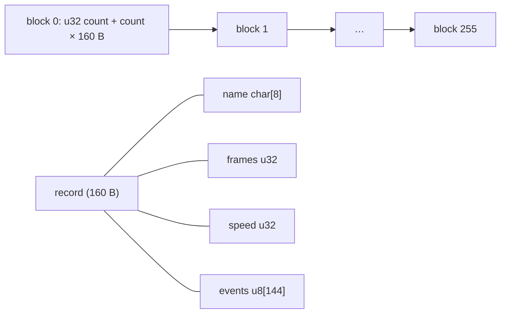

# Animation data (`animdata.d2`)

Owned by `archivist`. One file holds, for every unit animation (one COF name: unit token, mode token and weapon class),
its **frame count per direction**, its **speed** and **one event byte per frame**. Plan 0050 Phase 0 decodes it; what
the game does with it (the frame advance, the event codes, the rates) is plan 0050 Phase 1.1, and every statement
here about a meaning is `[L]` until a finding anchors it.

Parser: `tools/animdata.py` (`survey`, `dump`, `compare`, `dups`); gate survey `animdata`. **Sources: no lead; derived
from data.** No external document was fetched or read for this format and nothing is registered in
[sources.md](../sources.md) (ADR-0007). The field names are ours. Layout rows are `[C]` when `animdata.py survey`
reads every byte of the file that way with every check passing (evidence rules, data-format claims). No field has a
code anchor.

## Files

- `[C]` **Three copies in the archives** ([mpq](mpq.md)), all at `data/global/AnimData.D2`:

  | Archive | Bytes | Records | Names | sha256 |
  |---|---:|---:|---:|---|
  | `d2data` | 411 104 | 2 563 | 2 556 | `61aa9cd0…2d30d658` |
  | `d2exp` | 570 304 | 3 558 | 3 529 | `36cb704b85a7a4788533f12aa3e7c61c619dc650c8efa0cbd1d562446e1dab68` |
  | `patch_d2-classic` (not merged) | 570 304 | 3 558 | 3 529 | the d2exp hash |

  `patch_d2` (LoD) ships none. The merged tree's `data/global/animdata.d2` is d2exp's (`merged-manifest.tsv`).
- `[I]` **d2exp wins.** By the archive precedence (patch_d2 > d2exp > d2char > d2data,
  [mpq § Precedence](mpq.md#precedence-and-the-merged-tree), [data/0002](../findings/data/0002-mpq-precedence.md#answer-summary))
  the LoD game opens d2exp's copy. `[C]` The pinned `Game.exe` holds the string `%s\AnimData.d2` at `0x006EED5C`
  (`.rdata`, file offset `0x2EED5C`) and no string naming `EAnimData`; which code opens the file is plan 0050 Phase 1.1.
- `[C]` **d2data → d2exp.** Every one of d2data's 2 556 names is in d2exp; d2exp adds 973 names (the Assassin `AI` 139
  and Druid `DZ` 93, and expansion monsters and objects). Of the 2 556 shared names (first record of each), 3 change
  `frames` (`3DNUHTH` 16 → 1, `YKNUHTH` 13 → 20, `YOOPHTH` 19 → 10) and 1 changes `speed` (`3DNUHTH` 176 → 256); no event
  byte changes (`animdata.py compare`).
- `[C]` **`data/global/eanimdata.d2`** (d2exp, `EAnimData.D2`, 565 984 bytes, 3 531 records, 3 520 names, sha256
  `c910e23d…5420113c`) has the same layout. Every one of its names is in `animdata.d2` with the same frames, speed
  and events; `animdata.d2` adds 9 names (`K9` 6, `0J`, `41`, `44` one each). `[L]` Nothing names it in `Game.exe`;
  whether it is read is not known.

## Layout

Little-endian. The file is **256 blocks in order** and nothing else; block *b* is:

| offset | size | type | name | meaning | tag |
|---|---|---|---|---|---|
| `+0x00` | 4 | u32 | `count` | number of records in the block (0..67; 120 of the 256 blocks are empty) | `[C]` |
| `+0x04` | 160 × `count` | record[] | `records` | the block's records | `[C]` |

Each record, 160 bytes (`0xA0`):

| offset | size | type | name | observed | tag |
|---|---|---|---|---|---|
| `+0x00` | 8 | char[8] | `name` | the COF name in upper case (`L1OPHTH`), 7 characters in all 3 558 records, NUL padded (byte 7 is 0, no byte after the NUL is set) | `[C]` |
| `+0x08` | 4 | u32 | `frames` | 1..200: 1 ×924, 8 ×439, 16 ×224, 12 ×221, 10 ×200, 20 ×173 … | layout `[C]`, meaning `[L]` (below) |
| `+0x0C` | 4 | u32 | `speed` | 0..512, 41 distinct: 256 ×2 700, 128 ×149, 208 ×63, 168 ×57, 80 ×51 …; 0 in 4 records, 512 in 2 | layout `[C]`, meaning `[L]` |
| `+0x10` | 144 | u8[144] | `events` | one byte per frame: 0, 1, 2 or 3 | layout `[C]`, meaning `[L]` |

- `[C]` **The file is exactly the 256 blocks**: `sum(4 + 160 × count) = 570 304`, the file size; the same holds for the
  d2data copy and `eanimdata.d2`. A 1 024-byte header of 256 counts does not fit (the first u32 is block 0's count,
  `0x36` = 54, and record 0's name follows at offset 4).
- `[C]` **The block is a hash of the name**: every record sits in block `(sum of the name's bytes) & 0xFF`, the name as
  stored (upper case); 0 of 3 558 records elsewhere (`hash_bad=0`, all three files). `[L]` That the game looks a name up
  by this hash (upper-casing the COF name it builds, then scanning the block) is the obvious reading, not a finding.
- `[C]` **No event byte past the frame count**: in every record the bytes at index ≥ `frames` are 0
  (`ev_past_frames=0`). One record has more frames than event slots: `42DTHTH`, `frames` 200 (its 144 bytes are 0).
- `[C]` **Duplicate names.** 29 names are held by two records (always in the same block); 9 of them differ in content:
  `3DNUHTH` (frames 1/256 and 16/176), `64A1HTH` (speed 208 event at 16 / speed 200 event at 13), `64NUHTH`,
  `MINUHTH`, and the six `VM*` names `VMA1HTH`, `VMGHHTH`, `VMNUHTH`, `VMS1HTH`, `VMWLHTH` (different speeds) — the
  `VM` monster has two COF directories (`monsters/vm/cof/` and `monsters/vm/cof/vm/`, [cof](cof.md#files)) and `3D` is
  both a monster and an object token. `[L]` Which of two records the game takes is a code question (Phase 1.1).

### Event bytes

- `[C]` Values over the 3 558 records: **1 ×433, 2 ×148, 3 ×4**, no other non-zero value. 568 records have at least one
  (558 one, 9 two, 1 nine: `ANSCHTH`, Andariel's cast, frames 4..12 all 2). Value 3 is in `TES1HTH` (frame 3),
  `10A1HTH`, `10A2HTH` and `13A1HTH` (each with a 1 later in the same record).
- `[C]` Per player mode (records joined by class token, [anim survey](#tools)): `A1` 1 ×48 and 2 ×14, `A2` 1 ×46, `KK` 1
  ×62 (at frame 4, 5 or 6 by class), `TH` 2 ×24, `SC` 1 ×47 and 2 ×15, `S1` 1 ×42, `S2`..`S4` few, `GH` 1 ×4; in every class
  the bow and crossbow `A1` records (`<cls>A1BOW`, `<cls>A1XBW`) carry 2 where every melee weapon class carries 1.
- `[L]` An event byte marks the frame on which the mode's action happens. [skills/0001 § 5](../findings/skills/0001-dispatch.md#5-the-frame-when-the-do-function-runs)
  `[I]` has the player's frame function run the skill's do function on an **event code** of 1 or 2; the 1 = melee,
  2 = missile reading of these bytes (bows 2, swings 1) fits that, but which frame delivers which code is plan 0050
  Phase 1.1's.

### Speed

- `[L]` `speed` is the animation's rate in 1/256 frames per game frame (256 = one animation frame per game frame), by the
  value distribution (256 the most common; the player classes' `NU` records 96..184 and `TN` 64..128, the attack, kick
  and cast records mostly 256, with exceptions such as the Druid's `SC` 208 and the Assassin's claw (`ht1`/`ht2`)
  `A1`/`A2` 208; the full list is `anim_survey.py players`). Not anchored. The four records with
  speed 0 (`CODTHTH`, `VHNUHTH`, `VJNUHTH`, `R7DDHTH`) all have 1 frame.

## Lookup by name

The name is the COF name: unit token (2 characters), mode token (2) and weapon class (3), as the COF files
([cof § Files](cof.md#files)) are named. `[C]` 3 500 of the 3 529 names have a `.cof` of the same name under
`data/global/` (`chars` 756, `monsters` 1 287, `objects` 1 457); 29 names have none (`BX*` 10, `MI*` 8, `YH`/`YJ`/`YK`
`NU`/`ON`/`OP` 9, `9BNUHTH`, `O0NUHTH`), and 3 `.cof` names have no record (`2QONHTH`, `2QOPHTH`, `OYTNHTH`). How the
tables' tokens build these names for each unit type is the [anim survey](#tools) (players, monsters, objects); the
game's own rule and its fallback when no record exists are plan 0050 Phase 1.1.

## Tools

- `python3 -I tools/animdata.py survey workspace/merged`: parses the merged file, checks the block sum, the NUL padding,
  the hash block of every record and the event bytes past `frames`, prints the histograms above and the COF join
  ([cof § animdata](cof.md#animdatad2-against-the-cof-fields-data-only)), and ends with
  `SURVEY animdata records=3558 blocks=256 empty_blocks=120 names=3529 dup_names=29 dup_differ=9 hash_bad=0 errors=0 frames_max=200 frames_over_144=1 speed_distinct=41 speed_zero=4 ev1=433 ev2=148 ev3=4 ev_other=0 ev_past_frames=0 recs_with_events=568 cof_files=3512 cof_join=3500 rec_no_cof=29 cof_multi=30 cof_no_rec=3 cof_frames_eq=3500 cof_events_eq=3500 cof_rate_eq=3500`
  (the gate baseline). Exit 0 iff `errors` = 0. Under a second.
- `python3 -I tools/animdata.py dump <file.d2> [NAME …]`: one line per record (block, slot, frames, speed,
  `frame:byte` events).
- `python3 -I tools/animdata.py compare <a.d2> <b.d2>`, `dups <file.d2>`: the archive comparison and the duplicate list above.
- `python3 -I tools/anim_survey.py <section> workspace/merged` (gate survey `anim`): the tables' tokens joined with
  these records ([MonSeq](../tables/MonSeq.md), [PlrMode § Timing](../tables/PlrMode.md#timing-plan-0050-phase-0),
  [MonStats § Timing](../tables/MonStats.md#timing-plan-0050-phase-0), [Objects § Timing](../tables/Objects.md#timing-plan-0050-phase-0)).
  Sections `players`, `monsters`, `objects`, `skills`, `monseq`; `summary` ends with the gate baseline
  `SURVEY anim plr_classes=7 plr_class_modes=126 plr_records=756 plr_joined=755 plr_unjoined=1 plr_modes_none=0 mon_rows=734 mon_modes=5109 mon_hit_basew=5057 mon_hit_hth=52 mon_miss=0 mon_msq=492 mon_records_used=1143 obj_rows=573 obj_modes=1603 obj_hit=1483 obj_miss=120 obj_framecnt_eq=1173 obj_framedelta_eq=609 obj_framecnt_gt=2 obj_sync=348 obj_sync0_draw_rows=216 obj_sync0_draw_modes=393 obj_cycleanim=380 sk_rows=357 sk_anim=334 sk_anim_sq=116 sk_monanim=357 sk_monanim_xx=214 sk_seqtrans=334 sk_seqnum=34 sk_seqnum_distinct=23 sk_seqnum_nonsq=6 sk_seqinput=4 sk_delay=23 sk_perdelay=22 isc_updateanimrate=3 rate_stat_skill_cells=33 rate_stat_states=7 seq_rows=1010 seq_sequences=60 seq_events=160 seq_event1=118 seq_event2=24 seq_event3=4 seq_event4=14 seq_dir_set=0 seq_users=319 seq_used=54 seq_user_frames_checked=5408 seq_user_frame_past_record=249 seq_user_no_record=0 seq_ev_same_set=81 seq_ev_same_zero=4354 seq_ev_seq_only=559 seq_ev_rec_only=153 seq_ev_both_differ=12`.
  Under a second.
- `animdata.load(path)`, `animdata.lookup(recs, name)`, `animdata.name_hash(name)` (library functions).

## Open questions

- `[L]` How the game builds the name for each unit type, uses the hash, picks between two records of one name, and
  falls back when no record exists; what `frames`, `speed` and the event values 1, 2, 3 do in the frame advance;
  whether `eanimdata.d2` is read. Plan 0050 Phase 1.1.
