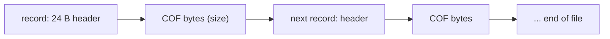

# COF bundles (`chars_cof.d2`, `cmncof_a1..a7.d2`)

Owned by `archivist`. Tooling only (ADR-0005): no research-map row, no spec. A bundle is a flat concatenation of
[COF](cof.md) files, each behind a 24-byte record header holding its 7-character name, so that the client reads one
file per act instead of hundreds of loose `.cof` files. **Sources: no lead; derived from data**, with the loader's
layout taken from the reverser's finding [data/0006 § 4](../findings/data/0006-loaded-tables-and-bundles.md#4-the-cof-bundles-plan-item-4)
(the layout statements marked "finding" below come from it, not from this lane's own decompilation; the data statements
are this lane's survey). Nothing is registered in [sources.md](../sources.md) (ADR-0007). The field names are ours.

Parser: `tools/cofbundle.py` (`survey`, `dump`); it reuses `tools/cof.py` for the embedded COFs. Survey line, registered
in the full-tier gate as `cofbundle`:
`SURVEY cofbundle files=8 records=6726 errors=0 cof_errors=0 leftover_bytes=63 dup_names=0 rt_other=0 name_pad_nonzero=0 upper_names=0`
(exit 0).

## Files

- `[C]` Eight files in `data/global/` of the merged tree: `chars_cof.d2` (1 278 822 B, 754 records) and
  `cmncof_a1..a7.d2` (records 809, 791, 1 281, 660, 789, 650, 992; sizes 135 560, 133 038, 190 815, 113 898, 79 910,
  94 111, 94 903 B), 6 726 records in all. Every file ends exactly at the end of its last record.
- `[I]` Which the game opens (finding, § 4): the client at an act load opens `cmncof_a1..a4.d2` and `cmncof_a6.d2`
  (act index 0..4 maps to a1, a2, a3, a4, a6); `chars_cof.d2`, `cmncof_a5.d2` and `cmncof_a7.d2` are named nowhere in
  the image (0 occurrences of each name, any case). The parsed records go into the client's COF cache only
  (`g_ClientCofCache`, 0x007A78F0): the server never reads a bundle, so no mode length or event frame comes from one
  (they come from `animdata.d2`, [animdata.md](animdata.md)). Presentation.

## Layout

No file header. Records back to back to the end of the file. Little-endian.

| offset | size | type | name | observed | tag |
|---|---|---|---|---|---|
| `0x00` | 4 | u32 | `next` | `0xFFFFFFFF` in all 6 726 records; a runtime link slot, the loader overwrites it (finding) | `[C]` data, `[I]` meaning |
| `0x04` | 4 | u32 | `flags` | 0 in all records; a runtime slot, the loader clears it | `[C]` data, `[I]` meaning |
| `0x08` | 4 | u32 | `size` | bytes of COF that follow the header; 39 to 3 196 | `[C]` |
| `0x0C` | 8 | char[8] | `name` | the COF's name without `.cof`: always 7 characters (`<token><mode><wclass>`, as [cof.md](cof.md)), lower case, then a NUL (0 non-zero padding bytes); never a repeat inside one file | `[C]` |
| `0x14` | 4 | u32 | `data` | `0xFFFFFFFF` in all records; a runtime slot, the loader sets it to the record `+0x18` | `[C]` data, `[I]` meaning |
| `0x18` | `size` | COF | `cof` | one COF file, exactly [cof.md](cof.md)'s layout | `[C]` |

- `[C]` The next record starts at `offset + 0x18 + size`. The walk from 0 reaches the end of all eight files exactly,
  with no gap and no trailing bytes (`errors=0`).
- `[I]` The loader (fn:sub_0046DDF0_CofBundleParse@0x0046DDF0, finding § 4) refuses a name longer than 7 characters
  (source line 0x79) and a COF whose byte 2 (directions) is above 0x40 (line 0x126); the data stays inside both
  (all 6 726 names have 7 characters; directions are 1 in 4 902 records, 8 in 1 055, 16 in 761, 4 in 8).
- `[I]` There is no on-disk index: the loader links each record into one of 512 hash buckets of the cache (at cache
  `+0x0C`) by a hash of its name (`0x00413CE0`, folded to 9 bits), so a lookup is by name, and the file order carries no
  meaning the game uses.
- `[C]` Each embedded COF parses with `cof.parse` in all 6 726 records (`cof_errors=0`). The `leftover_bytes=63` is
  21 records: `f9onhth`, `f9ophth` and `f9nuhth`, the three `objects/f9` COFs with 3 unexplained bytes after the frame
  bytes ([cof.md](cof.md) § Three files with 3 extra bytes), each in seven of the eight bundles.

## Content against the loose files

All counts `[C]`, from `tools/cofbundle.py survey` over `workspace/merged` (a name is looked up in the loose `.cof`
files of the merged tree; a record matches when some loose file of that name has the same bytes).

- `[C]` 2 516 distinct names; 1 287 occur in one bundle, the rest in 2 to 7 (the common monster and object COFs repeat
  in every act bundle).
- `[C]` 6 597 records are byte-identical to the loose `.cof` of the same name, 93 differ, 36 have no loose file.
  `chars_cof.d2`'s 754 records are 685 identical and 69 different from the loose ones (the loose `chars` set has 756;
  `ai` 138 of 139 and `dz` 92 of 93 are in the bundle).
- `[C]` Against `animdata.d2`'s record of the same name every one of the 6 726 has a record. 6 715 have the same frames
  per direction; 11 differ (`aia1ht1`, `aia1hth` 12 against 11; `yoophth` 19 against 10; `3dnuhth` 16 against 1;
  `yknuhth` 13 against 20, some in several bundles). 6 724 have the same event frames (the COF's non-zero frame bytes
  against `animdata`'s event bytes); 2 differ (`aia12ht`, `aia22ht`: `animdata` has event 1 at frame 10, the COF none).
  `python3 -I tools/cofbundle.py survey workspace/merged --list` prints each.
  What the differences mean is not known: the client draws from the bundle and the server times from `animdata.d2`.
  `[L]`

## Open questions

- `[L]` Why `chars_cof.d2`, `cmncof_a5.d2` and `cmncof_a7.d2` ship unused, and how the 93 differing and 36
  loose-less COFs came to be: nothing in the data says. No rule depends on it.
