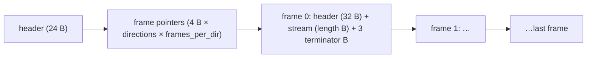

# DC6 sprites (`.dc6`)

Owned by `archivist`. Tooling only (ADR-0005): no research-map row, no spec. A DC6 file holds one
or more pre-rendered 8-bit palettized frames, arranged as `directions × frames_per_dir`: inventory
icons and item-drop animations, UI panels and buttons, front-end screens, fonts, cursors and a few
monster and object overlays. Pixels are palette indices ([palette.md](palette.md)), run-length
encoded per row.

Parser: `tools/dc6.py` (`survey`, `dump`, `rows`, `render`). The layout was derived from the data: the
parser reads every file and the pieces tile each file with no gap, overlap or leftover byte. No
external source was consulted for this format (nothing to register in
[sources.md](../sources.md)). The field names are ours. A layout row is `[C]` when `dc6.py survey`
reads all 1 681 files that way and the values make sense (evidence rules, data-format claims). No
field has a code anchor. Rendered images are not evidence.

**Scope of the tags.** A `[C]` here describes the **encoding** only. How the game draws a frame
(offset use, flip, palette, blending) is code behaviour and stays `[L]`.

## Files

- `[C]` **1 681** `.dc6` files under `data/` in `workspace/merged/`, 97 978 980 bytes in total:
  `global/items` 737, `global/ui` 495, `local/ui` 354, `global/monsters` 56, `local/font` 14,
  `global/objects` 13, `global/uncompoverlays` 11, `global/overlays` 1.
- `[C]` `dc6.py survey` over all of them:
  `SURVEY dc6 files=1681 frames=24532 errors=0 leftover_bytes=0` (exit 0). The five
  `global/items/inv{toa,tes,ceh,bet,fed}.dc6` from `patch_d2` joined on 2026-10-11 once named
  ([mpq.md](mpq.md)); before that it read `files=1676 frames=24527`. Each is one 28×28 frame with
  terminator 0 and a valid `next_block`, and the counts below include them.

## Layout

Little-endian. Offsets from the start of the file.

### File header (24 bytes)

| offset | size | type | name | observed | tag |
|---|---|---|---|---|---|
| `0x00` | 4 | s32 | `version` | 6 in all 1 681 files | `[C]` |
| `0x04` | 4 | s32 | `flags` | 1 in all files | layout `[C]`, meaning unknown |
| `0x08` | 4 | s32 | `encoding` | 0 in all files | layout `[C]`, meaning unknown |
| `0x0C` | 4 | u32 | `terminator` | `0xEEEEEEEE` 1 182, `0xCDCDCDCD` 401, `0x00000000` 93 | layout `[C]`, meaning `[L]` (below) |
| `0x10` | 4 | s32 | `directions` | 1 in 1 645 files; 8 in 34 (`global/monsters`), 4 in 1 (`global/items/flpgld.dc6`), 16 in 1 (`global/monsters/mp/s1/mps1lita2hth.dc6`) | `[C]` |
| `0x14` | 4 | s32 | `frames_per_dir` | 1..1 499 | `[C]` |

### Frame pointer table

| offset | size | type | name | meaning | tag |
|---|---|---|---|---|---|
| `0x18` | 4 × n | u32[n] | `frame_ptr` | n = `directions × frames_per_dir`, direction-major (frame `i` is direction `i / frames_per_dir`, frame `i % frames_per_dir`). Offset of each frame header | `[C]` |

- `[C]` In every file the frames are stored in pointer order and back to back: `frame_ptr[0]` is
  `0x18 + 4n`, and each next pointer is the end of the previous frame's terminator bytes.

### Frame header (32 bytes, at each `frame_ptr`)

| offset | size | type | name | observed | tag |
|---|---|---|---|---|---|
| `0x00` | 4 | s32 | `flip` | 0 (24 387 frames), 1 (140) | layout `[C]`, meaning `[L]` (row order, below) |
| `0x04` | 4 | s32 | `width` | 1..319 | `[C]` |
| `0x08` | 4 | s32 | `height` | 1..256 | `[C]` |
| `0x0C` | 4 | s32 | `offset_x` | −287..62 | layout `[C]`, meaning `[L]` (draw offset) |
| `0x10` | 4 | s32 | `offset_y` | −228..169 | layout `[C]`, meaning `[L]` (draw offset) |
| `0x14` | 4 | s32 | `unk_14` | 0 in every frame | layout `[C]`, meaning unknown |
| `0x18` | 4 | u32 | `next_block` | file offset of the next frame (= end of this frame's terminator bytes) in 1 400 files; **not** an offset in the other 281 (below) | layout `[C]`, value `[C]` as stated |
| `0x1C` | 4 | s32 | `length` | byte length of the pixel stream that follows | `[C]` |

- `[C]` `flip` is 1 only in the four inventory-background files `global/items/inv1x1.dc6`,
  `inv1x2.dc6`, `inv2x2.dc6` and `inv2x3.dc6` (50 + 7 + 25 + 58 frames), and 0 everywhere else.
- `[C]` **`next_block` is unreliable.** In 281 files (all with `terminator = 0xEEEEEEEE`) it holds a
  value that is not a file offset in **every** frame: 4 816 frames, values like `0x006F007C`,
  `0x006F00A8`, `0x0070007C`, … stepping by 0x2C within a file. These files are mostly the
  item-drop animations (`global/items/flp*.dc6`), plus UI panels, cursors, hireables, char-select
  and `local/ui/eng` files. The parser does not use `next_block`: frame positions come from
  `frame_ptr`, and frame ends from `length`.
- `[L]` The `next_block` values look like stale memory left by the tool that wrote the files. Data
  only, no code anchor.
- `[C]` Frame sizes: the most common are 8×16 (1 503 frames) and 16×32 (1 500), 72×86
  (783), 2×2 (553), 48×48 (543), 9×11 (523), 200×200 (482) and 256×256 (279, full-screen backgrounds
  cut into 256-pixel tiles). No frame has a zero width or height.

### Pixel stream (`length` bytes after the frame header)

One control byte at a time, rows in stream order:

| byte `b` | meaning | tag |
|---|---|---|
| `0x80` | end of the current row; the next byte starts a new row | `[C]` |
| `0x81..0xFF` | skip `b & 0x7F` pixels (transparent, left as index 0) | `[C]` |
| `0x00..0x7F` | literal run: the next `b` bytes are palette indices | `[C]` |

- `[C]` In all 24 532 frames the stream ends exactly at `length` on an end-of-row byte, contains
  exactly `height` end-of-row bytes, and no row is wider than `width`.
- `[L]` A row shorter than `width` is padded with transparent pixels on the right. This is the
  renderer's convention (`dc6.frame_pixels`), not something the data or code pins down.
- `[C]` **Row order, `flip` = 0: stream row 0 is the bottom row of the image** (encoding claim).
  Data-only check, `dc6.py rows workspace/merged`, assuming glyph frame index = character code
  (consistent with the glyph shapes). In all 14 `local/font/latin` fonts (every frame `flip` = 0),
  the widest row of `T` (its bar) has a higher stream index than the widest row of `L` (its foot),
  for example `font8.dc6` T = 9, L = 2 of 14 rows. In the 7 fonts with true descenders (`font6`,
  `font8`, `fontformal10`–`12`, `fontingamechat`, `reallythelastsucker`) all five of `g j p q y` have
  ink in a lower stream row than any of `a c e m n o r s u v w x z`; the other 7 (`font16`–`42`,
  `fontexocet8`/`10`, `fontridiculous`) are inconclusive on that test and none contradicts it.
  Result line: `ROWS dc6 fonts=14 t_above_l=14 descenders_ok=7 descenders_inconclusive=7
  descenders_contradict=0` (exit 0). Top-down storage would invert both tests in every font.
- `[L]` With `flip` = 1 stream row 0 is the top row. The only basis is renders of the four
  inventory-background files; no data check fixes it. How the game draws either case is code.
- `[L]` Index 0 is drawn as transparent (palette.md).

### Frame terminator (3 bytes after each stream)

- `[C]` Every frame's stream is followed by exactly **3** bytes that belong to no field, and the last
  frame's 3 bytes end the file (no leftover byte in any file).
- `[C]` Their value is the header `terminator` byte repeated (`EE EE EE`, `CD CD CD` or `00 00 00`) in
  24 052 of 24 532 frames. In 173 frames they are `00 00 00` under a non-zero header terminator, and
  in 307 frames (59 files, mostly `local/ui/*` and `global/ui/*`) they are other values (`00 00 0F`,
  `0F 10 02`, `D2 D2 D2`, … 149 distinct triples overall).
- `[C]` The parser never needs these bytes to find a frame end (frame ends come from `length`), and
  their content is not constant (counts above).
- `[L]` They are padding the game does not read, not an end marker. `0xCDCDCDCD` and `0xEEEEEEEE`
  are common debug-heap fill patterns, which fits stale fill bytes; the header `terminator` field
  would then be the same fill. Data only; whether the game reads either would need code.

## Survey histograms

`[C]` From `dc6.py survey` (all files, top entries):

- **directions × frames_per_dir:** 1×1 705, 1×2 291, 1×17 258 (mostly item-drop animations `flp*`), 1×4 59,
  1×3 43, 1×12 36, 1×30 36, 1×27 29, 1×6 23, 1×8 20, 1×256 15, …; 36 files have more than
  one direction.
  58 distinct shapes.
- **frames per file:** 1 → 705 files, 2 → 291, 17 → 258; the largest are 1 499
  (`global/ui/automap/maximap.dc6`, `maximaps.dc6`), then 272 (16 × 17) and 256 (15 files, mostly `local/font/latin`).
- **frame width:** 1 14, 2–3 583, 4–7 709, 8–15 5 150, 16–31 5 349, 32–63 4 361, 64–127 5 251,
  128–255 2 340, 256–319 770.
- **frame height:** 1 16, 2–3 599, 4–7 908, 8–15 3 640, 16–31 5 730, 32–63 4 457, 64–127 4 472,
  128–255 4 282, 256 423.

## Which palette (renderer heuristic)

Which palette the game uses for a DC6 is code behaviour and stays `[L]`. `dc6.palette_for_dc6()`
uses `loading` for `global/ui/loading/` and `units` for everything else; `render --palette P`
overrides it. The choice rests on the by-eye checks below (plan 0006 log, 2026-10-11), which are
sanity checks, not evidence:

| asset group (sampled) | looks right with | looks wrong with |
|---|---|---|
| inventory icons (`global/items/inv*`: ring mail, cap, axe, bow, potions, gem, bone shield) | `units`; `act1` and `act3` look the same | `menu0` |
| in-game panels (`ui/panel/invchar6`, `800ctrlpnl7`, `hlthmana`, `ui/menu/questbackground`) | `units`, `act1` | `menu0` |
| loading screen (`ui/loading/loadingscreen`) | `loading` | `units`, `sky`, `static`, `menu0`, `trademark` |
| front-end backgrounds (`frontend/gameselectscreenexp`, `charselect/charselectbckg`) | `units` plausible; `sky` gives a bluer night scene; undecided | `static`, `menu0`–`menu4`, `trademark`, `fechar`; `act5` on the game-select scene |
| fire logo (`frontend/d2logofireleft`), `local/ui/eng/exitd2`, `frontend/blizz` | `units`, `sky`, `act1`, `act5` | `menu1`–`menu4`, `fechar` |

## Tools

- `python3 -I tools/dc6.py survey workspace/merged`: parses every file, decodes every stream,
  prints the histograms above and the `SURVEY` line. Exit 0 only with 0 errors and 0 leftover bytes.
- `python3 -I tools/dc6.py dump <file.dc6>`: header and frame headers of one file.
- `python3 -I tools/dc6.py rows workspace/merged`: the row-order check on the 14 fonts (one line
  per font, then the `ROWS` line). Exit 0 only if T/L passes in every font, at least one font passes
  the descender test and none contradicts it.
- `python3 -I tools/dc6.py render workspace/merged [out] [--palette P] [--only SUBSTR]`: one PNG per
  frame at `<out>/dc6/<path>/<dir>_<frame>.png`, where `<path>` is the file path under `data/`
  without the extension, lower-case (default `<out>` is `workspace/render`). Index 0 is transparent.
  `render_all.py` runs it as the `dc6` step. `--shift FILE:COLOUR` applies one item colour shift
  before the palette lookup and writes to `<path>@<FILE>-<COLOUR>/` ([item-palette.md](item-palette.md)).
