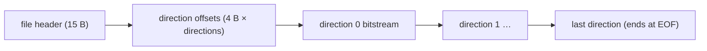
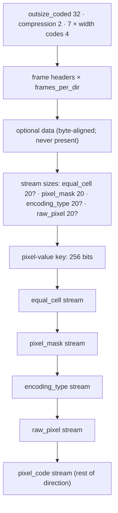

# DCC animations (`.dcc`)

Owned by `archivist`. Tooling only (ADR-0005): no research-map row, no spec. A DCC file holds one
animation of one unit layer: player-class component layers (`global/chars`), monsters, objects,
missiles and overlays. It stores `directions × frames_per_dir` frames of 8-bit palette indices
([palette.md](palette.md)), compressed per direction as a set of LSB-first bitstreams that fill a
grid of 4×4 pixel cells.

Parser: `tools/dcc.py` (`survey`, `mutations`, `dump`, `render`). **Provenance (corrected
2026-10-11):** the bitstream description below was recalled from an **unidentified** community
source. It was first attributed to `src:siramy-dcc`, but that PDF is a tutorial with no bitstream
content. The document it credits (`src:belchev-dcc`) was not found. See
[sources.md](../sources.md). Every step was then checked against all 21 717 files (12 233 before `d2char` was merged). The field names
are recalled community terminology, source unidentified.

**What the tags mean here** (evidence rules, data-format claims):

- A layout row is `[C]` when `dcc.py survey` reads all 21 717 files that way and every fixed-size
  stream ends exactly at its stated bit length (below). Bit accounting pins *how many bits* each step
  reads. The variable-length pixel-code stream has no length field, so it is pinned by a tighter
  check: in all 271 176 directions the decode leaves 0–7 bits, never 8 or more, at the end of the
  direction (byte padding).
- A rule is pinned by the accounting only if a wrong variant of it breaks the accounting.
  `dcc.py mutations` decodes every direction with each wrong variant (counts below). The stage 1
  slot order and mask-bit-to-slot mapping look like pixel-value rules, but stage 2 picks its bit
  cost by comparing slots, so a wrong order changes bit counts and fails. They are `[C]`.
- A rule whose wrong variants cost the same bits cannot be pinned this way: the equal-cell copy, the
  within-cell scan order, the canvas orientation, and the key-bit-to-palette mapping and its order.
  Those rules are `[L]`. Their only support is that renders look right, and renders are not
  evidence. None has a lead (ADR-0007): no lead; derived from data.
- What a field *means* to the game (draw offset, how frames are composed) is code behaviour. It stays `[L]`.
  No field has a code anchor.

## Files

- `[C]` **21 717** `.dcc` files under `data/` in `workspace/merged/`, 600 830 314 bytes in total:
  `global/chars` 14 421 (`ai` 2 470, `am` 1 855, `ba` 2 582, `dz` 2 214, `ne` 1 668, `pa` 1 963,
  `so` 1 669), `global/monsters` 4 773, `global/objects` 1 748, `global/missiles` 391,
  `global/overlays` 384.
- `[C]` Since plan 0009 Phase 1 (2026-10-11) the merged tree includes `d2char.mpq` ([mpq.md](mpq.md)),
  which adds 9 484 DCCs (the classic classes `am`, `ba`, `ne`, `pa`, `so`). Before that the tree held
  12 233 files, 333 684 297 bytes (`global/chars` 4 937).
- `[C]` `dcc.py survey` over all of them (exit 0):
  `SURVEY dcc files=21717 directions=271176 frames=3305132 errors=0 leftover_bits=0`, key 1..205
  entries. Before `d2char` was merged it read `files=12233 directions=119448 frames=1396764`, same
  errors and leftover bits.
- `[C]` **Scope of the counts below.** The per-field distributions (header fields, `outsize_coded`,
  `compression`, field-width combinations, `variable0`, pixel-code tail bits, key index 0) are
  re-tallied by `dcc.py survey` over all 21 717 files / 271 176 directions (2026-10-11, plan 0009 P1
  review). The **`dcc.py mutations` counts** (*Stage 1* note and *Mutation check*) are still those
  of the **12 233 files / 119 448 directions before `d2char` was added**; a rerun over the full tree
  is in the backlog. The layout and the bit accounting hold for all 21 717 files.

## Layout



### File header (15 bytes, little-endian, unaligned)

| offset | size | type | name | observed | tag |
|---|---|---|---|---|---|
| `0x00` | 1 | u8 | `signature` | `0x74` in all files | `[C]` |
| `0x01` | 1 | u8 | `version` | 6 in all files | `[C]` |
| `0x02` | 1 | u8 | `directions` | 16 (14 483 files), 8 (4 361), 1 (2 768), 4 (56), 32 (49) | `[C]` |
| `0x03` | 4 | u32 | `frames_per_dir` | 1..200 (200 in 2 files); 8 is the most common (4 713 files), then 16 (2 756), 12 (1 856); 57 distinct values | `[C]` |
| `0x07` | 4 | u32 | `tag` | 1 in all files | layout `[C]`, meaning unknown |
| `0x0B` | 4 | u32 | `total` | equals neither the sum of the directions' `outsize_coded` (no file) nor the sum of frame areas (1 file) | layout `[C]`, meaning unknown |
| `0x0F` | 4 × n | u32[n] | `dir_offset` | n = `directions`. File offset of each direction's bitstream | `[C]` |

- `[C]` `dir_offset[0]` = `0x0F + 4n`. Each direction runs to the next offset, and the last one runs
  to end of file. No byte lies outside a direction.

### Direction bitstream

The bits are read **LSB first**: bit 0 of byte 0 comes first, and a multi-bit field takes its low bit first `[C]`.
All of the direction is one bit space, and its streams follow each other with no alignment.



**Direction header**

| bits | name | observed | tag |
|---|---|---|---|
| 32 | `outsize_coded` | equals the sum of frame areas in 120 of 271 176 directions | layout `[C]`, meaning unknown |
| 2 | `compression` | 0: 91 238 directions, 3: 81 680, 2: 65 805, 1: 32 453 | `[C]`. Bit 1 = an `equal_cell` stream is present; bit 0 = `encoding_type` and `raw_pixel` streams are present |
| 4 × 7 | width codes | for the seven frame fields below, in order; each code `c` maps to a bit width `WIDTHS[c]` | `[C]` |

`WIDTHS = (0, 1, 2, 4, 6, 8, 10, 12, 14, 16, 20, 24, 26, 28, 30, 32)` `[C]`. A width of 0 means the field is
absent and reads as 0. In 460 distinct combinations, `variable0` and `optional_bytes` always have width 0.

**Frame header** (`frames_per_dir` times, fields at the widths above)

| field | signed | observed | tag |
|---|---|---|---|
| `variable0` | no | 0 in all 3 305 132 frames | layout `[C]`, meaning unknown |
| `width` | no | > 0 in every frame | `[C]` |
| `height` | no | > 0 in every frame | `[C]` |
| `offset_x` | yes (two's complement at its width) | | layout `[C]`; as the frame's left edge in the direction box `[C]` (it fixes the cell grid, below); as a draw offset `[L]` |
| `offset_y` | yes | | layout `[C]`; as the frame's bottom row (`bottom_up` = 0) `[C]` (same reason); as a draw offset `[L]` |
| `optional_bytes` | no | 0 in every frame | layout `[C]` |
| `coded_bytes` | no | non-zero in every frame | layout `[C]`, meaning unknown |
| `bottom_up` (1 bit) | | 0 in every frame | layout `[C]`; how a 1 would change the box is from `src:siramy-dcc`, no sample, `[L]` |

- Frame box: `xmin = offset_x`, `xmax = xmin + width − 1`. With `bottom_up` = 0, `ymax = offset_y` and
  `ymin = ymax − height + 1`. `[C]`: the box sets the cell split, which the bit counts pin (below).
- `[L]` **Optional data** (`src:siramy-dcc`). If any frame's `optional_bytes` is non-zero, the stream pads to a byte boundary and
  then reads those bytes, frame by frame. `[C]` No direction has any, so this branch has no sample.

**Stream sizes and key**

| bits | name | present when | tag |
|---|---|---|---|
| 20 | `equal_cell_bits` | `compression & 2` | `[C]` |
| 20 | `pixel_mask_bits` | always | `[C]` |
| 20 | `encoding_type_bits` | `compression & 1` | `[C]` |
| 20 | `raw_pixel_bits` | `compression & 1` | `[C]` |
| 256 | pixel-value key | always | width `[C]`, and every stage 1 value is below the number of set bits `[C]`. That bit `i` stands for palette index `i`, and that the set indices form the key list in ascending order, is `[L]` (renders only; reversing the order costs no bits) |

- `[C]` Then the four sized streams follow in that order, each exactly as long as stated, and the
  `pixel_code` stream is the rest of the direction.
- `[C]` In every direction, `equal_cell`, `pixel_mask`, `encoding_type` and `raw_pixel` are
  consumed to **exactly** their stated length. The `pixel_code` tail is 0..7 bits in all 271 176
  directions (0: 35 595, 1: 32 128, 2: 36 942, 3: 31 568, 4: 35 278, 5: 31 177, 6: 37 167, 7: 31 321),
  which is byte padding at the direction's end.
- `[C]` The key has 1..205 entries (`survey` prints the exact minimum and maximum). It holds index 0 in 271 171 directions and lacks it in 5.

### Cell grid

- `[C]` The **direction box** is the union of the frame boxes. It is cut into a grid of
  `ceil(w/4) × ceil(h/4)` cells, aligned on the box's top-left corner.
- `[C]` A **frame** is cut along the same grid lines, per axis. Take `s` as the frame's start
  relative to the box and `n` as its size. The first cell is `4 − s mod 4` wide. If `n` minus that is
  at most 1, the frame is one cell `n` wide. Otherwise cells of 4 follow, and the last cell takes the
  remainder; when the remainder after the full cells would be 1, that pixel joins the cell before it,
  so a last cell can be 5 wide. Frame cells run row by row, top to bottom and left to right. Each frame cell belongs to the
  direction cell holding its top-left pixel.
  This split is `[C]`: it sets how many bits stage 2 reads, and any other split desyncs the stream.

### Stage 1: cell values

The stage walks frames in order, and within each frame its cells in order. Each direction cell
remembers the last 4-value entry written to it, starting with none.

```
for each frame cell (direction cell ci):
    if ci has an entry:
        if equal_cell stream present and read 1 bit from equal_cell == 1:
            cell is EQUAL (no entry this frame); continue
        mask = read 4 bits from pixel_mask
    else:
        mask = 0xF
    n = popcount(mask)
    raw = (n > 0 and encoding_type present) ? read 1 bit from encoding_type : 0
    got = []; last = 0
    repeat n times:
        if raw: v = read 8 bits from raw_pixel
        else:   v = last; do { d = read 4 bits from pixel_code; v += d } while d == 15
        if v == last: stop                      # a repeat ends the list early
        got.append(v); last = v
    new entry: for slot i in 0..3:
        if mask bit i: take got from the END (last decoded first); 0 once got runs out
        else: keep slot i of the old entry
```

- `[C]` The reads and their order: the `equal_cell` bit only for a cell that already has an entry,
  the 4-bit mask, the 1-bit encoding type when `n > 0`, the 8-bit raw values or the 4-bit
  displacements continued while the nibble is 15, and the early stop on a repeat. Every fixed stream
  ends exactly at its length only when these are right.
- `[C]` Which slot gets which value (newest first) and the slot-to-mask-bit mapping (bit `i` = slot
  `i`). Stage 2 picks its bit cost from slot comparisons, so either wrong variant breaks the accounting:
  `slot_from_start` fails in 78 456 directions and `mask_bits_reversed` in 109 813 (`dcc.py mutations`,
  over the 119 448 pre-`d2char` directions).
- `[C]` Every value is a valid index into the key (checked in every entry).

### Stage 2: pixels

Stage 2 reads the `pixel_code` stream on from where stage 1 stopped. A direction-sized canvas
persists across frames. For each frame, cells in the same order:

```
if cell is EQUAL:
    if its size equals the size this direction cell had when last drawn:
        copy those pixels from where they were last drawn
    else: clear the cell to 0
else with entry v (4 key indices), colours c = key[v[i]]:
    if v[0] == v[1]: fill the cell with c[0]                        # no bits
    else: bits = 1 if v[1] == v[2] else 2
          for each pixel, row by row, left to right: c[read bits from pixel_code]   # scan order [L]
record the cell's position and size
frame image = canvas cropped to the frame box
```

- `[C]` The bit cost: no bits when `v[0] == v[1]`, 1 bit per pixel when `v[1] == v[2]`, else
  2 bits per pixel, over the cell size from the grid. This is pinned by the `pixel_code` tail landing
  in 0..7 bits in every direction.
- `[L]` The scan order within a cell (row by row, left to right). Column order costs the same bits
  (`scan_column_major` fails in 0 directions). No lead; derived from data.
- `[L]` The equal-cell copy, and clearing on a size change. These cost no bits
  (`equal_clear_always` fails in 0 directions) and rest on renders. No lead; derived from data.
- `[L]` Image orientation: canvas row 0 is the top row (`ymin`). Renders read right way up. No
  lead; derived from data.
- `[L]` Index 0 is drawn as transparent (palette.md).

## Mutation check

`[C]` `dcc.py mutations` decodes all 119 448 directions of the pre-`d2char` tree (12 233 files; not
yet rerun over the 271 176 of the current tree, see the backlog) once with the documented decoder and once
with each deliberately wrong rule, and counts the directions whose bit accounting then fails (a
fixed stream not consumed exactly, a read past a stream end, or a `pixel_code` tail of 8+ bits):

| variant | what it changes | failing directions |
|---|---|---|
| base | nothing | 0 |
| `slot_from_start` | stage 1 fills mask slots oldest value first | 78 456 |
| `mask_bits_reversed` | mask bit `3 − i` selects slot `i` | 109 813 |
| `fill_rule_v2v3` | single-colour test on `v[2] == v[3]` | 116 049 |
| `nbit_rule_v2v3` | 1-bit test on `v[2] == v[3]` | 114 400 |
| `no_absorb_split` | cell split without the 1-pixel absorption | 106 170 |
| `offset_y_top` | `offset_y` read as the top row | 100 743 |
| `no_early_stop` | stage 1 without the stop on a repeated value | 119 437 |
| `equal_clear_always` | equal cells always cleared, never copied | 0 |
| `scan_column_major` | stage 2 pixels read column by column | 0 |
| `key_descending` | key list in descending palette order | 0 |

The first seven rules are pinned by the accounting (`[C]` above). The last three cost the same
bits as the documented rule, so the data cannot choose between them. They stay `[L]`.

## Tools

- `python3 -I tools/dcc.py survey workspace/merged [--jobs N]`: decodes every direction of every
  file in parallel (stage 1 and 2, no image output), checks each stream's bit accounting, prints the
  histograms above and the `SURVEY` line. Exit 0 only with 0 errors and 0 leftover bits. It takes about
  2.5 min on 16 cores.
- `python3 -I tools/dcc.py mutations workspace/merged [--jobs N]`: the table above, ending
  `MUTATIONS dcc …`. Exit 0 only if base fails nowhere and each variant fails (or not) as listed.
  It takes about 15 min on a loaded 16-core machine.
- `python3 -I tools/dcc.py dump <file.dcc>`: header, direction headers, stream sizes and frame headers.
- `python3 -I tools/dcc.py render workspace/merged [out] [--palette P] [--only SUBSTR] [--jobs N]`:
  one PNG per frame at `<out>/dcc/<path>/<dir>_<frame>.png`, cropped to the frame box, palette
  `units` by default (a heuristic). `render_all.py` runs it as the `dcc` step. `--shift FILE:COLOUR`
  as in `dc6.py render` ([item-palette.md](item-palette.md)).

## Open questions

- `[L]` What `tag`, `total`, `outsize_coded`, `variable0` and `coded_bytes` mean. None of them is
  needed to decode.
- `[L]` The `bottom_up` = 1 and optional-data branches: no file uses them.
- `[L]` The zero-bit rules: the equal-cell copy and clear, the within-cell scan order, the canvas
  orientation, and the key-bit-to-palette mapping and its order (`key_descending` fails in 0
  directions). Renders support them, but only code or a located format document can confirm them.
- `[L]` How the game positions a frame from its offsets, composes layers (COF, Phase 5) and picks a
  palette or colour shift.
