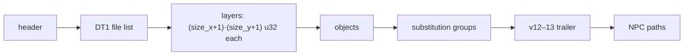

# DS1 preset maps (`.ds1`)

Owned by `archivist`. A DS1 file is one preset map: a grid of tile cells in several layers (walls,
floors, shadow, substitution), plus lists of placed objects and monsters, substitution groups and NPC
walk paths. `LvlPrest` records name up to six DS1 files each ([LvlPrest.md](../tables/LvlPrest.md)).
How the game *uses* a DS1 (which layers it reads, how substitution and objects are applied) belongs
to `drlg/preset` and `drlg/collision`. This doc covers the bytes only.

Parser: `tools/ds1.py` (`survey`, `dump`, `lvlprest`). Lead for the layout:
`src:siramy-ds1edit` ([sources.md](../sources.md)). Every layout row below was checked against the
files. Tags follow the data-format rule in the evidence rules: a field is `[C]` when the parser
reads every file of the type and ends exactly at the last byte, *and* the values make sense. A
version threshold that falls between versions this game does not ship stays `[L]`.

**Scope of the tags.** A `[C]` here describes the **encoding**: where a field is and what values it
holds. It does not say what the game does with the field (which layers it reads, how a cell becomes a
tile, how objects are placed). Those claims need a code anchor in the drlg findings, and a drlg spec
cannot cite this doc for them.

## Files

- `[C]` **2276** `.ds1` files under `data/global/tiles/` in `workspace/merged/`: `act1` 597, `act2` 446,
  `act3` 521, `act4` 220, `expansion` 480, `guild` 10, `arena` 2.
- `[C]` LvlPrest names **2043** of them (2058 references); **233** are never referenced
  ([§ LvlPrest references](#lvlprest-references)).

### Version histogram

`python3 -I tools/ds1.py survey workspace/merged` (the `version` dword at `+0x00`):

| version | all files | parse cleanly | referenced by LvlPrest |
|---:|---:|---:|---:|
| 3 | 1 | 1 | 0 |
| 8 | 6 | 6 | 0 |
| 12 | 13 | 12 | 7 |
| 13 | 30 | 29 | 16 |
| 15 | 13 | 13 | 10 |
| 16 | 223 | 223 | 210 |
| 17 | 145 | 145 | 126 |
| 18 | 1845 | 1844 | 1674 |
| **total** | **2276** | **2273** | **2043** |

- `[C]` Versions 4–7, 9–11 and 14 do not occur. The files the game can reach through LvlPrest are
  versions 12, 13 and 15–18 only.
- `[C]` **2273 files parse with no leftover byte.** The other 3 are malformed, none of them is
  referenced by LvlPrest, and the parser reproduces each failure exactly
  ([§ Malformed files](#malformed-files)).

## Layout

Little-endian. Every field is a 32-bit integer except the file-name strings. The file is a header,
then the cell layers, then up to three lists, and the version decides which parts are present.

### Header

| order | size | type | name | present when | meaning | tag |
|---:|---|---|---|---|---|---|
| 1 | 4 | s32 | `version` | always | format version, 3..18 | `[C]` |
| 2 | 4 | s32 | `size_x` | always | width in tiles. The cell grid is `size_x + 1` cells wide | `[C]` |
| 3 | 4 | s32 | `size_y` | always | height in tiles. The grid is `size_y + 1` cells tall | `[C]` |
| 4 | 4 | s32 | `act` | v ≥ 8 | 0-based act number | layout `[C]`, meaning `[L]` |
| 5 | 4 | s32 | `tag_type` | v ≥ 10 | substitution mode, 0/1/2. It selects the substitution layer and group list | layout `[C]`, meaning `[L]` |
| 6 | 4 | s32 | `file_count` | v ≥ 3 | number of strings that follow | `[C]` |
| 7 | var | char[]×n | `files` | v ≥ 3 | NUL-terminated tile-file paths ([§ File list](#dt1-file-list)) | `[C]` |
| 8 | 8 | s32×2 | `unk_skip` | 9 ≤ v ≤ 13 | `(5000, 5000)` in all 41 such files | layout `[C]`, meaning unknown |
| 9 | 4 | s32 | `wall_layers` | v ≥ 4 | number of wall layers, 0..4 | `[C]` |
| 10 | 4 | s32 | `floor_layers` | v ≥ 16 | number of floor layers, 0..2. Before v16 it is implicitly 1 | `[C]` |

- `[C]` The cell grid is `(size_x + 1) × (size_y + 1)`. This rests on byte accounting: with that cell
  count per layer, all 2273 clean files end exactly at their last byte, and the wall/orient zero pairing
  holds in every pair ([§ Layers](#layers)). No other count does both.
- `[C]` `size_x`/`size_y` equal the `SizeX`/`SizeY` of the LvlPrest record that names the file, in
  **all 1995** references where the record's size is non-zero (63 references are from records with
  size 0). So the header field and the table column are the same quantity, in tiles. This match says
  nothing about the "+1", which comes from the byte accounting above. Grids run from 2×2 to 101×103 cells.
- `[C]` `act` against the directory the file sits in: `act1` → 0 (594), `act2` → 1 (344) or 0 (102),
  `act3` → 2 (519), 0 (1) or 3 (1), `act4` → 3 (218) or 0 (2), `expansion` → 4 (409), 5 (49), 3 (13)
  or 0 (8), `guild` → 4 (10), `arena` → 5 (2). So the value is 0-based and mostly matches the directory, but 0 also appears outside act 1.
  `[L]` Whether the game reads it at all, or takes the act from `Levels` instead, is a code question.
- `[C]` `tag_type` is 0 in 2124 clean files, 1 in 71 and 2 in 78. Non-zero values occur in v13, v16,
  v17 and v18.
- `[L]` Thresholds that fall in a version gap: `act` could start anywhere in 4..8, `tag_type` in
  9..12, `unk_skip` could start anywhere in 9..12 and end in 13..14, `wall_layers` could start in 4..8,
  and `file_count` in 1..3 (`src:siramy-ds1edit` gives 8, 10, 9–13, 4 and 3). Only the versions
  in the histogram matter for 1.14d data.
- Version 3 (one file, `act1/court/court1b.ds1`, unreferenced) has no `wall_layers` field. It
  carries exactly 5 layers ([§ Layers](#layers)).

### Layers

`n_cells = (size_x + 1) × (size_y + 1)`. Each layer is `n_cells` u32 values in row-major order (x
fastest).

| version | stream order | tag |
|---|---|---|
| v ≥ 4 | for each wall layer *i*: `wall[i]`, then `orient[i]`; then `floor[0..floor_layers−1]`; then `shadow`; then `subst` **only if `tag_type` is 1 or 2** | `[C]` |
| v < 4 | `wall`, `floor`, `orient`, `subst`, `shadow` (5 layers, always) | count `[C]`, order and names `[L]` |

- `[C]` The order for v ≥ 4 is pinned by the content, not only by the byte count:
  - In every wall/orient pair, a wall cell is 0 **exactly when** its orientation cell is 0
    (1 319 917 zero pairs, 173 411 non-zero pairs, no mixed pair). That cannot hold if the layers are
    misassigned.
  - Orientation cells hold only 0..19.
  - Floor, wall and shadow cells each have their own low-byte signature (below).
  - Substitution cells are small numbers that track the group count.
- `[C]` There is exactly **one** shadow layer, and the substitution layer exists only when `tag_type ∈ {1, 2}`.
  Any other choice desynchronises the following object list in some file.

#### Wall, floor and shadow cells

`[C]` Observed bit distribution over every non-zero cell of the clean files (`survey` prints the
full histograms):

| bits | wall (173 411 non-zero) | floor (696 511) | shadow (15 055) | lead name (`src:siramy-ds1edit`) |
|---|---|---|---|---|
| 0–7 | `0x81` ×170 211, `0x91`, `0x85`, `0x89`, `0x99` | `0xC2` ×656 897, `0x42` ×39 303, `0xC6`, `0xCA` | `0x80` ×15 054, `0x88` ×1 | `prop1`: flag byte |
| 8–13 | 63 distinct (0..63) | 64 distinct | 64 distinct | sub-index (`sequence`), `[C]` via DT1 |
| 14–19 | 0, 8, 12, 4 | 0, 8, 12, 4 | 0, 8, 12 | unknown |
| 20–25 | 46 distinct | 49 distinct | 15 distinct | main index (`style`), `[C]` via DT1 |
| 26–30 | 0, 4, 1, 8 | 0, 4, 1 | 2, 6, 15 | unknown |
| 31 | 1 in 2 744 | 1 in 6 690 | 1 in 7 | `hidden` |

- `[C]` A cell is either 0 (empty) or has a non-zero low byte: no non-zero cell has bits 0–7 clear.
- `[C]` The low byte differs by layer kind: wall cells always have `0x81` set, floor cells `0x42`, shadow
  cells `0x80`. So the low byte is a per-layer flag byte rather than an index.
- `[C]` **The main index is bits 20–25 and the sub-index bits 8–13.** Together with the orientation
  (from the paired `orient` layer for walls, 0 for floors, 13 for shadows) they form a DT1 tile key.
  Every shadow cell, 97.9 % of wall cells and 93.9 % of floor cells name a tile in the DS1's own DT1
  list, and every alternative bit split does far worse. Data behaviour across two formats
  ([dt1.md § DS1 cells → DT1 tiles](dt1.md#ds1-cells--dt1-tiles), plan 0005 Phase 2).
- `[C]` The floor cells with low byte `0x42` (39 303) all carry key (0, 30, 0), a tile of
  `act1/outdoors/blank.dt1` that no DS1 lists. `[L]` Bit 7 of the low byte clear marks a "blank" floor.
- `[L]` Bit 31 hides the tile (`src:siramy-ds1edit`). Hidden cells resolve to tiles like any other.
  Bits 14–19 and 26–30 are unknown.
- `[L]` Orientation values 0..19: 0 means none, and the rest are wall, corner, roof and special
  orientations (`src:siramy-ds1edit`). Observed counts are in the `survey` output.

#### Substitution cells

- `[C]` Values 0..255 occur. In 142 of the 149 files with a substitution layer, every value is at
  most the file's group count. In the other 7 the maximum is larger (for example 50 with 8 groups).
- `[L]` A cell names the substitution group it belongs to, 0 meaning none. The 7 exceptions argue
  against a plain index, so this is a code question.

### Objects (v ≥ 2)

| field | type | present when | observed | tag |
|---|---|---|---|---|
| `count` | s32 | v ≥ 2 | 0..181 | `[C]` |
| `type` | s32 | | 1 (×2 676) or 2 (×15 101) | layout `[C]`, meaning `[L]` |
| `id` | s32 | | type 1: 0..58 (57 distinct); type 2: 0..149 (146 distinct) | layout `[C]`, meaning `[L]` |
| `x`, `y` | s32 | | 17 697 of 17 777 lie inside `5·(size+1)`. Read as sub-tile coordinates | layout `[C]`, meaning `[I]` |
| `flags` | s32 | v ≥ 6 | 0 (×17 754) or 1 (×23, all v18) | layout `[C]`, meaning unknown |

- `[L]` `type` 1 is a monster or NPC and `type` 2 an object, with `id` an index into a per-act
  preset table (`src:siramy-ds1edit`). Which table, and whether it depends on `act`, is the reverser's.
- `[I]` The coordinates are in sub-tiles, 5 per tile: almost every object fits in a grid of
  `5·(size_x+1)` × `5·(size_y+1)`. The 80 outside it are unexplained.
- `[L]` The flags threshold: v3 has no objects, so the gate could be anywhere in 3..8 (`src:` gives 6).

### Substitution groups (v ≥ 12 and `tag_type` ∈ {1, 2})

| field | type | present when | observed | tag |
|---|---|---|---|---|
| `unk_group` | s32 | v ≥ 18 | 0 in all 117 v18 files that have the list | layout `[C]`, meaning unknown |
| `count` | s32 | | 0..134 | `[C]` |
| `x`, `y`, `w`, `h` | s32 ×4 | per group | a tile rectangle; every one lies inside the `(size_x+1) × (size_y+1)` grid | layout `[C]`, meaning `[L]` |
| `unk` | s32 | per group, v ≥ 13 | 0 (×781), 1 (×61), 2..16 | layout `[C]`, meaning unknown |

- `[C]` The list is absent when `tag_type` is 0 (the object list is followed directly by the
  paths), and the `v ≥ 18` extra dword is pinned between v17 (absent) and v18 (present).
- `[C]` Groups occur in v13 (2 files: `act2/outdoors/palm.ds1`, `scrub.ds1`, 4 groups each), v16 (10),
  v17 (20) and v18 (117). The v13 groups already carry the per-group `unk`.
- `[L]` Version 12: the only v12 file with `tag_type` ≠ 0 is the malformed `trees.ds1`, so neither the
  list threshold (12) nor whether v12 groups have `unk` is exercised. Its data fits 4-dword groups.
  `src:siramy-ds1edit` gives 12 for the list and 13 for `unk`.

### v12–13 trailer

- `[C]` Every version 12 and 13 file has **one more s32 at the end**, and it is 0 in all 41 clean
  ones. It comes after the object list: the v13 town maps (34–37 objects) parse with it last. It also
  comes after the group list: `palm.ds1` and `scrub.ds1` (v13, 4 groups) parse with it last.
- unknown. `[L]` It may be an empty NPC-path count (the path list being present from v12 rather than
  v14). The editor lead has no such field, so this is a code question (backlog).

### NPC paths (v ≥ 14)

| field | type | present when | observed | tag |
|---|---|---|---|---|
| `count` | s32 | v ≥ 14 | 0 in 2256 files; 1..31 in 17 (v17 and v18 only) | `[C]` |
| `points` | s32 | per path | 1..8 | `[C]` |
| `x`, `y` | s32 ×2 | per path | position of the walker | `[C]` |
| point `x`, `y` | s32 ×2 | per point | sub-tile coordinates | `[C]` |
| point `action` | s32 | per point, v ≥ 15 | 1 (×328), 2 (×105), 3 (×43), 4 (×34), 5 (×1) | layout `[C]`, meaning `[L]` |

- `[C]` Every one of the 136 paths starts at the `(x, y)` of an object in the same file.
- `[I]` So a path belongs to the object (monster/NPC) at that position. Which object the game
  attaches it to is a code question.
- `[L]` The action threshold (15) is only exercised by v17/18 files. Earlier versions have no paths.

## DT1 file list

- `[C]` 10 496 strings over the clean files, 1..24 per file. Each is an absolute path from the
  original build tree: prefix `\d2\` (10 425) or `C:\d2\` (71), then `data\global\tiles\…`. Extension
  `.tg1` (6 888) or `.dt1` (3 608).
- `[C]` Mapped to `data/global/tiles/…` with the extension replaced by `.dt1`, **10 462 of 10 496**
  name an existing file. The 34 misses are `expansion/siege/debris.dt1` (33) and
  `act1/caves/caves.dt1` (1), neither of which ships.
- `[L]` Whether the game loads tiles from this list or only from `LvlTypes` (and what `Dt1Mask`
  selects) is a code question. The `.tg1` name suggests an editor-side tile group.

## LvlPrest references

`python3 -I tools/ds1.py lvlprest workspace/merged` reads `lvlprest.bin`, the form the game loads.
Its layout diffs clean against `LvlPrest.txt` ([LvlPrest.md](../tables/LvlPrest.md)).

- `[C]` **All 2058** non-blank `File1..6` cells (a `0` cell means none) resolve to an existing `.ds1`
  file, case-insensitively, with paths relative to `data/global/tiles/`. **No misses.**
- `[C]` They name 2043 distinct files. None of the three malformed files is referenced.
- `[C]` In 81 records `Files` differs from the number of non-blank `File1..6` cells (e.g. `Files = 0`
  with 4 files named), so `Files` is not a plain count. `[L]` Its meaning is the drlg plans'.

## Malformed files

The parser keeps these in `KNOWN_MALFORMED`. `survey` fails if they stop failing, or fail
differently.

| file | version | problem | referenced |
|---|---:|---|---|
| `act1/outdoors/swamp2.ds1` | 13 | after its 11 groups come 12 dwords: a copy of the last group, then `15` and six zeros. The parser takes the first as the trailer and reports 44 bytes left over | no |
| `act1/outdoors/trees.ds1` | 12 | group count says 14, but there is data for 13 groups plus the trailer | no |
| `expansion/siege/xtransition.ds1` | 18 | ends after the object count, so the NPC-path count is missing (4 bytes short) | no |

- `[C]` All three fail only in their trailing lists. Their header and layers decode like any other file.
- `[L]` The game never opens them through LvlPrest. Whether anything else (a hard-coded path)
  loads them is not checked.

## Unknown fields

| field | where | observed |
|---|---|---|
| `unk_skip` | header, v9–13 | `(5000, 5000)` in all 41 files |
| cell bits 14–19, 26–30 | wall/floor/shadow cells | small sets of values (table above) |
| cell low byte | wall/floor/shadow cells | per-layer constant flags (`0x81`/`0x42`/`0x80` always set) |
| object `flags` | v ≥ 6 | 0 or 1 |
| `unk_group` | group list, v18 | 0 |
| group `unk` | v ≥ 13 | 0..16 |
| v12–13 trailer | after groups | 0 |
| path point `action` | v ≥ 15 | 1..5 |

## Preview

Tooling only (ADR-0005). `python3 -I tools/ds1.py render workspace/merged` draws every DS1 that
`lvlprest.bin` names (`--all`: every DS1) as one isometric PNG under `workspace/render/ds1/`, from the
tiles of [dt1.md § Pixel data](dt1.md#pixel-data). **The preview illustrates the data. It says
nothing about DRLG behaviour** and is not evidence for any tag. What it simplifies:

- Tile choice: for each key it takes the **first** tile in the DS1's own DT1 list, else the first in
  any DT1. Rarity variants, animation frames and the game's real tile source (`LvlTypes`, `Dt1Mask`)
  are ignored.
- Layer order: all floor layers, then all wall layers, each row by row (`y` outer, `x` inner). No
  depth sorting of walls against each other, no roof lift (`roof_height`), no orientation 3/4 corner
  pairing.
- Not drawn: hidden cells (bit 31 set; `--hidden` draws them, and the skipped count is printed),
  shadow and substitution layers, objects, NPC paths, orientations 10 and 11. No lighting,
  no shadow or blend tables, flat palette lookup with the act-directory palette
  ([palette.md](palette.md)).
- Placement: cell (`x`, `y`) is drawn with its tile origin at (`(x − y)·80`, `(x + y)·40`) pixels.
  Presets over 60 M pixels are drawn at half scale (12 files).
- Cells whose key is in no DT1 are filled with a palette-index-255 diamond and counted.
- Hidden cells are mostly collision filler: wall key (1, 5, 0) of `act1/outdoors/river.dt1`, RLE
  tiles of the single colour index 233 (blue bands along the river), and `act1/barracks/inviswal.dt1`
  invisible walls (green strips in the Durance). Counts skipped by default: `act1/town/townn1` 43
  wall cells, `act1/tristram/tri_town4` 126 wall cells, `act3/travincal/mephcomp` 26 wall + 1 floor.
  A few unhidden filler cells remain and are drawn as data (8 of the 48 river-filler cells in
  `townn1`, 2 of 127 in `tri_town4`). Their cell low byte is `0x81`; whether the game hides them by
  that or another flag is a reverser question (Open questions).
- A DS1 that parses with leftover bytes (a known malformed file, e.g. `act1/outdoors/swamp2`, 44
  bytes, reached with `--all`) is rendered as far as it parses and named in a `NOTE` line.

Last full run: 2 043 named DS1, 0 failures. Floor cells 559 279 from the own list, 37 315 from
another DT1, 11 missing; wall cells 149 674 own, 2 084 other, 61 missing, 768 skipped
(orientation 10/11). Missing keys fall in 13 files, all under `expansion/`.

## Open questions

- `[L]` Which tile the game picks among rarity variants, and where it takes a level's tiles from,
  are `drlg/preset` questions. The preview's choices ([§ Preview](#preview)) are not answers to them.
- `[L]` Whether the game hides wall cells without bit 31 (river filler with cell low byte `0x81`)
  by another flag: reverser question ([§ Preview](#preview)).

- `[L]` Cell flag bits (low byte, bit 31, bits 14–19 and 26–30). The index split is settled by data
  ([dt1.md](dt1.md#ds1-cells--dt1-tiles)). How the game uses the flags goes to the reverser (backlog).
- `[L]` What the game reads from the header (`act`, `tag_type`, the DT1 list), what the substitution
  cells and groups mean, which tables the object `id`s index, and what the v12–13 trailer and
  `unk_skip` are (backlog → reverser).
