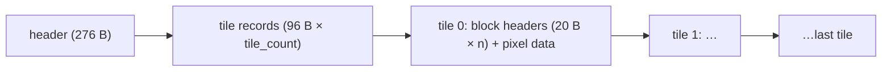

# DT1 tile sets (`.dt1`)

Owned by `archivist`. A DT1 file is a set of map tiles: floors, walls, roofs, shadows and special
tiles. Each tile has an (orientation, main index, sub index) key, a rarity, a 5×5 grid of sub-tile
flags (the collision input for `drlg/collision`), and its pixel blocks. DS1 cells name tiles by
that key ([ds1.md](ds1.md)). `LvlTypes` lists which DT1 files a level type loads. Pixel data is
decoded for rendering only ([§ Pixel data](#pixel-data)).

Parser: `tools/dt1.py` (`survey`, `dump`, `ds1keys`, `render`). Lead for the layout: none
(the fetched editor manual, `src:siramy-ds1edit` in [sources.md](../sources.md), has no byte layout;
no lead; derived from data). A layout row is `[C]` when
the parser reads every version 7.6 file, the pieces tile the file with no gap, overlap or leftover
byte, and the values make sense. No field has a code anchor yet.

**Scope of the tags.** A `[C]` here describes the **encoding** only. How the game picks a tile for a
key, reads the sub-tile flags or uses `rarity` needs a code anchor in the drlg findings. A drlg spec
cannot cite this doc for that behaviour.

## Files

- `[C]` **263** `.dt1` files under `data/global/tiles/` in `workspace/merged/`: `act1` 65, `act2` 69,
  `act3` 36, `act4` 25, `expansion` 56, `guild` 12. No `.tg1` file ships.
- `[C]` **Version histogram** (the two s32 at `+0x00`): **7.6: 257**, **4.1: 6**.
- `[C]` `LvlTypes.txt` `File 1..32` name 230 distinct DT1 files, and all of them exist. All 230 are
  version 7.6. The six 4.1 files are named neither by `LvlTypes` nor by any DS1 tile list
  ([§ Version 4.1 files](#version-41-files)).
- `[C]` **All 257 version 7.6 files parse with every byte accounted for.** That is 16 456 tiles and
  361 484 blocks: the header, the tile records and each tile's block area cover the file exactly, and
  every pixel block decodes to exactly its stated length. `survey` exits 0.

## Layout (version 7.6)

Little-endian. Offsets are from the start of the file unless a row says otherwise.

### Header (276 bytes)

| offset | size | type | name | meaning | tag |
|---|---|---|---|---|---|
| `0x000` | 4 | s32 | `version_major` | 7. The reader is fatal on any other value `[I]` | `[C]` |
| `0x004` | 4 | s32 | `version_minor` | 6. Reused at load as a state word (bit 1 → bit 2 marks "relocated") `[I]` | `[C]` |
| `0x008` | 260 | bytes | `unk_008` | zero in all 257 files; the runtime name buffer (the loader copies the file name here) | layout `[C]`, meaning `[I]` |
| `0x10C` | 4 | s32 | `tile_count` | 1..494 | `[C]` |
| `0x110` | 4 | u32 | `tile_ptr` | offset of the first tile record. 276 in every file | `[C]` |

### Tile record (96 bytes, `tile_count` of them from `tile_ptr`)

| offset | size | type | name | observed | tag |
|---|---|---|---|---|---|
| `0x00` | 4 | s32 | `direction` | 1..9. A fixed function of `orientation` (table below) | layout `[C]`, meaning `[L]` |
| `0x04` | 2 | s16 | `roof_height` | 0, or 80..240 on roof tiles. One stray −9160 | layout `[C]`, meaning `[L]` |
| `0x06` | 1 | u8 | `sound` | 13 values (0, 1, 2, 4, 5, 8, 16, 17, 33, 64, 65, 128, 129). Bits 0 and 2 set runtime tile flags `0x4` and `0x800` | layout `[C]`, those two bits `[I]`, name and the rest `[L]` |
| `0x07` | 1 | u8 | `animated` | 0 (16 195), 4 (181), 1 (80). Bit 0 marks an animated tile | layout `[C]`, bit 0 `[I]`, value 4 `[L]` |
| `0x08` | 4 | s32 | `height` | −960..0 | layout `[C]`, meaning `[L]` |
| `0x0C` | 4 | s32 | `width` | 0..160 | layout `[C]`, meaning `[L]` |
| `0x10` | 4 | s32 | `unk_10` | 0 in every tile | unknown |
| `0x14` | 4 | s32 | `orientation` | 0..19 | `[C]` |
| `0x18` | 4 | s32 | `main_index` | 0..63 (49 distinct) | `[C]` |
| `0x1C` | 4 | s32 | `sub_index` | 0..63 (64 distinct) | `[C]` |
| `0x20` | 4 | s32 | `rarity` | 0..30. 0 in 13 296 tiles. The weight of a rarity-weighted draw among tiles of one key; the frame number of an animated tile | layout `[C]`, meaning `[I]` |
| `0x24` | 4 | u8×4 | `unk_24` | bytes 0–2 vary (`FF 00 FF` in 8 495 tiles); byte 3 is 0 in every tile | unknown |
| `0x28` | 25 | u8×25 | `subtile_flags` | one byte per sub-tile (below) | layout `[C]`, meaning `[L]` |
| `0x41` | 7 | bytes | `unk_41` | zero in every tile | unknown |
| `0x48` | 4 | u32 | `block_ptr` | file offset of this tile's block headers | `[C]` |
| `0x4C` | 4 | u32 | `block_len` | size of the tile's block area: headers plus pixel data | `[C]` |
| `0x50` | 4 | s32 | `block_count` | 0..132 (25 in 9 287 tiles) | `[C]` |
| `0x54` | 12 | bytes | `unk_54` | dwords 0 and 2 always 0, and the loader is fatal otherwise. Dword 1 is non-zero in 1 353 tiles of 22 files, with pointer-like values such as `0x0956004C`; it is the runtime name pointer, overwritten on load | layout `[C]`, meaning `[I]` |

- `[C]` The block areas are laid out back to back in tile order: each `block_ptr` equals the previous
  tile's `block_ptr + block_len` (16 456/16 456), and the last ends at the end of the file.
- `[C]` `orientation` → `direction` is one-to-one in the data: 0→3, 1→1, 2→2, 3→3, 4→3, 5→1, 6→2,
  7→4, 8→1, 9→2, 10→1, 11→2, 12→3, 13→3, 14→3, 15→5, 16→6, 17→7, 18→8, 19→9.
- `[C]` `roof_height` is non-zero only on orientation 15: 830 of its 856 tiles. The one negative value
  is in `expansion/siege/temptile.dt1`.
- `[C]` Every orientation-0 tile (9 551) is 160 wide with height −128 and is the only kind with a fixed
  size. Walls vary.
- `[L]` Names and meanings (no lead; derived from data): orientation 0 is a floor, 1–11 and 16–19
  walls and corners, 12 and 14 special, 13 a shadow, 15 a roof. `rarity` weighs the choice among
  tiles that share a key. `animated` marks animated floors, whose `rarity` is then a frame number.
  The only fetched mention is `src:siramy-ds1edit` (Tutorial 1, warps), which places warp tiles ("Vis") at orientation 10 or 11 on a
  wall layer.
- `[I]` `rarity` and `animated`, from the code ([drlg/0001 § Tile choice by rarity](../findings/drlg/0001-ds1-dt1-readers.md#tile-choice-by-rarity)):
  tiles sharing a key are chosen by a draw weighted by `rarity` on the DRLG room seed, made whenever the
  summed rarity is > 0, even for a single candidate; with a sum of 0 the first candidate wins. Tile
  `+0x06` is read as one u16; its bit 8 (`animated` bit 0) marks an animated tile, whose frames are the
  tiles of the same key ordered by `rarity` (fn:DRLG_PickTileByRarity@0x0066D820,
  fn:TILE_GetFlags16@0x00604BC0, fn:sub_0066D440_AnimTilesBuild@0x0066D440).

#### Sub-tile flags

`[C]` 25 bytes per tile, 411 400 bytes in all. Observed values (all files):

| byte | count | | byte | count |
|---:|---:|---|---:|---:|
| `0x00` | 306 033 | | `0x10` | 398 |
| `0x01` | 79 196 | | `0x04` | 232 |
| `0x07` | 15 550 | | `0x21` | 174 |
| `0x05` | 8 334 | | `0x02` | 31 |
| `0x25` | 941 | | `0x20` | 16 |
| `0x03` | 488 | | `0x24`, `0x17`, `0x06` | 3, 2, 2 |

- `[C]` Only bits 0, 1, 2, 4 and 5 are ever set (bit 0 in 104 685 bytes, bit 2 in 25 064, bit 1 in
  16 073, bit 5 in 1 134, bit 4 in 400). Bits 3, 6 and 7 are never set.
- `[C]` 5 115 of the 9 551 floor tiles have all 25 bytes zero. Shadows (660 of 696) and roofs (852 of
  856) are almost always all zero.
- `[I]` The collision builder ORs all 8 bits of each of the 25 bytes into a 16-bit collision map: the
  bytes are rows of five, and byte row 0 is the **last** of the five map rows (row-reversed); nothing
  masks any bit (fn:COLL_StampTile@0x0064C4C0, fn:TILE_GetSubtileFlags@0x00604CE0;
  [drlg/0001 § Sub-tile flags](../findings/drlg/0001-ds1-dt1-readers.md#sub-tile-flags-into-the-collision-map)).
- `[L]` Meaning: one byte per sub-tile of a 5×5 grid, bits blocking walking, jumping and so on.
  `src:siramy-ds1edit` (Tutorial 1: "a Tile is a group of 5 x 5 sub-tiles"; manual § SPACE, "walkable
  & jump infos" read from the DT1) supports per-sub-tile walk and jump data; line of sight and the
  bit assignment have no lead. The bit meanings **stay `[L]` until the collision plan anchors them**
  (plan 0005 Phase 2 *Done when*); the byte order is the `[I]` above.

### Block header (20 bytes, `block_count` of them at `block_ptr`)

| offset | size | type | name | observed | tag |
|---|---|---|---|---|---|
| `0x00` | 2 | s16 | `x` | pixel offset in the tile | layout `[C]`, meaning `[L]` |
| `0x02` | 2 | s16 | `y` | pixel offset. Negative for most wall blocks | layout `[C]`, meaning `[L]` |
| `0x04` | 2 | u16 | `unk_04` | 0 in every block | unknown |
| `0x06` | 1 | u8 | `grid_x` | 0..4 | layout `[C]`, meaning `[L]` |
| `0x07` | 1 | u8 | `grid_y` | 0..4 | layout `[C]`, meaning `[L]` |
| `0x08` | 2 | u16 | `format` | `0x0001`, `0x1001` or `0x2005` | `[C]` |
| `0x0A` | 4 | s32 | `length` | bytes of pixel data | `[C]` |
| `0x0E` | 2 | u16 | `unk_0E` | 0 in every block | unknown |
| `0x10` | 4 | s32 | `data_off` | offset of the pixel data **from `block_ptr`** | `[C]` |

- `[C]` Each tile's block area is its block headers, then the blocks' pixel data with no gap or overlap
  (checked for every tile). In every tile the data follows the headers' order.
- `[C]` **`format` `0x0001`** (231 101 blocks): a fixed **256-byte** block, always. This is the
  isometric 32×15 diamond (no lead; derived from data: rows of 4+8+…+32+…+8+4 = 256 pixels, see
  [§ Pixel data](#pixel-data)).
- `[C]` **Any other format** (`0x1001` ×114 117, `0x2005` ×16 266) is run-length coded: pairs of
  (skip, count) bytes, each followed by `count` pixel bytes, with `(0, 0)` ending a row. Walking the
  pairs consumes exactly `length` bytes in every block. `0x1001` blocks always have 32 rows,
  `0x2005` blocks 15.
- `[C]` `0x1001` blocks occur only in non-floor tiles and always have grid (0, 0). Floor tiles use
  `0x0001` and `0x2005`.

## DS1 cells → DT1 tiles

`python3 -I tools/dt1.py ds1keys workspace/merged` takes every non-zero wall, floor and shadow cell
of the 2273 clean DS1 files and builds the key `(orientation, (cell >> 20) & 63, (cell >> 8) & 63)`.
Walls take the orientation from the paired `orient` layer, floors 0 and shadows 13. It then looks
the key up among the tiles of the DT1 files the DS1 lists (`.tg1` names mapped to `.dt1`).

| cells | found in the DS1's own DT1 list | found in any DT1 (`--all`) |
|---|---:|---:|
| shadow (15 055) | **15 055 (100 %)** | 15 055 (100 %) |
| wall (173 411) | 169 774 (97.9 %) | 173 177 (99.87 %) |
| floor (696 511) | 654 186 (93.9 %) | 696 405 (99.98 %) |

Other bit splits, tested against each DS1's own list:

| main bits / sub bits | shadow found | wall found | floor found |
|---|---:|---:|---:|
| **20–25 / 8–13** | **100 %** | **97.9 %** | **93.9 %** |
| 8–13 / 20–25 (swapped) | 7.4 % | 23.1 % | 48.3 % |
| 20–25 / 14–19 | 87.7 % | 86.6 % | 86.1 % |
| 14–19 / 8–13 | 80.6 % | 45.7 % | 49.9 % |

- `[C]` **The DS1 cell's main index is bits 20–25 and its sub index bits 8–13**, and with the
  orientation they form the DT1 tile key. The shadow layer uses orientation 13 and floors use 0.
  Every shadow cell names a tile in its own DS1's list, and every alternative split does far worse.
  This is data-behaviour corroboration across two formats, and it promotes the `[L]` in
  [ds1.md § Wall, floor and shadow cells](ds1.md#wall-floor-and-shadow-cells).
- `[C]` **Floor cells with low byte `0x42`** are the largest group of list misses: all 39 303 of them
  carry key (0, 30, 0). That is a tile of `act1/outdoors/blank.dt1` (2 tiles), which no DS1 lists.
  Every other floor cell has bit 7 of the low byte set (`0xC2`/`0xC6`/`0xCA`). `[L]` Bit 7 clear marks a
  "blank" floor that the game resolves outside the DS1's list.
- `[C]` The remaining misses are 3 022 floor and 3 637 wall cells. All but 106 floor and 234 wall
  cells name a tile in some other DT1. Part of it is naming: the cave DS1 lists name
  `ACT1\Caves\caves.tg1`, while the shipped file is `act1/caves/cave.dt1`. By orientation (the
  `ds1keys` output, "missing (orientation, in another DT1)"):

  | orientation | missed in own list | of which in another DT1 | in no DT1 |
  |---:|---:|---:|---:|
  | 0 (floor) | 3 022 | 2 916 | 106 |
  | 12 | 2 222 | 2 190 | 32 |
  | 1 | 408 | 390 | 18 |
  | 2 | 318 | 306 | 12 |
  | 14 | 270 | 228 | 42 |
  | 5 | 86 | 83 | 3 |
  | 7 | 84 | 62 | 22 |
  | 3 | 50 | 50 | 0 |
  | 16 | 50 | 25 | 25 |
  | 6 | 47 | 39 | 8 |
  | 17 | 40 | 10 | 30 |
  | 18 | 25 | 0 | 25 |
  | 15 | 14 | 0 | 14 |
  | 11 | 9 | 7 | 2 |
  | 13 | 8 | 8 | 0 |
  | 9 | 5 | 5 | 0 |
  | 10 | 1 | 0 | 1 |

  The floor row excludes the 39 303 `0x42` blank floors above.
- `[C]` Orientation 12 accounts for 61 % of the wall misses. 1 840 of its 2 222 misses are the keys
  (12, 0, 0), (12, 0, 1) and (12, 0, 2), which exist in many DT1 files across the acts (`cave.dt1`,
  `basewalls.dt1`, `harem.dt1`, `fence.dt1`, …). The next largest is (12, 6, 1) in
  `act1/tristram/town.dt1` (137). `[L]` These are generic special tiles that the game resolves from a
  wider tile set than the DS1's own list.
- `[C]` The 340 cells that match **no** tile anywhere sit in a few files:
  - **Floors (106, 16 files):** 14 are `expansion/siege` border and boss maps (`brdr32x16btm_snow` 28,
    `brdr16x32top_snow` 16, `brdr16x32btm_snow` 14, `brdr_snow10cr` 13, …), plus
    `expansion/icecave/northexit_dirt` 5 and `expansion/wildtemple/templeentrance` 5.
  - **Walls (234, 32 files):** `expansion/siege/sample` 45, `townsiege` 15, the six `act1/town/town*`
    maps 11–12 each, `act1/court/court1b` 10 (version 3, unreferenced), `guild/house1/guild5` 6,
    `act2/maggot/hole1` 1, and the rest in `expansion/siege`, `icecave` and `wildtemple`.

  Part of this is the missing `expansion/siege/debris.dt1` ([ds1.md § DT1 file list](ds1.md#dt1-file-list)).
  The rest is unexplained.
- `[I]` The game takes a room's tiles from its level type's `LvlTypes` `File 1..32`, filtered by a
  32-bit mask, plus three fixed files (`act1/outdoors/blank.dt1`, `act1/barracks/inviswal.dt1`,
  `act1/barracks/warp.dt1`), and never from the DS1 list (fn:DRLG_LevelDt1ListBuild@0x0066F240;
  [drlg/0001 § Where a level's DT1 files come from](../findings/drlg/0001-ds1-dt1-readers.md#where-a-levels-dt1-files-come-from)). That is why
  keys missing from a DS1's own list can still resolve.
- `[C]` Hidden cells (bit 31) resolve like the others (6 385 + 2 671 + 7 found).

## Pixel data

Tooling only (ADR-0005). `python3 -I tools/dt1.py render workspace/merged` decodes every block of
every version 7.6 file into palette indices and writes PNGs under `workspace/render/tiles/`. The
byte accounting above is `[C]`. The **geometry** below (where a byte lands) has no code anchor; the
first three rows are `[C]` on a data-only check over all 257 files that `render` runs and prints as
its `geometry:` line (it exits non-zero if either count is non-zero): **0** RLE runs end past column
32, and in all **7 686** floor tiles made only of `0x0001` blocks (each has 25 blocks, 25 × 256 = 6 400
pixels, half of 160×80, which is the area of the 160×80 diamond) the blocks placed at their header
`(x, y)` with the row shape below overlap in **0** pixels. No lead; derived from data.
The renders look right by eye (plan 0006 implementation log), which is a sanity check, not evidence.

- `[C]` **`0x0001` (isometric) block:** 15 rows; row `r` holds `w[r]` pixels starting at column
  `x[r]`, with `w` = 4, 8, 12, 16, 20, 24, 28, 32, 28, 24, 20, 16, 12, 8, 4 and
  `x` = (32 − `w`) / 2 = 14, 12, …, 0, …, 12, 14. The block is 32 wide and 15 high. (`w` sums to 256,
  the fixed block length, and the 25 blocks of an iso-only floor tile tile its diamond with no
  overlap.)
- `[C]` **RLE blocks (`0x1001`, `0x2005`):** a row cursor starts at column 0; each (skip, count) pair
  advances it by `skip`, then writes `count` pixel bytes; `(0, 0)` moves to column 0 of the next
  row. Blocks are 32 wide (no run ends past column 32 in any block); `0x1001` has 32 rows and
  `0x2005` 15.
- `[C]` Each block is placed at its header `(x, y)` in tile space (the no-overlap check above); `grid_x`/`grid_y` are not used for
  placement. Floor blocks (orientation 0) land in a 160×80 diamond; wall blocks have negative `y`
  and stack upwards from the tile's base.
- `[L]` Pixel value 0 is transparent; any other value is a palette index ([palette.md](palette.md)).
- Renderer choices (not format claims): a tile's PNG is the bounding box of its blocks; a later
  block's index 0 never overwrites an earlier block's pixel; `roof_height` and `animated` are
  ignored; tiles with no blocks are written as a 1×1 transparent PNG. Output files are
  `<orientation>_<main>__<n>.png`, where `n` counts tiles with the same key in file order
  (rarity variants and animation frames), plus `_sheet.png`, a shelf-packed contact sheet of all
  tiles in file order, at most 2 048 px wide. Palette: by act directory
  ([palette.md § Which palette](palette.md#which-palette-an-asset-uses-renderer-heuristic)).
- Run: 257 files, 16 456 tile PNGs, 257 sheets, 0 failures, about 35 s.

## Version 4.1 files

Six files have version 4.1:

| file | size | tiles |
|---|---:|---:|
| `act1/barracks/barracks.dt1` | 541 406 | 34 |
| `act1/barracks/gargtrap.dt1` | 10 789 | 1 |
| `act1/catacomb/catacombs.dt1` | 440 972 | 22 |
| `act1/cathedrl/cathedrl.dt1` | 1 210 193 | 65 |
| `act1/court/court.dt1` | 1 180 690 | 76 |
| `act1/outdoors/outdoor1.dt1` | 432 252 | 54 |

- `[C]` None is named by `LvlTypes` or by any DS1 tile list, so the game never reaches them through
  data.
- `[I]` The reader rejects any `version_major` other than 7 as a fatal error, so these files would
  crash the game if they were ever opened (fn:DT1_Relocate@0x0060A390;
  [drlg/0001 § DT1 load](../findings/drlg/0001-ds1-dt1-readers.md#dt1-load)).
- `[C]` Top-level structure, as far as decoded: s32 4, s32 1, s32 `header_size` (= 24 + 4 × count),
  s32 0 (`0xEEEEEEEE` in `gargtrap`, a debug fill), u32 `table_ptr`, s32 `count`, then `count` u32
  pointers to 44-byte tile records. In five files those records are the last `44 × count` bytes of the
  file. The region from `header_size` to `table_ptr` (pixel data in an older encoding) and the one
  from `table_ptr` to the first record are **not decoded**. `gargtrap.dt1` has 216 bytes after its
  only record.
- **These six files are the exception to "every byte accounted for".** `survey` lists them as known
  and fails if any other file is not version 7.6. Decoding them helps no subsystem; reopen only if a
  code path is found that loads them.

## Unknown fields

| field | where | observed |
|---|---|---|
| `unk_008` | header | 260 zero bytes; runtime name buffer `[I]` |
| `unk_10` | tile `+0x10` | 0 |
| `unk_24` | tile `+0x24` | 3 varying bytes + 0 (perhaps a colour, `[L]`) |
| `unk_41` | tile `+0x41` | 7 zero bytes |
| `unk_54` | tile `+0x54` | middle dword pointer-like in 1 353 tiles, else 0: the runtime name pointer, the file values are stale memory overwritten on load `[I]` |
| `unk_04`, `unk_0E` | block header | 0 |
| `direction`, `sound` (except bits 0, 2), `animated` (except bit 0), `roof_height`, `width`/`height`, block `x`/`y`/`grid` | tile, block | values above. The layout is `[C]` but the meaning is `[L]` |

## Open questions

- `[L]` Sub-tile flag bit meanings (0, 1, 2, 4, 5): the collision plan (backlog → reverser). The byte
  order and the OR into the collision map are `[I]` from drlg/0001.
- Answered `[I]` in [drlg/0001](../findings/drlg/0001-ds1-dt1-readers.md): tiles come from `LvlTypes` plus three fixed files, and `rarity`
  weights the draw. What the `0x42` floor flag does beyond the blank-floor handling stays open.
- `[L]` `direction`, `sound`, `animated`, `unk_24`: no consumer planned yet.
