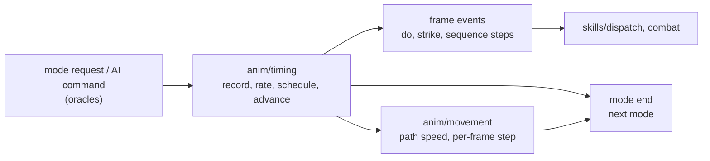

# Animation and frame timing: the machinery

## Purpose

Every unit action the server runs is timed by its animation: the mode a unit enters has an animation record, a rate
from the unit's stats and weapon, and frame events that run the do function, the melee strike and the sequence
steps; its end starts the next mode. A moving unit's position advances once per game frame at a speed the same rate
code sets. This subsystem specifies that timing, phase (4) of [ADR-0014](../../adrs/0014-scope-game-simulation.md)
([plan 0050](../../plans/0050-animation-frame-timing.md)): the record lookup, the schedule and the per-frame advance,
the mode machines of players, monsters and objects, the rates and the breakpoints they give, the gates that sit on
the frame clock (the do frame, the skill delay, hit recovery, the block, the get-hit roll, the player's mode tests),
and movement. Timing enters as frame counts and event frames; which cel is drawn, and the client's own clock, stay
out (ADR-0005, ADR-0014 § Time).

## Files

| Spec | What |
|---|---|
| [anim/timing](timing.md) | the record, the mode start, the start frame, the schedule, the advance, sequences, the event queue and the frame order, the mode machines, the rate, the breakpoints, the gates, the draws |
| [anim/movement](movement.md) | the path speed, the run's stat, the monster speeds at load, the per-frame step, the snap, the collision walk, the run drain, knockback, the slowing states |

The research map's two rows, `anim/timing` and `anim/movement`, are kept as two files; movement depends on timing's
rate and mode machine.

## Entry points

| When | Function | Tag |
|---|---|---|
| A unit's mode changes | fn:UNIT_SetMode@0x00624690 ([timing § C](timing.md#c-the-mode-start)) | [I] |
| A scheduled mode's events are queued | fn:SUNIT_ScheduleModeEvents@0x005539B0 ([timing § E](timing.md#e-the-schedule)) | [C] (run:2026-10-27-anim) |
| The unit event lists run, each game frame | fn:sub_005414D0_GameRunUnitEvents@0x005414D0 ([timing § H](timing.md#h-the-event-queue-and-the-frame-order)) | [I] |
| A unit's rate is (re)computed | fn:UNIT_AnimSetRate@0x00623F50 ([timing § J](timing.md#j-the-rate-unit_animsetrate)) | [C] (run:2026-10-27-anim) |
| A moving unit steps | fn:sub_00554CA0_UnitMoveStep@0x00554CA0 ([movement § B](movement.md#b-the-per-frame-step)) | [C] (run:2026-10-27-anim) |

## Inputs

### Tables

| Anchor | Used for |
|---|---|
| `animdata.d2` ([formats/animdata](../../formats/animdata.md)) | each mode's frames, speed and event bytes |
| PlrMode, MonMode, ObjMode, PlrType, ObjType, MonSeq, HitClass | the record names, sequences, hit-class codes ([timing § Inputs](timing.md#inputs)) |
| tbl:CharStats.txt:WalkVelocity, tbl:MonStats.txt:Velocity, tbl:MonStats2.txt:A1mv, tbl:Skills.txt:seqnum, tbl:ItemStatCost.txt:Stat, tbl:Objects.txt:FrameDelta0 | speeds, the every-frame modes, sequences, the rate stats, the object start draw |

### Runtime state

| State | Type | Source |
|---|---|---|
| the unit's frame fields `+0x30`…`+0x50` | [timing § Inputs](timing.md#runtime-state) | the mode start and the rate |
| the path (`PathMove`) | [movement § Inputs](movement.md#runtime-state) | the planner (phase (5)) and the step |
| the current game frame | struct:Game+0xA8 | the game loop |

### The ADR-0014 boundary

| Input | Treatment | Tag |
|---|---|---|
| The mode request (plan 0045), the AI's command and its velocity block (plan 0052), the path plan and `0x00679720` (phase (5)), the collision test's result per crossed subtile ([drlg/collision](../drlg/collision.md)), the client | boundary oracles: logged and taken as given (ADR-0004) | [C] (run:2026-10-27-anim) |
| The catalogue's reschedules, its speed writers (Charge, Leap Attack), its own event queue after a cancel, a do's store to `+0x4E` (plan 0046) | taken as given where logged; the queue after a cancel is not logged in part 1, so the 124 dispatches it gives are an uncompared catalogue path, not an oracle | [I] (fn:sub_00553DC0_RescheduleAt@0x00553DC0) |
| Everything else: the record, the start frame, the schedule, the advance, the rate, the speeds, the step and its snap and collision walk, the run drain, the knockback point and length, the gates, `GetHitRoll` and its draws, `PlayerModeAllowed`'s draw, the hit-class nibbles, the object operate end | modelled | [C] where run:2026-10-27-anim compares it (the timing and movement sections say which), [I] otherwise |

## Algorithm

### A. The event kinds

| Kind | Inputs | Outputs | Draws | Tag |
|---|---|---|---|---|
| mode start | the mode, type, class, transform states, used skill, weapon items, record, stats, `T` | `+0x10`, the frame fields, the queued kind-0/1 events | an object's `RangeB` on its unit seed when `Sync` is 0 | [C] (run:2026-10-27-anim) |
| frame event (kind 0) | the code and index | the mode's frame function: the do, the strike | the do's and the hit's (skills, combat), none of the animation's | [I] (fn:sub_00580460_PlrModeSkillFrame@0x00580460) |
| mode end (kind 1) | the mode | the next mode and its start | the next start's, `PlayerModeAllowed`'s, the AI's | [I] (fn:sub_00581020_PlayerModeEnd@0x00581020) |
| frame advance | every-frame monsters' frame fields | `+0x44`, `+0x4E` | none | [C] (run:2026-10-27-anim) |
| rate change | the unit's display type, class, mode, record, stats, items, states | `+0x50`, `+0x4C`, `+0x3C`, the path speed | none | [C] (run:2026-10-27-anim) |
| movement step | the path, its speed, the collision results | the position, the point index | none | [C] (run:2026-10-27-anim) |
| get-hit decision | the packet, the defender's max HP and seed | get hit or not | 0–2 `RangePow2` on the defender's seed | [C] (run:2026-10-27-anim) |

(fn:UNIT_AnimInit@0x00624390, fn:SUNIT_ScheduleModeEvents@0x005539B0, fn:UNIT_AnimAdvance@0x00623E00,
fn:UNIT_AnimSetRate@0x00623F50, fn:sub_00650840_PathStep@0x00650840, fn:sub_0057CB00_GetHitRoll@0x0057CB00)

### B. Chaining (ADR-0014)

- B1. [I] The animation adds no seed of its own. An object's start draw chains on the object's unit seed
  ([objects § G](../objects/README.md#g-creation-sunitcreate-for-an-object)); the get-hit draws on the defender's
  seed and the Concentration draw on the player's, between the defender's other draws in delivery order
  ([timing § N](timing.md#n-draws-and-seeds-per-event-kind)). (fn:UNIT_AnimInit@0x00624390,
  fn:sub_0057EEC0_PlayerModeAllowed@0x0057EEC0)
- B2. [C] The `GetHitRoll` draws chain: 102 consecutive pairs on one defender have the second's seed before equal to
  the first's after. (fn:sub_0057CB00_GetHitRoll@0x0057CB00, run:2026-10-27-anim) [I] The object start draw and the
  Concentration draw have no chained pair in the run, so their place in their seed's order is as read.
  (run:2026-10-27-anim)

### C. Branches

- C1. [I] **Two clocks**: scheduled modes (players' actions, get-hit, block, death; monsters' non-`*mv` A1–S2,
  get-hit, block, death) fix every event at their start; every-frame modes (monsters' walk, run, knockback, sequence
  and `*mv` modes; players' moves without an advance) run once per frame ([timing § A](timing.md#a-the-two-clocks-and-the-event-kinds)).
  (fn:SUNIT_ScheduleModeEvents@0x005539B0, fn:SUNIT_ModeEveryFrame@0x00553F00)
- C2. [I] **Unit types**: players and monsters through the rate and the record; objects from their Objects row
  (no record lookup, a start draw, an operate end without an animation start); missiles and items get frame fields
  and no server advance. (fn:UNIT_AnimInit@0x00624390)

## Outputs

- [C] The frame of every scheduled event and mode end, every-frame monsters' frame and event byte, the rate, and each
  moving unit's position per frame, as the two specs give them. (fn:SUNIT_ScheduleModeEvents@0x005539B0,
  fn:sub_00650840_PathStep@0x00650840, run:2026-10-27-anim)

## Worked example

[I] See [timing § Worked example](timing.md#worked-example) (a cast's length, its do frame and its breakpoint) and
[movement § Worked example](movement.md#worked-example) (a walk's and a run's step). (fn:UNIT_AnimSetRate@0x00623F50)

## Reimplementation notes

- [I] **A scheduled mode does not follow a rate change.** Its events stay where its start put them; only a catalogue
  reschedule moves them. An every-frame monster takes the new rate at its next advance.
  ([timing § J](timing.md#j-the-rate-unit_animsetrate), fn:UNIT_AnimSetRate@0x00623F50)
- [I] **The breakpoint tables count `N = n − 1`.** The schedule's end is at `T + n`; the server starts the next
  action at its request, and the stock client's held request comes at `T + N` ([timing § L](timing.md#l-the-frame-events-as-gates)).
  (fn:SUNIT_ScheduleModeEvents@0x005539B0)

## Evidence

- Findings: [anim/0001](../../findings/anim/0001-modes-frames.md), [anim/0002](../../findings/anim/0002-rates.md),
  [anim/0003](../../findings/anim/0003-movement-gates.md), [anim/leads](../../findings/anim/leads.md),
  [anim/experiments](../../findings/anim/experiments.md).
- Plan: [0050](../../plans/0050-animation-frame-timing.md). Upstream: [rng](../rng/README.md),
  [stats/aggregate](../stats/aggregate.md). Downstream: [skills/dispatch](../skills/dispatch.md),
  [combat](../combat/README.md), [objects](../objects/README.md), [monsters/stats](../monsters/stats.md).

## Open questions

- [L] Plan 0050 Phase 2 part 2 (not yet run) targets the get-hit FHR tiers, the FBR rates, the throws of three
  classes, the set-2 IAS rates, a third FCR rate, P1b-1's restart for every class and action mode, the catalogue
  queue, and the rare branches; the statements it targets are at their findings' current tags, for a re-tag pass
  ([timing § Open questions](timing.md#open-questions), [movement § Open questions](movement.md#open-questions)).
- [L] Two clients: party-wide rate auras on another player's unit (plan 0050 § Open questions).
