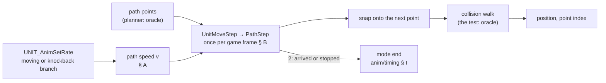
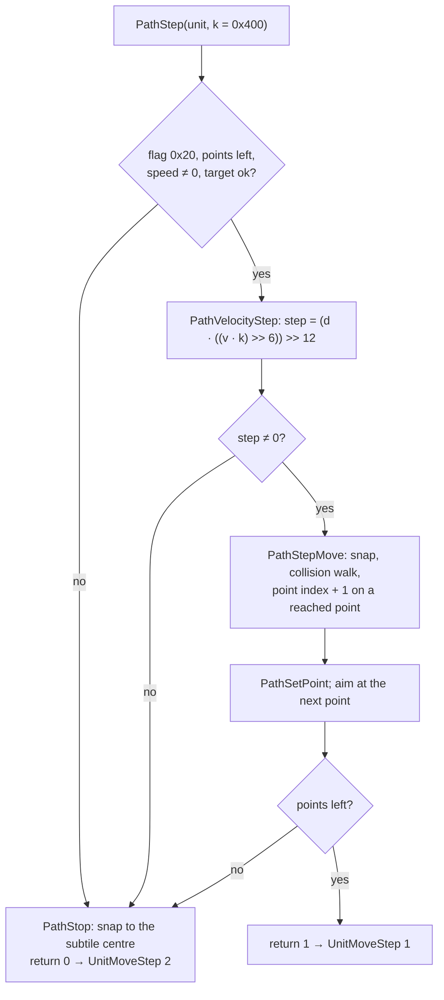

# Movement: speeds, the per-frame step, the run drain and knockback

## Purpose

A walking, running or knocked-back unit moves along a path whose points the planner gives (phase (5), an input
here). This page specifies how fast it moves and how far its position advances on each game frame: the path speed
that the rate code sets from the unit's tables and stats, the step that the unit's every-frame mode event takes, the
snap onto a path point, the collision walk across subtiles, the run's stamina drain, and knockback's distance, speed
and length. The modes, their events and the animation rate are [anim/timing](timing.md). Positions are 16.16
subtiles (the high word the subtile, as in [drlg/collision](../drlg/collision.md)); a speed `v` is the path's `+0x7C`.



## Entry points

| When | Function | Tag |
|---|---|---|
| A moving or knockback mode's rate is set | fn:UNIT_AnimSetRate@0x00623F50 (the path speed) | [C] (run:2026-10-27-anim: 127 584 path speeds) |
| A player starts running (or is knocked back) | fn:sub_00620E80_RunVelocityStat@0x00620E80 | [I] |
| A moving unit's every-frame event | fn:sub_00554CA0_UnitMoveStep@0x00554CA0 → fn:sub_00650840_PathStep@0x00650840 | [C] (run:2026-10-27-anim: 99 241 steps) |
| A running player's frame, outside town | fn:sub_0057F240_RunStaminaDrain@0x0057F240 | [C] (run:2026-10-27-anim: 37 434 frames) |
| A knockback path is planned | fn:sub_0067A000_PathPlanKnockback@0x0067A000 | [I] |
| A monster's MonStats speeds at load | fn:sub_00650F00_MonStatsSpeeds@0x00650F00 | [C] (run:2026-10-27-anim) |

## Inputs

### Tables

| Anchor | Used for |
|---|---|
| tbl:CharStats.txt:WalkVelocity, tbl:CharStats.txt:RunVelocity | a player's path base and run bonus (A1, A2) |
| tbl:CharStats.txt:RunDrain, tbl:Armor.txt:speed, tbl:ItemStatCost.txt:Stat (stats 10, 154) | the run drain (§ D) |
| tbl:MonStats.txt:Velocity, tbl:MonStats.txt:Run, tbl:MonStats.txt:BaseId | a monster's path base, its walk and run animation bases (A1, A4) |
| `animdata.d2` (fmt:animdata#layout) | the `WL` and `RN` records' speeds behind the monster bases (A4) |

### Runtime state

| State | Type | Source |
|---|---|---|
| path `+0x00`/`+0x04` (`PathMove`) | 16.16 position | the planner, then § B |
| path `+0x24`, `+0x28`, `+0x9C` | point index, point count, the points | the planner (oracle) |
| path `+0x6A`/`+0x6E` | i16 direction, a unit vector × 4096 | § B2 |
| path `+0x72`/`+0x76` | the step | § B1 |
| path `+0x7C` | i32 speed `v` | A1 |
| path `+0x90` | u8 knockback distance byte, decremented per subtile change | § E |
| stats 67, 96 (and 10, 154 for the drain) | as the aggregate holds them | [stats/aggregate](../stats/aggregate.md) |

### Inputs and oracles

| Input | How it enters | Tag |
|---|---|---|
| The path plan (its points, the replan and the target revalidation's planner calls, `0x00679720`) | taken as given (phase (5)) | [C] (run:2026-10-27-anim) |
| The collision test `0x0064FF90`'s result per crossed subtile | taken as given ([drlg/collision](../drlg/collision.md)) | [C] (run:2026-10-27-anim) |
| The AI's mode command and its velocity block; the catalogue speed writers (Charge, Leap Attack) | taken as given (plans 0052, 0046) | [I] (fn:sub_005A6380_MonModeVelocity@0x005A6380, fn:sub_005CF6B0_SkillSt31Charge@0x005CF6B0) |

### Constants

| Name | Value | Anchor | Tag |
|---|---|---|---|
| server step factor `k` | `0x400` | fn:sub_00554CA0_UnitMoveStep@0x00554CA0 (0x00650899) | [C] (run:2026-10-27-anim) |
| moving factor floor | 25 | 0x00624128–0x006241D4 | [I] |
| FR/W bonus `k` | 150 | data:g_AnimRateBonus@0x006E8E24 | [C] (run:2026-10-27-anim-rates-emu) |
| knockback path speed | `0x1000` | 0x006240CC–0x00624110 | [C] (run:2026-10-27-anim) |
| animation base `vbase` (player) | `0x65` run, `0xD5` otherwise | fn:sub_006213D0_AnimMoveBaseRate@0x006213D0 | [C] (run:2026-10-27-anim) |
| collision crossings per step | 10 | 0x0065022F–0x0065023D | [C] (run:2026-10-27-anim) |

## Algorithm

### A. Speeds

```
A1. The moving branch of UNIT_AnimSetRate (anim/timing J2):       [C] (fn:UNIT_AnimSetRate@0x00623F50, fn:sub_00621360_AnimPathBaseSpeed@0x00621360, run:2026-10-27-anim, all of A1)
      if the unit has no path: return                               ; +0x4C kept, no speed set; [I] no case
      X: i32 ← max(B_FRW + stat67, 25)                              ; [I] the floor 25: no case; B_FRW = 150 s / (150 + s), anim/timing J1
      pbase: i32 ← display type 0 ? CharStats[class].WalkVelocity << 8 : MonStats[class].Velocity << 8
      +0x4C ← clamp((vbase × X) ÷ 100, 0, 0x7FFF)                   ; signed divide
      PathSetSpeed(path, (pbase × X) ÷ 100)                         ; signed; writes +0x7C and the maximum +0x84
    knockback branch: +0x4C ← vbase;  PathSetSpeed(path, 0x1000)

A2. RunVelocityStat(class, unit), from UNIT_AnimInit for a player form in mode 3 or 19:   [I] (fn:sub_00620E80_RunVelocityStat@0x00620E80, all of A2)
      list ← a new stat list with flag 4 (dropped at the next mode change)
      if CharStats[class].WalkVelocity ≠ 0:
        SetStat(list, 67, (RunVelocity × 100) ÷ WalkVelocity − 100)  ; unsigned 64-bit divide; 50 on stock data
        link the list to the unit
```

- A1. [C] At every moving and knockback rate exit the path speed is `(pbase · max(B_FRW + stat 67, 25)) / 100` with
  CharStats `WalkVelocity << 8` (player) or MonStats `Velocity << 8` (monster), and `0x1000` in knockback (127 584 path
  speeds); each windowed step's speed equals the last such call's (131 167 steps). Walk `v` 1 536 and run 2 304 for
  every player at `X` 100 and 150. (fn:UNIT_AnimSetRate@0x00623F50, fn:sub_00620E80_RunVelocityStat@0x00620E80,
  run:2026-10-27-anim)
- A1. [I] **The floor 25** is reached by no logged call (P1b-14; Phase 2 part 2's record reports no outcome for it). The path base has no mode argument:
  a running monster's path base is its walk `Velocity`; the RN record's speed changes only its animation rate.
  `PathSetSpeed` also sets path `+0x38 = 15` when the speed changed. (fn:sub_00648690_PathSetSpeed@0x00648690,
  0x006241A9–0x006241C9)
- A1. [I] **The animation base** `vbase`: a player's `0x65` in run, `0xD5` otherwise; a monster's MonStats `+0x38`
  in RN, else `+0x36` (A4). (fn:sub_006213D0_AnimMoveBaseRate@0x006213D0, 0x0062140E–0x0062141B)
- A2. [C] A player's run is the walk base with the mode-scoped stat-67 list: the run's path speed 2 304 at `X` 150
  (A1). (run:2026-10-27-anim) [I] The list is made at the run's start and dropped at the next `UNIT_SetMode` to
  another mode; the class it reads is the unit's real class, the path base the display class (the wolf and bear keep
  RN and the +50; the vampire and fetish forms have no RN mode). (fn:sub_006272E0_StatListsDropOnMode@0x006272E0,
  0x0062449F, 0x00624158–0x006241A9)
- A3. [I] **A monster's stat 67** starts at 75; the `champion`, `possessed`, `fast` and `fanatic` mods add to it
  ([monsters/stats § G](../monsters/stats.md#g-the-mod-handlers-stat-effects)); and `MonSetMode` calls
  `MonModeVelocity` when the mode command's block has a non-zero `+0x10`, which writes that value as stat 67 into the
  unit's `0x4000` list (made with flags `0x4004`, so it too drops at a mode change) and re-runs the rate. So a
  monster's run is faster than its walk only through the AI's command. (fn:sub_005A6380_MonModeVelocity@0x005A6380,
  fn:sub_005A7C20_MonSetMode@0x005A7C20, fn:sub_00573CB0_MonStatsInit@0x00573CB0)

```
A4. MonStatsSpeeds, for each MonStats row i at load:              [C] (fn:sub_00650F00_MonStatsSpeeds@0x00650F00, run:2026-10-27-anim, all of A4)
      b ← MonStats[i].BaseId  (out of range → i)                   ; [I] the out-of-range case
      walk: i32 ← ANIMDATA_Lookup(mode 2, type 1, class b).speed  ; [I] the fallback record's 256 when no WL record
      if b ≠ i and Velocity(b) > 0: walk ← ((i16) Velocity(i) × walk) ÷ Velocity(b)   ; unsigned
      +0x36 ← min(walk, 0x7FFF)
      if i < 410: run ← +0x36 of row b, ÷ 2 (signed)
      else:       run ← ANIMDATA_Lookup(mode 15, type 1, class b).speed
      if b ≠ i and Run(b) > 0: run ← (Run(i) × run) ÷ Run(b)
      +0x38 ← min(run, 0x7FFF)
```

- A4. [C] Every monster moving and knockback call (124 391) uses `+0x36`/`+0x38` as A4 gives for its class, the
  `Run(i) / Run(b)` scaling of the run base below class 410 included (54 classes). (fn:sub_00650F00_MonStatsSpeeds@0x00650F00,
  tbl:MonStats.txt:Run, run:2026-10-27-anim)
- A4. [I] **A class with no walk record** (the classic `9A` traps, `compellingorb` and the `E9` rows) gets walk base
  256, run 128 below class 410. No stock row's base comes after it, so row `b`'s `+0x36` is computed first.
  (fn:ANIMDATA_Lookup@0x0066A9B0, 0x00650F80–0x00650F9D, 0x00650FBE–0x00650FD4)
- A5. [I] **A `Velocity`-0 classic class in S1** (a classic monster's S1–S4 take the moving branch, anim/timing J3) has
  a path when it was created with create flag bit 0, so the branch writes `+0x4C = ⌊256 · X / 100⌋` (192 at `X` 75)
  and a path speed of 0: the animation runs while the unit does not move. (fn:sub_00554850_SUnitPathCreate@0x00554850,
  0x00624128–0x006241D4)
- A6. [I] **Other writers of a unit's path speed**: the knockback and moving branches, `MonInitMode`, and five
  catalogue skill functions (Charge's start among them, plan 0046); `PathMoveReset` copies `+0x80` into `+0x7C`
  under path flag `0x8000` at every player move start. (fn:sub_00648690_PathSetSpeed@0x00648690,
  fn:sub_005CF6B0_SkillSt31Charge@0x005CF6B0, fn:sub_00648DC0_PathMoveReset@0x00648DC0)
- A6. [I] Charge's start sets `MulDiv(RunVelocity << 8, max(stat 67, 50) + Param1, 100)`, `Param1` 150
  ([skills/0011 § 5](../../findings/skills/0011-paladin.md)); the run's 160 Charge steps ran at 5 760 at stat 67 100
  (`2 304 · 250 / 100`, what that reading gives), but the speed is a catalogue writer's, taken as given and not
  compared, and Charge at stat 67 ≤ 50 (P1b-15) is not met. (fn:sub_005CF6B0_SkillSt31Charge@0x005CF6B0,
  run:2026-10-27-anim)

### B. The per-frame step



```
B1. PathStep(unit, k):                                            [C] (fn:sub_00650840_PathStep@0x00650840, fn:sub_006502D0_PathVelocityStep@0x006502D0, run:2026-10-27-anim, all of B1)
      p ← unit.path;  p.flags &= ~8
      if p.flags & 0x20 and p.nPoints > 0 and p.speed ≠ 0
         and (p.flags & 0x40000 or PathStepTargetCheck(p)) and p.iPoint < p.nPoints:
        if k ≤ 0: k ← 0x400                                        ; [I] the server passes 0x400
        s: i32 ← (p.speed × k) >> 6                                ; = 16 v on the server
        p.stepX ← (p.dirX × s) >> 12;  p.stepY ← (p.dirY × s) >> 12 ; imul, sar: signed 32-bit
        if p.stepX ≠ 0 or p.stepY ≠ 0:
          (x, y) ← PathStepMove(p)                                 ; B3, B4
          PathSetPoint(p, x, y)
          if p.type ≠ 4 and p.iPoint < p.nPoints: PathAimNextPoint(p)
          if p.iPoint < p.nPoints: return 1
      PathStop(p);  return 0                                       ; UnitMoveStep returns 2 − (ret ≠ 0)
```

- B1. [C] 99 241 consecutive path steps of the windowed units (the player always, one monster at a time) reproduce the
  next position (16.16) and point index: `(d · 16 v) >> 12` per axis, the snap, and the collision walk over the
  logged collision results (3 steps stopped by a blocked subtile, 2 102 after a replan). (fn:sub_00650840_PathStep@0x00650840,
  fn:sub_00650090_PathStepSnap@0x00650090, fn:sub_00650660_PathStepMove@0x00650660,
  fn:sub_00650150_PathStepCollide@0x00650150, run:2026-10-27-anim)
- B1. [I] `PathStep` has one server caller, `UnitMoveStep` with `k = 0x400`, so the axis step is `⌊d · v / 256⌋` in
  1/65536 subtile. `PathVelocityStep` adds an acceleration every fifth call, but a unit's path has none: `PathSetAccel`'s
  only server caller is `MissileCreate`. (fn:sub_00554CA0_UnitMoveStep@0x00554CA0, fn:sub_00648700_PathSetAccel@0x00648700,
  0x006502E6–0x00650320)
- B2. [I] **The direction** `(+0x6A, +0x6E)` is a `g_PathDirTable` row, axes swapped and signed by octant, toward the
  next point, set after each plan and each move; every row's norm² lies between 16 767 217 and 4096², so a speed `v`
  moves `v / 16` subtiles per frame along an axis (`v · 2896 / 4096 / 16` on the diagonal). Walk 0.375, run 0.5625,
  knockback 1 subtile per frame on an axis. (fn:sub_0064FE40_PathAimNextPoint@0x0064FE40,
  fn:sub_0064FC60_PathDirection@0x0064FC60, data:g_PathDirTable@0x006EB7E0)
- B3. [I] **The snap** (not for path type 4): with `m = max(|stepX|, |stepY|)` and the next point at its subtile
  centre (`(word << 16) + 0x8000`), when both remaining axis distances are at most `m` the step becomes exactly the
  remaining delta and the point counts as reached. So a point `d` subtiles away on an axis takes `⌈65536 d / step⌉`
  frames, the last one partial: walk 8 frames for 3 subtiles, run 6, knockback 3. (fn:sub_00650090_PathStepSnap@0x00650090)
- B4. [I] **The collision walk.** When the step changes the subtile, `PathStepCollide` halves both axes together
  until each is within one subtile, adds that increment from the old position and tests each new subtile it enters
  with `0x0064FF90`; each free tested subtile counts in path `+0x1D4`; at a blocked one the position stops at the centre
  of the last free subtile (a monster path with flag `0x10` then re-plans, any other path ends); at the 10th crossing
  the walk stops testing and the full step's target is taken unchecked, with flag `0x8` set. A reached point
  increments `+0x24`; the byte `+0x90` drops at each subtile change for path types other than 8 and 11.
  (fn:sub_00650150_PathStepCollide@0x00650150, fn:sub_00650350_PathReplan@0x00650350, 0x00650177,
  0x00650259–0x00650279, 0x00650292–0x006502AA) [C] The run reproduces this walk over the logged test results (B1).
  (run:2026-10-27-anim)
- B5. [I] **The end.** With no point left, `PathStop` snaps to the subtile centre, clears flag `0x20`, the points and
  the step, and `UnitMoveStep` returns 2. `PathStepTargetCheck` (unless flag `0x40000`) re-plans when the target unit
  has moved more than 5 subtiles from the planned end, or ends a path whose target is within its byte `+0x93`.
  (fn:sub_006507B0_PathStop@0x006507B0, fn:sub_006503F0_PathStepTargetCheck@0x006503F0)
- B6. [I] **Wrap bound.** `d · s` (`s = 16 v`) fits 32 bits up to `v = 32 767` and wraps from `v = 32 768` on a
  component of +4096, turning that axis negative; no test guards it. A player reaches it from `X = 2 134`, a
  `Velocity`-15 monster from `X = 854`; whether a stock source does is not surveyed. (0x00650330–0x00650345)

### C. Who steps

- C1. [I] `UnitMoveStep` has 11 call sites, each in a mode's every-frame function: the player's skill frame
  (move-first skills) and move frame (walk, run, town walk, knockback), and the monster's DT (while moving), S3,
  `MonAttackFrame` (two), WL, RN, KB and `MonSeqFrame`, and a missile's move ([skills/missiles](../skills/missiles.md)).
  So a moving unit steps once per game frame; its first step runs in the start's frame only when the every-frame event
  is queued before its type's list ([anim/timing § H](timing.md#h-the-event-queue-and-the-frame-order)).
  (fn:sub_00554CA0_UnitMoveStep@0x00554CA0, fn:sub_00580C20_PlrModeMoveFrame@0x00580C20)
- C2. [I] Player walk and run, and monster WL and RN, end when `UnitMoveStep` returns 2; a walking monster's animation
  advances but does not end the mode. `PlrModeMoveFrame` runs state 13's handler and, in run, the drain (§ D) before
  the step, and a wall-clock position history after it, which the step does not read. (0x005A84C9–0x005A84D2,
  0x005A84FB–0x005A8504, 0x00580C49–0x00580D7C)

### D. The run drain

```
D1. RunStaminaDrain(unit) → bool, each run frame:                 [C] (fn:sub_0057F240_RunStaminaDrain@0x0057F240, run:2026-10-27-anim, all of D1)
      if the unit's room is a town: return 1                       ; [I] read from the code
      if the unit has no inventory: return 0                        ; [I] read from the code
      q: i32 ← CharStats.RunDrain × 2
      q ← q × (Armor[body location 3].speed ÷ 10 + 1)              ; signed: speed 0, 5, 10 → × 1, 1, 2
      if stat154 ≠ 0: q ← q + (q × stat154) ÷ 100                  ; signed, toward zero
      if q < 1: q ← 1
      stat10 ← stat10 − q                                          ; stamina, 1/256 units
      if stat10 > 0: return 1
      stat10 ← 0;  return 0
```

- D1. [C] 37 434 logged run frames take `max(1, RunDrain · 2 · (armour speed / 10 + 1) + ⌊that · stat 154 / 100⌋)`
  from stat 10. (fn:sub_0057F240_RunStaminaDrain@0x0057F240, tbl:CharStats.txt:RunDrain, tbl:Armor.txt:speed,
  run:2026-10-27-anim) [I] The town and no-inventory returns are read from the code. (0x0057F290–0x0057F2E6)
- D2. [I] **The turn to a walk.** On 0, `PlrModeMoveFrame` restarts the move (`PlrModeStartMove`), which turns a run
  with stamina 0 into a walk, before this frame's step; no run reached 0 stamina in either part of the run (Phase 2
  part 2 names the turn to a walk short, not staged).
  (fn:sub_00580C20_PlrModeMoveFrame@0x00580C20, fn:sub_0057F090_PlrModeStartMove@0x0057F090)

### E. Knockback

```
E1. PathPlanKnockback (path type 8):                               [I] (fn:sub_0067A000_PathPlanKnockback@0x0067A000, all of E1)
      n: i32 ← (path.+0x90 >> 1) + 1                               ; +0x90 = 5 → n 3; 10 (base class 78) → n 6
      (dx, dy) ← the unit's subtile − the attacker's;  M ← max(|dx|, |dy|)
      point ← the unit's subtile + (n·dx ÷ M, n·dy ÷ M)            ; signed; unchanged when M = 0
      point ← 0x00679720(point)                                    ; not read (oracle)
      no point when it equals the start;  else the path's one point
```

- E1. [I] **Start.** A player: `COMBAT_GetHit` with result bit `0x8` commands mode 19 at the attacker;
  `PlrModeStartMove(19)` sets path type 8 and `+0x90 = 5`. A monster: a class without the KB mode takes a get-hit
  instead; base class 78 (`sandleaper1`) adds `0x8` to every get-hit unless frozen; the knockback start needs both GH
  and KB, sets path type 8 and `+0x90` 10 for base class 78 else 5. (fn:COMBAT_GetHit@0x0057CEE0,
  fn:sub_005A54F0_MonGetHitAddKnockback@0x005A54F0, fn:sub_0046C140_MonModeAllowed@0x0046C140, 0x005A77E3–0x005A785F)
- E2. [C] **Speed.** The knockback branch sets the path speed to `0x1000`, one subtile per frame on an axis (A1).
  (run:2026-10-27-anim)
- E2. [I] **A player's length**: the path's, 3 frames for `n` 3 on an axis and 5 on the diagonal (6 and 9 for `n` 6),
  fewer when the collision walk stops it; then neutral. The run met two mode-19 starts (part 1; Phase 2 part 2 names
  player knockbacks short, not staged); 12 of Blood Raven's 13 knockback results put the player in neutral in the hit's own frame
  ([anim/timing § M](timing.md#m-hit-recovery-the-block-the-get-hit-roll-the-mode-tests-stun-and-the-hit-class)).
  (fn:sub_00580C20_PlrModeMoveFrame@0x00580C20)
- E3. [C] **A monster's length**: its knockback ends on its animation, in the frame its advance reaches the `GH`
  record's length at the walk-base rate `+0x36` (541 ends), however far the path got; then `MonKnockbackEnd`'s
  get-hit command. (fn:sub_005A8520_MonKnockbackEnd@0x005A8520, fn:UNIT_AnimAtEnd@0x006217C0, run:2026-10-27-anim)
  [I] From `+0x44 = 0` that is `max(1, ⌈L / r⌉ − 1)` calls of its every-frame event, derived from the advance and
  `UNIT_AnimAtEnd`. (0x005A8636–0x005A864F)

### F. The slowing states

- F1. [I] Slowing reaches movement only through stat 67 and the FR/W bonus in `X`, floored at 25: chill sets 67 (and
  68, 69) to the cold effect (a player's −50, [combat/delivery § D](../combat/delivery.md#d-stun-cold-freeze-poison-burn)),
  `item_slow` and the curses through their stat lists, each re-running the rate. A mid-move change takes effect at
  once: the moving branch writes the path speed at each call and the step reads `+0x7C` every frame.
  (fn:UNIT_AnimSetRate@0x00623F50, fn:COMBAT_ApplyCold@0x0057AF80, fn:sub_006502D0_PathVelocityStep@0x006502D0)
- F1. [C] 212 slowed monster windows and 9 slowed player windows are reproduced (the step and the speed of A1).
  (run:2026-10-27-anim)
- F2. [I] **Slows Target** sets stats 68 and 69 only (attack and default rate), capped at 50 for players, bosses,
  hirelings and a `MonTypeFlag`, else 75 or 90; it has no velocity effect. Not staged in part 1 (P1b-13); Phase 2
  part 2's session `sp-pal-slow` ran, but its record reports no outcome for it. (fn:sub_005C0310_StatEv19Slow@0x005C0310)

### G. Draws

- G1. [I] None. The step, the snap, the collision walk, the speeds, the knockback planner's read part and the run
  drain call no RNG function; the replan and the target revalidation reach the planner, whose draws (the random-walk
  type among them) are phase (5)'s. A movement step is an event kind with no draw and chains on nothing.
  (fn:sub_00650840_PathStep@0x00650840, fn:sub_00649970_PathPlan@0x00649970, fn:sub_0057F240_RunStaminaDrain@0x0057F240)

## Outputs

- [C] Per moving unit per frame: the 16.16 position and the point index; per run frame, stamina. (fn:sub_00650840_PathStep@0x00650840,
  fn:sub_0057F240_RunStaminaDrain@0x0057F240, run:2026-10-27-anim)
- [I] The mode end on arrival (2 from `UnitMoveStep`), which [anim/timing § I](timing.md#i-the-mode-machines) turns
  into the next mode. (fn:sub_00554CA0_UnitMoveStep@0x00554CA0)

## Worked example

1. [I] **A player's walk** (CharStats `WalkVelocity` 6, no FR/W, stat 67 100): `pbase = 6 << 8 = 1536`, `X = 100`, `v
   = 1536`; `s = (1536 × 0x400) >> 6 = 24 576`; on the axis row (`d` 4096) the step is `(4096 × 24 576) >> 12 = 24 576`
   = 0.375 subtile; 3 subtiles take `⌈196 608 / 24 576⌉ = 8` frames. Running: stat 67 150 (`(9 × 100) ÷ 6 − 100 = 50`
   added), `v = 2304`, step 36 864 (0.5625), 6 frames for 3 subtiles. (`p50d-model.txt`, the tool's model;
   run:2026-10-27-anim's speeds A1)

## Reimplementation notes

- [I] **The run is a stat, not a base.** A player's run speed comes from the walk base and a +50 stat-67 list that
  lives only while the run lasts; a monster runs at its walk path speed unless its AI command carries a velocity.
  (fn:sub_00620E80_RunVelocityStat@0x00620E80, fn:sub_005A6380_MonModeVelocity@0x005A6380)
- [I] **Two bases.** The path speed (`WalkVelocity` or `Velocity << 8`) moves the unit; the animation base (`vbase`)
  only paces the animation. They take the same factor `X`. (fn:UNIT_AnimSetRate@0x00623F50)
- [I] **The snap is exact.** A step that would pass the point lands on its subtile centre, so frames per point are a
  ceiling, and the next step starts from the centre. (fn:sub_00650090_PathStepSnap@0x00650090)
- [I] **The tenth crossing is unchecked.** A very fast step can pass a blocked subtile after ten free crossings.
  (0x00650292–0x006502AA)

## Evidence

- Findings: [anim/0003](../../findings/anim/0003-movement-gates.md) (§§ 1–4, 8 and its run section),
  [anim/0002](../../findings/anim/0002-rates.md) (§§ 3.3–3.5 and its run section), [anim/0001](../../findings/anim/0001-modes-frames.md)
  § 9.1, [anim/leads](../../findings/anim/leads.md) (§ 10, § 12).
- Runs: [run:2026-10-27-anim](../../findings/anim/experiments.md#run2026-10-27-anim);
  [run:2026-10-27-anim-p2](../../findings/anim/experiments.md#run2026-10-27-anim-p2) (part 2's closing check over 81
  logs: `step` 125 141, `pathspeed` 150 696, `drain` 49 914, 0 mismatches; no movement claim raised by it).
- Tables: the § Timing sections of [CharStats](../../tables/CharStats.md#timing-plan-0050-phase-0),
  [MonStats](../../tables/MonStats.md#timing-plan-0050-phase-0), [States](../../tables/States.md#timing-plan-0050-phase-0),
  [ItemStatCost](../../tables/ItemStatCost.md#timing-plan-0050-phase-0).
- Tools: `tools/anim.py`, `tools/anim_moves.py`. Plan: [0050](../../plans/0050-animation-frame-timing.md).

## Open questions

- [L] Whether a stock source gives a moving `X` of 854 (a `Velocity`-15 monster) or 2 134 (a player) or more, where the
  step product wraps (B6).
- [L] `0x00679720`, the knockback point's adjustment, and the planners (phase (5)).
- [L] Whether the moving floor 25 and a run's turn to a walk at 0 stamina are reached by a stock recipe (P1b-14 and
  the low-stamina run); Charge at stat 67 ≤ 50 (P1b-15); Slows Target (P1b-13); a player's knockback length. Phase 2
  part 2 left them short or unreported; a part 3 is the owner's call (plan 0050 log).
- [L] Whether a player under stun is refused anything other than through the get-hit it takes.

### Community sources: differences of 1.14d

- [L] src:basin-wiki-animation, src:basin-movement-clarification (LoD 1.10+, 1.13), M6, M8: Slows Target lowers walk
  and run, capped at −50 (M8: caps 90/50 and a velocity from the first slow). Contradicted: no stat 67 in its state (F2).
- [L] src:basin-runwalk-thread (**1.09 only**), M7: Slows Target gives −100 % to walk and run. Contradicted (F2).
- [L] src:basin-runwalk-thread (**1.09 only**), M11: the run factor 65 and a floor of 15. Contradicted: the animation
  base is `0x65` (101; the row's 65 matches only read as hex) and the floor is 25 (A1).
- [L] src:basin-runwalk-thread (**1.09 only**), M12: Charge at `RB · (1 + bonus + armour) · 150 %`. Contradicted: the
  start's speed is `RB · (max(stat 67, 50) + 150) / 100` (A6).
- [L] src:basin-wiki-animation, src:basin-runwalk-thread, src:basin-movement-clarification, M2, M3: walk and run as
  `WB (100 + Speed)/100` and `RB + WB · Speed/100`, 6 and 9 per second. Held with refinement: one base and one
  factor (A1, A2); `v / 16` subtiles per frame (B2).
