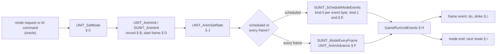
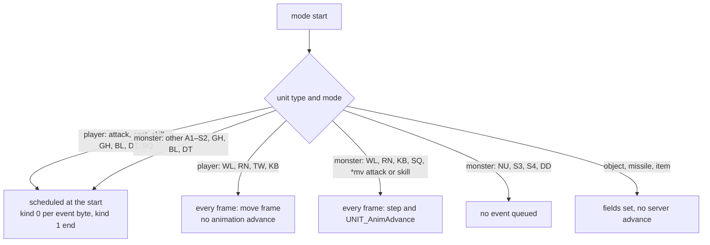
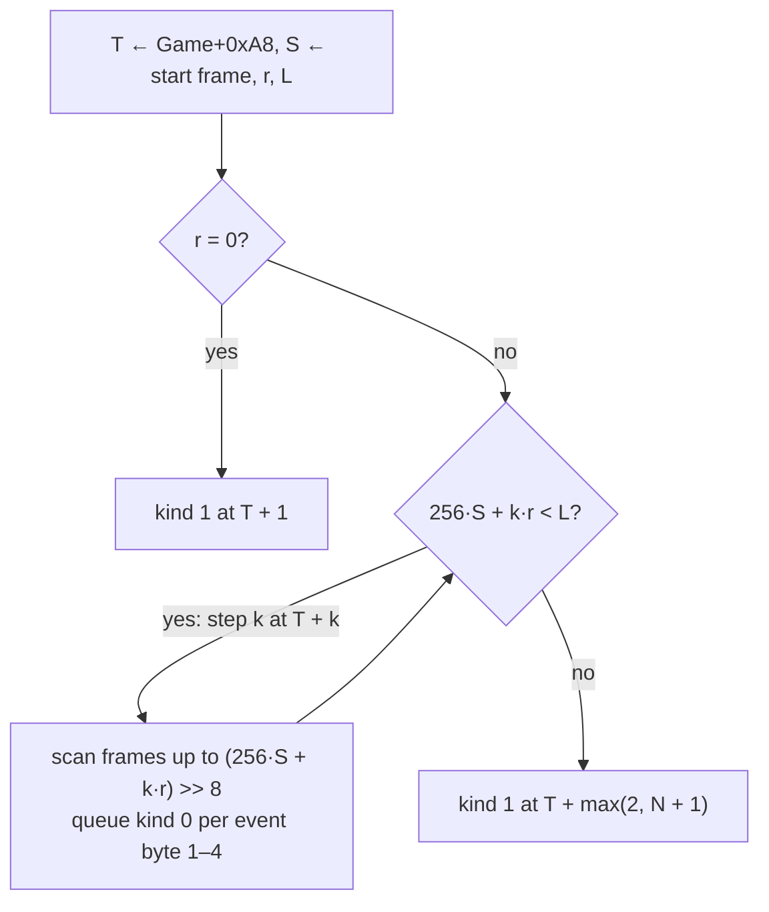
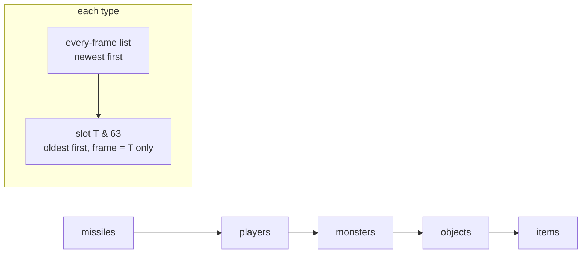
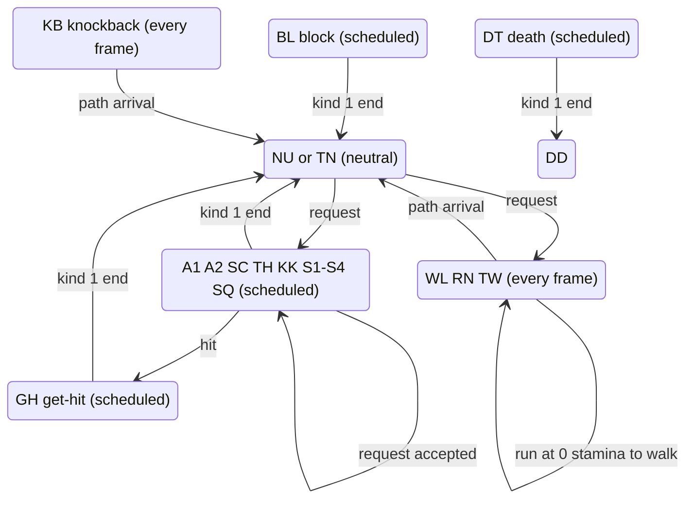
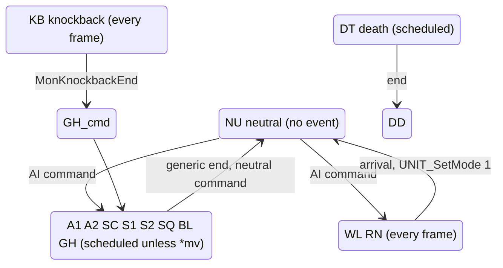
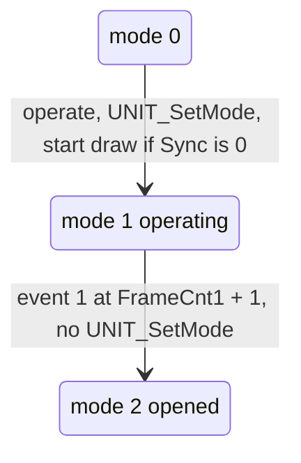
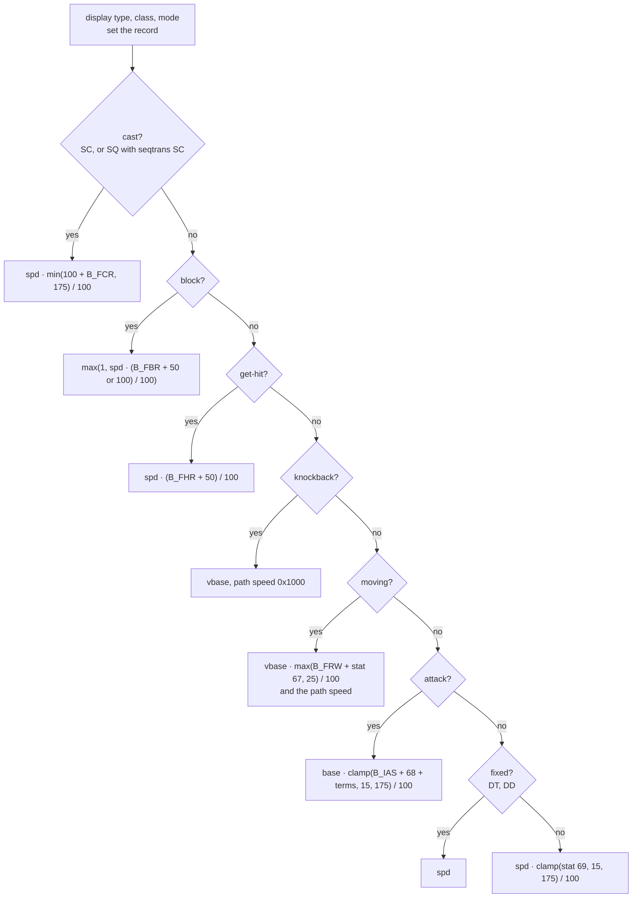
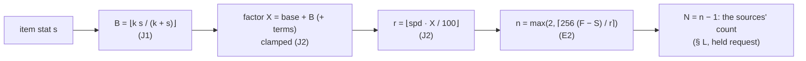
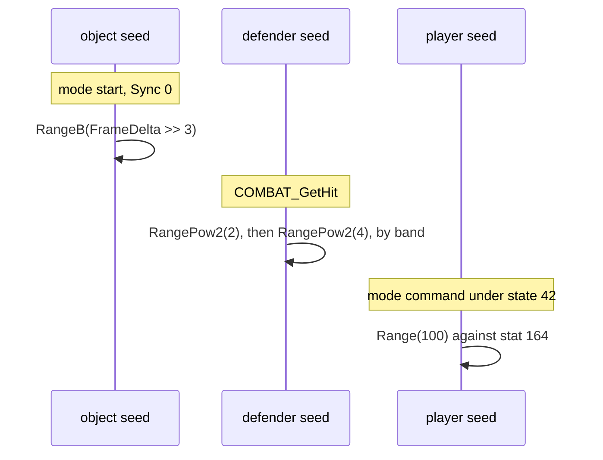

# Animation timing: modes, records, the schedule, the frame advance, rates, breakpoints and the gates

## Purpose

When a unit enters a mode, the server looks up the mode's animation record, sets the unit's frame fields, computes
its rate from the unit's stats and weapon, and either **schedules** the mode's frame events and its end on the game
frames they fall on, or (for a monster's every-frame modes) **advances** the frame once per game frame. The frame
events run the do function, the melee strike and the sequence steps; the end starts the next mode. This page
specifies that machinery for players, monsters and objects, the rate of every mode and the breakpoints it gives, and
the gates that sit on it: the do frame, the skill delay, hit recovery, the block, the get-hit roll and the player's
mode tests. How far a moving unit gets per frame is [anim/movement](movement.md). Which mode a unit is asked to
enter, and when, is an input: the request for a player ([skills/dispatch § B](../skills/dispatch.md#b-the-request)),
the AI's command for a monster (phase (5)). Overview and boundary: [anim](README.md).



## Entry points

| When | Function | Tag |
|---|---|---|
| A unit's mode changes | fn:UNIT_SetMode@0x00624690 → fn:UNIT_AnimInit@0x00624390 | [I] |
| A server player or monster mode starts | fn:SUNIT_AnimInit@0x005533D0 | [I] |
| A scheduled mode's events are queued | fn:SUNIT_ScheduleModeEvents@0x005539B0 | [C] (run:2026-10-27-anim: 25 848 schedules) |
| An every-frame mode starts | fn:SUNIT_ModeEveryFrame@0x00553F00 | [C] (run:2026-10-27-anim: 9 682 starts) |
| Each game frame, the unit event lists run | fn:sub_005414D0_GameRunUnitEvents@0x005414D0 | [I] |
| An every-frame monster's frame advances | fn:UNIT_AnimAdvance@0x00623E00 | [C] (run:2026-10-27-anim: 2 927 advances) |
| A unit's rate is (re)computed | fn:UNIT_AnimSetRate@0x00623F50 | [C] (run:2026-10-27-anim: 298 373 calls) |
| A player's mode ends | fn:sub_00581020_PlayerModeEnd@0x00581020 | [I] |
| A monster's mode command | fn:sub_005A7C20_MonSetMode@0x005A7C20 | [I] |
| A hit reaches the defender's mode | fn:COMBAT_GetHit@0x0057CEE0 | [I] |
| The get-hit decision | fn:sub_0057CB00_GetHitRoll@0x0057CB00 | [C] (run:2026-10-27-anim: 7 195 calls) |
| A player mode request is tested | fn:sub_0057EDD0_PlrModeLeaveOk@0x0057EDD0, fn:sub_0057EEC0_PlayerModeAllowed@0x0057EEC0 | [I] |

## Inputs

### Tables

| Anchor | Used for |
|---|---|
| `animdata.d2` (fmt:animdata#layout: `name`, `frames`, `speed`, `events`) | the record of a mode: length, speed, the event byte of each frame (§ B) |
| tbl:PlrType.txt:Token, tbl:MonStats.txt:Code, tbl:ObjType.txt:Token | the first part of the record name (§ B) |
| tbl:PlrMode.txt:Token, tbl:MonMode.txt:token, tbl:ObjMode.txt:Token | the mode token of the name (§ B) |
| tbl:CharStats.txt:baseWClass, tbl:Weapons.txt:wclass, tbl:Weapons.txt:2handedwclass, tbl:MonStats2.txt:BaseW | the weapon class of the name (§ B) |
| tbl:MonStats2.txt:compositeDeath, tbl:MonStats2.txt:mDT (the `m<mode>` bits), tbl:MonStats2.txt:A1mv (the `*mv` bits) | the death record, the modes a class has, the every-frame attack and skill modes (§§ B, I) |
| tbl:States.txt:gfxtype, tbl:States.txt:gfxclass, tbl:States.txt:meleeonly | the shapeshift display and its attack base (§§ B, J) |
| tbl:Skills.txt:seqnum, tbl:Skills.txt:seqtrans, tbl:Skills.txt:UseAttackRate, tbl:Skills.txt:interrupt, tbl:Skills.txt:delay, tbl:Skills.txt:durability | sequences, the rate branch, the mode tests, the delay (§§ G, J, L, M) |
| tbl:MonStats.txt:Sk1mode, tbl:MonStats.txt:Skill1, `monseq` (tbl:MonSeq.txt:sequence, `mode`, `frame`, `event`) | a monster's sequence (§ G) |
| tbl:MonStats.txt:SplGetModeChart, tbl:MonStats.txt:SplEndGeneric, tbl:MonStats.txt:SplEndDeath, tbl:MonStats.txt:aidel | the monster mode overrides and ends (§ I) |
| tbl:Objects.txt:FrameCnt0, tbl:Objects.txt:Start0, tbl:Objects.txt:FrameDelta0, tbl:Objects.txt:Sync, tbl:Objects.txt:Mode1, tbl:Objects.txt:Mode2, tbl:Objects.txt:FrameCnt1 | an object's frame fields, its start draw and its operate end (§§ C, I) |
| tbl:Missiles.txt:animrate, tbl:Missiles.txt:AnimLen | a missile's frame fields (§ C) |
| tbl:ItemStatCost.txt:Stat (stats 67–69, 93, 95, 96, 99, 102, 105, 164), tbl:ItemStatCost.txt:damagerelated | the rate terms (§ J), the block gate (§ M) |
| tbl:Weapons.txt:speed, tbl:Weapons.txt:hitclass, tbl:MonStats2.txt:HitClass, tbl:Missiles.txt:HitClass (codes: [HitClass](../../tables/HitClass.md)) | the attack rate (§ J), the hit class (§ M) |

### Runtime state

| State | Type | Source |
|---|---|---|
| struct:Unit+0x44 | i32, frame 8.8 (a scheduled mode: the schedule's game frame `<< 8`) | § C, § E, § F |
| struct:Unit+0x48 | i32, length, frames `<< 8` (a sequence: the frames left `<< 8`) | § C, § G |
| struct:Unit+0x4C | i16, rate 8.8 per game frame, clamped to `[0, 0x7FFF]` | § J |
| struct:Unit+0x4E | u8, the event byte of the frames last crossed (1–4), else 0 | § F, § G |
| struct:Unit+0x50 | the `animdata.d2` record (`AnimDataRec`) | § B |
| struct:Unit+0x30, struct:Unit+0x34, struct:Unit+0x38, struct:Unit+0x3C, struct:Unit+0x40 | a sequence's frames, length `<< 8`, position 8.8, step 8.8, current frame's mode | § G |
| struct:Unit+0xC4 | bit 6 (the do ran), bit 14 (sequence mode changed), bit 19 (monster mode command) | § G, § L |
| struct:Unit+0x20 | the unit seed (`Seed64`, [rng](../rng/README.md)) | the object start draw (§ C), the get-hit roll (§ M) |
| struct:Game+0xA8 | i32, the current game frame `T` | § E, § H |
| the unit's stat lists | stats 67, 68, 69, 93, 96, 99, 102, 105 as the aggregate holds them ([stats/aggregate](../stats/aggregate.md)) | § J |

### Inputs and oracles

| Input | How it enters | Tag |
|---|---|---|
| The mode request (a player's packet, the pilot's client) and the AI's command | logged and taken as given (ADR-0004); the server's handling from the request on is specified | [C] (run:2026-10-27-anim) |
| A catalogue function's reschedule (§ E3), its own event queue after a cancel, its writes of the frame word or `+0x4E` | outputs taken as given (plan 0046's catalogue) | [I] (fn:sub_00553DC0_RescheduleAt@0x00553DC0, fn:sub_005417D0_UnitQueueEvent@0x005417D0) |
| The stats behind the rate | values of the aggregate | [C] (run:2026-10-27-anim) |

### Constants

| Name | Value | Anchor | Tag |
|---|---|---|---|
| fallback record | 2 048 frames, speed 256, no event byte | fn:ANIMDATA_Load@0x0066A770 (0x0066A80A, 0x0066A814) | [I] |
| event-byte scan bound | frames `< 0x90` (144) | fn:SUNIT_ScheduleModeEvents@0x005539B0 (0x00553A40) | [I] |
| rate bonus `k` | 120 (stats 93, 99, 102, 105), 150 (stat 96) | data:g_AnimRateBonus@0x006E8E24 | [C] (run:2026-10-27-anim-rates-emu) |
| attack and default factor clamp | 15..175 | fn:UNIT_AnimSetRate@0x00623F50 | [C] the attack's 175 (run:2026-10-27-anim); [I] the floor 15 |
| cast factor cap | 175 | fn:UNIT_AnimSetRate@0x00623F50 (0x00623FDA–0x00623FE1) | [C] (run:2026-10-27-anim) |
| player sequence attack term | −30 | 0x00624290–0x0062429B | [C] (run:2026-10-27-anim) |
| block gate | `⌊stat 102 / 8⌋ + 15` frames | 0x0057D282–0x0057D2D6 | [C] (run:2026-10-27-anim) |
| `PlrModeEndPending` slack | 5 frames | fn:sub_0057ED70_PlrModeEndPending@0x0057ED70 | [I] |

## Algorithm

### A. The two clocks and the event kinds



- A1. [I] **Two clocks.** A player's attack, cast, skill, get-hit, block, death and sequence modes, and a monster's
  A1–S2, get-hit, block and death modes outside its `*mv` bits, are **scheduled** at their start: one pass of
  `SUNIT_ScheduleModeEvents` queues a unit event of kind 0 per frame-event byte on the game frame it falls on and one
  event of kind 1 (the mode end). A monster's walk, run, knockback and sequence modes, and its A1, A2, SC and S1–S4
  modes whose MonStats2 `*mv` bit is set, run an **every-frame** event that steps and calls `UNIT_AnimAdvance`.
  (fn:SUNIT_ScheduleModeEvents@0x005539B0, fn:SUNIT_ModeEveryFrame@0x00553F00, fn:UNIT_AnimAdvance@0x00623E00,
  data:g_MonModePerFrame@0x006E23D0, tbl:MonStats2.txt:A1mv) The schedule and the advance themselves are `[C]` where
  the run logs them (E1, F1). [C] (run:2026-10-27-anim)
- A2. [I] A player's walk, run, town walk and knockback run an every-frame event too, which steps the path but never
  calls `UNIT_AnimAdvance`; a monster's neutral, S3, S4 and dead modes queue nothing; objects, missiles and items get
  their frame fields at the start and no server advance through them (4 of `UNIT_AnimAdvance`'s 11 call sites and all
  5 of `UNIT_AnimAdvanceLoop`'s are client code). (fn:sub_0057F090_PlrModeStartMove@0x0057F090,
  fn:sub_005A7C20_MonSetMode@0x005A7C20, fn:UNIT_AnimAdvanceLoop@0x00621310)
- A3. [I] **Event kinds** (ADR-0014): *mode start* (inputs the mode, type, class, transform states, used skill, weapon
  items, record, the rate's stats and `T`; outputs `+0x10`, the frame fields, the queued kind-0/1 events; the object
  start draw only), *frame event* (kind 0 with code `a` and index `b`; outputs the mode frame function's effects),
  *mode end* (kind 1; outputs the next mode and its start), *frame advance* (every-frame monsters; no draw), *rate
  change* (§ J; no draw, no queued event). (fn:SUNIT_ScheduleModeEvents@0x005539B0, fn:UNIT_AnimAdvance@0x00623E00,
  fn:UNIT_AnimSetRate@0x00623F50)

### B. The animation record

```
B1. UNIT_AnimSetRecord(unit, type, class, mode):                  [C] (fn:UNIT_AnimSetRecord@0x00620F00, fn:ANIMDATA_Lookup@0x0066A9B0, fn:COMPOSIT_BuildCofName@0x0064F5B0, run:2026-10-27-anim, all of B1)
      (type, class, mode) are the display values (B3)
      name ← token(type, class) ‖ modeToken(type, mode) ‖ weaponClass(unit, type, class, mode)   ; spaces removed
      unit.+0x50 ← ANIMDATA_Find(name) or, when none, the fallback record (2 048 frames, speed 256, no event)   ; [I] the fallback: no case

B2. ANIMDATA_Find(name):                                          [I] (fn:ANIMDATA_Find@0x0066A8F0, all of B2)
      uppercase name in place ('a'..'z');  fatal if longer than 8 characters
      block: u8 ← (sum of the name's bytes) & 0xFF
      return the first record of that block whose first two dwords equal the name's
```

- B1. [C] **The name**, met at all 298 373 logged rate calls: a player's PlrType token, the PlrMode token (`GH` for
  modes 18 and 19), and `COMPOSIT_WeaponClass` (CharStats `baseWClass` without a weapon, the item's one- or
  two-handed class, `hth` in modes 0 and 17 and for a throw with a class other than `1hs`, `1ht`, `1js`, `1jt`, `1ss`,
  `1st`, the dual classes `1ss` and `ht2`); a monster's MonStats `Code`, the MonMode token (`KB` → `GH`) and MonStats2
  `BaseW` (`hth` in modes 0 and 12 without `compositeDeath`); a shapeshifted player's display class with the mode
  mapped through `g_PlrToMonMode` and its fallback chain. (fn:COMPOSIT_BuildCofName@0x0064F5B0,
  fn:COMPOSIT_WeaponClass@0x0064F060, fn:UNIT_AnimTransform@0x00645270, data:g_PlrToMonMode@0x006EB348,
  tbl:CharStats.txt:baseWClass, tbl:MonStats2.txt:BaseW, run:2026-10-27-anim)
- B1. [I] The Barbarian's dual classes `1js` (1hs + 1ht), `1jt` (1ht + 1ht) and `1st` (1ht + 1hs) and the fallback
  record are read from the code; no case of the run separates them. An object's name is its ObjType token, the ObjMode
  token and `hth`, but the server never looks an object's record up (C3). (fn:COMPOSIT_WeaponClass@0x0064F060,
  fn:ANIMDATA_Lookup@0x0066A9B0, run:2026-10-27-anim)
- B2. [I] **Duplicate names.** Of two records with one name (29 names in `animdata.d2`, 9 with different content), the
  one earlier in its block wins. Only `%s\AnimData.d2` under `DATA\GLOBAL` is loaded (d2exp's copy by the archive
  precedence); `eanimdata.d2` is not read by this loader. (fn:ANIMDATA_Find@0x0066A8F0, fn:ANIMDATA_Load@0x0066A770,
  [formats/animdata](../../formats/animdata.md#layout))
- B3. [C] **The shapeshift display.** With `Unit+0xC8` bit 3 set, the first state of the DataTables transform list
  that the unit has decides: States `gfxtype` 1 shows a player as a monster of class `gfxclass` (its mode mapped by
  `g_PlrToMonMode`, then down 5, 7 → 4; 6 → 3; 9–11 → 8; 15 → 2; others → 1 until MonStats2 `mDT`…`mRN` has it);
  the record, the start frame and the rate all take the display values (758 transformed calls of the werewolf and
  werebear, display classes 430 and 431). (fn:UNIT_AnimTransform@0x00645270,
  fn:sub_00645190_PlrToMonMode@0x00645190, tbl:States.txt:gfxtype, run:2026-10-27-anim) `gfxtype` 2 shows a monster as
  a player class of class `gfxclass`, its mode mapped by `g_MonToPlrMode`; no case of the run has it. [I] (data:g_MonToPlrMode@0x006EB308)
- B4. [I] A record's `frames` gives `+0x48 = frames << 8` at every non-sequence start; its `speed` is the base of the
  rate (§ J); its event byte for frame `f` is read only for `f < 0x90`. (0x00624470, 0x006244F1, 0x00553A40)

### C. The mode start

```
C1. UNIT_SetMode(unit, mode) → bool:                              [I] (fn:UNIT_SetMode@0x00624690, all of C1)
      if unit is null or unit.type = 5: return 0
      if unit.mode = mode: refresh only (no animation start); return 0
      unit.mode ← mode;  drop the stat lists flagged to end on a mode change
      UNIT_AnimInit(unit);  return 1

C2. UNIT_AnimInit(unit):                                          [I] (fn:UNIT_AnimInit@0x00624390, all of C2)
      +0x4E ← 0;  +0x44 ← UNIT_AnimStartFrame(unit) << 8;  (type, class, mode) ← display values
      type 0 (player form):  if mode ∈ {3, 19}: RunVelocityStat (anim/movement A2)
                             if mode ≠ 18: +0x30 ← 0; UNIT_AnimSetRate; +0x48 ← rec.frames << 8
                             else:         UNIT_SeqInit; UNIT_AnimSetRate
      type 1 (monster form): a player shown in mode 13 or 15: RunVelocityStat
                             if mode ≠ 14: UNIT_AnimSetRate; +0x30 ← 0; +0x48 ← rec.frames << 8
                             else:         UNIT_SeqInit; UNIT_AnimSetRate
      type 2 (object, mode < 8 else fatal):
        +0x48 ← Objects.FrameCnt[mode]                            ; already << 8 at load
        +0x44 ← Objects.Start[mode] << 8
        fd: i32 ← (i16) Objects.FrameDelta[mode]
        if Objects.Sync ≠ 0: +0x4C ← fd
        else:
          d: i32 ← 0
          if (fd >> 3) ≥ 1: d ← RNG.RangeB(seed: unit.seed, n: fd >> 3)       ; draw#1
          +0x4C ← clamp(fd − (fd >> 4) + d, 0, 0x7FFF)                       ; >> arithmetic
      type 3 (missile): +0x4C ← Missiles.animrate × 256 ÷ 1024; +0x48 ← (u8 AnimLen) << 8 ; 0 without a row
      type 4 (item): mode 3: +0x4C ← 0, +0x48 ← 0x1100, +0x44 ← 0x1000;  mode 5: +0x4C ← 0x100, +0x48 ← 0x1100

C3. SUNIT_AnimInit(unit):                                         [I] (fn:SUNIT_AnimInit@0x005533D0, all of C3)
      +0x4E ← 0
      if (monster in mode 14 or player in mode 18) and the used skill has a sequence record:
        UNIT_SeqInit; UNIT_AnimSetRate; return
      +0x30 ← 0;  +0x44 ← 0
      if unit has a path (+0x2C): UNIT_AnimSetRate  else UNIT_AnimSetRecord
      +0x48 ← rec.frames << 8
```

- C1. [I] A request for the mode the unit is already in neither restarts the animation nor draws. (fn:UNIT_SetMode@0x00624690)
- C2. [C] **The object start draw.** At 725 logged object animation starts the rate is
  `FrameDelta − (FrameDelta >> 4) + draw` with draw#1 `RangeB(object seed, FrameDelta >> 3)` when `Sync` is 0 (490 starts) and no draw otherwise
  (235), and `+0x44`, `+0x48` as C2. (fn:UNIT_AnimInit@0x00624390, 0x00624563, tbl:Objects.txt:Sync,
  tbl:Objects.txt:FrameDelta0, run:2026-10-27-anim) The draw's place in the object seed's draw order is
  [objects § G](../objects/README.md#g-creation-sunitcreate-for-an-object)'s; no chained pair of two start draws on
  one object was logged (7 pairs, each with another draw between). [I] (run:2026-10-27-anim)
- C2. [I] An object's server frame fields come from the Objects row, never from its `animdata.d2` record (the object
  branch calls neither `UNIT_AnimSetRate` nor `UNIT_AnimSetRecord`), so a disagreement between the two (`FrameCnt`
  equals the record's `frames` in 1 173 of 1 483 joined modes) has no server effect. The Objects loader shifts the
  eight `FrameCnt` dwords left by 8, so an object's `+0x48` is 8.8 like every other type's.
  (fn:UNIT_AnimInit@0x00624390, fn:sub_0063F690_ObjectsLoad@0x0063F690, 0x00640E33–0x00640E64,
  [Objects § Timing](../../tables/Objects.md#timing-plan-0050-phase-0))
- C2. [I] The rate no server code reads back for an object, a missile or an item (no server advance, A2); for a
  missile its own frame is [skills/missiles](../skills/missiles.md)'s range countdown. (fn:UNIT_AnimInit@0x00624390)
- C3. [I] **A scheduled mode starts from `+0x44 = 0`** whatever C2 set; the schedule reads the start frame from
  `UNIT_AnimStartFrame` itself (§ E). C3's second rate call, after C2 has written the new `+0x48`, is the one that
  sets the rate a schedule uses. (fn:SUNIT_AnimInit@0x005533D0, fn:SUNIT_ScheduleModeEvents@0x005539B0)

### D. The start frame

```
D1. UNIT_AnimStartFrame(unit) → i32:                              [C] (fn:UNIT_AnimStartFrame@0x00623B10, data:g_AttackStartFrames@0x006E8E60, run:2026-10-27-anim, all of D1)
      if display type = 0 and (mode ∈ {7, 8} or (mode ∈ {15, 16} and UNIT_CanDualWield(unit))):   ; [I] the S3/S4 half: its cells are 0
        item ← SkillSrcDamWeapon(unit, 1)
        wc: i32 ← item ? ItemWeaponClassIndex(item) : 0    ; bow 1, 1hs 2, 1ht 3, stf 4, 2hs 5, 2ht 6, xbw 7, ht1 12, else 0
        return g_AttackStartFrames[wc × 7 + class]
      return 0
```

- D1. [C] The return equals `g_AttackStartFrames[wclass][class]` at all 25 149 logged schedules that read it: 1 or 2
  in the Amazon's and the Sorceress's A1 with a weapon, 0 elsewhere.
  (data:g_AttackStartFrames@0x006E8E60, run:2026-10-27-anim)
- D1. [I] The table's non-zero cells are those two classes' only: 1 for hand to hand, 2 for `1hs`, `1ht`, `stf`,
  `2hs` and `2ht`; rows `bow`, `xbw` and `ht1` are 0 for every
  class; the S3/S4 dual-wield branch was met (`BAS31SS`, `AIS4HT2`) but its cells are 0, so it is not separated. The
  start frame is added at the schedule's start and after each wrap of the advance. (data:g_AttackStartFrames@0x006E8E60,
  data:g_ItemWeaponClassIndex@0x007446A0, run:2026-10-27-anim)

### E. The schedule



```
E1. SUNIT_ScheduleModeEvents(game, unit):                         [C] (fn:SUNIT_ScheduleModeEvents@0x005539B0, run:2026-10-27-anim, all of E1)
      T: i32 ← game.frame;  t: i32 ← T;  S: i32 ← UNIT_AnimStartFrame(unit) << 8
      if unit.+0x30 ≠ 0: r ← unit.+0x3C; L ← unit.+0x34            ; a sequence
      else:              r ← (i32)(i16) unit.+0x4C; L ← unit.+0x48
      if r = 0: UnitQueueEvent(kind 1, frame T + 1); return        ; [I] no logged rate is 0
      f: i32 ← S >> 8;  n: i32 ← 0;  acc: i32 ← S + r
      while acc < L:                                               ; signed 32-bit compares
        t ← t + 1
        while f ≤ (acc >> 8) and f < 0x90:                       ; [I] the 0x90 bound: no stock record with an event reaches it
          e ← unit.+0x30 ? SeqFrameEvent(f << 8) : rec.events[f]
          if e ∈ {1, 2, 4}: UnitQueueEvent(kind 0, frame t, a: e, b: n); n ← n + 1
          else if e = 3:    UnitQueueEvent(kind 0, frame t, a: 3, b: 0)
          f ← f + 1
        acc ← acc + r
      if t = T: t ← t + 1                                          ; [I] no step: E2
      UnitQueueEvent(kind 1, frame t + 1)
      unit.+0x44 ← T << 8
```

- E1. [C] All 25 848 logged schedules (players and monsters, sequences among them) queue exactly E1's kind-0 list and
  kind-1 end from the start frame, the rate and the length of the unit's last rate call and record, and the 42 542
  queued events fire at their frames unless cancelled first; no dispatch fires an event the schedulers did not queue
  (42 449 dispatches). (fn:SUNIT_ScheduleModeEvents@0x005539B0, fn:sub_00581220_PlayerEventDispatch@0x00581220,
  fn:sub_005A7F80_MonEventDispatch@0x005A7F80, run:2026-10-27-anim)
- E1. [I] Outside that `[C]`: 124 dispatches (110 kind 0, 14 kind 1) 0–4 frames after a catalogue skill function's own
  `UNIT_CancelEvents` call, each followed at once by that function's own `UnitQueueEvent` call, which the run did not
  log. They are an **uncompared catalogue path** (plan 0046), not a boundary oracle: the queue's output is not
  logged, so nothing was taken as given. (fn:UNIT_CancelEvents@0x00540E60, fn:sub_005417D0_UnitQueueEvent@0x005417D0,
  run:2026-10-27-anim)
- E2. [C] **The length.** For `L = 256 F` and `F > S` the end fires at `T + n`, `n(r) = max(2, ⌈256 (F − S) / r⌉)`, at
  every logged rate (25 848 lengths). (fn:SUNIT_ScheduleModeEvents@0x005539B0, run:2026-10-27-anim)
- E2. [I] **The event frames**, derived from E1's loop: with `N = ⌈256 (F − S) / r⌉ − 1` steps, frame `f ≥ S` fires
  at `T + k_f`, `k_f = max(1, ⌈256 (f − S) / r⌉)`, only when `k_f ≤ N`; the first step carries frame `S` and every
  frame up to `(256 S + r) >> 8`; frames after the last step's are never scanned; no frame event shares the end's
  frame. When `r ≥ 256 (F − S)` (no step) no frame event fires at all, not even frame `S`'s, and the end is at `T + 2`.
  (fn:SUNIT_ScheduleModeEvents@0x005539B0, 0x00553A16, 0x00553A0C–0x00553AF1)
- E2. [I] On stock data a player never reaches the no-event case (the start frames 1 and 2 are A1's and A2's and no
  stock record with an event reaches `r ≥ 256 (F − S)` at a factor ≤ 175); a two-frame monster record would need
  `r ≥ 512`, which no stock source gives. ([plan 0050 log](../../plans/0050-animation-frame-timing.md#implementation-log),
  P1.2 review rulings (f) and `lane/a50t` (c); fn:SUNIT_ScheduleModeEvents@0x005539B0)
- E3. [I] **Reschedules (catalogue).** Three functions cancel kinds 0 and 1 and rebuild the list from an elapsed
  position `p` (frames): steps `256 p + k r < L`, the scan from frame `p − 1`, every code 1–4 queued with `b = 0`, no
  `0x90` bound, the end as E1. `RescheduleFromPct(pct)`: `p = (T − (+0x44 >> 8)) · (100 − pct) / 100` (signed),
  `+0x44 = (T − p) << 8` (Dragon Talon, Strafe, Fend); `RescheduleSkip(n > 0)`: `p = T − (+0x44 >> 8) − n` (Inferno,
  Blade Fury); `RescheduleAt(n)`: `p = n`, `+0x44 = (T − n) << 8` (Charge, Whirlwind, Leap Attack). Their arguments
  are catalogue values (plan 0046). (fn:sub_00553B10_RescheduleFromPct@0x00553B10,
  fn:sub_00553C70_RescheduleSkip@0x00553C70, fn:sub_00553DC0_RescheduleAt@0x00553DC0)
- E4. [I] **Callers.** The player starts for get-hit, block, the skill modes and death, and `MonSetMode` for a
  scheduled monster mode; each first cancels the unit's kinds 0 and 1. The skill starts schedule **before**
  `SKILLS_StartUsedSkill`, so a start function can still reschedule. (fn:sub_0057FE30_PlrModeStartGetHit@0x0057FE30,
  fn:sub_0057FDC0_PlrModeStartBlock@0x0057FDC0, fn:sub_0057FE90_PlrModeStartSkillXY@0x0057FE90,
  fn:sub_00580EC0_PlayerDeath@0x00580EC0, fn:sub_005A7C20_MonSetMode@0x005A7C20, 0x0057FED3)

### F. The per-frame advance (every-frame monsters)

```
F1. UNIT_AnimAdvance(unit):                                       [C] (fn:UNIT_AnimAdvance@0x00623E00, run:2026-10-27-anim, all of F1)
      +0x4E ← 0
      if +0x30 ≠ 0: the sequence advance (G3); return
      f: i32 ← +0x44 >> 8;  if (i16) +0x4C ≥ 0x100: f ← f + 1      ; 16-bit signed compare
      +0x44 ← +0x44 + +0x4C
      while +0x44 ≥ +0x48:
        for f ..< (+0x48 >> 8): take(f)
        +0x44 ← +0x44 − +0x48;  f ← 0;  +0x44 ← +0x44 + (UNIT_AnimStartFrame(unit) << 8)   ; [I] a start frame ≠ 0: no case
      for f ... (+0x44 >> 8): take(f)
      ; take(f): if f < 0x90 and rec.events[f] ∈ 1..4: +0x4E ← rec.events[f]     (the last one wins)

F2. UNIT_AnimAtEnd(unit) → bool:                                   [I] (fn:UNIT_AnimAtEnd@0x006217C0)
      sequence: +0x48 < 1;  else: +0x48 ≤ +0x44 + +0x4C
```

- F1. [C] 2 927 consecutive advances of windowed every-frame monsters (knockback among them) give the next `+0x44` and
  event byte. (fn:UNIT_AnimAdvance@0x00623E00, run:2026-10-27-anim)
- F1. [I] Below a rate of `0x100` the frame the unit stood on is scanned again, so one event byte can be taken on two
  consecutive frames; at `0x100` or more each frame is taken once. (0x00623E58–0x00623E6E)
- F1. [C] **The advance reads the rate at its call** (an ADR-0015 map: 1 200 emulated pairs, the second call at a new
  rate, 0 mismatches; 1 114 of the 1 120 changed pairs would mismatch at the old rate). (fn:UNIT_AnimAdvance@0x00623E00,
  run:2026-10-27-anim-rates-emu) So an every-frame monster re-computed mid-mode advances at the new rate from its
  next advance on (the slowed monster windows of the run among them). [C] (run:2026-10-27-anim)
- F2. [I] The every-frame monster frame functions call F2 after advancing; the length `+0x48` stays the start's, so a
  rate change shortens such a mode only through the frame position. (fn:UNIT_AnimAtEnd@0x006217C0)

### G. Sequences

```
G1. Which sequence record:                                        [I] (fn:sub_00663310_UnitSeqRecord@0x00663310, fn:sub_00643D00_SkillSeqIndex@0x00643D00, all of G1)
      player:  idx ← Skills[used].seqnum;  monster: idx ← MonStats.Sk<k>mode ordinal, k the first with Skill<k> = used
               (0 when absent or for skill 199)
      if idx < 1: no sequence
      player:  g_PlrSeqTables[idx] + 12 × column(weapon class)    ; no bound test on idx
      monster: the monseq sequence of that ordinal (MONSEQ_Load's index)

G2. UNIT_SeqInit(unit):                                            [I] (fn:UNIT_SeqInit@0x00621260)
      +0x30 ← frames;  +0x34 ← length << 8;  +0x38 ← 0;  +0x3C ← 0x100;  +0x48 ← frames << 8
      UNIT_SeqReadFrame(0);  +0xC4 |= 0x4000

G3. the sequence advance (in UNIT_AnimAdvance, monster mode 14):   [C] (fn:UNIT_AnimAdvance@0x00623E00, fn:UNIT_SeqReadFrame@0x00621210, fn:SEQ_ReadFrame@0x00663410, run:2026-10-27-anim, all of G3)
      prev ← +0x38;  +0xC4 &= ~0x4000
      +0x38 ← +0x38 + +0x3C;  if +0x38 ≥ +0x34: +0x38 ← +0x38 − +0x34
      +0x48 ← +0x48 − +0x3C
      the frame at +0x38 >> 8: +0x40 ← mode;  +0x44 ← frame << 8
      +0x4E ← the last non-zero event of the rows (prev >> 8) + 1 … (+0x38 >> 8)   ; its own row's when +0x38 = prev; 0 after a wrap
      if +0x40 changed: +0xC4 |= 0x4000
      ; the mode ends when +0x48 < 1 (F2)
```

- G1. [I] A sequence frame is 6 bytes (mode, frame, direction, event, after a u16 sequence id); `MONSEQ_Load` sets a
  sequence's length and frame count to its row count. The player tables have 207 non-empty entries; the 25 stock rows
  with a `charclass` and a `seqnum` stay within the 24 entries. (fn:MONSEQ_Load@0x00659C60,
  data:g_PlrSeqTables@0x007483B8, tbl:Skills.txt:seqnum)
- G3. [C] 1 453 logged monster sequence advances (mode 14, the `monseq` rows of the used skill) give the next position,
  length, frame, event byte and mode. (fn:SEQ_ReadFrame@0x00663410, run:2026-10-27-anim)
- G3. [I] In two advances the byte was 0 where the rows give 1: read as the do of that event clearing it (do 87 stores 0
  at `+0x4E`, 0x005CB48E; dos 89 and 103 have such stores too). That is a catalogue write after the advance (plan
  0046), not the advance's result. (fn:sub_005CB3C0_SkillDo87MaggotLay@0x005CB3C0, run:2026-10-27-anim)
- G4. [I] **The event of a sequence is the sequence row's**, never the `animdata.d2` byte of the row's frame: both the
  schedule and the advance read the sequence record while `+0x30` is set, and a row's `frame` only sets `+0x44`. So
  `monseq` steps whose frame lies past the user's record (249 on stock data) read nothing through the record.
  (fn:UNIT_SeqReadFrame@0x00621210, fn:SUNIT_ScheduleModeEvents@0x005539B0, 0x00553A48)
- G5. [I] **A player's sequence** (mode 18) is scheduled once from its step `+0x3C` and length `+0x34` (E1) and is not
  advanced on the server; at each of its frame events `PlrModeSkillFrame` writes the running event's index `b` into
  `+0x38 >> 8` when a skill is in use. So for a player `+0x38 >> 8` is the index of the code-1/2/4 event being run (0
  for the first), which is what skills/dispatch's sequence delay gate and do 35's parity read.
  (fn:sub_00580460_PlrModeSkillFrame@0x00580460, 0x00580482–0x00580488, fn:sub_006212C0_UnitSetSeqPos@0x006212C0)

### H. The event queue and the frame order



- H1. [I] `UnitQueueEvent(game, unit, kind, frame, a, b)` takes kinds below 15, raises a frame at or below the current
  one to the current + 1, and appends the record to slot `frame & 63` of the unit type's list; a frame of −1 puts it
  at the head of the type's every-frame list. (fn:sub_005417D0_UnitQueueEvent@0x005417D0,
  fn:sub_005416B0_EventQueueAt@0x005416B0, fn:sub_005415E0_EventQueueEveryFrame@0x005415E0, struct:Game+0xA8)
- H2. [I] Each game frame runs the missile, player, monster, object and item lists in that order, each its
  every-frame list (newest first) and then the current frame's slot (oldest first, only records whose frame equals
  the current one, then freed). (fn:sub_005414D0_GameRunUnitEvents@0x005414D0, 0x005414EE–0x00541589)
- H2. [C] **The first run of an every-frame event**: in the frame it is queued when queued before its type's
  every-frame list is walked (the runner's phase below 3 for players, below 5 for monsters), else in the next frame
  (9 682 starts; every player start ran next-frame). So the first step of a moving mode and the first knockback
  advance run in the start's frame only when the start comes before the type's list. (fn:SUNIT_ModeEveryFrame@0x00553F00,
  fn:sub_005415E0_EventQueueEveryFrame@0x005415E0, run:2026-10-27-anim)
- H3. [I] **Dispatch.** A player record goes to `g_PlayerEventFuncs[kind](a, b)`: kind 0 runs the mode's frame
  function and, on its return of 2, `PlayerModeEnd`; kind 1 runs `PlayerModeEnd`. A monster record goes to
  `MonEventDispatch`, which drops every kind but 3, 4, 5, 8 and 12 while a living monster has state 1 (`freeze`), then
  kind 0 runs the mode record's frame function (called with the game and unit only; **its return is not used**) and
  kind 1 its end function. A dropped scheduled record is freed, so a frozen monster loses those frame events and its
  mode end. (fn:sub_00581220_PlayerEventDispatch@0x00581220, fn:sub_005811D0_PlayerModeFrameEvent@0x005811D0,
  fn:sub_005A7F80_MonEventDispatch@0x005A7F80, fn:sub_005A7BA0_MonModeFrameEvent@0x005A7BA0, 0x005410C4)
- H3. [I] With no mode record or no function in it, the monster handlers call `0x005A7B30`: clear the used skill and,
  unless the unit is dead outside DT and DD, start neutral. (fn:sub_005A7BE0_MonModeEndEvent@0x005A7BE0, 0x005A7DFD)

### I. The mode machines

#### I1. Players



| Mode | Start | Events | End → | Tag |
|---|---|---|---|---|
| 1 NU, 5 TN | `PlrModeStartNeutral` (5 in a town room) | none | — | [I] (fn:sub_0057F020_PlrModeStartNeutral@0x0057F020) |
| 2 WL, 3 RN, 6 TW, 19 KB | `PlrModeStartMove` | every frame (`PlrModeMoveFrame`) | neutral on arrival | [I] (fn:sub_0057F090_PlrModeStartMove@0x0057F090) |
| 4 GH, 9 BL | `PlrModeStartGetHit`, `PlrModeStartBlock` | scheduled | neutral | [I] (fn:sub_0057FE30_PlrModeStartGetHit@0x0057FE30) |
| 7, 8, 10–16, 18 | `PlrModeStartSkillXY` / `…Unit` | scheduled (`PlrModeSkillFrame`) | neutral | [I] (fn:sub_0057FE90_PlrModeStartSkillXY@0x0057FE90) |
| 0 DT | `PlayerDeath` | scheduled | 17 DD | [I] (fn:sub_00580EC0_PlayerDeath@0x00580EC0) |

(data:g_PlayerModeStartFuncs@0x006E1740, data:g_PlayerModeFrameFuncs@0x00732C10)

- I1. [I] `PlayerModeEnd` (kind 1, or a frame function's 2): for modes 7, 8, 11 or a used skill with Skills
  `durability` it refreshes the hands first; then mode 0 → `PlayerDeathModeEnd(17)`; mode 19 → a get-hit start after
  `PlayerModeAllowed(4)`; every other mode → neutral. (fn:sub_00581020_PlayerModeEnd@0x00581020, tbl:Skills.txt:durability)
- I1. [I] `PlrModeStartMove`: a run with stamina 0 becomes a walk; walk and town walk become 6 in a town, else 2;
  knockback sets path type 8; a refused path gives neutral; otherwise `SUNIT_SetMode`, cancel, `SUNIT_ModeEveryFrame`.
  `PlrModeMoveFrame` steps ([anim/movement § C](movement.md#c-who-steps)), drains a run ([anim/movement § D](movement.md#d-the-run-drain)),
  and on arrival sets neutral (or runs the queued interact or skill) and returns 2; so `PlayerModeEnd` sees mode 1 or
  5 and its knockback branch is not reached from this path, and no kind-1 event is queued for mode 19.
  (fn:sub_0057F090_PlrModeStartMove@0x0057F090, fn:sub_00580C20_PlrModeMoveFrame@0x00580C20)
- I1. [I] `PlrModeStartGetHit` and `PlrModeStartBlock`: `SUNIT_SetMode(4 or 9)`, `SUNIT_AnimInit`, clear the used
  skill, cancel, schedule; `PlrModeStartSkillXY`: path target, `SUNIT_SetMode`, `SUNIT_AnimInit`, cancel, schedule,
  clear `+0xC4` bit 6, `SKILLS_StartUsedSkill`. (fn:sub_0057FE30_PlrModeStartGetHit@0x0057FE30,
  fn:sub_0057FDC0_PlrModeStartBlock@0x0057FDC0, fn:sub_0057FE90_PlrModeStartSkillXY@0x0057FE90)

#### I2. Monsters



| Row | Mode | Frame function | End | `schedule` | Tag |
|---:|---|---|---|---:|---|
| 0 | DT | not moving: mode 12 at once; moving: step, advance, 12 at the end | mode 12, event 13; `SplEndDeath` | 1 | [I] (data:g_MonModeRecords@0x006E2260) |
| 1 | NU | `UNIT_CancelEvents(0, 0)` | — | 0 | [I] (data:g_MonModeRecords@0x006E2260) |
| 2, 15 | WL, RN | trails, step; arrival → generic end | — | 1 | [I] (data:g_MonModeRecords@0x006E2260) |
| 3, 6 | GH, BL | — | generic | 1 | [I] (data:g_MonModeRecords@0x006E2260) |
| 4, 5, 7, 8, 9 | A1, A2, SC, S1, S2 | `MonAttackFrame` | generic | 1 | [I] (data:g_MonModeRecords@0x006E2260) |
| 10, 11 | S3, S4 | S3: step, advance, at the end mode 11 | — | 0 | [I] (data:g_MonModeRecords@0x006E2260) |
| 12 | DD | — | — | 0 | [I] (data:g_MonModeRecords@0x006E2260) |
| 13 | KB | step, advance; at the end `MonKnockbackEnd` | `MonKnockbackEnd` | 1 | [I] (data:g_MonModeRecords@0x006E2260) |
| 14 | SQ | `MonSeqFrame` | generic | 1 | [I] (data:g_MonModeRecords@0x006E2260) |

(data:g_MonModeRecords@0x006E2260, data:g_MonModeEndDirect@0x0073C6D0)

- I2. [I] `MonSetMode(game, cmd, flag)`: fatal under state 54; for a mode other than 3, the path target, the move plan
  and the attack stats; the record's start (0 → clear the used skill and start neutral); then `+0xC4 |= 0x80000`,
  `SUNIT_AnimInit`, cancel kinds 0 and 1, and by the record of the **resulting** mode: `schedule` 0 → no event, else
  every frame (A1) or `SUNIT_ScheduleModeEvents`. (fn:sub_005A7C20_MonSetMode@0x005A7C20, 0x005A7DE7–0x005A7E2B,
  fn:sub_005A6B10_MonModeEveryFrame@0x005A6B10)
- I2. [I] **Class overrides** (MonStats `SplGetModeChart` set, all ten classes on stock data): 243, 333 and 705 take
  attack records for S3 (row 17) and S4 (row 16); 403 takes rows 18 (A1, A2) and 19 (S1, S2), each ending in a mode-8
  command; 417 and 418 take row 20 for S4; 543, 544, 570 and 709 take row 7 for S3. (fn:sub_005A78A0_MonModeRecord@0x005A78A0,
  0x005A7923–0x005A7990, tbl:MonStats.txt:SplGetModeChart)
- I2. [I] **`MonAttackFrame`.** With no used skill, a scheduled mode strikes (`MON_MeleeHit`, `COMBAT_DeliverQueued`) on
  **each** of its scheduled events (any code 1–4); an every-frame mode steps, advances and strikes only on a frame
  whose event byte is 1 (mode 14: bit 6 set). With a used skill it runs `SKILLS_DoUsedSkill` on every call, then
  advances. (fn:sub_005A7670_MonAttackFrame@0x005A7670, 0x005A76DF–0x005A7741)
- I2. [I] **`MonModeEndGeneric`** (GH, BL, A1–S2, SQ; WL and RN on arrival): a `SplEndGeneric` base class in its
  listed mode gets only the AI event (unless frozen and alive); otherwise, when `g_MonModeEndDirect[mode]` is 0 (all
  but WL and RN), the delayed hit of state 54, clear the used skill and a neutral command; WL and RN go to
  `UNIT_SetMode(1)` directly and then the AI event. (fn:sub_005A8030_MonModeEndGeneric@0x005A8030,
  tbl:MonStats.txt:SplEndGeneric)
- I2. [C] **`MonKnockbackEnd`** runs in the frame the knockback's advance reaches the length (541 ends, 3 585
  knockback frames, none ending earlier). (fn:sub_005A8520_MonKnockbackEnd@0x005A8520, fn:UNIT_AnimAtEnd@0x006217C0,
  run:2026-10-27-anim) [I] Its branches: path stop; when `MonModeAllowed(3)` refuses, the AI event at `T + 1`; base
  class 78 the AI event at `T + 15` (`T + 45` stunned); else clear the used skill, `Unit+0xB0 = 0xA0` and a get-hit
  command. (fn:sub_005A8520_MonKnockbackEnd@0x005A8520, struct:Unit+0xB0)
- I2. [I] `MonModeStartNeutral`: `SUNIT_SetMode(1)`; when the next AI event is not later than now, re-queue it at `T +
  45` under state 21 (`stunned`), else at `T +` MonStats `aidel` (by difficulty; 15 when 0). The AI's delay itself is
  phase (5)'s. (fn:sub_005A73E0_MonModeStartNeutral@0x005A73E0, tbl:MonStats.txt:aidel)

#### I3. Objects



- I3. [I] After a chest's drops `OBJOP_Chest` sets mode 1 (when `Mode1` is set) and queues object event 1 at `frame +
  (FrameCnt1 >> 8) + 1`; event 1 sets `Unit+0x10 = 2` when the object is still in mode 1 and the row has `Mode2`,
  **without** `UNIT_SetMode` (no animation start, so no start draw), and unmarks the footprint when
  `HasCollision2` is 0. The same queue form appears at 46 sites, two of them read. (fn:OBJOP_Chest@0x00585F60,
  fn:sub_00581490_ObjEvOperateEnd@0x00581490, 0x0058639A–0x005863B7, tbl:Objects.txt:FrameCnt1, tbl:Objects.txt:Mode2)

### J. The rate (`UNIT_AnimSetRate`)



```
J1. AnimRateBonus(unit, i) → i32:                                  [C] (fn:sub_00621740_AnimRateBonus@0x00621740, data:g_AnimRateBonus@0x006E8E24, run:2026-10-27-anim-rates-emu, all of J1)
      (k, stat) ← (120, 93) | (120, 99) | (120, 105) | (120, 102) | (150, 96)     ; i = 0..4: IAS, FHR, FCR, FBR, FRW
      s: i32 ← UnitGetStat(unit, stat, 0)
      return s = 0 ? 0 : (k × s) ÷ (k + s)                        ; signed imul, idiv toward zero

J2. UNIT_AnimSetRate(unit):                                        [C] (fn:UNIT_AnimSetRate@0x00623F50, run:2026-10-27-anim, all of J2)
      if unit is null or unit.type ≥ 4: return
      (type, class, mode) ← display values;  UNIT_AnimSetRecord(unit, type, class, mode);  spd: u32 ← rec.speed
      if IsCast(type, mode):              X ← min(100 + B_FCR, 175);  q ← (spd × X) mod 2³² ÷ 100 (unsigned)
      else if (type, mode) ∈ {(0, 9), (1, 6)}:
                                          X ← B_FBR + (HasState(unit, 101) ? 100 : 50);  q ← max(1, (spd × X) mod 2³² ÷ 100)   ; [I] the 1: no case
      else if (type, mode) ∈ {(0, 4), (1, 3)}:
                                          X ← B_FHR + 50;  q ← (spd × X) mod 2³² ÷ 100
      else if (type, mode) ∈ {(0, 19), (1, 13)}:
                                          q ← vbase(type, class, mode);  PathSetSpeed(path, 0x1000)
      else if IsMove(type, mode, class):
                                          if no path: return                                ; +0x4C kept; [I] no case
                                          X ← max(B_FRW + stat67, 25)                         ; [I] the floor 25: no case
                                          q ← (vbase × X) ÷ 100 (signed);  PathSetSpeed(path, (pbase × X) ÷ 100)   ; anim/movement A1
      else if IsAttack(type, mode, class):
                                          WeaponListsRelink2(unit, 1)
                                          X ← B_IAS + stat68
                                          if UNIT_CanDualWield(unit) and both hands hold a usable weapon (type 45):
                                            X ← X + (stat68(R) + stat68(L)) ÷ 2 − stat68(R)       ; R body location 4, L 5
                                          if unit.type = 0 and unit.mode = 18: X ← X − 30        ; the real type and mode
                                          X ← clamp(X, 15, 175)                               ; [I] the floor 15: no case
                                          base ← (HasStateFlag(unit, 38) and w ← WereformAttackBase(unit), w ≠ 0) ? w : spd
                                          q ← (base × X) mod 2³² ÷ 100 (unsigned)
      else if IsFixed(type, mode, class): q ← spd
      else:                               q ← (spd × clamp(stat69, 15, 175)) ÷ 100 (unsigned)
      q ← q ≤ 0 ? 0 : min(q, 0x7FFF);  +0x4C ← (i16) q             ; signed test, then the cap; [I] neither reached
      if cast or attack: +0x3C ← (i32)(i16) q                     ; the sequence step
```

- J1. [C] The bonus map holds over 3 413 emulated cases (`s` from −119 to 65 535 and random values); that `s` is the
  unit's full stat is the reading of `UnitGetStat(unit, stat, 0)`, `[I]`. For `s ≥ 0` the bonus rises from 0 toward
  `k` and never reaches it. (fn:sub_00621740_AnimRateBonus@0x00621740, run:2026-10-27-anim-rates-emu)
- J1. [I] For `−k < s < 0` the bonus is negative and unbounded below; `s = −k` divides by zero; no stock source makes a
  rate-bonus stat negative (353 property blocks write the five stats, all with `min`/`max` ≥ 3), so the negative
  cases and the wraps below are not reached on stock data. ([ItemStatCost § Timing](../../tables/ItemStatCost.md#timing-plan-0050-phase-0),
  0x00621769–0x00621777)
- J2. [C] **Every branch** holds at all 298 373 logged exits, `+0x4C` and (cast and attack) the 39 901 sequence steps
  `+0x3C`: cast (players 4 672, monsters 33), block (1 150, 233; Holy Shield's 100 in the Paladin's rates), get-hit
  (173, 3 526), knockback (2, 1 331), moving (3 191, 123 060), attack (7 532, 27 664), fixed (72, 7 698), default
  (9 129, 108 907). The attack clamp's 175 is reached by 31 player and 74 monster calls (Burst of Speed with two fast
  katars, Double Swing). (fn:UNIT_AnimSetRate@0x00623F50, run:2026-10-27-anim)
- J2. [I] The moving floor 25, the attack floor 15, block's floor 1 and the `0x7FFF` cap are reached by no logged call.
  Cast, get-hit, block, attack and default divide unsigned, so a negative factor would wrap to the cap (FCR ≤ −55,
  FHR or FBR ≤ −36, FBR ≤ −55 under Holy Shield); moving divides signed. (0x00623FF6–0x00624016, 0x00624369–0x00624381,
  0x00623FE9–0x00624007)
- J2. [I] **The record is set again at every call**, so a mid-mode call can change `+0x50` (a weapon swap) but never
  `+0x48`, which only the mode starts write. Objects and missiles never reach J2 (their start branches do not call
  it). (0x00623FAF, fn:sub_006214A0_AnimRateIsMove@0x006214A0)
- J3. [I] **Which branch a mode takes** is the mode-class tables (players; monsters below class 410; from 410): player
  A1, A2, TH, KK attack; SC cast (SQ too when its `seqtrans` is SC); BL block; GH get-hit; KB knockback; WL, RN, TW
  moving; DT, DD fixed; S1–S4 and SQ moving with a move-first skill, attack with `UseAttackRate`, else default; NU, TN
  default. Monster A1, A2 attack; SC cast; BL block; GH get-hit; KB knockback; WL, RN moving; DT, DD fixed; S1–S4
  **always moving below class 410** and like the player's from 410; an `npc` row is moving only in WL and RN.
  (fn:sub_006216E0_AnimRateIsCast@0x006216E0, fn:sub_006214A0_AnimRateIsMove@0x006214A0,
  fn:sub_00621580_AnimRateIsAttack@0x00621580, fn:sub_00621630_AnimRateIsFixed@0x00621630,
  data:g_PlrModeRateClass@0x006E8A00, tbl:Skills.txt:UseAttackRate, tbl:MonStats.txt:npc)
- J3. [C] The `npc` rule (classes 257 and 405 in S1–S4 take the default branch, 70 calls) and a classic monster's
  S1–S4 at the moving rate (1 818 calls over classes 6, 19, 20, 111, 180 and 190, 19 under a changed stat 67) are met.
  (run:2026-10-27-anim)
- J4. [C] **The dual-wield term** `(R + L) ÷ 2 − R` (toward zero) replaces the right hand's stat 68 by the two hands'
  mean, over the dual-wield calls of Double Swing, Frenzy, A1 and S3/S4; **the sequence term**
  `− 30` applies to a player whose real mode is 18 with an attack-rate skill (Jab, Double Swing, Frenzy, Fists of
  Fire); Charge and Leap Attack take the default branch (no `UseAttackRate`). The right hand's stat 68 is the one
  replaced also when the left weapon is the linked one (the term subtracts the right hand's whichever is linked), read
  from the code: `[I]`. (0x00624211–0x0062428E,
  0x00624290–0x0062429B, run:2026-10-27-anim)
- J4. [C] **The shapeshift base.** Under state flag 38 (`meleeonly`) a transformed player's attack base is `w = (+0x48 &
  ~0xFF) ÷ D` (signed), `D` 19 without a weapon, else `HumanAttackFrames(unit, weapon) = (F_h << 8) ÷ ((spd_h · (100 +
  stat93(weapon) + stat68(weapon))) ÷ 100)` from the player's own A1 record with that weapon's class; `+0x48` is the
  previous mode's length at `UNIT_AnimInit`'s calls and the new one at `SUNIT_AnimInit`'s (235 calls; 50 separate the
  two lengths). (fn:sub_00646170_WereformAttackBase@0x00646170, fn:sub_0062A710_HumanAttackFrames@0x0062A710,
  tbl:States.txt:meleeonly, run:2026-10-27-anim)
- J4. [I] `HumanAttackFrames` takes speed 45 when the name has no record, and a zero divisor faults.
  (0x0062A7EB–0x0062A822)
- J5. [I] **Where the terms come from** (to the depth the rate needs): stats 67, 68, 69 are 100 on a new player and 75,
  100, 100 on a new monster; a weapon's stat 68 is `−speed`; stats 68 and 93 are `damagerelated`, so only the weapon
  the attack uses counts after `WeaponListsRelink2`; `champion` and `possessed` add 20 to stat 67, `fast` and
  `fanatic` `clamp(2048 ÷ Velocity − 128, 10, 100)` ([monsters/stats § G](../monsters/stats.md#g-the-mod-handlers-stat-effects));
  chill sets 67, 68 and 69 to the cold effect; Slows Target's state carries 68 and 69 only; a monster's mode command can
  carry a velocity into stat 67 (anim/movement A3). No difficulty, player-count or game field is read.
  (fn:PLAYER_InitBaseStats@0x005706D0, fn:sub_00573CB0_MonStatsInit@0x00573CB0, fn:sub_00623C80_WeaponListsRelink2@0x00623C80,
  fn:COMBAT_ApplyCold@0x0057AF80, fn:sub_005C0310_StatEv19Slow@0x005C0310, tbl:ItemStatCost.txt:damagerelated)
- J6. [I] **Who recomputes it.** 31 call sites, 24 server: the mode starts, equip, auras, curses, chill on and off,
  the slows, state ends, the skill stat lists, a monster's mode-command velocity; no stat write hooks it (an unequip
  leaves the rate to the next call), and ItemStatCost `UpdateAnimRate` is tested by the server only in four curse and
  Taunt paths, which gate their own call. (fn:UNIT_AnimSetRate@0x00623F50, fn:ITEMS_DetachFromOwner@0x0055C730,
  fn:sub_005C35C0_CurseApplyCb@0x005C35C0, tbl:ItemStatCost.txt:UpdateAnimRate)
- J7. [C] **A rate change in a scheduled mode** moves no queued event: the events fire at their queued frames whatever
  rate call comes after (`fire`). (fn:SUNIT_ScheduleModeEvents@0x005539B0, run:2026-10-27-anim) [I] The reading behind
  it: `UNIT_AnimSetRate`'s 19 direct callees include neither the queue nor the cancel; only E3's reschedules rebuild
  the list, from the rate at their call. (fn:UNIT_AnimSetRate@0x00623F50)

### K. Breakpoints (derived)

The breakpoints are not a table in the game: they follow from E2's length and J2's rate. The statements below are
derived formulas. Their inputs are `[C]`: the length `n(r)` (E2, every logged rate), the rate branches (J2) and the
bonus map (J1). The closed forms themselves are `[I]`: `tools/anim_rates.py bp` checks them against E1's loop and brute
force over every stock (frames, speed) pair, a check of the algebra, not of the game (fn:SUNIT_ScheduleModeEvents@0x005539B0, fn:UNIT_AnimSetRate@0x00623F50).



```
K1. Length and event frame at rate r (F frames, start S, F > S):      [I] (derived from E1 and E2, fn:SUNIT_ScheduleModeEvents@0x005539B0, all of K1)
      n(r) ← max(2, ⌈256 (F − S) / r⌉);  N(r) ← n(r) − 1
      frame f ≥ S fires at T + max(1, ⌈256 (f − S) / r⌉) when that is ≤ N(r)

K2. The least factor for a length ≤ m (r = ⌊spd · X / 100⌋):          [I] (derived, fn:UNIT_AnimSetRate@0x00623F50, all of K2)
      R_m ← ⌈256 (F − S) / m⌉;  X_m ← ⌈100 · R_m / spd⌉
      the breakpoints of a record are the X_m of every m its factor range [X_lo, X_hi] reaches:
        attack and default 15..175; cast 100..175 (FCR ≥ 0); get-hit and block 50 upward; block under Holy Shield 100 upward

K3. The least item stat for a bonus ≥ y:                               [I] (derived from J1, fn:sub_00621740_AnimRateBonus@0x00621740, all of K3)
      y ← X_m − base       ; base 100 cast, 50 get-hit and block, 100 under Holy Shield
      s_min ← ⌈k · y / (k − y)⌉   for 0 < y < k  (none for y ≥ k: the bonus never reaches k)
      attack: y ← X_m − stat68 (− the dual and sequence terms), the IAS needed is s_min with k 120
```

- K1. [I] Block's `max(1, …)` and the moving and knockback branches (which do not divide `spd`) are outside K2; a
  sequence's `F` is its row count with `S` 0 (a player sequence is scheduled from its step, G5).
  (fn:UNIT_AnimSetRate@0x00623F50)
- K2. [I] A gain shows only when it lowers `⌈256 (F − S) / r⌉`: between two `X_m` every factor gives the same length,
  and a breakpoint is met at the listed value or above. (fn:SUNIT_ScheduleModeEvents@0x005539B0)
- K3. [I] Illustrations from stock records (`p50b-bp.txt`, the tool's model, not a run): `SOSCHTH` (14 frames, speed
  256, event at frame 7) at FCR 0, 9, 20, 37, 63, 105, 200 lasts 14, 13, 12, 11, 10, 9, 8 frames (`n`; the last at the
  cap, any FCR ≥ 200 the same); `PAGHHTH` (5 frames) at FHR 0, 7, 15, 27, 48, 86, 200 lasts 10, 9, 8, 7, 6, 5, 4.
  (fn:SUNIT_ScheduleModeEvents@0x005539B0, [anim/0002 § 7](../../findings/anim/0002-rates.md#7-the-breakpoint-function-derived-not-copied))
- K3. [C] The schedule lengths of the run equal `n(r)` at every logged rate: three FCR rates of 30 events for four
  classes, two FBR rates for three. (fn:SUNIT_ScheduleModeEvents@0x005539B0, run:2026-10-27-anim) [I] The FHR rates
  per class, a third FCR rate for the Amazon, Barbarian and Assassin, the FBR rates of the other classes and the second
  weapon type of the IAS rates have fewer than 30 events in the run (plan 0050 Phase 2 part 2's cases), so their
  breakpoints stand on K1–K3 and the `[C]` inputs only. (run:2026-10-27-anim)

### L. The frame events as gates

- L1. [C] **The kind-0 events of a scheduled player mode fire at the frames E1 gives** (A1, cast, kick, throw,
  sequence, get-hit and block among the 7 092 scheduled player modes). (fn:SUNIT_ScheduleModeEvents@0x005539B0,
  run:2026-10-27-anim) [I] `PlrModeSkillFrame` runs the used skill's do on an event of code 1 or 2 while `Unit+0xC4`
  bit 6 is clear (the start cleared it; most do functions set it), so the do runs at `T + max(1, ⌈256 (f − S) / r⌉)`
  for the first frame `f ≥ S` whose event byte (or sequence event) is 1 or 2 within the scanned steps, and again at a
  later code-1/2 event only if the do left bit 6 clear; codes 3 and 4 do nothing there. A move-first skill runs its
  do on the arrival frame of its step instead ([skills/dispatch § E](../skills/dispatch.md#e-the-do-frame-and-skills_srvdo)).
  (fn:sub_00580460_PlrModeSkillFrame@0x00580460)
- L2. [I] **The attack's delivery** is on the do frame: a player's normal attack is skill 0's do, which runs the hit
  test, the build, the queue and `COMBAT_DeliverQueued` in that call; a monster's plain attack strikes in
  `MonAttackFrame` (I2). A skill's `srvmissile` is created by `SKILLS_SrvDo` after the do function in the same call,
  so on the do frame. (fn:SKILL_AttackDo@0x0056F070, fn:SKILLS_SrvDo@0x0056F7F0, fn:sub_005A7670_MonAttackFrame@0x005A7670)
- L3. [C] **The skill delay runs from the do.** With Frozen Orb held, 72 of the 73 next casts that start within 3
  frames of the delay state's end start exactly at the `SKILLS_SetDelayState` frame (the do's) plus `d`, one 3 frames
  later; the frames from the mode start to the do are not part of the delay. (fn:SKILLS_SetDelayState@0x0056EF90,
  fn:SKILLS_SrvDo@0x0056F7F0, tbl:Skills.txt:delay, run:2026-10-27-anim)
- L4. [C] **The interval between two actions (P1b-1).** The schedule's last event step is at `T + N` and its end at
  `T + n`, `N = n − 1` (E2). **The server starts the next action in the frame of its request**, whatever that frame:
  of the first action requests after a cast's start, 1 816 of 2 084 are followed by the next scheduled mode in their
  own frame, 23 of them two or more frames before `T + N`; after A1 1 685 of 2 332, after a throw 90 of 149, after a
  kick 368 of 569 likewise (the rest start it from a later request). (fn:SUNIT_ScheduleModeEvents@0x005539B0,
  fn:sub_0057EDD0_PlrModeLeaveOk@0x0057EDD0, run:2026-10-27-anim)
- L4. [C] **The stock client's held request** (an observation of the oracle input, not a server rule) comes at `T + N`
  for a held normal action and at `T + n` for held Lightning: the next scheduled mode within 3 frames of the end
  started at `T + N` 448 times and at `T + n` 103 after a cast, 107 and 63 after A1, 36 and 2 after a throw, and after
  held Lightning (mode 18) at `T + n` 68 times, never at `T + N`. So a breakpoint table's frame count `N` is the
  interval a held button gives with this client. (run:2026-10-27-anim)
- L4. [I] The client's own rule for when it sends a held request is not read (ADR-0005: the client is presentation and
  an oracle). The other player action modes (A2, S1–S4) and the classes' get-hit and block restarts against the
  request frame are plan 0050 Phase 2 part 2's cases. (run:2026-10-27-anim)
- L5. [I] **Get-hit and block are never left before `T + n`**: in the run no get-hit or block was followed by the next
  mode before its end; the reading is `PlrModeLeaveOk`'s refusal of every request but death and neutral from GH and BL
  (M4). (fn:sub_0057EDD0_PlrModeLeaveOk@0x0057EDD0, run:2026-10-27-anim)

### M. Hit recovery, the block, the get-hit roll, the mode tests, stun and the hit class

```
M1. COMBAT_GetHit(defender, packet; attacker), the timing part:     [I] (fn:COMBAT_GetHit@0x0057CEE0, 0x0057CEE0–0x0057D3BD, all of M1)
      if the defender is in a town room and not (attacker is a monster with MonStats +0x00D bit 2): return
      if result & 1 (hit):
        if not packet.+0x64 and (packet.+0x60 & 0xF0) = 0: packet.+0x60 ← HitClassPick(packet, packet.+0x60)
        defender.+0xB0 ← packet.+0x60
      if HasState(defender, 54): (if result & 2: STATE_Set(92, 1)); return
      player defender, by result bits in this order, each returning:
        0x80 dodged, 0x100 avoided, 0x200 evaded (their skills' modes or events)
        0x8010 blocked: unless 0x4000: if frame − stat95 > stat102 ÷ 8 + 15:
                          block command (mode 9);  then stat95 ← frame
        0x2 killed: mode 0 (unless in DT or DD)
        0x8 knockback: PLAYER_ModeCmdUnit(19, attacker)
        0x4 get-hit: if stunned (state 21's list) or GetHitRoll(def, pkt, pkt.+0x60) = 0:
                       PlayerModeCmd(4, unforced)           ; passes M4's two tests first
      monster defender (not in DT or DD): knockback → get-hit without a KB mode; base class 78 adds 0x8 unless frozen;
        0x2 → UnitKilled;  0x8 → command 13;  0x10 → block mode 6 unless 0x4000, classes 243, 333, 705 or no BL mode;
        0x4 → command 3 if stunned or GetHitRoll = 0

M2. GetHitRoll(def, pkt, hc) → i32 (0 get hit, 1 not):              [C] (fn:sub_0057CB00_GetHitRoll@0x0057CB00, run:2026-10-27-anim, all of M2)
      if HasState(def, 1) or (pkt.poison ≠ 0 and pkt.poison = pkt.total) or pkt.total < 0x100: return 1
      hp: i32 ← UnitGetMaxHp(def)                                  ; 1/256 units, as the total
      D: i32 ← hc ∈ {2, 6, 10, 11} ? 8 : hc ∈ {4, 8} ? 32 : hc = 5 ? 64 : 16   ; hc is the whole +0x60; [I] 32 and 64 not separated from 16
      if pkt.total < hp ÷ D: return 1
      if pkt.total < hp ÷ (D ÷ 2) and RNG.RangePow2(seed: def.seed, n: 2) = 0: return 1    ; draw#1
      if pkt.total < hp ÷ (D ÷ 4) and RNG.RangePow2(seed: def.seed, n: 4) = 0: return 1    ; draw#2 (or the only one)
      if def is a monster and not MonModeAllowed(def.class, 3): return 1    ; [I] not separated
      return 0
```

- M1. [C] **The block gate.** For 867 blocked hits on a player the block command is issued exactly when `frame − stat
  95 > ⌊stat 102 / 8⌋ + 15` (618 open, 249 shut); of the 618 the mode test refused 51. (0x0057D282–0x0057D2D6,
  fn:COMBAT_GetHit@0x0057CEE0, run:2026-10-27-anim) [I] Stat 95 is written only when the test passes, whether or not
  the command is accepted; the division by 8 is signed toward zero; the block result itself is combat's
  ([combat/to-hit](../combat/to-hit.md)). (0x0057D3BD)
- M1. [C] **A player's knockback (P1b-10).** Of 15 hits on a player with result bit `0x8`, 13 by Blood Raven in Hell
  (MonProp `knock`), 12 set the player to neutral in the hit's own frame and one later; 2 by class 462 started
  mode 19. (fn:COMBAT_GetHit@0x0057CEE0, run:2026-10-27-anim) [I] Why Blood Raven's knockback commands end in neutral at once
  (the planner's point equal to the start, or a refusal in the mode command) is not logged; the length of mode 19 (two
  starts) is Phase 2 part 2's rare branch; its reading is [anim/movement § E](movement.md#e-knockback).
  (fn:sub_0057F090_PlrModeStartMove@0x0057F090)
- M2. [C] All 7 195 logged calls return what M2 gives with 0–2 draws on the defender's seed (none 5 977, one 928, two
  290): early returns 809, below `hp ÷ D` 4 518, the two drawing bands 605 and 613, at `hp ÷ (D ÷ 4)` and above 650; `D`
  16 (5 589 calls) and 8 (774). 102 consecutive pairs on one defender chain (the second's seed before is the first's
  after); 701 have other draws between. (fn:RNG_RangePow2@0x00472210, run:2026-10-27-anim)
- M2. [I] The divisors 32 (19 calls) and 64 (4) are met but not shown to separate from 16. `D ÷ 2` and `D ÷ 4` are
  signed; the get-hit chance per band is 3/8, 3/4 and 1 (`RangePow2(n)` is `low & (n − 1)`, [rng](../rng/README.md)).
  Two callers, both in `COMBAT_GetHit`. (0x0057CB0B–0x0057CBF5, 0x0057CBF8, fn:RNG_RangePow2@0x00472210)
- M3. [I] **Hit recovery is the get-hit mode's schedule**: the `GH` record at the get-hit rate `⌊spd · (B_FHR + 50) /
  100⌋` (J2), `n(r) = max(2, ⌈256 F / r⌉)` frames (start frame 0), then neutral (I1); a monster's the same with its
  record. **The block's length** is the block mode's schedule at the block rate. (fn:sub_0057FE30_PlrModeStartGetHit@0x0057FE30,
  fn:sub_0057FDC0_PlrModeStartBlock@0x0057FDC0, fn:SUNIT_ScheduleModeEvents@0x005539B0) [C] Both rates and both
  schedules hold at every logged call and schedule (E2, J2); the per-class FHR tiers are short (K3). (run:2026-10-27-anim)

```
M4. Player mode tests (both mode commands; the second unless forced):
  PlrModeLeaveOk(unit, requested) → bool:                           [I] (fn:sub_0057EDD0_PlrModeLeaveOk@0x0057EDD0, all of PlrModeLeaveOk)
      an item on the cursor: only 0 and 17 pass
      requested ∈ {0, 1, 5, 17}: pass
      by the current mode: DT, GH, BL, DD refuse
        A1, A2, SC, TH: pass while PlrModeEndPending, else only a GH or BL request
        KK: pass while PlrModeEndPending;  S1 refuses for class 0, S3 for class 5;  SQ: PlrSeqLeaveOk
        every other mode passes
  PlrModeEndPending(unit) → bool: frame ≤ E + 5, E the least positive frame of the unit's kind-1 events (0 when none)
                                                                    [C] E (fn:sub_0057ED70_PlrModeEndPending@0x0057ED70, run:2026-10-27-anim); [I] the + 5
  PlayerModeAllowed(requested, 1, skill) → bool:                    [I] (fn:sub_0057EEC0_PlayerModeAllowed@0x0057EEC0, 0x0057EF7C, all of PlayerModeAllowed)
      0 under state 54 or in DT or DD;  1 without a used skill
      1 when the request is for the used skill itself and its srvdofunc is 67 or 76
      used skill without interrupt: in neutral a forced neutral command and 1;
                                    else only 7, 8, 10, 11, 13, 18 pass while a mode end is queued
      used skill with interrupt:   under state 42: c ← RNG.Range(seed: unit.seed, n: 100)   ; draw#1
                                                   refuse if c < stat 164 of state 42's list
                                   refuse under state 15
                                   a refusal in neutral is a forced neutral command and 1
```

- M4. [C] 1 027 logged `PlrModeEndPending` values equal the frame of the kind-1 end queued when the request comes.
  (fn:sub_0057ED70_PlrModeEndPending@0x0057ED70, run:2026-10-27-anim) [I] `PlrModeLeaveOk` returned 1 at all 5 633
  first requests after an A1, cast, throw or kick start, so none of its refusals is reached in the run. One
  `PlrModeEndPending` value after a catalogue requeue is not compared. (fn:sub_0057EDD0_PlrModeLeaveOk@0x0057EDD0,
  run:2026-10-27-anim)
- M4. [C] 26 696 `PlayerModeAllowed` calls leave the player's seed unchanged; none is under state 42.
  (fn:sub_0057EEC0_PlayerModeAllowed@0x0057EEC0, run:2026-10-27-anim) [I] So the Concentration draw is read from the
  code only: a get-hit, block or knockback during a non-interruptible skill (12 player skills, Kick, Jab, Fend, Zeal,
  Frenzy and Whirlwind among them) never starts, and during an interruptible one under Concentration it starts with
  probability `1 − stat 164 / 100`, one draw per command. (tbl:Skills.txt:interrupt)
- M5. [I] **Stun.** `COMBAT_ApplyStun` sets state 21 until `frame + length` (capped at 250, 13 for a hireling from 12
  up) with a unit event 12 at that frame; a stunned defender's get-hit skips `GetHitRoll` (M1); a monster's next AI
  event after a neutral start comes at `T + 45` under stun (I2); `sandleaper1`'s knockback end waits 45. No state-21
  test is in the two player mode tests. ([combat/delivery § D](../combat/delivery.md#d-stun-cold-freeze-poison-burn),
  fn:COMBAT_ApplyStun@0x0057AAE0, 0x0057AB9A–0x0057ABF9)
- M6. [I] **The hit class** is the packet's `+0x60`. Melee delivery fills its low nibble when `+0x64` and `+0x60 & 0xF`
  are 0 from `UnitBaseHitClass(attacker)`: a player's weapon `hit class` (the base record's `+0x13C`), 1 without a
  weapon; a monster's MonStats2 `HitClass`; else 0. A missile's hit sets `+0x60 = Missiles HitClass | (+0x60 & 0xF0)`.
  `COMBAT_GetHit` then ORs an element nibble by `HitClassPick` (cold 0x30, fire 0x20, lightning 0x40, poison 0x50: the
  first with damage above 0 in an order rotated by a global byte counter; else 0x10 for a doubled hit; a class 0
  becomes 13) and copies the whole into `Unit+0xB0`. The server gate found on it is M2's divisor, where any high nibble
  gives 16, so the counter changes no server outcome found. (fn:sub_00623C20_UnitBaseHitClass@0x00623C20,
  fn:sub_0062A180_ItemHitClass@0x0062A180, fn:sub_0057CE30_HitClassPick@0x0057CE30, data:g_HitClassCounter@0x0088CAD0,
  data:g_HitClassElements@0x006E16D8, 0x0057D5EA, 0x005AD863, tbl:Weapons.txt:hitclass, tbl:MonStats2.txt:HitClass,
  tbl:Missiles.txt:HitClass)

### N. Draws and seeds per event kind



- N1. [I] Over the 171 functions under the animation machine's 29 roots (three indirect stat-list callbacks
  unfollowed), the only RNG call is the object start draw (C2); the rate (J2), the schedule, the advance and the
  sequences draw nothing. (fn:UNIT_AnimInit@0x00624390, 0x00624563, fn:UNIT_AnimSetRate@0x00623F50)
- N2. [I] On a hit, in delivery order: the durability draws ([items/economy § H](../items/economy.md#h-wear-durability-quantity-charges-replenish)),
  the stat events, the knockback handler, then `COMBAT_GetHit`: `GetHitRoll` (defender seed, 0–2, M2), then the
  command's `PlayerModeAllowed` draw (player seed, 0 or 1, M4). On a player defender these are all the player's own
  seed. The mode functions reach other draws only through other subsystems (skills, combat, death drops, the AI, the
  path plan), plus monster death's class-212 area damage and a quill rat's local seed. (fn:COMBAT_DeliverQueued@0x0057D4F0,
  fn:sub_005A6FF0_MonDeathEvent@0x005A6FF0)
- N3. [C] The `GetHitRoll` draws chain on the defender's seed (M2, 102 chained pairs). (run:2026-10-27-anim) [I] The
  object start draw and the `PlayerModeAllowed` draw have no chained pair in the run; their draw order stays as read.
  (run:2026-10-27-anim)

## Outputs

- [C] Per scheduled mode start: the record `+0x50`, the rate `+0x4C` (and `+0x3C`), the queued kind-0 events
  `(frame, code, index)` and the kind-1 end frame; per every-frame monster frame, `+0x44` and `+0x4E`.
  (fn:SUNIT_ScheduleModeEvents@0x005539B0, fn:UNIT_AnimAdvance@0x00623E00, run:2026-10-27-anim)
- [I] The next mode at each end (§ I), the get-hit, block and knockback commands of a hit (§ M), and an object's start
  rate and draw (§ C). (fn:sub_00581020_PlayerModeEnd@0x00581020, fn:COMBAT_GetHit@0x0057CEE0)

## Worked example

Derived from the closed forms (K1–K3) over stock records, as `tools/anim_rates.py bp` prints them (`p50b-bp.txt`);
run:2026-10-27-anim's schedules hold `n(r)` at every logged rate (E2), but these particular cases are the tool's.

1. [I] **A Sorceress cast at FCR 20** (`SOSCHTH`: 14 frames, speed 256, event byte 1 at frame 7, `S` 0). J1: `B =
   (120 × 20) ÷ 140 = 17`. J2: `X = min(117, 175) = 117`, `r = (256 × 117) ÷ 100 = 299`. E2: `n = ⌈3584 / 299⌉ = 12`,
   `N = 11`. The do (frame 7) fires at `T + ⌈1792 / 299⌉ = T + 6`. At FCR 9: `B = 1080 ÷ 129 = 8`, `r = 276`, `n = 13`.
   K2 for `m = 12`: `R = ⌈3584 / 12⌉ = 299`, `X = ⌈29900 / 256⌉ = 117`; K3: `y = 17`, `s = ⌈2040 / 103⌉ = 20`. So FCR 20
   is the 12-frame breakpoint. (fn:sub_00621740_AnimRateBonus@0x00621740, [anim/0002 § 7](../../findings/anim/0002-rates.md#7-the-breakpoint-function-derived-not-copied))
2. [I] **A Paladin get-hit** (`PAGHHTH`: 5 frames, speed 256). FHR 0: `X = 50`, `r = 128`, `n = ⌈1280 / 128⌉ = 10`.
   FHR 7: `B = 840 ÷ 127 = 6`, `X = 56`, `r = 143`, `n = ⌈1280 / 143⌉ = 9`.
   (fn:UNIT_AnimSetRate@0x00623F50)
3. [I] **An Amazon's one-handed swing** (`AMA11HS`: 16 frames, start frame 2, event at frame 10) at factor 100: `r =
   256`, `n = ⌈256 · 14 / 256⌉ = 14`, the event (the do) at `T + ⌈256 · 8 / 256⌉ = T + 8`.
   (fn:SUNIT_ScheduleModeEvents@0x005539B0)

## Reimplementation notes

- [C] **Count the end.** A scheduled mode's end is `n` frames after its start; the community tables count `N = n − 1`
  (the event steps). With the stock client a held normal action restarts at `T + N`, held Lightning at `T + n`; the
  server itself starts the next action in the frame its request arrives (L4: after A1, a cast, a throw and a kick).
  (fn:SUNIT_ScheduleModeEvents@0x005539B0, run:2026-10-27-anim)
- [I] **Two rate calls per server start.** `UNIT_AnimInit` calls the rate before it writes the new `+0x48`, and
  `SUNIT_AnimInit` calls it again after; the shapeshift base reads `+0x48`, so the first call sees the previous mode's
  length. The schedule uses the second call's rate. (fn:UNIT_AnimInit@0x00624390, fn:SUNIT_AnimInit@0x005533D0)
- [I] **Unsigned divides.** Cast, get-hit, block, attack and default take `(spd × X) mod 2³² ÷ 100` unsigned; only the
  moving branch divides signed. A negative factor gives the fastest rate, not a slow one (unreachable on stock data).
  (fn:UNIT_AnimSetRate@0x00623F50)
- [I] **The record is the display's.** A shapeshifted player takes the form's record, start frame and rate, with the
  mode mapped through `g_PlrToMonMode` and the MonStats2 fallback. (fn:UNIT_AnimTransform@0x00645270)
- [I] **A monster's frame function result is ignored.** An every-frame monster attack or skill mode with no end call
  of its own lasts until another command (open questions). (fn:sub_005A7BA0_MonModeFrameEvent@0x005A7BA0)
- [I] **An object's opened mode** is set without an animation start: no start draw at the operate end.
  (fn:sub_00581490_ObjEvOperateEnd@0x00581490)
- [I] **A frozen monster loses its scheduled events** (dropped and freed), its mode end among them.
  (fn:sub_005A7F80_MonEventDispatch@0x005A7F80)

## Evidence

- Findings: [anim/0001](../../findings/anim/0001-modes-frames.md) (§§ 1–11 and its run section),
  [anim/0002](../../findings/anim/0002-rates.md) (§§ 1–7 and its run section), [anim/0003](../../findings/anim/0003-movement-gates.md)
  (§§ 5–7 and its run section), [anim/leads](../../findings/anim/leads.md) (the verdicts, § 12).
- Runs: [run:2026-10-27-anim](../../findings/anim/experiments.md#run2026-10-27-anim) (55 logs, 0 mismatches),
  [run:2026-10-27-anim-rates-emu](../../findings/anim/experiments.md#run2026-10-27-anim-rates-emu) (the bonus and
  advance maps).
- Formats and tables: [formats/animdata](../../formats/animdata.md), [MonSeq](../../tables/MonSeq.md),
  [HitClass](../../tables/HitClass.md), [PlrMode § Timing](../../tables/PlrMode.md#timing-plan-0050-phase-0),
  [MonMode § Timing](../../tables/MonMode.md#timing-plan-0050-phase-0), [ObjMode § Timing](../../tables/ObjMode.md#timing-plan-0050-phase-0),
  [PlrType](../../tables/PlrType.md), [ObjType](../../tables/ObjType.md), and the § Timing sections of CharStats,
  MonStats, MonStats2, Weapons, Skills, States, ItemStatCost and Objects.
- Tools: `tools/anim.py` (the model and `check`), `tools/anim_rates.py` (the rate tables and `bp`), `tools/anim_scan.py`,
  `tools/animdata.py`, `tools/anim_survey.py`. Plan: [0050](../../plans/0050-animation-frame-timing.md).
- Upstream: [rng](../rng/README.md), [stats/aggregate](../stats/aggregate.md), [monsters/stats](../monsters/stats.md).
  Downstream: [skills/dispatch](../skills/dispatch.md), [combat](../combat/README.md), [objects](../objects/README.md),
  [anim/movement](movement.md).

## Open questions

- [L] What ends an every-frame monster attack or skill mode (`*mv` set), given the ignored return of its frame
  function, and what ends a generic S3 (`schedule` 0, so nothing runs its frame function); the AI command (phase (5))
  is the likely path.
- [L] Whether `PlayerModeEnd`'s knockback-to-get-hit branch is reached at all.
- [L] The order of a unit's every-frame event against its slot events in one frame when both exist.
- [L] `sub_0064C040` (called by `UNIT_SetMode`) and `0x0057C980` (by `SUNIT_SetMode`) are not read.
- [L] The readers of `Unit+0xB0` on the server; what the 44 unread `FrameCnt1 >> 8` queue sites schedule.
- [L] `SkillEntry+0x0C` bit 12, which turns a move-first skill back to the default rate branch, and item flag `0x4000`,
  which empties a hand for the dual-wield term, are not named.
- [L] `sub_0057ED90_PlrSeqLeaveOk` past its first test.
- [L] **Plan 0050 Phase 2 part 2** (not yet run): the FHR tiers per class, the FBR rates, the throws of three classes,
  the set-2 IAS rates, a third FCR rate; P1b-1's restart against the request frame for every class and action mode;
  the catalogue queue after a cancel (part 1's 124 dispatches stay uncompared); the rare branches (player knockbacks,
  P1b-2, P1b-13 Slows Target, P1b-14, `VASCHTH`, P1b-15). The statements they target are written above at their
  findings' current tags, for a re-tag pass after part 2's review.

### Community sources: differences of 1.14d

The cross-check of [anim/leads § 12](../../findings/anim/leads.md#12-verdicts-part-2) gave 19 contradictions. Each
is listed so that a reimplementer does not "correct" 1.14d; the 1.14d behaviour is the section named. A row marked
**D2R 2.4+ only** or **1.09 only** has no LoD-era source behind it: the difference may be a version difference, not a
community error.

- [L] src:maxroll-d2r-attack-speed, src:maxroll-d2r-breakpoints (**D2R 2.4+ only**), A1, C1, H1, B1: frames `⌈…⌉ − 1`.
  Held with refinement: their count is `N = n − 1` (K, L4).
- [L] src:basin-wiki-animation (LoD 1.10+), A2: attack frames `⌈256 (F − 1 − S) / r⌉`, the `− 1` inside the ceiling.
  Contradicted: it equals `N` only at `r` 256; 23 A1 restarts of the run separate it (L4).
- [L] src:maxroll-d2r-breakpoints, src:pd-breakpoints, R5: no cap on EIAS. Contradicted: the attack factor is clamped
  15..175 with the skill and weapon terms inside (J2).
- [L] src:maxroll-d2r-attack-speed (**D2R 2.4+ only**), A9: a throw costs 30 off the rate except for the Barbarian.
  Contradicted: the only −30 is a player's real mode 18, any class (J2, J4).
- [L] src:maxroll-d2r-attack-speed (**D2R 2.4+ only**), A10: Charge and Leap Attack ignore WSM inside an attack-rate
  sequence formula. Contradicted: they take the default branch, item IAS does not enter (J4).
- [L] src:maxroll-d2r-attack-speed (**D2R 2.4+ only**), A12, A13: Double Swing at base 120, Frenzy's two swings at
  two factors. Contradicted: one schedule per sequence at base 70 with the dual term (J2, J4).
- [L] src:maxroll-d2r-attack-speed (**D2R 2.4+ only**), A14: the wereform delay from the NU length and a 15-frame
  character. Contradicted: the form's current record and the human A1 record of the weapon's class (J4).
- [L] src:maxroll-d2r-breakpoints (**D2R 2.4+ only**), C2, C4: the Druid's, the Necromancer's, the forms' and the
  vampire's cast bases and action frames. Contradicted: the records give `DZSC*` 15 frames at 208 with the event at
  8, `NESC*` 16, `40SCHTH` 11 at 168 (event 5), `TGSCHTH` 10 at 152 (event 5), `VASCHTH` event 3 (B).
- [L] src:maxroll-d2r-breakpoints, src:pd-breakpoints, H4: the "one-handed swinging" weapon lists. Contradicted: the
  records `DZGH1HS` and `AMBL1HS` go by the weapon class `1hs` held in one hand (B1).
- [L] src:pd-breakpoints, H6: hit recovery above 1/12 of life. Contradicted: `GetHitRoll`'s bands from `hp ÷ D` (M2).
- [L] src:basin-wiki-animation (LoD 1.10+), H10: knockback puts the target into hit recovery. Contradicted for a
  player: its knockback ends in neutral (M1, I1); a monster's ends in a get-hit command (I2).
- [L] src:pd-breakpoints, src:maxroll-d2r-breakpoints, B5: blocks repeat with no cooldown. Contradicted: the block
  gate of `⌊stat 102 / 8⌋ + 15` frames (M1).
- [L] src:pd-breakpoints, D2: the delay runs after the whole cast. Contradicted: it runs from the do (L3).
- [L] src:basin-wiki-animation, src:basin-movement-clarification, src:basin-runwalk-thread (M7 **1.09 only**), M6–M8:
  Slows Target lowers velocity. Contradicted: its state carries stats 68 and 69 only (J5;
  [anim/movement § F](movement.md#f-the-slowing-states)).
- [L] src:basin-runwalk-thread (**1.09 only**), M11, M12: the run factor 65, the floor 15, Charge at 1.5 RB.
  Contradicted: [anim/movement](movement.md) §§ A, F.
