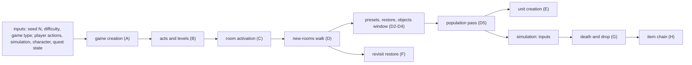
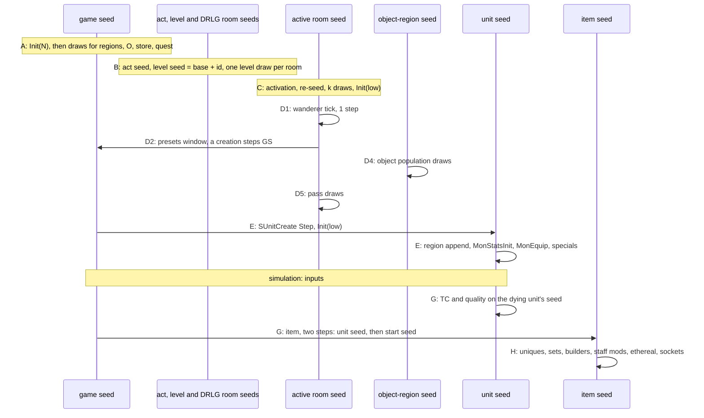

# Seed to world: the core specs composed, from the game seed to a populated level and a drop

## Purpose

This spec composes the core specs into one call order. The inputs are a game seed, the difficulty, the game type and
the inputs of § *Inputs* (where the player walks, what simulation does, the player's character, quest state). The
output is everything the server builds from them: each level's layout and rooms, the objects, the monster population
with its packs, special monsters and creation stats, the revisit re-creations, and, from a dying unit's seed, every
item it drops down to its last property. It adds no mechanic of its own. Each step is specified in the spec it links,
and this page states only the order, the seeds that cross from one spec to the next, and the run that checked the
composition with no oracle inside it. Primitives (`Step`, `Range`, `Init`) are those of [rng](../rng/README.md).



## Entry points

| When | Function | Tag |
|---|---|---|
| Game creation | fn:GAME_InitSeeds@0x0052C280, fn:sub_00530BF0_GameCreate@0x00530BF0 | [C] |
| A level is first needed | fn:DRLG_LevelCreate@0x00642AE0 | [C] |
| A room activates | fn:DRLG_RoomActivate@0x006422A0 | [C] |
| New rooms of an act, start of the next frame | fn:sub_0052D160_NewRoomsUpdate@0x0052D160 | [C] |
| A monster dies | fn:MONSTER_DropItems@0x005A6600 → fn:TC_ResolveDrops@0x0055A6D0 | [C] |
| A player operates a chest | fn:OBJ_OperateDispatch@0x00584420 | [C] |

The first four rows are the entry points of [rng/seeds](../rng/seeds.md), [drlg/overview](../drlg/README.md),
[drlg/room-tiles](../drlg/room-tiles.md) and [drlg/lifecycle](../drlg/lifecycle.md), and the last two those of
[items/tc](../items/tc.md) and [objects § J](../objects/README.md#j-operate-chests-and-containers-up-to-the-drop).
[C] (run:2026-10-11-seed-tree, run:2026-10-17-lifecycle, run:2026-10-21-chain2)

## Inputs

### Tables

None of its own. Each step reads the tables its own spec lists; the composition adds no table read.
[C] ([chain/0003 § Data touched](../../findings/chain/0003-end-to-end-run.md#data-touched), run:2026-10-21-chain2)

### Runtime state

What a reimplementation supplies, by class, with the count of each in the 37 logs of
[run:2026-10-21-chain2](../../findings/chain/experiments.md#run2026-10-21-chain2). The classes are those of plan 0048's
*Context* ([chain/0001 § 3.3](../../findings/chain/0001-oracles.md#33-inputs-the-chain-must-still-supply)). Besides
these, only the remaining oracles listed under *Inputs and oracles* enter the composition, each counted.

| Input | Class | What it fixes | Count in the run | Tag |
|---|---|---|---|---|
| seed `N` (`-seed`), difficulty, game type | configuration | the game seed and the map seed (rng/seeds step 1), the region pools, the level parameters | 37 games | [C] (fn:GAME_InitSeeds@0x0052C280, run:2026-10-21-chain2) |
| which rooms activate, in which order, with which near rooms active | player actions | each room's near list, so its grid stamp, the act's room list order, so the walk order (§ C, § D) | 18 459 activations (`AROOM`) | [I] (fn:DUNGEON_NearRoomsBuild@0x00619800, fn:sub_0052D160_NewRoomsUpdate@0x0052D160, [chain/0001 § 3.2](../../findings/chain/0001-oracles.md#32-activation-order-the-plans-open-question)) |
| when a player operates which object | player actions | the operate's draws and the operate spawns (oracle 8) | operate and trap spawns 6, 25 and 2; non-container `OperateFn`s 53 | [C] (fn:OBJ_OperateDispatch@0x00584420, run:2026-10-21-chain2) |
| the dying unit's seed at death | simulation (ADR-0014) | the TC resolution and the quality rolls of its drop (§ G); combat draws on it | 3 784 `TC_ResolveDrops` calls (`TCR`) | [C] (fn:TC_ResolveDrops@0x0055A6D0, run:2026-10-21-chain2) |
| the game seed at each drop | simulation | each dropped item's unit and start seeds (§ G); every server unit simulation creates steps it | 3 784 (`TCR gseed`) | [C] (fn:sub_00552E90_ItemSeedInit@0x00552E90, run:2026-10-21-chain2) |
| when an object timer event runs | simulation | which timer draws happen; their draws are modelled ([objects § K](../objects/README.md#k-object-timer-events)) | 20 109 timer draws | [C] (run:2026-10-21-chain2) |
| a restored monster's class, unit id, cell and alive or dead state (chain/0001 oracle 25) | simulation (monster AI and movement) | which records the revisit restore re-creates, where, and dead or alive (§ F) | 7 290 re-creations (103 made no unit) | [C] (fn:sub_00541E20_InactiveMonAiRestore@0x00541E20, run:2026-10-21-chain2) |
| the killer's magic find, and a summon's owner's | the player's character | the quality roll's magic-find terms ([items/quality § C](../items/quality.md#c-shared-terms-and-magic-find)) | `QKMF` 473, `QMF` 479 | [C] (fn:ITEMS_DropRollQuality@0x00558640, run:2026-10-21-chain2) |
| quest state | quest state | the state `InitFn`s' modes and interact bytes, class 434's mode, the Chaos Sanctuary gate test, the quest seed at a scripted drop | modes 952, interact bytes 49, class 434 3 | [C] (data:g_ObjInitFns@0x00731BC0, run:2026-10-21-chain2) |
| a revisited room's saved objects | simulation and player history | the saved interact, mode and sparkle of a re-created object | 35 | [C] (run:2026-10-21-chain2) |

- [I] Activation order is an input beyond the per-room seeds. The level seed and the active-room seed do not depend on
  it, but the game seed (one step per server unit), the object-region seed (carried across rooms) and each room's
  near list do. (fn:sub_00555230_SUnitCreate@0x00555230, fn:OBJRGN_Create@0x00546C60,
  fn:DUNGEON_NearRoomsBuild@0x00619800, [chain/0001 § 3.2](../../findings/chain/0001-oracles.md#32-activation-order-the-plans-open-question))
- [I] The game seed at a pass entry is a chained value only while no unit was created by simulation since the
  previous pass; a missile or a summon in between shifts it. For the same reason the game seed at each drop is an
  input. (fn:sub_00555230_SUnitCreate@0x00555230, [chain/0001 § 3.2](../../findings/chain/0001-oracles.md#32-activation-order-the-plans-open-question))

### Constants

None of its own.

### Inputs and oracles

The run checked the composition with every model of plan 0048 Phase 1 in. A **retired** oracle is a callee that an
earlier reproduction took from the log at a subsystem's boundary (ADR-0004) and that a model now predicts inside the
chain; the model is in the spec linked. [C] ([chain/0002](../../findings/chain/0002-retirements.md),
[chain/0003](../../findings/chain/0003-end-to-end-run.md), run:2026-10-21-chain2)

| # | Former oracle | Now | Model | Tag |
|---|---|---|---|---|
| 1 | the property roll `ItemApplyProps` | modelled | [items/properties § B](../items/properties.md#b-itemapplyprops-modes-and-blocks) | [C] (fn:sub_0065FEC0_ItemApplyProps@0x0065FEC0, run:2026-10-15-items-chain) |
| 2 | `ITEMS_RollStaffMods` | modelled, the default since plan 0048 Phase 1 | [items/affixes § I](../items/affixes.md#i-staff-mods--items_rollstaffmods) | [C] (fn:ITEMS_RollStaffMods@0x005C1260, run:2026-10-15-items-chain, [chain/0002 § 2](../../findings/chain/0002-retirements.md#2-oracle-2-the-staff-mods)) |
| 3 | the builders under a failed unique or set | modelled | [items/affixes](../items/affixes.md) after [items/uniques-sets § E](../items/uniques-sets.md#e-failure-durability-and-the-fallback-chain) | [C] (fn:ITEMS_BuildRare@0x005C21A0, fn:ITEMS_BuildMagic@0x005565E0, run:2026-10-15-items-chain) |
| 5 | the drop quality roll | modelled | [items/quality](../items/quality.md) | [C] (fn:ITEMS_DropRollQuality@0x00558640, run:2026-10-13-quality, run:2026-10-21-chain2) |
| 6 | `TC_ResolveDrops` at an object's drop | modelled | [items/tc § J](../items/tc.md#j-object-drops-named-only), [objects § J](../objects/README.md#j-operate-chests-and-containers-up-to-the-drop) | [C] (fn:TC_ResolveDrops@0x0055A6D0, [chain/0002 § 10](../../findings/chain/0002-retirements.md#10-oracle-6-an-objects-drop)) |
| 7 | the gold drop of `InitFn` 28 | modelled in its seeds and marks; the spot read, predicted for 69 of 71 | [objects § H](../objects/README.md#h-draws-at-creation-per-initfn) row 28 | [C] the seeds and marks (fn:sub_00559300_DropGoldPile@0x00559300, [chain/0002 § 9](../../findings/chain/0002-retirements.md#9-oracle-7-the-gold-piles-items)); [I] the spot (fn:sub_0064E810_FreeNearPair@0x0064E810) |
| 14 | the unit seed after `SUnitCreate` | modelled | [monsters/spawn § J](../monsters/spawn.md#j-creation-and-the-unit-seed), [monsters/pool § D](../monsters/pool.md#d-appearance-sets-sub_005bdb20_monvariantroll), [monsters/stats § B](../monsters/stats.md#b-monstatsinit-in-order) | [C] (fn:sub_00547BC0_MonRegionFindAdd@0x00547BC0, [chain/0002 § 3](../../findings/chain/0002-retirements.md#3-oracle-14-the-unit-seed-after-sunitcreate), run:2026-10-21-chain2) |
| 15, 16 | the presets window and its preset monsters | modelled | [objects § I](../objects/README.md#i-ds1-preset-objects-and-the-pseudo-objects), [monsters/spawn § H](../monsters/spawn.md#h-placement-spawnpospick-and-monspawntry) | [C] (fn:sub_0054E490_PresetClassSpawn@0x0054E490, [chain/0002 § 4](../../findings/chain/0002-retirements.md#4-oracle-16-the-preset-monsters-of-the-presets-window)) |
| 17 | `InitFn` 46 (City of the Damned) | modelled; the other monster-creating `InitFn`s stay seed oracles | [objects § H](../objects/README.md#h-draws-at-creation-per-initfn) row 46 | [C] (fn:OBJINIT_CityDamnedSpawns@0x005506D0, [chain/0002 § 5](../../findings/chain/0002-retirements.md#5-oracle-17-initfn-46-city-of-the-damned)) |
| 21 | another room's seed in a pass | chain state | that room's seed (§ D6) | [C] (fn:sub_005B2A00_MonSpawnTry@0x005B2A00, [chain/0002 § 8](../../findings/chain/0002-retirements.md#8-oracle-21-another-rooms-seed-in-a-pass)) |
| 22 | `Orient89Unit`'s units | the presets window's | [drlg/room-tiles](../drlg/room-tiles.md#algorithm) step 11, then § D2 | [C] (fn:sub_0066D9E0_Orient89Unit@0x0066D9E0, [chain/0002 § 6](../../findings/chain/0002-retirements.md#6-oracle-22-the-orient89unit-creations)) |
| 26–31 | position predicates, maze and outdoor windows, preset drop rolls, special mods, tile placement | modelled before plan 0048 | [drlg/collision](../drlg/collision.md), [drlg/maze](../drlg/maze.md), [drlg/outdoor](../drlg/outdoor.md), [drlg/preset](../drlg/preset.md), [monsters/special](../monsters/special.md) | [C] (run:2026-10-14-collision, run:2026-10-15-drlg-maze, run:2026-10-15-drlg-outdoor, run:2026-10-14-mon-special) |

**Remaining oracles inside the chain**, taken from the log and counted, with the reason. The 2 189 populations the
run counts as oracle-free hold no seed taken from the log in their window or pass; the value inputs of oracles 19 and
20 below are read in every one of them, and a window holding any other row of this table does not count. [C]
(run:2026-10-21-chain2, plan 0048 Phase 1 review ruling 2)

| Remaining | Why it stays | Count in the run | Tag |
|---|---|---|---|
| oracle 19, the gate's DRLG parts (room flags `0x30000`, `RoomPopLevelId`, the preset and town tests, `LevelRoomCount`) | read ([chain/0002 § 7](../../findings/chain/0002-retirements.md#7-oracle-19-the-gates-drlg-parts-read-inputs-kept)) and asserted against the reading at every gate, but the room flags are DRLG state not yet handed from the DRLG model to the walk | 4 883 gates (4 801, 3 885 and 3 676 assertions, 82 closed by `0x30000`), `LevelRoomCount` in 88 windows | [C] (fn:OBJ_PopulateGate@0x00552560, fn:sub_00642BE0_LevelRoomCount@0x00642BE0, run:2026-10-21-chain2) |
| oracle 20, the grid snapshot at pass entry (`SN`), the barrier grid of the flood (`LG0`), the type-11 point (`NWW`) | the composed grid equals the snapshot in 4 723 of 4 883 pass rooms; the residue is unit bits of players, monsters that walked, items and corpses; the barrier grid and the type-11 point are read, not modelled | `SN` 4 883, `LG0` 7 343, `NWW` 21 943 | [C] (fn:sub_0054EC90_RoomPopulate@0x0054EC90, fn:LOGIC_BarrierGridBuild@0x0066C870, fn:sub_0054DB50_NearWarpTest@0x0054DB50, run:2026-10-21-chain2) |
| the other monster-creating `InitFn`s reached (25, 43, 62) | not assigned to plan 0048 Phase 1 | 2, 2, 7 | [C] (data:g_ObjInitFns@0x00731BC0, run:2026-10-21-chain2) |
| MonPlace rows 5, 10 and 11 | not modelled in the chain | 3, 4, 3 | [C] (fn:sub_0054E600_PresetMonSpawn@0x0054E600, run:2026-10-21-chain2) |
| a creation outside the model with no level known; a region append by a creation outside the model | the creation is an operate or `InitFn` spawn the model does not run | 34; 12 | [C] (fn:sub_00547BC0_MonRegionFindAdd@0x00547BC0, run:2026-10-21-chain2) |
| a presets-window cell test whose room has no cells in the model | the cell lies in an active room the grid model holds no cells for | 35 each | [C] (fn:sub_0064D9B0_CollisionTest@0x0064D9B0, run:2026-10-21-chain2) |
| the special-count increment in a preset monster's creation | taken from the log | 8 | [C] (run:2026-10-21-chain2) |
| a gold pile's spot | the model's spot disagrees | 1 | [C] (fn:sub_00559300_DropGoldPile@0x00559300, run:2026-10-21-chain2) |
| a chest's interact byte at its operate | its writer is not read (*Open questions*) | 7 (lock bit set 2, lock bit cleared 3, cleared to 0 2) | [C] (fn:OBJINIT_Chest@0x0054FCB0, run:2026-10-21-chain2) |

- [C] Where the objects checker takes a seed at a preset monster's or an `InitFn` 46 request's exit and the monsters
  checker predicts and asserts it at the same line, both run in one check and a failed assert fails the run; the
  composed value is the model's. These are not oracles of the composition, and this spec states the one call order.
  (Phase 1 review ruling 1, [plan 0048 log](../../plans/done/0048-seed-to-world.md#implementation-log); run:2026-10-21-chain2)

## Algorithm



```
A. Game creation                                                  [C] (fn:GAME_InitSeeds@0x0052C280, fn:sub_00530BF0_GameCreate@0x00530BF0, run:2026-10-11-seed-tree, chain/0002 § 1)
   A1. game.seed ← Init(N); mapSeed ← N                           ; rng/seeds step 1, override branch
   A2. game draw 1 → monster regions: Init(low)                   ; monsters/pool § A, then the region build
   A3. game draw 2 → object-region seed O: Init(low)              ; objects § A
   A4. game draw 3 → store seed; game draw 4 → quest seed

B. Acts and levels                                                [C] (fn:DRLG_ActCreate@0x00642DA0, fn:DRLG_LevelCreate@0x00642AE0, fn:DRLG_RoomCreate@0x0066B3E0, run:2026-10-11-seed-tree)
   B1. act.seed ← Init(mapSeed); Step; levelSeedBase ← low; the act's own draws   ; rng/seeds step 3
   B2. when a level is first needed: level.seed ← Init(levelSeedBase + levelId)  ; rng/seeds step 4
   B3. the level's generator on level.seed (preset, maze, outdoor) with the preset drop rolls   ; drlg/overview
   B4. each DRLG room: one level draw                             ; rng/seeds step 5

C. Room activation, in the player's order                         [C] (fn:sub_0066EE40_DrlgRoomReseed@0x0066EE40, fn:DRLG_RoomActivate@0x006422A0, fn:COLL_StampTileList@0x0064C790, run:2026-10-11-drlg-roomk, run:2026-10-14-collision)
   C1. DRLG room re-seeded, k room-type draws, Orient89Unit's draws   ; drlg/room-tiles steps 1–11
   C2. the collision grid stamped from the tiles of the active near rooms   ; drlg/collision § A
   C3. Step(DRLG room seed); activeRoom.seed ← Init(low)          ; rng/seeds step 6

D. The new-rooms walk, per act with new rooms, per room of the act's room list   [C] (fn:sub_0052D160_NewRoomsUpdate@0x0052D160, run:2026-10-17-lifecycle, run:2026-10-21-chain2)
   D1. RoomWandererTick: one active-room step, always             ; drlg/lifecycle § I
   if the room's flags bit 0 is clear (first activation):
   D2. presets window: the room's preset units in order           ; objects § I; preset monsters through E
   D3. inactive restore: no record, no draw                        ; drlg/lifecycle § H
   D4. object population on O: the gate, the slots, each object's creation   ; objects §§ C–H
   D5. population pass on the room seed and the game seed          ; monsters/spawn §§ A–K, each creation through E
   D6. every room the pass drew on keeps its seed as chain state for its next request
   else, once per activation: the revisit restore only             ; § F

E. One monster creation (SUnitCreate type 1, from MonSpawnTry)    [C] (fn:sub_00555230_SUnitCreate@0x00555230, fn:sub_00574250_MonsterInit@0x00574250, run:2026-10-21-chain2)
   E1. Step(game.seed); unit.seed ← Init(low)                     ; rng/seeds 7a
   E2. MonRegionFindAdd: an appended class rolls MonVariantRoll(unit.seed, entry, 3)   ; monsters/pool § D
   E3. MonStatsInit's unit-seed draws, then MonEquip's             ; monsters/stats § B, B12
         each MonEquip item: two game-seed steps                   ; § G's item creation
   E4. for a special: the mod picks and handlers                   ; monsters/special
   E5. the grid marks of the creation                               ; drlg/collision § F

F. Revisit restore of a released room                             [C] (fn:sub_00542B40_RoomInactiveUnitsRestore@0x00542B40, run:2026-10-17-lifecycle, run:2026-10-21-chain2)
   F1. monster records, oldest first: MonSpawnTry at the record's cell, then E1–E3 and E5   ; drlg/lifecycle § H
         a special's or minion's mods come from the record, not from new picks          ; drlg/lifecycle H2b, H2c
   F2. item records, then the other unit records                    ; drlg/lifecycle § H4, objects § B5

G. Death and drop                                                 [C] (fn:MONSTER_DropItems@0x005A6600, fn:TC_ResolveDrops@0x0055A6D0, fn:ITEMS_DropRollQuality@0x00558640, run:2026-10-21-chain2)
   G1. the TC on the dying unit's seed; each pick's quality on the same seed   ; items/tc §§ B–H, items/quality
   G2. each item: Step(game.seed) → unit seed Init(low); Step(game.seed) → start seed   ; rng/seeds 7a
   G3. base stats on the unit seed                                  ; items/properties § A
   G4. the item chain on Init(start)                                ; § H
   a chest's drop: G1–H on the object's unit seed                   ; objects § J

H. The item chain                                                 [C] (fn:sub_00557450_ItemCreateByQuality@0x00557450, fn:ITEMS_RollStaffMods@0x005C1260, run:2026-10-15-items-chain, run:2026-10-21-chain2)
   H1. uniques and sets, the fallback builders                       ; items/uniques-sets
   H2. the builder's picks with their property rolls, the staff mods   ; items/affixes, items/properties § B
   H3. the ethereal roll, the socket roll, the automagic pick       ; items/properties § F, items/affixes § J
```

Step notes:

- A. [C] `tools/chain.py gen` reproduces, from `-seed N` alone, the game seed, the four game-creation draws, the act
  bases and their own draws and every level's seed; on `-seed 12345` it prints the
  [rng/seeds worked example](../rng/seeds.md#worked-example). (fn:GAME_InitSeeds@0x0052C280,
  fn:sub_00547D20_MonRegionsInit@0x00547D20, fn:OBJRGN_Create@0x00546C60, fn:NPCSTORE_CtlCreate@0x00536070,
  fn:QUESTS_InitGame@0x00545D80, run:2026-10-11-seed-tree, [chain/0002 § 1](../../findings/chain/0002-retirements.md#1-toolschainpy))
- B. [C] A level's seed does not depend on the order in which levels are built: it is a sum, not a draw. The run built
  176 (level, difficulty, game type) with every generator kind (DrlgType 1: 65, 2: 36, 3: 75) and every act of each
  game type in each difficulty. (fn:DRLG_LevelCreate@0x00642AE0, run:2026-10-11-seed-tree, run:2026-10-21-chain2)
- C. [I] `Orient89Unit` makes a preset unit of the room at activation, not a unit; the units its rows name are created
  later in the presets window (D2). (fn:sub_0066D9E0_Orient89Unit@0x0066D9E0, [chain/0002 § 6](../../findings/chain/0002-retirements.md#6-oracle-22-the-orient89unit-creations))
- C. [C] A room's near list at activation holds the near rooms already active, and the grid stamp reads their tiles, so
  the activation order reaches the grid. (fn:DUNGEON_NearRoomsBuild@0x00619800, run:2026-10-14-collision)
- D. [C] The walk restores and populates a room whose flags bit 0 is clear and only restores one with bit 0 set and
  bit 1 clear; a re-activated room is never populated again. (fn:sub_0052D160_NewRoomsUpdate@0x0052D160,
  run:2026-10-17-lifecycle, [drlg/lifecycle § D](../drlg/lifecycle.md#d-the-new-rooms-walk-populate-once-restore-once-per-activation))
- D2. [C] A preset monster below `nMonStats` goes through `sub_0054E490_PresetClassSpawn` to `SpawnAtPos` and E; the
  MonPlace fixed rows take their class through `sub_0063EC70_LevelClassVariant`; a superunique or MonPlace 2/3 preset
  goes through [monsters/special § G–H](../monsters/special.md#g-superuniques); a tile unit (preset type 5) steps the
  game seed once and takes `Init(low)`. 311 class-case presets of the 62 Phase 1 logs were predicted.
  (fn:sub_0054E600_PresetMonSpawn@0x0054E600, fn:sub_0054E490_PresetClassSpawn@0x0054E490,
  fn:sub_0063EC70_LevelClassVariant@0x0063EC70, fn:sub_005557D0_PresetUnitDispatch@0x005557D0,
  run:2026-10-15-objects, [chain/0002 § 4](../../findings/chain/0002-retirements.md#4-oracle-16-the-preset-monsters-of-the-presets-window))
- D4. [C] The object-region seed `O` is one object for the whole game, carried across every room's population, every
  operate and every timer event, so the order of the object populations decides each room's object draws.
  (fn:OBJRGN_Create@0x00546C60, run:2026-10-15-objects)
- D4. [C] The objects window draws the room seed, the game seed and `O`; on the run it created 13 056 objects (2 888 by
  the population, 10 168 presets) with every seed predicted. (fn:sub_00552610_RoomObjectsPopulate@0x00552610,
  run:2026-10-21-chain2)
- D5. [C] `NearWarpTest` can activate a room and step the level seed inside a pass. (fn:sub_0054DB50_NearWarpTest@0x0054DB50,
  run:2026-10-14-collision)
- D6. [C] A request placed on another room's tile draws from that room's seed: its predicted activation seed, or its
  seed after its last pass. (fn:sub_005B2A00_MonSpawnTry@0x005B2A00, fn:sub_005B2700_SpawnPosOnTile@0x005B2700,
  [chain/0002 § 8](../../findings/chain/0002-retirements.md#8-oracle-21-another-rooms-seed-in-a-pass))
- E. [C] Every server unit other than a player steps the game seed once at its creation, and an item twice. On the run,
  12 580 unit seeds after `SUnitCreate` were predicted, of 12 580 creations. (fn:sub_00555230_SUnitCreate@0x00555230,
  fn:sub_00552DF0_UnitSeedInit@0x00552DF0, run:2026-10-11-seed-tree-p1, run:2026-10-21-chain2)
- E3. [C] MonEquip's item creation runs on the stock table only for classes 234 and 267 (Blood Raven), each with one
  row of level 0 and one location; the run reproduced its 4 creations with their items. Its other branches are
  `[I]` (*Open questions*). (fn:sub_005D6B60_MonEquipInit@0x005D6B60, run:2026-10-21-chain2,
  [chain/0002 § 11](../../findings/chain/0002-retirements.md#11-oracle-13-monequips-items))
- E4. [C] 63 champion packs and 162 unique and minion packs, with 217 special-mods rolls, were predicted. (fn:sub_005A0760_SpecialModsRoll@0x005A0760,
  run:2026-10-21-chain2)
- F. [C] A re-created monster gets a new unit seed and a full `MonsterInit` (E1–E3), and its marks are those of
  [drlg/lifecycle § H5](../drlg/lifecycle.md#h5-the-grid-marks-of-a-re-created-monster). Where it lands and whether it
  is dead are oracle 25's input. (fn:sub_005424F0_InactiveMonstersRestore@0x005424F0, run:2026-10-17-lifecycle, run:2026-10-21-chain2)
- G. [C] 1 314 monster drops with an item (1 492 items) were predicted from the dying unit's logged seed with no builder
  oracle; all 3 784 `TC_ResolveDrops` calls and 1 913 item creations reproduce. (fn:TC_ResolveDrops@0x0055A6D0,
  fn:sub_00557450_ItemCreateByQuality@0x00557450, run:2026-10-21-chain2)
- G. [C] At a chest's drop the object's unit seed after the drop is the resolver's exit seed and the game seed after it
  is two steps per item created; `O` does not move. (fn:TC_ResolveDrops@0x0055A6D0, fn:sub_00555230_SUnitCreate@0x00555230,
  [chain/0002 § 10](../../findings/chain/0002-retirements.md#10-oracle-6-an-objects-drop))

### Entry contracts

What each step receives. The seed column is the seed state at the step's entry; "chain" means the value the steps
before it leave, with no input between. [C] (run:2026-10-21-chain2)

| Step | Entry | Seed in | Arguments | State read | Spec | Tag |
|---|---|---|---|---|---|---|
| A | game creation | `Init(N)` | difficulty, game type | the tables | [rng/seeds](../rng/seeds.md#algorithm), [monsters/pool § A](../monsters/pool.md#a-the-region-seed-sub_00547d20_monregionsinit), [objects § A](../objects/README.md#a-the-object-region-seed-and-level-records-game-creation) | [C] (fn:GAME_InitSeeds@0x0052C280, run:2026-10-11-seed-tree) |
| B | `DRLG_LevelCreate` | `Init(levelSeedBase + levelId)` | level id | Levels, LvlPrest, LvlMaze, LvlSub and the DS1 files | [drlg/overview](../drlg/README.md#algorithm) | [C] (fn:DRLG_LevelCreate@0x00642AE0, run:2026-10-12-drlg-gen) |
| C | `DRLG_RoomActivate` | the DRLG room's seed | the room | the near rooms already active (input order), the DT1 tiles | [drlg/room-tiles](../drlg/room-tiles.md#algorithm), [drlg/collision § A](../drlg/collision.md#a-the-grid-build-at-activation) | [C] (fn:DRLG_RoomActivate@0x006422A0, run:2026-10-14-collision) |
| D1 | `RoomWandererTick` | the active room seed | the room | the region's wanderer count, the room's client list | [drlg/lifecycle § I](../drlg/lifecycle.md#i-the-wanderer-tick) | [C] (fn:sub_0054F060_RoomWandererTick@0x0054F060, run:2026-10-17-lifecycle) |
| D2–D4 | the window `RW1` → `RW4` | room seed, game seed and `O`: chain | the room, its preset units | the grid, quest state (inputs), the gate's DRLG parts (oracle 19) | [objects § B](../objects/README.md#b-the-window-in-the-room-driver-and-the-revisit) | [C] (fn:sub_005559A0_RoomPresetUnits@0x005559A0, fn:sub_00552610_RoomObjectsPopulate@0x00552610, run:2026-10-21-chain2) |
| D5 | `RoomPopulate` | room seed and game seed: chain | the room | the level's region, the grid snapshot (oracle 20), the logic boxes, the warp points | [monsters/spawn § A](../monsters/spawn.md#a-when-the-pass-runs-and-the-room-seed-before-it) | [C] (fn:sub_0054EC90_RoomPopulate@0x0054EC90, run:2026-10-21-chain2) |
| E | `SUnitCreate` type 1 | game seed: chain | class, cell, mode, request flags | the region entry, MonStats, MonStats2, MonLvl, MonProp, MonEquip | [monsters/spawn § J](../monsters/spawn.md#j-creation-and-the-unit-seed), [monsters/stats](../monsters/stats.md#b-monstatsinit-in-order) | [C] (fn:sub_00555230_SUnitCreate@0x00555230, run:2026-10-21-chain2) |
| F | `RoomInactiveUnitsRestore` | room seed and game seed: chain | the room's records | the records' class, id, cell and state (oracle 25) | [drlg/lifecycle § H](../drlg/lifecycle.md#h-the-restore) | [C] (fn:sub_00542B40_RoomInactiveUnitsRestore@0x00542B40, run:2026-10-21-chain2) |
| G | `TC_ResolveDrops` | the dying unit's seed (input) | TC, item level, the killer | magic find (input), player count | [items/tc § D](../items/tc.md#d-the-resolver--tc_resolvedrops) | [C] (fn:TC_ResolveDrops@0x0055A6D0, run:2026-10-21-chain2) |
| G2 | item creation | the game seed at the drop (input) | base, quality, item level | the base tables | [rng/seeds](../rng/seeds.md#algorithm) step 7a, [items/uniques-sets § A](../items/uniques-sets.md#a-the-item-seed-at-entry) | [C] (fn:sub_00552E90_ItemSeedInit@0x00552E90, run:2026-10-21-chain2) |
| H | `ItemCreateByQuality` | `{start, 666}` | the creation record | the item tables | [items/uniques-sets](../items/uniques-sets.md), [items/affixes](../items/affixes.md), [items/properties](../items/properties.md) | [C] (fn:sub_00557450_ItemCreateByQuality@0x00557450, run:2026-10-15-items-chain) |

## Outputs

- The levels built from the game seed, their rooms, presets, warps and waypoints ([drlg](../drlg/README.md)).
  [C] (run:2026-10-21-chain2)
- Per activated room, in the player's order: its objects, its monster population with packs, minions and special
  monsters and their creation stats, and on each revisit its re-created units with their grid marks. [C]
  (run:2026-10-21-chain2)
- Per death, from the dying unit's seed: every item of its drop with its quality, affixes, unique or set pick and
  properties. [C] (run:2026-10-21-chain2)
- The seeds left for what comes next: the game seed, `O`, and each room's seed. [C] (run:2026-10-21-chain2)

## Worked example

All from kept logs of [run:2026-10-20-chain](../../findings/chain/experiments.md#run2026-10-20-chain) and
[run:2026-10-21-chain2](../../findings/chain/experiments.md#run2026-10-21-chain2), each reproduced by run 2's
`tools/chain.py check` with 0 sub-checks failed. Seeds are `low:high`, hex. They double as test vectors.

### 1. From `-seed 4802` to level 57 (Normal, expansion)

`p2-s1-4802-xn2.log`, the Halls of the Dead 2 session; `tools/chain.py gen --seed 4802 --diff 0 --exp 1` prints the
same values from `N` alone. [C] (run:2026-10-20-chain, [chain/0002 § 1](../../findings/chain/0002-retirements.md#1-toolschainpy))

| Step | Value | Log line |
|---|---|---|
| A1 game seed, map seed | `000012C2:0000029A`, `000012C2` | `GAME`, line 47 |
| A2 monster regions | `Init` → `E0A791E4:0000029A` | (gen) |
| A3 object-region seed `O` | `615B8C46:0000029A`; game seed then `615B8C46:5DB3A30E` | `OGC`, line 49 |
| A4 store, quest | `4231F4EC:0000029A`, `5959A58E:0000029A` | (gen) |
| B1 `levelSeedBase` | `E0A791E4` | `LC0 base` 3769078244 |
| B2 level 57 | `E0A791E4 + 0x39` → `E0A7921D:0000029A`; DrlgType 1; region pool 374, 101, 101 | `LC0`, line 2073 |

### 2. One room population, end to end (level 57)

The same log, the room activated at line 2271 and populated at lines 3944–4152. The room is one of the run's 2 189
oracle-free populations. [C] (run:2026-10-20-chain, run:2026-10-21-chain2)

| Step | Seeds after | Notes |
|---|---|---|
| C3 activation | active room `4DAC63D4:0000029A` (DRLG room `4DAC63D4:4D8861C4`) | `AROOM` |
| D entry (`RW0`) | room `4DAC63D4:0000029A`, game `F32620F0:18A533CC`, `O` `D702B3B7:15932444` | |
| D1 wanderer tick | room `BBC814BE:2065A097` | `low & 0x7FFF` = `0x14BE` ≠ 0: no wanderer |
| D2, D3 | unchanged | no preset unit, no record |
| D4 objects | `O` `D5486017:59ADE417`, room `4AAEC54A:14C4F38E`, game unchanged | the gate passes (`pop` 57); eight slots; no object created |
| D5 pass entry (`P0`) | room `4AAEC54A:14C4F38E`, game `F32620F0:18A533CC` | |
| D5 first placement | game `F9D9D259:1F73FD2E` | after 27 game-seed steps |
| E1 leader, class 374, id 6, at (15184, 8106) | game `753AEBAB:6835FCDC`; unit seed `Init` → `753AEBAB:0000029A` | |
| E3 `MonStatsInit` | unit seed `99308A27:2E5D6D76` | two steps: the appearance pick and the HP draw |
| group size draw | leader's unit seed `5E97AD79:3FE4EB60` | monsters/spawn § F |
| member id 7 at (15186, 8103) | game `D75F8773:30E55372`; unit seed after `MonStatsInit` `ADC8E500:5AC78601` | |
| member id 8 at (15187, 8104) | game `0A8B3EF1:59D49BC4`; unit seed `E7B2DB43:612A2416` | |
| pass exit (`PX`) | room `D0F81837:1908F5BF`, game `04994E9F:59583410` | |

### 3. A gold drop

The same log, lines 11896–11926: a class-101 monster dies with unit seed `3798A5AC:63BFE189`, TC 475, item level 15;
the game seed at the drop is `8B0F9E11:1D78C39B` (an input). [C] (run:2026-10-20-chain, run:2026-10-21-chain2)

| Step | Value |
|---|---|
| G1 NoDrop and pick | `NDP` 100, `total` 60; `PICK` range 160, roll 101 → item 523 (`gld`); quality 2; the dying unit's seed at `TCEND`: `64701EE5:1730541A` |
| G2 first game step | `348CF6B0:3A00542B` → unit seed `348CF6B0:0000029A` |
| G2 second game step | `A15D299B:15EB20E3` → start `A15D299B`, item seed `A15D299B:0000029A` |
| G3 base stats | one unit-seed step → `675CD80A:15EB20E3`; stat 14 (gold) = 31 ([items/economy § G](../items/economy.md#g-gold-payment-caps-piles-and-the-death-loss)) |
| H | the normal builder, the staff mods, the ethereal and socket rolls: no draw on the item seed |

The next drop of the log (line 11928) starts from the game seed `A15D299B:15EB20E3` the item left.

### 4. Two revisit re-creations and their marks

`p2r2-s1-4862-r2-xn2.log` (Blood Moor, Normal, expansion), lines 39133–39176: the restore scope of one room
(`CMR0` .. `CMRX`) re-creates two class-5 records with request flags `0x62`. [C] (run:2026-10-21-chain2)

| Record | Oracle 25's input | Seeds | Logged marks, in order (pattern, mask) |
|---|---|---|---|
| id 276, alive | cell (5677, 5775), mode 1 | room `DB237076:3AEDDC1B` → `256AE4E2:12207A27` (three draws), game `FC6719A9:52CF6906` → `5F4B3813:6946771A`; unit seed `5F4B3813:0000029A` → `5AC24825:5DE5631C` | mark (1, `0x100`) twice; unmark (1, `0x100`); mark (1, `0x100`) |
| id 277, dead (`a10` 12) | cell (5678, 5766) | room → `52B82AA9:67398AA0`, game → `4A654DB9:27BF0F49`; unit seed `4A654DB9:0000029A` → `992479AD:6540FD93` | mark (1, `0x100`); unmark (1, `0x100`); 3×3 rectangle `0x8000`; unmark (1, `0x100`); unmark (5, `0x100`); mark (5, `0x8000`) |

## Reimplementation notes

- **The player's walk is an input, not a detail.** Two games from the same seed agree on every level seed and room
  seed, but their game seed and `O` diverge as soon as rooms activate or populate in another order, or simulation
  creates a unit. [I] (fn:sub_00555230_SUnitCreate@0x00555230, fn:OBJRGN_Create@0x00546C60,
  [chain/0001 § 3.2](../../findings/chain/0001-oracles.md#32-activation-order-the-plans-open-question))
- **`O` is one seed for the whole game**, not one per room or per level. [C] (fn:OBJRGN_Create@0x00546C60, run:2026-10-15-objects)
- **A room's seed outlives its pass.** A later request on that room's tile (another room's pass) draws from the seed
  the earlier pass left. [C] (fn:sub_005B2A00_MonSpawnTry@0x005B2A00, [chain/0002 § 8](../../findings/chain/0002-retirements.md#8-oracle-21-another-rooms-seed-in-a-pass))
- **A re-created monster is a new unit for the seeds**: a new game-seed step, a new unit seed and a new `MonsterInit`,
  with only its id, class, cell, stats 13, 7 and 6 and its mods from the record. [C] (fn:sub_005424F0_InactiveMonstersRestore@0x005424F0,
  run:2026-10-17-lifecycle)
- **A re-created monster marks the grid like a pass creation**, outside any window. Leaving its marks out fails later
  position tests: run 1's two mismatches were exactly that. [C] (fn:COLL_WHTest@0x0064D800, run:2026-10-21-chain2,
  [chain/0003 § 2](../../findings/chain/0003-end-to-end-run.md#2-run-1s-two-mismatches-and-the-re-creations-marks))
- **The region append is chain state.** A class that a creation outside the model appends to the level's region rolls
  its sets then; a later creation of that class reads them. [C] (fn:sub_00547BC0_MonRegionFindAdd@0x00547BC0,
  [chain/0002 § 3](../../findings/chain/0002-retirements.md#3-oracle-14-the-unit-seed-after-sunitcreate))

## Evidence

- [findings/chain/0001-oracles.md](../../findings/chain/0001-oracles.md): the oracle inventory, the composition order
  (§ 3.1), activation order (§ 3.2), the input classes (§ 3.3).
- [findings/chain/0002-retirements.md](../../findings/chain/0002-retirements.md): each retired oracle's model (§§ 2–11),
  the composition over the 195 Phase 1 logs (§ 13), the review re-run (§ 14).
- [findings/chain/0003-end-to-end-run.md](../../findings/chain/0003-end-to-end-run.md): the end-to-end run, the
  re-creation marks (§ 2), the chest interact byte (§ 3), oracle 20's residue (§ 4).
- [run:2026-10-20-chain](../../findings/chain/experiments.md#run2026-10-20-chain) (28 logs) and
  [run:2026-10-21-chain2](../../findings/chain/experiments.md#run2026-10-21-chain2) (37 logs, 0 mismatches, 2 189
  oracle-free populations; the inputs and remaining oracles with their counts).
- The composed specs: [rng/seeds](../rng/seeds.md), [drlg/overview](../drlg/README.md),
  [drlg/room-tiles](../drlg/room-tiles.md), [drlg/lifecycle](../drlg/lifecycle.md), [drlg/collision](../drlg/collision.md),
  [objects](../objects/README.md), [monsters/pool](../monsters/pool.md), [monsters/spawn](../monsters/spawn.md),
  [monsters/special](../monsters/special.md), [monsters/stats](../monsters/stats.md), [items/tc](../items/tc.md),
  [items/quality](../items/quality.md), [items/uniques-sets](../items/uniques-sets.md), [items/affixes](../items/affixes.md),
  [items/properties](../items/properties.md).

## Open questions

- [L] **Who writes a chest's interact byte between its creation and its operate?** Seven chests reached `OperateFn` 4
  with a byte their `InitFn` did not leave and no logged line wrote: the lock bit set (2), the lock bit cleared (3),
  cleared to 0 (2). The check takes the byte at the operate and counts it; it drives only the locked test and that
  chest's drop, and any other change still fails the check. Reading the writers of the object's interact field
  reached from the player's interaction request would retire it (chain/0003 Open question 2; plan 0048 run-1 review
  ruling 3; no reverser entry filed, by the run-2 review's ruling 5). (fn:OBJINIT_Chest@0x0054FCB0, run:2026-10-21-chain2)
- [L] **MonEquip's branches that the stock table cannot reach**: the level skip (a first row above the monster level),
  a second row, two or three locations (three is the `RangeB` branch) and an occupied location. Each of the two
  `oninit` classes has one row of level 0 with one location, so only a forced-path run (ADR-0010) on an edited
  `monequip` row could reach them ([chain/0002 § 11](../../findings/chain/0002-retirements.md#11-oracle-13-monequips-items)).
  (fn:sub_005D6B60_MonEquipInit@0x005D6B60)
- [L] **Oracle 19's room flags in the chain.** Which DRLG rooms carry `0x30000`, `0x800000` and the out room's `0x80`,
  and `LevelRoomCount`, are DRLG state; handing the DRLG model's per-room predictions to the walk would retire the
  oracle ([chain/0002 § 7](../../findings/chain/0002-retirements.md#7-oracle-19-the-gates-drlg-parts-read-inputs-kept)).
  (fn:OBJ_PopulateGate@0x00552560)
- [L] **Oracle 20's model-side half**: the predicates still read the logged snapshot; the barrier grid (258 of 307
  probed grids equal) and the type-11 point are read but not modelled
  ([chain/0002 § 12](../../findings/chain/0002-retirements.md#12-oracle-20-the-grid-snapshot-the-barrier-grid-the-type-11-point-named-not-modelled)).
  (fn:LOGIC_BarrierGridBuild@0x0066C870)
- [L] The monster-creating `InitFn`s other than 46 (25, 43 and 62 reached) and MonPlace rows 5, 10 and 11 stay seed
  oracles. (data:g_ObjInitFns@0x00731BC0, run:2026-10-21-chain2)
- [L] A log-free world build from `gen` alone would need the activation order as an input record and the hand-off
  between the objects and monsters models; plan 0048 does not build it (Phase 1 review ruling 1).
