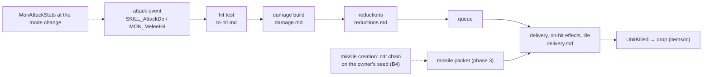
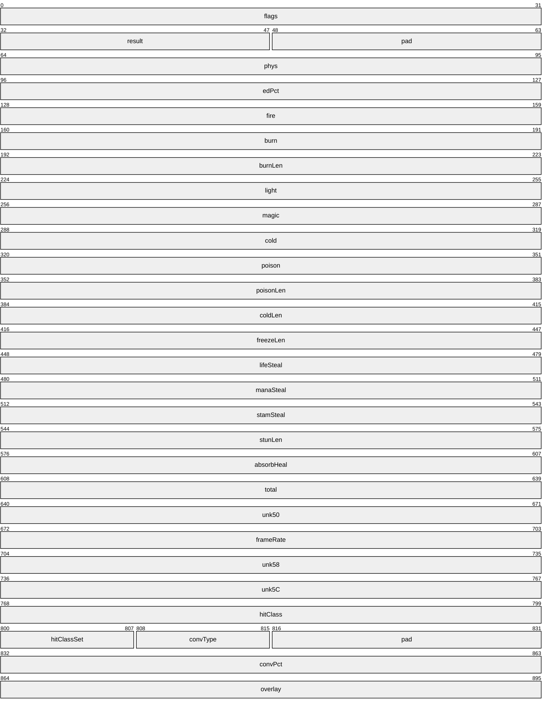
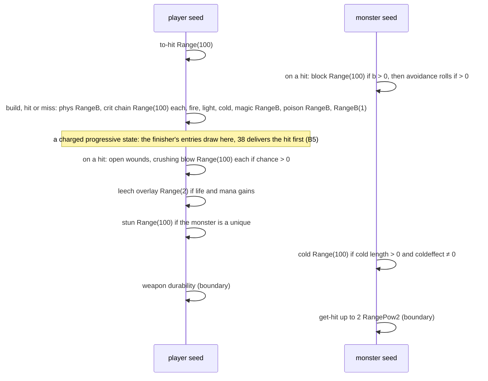
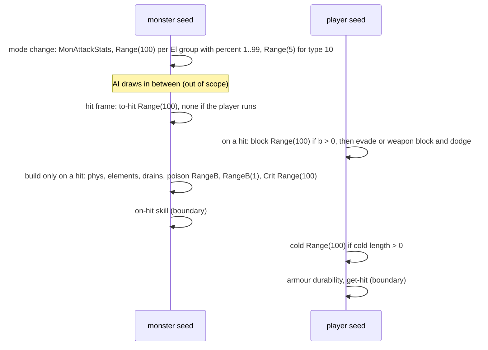
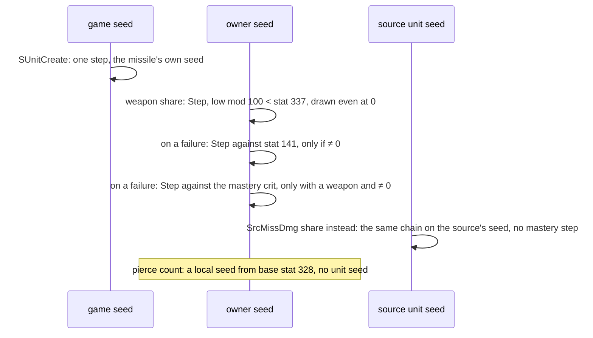
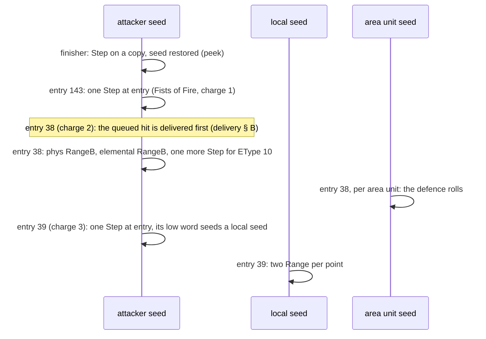

# Combat formulas: the attack event, its seeds and its branches

## Purpose

When one unit attacks another, the server tests the hit, builds the damage of each type, reduces it on the
defender, applies it with the on-hit effects and changes the defender's life. This subsystem specifies that chain for
a player's normal attack, a monster's or mercenary's plain attack and the defender's side of a missile hit, in every
difficulty and in classic and expansion games, with every draw on the attacker's and the defender's unit seeds in
order. It is the first simulation phase of [ADR-0014](../../adrs/0014-scope-game-simulation.md): a unit's **final
stats** are inputs (phase (2) models how they add up), and a **skill's or missile's damage packet** is an input
(phase (3) models how a skill builds it). This page gives the events, the packet, the draw order per event, the
chaining of events on one seed, the branches and a full worked example; the formulas are in the four files below.



## Files

| File | Covers | Status |
|---|---|---|
| [to-hit.md](to-hit.md) | the hit test, the chance to hit with `ToHitFactor`, defence, block, evade, weapon block, dodge, avoid | reviewed |
| [damage.md](damage.md) | the damage build: physical roll, critical and deadly strike, elements, steal and drain fields, poison, the `RangeB(1)` step, conversion, the monster `Crit`; `MonAttackStats`' draws | reviewed |
| [reductions.md](reductions.md) | the percent P, DR and MDR, resistances with the difficulty penalty, caps, immunity and pierce, absorb | reviewed |
| [delivery.md](delivery.md) | queue and delivery, crushing blow, open wounds, leech, stun, cold, freeze, poison, the life change, the life tick | reviewed |

Names of functions, structs and fields are ours ([combat/0001](../../findings/combat/0001-formulas.md),
`re/types/combat.h`); the server module is the binary's own `.\UNIT\SUnitDmg.cpp`. Primitives (`Step`, `Range`,
`RangePow2`) are those of [rng](../rng/README.md); `RangeB` is the second compile of `Range`. `MulDiv(a, b, c)` is the
helper of [monsters/stats § A](../monsters/stats.md#a-muldiv-and-monlvlstats). Divisions are signed and truncate
toward zero unless stated. Life, mana and damage fields are in 1/256 points.

## Entry points

| When | Function | Tag |
|---|---|---|
| A player's normal attack (Skills row 0, `srvdofunc` 1), at the hit frame | fn:SKILL_AttackDo@0x0056F070 | [C] (run:2026-10-16-combat: 2 030 events) |
| A monster's or a mercenary's plain attack, at the hit frame | fn:sub_005A7670_MonAttackFrame@0x005A7670 → fn:MON_MeleeHit@0x005A5490, fn:COMBAT_DeliverQueued@0x0057D4F0 | [C] (run:2026-10-16-combat: 4 533 monster, 1 259 mercenary) |
| A monster skill's melee hit | fn:sub_005D9C80_MonSkillAttackDo@0x005D9C80 | [I] |
| A monster enters an attack mode (its to-hit, damage and `El` stats) | fn:sub_005A7C20_MonSetMode@0x005A7C20 → fn:sub_005A4F50_MonAttackStats@0x005A4F50 | [C] for the draws (run:2026-10-16-combat: 5 060) |
| A missile that takes a weapon share is created (its critical chain, § B4) | fn:sub_0059FA30_MissileCreate@0x0059FA30 → fn:sub_0059F900_MissileInitDamage@0x0059F900 → fn:sub_0064B860_MissileDamageBlock@0x0064B860 → fn:sub_0064A850_MissileCritRoll@0x0064A850 | [I] |
| A missile's damage reaches a unit (the defender's side) | fn:MISSILE_ApplyDamage@0x005AD730 | [C] (run:2026-10-16-combat: 1 957 on the player or the mercenary, 519 Nova missiles) |
| A player skill's melee hit (packet and `SrcDam` from the skill) | `0x005C7690` and the other do-functions that call fn:COMBAT_MeleeHitTest@0x0057EC10 | [I] |

## Inputs

### Tables

| Anchor | Used for |
|---|---|
| tbl:CharStats.txt:ToHitFactor, `BlockFactor` | [to-hit](to-hit.md) |
| tbl:MonStats.txt:Crit, `Drain`, `coldeffect`, `NoShldBlock`, `killable`, `boss`, `primeevil`, `demon`, `lUndead`, `hUndead`, `MonType`, `Velocity` | every file |
| tbl:DifficultyLevels.txt:ResistPenalty, `LifeStealDivisor`, `ManaStealDivisor`, `MonsterColdDivisor`, `MonsterFreezeDivisor`, `HireableBossDamagePercent` | [reductions](reductions.md), [delivery](delivery.md) |
| tbl:Weapons.txt:StrBonus, `DexBonus` | [damage](damage.md) |
| tbl:ItemStatCost.txt:itemeventfunc1 | the stat events of [delivery § E](delivery.md#e-the-stat-events-crushing-blow-open-wounds-freeze) |
| tbl:Skills.txt:srvdofunc, `SrcDam`, `ToHit`, `LevToHit`, `ToHitCalc` | the event and the skill's percent |
| tbl:Missiles.txt:SrcDamage, `SrcMissDmg`, `Skill`, `MissileSkill` | whether a missile's creation draws the critical chain (§ B4) |
| `g_DamageResistTable` (binary) | [reductions § B](reductions.md#b-the-rows-g_damageresisttable) |

### Runtime state

| State | Type | Source |
|---|---|---|
| unit seed of each unit | `Seed` at `Unit+0x20` | [rng/seeds](../rng/seeds.md) |
| unit stats | i32 values of the stat lists | value inputs (§ The ADR-0014 boundary) |
| hit queue | list at `Unit+0xAC` | [delivery § A](delivery.md#a-queue-and-delivery) |
| frame | `Game+0xA8` | timed states |
| game type | `Game+0x70`, 0 classic | game creation |
| difficulty | the game's difficulty, 0..2 | game creation |

### The damage packet



[I] The packet is 0x70 bytes, zeroed by the caller on its stack and copied whole onto the attacker's hit queue. Its
fields: `+0x00` flags, `+0x04` result (u16), `+0x08` physical, `+0x0C` enhanced-damage percent, `+0x10` fire,
`+0x14`/`+0x18` burning damage and length, `+0x1C` lightning, `+0x20` magic, `+0x24` cold, `+0x28`/`+0x2C` poison
per frame and length, `+0x30` cold length, `+0x34` freeze length, `+0x38`/`+0x3C`/`+0x40` life, mana and stamina
steal, `+0x44` stun length, `+0x48` absorbed life, `+0x4C` total, `+0x54` damage frame rate, `+0x60` hit class,
`+0x64` hit-class-set byte, `+0x65`/`+0x68` conversion type and percent, `+0x6C` overlay; `+0x50`, `+0x58` and `+0x5C` are
not named. (struct:DamagePacket+0x08, struct:DamagePacket+0x65,
fn:COMBAT_QueueHit@0x0057CA80) The checker predicted every damage field and the result word of the packet at the
builder's return, after the reductions and at delivery. [C] (run:2026-10-16-combat)

[I] Flags at `+0x00`: `0x1` physical already set (skip the roll), `0x2` already built, `0x4`/`0x8`/`0x10` no
life/mana/stamina drain roll, `0x20` built (and forced at delivery), `0x80` no `domissiledamage` event, `0x100`/
`0x200`/`0x400` bypass resistances of undead, demons, others, `0x1000` hits non-hostile units. Result bits at
`+0x04`: `0x1` hit, `0x2` killed, `0x4` get-hit, `0x8` knockback, `0x10` blocked, `0x20` no events, `0x80` dodged,
`0x100` avoided, `0x200` evaded, `0x2000` doubled, `0x8000` weapon block. (struct:DamagePacket+0x04)

### The ADR-0014 boundary

| Kind | What | Tag |
|---|---|---|
| value inputs | every stat of both units at the event's entry, and their life, mana and stamina; the table cells named in each file | [C] (run:2026-10-16-combat) |
| value oracles | the player's attack-rating percent (mastery included), `UnitBlockChance`'s shield test, `UnitIsMoving`, the weapon block chance and its skill check, the two-handed test, the weapon mastery's damage and crit, step 1's `edPct` | [C] (run:2026-10-16-combat) |
| inputs (packets) | a skill's packet (any `srvdofunc` other than 1) and a missile's packet, taken at `ResolveAndQueue` or `ApplyDamage` entry | [C] (run:2026-10-16-combat) |
| boundary oracles | stat-event handlers other than 15 and 16, `COMBAT_DurabilityLoss`, the knockback, `COMBAT_GetHit`, a monster's on-hit skill `0x005A4390`, a skill do-function's draws before the build, a delivery on a later frame than the hit test: entry seeds asserted, exit seeds taken (ADR-0004) | [C] (run:2026-10-16-combat) |

[C] Under this boundary run:2026-10-16-combat reproduced 15 358 logged events of 19 sessions with 0 mismatches,
every logged seed asserted; with the resume-lane addendum the run list holds 40 logs and 40 655 events, still with 0
mismatches. (run:2026-10-16-combat) [C] Under the same boundary run:2026-10-20-shortfalls (plan 0047 Phase 2,
sessions built for the branches the first run met too rarely) reproduced 18 737 events of 31 logs with 0 mismatches,
and the kept run list re-checks with the same checker at 0 mismatches over its 40 655 events. Its run list names the logs whose player holds no
usable shield (`--no-shield-log`), which only sets the predicted block chance to 0, so a logged chance above 0 still
fails ([to-hit § C2](to-hit.md#c-the-hit-test-and-the-defence-rolls)). (run:2026-10-20-shortfalls) The progressive-charge hooks around the player's build and the
finisher before delivery were dropped events by rule; none occurred. [I] (fn:COMBAT_PrgHooksBeforeBuild@0x005D3AC0,
fn:COMBAT_PrgFinisher@0x005D5220)

### Constants

| Name | Value | Anchor | Tag |
|---|---|---|---|
| normal attack `SrcDam` | 128 | tbl:Skills.txt:SrcDam | [C] (run:2026-10-16-combat) |
| LCG multiplier of the inlined draws | `0x6AC690C5` | [rng](../rng/README.md) | [C] (run:2026-10-16-combat) |

## Algorithm

### A. The attack events

```
A1. PlayerAttack(att):                                                [C] (fn:SKILL_AttackDo@0x0056F070, run:2026-10-16-combat, all of A1 except as tagged)
      if att wields a missile weapon: create a missile; return        ; [I] (0x0056ECB0), phase (3); its creation draws: § B4
      def ← att's target;  pkt ← 0x70 zero bytes
      pkt.result ← MeleeHitTest(att, def, arPct: stat(att, 325), rangeExtra: 0)       ; to-hit.md § C
      pkt.flags |= 0x2
      PrgHooksBeforeBuild(att, pkt);  BuildDamage(att, def, pkt, 0, 128);  PrgHooksAfterBuild(att, pkt)   ; damage.md, whatever the result
      ResolveAndQueue(att, def, pkt, 128)                             ; delivery.md § A: reductions on a hit
      if att has the `meleeonly` state flag: AttackDeliverMeleeOnly(att, def)        ; [I] (fn:sub_0056C2D0_AttackDeliverMeleeOnly@0x0056C2D0), skips the finisher
      else: PrgFinisher(att);  DeliverQueued(att, def)                ; delivery.md § A3: the finisher's own step peeks att.seed, its srvprgfunc entries draw (§ B5), [I] (fn:COMBAT_PrgFinisher@0x005D5220, 0x005D5368–0x005D538C, 0x005D4E80)

A2. MonsterAttack(att):                                               [C] (fn:sub_005A7670_MonAttackFrame@0x005A7670, fn:MON_MeleeHit@0x005A5490, run:2026-10-16-combat, all of A2)
      ; earlier, at the mode change: MonAttackStats(att, newMode)     ; damage.md § E
      def ← att's target;  pkt ← 0x70 zero bytes
      pkt.result ← MeleeHitTest(att, def, arPct: 0, rangeExtra: 0)
      ResolveAndQueue(att, def, pkt, 128)                             ; the build runs here, only on a hit
      DeliverQueued(att, def)
```

- A1. **The player's damage is built on a miss**, so a missed swing still steps the attacker's seed through the
  build. [C] (fn:SKILL_AttackDo@0x0056F070, run:2026-10-16-combat: 386 misses)
- A1. A player skill's melee hit passes `SKILLS_GetToHit` as `arPct` and its own `SrcDam`; its packet is phase (3)'s
  input. [I] (fn:SKILLS_GetToHit@0x006449F0, 0x005C76B0)
- A2. A monster skill's do-function calls `MonAttackStats` itself, then `MON_MeleeHit` and the delivery; the plain
  attack frame relies on the call made at the mode change. [I] (fn:sub_005D9C80_MonSkillAttackDo@0x005D9C80)
- A2. **A mercenary is a monster on this path.** It differs where the code tests the hireling type: crushing blow
  divisor 10 against it, P = 25 against another hireling and `HireableBossDamagePercent` against a boss, leech by the
  player formula without the divisors, and no drain rolls in its build. [I] (fn:sub_0063EE90_HirelingType@0x0063EE90)
  The mercenary's 1 259 attacks reproduced. [C] (run:2026-10-16-combat)
- A3. **Missiles.** `MISSILE_HitUnit` may roll the chance to hit, `MISSILE_BuildDamage` builds the packet from the
  missile's own stats on the missile's seed, and `MISSILE_ApplyDamage` rolls the knockback on the missile's seed,
  the defence on the defender's seed (block only with physical damage), and calls `ApplyDamage` with reductions.
  That path is phase (3); here its packet is an input. [I] (fn:MISSILE_HitUnit@0x005ADF10,
  fn:MISSILE_BuildDamage@0x005A89A0, fn:MISSILE_ApplyDamage@0x005AD730)
- A3. **A missile's weapon terms are taken at its creation**, not at the hit: the weapon share, the enhanced damage
  and the critical strike's result are fixed when `MissileCreate` builds the damage block and are stored as the missile's own
  stats. The critical chain draws then, on the owner's seed (§ B4). [I] (fn:sub_0064B860_MissileDamageBlock@0x0064B860,
  fn:sub_0064AC60_MissileDamageToStats@0x0064AC60)

### B. Draw order per event

**B1. A player's normal attack on a monster.**



[C] On the player's seed the order is: to-hit, the build (whatever the hit result), then on a hit the stat events,
the leech overlay and the stun; on the monster's seed: the defence rolls (on a hit), then the cold draw at delivery.
Each draw happens only under the condition given in its file. (fn:SKILL_AttackDo@0x0056F070, fn:COMBAT_ApplyDamage@0x0057C6C0,
run:2026-10-16-combat) The weapon durability and the get-hit draws are boundary oracles (§ The ADR-0014 boundary).
[I] (fn:COMBAT_DurabilityLoss@0x0057D3D0, fn:sub_0057CB00_GetHitRoll@0x0057CB00) Under a charged progressive state
the finisher's entries draw on the player's seed after the build; when entry 38 runs it delivers the queued hit
itself first, so the delivery's draws come before 38's and those of any later entry (B5); the other stat-event handlers draw on the seed of the unit that owns them (B6). [I]
(fn:COMBAT_PrgFinisher@0x005D5220, 0x005D4E80, data:g_StatEventFuncs@0x007325B0)

**B2. A monster's melee attack on the player.**



[C] On the monster's seed: `MonAttackStats`' `El` draws at the mode change, then at the hit frame the to-hit and, only
on a hit, the build with the `Crit` draw last; on the player's seed: the defence rolls on a hit and the cold draw at
delivery. (fn:sub_005A4F50_MonAttackStats@0x005A4F50, fn:MON_MeleeHit@0x005A5490, run:2026-10-16-combat) A monster
attacker's leech has no draw. [I] (fn:COMBAT_Leech@0x0057C420)

B2 is the melee path. A monster's missile that takes a weapon share (an archer's arrow) builds its packet on the
missile's seed at the hit (B3) and steps the monster's seed one to three times when it is created (B4). [I] (fn:sub_0064A850_MissileCritRoll@0x0064A850,
fn:sub_0064B860_MissileDamageBlock@0x0064B860)

**B3. A missile on the player.** The missile's own seed draws its packet and its knockback (phase (3)); the player's
seed draws the defence (block only when the packet has physical damage, then avoid) and, at delivery, the cold draw.
[C] for the player's seed (run:2026-10-16-combat: 1 957 events); [I] for the missile's (fn:MISSILE_ApplyDamage@0x005AD730)

[I] At the hit, for a missile whose row has `ToHit`, the **owner's** seed draws the chance to hit first, with the
missile's stat 19 as `arPct` ([to-hit § C4](to-hit.md#c-the-hit-test-and-the-defence-rolls)); a miss ends the
missile unless an `AlwaysExplode` row's hit function keeps it. On a damaging
hit `MISSILE_BuildDamage` draws up to seven `RangeB` on the **missile's** seed, in this order, each only when both
bounds are ≥ 1: physical (stats 21, 22), fire (48, 49), magic (52, 53), lightning (50, 51), cold (54, 55), poison
(57, 58), burn (316, 317). (fn:MISSILE_HitUnit@0x005ADF10, fn:COMBAT_ToHitRoll@0x0057D9B0,
fn:MISSILE_BuildDamage@0x005A89A0, 0x005A89A0–0x005A8C6F)

**B4. Missile creation (the owner's seed).** A new event, separate from the hit: `MissileCreate` builds the
missile's damage block, which draws the critical chain when the missile takes a weapon share.



```
B4. MissileCreate(params) → missile:                                  [I] (fn:sub_0059FA30_MissileCreate@0x0059FA30, all of B4)
      m ← SUnitCreate(type 3, …)                                       ; one game-seed step: rng/seeds step 7a
      ; … path, range, marks; the damage block:
      if row.Skill < 1 and not row.MissileSkill:                       ; Missiles damage
        src ← row.SrcDamage;  srcMiss ← row.SrcMissDmg
      else:                                                            ; Skills damage
        src ← Skills[skill].SrcDam;  srcMiss ← 0
        if row.SrcDamage = 0xFF: src ← 0                               ; −1 cancels the weapon share
      if src ≠ 0:
        w ← owner's weapon (a player's, or a monster's when it has one), else none
        crit ← CritChain(owner, w)                                     ; draws on owner.seed
      else if srcMiss ≠ 0 and params.source:
        crit ← CritChain(params.source, none)                          ; draws on the source's seed
      ; crit sets the missile's stat 141 = 1: physical × 2 at the hit (MISSILE_BuildDamage)
      PierceCount(owner, m)                                            ; local seed, below

CritChain(u, w) → bool:                                              [I] (fn:sub_0064A850_MissileCritRoll@0x0064A850, 0x0064A850–0x0064A92D)
      Step(u.seed);  if (i32)(u.seed.low mod 100) < stat(u, 337): return true      ; draw, always
      if stat(u, 141) ≠ 0:
        Step(u.seed);  if (i32)(u.seed.low mod 100) < stat(u, 141): return true    ; draw
      if w and mc ← SKILLS_GetMasteryBonus(u, w, 0, 2) ≠ 0:
        Step(u.seed);  if (i32)(u.seed.low mod 100) < mc: return true              ; draw
      return false
```

- B4. The weapon-share test, the order and the stop at the first success are as above. The block is
  `sub_0064B860_MissileDamageBlock` and the chain `sub_0064A850_MissileCritRoll`; the steps are the inline LCG of
  [rng](../rng/README.md) step 1 on `Unit+0x20`, with the unsigned remainder compared signed. [I]
  (fn:sub_0064B860_MissileDamageBlock@0x0064B860, fn:sub_0064A850_MissileCritRoll@0x0064A850, 0x0064A864–0x0064A890,
  tbl:Missiles.txt:SrcDamage, tbl:Missiles.txt:SrcMissDmg, tbl:Skills.txt:SrcDam)
- B4. **It is not the melee build's chain** ([damage](damage.md) step 3: mastery crit, 337, 141, each only when above
  0): the order differs and stat 337 draws even at 0, so every weapon-share missile steps its owner's seed at least once
  (an arrow, a javelin, a throw, a `SrcDam` skill missile, a monster archer's arrow). [I]
  (fn:sub_0064A850_MissileCritRoll@0x0064A850, fn:COMBAT_BuildDamage@0x0057B7D0)
- B4. A `SrcMissDmg` missile (a sub-missile taking a share of its source missile's damage) draws the chain on the
  **source unit's** seed, a missile's own, with no weapon and so no mastery step. [I] (fn:sub_0064B860_MissileDamageBlock@0x0064B860)
- B4. The pierce count makes a **local** seed, `Init(baseStat(owner, 328))`, and steps it up to four times while
  `low mod 100 < stat 166 + stat 156`, for a player or monster owner and a `Pierce` row; no game or unit seed is
  drawn ([rng/seeds](../rng/seeds.md), *Reimplementation notes*). [I] (fn:sub_0059F940_MissilePierceCount@0x0059F940,
  tbl:Missiles.txt:Pierce)

**B5. The progressive finisher (the attacker's seed).** A player's normal attack under a charged progressive
state (an Assassin's charge-up skills) runs `COMBAT_PrgFinisher` between the queue and the delivery (A1); the run met
none (§ The ADR-0014 boundary). Its own `RNG_Step` is a **peek**, but the `srvprgfunc` entries it calls **draw on the
attacker's seed**; the full algorithm is [delivery § A3](delivery.md#a-queue-and-delivery).



- B5. **Entries 37, 39, 41 and 143 step the attacker's seed once at entry**, before any test, so the step happens
  even when the entry then does nothing (143 for Fists of Fire, whose `srvmissilea` is empty). 37 and 143 pass the
  stepped low word to a missile ring, 39 and 41 initialise a local seed with it (39 then draws two `Range` per
  scatter point on it); the missiles they create are re-seeded or drawn from that local seed, not from the
  attacker's. On stock data Fists of Fire runs 143, 38 and 39 at charges 1, 2 and 3 (with `prgstack`, every entry up
  to the current count). [I] (0x005D4E80, 0x005D4F50, 0x005D3F90,
  0x005D5080, 0x005D53E0–0x005D5490, [skills/0003 § 1](../../findings/skills/0003-handlers.md#1-progressive-entries-srvprgfunc-and-the-finishers-tail))
- B5. **Entry 38 draws two or three times on the attacker's seed**: it first delivers the queued hit
  (`COMBAT_DeliverQueued`, so that hit's delivery draws of B1 come before 38's), then builds an area packet with
  `RangeB(att.seed, max − min)` for the physical damage and `SKILLS_RollElemDamage`'s `RangeB` for the elemental, plus
  one `RNG_Step` for `EType` 10; each unit of the area then draws its own defence rolls on its own seed, as a missile with no block (evade, weapon
  block or avoid only, [delivery § A3](delivery.md#a-queue-and-delivery)). [I]
  (fn:sub_0056E170_SkillRollPhys@0x0056E170, 0x0056E1C4, fn:SKILLS_RollElemDamage@0x0056E0C0,
  fn:sub_0056B9C0_AreaHitUnit@0x0056B9C0, 0x0056BA06–0x0056BA0D, [skills/0003 § 1](../../findings/skills/0003-handlers.md#1-progressive-entries-srvprgfunc-and-the-finishers-tail))
- B5. Entries 36 and 40 draw nothing of their own; every entry that creates missiles adds the creations' draws (B4).
  The finisher's tail, `sub_00571AA0_UnitMsgA3`, queues a client message carrying the peeked value and changes no game
  state. [I] (fn:sub_00571AA0_UnitMsgA3@0x00571AA0, 0x005D5465)

**B6. The other stat-event handlers.** Besides crushing blow, open wounds and freeze ([delivery § E](delivery.md#e-the-stat-events-crushing-blow-open-wounds-freeze)),
the handlers registered on stock data that draw do so on the **handler's unit**, the unit that owns the event. On
the attacker's seed: its `do…` handlers 7 knockback, 8 howl and 9 stupidity, 20 skill on attack, hit or kill, and
its `kill` handler 31 reanimate; on the defender's: 3 shiver armour (`attacked…`), 21 skill on get-hit (`damaged…`) and
its `killed` handler 30. In run:2026-10-16-combat these handlers were boundary oracles (§ The ADR-0014 boundary); the
list and their draws are [delivery § E5](delivery.md#e-the-stat-events-crushing-blow-open-wounds-freeze). [I]
(data:g_StatEventFuncs@0x007325B0, [skills/0003 §§ 3, 13](../../findings/skills/0003-handlers.md#3-the-stat-event-handlers))

### C. Chaining events on one seed

[C] **The player's seed chains.** Consecutive in-scope events on the player's seed (its attacks, the monster attacks'
defence part, the missile defence, its Nova missiles) follow each other with no hidden draw between them on the paths
taken: chained pairs `pa` 1 796, `ma` 4 235, `md` 1 505, `pm` 519 (as first event), each ≥ 20 on both ends.
(run:2026-10-16-combat) A resynchronisation was needed where something out of scope drew in between (213 player
attacks). (run:2026-10-16-combat)

[I] The run had no finisher events (they were dropped by rule and none occurred), so this chaining does not cover a
charged progressive state: there the finisher's entries 37, 39, 41 and 143 add one draw each and 38 two or three on the
player's seed inside the attack, besides the creation draws of the missiles they create (B5, B4), and the drawing stat-event handlers of B6 add theirs inside a hit or a kill. Plan 0045 Phase 2
tests both kinds. (fn:COMBAT_PrgFinisher@0x005D5220, 0x005D4E80, 0x0056E1C4, data:g_StatEventFuncs@0x007325B0)

[I] A weapon-share missile the player creates (a bow or crossbow attack, a javelin, a throw, a `SrcDam` skill
missile) inserts the 1–3 critical draws of B4 on the player's seed at its creation frame, between the player's other
events. Whether these draws account for any of the 213 resynchronisations is not established; plan 0045 Phase 2 tests
the creation event's chaining. (fn:sub_0064A850_MissileCritRoll@0x0064A850, fn:sub_0064B860_MissileDamageBlock@0x0064B860)

[C] **A monster's seed chains only within one melee attack**: `MonAttackStats` at the mode change to the attack it
opens (2 237 monster, 558 mercenary pairs). Between two attacks its AI draws on the same seed, out of scope, so each
attack resynchronises. (fn:sub_005A4F50_MonAttackStats@0x005A4F50, run:2026-10-16-combat) [I] A monster can also
call `MonAttackStats` inside an attack, between the defence rolls and the build, on its running seed (`sandraider2`
in mode 14, [damage § E](damage.md#e-a-monsters-attack-stats-monattackstats)); which attacks do is not read.
(fn:sub_005A4F50_MonAttackStats@0x005A4F50, run:2026-10-20-shortfalls) [I] A monster's
weapon-share missile (an archer's arrow) also steps the monster's seed, one to three times at its creation (B4).
(fn:sub_0064A850_MissileCritRoll@0x0064A850)

### D. Branches

| Branch | Where | What changes | Tag |
|---|---|---|---|
| classic against expansion | block | expansion only: `(dex − 15)·b / (2·lvl)`; classic `stat 20 + BlockFactor` | [C] (fn:sub_00622720_UnitBlockChance@0x00622720, run:2026-10-16-combat) |
| classic against expansion | resistance | classic −20 Nightmare / −50 Hell; expansion `ResistPenalty` 0 / −40 / −100 | [C] (fn:COMBAT_ResistFor@0x0057BE00, run:2026-10-16-combat) |
| classic against expansion | `MonAttackStats` | classic ×10/12 damage and ×10/15 to-hit in Nightmare and Hell; expansion player-count bonus | [I] (fn:sub_005A4F50_MonAttackStats@0x005A4F50) |
| difficulty | resistance penalty, leech divisors, cold and freeze divisors, MonStats `Drain` and `coldeffect` | per the tables | [C] for the penalty and leech (run:2026-10-16-combat); [I] for the freeze divisor (fn:COMBAT_ApplyFreeze@0x0057B230) |
| difficulty | to-hit, block, crushing blow, open wounds | none | [I] (fn:COMBAT_ToHitRoll@0x0057D9B0, fn:STATEVENT_CrushingBlow@0x005BFFC0, fn:STATEVENT_OpenWounds@0x005BFE60) |
| player count | crushing blow divisor | `k + MulDiv(k, PlayerHpPct(n), 100)` with the monster's creation count | [C] (fn:STATEVENT_CrushingBlow@0x005BFFC0, run:2026-10-16-combat) |
| player count | `MonAttackStats` damage | expansion, Nightmare and Hell: + `b/128` with `b = 8(n − 1)` for `n < 9` | [I] (fn:sub_005A4F20_PlayerDmgBonus@0x005A4F20) |
| hireling | P, crushing blow, leech, drains | § A2 | [C] for P 50, 35 and 25 against a boss (run:2026-10-16-combat); [I] otherwise (fn:sub_0063EE90_HirelingType@0x0063EE90) |
| player against player | P = 17 on every scaled field; stat events and leech with `D` = 100 | named only; no two-client run yet (ADR-0008) | [I] (fn:COMBAT_DamagePercent@0x0057C060) |

- D. "Players" means the monster's stat 100, the count frozen at its creation, not the current `/players`. [C]
  (fn:STATEVENT_CrushingBlow@0x005BFFC0, run:2026-10-16-combat)

## Outputs

The defender's life, mana and stamina, the attacker's life and mana after leech, the defender's timed states, the
result word (hit, killed, blocked…), the kill hand-off to `COMBAT_GetHit` and `sub_0057CCB0_UnitKilled`, and both
seeds advanced by the draws of § B. [C] (fn:COMBAT_ApplyDamage@0x0057C6C0, run:2026-10-16-combat)

## Worked example

### Example 1: a melee hit in Hell with crushing blow and leech

`solo-h3`, frame 357, expansion Hell, `/players` 1 (run:2026-10-16-combat). The attacker is the tool-built
`CombatSolo` Sorceress (level 85, strength 405, dexterity 420, stat 19 = 250, a Dimensional Blade;
stats 21/22 = 32/87, fire 3–6, cold 15–45, magic 50–120, poison 153 for 100 frames; deadly strike 15, open wounds 10,
crushing blow 20, life steal 5, mana steal 7). The defender is a `fallen2` (level 68, life 74776 of 479232,
defence 946, block 16, physical resistance 15, fire 110, cold 40, stat 100 = 1). Seeds `low:high`. [C]
(run:2026-10-16-combat)

| # | Seed | Draw | Value | Effect |
|---|---|---|---|---|
| 1 | player `4eb7ca01:65342f7a` → `0109323f:20d5284f` | to-hit `Range(100)` | 3 | AR `(420 − 7)·5 + 250 − 15` = 2300, DEF 946; `c` = `230000 ÷ 3246` = 70 → `70·85·2 ÷ 153` = 77; hit |
| 2 | monster `91336523:696c7d87` → `c5ef0176:3c8fe7bd` | block `Range(100)` | 30 | `b` = 16; not blocked; no dodge or avoid stat, no draw |
| 3 | player → `0be642ca:006e9c81` | physical `RangeB(71104)` | 50826 | phys `41369 + 50826` = 92195 |
| 4 | player → `fa6da1f3:04f69279` | deadly strike `Range(100)` | 83 | ≥ 15, no doubling |
| 5 | player → `465ee278:6873a378` | fire `RangeB(768)` | 120 | fire 888 |
| 6 | player → `c7ab69d0:1d59def4` | cold `RangeB(7680)` | 6608 | cold 10448 |
| 7 | player → `26a74c04:5347d94e` | magic `RangeB(17920)` | 9220 | magic 22020 |
| 8 | player → `9fdf9862:101f40ba` | `RangeB(1)` | 0 | burn 2 |
| — | — | reductions, no draw | — | phys 78365, fire 0 (immune), cold 6268, magic 22020, poison 153, cold length 60; total 106806; kill pre-test: result `0x7` |
| 9 | player → `4cb2a424:42ae9671` | open wounds `Range(100)` | 44 | ≥ 10, no wound |
| 10 | player → `a0532625:1ffd7581` | crushing blow `Range(100)` | 13 | < 20: life 74776 → 58886 |
| 11 | player → `180c9ffa:42dec8c5` | leech overlay `Range(2)` | 0 | phys capped to 58886; life + 731 (1540389 → 1541120) |
| — | — | life change | — | `58886 − 106806` < 256: 0, killed |
| 12 | monster → `fb92678b:528e7d64` | cold `Range(100)` | 79 | no shatter |
| — | player → `1dee8427:0a07e19b`; monster → `e7f85b5b:68edc05f` | durability, get-hit (boundary oracles) | — | exit seeds as logged |

Each step's arithmetic is in its file: [to-hit § Worked example](to-hit.md#worked-example) for the rule,
[damage § Worked example](damage.md#worked-example), [reductions § Worked example](reductions.md#worked-example),
[delivery § Worked example](delivery.md#worked-example). Draws 1–12 and every intermediate seed are the logged ones.
[C] (run:2026-10-16-combat)

The per-difficulty examples are in the files: monster hits blocked in Normal, Nightmare, Hell and classic Hell
([to-hit](to-hit.md#worked-example)), monster hits resisted in the same four ([reductions](reductions.md#worked-example)),
crushing blow at `/players 8` ([delivery](delivery.md#worked-example)). [C] (run:2026-10-16-combat)

## Reimplementation notes

- **Two seeds per event.** The attacker's seed draws the to-hit, the build, the stat events, leech and stun; the
  defender's draws the defence rolls and the cold. Using one combat RNG desynchronises both units. [C]
  (run:2026-10-16-combat)
- **Draws whose results are discarded still happen**: the player's build on a miss, the builder's `RangeB(1)`, the
  leech overlay `Range(2)`, the cold shatter roll on a monster that cannot shatter. [C] (fn:SKILL_AttackDo@0x0056F070,
  0x0057BC2F–0x0057BC8A, 0x0057C560–0x0057C568, 0x0057B0FA–0x0057B124, run:2026-10-16-combat)
- **Draws that do not happen**: a chance of 0 (block, dodge, deadly strike, crushing blow, open wounds) and a
  degenerate damage range draw nothing, on the paths the run checked: § B1, B2 and the player's side of B3. [C] (run:2026-10-16-combat)
- **The finisher peeks; its entries draw.** `COMBAT_PrgFinisher` steps a copy of the attacker's seed and restores
  it, but entries 37, 39, 41 and 143 step the real seed once at entry and 38 draws two or three times on it (B5). A
  reimplementation advances the seed for the entries and not for the peek. [I] (0x005D5368–0x005D538C, 0x005D4E80,
  0x005D4F50, 0x0056E1C4)
- **The missile creation's critical strike draws at 0.** A weapon-share missile always steps its owner's seed once
  for stat 337, whatever its value (B4); its deadly strike and mastery steps still need a chance above 0. [I]
  (fn:sub_0064A850_MissileCritRoll@0x0064A850, 0x0064A864–0x0064A890)
- **A monster attack and its `MonAttackStats` are two moments.** The `El` draws happen when the attack mode starts,
  the to-hit and build at the hit frame, with the monster's AI drawing in between. [C]
  (fn:sub_005A4F50_MonAttackStats@0x005A4F50, run:2026-10-16-combat)
- **The community's 1/8 crushing blow on uniques and its player-count-free crushing blow do not hold in 1.14d**; nor
  does the class level bonus in the chance to hit, nor healing only from flat absorb. [C] (run:2026-10-16-combat) Nor
  does the 1/8 on champions: 52 crushing blows on champions took 1/4. [C] (fn:STATEVENT_CrushingBlow@0x005BFFC0,
  run:2026-10-20-shortfalls)

## Evidence

- [combat/0001](../../findings/combat/0001-formulas.md): the summary, §§ 1–2 (packet, events), 11 (draws per event
  and chaining), 12 (branches), 14 (the hooks and the finisher), 15 (the reproduction), the boundary recommendation,
  *Leads used* (30 verdicts, five contradicted).
- [combat/experiments § run:2026-10-16-combat](../../findings/combat/experiments.md#run2026-10-16-combat) and its
  architect review: 19 sessions, 15 358 events, 0 mismatches; the resume-lane addendum (40 logs, 40 655 events,
  0 mismatches) and its review; the shortfalls.
- [combat/0001 § 16](../../findings/combat/0001-formulas.md#16-plan-0047-phase-2-the-shortfalls-run2026-10-20-shortfalls)
  and [combat/experiments § run:2026-10-20-shortfalls](../../findings/combat/experiments.md#run2026-10-20-shortfalls)
  (plan 0047 Phase 2: 31 logs, 18 737 events, 0 mismatches) with its review in the
  [plan 0047 log](../../plans/0047-simulation-shortfalls.md#implementation-log) (rulings 1, 2 and 7: `--no-shield-log`
  a model input, the cold cap over two runs, the raises).
- [skills/0001](../../findings/skills/0001-dispatch.md) §§ 11 (the conversion writers), 12 (the finisher's seed peek).
- [skills/0003](../../findings/skills/0003-handlers.md) §§ 1 (the `srvprgfunc` entries and the finisher's tail), 3 (the
  stat-event handlers and their draws), 13 (draws per event), and the architect's P1.3 review (plan 0045 log).
- [skills/0002](../../findings/skills/0002-missiles.md) §§ 2 (creation), 3 (the damage block, `MissileCritRoll`, the
  pierce count), 5 (the hit, the to-hit roll), 6 (`MISSILE_BuildDamage`'s draw order), 9 (draws per event), and the
  architect's ruling on the creation draws (plan 0045 P1.2 review).
- `tools/combat.py` (the model behind the confirmed tags, `check` over the run list), `tools/gdb/combat.gdb`.
- Types: `re/types/combat.h`. Plan: [0037](../../plans/done/0037-combat-formulas.md).
- Upstream: [rng](../rng/README.md), [rng/seeds](../rng/seeds.md), [monsters/stats](../monsters/stats.md),
  [player/creation](../player/creation.md), [items/properties](../items/properties.md), [data/calc](../data/calc.md).
  Downstream: [items/tc](../items/tc.md) (the drop at the kill).

## Open questions

- ~~**Owed to ADR-0014 phase (2), stats and states:** how items, skills, auras and states add up to the stats this
  spec takes as inputs.~~ Specified in [stats/aggregate](../stats/aggregate.md) and [stats/states](../stats/states.md)
  (plan 0041). The stats run:2026-10-16-combat logged stay value inputs: its logs hold values, not the lists the
  aggregation needs (plan 0041 P2 review).
- [L] **Still owed:** the formulas of the stats `MonAttackStats` writes, and a run that checks combat against the
  aggregated stats instead of logged values.
- [L] **Owed to phase (3), skills and missiles:** a skill's damage packet and `SrcDam`; a missile's packet values
  and its hit, damage and do functions (its draw order at creation and at the hit is § B3–B4, read from the code
  only); whether a missile's creation draws anything beyond B4 (the request's callback, the path plan, `0x005A43B0`
  for a monster owner, all unread) and whether its draws chain, which plan 0045 Phase 2 tests; the full rule of the
  conversion writers (skill hit builders write them, [damage § D](damage.md#d-conversion)); a run that reaches the
  progressive finisher and the stat-event handlers other than crushing blow and open wounds, whose draws B5 and B6
  give from the code only, and the progressive-charge hooks around the build.
- [L] **Owed to phase (5), animation:** hit recovery, knockback and stun lengths in time, the hit class, the get-hit
  and durability draws.
- ~~**Shortfalls of run:2026-10-16-combat** (plan 0037 Phase 2): crushing blow on a champion, the cold, lightning and
  magic caps, magic immunity, the negative absorbed amount, evade, weapon block, dodge, avoid, freeze, flat absorb,
  the negative total, the walking block.~~ Closed by run:2026-10-20-shortfalls (plan 0047 Phase 2). Reached, each to
  about 30 or more: crushing blow on champions 52 ([delivery E1](delivery.md#e-the-stat-events-crushing-blow-open-wounds-freeze)),
  the lightning cap 42 and the cold cap 31 over the two runs, magic immunity 36, the negative absorbed amount 186,
  fire flat absorb 113 ([reductions B2, B3](reductions.md#b-the-rows-g_damageresisttable)), the total ≤ 0 633
  ([delivery B4](delivery.md#b-delivery-combat_applydamage)), freeze 81
  ([delivery E3](delivery.md#e-the-stat-events-crushing-blow-open-wounds-freeze)), evade 31 of 46 rolls, weapon block 30 of 50,
  dodge 109 of 172, avoid 68 of 103 ([to-hit C3](to-hit.md#c-the-hit-test-and-the-defence-rolls)). The player's life
  tick is reproduced under poison by run:2026-10-17-stats ([stats/states § E](../stats/states.md#e-the-regeneration-tick)).
  Not reached, and named again in the next bullet: the walking block, the magic cap, cold and lightning flat absorb.
- [L] **Named again after run:2026-10-20-shortfalls.** Final: the mode-2 (walking) exception of the block `÷ 3`, 6
  undivided chances in 48 events on a walking player, the plan's one extra session spent
  ([to-hit C2](to-hit.md#c-the-hit-test-and-the-defence-rolls)); the magic resistance cap, which no stock source of
  stat 37 reaches ([reductions B2](reductions.md#b-the-rows-g_damageresisttable)). Carried to plan 0047 Phase 2b: cold
  and lightning flat absorb (0). Moved to plan 0045 Phase 2: conversion and pierce (skill and missile effects).
- [L] Player against player beyond run:2026-10-20-two-clients (plan 0044), which reached the 17 % on physical and
  lightning damage ([reductions A2](reductions.md)) and a shieldless player's block chance 0 ([to-hit C2](to-hit.md)):
  the fire, cold, magic and poison fields, a defender in town, and the hostile (offensive) auras.
