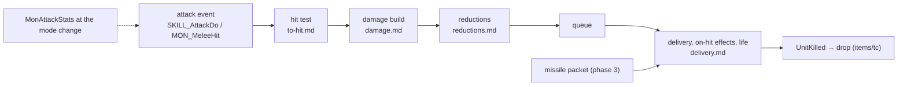
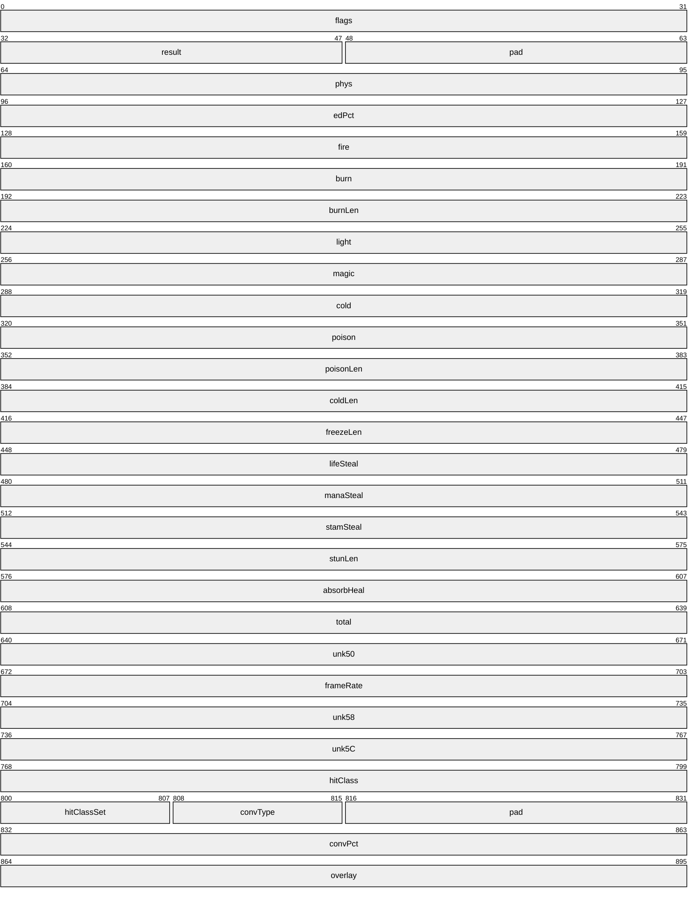
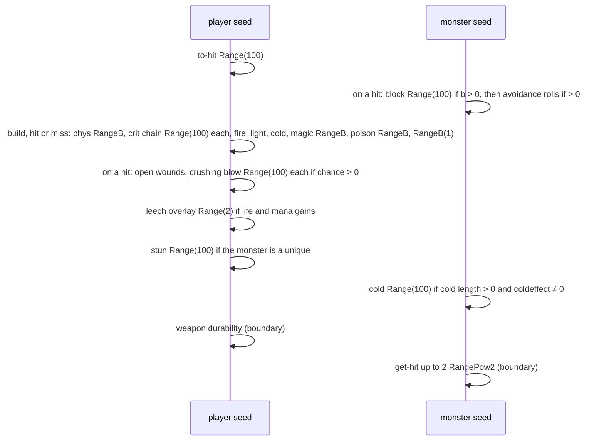
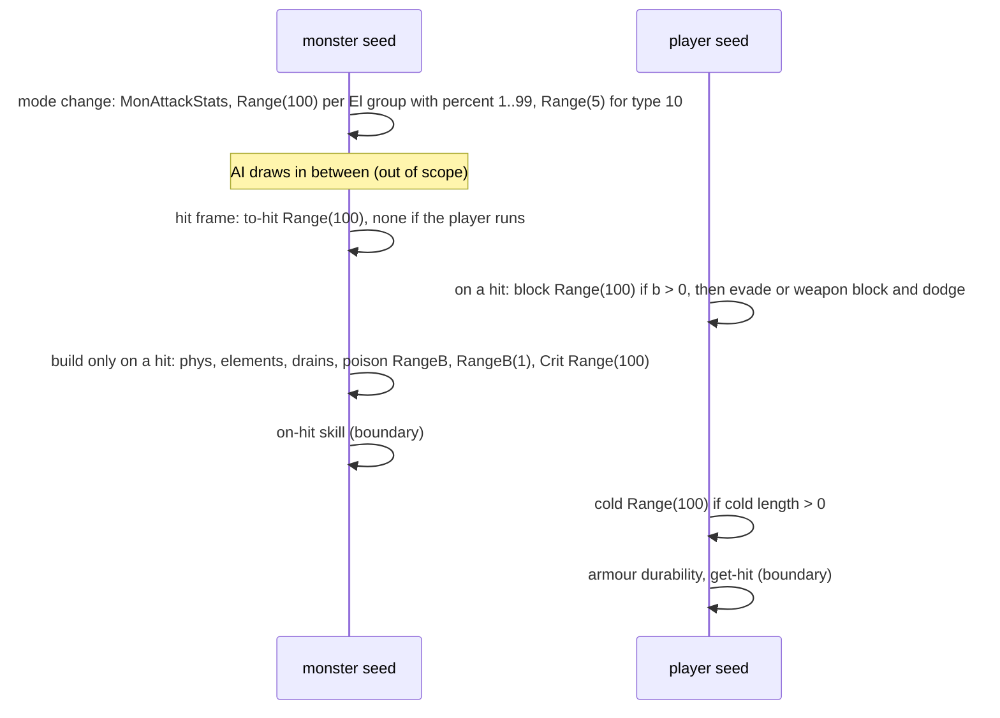

# Combat formulas: the attack event, its seeds and its branches

## Purpose

When one unit attacks another, the server tests the hit, builds the damage of each type, reduces it on the
defender, applies it with the on-hit effects and changes the defender's life. This subsystem specifies that chain for
a player's normal attack, a monster's or mercenary's plain attack and the defender's side of a missile hit, in every
difficulty and in classic and expansion games, with every draw on the attacker's and the defender's unit seeds in
order. It is the first simulation phase of [ADR-0014](../../adrs/0014-scope-game-simulation.md): a unit's **final
stats** are inputs (phase (2) models how they add up), and a **skill's or missile's damage packet** is an input
(phase (3) models how a skill builds it). This page gives the events, the packet, the draw order per event, the
chaining of events on one seed, the branches and a full worked example; the formulas are in the four files below.



## Files

| File | Covers | Status |
|---|---|---|
| [to-hit.md](to-hit.md) | the hit test, the chance to hit with `ToHitFactor`, defence, block, evade, weapon block, dodge, avoid | draft |
| [damage.md](damage.md) | the damage build: physical roll, critical and deadly strike, elements, steal and drain fields, poison, the `RangeB(1)` step, conversion, the monster `Crit`; `MonAttackStats`' draws | draft |
| [reductions.md](reductions.md) | the percent P, DR and MDR, resistances with the difficulty penalty, caps, immunity and pierce, absorb | draft |
| [delivery.md](delivery.md) | queue and delivery, crushing blow, open wounds, leech, stun, cold, freeze, poison, the life change, the life tick | draft |

Names of functions, structs and fields are ours ([combat/0001](../../findings/combat/0001-formulas.md),
`re/types/combat.h`); the server module is the binary's own `.\UNIT\SUnitDmg.cpp`. Primitives (`Step`, `Range`,
`RangePow2`) are those of [rng](../rng/README.md); `RangeB` is the second compile of `Range`. `MulDiv(a, b, c)` is the
helper of [monsters/stats § A](../monsters/stats.md#a-muldiv-and-monlvlstats). Divisions are signed and truncate
toward zero unless stated. Life, mana and damage fields are in 1/256 points.

## Entry points

| When | Function | Tag |
|---|---|---|
| A player's normal attack (Skills row 0, `srvdofunc` 1), at the hit frame | fn:SKILL_AttackDo@0x0056F070 | [C] (run:2026-10-16-combat: 2 030 events) |
| A monster's or a mercenary's plain attack, at the hit frame | fn:sub_005A7670_MonAttackFrame@0x005A7670 → fn:MON_MeleeHit@0x005A5490, fn:COMBAT_DeliverQueued@0x0057D4F0 | [C] (run:2026-10-16-combat: 4 533 monster, 1 259 mercenary) |
| A monster skill's melee hit | fn:sub_005D9C80_MonSkillAttackDo@0x005D9C80 | [I] |
| A monster enters an attack mode (its to-hit, damage and `El` stats) | fn:sub_005A7C20_MonSetMode@0x005A7C20 → fn:sub_005A4F50_MonAttackStats@0x005A4F50 | [C] for the draws (run:2026-10-16-combat: 5 060) |
| A missile's damage reaches a unit (the defender's side) | fn:MISSILE_ApplyDamage@0x005AD730 | [C] (run:2026-10-16-combat: 1 957 on the player or the mercenary, 519 Nova missiles) |
| A player skill's melee hit (packet and `SrcDam` from the skill) | `0x005C7690` and the other do-functions that call fn:COMBAT_MeleeHitTest@0x0057EC10 | [I] |

## Inputs

### Tables

| Anchor | Used for |
|---|---|
| tbl:CharStats.txt:ToHitFactor, `BlockFactor` | [to-hit](to-hit.md) |
| tbl:MonStats.txt:Crit, `Drain`, `coldeffect`, `NoShldBlock`, `killable`, `boss`, `primeevil`, `demon`, `lUndead`, `hUndead`, `MonType`, `Velocity` | every file |
| tbl:DifficultyLevels.txt:ResistPenalty, `LifeStealDivisor`, `ManaStealDivisor`, `MonsterColdDivisor`, `MonsterFreezeDivisor`, `HireableBossDamagePercent` | [reductions](reductions.md), [delivery](delivery.md) |
| tbl:Weapons.txt:StrBonus, `DexBonus` | [damage](damage.md) |
| tbl:ItemStatCost.txt:itemeventfunc1 | the stat events of [delivery § E](delivery.md#e-the-stat-events-crushing-blow-open-wounds-freeze) |
| tbl:Skills.txt:srvdofunc, `SrcDam`, `ToHit`, `LevToHit`, `ToHitCalc` | the event and the skill's percent |
| `g_DamageResistTable` (binary) | [reductions § B](reductions.md#b-the-rows-g_damageresisttable) |

### Runtime state

| State | Type | Source |
|---|---|---|
| unit seed of each unit | `Seed` at `Unit+0x20` | [rng/seeds](../rng/seeds.md) |
| unit stats | i32 values of the stat lists | value inputs (§ The ADR-0014 boundary) |
| hit queue | list at `Unit+0xAC` | [delivery § A](delivery.md#a-queue-and-delivery) |
| frame | `Game+0xA8` | timed states |
| game type | `Game+0x70`, 0 classic | game creation |
| difficulty | the game's difficulty, 0..2 | game creation |

### The damage packet



[I] The packet is 0x70 bytes, zeroed by the caller on its stack and copied whole onto the attacker's hit queue. Its
fields: `+0x00` flags, `+0x04` result (u16), `+0x08` physical, `+0x0C` enhanced-damage percent, `+0x10` fire,
`+0x14`/`+0x18` burning damage and length, `+0x1C` lightning, `+0x20` magic, `+0x24` cold, `+0x28`/`+0x2C` poison
per frame and length, `+0x30` cold length, `+0x34` freeze length, `+0x38`/`+0x3C`/`+0x40` life, mana and stamina
steal, `+0x44` stun length, `+0x48` absorbed life, `+0x4C` total, `+0x54` damage frame rate, `+0x60` hit class,
`+0x65`/`+0x68` conversion type and percent, `+0x6C` overlay. (struct:DamagePacket+0x08, struct:DamagePacket+0x65,
fn:COMBAT_QueueHit@0x0057CA80) The checker predicted every damage field and the result word of the packet at the
builder's return, after the reductions and at delivery. [C] (run:2026-10-16-combat)

[I] Flags at `+0x00`: `0x1` physical already set (skip the roll), `0x2` already built, `0x4`/`0x8`/`0x10` no
life/mana/stamina drain roll, `0x20` built (and forced at delivery), `0x80` no `domissiledamage` event, `0x100`/
`0x200`/`0x400` bypass resistances of undead, demons, others, `0x1000` hits non-hostile units. Result bits at
`+0x04`: `0x1` hit, `0x2` killed, `0x4` get-hit, `0x8` knockback, `0x10` blocked, `0x20` no events, `0x80` dodged,
`0x100` avoided, `0x200` evaded, `0x2000` doubled, `0x8000` weapon block. (struct:DamagePacket+0x04)

### The ADR-0014 boundary

| Kind | What | Tag |
|---|---|---|
| value inputs | every stat of both units at the event's entry, and their life, mana and stamina; the table cells named in each file | [C] (run:2026-10-16-combat) |
| value oracles | the player's attack-rating percent (mastery included), `UnitBlockChance`'s shield test, `UnitIsMoving`, the weapon block chance and its skill check, the two-handed test, the weapon mastery's damage and crit, step 1's `edPct` | [C] (run:2026-10-16-combat) |
| inputs (packets) | a skill's packet (any `srvdofunc` other than 1) and a missile's packet, taken at `ResolveAndQueue` or `ApplyDamage` entry | [C] (run:2026-10-16-combat) |
| boundary oracles | stat-event handlers other than 15 and 16, `COMBAT_DurabilityLoss`, the knockback, `COMBAT_GetHit`, a monster's on-hit skill `0x005A4390`, a skill do-function's draws before the build, a delivery on a later frame than the hit test: entry seeds asserted, exit seeds taken (ADR-0004) | [C] (run:2026-10-16-combat) |

[C] Under this boundary run:2026-10-16-combat reproduced 15 358 logged events of 19 sessions with 0 mismatches,
every logged seed asserted. (run:2026-10-16-combat) The progressive-charge hooks around the player's build and the
finisher before delivery were dropped events by rule; none occurred. [I] (fn:COMBAT_PrgHooksBeforeBuild@0x005D3AC0,
fn:COMBAT_PrgFinisher@0x005D5220)

### Constants

| Name | Value | Anchor | Tag |
|---|---|---|---|
| normal attack `SrcDam` | 128 | tbl:Skills.txt:SrcDam | [C] (run:2026-10-16-combat) |
| LCG multiplier of the inlined draws | `0x6AC690C5` | [rng](../rng/README.md) | [C] (run:2026-10-16-combat) |

## Algorithm

### A. The attack events

```
A1. PlayerAttack(att):                                                [C] (fn:SKILL_AttackDo@0x0056F070, run:2026-10-16-combat, all of A1 except as tagged)
      if att wields a missile weapon: create a missile; return        ; [I] (0x0056ECB0), phase (3)
      def ← att's target;  pkt ← 0x70 zero bytes
      pkt.result ← MeleeHitTest(att, def, arPct: stat(att, 325), rangeExtra: 0)       ; to-hit.md § C
      pkt.flags |= 0x2
      PrgHooksBeforeBuild(att, pkt);  BuildDamage(att, def, pkt, 0, 128);  PrgHooksAfterBuild(att, pkt)   ; damage.md, whatever the result
      ResolveAndQueue(att, def, pkt, 128)                             ; delivery.md § A: reductions on a hit
      if att has the `meleeonly` state flag: AttackDeliverMeleeOnly(att, def)        ; [I] (fn:sub_0056C2D0_AttackDeliverMeleeOnly@0x0056C2D0), skips the finisher
      else: PrgFinisher(att);  DeliverQueued(att, def)                ; delivery.md § A

A2. MonsterAttack(att):                                               [C] (fn:sub_005A7670_MonAttackFrame@0x005A7670, fn:MON_MeleeHit@0x005A5490, run:2026-10-16-combat, all of A2)
      ; earlier, at the mode change: MonAttackStats(att, newMode)     ; damage.md § E
      def ← att's target;  pkt ← 0x70 zero bytes
      pkt.result ← MeleeHitTest(att, def, arPct: 0, rangeExtra: 0)
      ResolveAndQueue(att, def, pkt, 128)                             ; the build runs here, only on a hit
      DeliverQueued(att, def)
```

- A1. **The player's damage is built on a miss**, so a missed swing still steps the attacker's seed through the
  build. [C] (fn:SKILL_AttackDo@0x0056F070, run:2026-10-16-combat: 386 misses)
- A1. A player skill's melee hit passes `SKILLS_GetToHit` as `arPct` and its own `SrcDam`; its packet is phase (3)'s
  input. [I] (fn:SKILLS_GetToHit@0x006449F0, 0x005C76B0)
- A2. A monster skill's do-function calls `MonAttackStats` itself, then `MON_MeleeHit` and the delivery; the plain
  attack frame relies on the call made at the mode change. [I] (fn:sub_005D9C80_MonSkillAttackDo@0x005D9C80)
- A2. **A mercenary is a monster on this path.** It differs where the code tests the hireling type: crushing blow
  divisor 10 against it, P = 25 against another hireling and `HireableBossDamagePercent` against a boss, leech by the
  player formula without the divisors, and no drain rolls in its build. [I] (fn:sub_0063EE90_HirelingType@0x0063EE90)
  The mercenary's 1 259 attacks reproduced. [C] (run:2026-10-16-combat)
- A3. **Missiles.** `MISSILE_HitUnit` may roll the chance to hit, `MISSILE_BuildDamage` builds the packet from the
  missile's own stats on the missile's seed, and `MISSILE_ApplyDamage` rolls the knockback on the missile's seed,
  the defence on the defender's seed (block only with physical damage), and calls `ApplyDamage` with reductions.
  That path is phase (3); here its packet is an input. [I] (fn:MISSILE_HitUnit@0x005ADF10,
  fn:MISSILE_BuildDamage@0x005A89A0, fn:MISSILE_ApplyDamage@0x005AD730)

### B. Draw order per event

**B1. A player's normal attack on a monster.**



[C] On the player's seed the order is: to-hit, the build (whatever the hit result), then on a hit the stat events,
the leech overlay and the stun; on the monster's seed: the defence rolls (on a hit), then the cold draw at delivery.
Each draw happens only under the condition given in its file. (fn:SKILL_AttackDo@0x0056F070, fn:COMBAT_ApplyDamage@0x0057C6C0,
run:2026-10-16-combat) The weapon durability and the get-hit draws are boundary oracles (§ The ADR-0014 boundary).
[I] (fn:COMBAT_DurabilityLoss@0x0057D3D0, fn:sub_0057CB00_GetHitRoll@0x0057CB00)

**B2. A monster's attack on the player.**



[C] On the monster's seed: `MonAttackStats`' `El` draws at the mode change, then at the hit frame the to-hit and, only
on a hit, the build with the `Crit` draw last; on the player's seed: the defence rolls on a hit and the cold draw at
delivery. (fn:sub_005A4F50_MonAttackStats@0x005A4F50, fn:MON_MeleeHit@0x005A5490, run:2026-10-16-combat) A monster
attacker's leech has no draw. [I] (fn:COMBAT_Leech@0x0057C420)

**B3. A missile on the player.** The missile's own seed draws its packet and its knockback (phase (3)); the player's
seed draws the defence (block only when the packet has physical damage, then avoid) and, at delivery, the cold draw.
[C] for the player's seed (run:2026-10-16-combat: 1 957 events); [I] for the missile's (fn:MISSILE_ApplyDamage@0x005AD730)

### C. Chaining events on one seed

[C] **The player's seed chains.** Consecutive in-scope events on the player's seed (its attacks, the monster attacks'
defence part, the missile defence, its Nova missiles) follow each other with no hidden draw between them on the paths
taken: chained pairs `pa` 1 796, `ma` 4 235, `md` 1 505, `pm` 519 (as first event), each ≥ 20 on both ends.
(run:2026-10-16-combat) A resynchronisation was needed where something out of scope drew in between (213 player
attacks). (run:2026-10-16-combat)

[C] **A monster's seed chains only within one attack**: `MonAttackStats` at the mode change to the attack it opens
(2 237 monster, 558 mercenary pairs). Between two attacks its AI draws on the same seed, out of scope, so each attack
resynchronises. (fn:sub_005A4F50_MonAttackStats@0x005A4F50, run:2026-10-16-combat)

### D. Branches

| Branch | Where | What changes | Tag |
|---|---|---|---|
| classic against expansion | block | expansion only: `(dex − 15)·b / (2·lvl)`; classic `stat 20 + BlockFactor` | [C] (fn:sub_00622720_UnitBlockChance@0x00622720, run:2026-10-16-combat) |
| classic against expansion | resistance | classic −20 Nightmare / −50 Hell; expansion `ResistPenalty` 0 / −40 / −100 | [C] (fn:COMBAT_ResistFor@0x0057BE00, run:2026-10-16-combat) |
| classic against expansion | `MonAttackStats` | classic ×10/12 damage and ×10/15 to-hit in Nightmare and Hell; expansion player-count bonus | [I] (fn:sub_005A4F50_MonAttackStats@0x005A4F50) |
| difficulty | resistance penalty, leech divisors, cold and freeze divisors, MonStats `Drain` and `coldeffect` | per the tables | [C] for the penalty and leech (run:2026-10-16-combat); [I] for the freeze divisor (fn:COMBAT_ApplyFreeze@0x0057B230) |
| difficulty | to-hit, block, crushing blow, open wounds | none | [I] (fn:COMBAT_ToHitRoll@0x0057D9B0, fn:STATEVENT_CrushingBlow@0x005BFFC0, fn:STATEVENT_OpenWounds@0x005BFE60) |
| player count | crushing blow divisor | `k + MulDiv(k, PlayerHpPct(n), 100)` with the monster's creation count | [C] (fn:STATEVENT_CrushingBlow@0x005BFFC0, run:2026-10-16-combat) |
| player count | `MonAttackStats` damage | expansion, Nightmare and Hell: + `b/128` with `b = 8(n − 1)` for `n < 9` | [I] (fn:sub_005A4F20_PlayerDmgBonus@0x005A4F20) |
| hireling | P, crushing blow, leech, drains | § A2 | [C] for P 50 and 35 against a boss (run:2026-10-16-combat); [I] otherwise (fn:sub_0063EE90_HirelingType@0x0063EE90) |
| player against player | P = 17 on every scaled field; stat events and leech with `D` = 100 | named only, ADR-0008 open | [I] (fn:COMBAT_DamagePercent@0x0057C060) |

- D. "Players" means the monster's stat 100, the count frozen at its creation, not the current `/players`. [C]
  (fn:STATEVENT_CrushingBlow@0x005BFFC0, run:2026-10-16-combat)

## Outputs

The defender's life, mana and stamina, the attacker's life and mana after leech, the defender's timed states, the
result word (hit, killed, blocked…), the kill hand-off to `COMBAT_GetHit` and `sub_0057CCB0_UnitKilled`, and both
seeds advanced by the draws of § B. [C] (fn:COMBAT_ApplyDamage@0x0057C6C0, run:2026-10-16-combat)

## Worked example

### Example 1: a melee hit in Hell with crushing blow and leech

`solo-h3`, frame 357, expansion Hell, `/players` 1 (run:2026-10-16-combat). The attacker is the tool-built
`CombatSolo` Sorceress (level 85, strength 405, dexterity 420, stat 19 = 250, a Dimensional Blade;
stats 21/22 = 32/87, fire 3–6, cold 15–45, magic 50–120, poison 153 for 100 frames; deadly strike 15, open wounds 10,
crushing blow 20, life steal 5, mana steal 7). The defender is a `fallen2` (level 68, life 74776 of 479232,
defence 946, block 16, physical resistance 15, fire 110, cold 40, stat 100 = 1). Seeds `low:high`. [C]
(run:2026-10-16-combat)

| # | Seed | Draw | Value | Effect |
|---|---|---|---|---|
| 1 | player `4eb7ca01:65342f7a` → `0109323f:20d5284f` | to-hit `Range(100)` | 3 | AR `(420 − 7)·5 + 250 − 15` = 2300, DEF 946; `c` = `230000 ÷ 3246` = 70 → `70·85·2 ÷ 153` = 77; hit |
| 2 | monster `91336523:696c7d87` → `c5ef0176:3c8fe7bd` | block `Range(100)` | 30 | `b` = 16; not blocked; no dodge or avoid stat, no draw |
| 3 | player → `0be642ca:006e9c81` | physical `RangeB(71104)` | 50826 | phys `41369 + 50826` = 92195 |
| 4 | player → `fa6da1f3:04f69279` | deadly strike `Range(100)` | 83 | ≥ 15, no doubling |
| 5 | player → `465ee278:6873a378` | fire `RangeB(768)` | 120 | fire 888 |
| 6 | player → `c7ab69d0:1d59def4` | cold `RangeB(7680)` | 6608 | cold 10448 |
| 7 | player → `26a74c04:5347d94e` | magic `RangeB(17920)` | 9220 | magic 22020 |
| 8 | player → `9fdf9862:101f40ba` | `RangeB(1)` | 0 | burn 2 |
| — | — | reductions, no draw | — | phys 78365, fire 0 (immune), cold 6268, magic 22020, poison 153, cold length 60; total 106806; kill pre-test: result `0x7` |
| 9 | player → `4cb2a424:42ae9671` | open wounds `Range(100)` | 44 | ≥ 10, no wound |
| 10 | player → `a0532625:1ffd7581` | crushing blow `Range(100)` | 13 | < 20: life 74776 → 58886 |
| 11 | player → `180c9ffa:42dec8c5` | leech overlay `Range(2)` | 0 | phys capped to 58886; life + 731 (1540389 → 1541120) |
| — | — | life change | — | `58886 − 106806` < 256: 0, killed |
| 12 | monster → `fb92678b:528e7d64` | cold `Range(100)` | 79 | no shatter |
| — | player → `1dee8427:0a07e19b`; monster → `e7f85b5b:68edc05f` | durability, get-hit (boundary oracles) | — | exit seeds as logged |

Each step's arithmetic is in its file: [to-hit § Worked example](to-hit.md#worked-example) for the rule,
[damage § Worked example](damage.md#worked-example), [reductions § Worked example](reductions.md#worked-example),
[delivery § Worked example](delivery.md#worked-example). Draws 1–12 and every intermediate seed are the logged ones.
[C] (run:2026-10-16-combat)

The per-difficulty examples are in the files: monster hits blocked in Normal, Nightmare, Hell and classic Hell
([to-hit](to-hit.md#worked-example)), monster hits resisted in the same four ([reductions](reductions.md#worked-example)),
crushing blow at `/players 8` ([delivery](delivery.md#worked-example)). [C] (run:2026-10-16-combat)

## Reimplementation notes

- **Two seeds per event.** The attacker's seed draws the to-hit, the build, the stat events, leech and stun; the
  defender's draws the defence rolls and the cold. Using one combat RNG desynchronises both units. [C]
  (run:2026-10-16-combat)
- **Draws whose results are discarded still happen**: the player's build on a miss, the builder's `RangeB(1)`, the
  leech overlay `Range(2)`, the cold shatter roll on a monster that cannot shatter. [C] (fn:SKILL_AttackDo@0x0056F070,
  0x0057BC2F–0x0057BC8A, 0x0057C560–0x0057C568, 0x0057B00D, run:2026-10-16-combat)
- **Draws that do not happen**: a chance of 0 (block, dodge, deadly strike, crushing blow, open wounds) and a
  degenerate damage range draw nothing. [C] (run:2026-10-16-combat)
- **A monster attack and its `MonAttackStats` are two moments.** The `El` draws happen when the attack mode starts,
  the to-hit and build at the hit frame, with the monster's AI drawing in between. [C]
  (fn:sub_005A4F50_MonAttackStats@0x005A4F50, run:2026-10-16-combat)
- **The community's 1/8 crushing blow on champions and uniques and its player-count-free crushing blow do not hold in
  1.14d**; nor does the class level bonus in the chance to hit, nor healing only from flat absorb. [C]
  (run:2026-10-16-combat)

## Evidence

- [combat/0001](../../findings/combat/0001-formulas.md): the summary, §§ 1–2 (packet, events), 11 (draws per event
  and chaining), 12 (branches), 14 (the hooks and the finisher), 15 (the reproduction), the boundary recommendation,
  *Leads used* (30 verdicts, five contradicted).
- [combat/experiments § run:2026-10-16-combat](../../findings/combat/experiments.md#run2026-10-16-combat) and its
  architect review: 19 sessions, 15 358 events, 0 mismatches; the shortfalls.
- `tools/combat.py` (the model behind the confirmed tags, `check` over the run list), `tools/gdb/combat.gdb`.
- Types: `re/types/combat.h`. Plan: [0037](../../plans/0037-combat-formulas.md).
- Upstream: [rng](../rng/README.md), [rng/seeds](../rng/seeds.md), [monsters/stats](../monsters/stats.md),
  [player/creation](../player/creation.md), [items/properties](../items/properties.md), [data/calc](../data/calc.md).
  Downstream: [items/tc](../items/tc.md) (the drop at the kill).

## Open questions

- [L] **Owed to ADR-0014 phase (2), stats and states:** how items, skills, auras and states add up to the stats this
  spec takes as inputs (attack rating percent, defence percents, `edPct`, resistances and their maxima, DR, MDR,
  absorb, leech, the on-hit chances), and the formulas of the stats `MonAttackStats` writes.
- [L] **Owed to phase (3), skills and missiles:** a skill's damage packet and `SrcDam`, a missile's packet, its hit
  test and knockback draws, the conversion fields, the event handlers other than crushing blow, open wounds and
  freeze (skill on hit, knockback, slow…), the progressive-charge hooks and the finisher's draw.
- [L] **Owed to phase (5), animation:** hit recovery, knockback and stun lengths in time, the hit class, the get-hit
  and durability draws.
- [L] **Shortfalls of run:2026-10-16-combat** (plan 0037 Phase 2; a resume lane may raise some): Hell's
  `HireableBossDamagePercent` 25 (0 events); open wounds on an act boss (0); crushing blow on an act boss (1), a
  superunique (5), a champion (0); the prime-evil 200 (1); the negative absorbed amount (4); the monster leech branch
  (7); the stun draw on a unique (17); the resistance cap for cold (15), lightning (17), poison (2), magic (0); magic
  immunity (0); evade, weapon block, dodge, avoid (0); conversion, freeze, pierce, flat absorb (0); the running
  player's automatic hit (26); the player's life tick (no window).
- [L] Player against player and hostile auras need two clients (ADR-0008, proposed).
