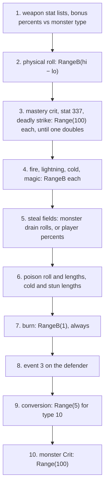

# Combat: the attacker's damage build

## Purpose

`COMBAT_BuildDamage` fills the damage packet of one attack from the attacker's stats: physical damage with enhanced
damage and the weapon's strength and dexterity shares, critical and deadly strike, the four elements, the drain or
steal fields, poison, cold and stun lengths, an unconditional seed step, the physical-to-element conversion a
skill's hit builder sets up, and the monster `Crit` doubling. Every draw is on the **attacker's** seed. The player's normal attack builds even
when the hit test missed; a monster builds only on a hit. The packet then goes through [combat/reductions](reductions.md)
and [combat/delivery](delivery.md). A skill's own packet (phase (3)) and a missile's packet are inputs, not built
here ([combat/overview](README.md)).



## Entry points

| When | Function | Tag |
|---|---|---|
| The player's normal attack, after the hit test, **whatever its result** | fn:SKILL_AttackDo@0x0056F070 → fn:COMBAT_BuildDamage@0x0057B7D0 | [C] (run:2026-10-16-combat) |
| A monster's plain attack, inside the queue, only on a hit | fn:MON_MeleeHit@0x005A5490 → fn:COMBAT_ResolveAndQueue@0x0057DBF0 → fn:COMBAT_BuildDamage@0x0057B7D0 | [C] (run:2026-10-16-combat) |
| The physical roll | fn:COMBAT_RollPhysical@0x0057B420 | [C] (run:2026-10-16-combat) |
| One element's roll | fn:COMBAT_RollElemStat@0x0057A8E0, fn:COMBAT_RollRange@0x0057A880 | [C] (run:2026-10-16-combat) |
| A monster's to-hit and damage stats, at its attack mode change | fn:sub_005A4F50_MonAttackStats@0x005A4F50 | [C] for its draws and its stats (run:2026-10-16-combat; the stats in 19 750 of 19 750 calls, [combat/experiments § S5a part 2](../../findings/combat/experiments.md#addendum-2026-11-15-plan-0066-batch-s5a-part-2-the-monattackstats-output-model-and-the-deliverys-boundary-draws-lanen66j)) |

## Inputs

### Tables

| Anchor | Used for |
|---|---|
| tbl:Weapons.txt:StrBonus, `DexBonus` | the strength and dexterity shares of enhanced damage (step 2) |
| tbl:MonStats.txt:Crit | the monster doubling chance (step 10) |
| tbl:MonStats.txt:MonType | the stat-180 bonus by monster type (step 1) |
| tbl:Skills.txt:SrcDam | `srcdam`, the share of the attack's damage out of 128 (128 for the normal attack) |

### Runtime state

| State | Type | Source |
|---|---|---|
| attacker seed | `Seed` at `Unit+0x20` | every draw of this spec |
| packet | `DamagePacket`, 0x70 bytes, zeroed by the caller | fields in 1/256 life unless noted ([combat/overview § Packet](README.md#the-damage-packet)) |
| `critFlag` | i32 argument | 0 for the normal attack: the mastery crit is allowed |
| `srcdam` | i32 argument, 0 means 128 | the caller |
| `edPct` | packet `+0x0C` | enhanced damage the caller or step 1 adds |
| two-handed hold, mastery damage and crit | values | value oracles in the run (`0x0063D340`, `SKILLS_GetMasteryBonus`) |

Stat ids read: 0, 2 (strength, dexterity), 17, 18 (max and min damage percent), 21–24 (one- and two-hand min/max),
25 (enhanced damage), 48–59 (elements and poison), 60–66 (steal, drain, stun), 101 (poison length override), 103, 104,
106 (bypass), 111 (flat damage), 120–122, 141 (deadly strike), 180, 315 (burn length), 326 (poison count), 329–332,
357 (elemental masteries), 337 (critical strike), and 31 on the defender (read and written in step 1's stat-120 term).
[C] Every stat-reader site of the builder and its rolls resolved with a second tool (tbl:ItemStatCost.txt:Stat,
0x0057B840, run:2026-11-15-sweep2-s5b,
[combat/0001 § 18](../../findings/combat/0001-formulas.md#18-plan-0066-batch-s5b-static-second-sources-run2026-11-15-sweep2-s5b))

### Constants

| Name | Value | Anchor | Tag |
|---|---|---|---|
| enhanced-damage floor | −90 | 0x0057B4BB–0x0057B628 | [C] (run:2026-10-16-combat) |
| unarmed min/max | 1 / 2 | fn:COMBAT_RollPhysical@0x0057B420 | [C] (run:2026-11-16-sweep2-s5e2) |
| burn constant | 316 | 0x0057BC2F–0x0057BC8A | [C] (run:2026-11-16-sweep2-s5e2: 226 cases separate it from 256) |
| conversion minimum length | 50 frames | 0x0057BCB2–0x0057BD71 | [C] (run:2026-11-16-sweep2-s5e2) |

## Algorithm

### A. `COMBAT_BuildDamage` in order

```
BuildDamage(att, def, pkt, critFlag: i32, srcdam: i32):              [C] (fn:COMBAT_BuildDamage@0x0057B7D0, run:2026-10-16-combat, run:2026-11-16-sweep2-s5e2, all of A except as tagged)
  if srcdam = 0: srcdam ← 128
1.  link the weapon's stat lists to att;  pkt.flags |= 0x20                         (0x0057B805–0x0057B87D, all of step 1)
    if (att is a player or UnitAlignGet(att) = 2) and def is a monster:
      if stat(att, 120) ≠ 0: def's stat 31 ← max(0, stat 31 + stat(att, 120))      ; added; permanent
      if def is a demon and stat(att, 121) > 0: pkt.edPct += stat(att, 121)
      if def is undead:
        u: i32 ← ((att's weapon is blunt, item type 57) ? 50 : 0) + stat(att, 122)   ; [I] the blunt 50: no case held a weapon (fn:sub_0057B660_UndeadDmgBonus@0x0057B660)
        if u > 0: pkt.edPct += u
      for each (layer, v) in att's stat-180 entries:
        if 0 < layer < count and 0 < MonType(def) < count and MonTypeTable[MonType(def)][layer]: pkt.edPct += v
2.  if not (pkt.flags & 0x1):
      pkt.phys ← RollPhysical(att, pkt.edPct, pkt.phys, srcdam)                    ; § B, draw#1 if hi > lo
3.    for chance in [masteryCrit(att) if critFlag = 0 and att holds a weapon,       ; [I] the mastery crit's place first, needing a weapon (0x0057B8A9–0x0057B92F)
                     stat(att, 337), stat(att, 141)]:
        if chance > 0:
          r ← RangeOffset(att.seed, 0, 100)                                        ; draw, = Range(att.seed, 100)
          if r < chance: pkt.result |= 0x2000; pkt.phys ← pkt.phys × 2; stop       ; at most one doubling
4.  pkt.fire  ← ElemRoll(att, 48, 49, 329, pkt.fire,  srcdam)                      ; § C, each a draw if hi > lo
    pkt.light ← ElemRoll(att, 50, 51, 330, pkt.light, srcdam)
    pkt.cold  ← ElemRoll(att, 54, 55, 331, pkt.cold,  srcdam)
    pkt.magic ← ElemRoll(att, 52, 53, 357, pkt.magic, srcdam)
5.  if att is a monster and not a hireling:                                         (0x0057BA55–0x0057BB5A)
      unless pkt.flags & 0x04: pkt.lifeSteal += Roll(60, 61, base: pkt.lifeSteal) × srcdam ÷ 128   ; drain rolls, draws as § C; the base: note 5
      unless pkt.flags & 0x08: pkt.manaSteal += Roll(62, 63, base: pkt.manaSteal) × srcdam ÷ 128
      unless pkt.flags & 0x10: pkt.stamSteal += Roll(64, 65, base: pkt.stamSteal) × srcdam ÷ 128
    else if att is a player or a hireling:                                          ; a unit of type 2 or more takes neither branch
      unless pkt.flags & 0x04: pkt.lifeSteal += stat(att, 60)                      ; percents, no draw
      unless pkt.flags & 0x08: pkt.manaSteal += stat(att, 62)
      if stat(att, 103): pkt.flags |= 0x100;  if stat(att, 104): pkt.flags |= 0x200;  if stat(att, 106): pkt.flags |= 0x400
6.  pct: i32 ← (stat(att, 58) > 0) ? stat(att, 332) : 0                            (0x0057BB60–0x0057BC2C)
    pkt.poison ← RollRange(stat(att, 57), stat(att, 58), pct, base: pkt.poison) × srcdam ÷ 128   ; replaces the field; no << 8; draw if hi > lo
    if stat(att, 58) > 0 and pkt.poison ≠ 0:
        if stat(att, 101) > 0: pkt.poisonLen += stat(att, 101)
        else: pkt.poisonLen += stat(att, 59);  if stat(att, 326) > 1: pkt.poisonLen ← pkt.poisonLen ÷ stat(att, 326)
    if pkt.cold > 0: pkt.coldLen += stat(att, 56) × srcdam ÷ 128
    if pkt.stunLen = 0: pkt.stunLen += stat(att, 66) × srcdam ÷ 128
7.  b: u32 ← RangeB(att.seed, 1)                                                    ; draw, ALWAYS; b = 0
    pkt.burn ← pkt.burn + max(0, pkt.burn × srcdam + 316 + b) ÷ 128                ; srcdam the byte after the 0 → 128 fix
    if pkt.burnLen ≠ 0: pkt.burnLen += stat(att, 315) × srcdam ÷ 128
8.  if att is a player or a hireling and not (pkt.result & 0x20):                   (0x0057BC8D–0x0057BCAD)
      DispatchEvent(3 attackedinmelee, unit: def, other: att, pkt)
9.  if pkt.convType ≠ 0: Convert(pkt)                                               ; § D (0x0057BCB2–0x0057BD71)
10. if att is a monster and MonStats[att.class].Crit ≠ 0:                           (fn:sub_005A5560_MonCritDouble@0x005A5560)
      r ← Range(att.seed, 100)                                                      ; draw, inlined; compared as (u8) r
      if r < Crit: phys, fire, light, magic, cold, poison ← each × 2;  mark the hit class (packet +0x60 |= 0x10 when free)
```

Step notes:

- 1. **Who runs step 1.** A player, or any unit for which `sub_006259B0_UnitAlignGet` returns 2: every unit of type 2
  or more with a stat list (a missile or an object attacker always), and a monster through the stat 172 of its
  state-105 list, so a hireling only through that list; the defender is a monster. Stat 120 is **added** to the
  monster's defence, permanently, floored at 0; stats 121 and 122 (against demons and undead) count only when
  positive, 122 together with the blunt bonus; stat 180's entries (against a monster type) count when the layer and
  the defender's `MonType` are both inside the type count and the MonType table's bit is set. In the run the `edPct`
  entering step 2 was a value oracle; `COMBAT_BuildDamage` emulated with an unarmed attacker reproduces step 1
  (596 cases separate the condition from "a player or a hireling", 474 the sign of stat 120). [C]
  (fn:sub_0057B660_UndeadDmgBonus@0x0057B660, fn:sub_0057B6A0_DmgVsMonType@0x0057B6A0,
  fn:sub_006259B0_UnitAlignGet@0x006259B0, 0x0057B805–0x0057B87D, run:2026-11-16-sweep2-s5e2,
  [combat/0001 § 20](../../findings/combat/0001-formulas.md#20-plan-0066-batch-s5e-part-2-stat-events-life-tick-and-the-damage-builder-run2026-11-16-sweep2-s5e2))
  The blunt `+ 50` needs a weapon, and which stock units carry the state-105 list is not read. [I]
  (fn:sub_0057B660_UndeadDmgBonus@0x0057B660)
- 2. **The player builds on a miss.** `SKILL_AttackDo` calls the builder after the hit test whatever its result, so
  a missed swing still steps the attacker's seed through steps 2–7 (386 misses logged). A monster's builder runs
  only when the result has `0x1` and none of `0x8380`. [C] (fn:SKILL_AttackDo@0x0056F070, 0x0057DC1D–0x0057DC37,
  run:2026-10-16-combat)
- 3. The order is the weapon mastery's crit (only with `critFlag` 0 and a weapon held), stat 337 (`passive_critical_strike`),
  stat 141 (`item_deadlystrike`); each draws only when its chance is above 0, and the first success doubles physical
  damage and stops the chain. Deadly strike reproduced 250 times, and the mastery crit came before stat 141 in 144
  logged builds with both above 0; no logged unit had stat 337, and the emulation puts it before stat 141 (40 cases
  separating, 108 with both). [C] (fn:RNG_RangeOffset@0x00472280, 0x0057B882–0x0057B92F, run:2026-10-16-combat,
  run:2026-11-16-sweep2-s5e2) The mastery crit's place before stat 337 needs a weapon, which the emulation had not.
  [I] (0x0057B8A9–0x0057B92F)
- 3. The doubling applies to physical damage only, and only when step 2 ran: 981 logged doublings left a non-zero
  element field undoubled, and with flag `0x1` steps 2 and 3 are skipped (4 066 emulated cases, 144 with stat 141
  above 0). [C] (0x0057B8A9–0x0057B92F, run:2026-10-16-combat, run:2026-11-16-sweep2-s5e2)
- 3. **A missile does not use this step.** Its critical chain runs once, when the missile is created, on the owner's
  seed, in another order (stat 337 drawn even at 0, then stat 141, then the mastery crit). [C]
  (fn:sub_0064A850_MissileCritRoll@0x0064A850, run:2026-10-25-skills, run:2026-11-16-sweep2-s5fe) Its result doubles
  the physical damage at the hit ([overview § B, B4](README.md#b-draw-order-per-event)). [I]
  (fn:sub_0064B860_MissileDamageBlock@0x0064B860)
- 4. The element order is **fire, lightning, cold, magic**, not the stat-id order. [C] (0x0057B932–0x0057BA4C,
  run:2026-10-16-combat)
- 5. A player's or a hireling's steal fields are the percents of stats 60 and 62 as they stand; the leech itself is
  computed at delivery ([combat/delivery § C](delivery.md#c-leech-combat_leech)). A monster's are rolled drain
  amounts. [C] (0x0057BA55–0x0057BB5A, run:2026-10-16-combat)
- 5. **A drain roll hides the packet's base.** `COMBAT_RollElemStat` is given the packet's field and returns it with the
  roll, and the result is added to the same field: the field becomes `field + max(field + roll, 0) × srcdam ÷ 128`, and
  `field + max(field, 0) × srcdam ÷ 128` on § C1's no-draw path (the maximum stat at 0 or below). A field that enters empty
  gets the scaled roll alone; a drain already in the packet counts again: emulated, 1 407 calls with a non-zero base.
  [C] (0x0057BA71–0x0057BAF3, 0x0057A8F7–0x0057A905, fn:COMBAT_RollElemStat@0x0057A8E0, run:2026-11-16-sweep2-s5e2)
  No stock path enters a build with these fields set: no stock `Skills` row has `EType` life, mana or stam, and no
  store to `+0x38`, `+0x3C` or `+0x40` in the 37 packet functions and their 97 callees reaches a build (do 122 and
  start 60 add after theirs, or on a packet already built). [C] (tbl:Skills.txt:EType, 0x0057BA71,
  fn:COMBAT_ResolveAndQueue@0x0057DBF0, run:2026-11-15-sweep2-s5b,
  [combat/0001 § 18](../../findings/combat/0001-formulas.md#18-plan-0066-batch-s5b-static-second-sources-run2026-11-15-sweep2-s5b),
  [quirks/0001](../../findings/quirks/0001-community-bugs.md#verdicts) row 12)
- 5. A player's or a hireling's `lifeSteal` and `manaSteal` adds are skipped under the flags `0x04` and `0x08`, as a
  monster's drains are; a unit of type 2 or more takes neither branch. [C] (0x0057BA55–0x0057BB5A,
  run:2026-11-16-sweep2-s5e2)
- 6. **The poison roll runs on every build and replaces the field**: `COMBAT_RollRange` gets the poison field as its
  base and a percent of stat 332 when stat 58 is above 0, else 0, and its result times `srcdam ÷ 128` is stored; at
  stat 58 ≤ 0 that is `max(field, 0) × srcdam ÷ 128` (2 011 emulated cases separate it from an add). [C]
  (0x0057BB60–0x0057BBF1, run:2026-11-16-sweep2-s5e2,
  [combat/0001 § 20](../../findings/combat/0001-formulas.md#20-plan-0066-batch-s5e-part-2-stat-events-life-tick-and-the-damage-builder-run2026-11-16-sweep2-s5e2))
  The run's poison hits entered with a zero poison field, where an add and a replace agree. [C] (run:2026-10-16-combat)
- 7. **The unconditional `RangeB(att.seed, 1)`.** It steps the attacker's seed once on every build and always returns
  0. With a zero `burn` field the result is `316 ÷ 128` = 2, so a plain attack carries `burn = 2` and `burnLen = 0`,
  and no burning is applied ([combat/delivery](delivery.md)). The constant 316 equals the `burningmin` stat id, which
  suggests a slip in the source; the code is as stated. The draw was asserted in all 3 732 builds, and so was `burn = 2`: the checker compares the whole
  packet at the builder's return. [C] for the draw and for `burn = 2` on a build that enters with `burn = 0` and
  `srcdam` 128 (0x0057BC2F–0x0057BC8A, run:2026-10-16-combat); for the general formula, the constant 316 itself
  (256 and 317 fail 226 and 6 emulated builds) and the `srcdam` read here as a byte (`movzx`, 0x0057BC2F; the whole
  dword fails 1 011) (run:2026-11-16-sweep2-s5e2: 3 403 builds with `burn` ≠ 0 or `srcdam` ≠ 128)
- 8. Step 8 dispatches event 3 to the defender's handlers (`UNIT_DispatchEvent(ECX game, EDX 3; def, att, pkt)`) for a
  player or hireling attacker without result `0x20`, 988 and 319 emulated calls. Over every event column of
  ItemStatCost and Skills (45 registrations) the only stock event-3 registration is Skills 50 Shiver Armor's `auraevent1`, handler 3,
  which draws on the defender's seed (skills/0003 § 3); no logged defender wore it, so none of the 10 951 logged
  builds had an event-3 handler. [C] (fn:UNIT_DispatchEvent@0x005C0C30, fn:sub_005CAD40_StatEv03ElemHitAttacker@0x005CAD40,
  tbl:Skills.txt:auraevent1, run:2026-11-15-sweep2-s5b, run:2026-11-16-sweep2-s5e2, run:2026-10-16-combat)
- 10. The comparison takes the low byte of `low mod 100`, which is the same value. 89 doublings reproduced, with the
  packet's `+0x60` flag. [C] (fn:sub_005A5560_MonCritDouble@0x005A5560, fn:sub_00554650_PacketHitClassSet@0x00554650,
  run:2026-10-16-combat) The overlay 54 on the defender is put only when the hit-class flag was already taken:
  `UnitSetOverlayStat(def, 54, 0)` is reached only when `+0x60 & 0xF0` ≠ 0 (416 separating cases). [C]
  (fn:sub_005A5560_MonCritDouble@0x005A5560, run:2026-11-16-sweep2-s5e)
- 10. `MISSILE_ApplyDamage` calls the same doubling, so a monster's missile takes it too: in 7 734 missile events from
  monsters with MonStats `Crit` above 0 the owner's draw at 0x005AD884 is asserted. [C] (0x005AD884,
  fn:sub_005A5560_MonCritDouble@0x005A5560, run:2026-10-16-combat,
  [combat/experiments § S5a part 1](../../findings/combat/experiments.md#addendum-2026-11-15-plan-0066-batch-s5a-part-1-new-checks-over-the-kept-combat-and-skills-logs-lanen66j),
  [quirks/0001](../../findings/quirks/0001-community-bugs.md#verdicts) row 11)

### B. The physical roll (`COMBAT_RollPhysical`)

```
B1. RollPhysical(att, edPct: i32, phys: i32, srcdam: i32) → i32:     [C] (fn:COMBAT_RollPhysical@0x0057B420, run:2026-10-16-combat, all of B1)
      if TwoHandedHold(att): mn ← stat(att, 23); mx ← stat(att, 24)
      else:                  mn ← stat(att, 21); mx ← stat(att, 22)
      if att holds no weapon: mn ← max(mn, 1); mx ← max(mx, 2)                      ; run:2026-11-16-sweep2-s5e2 (881 and 427 separating cases)
      mn ← (mn << 8) + (stat(att, 111) << 8);  mx ← (mx << 8) + (stat(att, 111) << 8)
      if mn < 1:   mn ← 256
      if mx ≤ mn:  mx ← mn + 256
      ed: i32 ← edPct + stat(att, 25)
      if att holds a weapon w:
        ed ← ed + Weapons[w].StrBonus × stat(att, 0) ÷ 100 + Weapons[w].DexBonus × stat(att, 2) ÷ 100
        ed ← ed + masteryDamage(att, w)
      else:
        ed ← ed + stat(att, 0)
      ed ← max(ed, −90)
      lo: i32 ← mn + MulDiv(mn, ed + stat(att, 18), 100)
      hi: i32 ← mx + MulDiv(mx, ed + stat(att, 17), 100)
      v: i32 ← phys + lo
      if hi > lo: v ← v + RangeB(att.seed, hi − lo)                                 ; draw
      v ← max(v, 0)
      if srcdam ≠ 128: v ← MulDiv(v, srcdam, 128)
      return v
```

- B1. The roll is `lo + RangeB(hi − lo)`, so the maximum is `hi − 1`, not `hi`. [C] (0x0057B4BB–0x0057B628,
  run:2026-10-16-combat)
- B1. `StrBonus·str ÷ 100` and `DexBonus·dex ÷ 100` are each truncated separately before they are added. [C]
  (tbl:Weapons.txt:StrBonus, run:2026-10-16-combat) The two-handed test (`0x0063D340`) and the mastery damage were
  value oracles. [C] (run:2026-10-16-combat)
- B1. The ≥ −90 floor is taken after the shares and the mastery are added. [C] (0x0057B4BB–0x0057B628,
  run:2026-10-16-combat)

### C. One element (`COMBAT_RollElemStat`, `COMBAT_RollRange`)

```
C1. ElemRoll(att, minStat, maxStat, masteryStat, field: i32, srcdam: i32) → i32:   [C] (fn:COMBAT_RollElemStat@0x0057A8E0, run:2026-10-16-combat, all of C1 except as tagged)
      mn ← stat(att, minStat);  mx ← stat(att, maxStat);  m ← stat(att, masteryStat)
      if mx × 256 < 8: v: i32 ← max(field, 0)                                       ; no draw
      else:
        lo: i32 ← (mn << 8) + MulDiv(mn << 8, m, 100)
        hi: i32 ← (mx << 8) + MulDiv(mx << 8, m, 100)
        v ← field + lo
        if hi > lo: v ← v + RangeB(att.seed, hi − lo)                               ; draw
        v ← max(v, 0)
      if srcdam ≠ 128: v ← (v × srcdam) ÷ 128                                        ; signed, toward zero; on the no-draw path too (run:2026-11-16-sweep2-s5e2)
      return v
```

- C1. The poison roll of step 6 and the monster drain rolls of step 5 use the same `RollRange` rule (a draw only when
  `hi > lo`); poison has no `<< 8` (stats 57 and 58 are already in 1/256 per frame). [C] (fn:COMBAT_RollRange@0x0057A880,
  run:2026-10-16-combat)
- C1. `srcdam` scales elements with a plain multiply and a truncating divide, while the physical roll uses `MulDiv`:
  782 emulated cases separate the divide from a shift, 460 the physical roll's `MulDiv` from the plain form, with 611
  negative products. [C] (0x0057B932–0x0057BA4C, run:2026-11-16-sweep2-s5e2,
  [combat/0001 § 20](../../findings/combat/0001-formulas.md#20-plan-0066-batch-s5e-part-2-stat-events-life-tick-and-the-damage-builder-run2026-11-16-sweep2-s5e2))
- C1. **The scale is the caller's, after the return**, so the no-draw path is scaled too: a field that enters positive
  with no stat comes back as `max(field, 0) × srcdam ÷ 128`. `srcdam` = 128 skips the multiply for the four elements; the
  drain rolls of step 5 multiply always, which gives the same value. No logged case had a positive field on that
  path; 2 156 emulated ones scale it so. [C] (0x0057A8F7–0x0057A905, 0x0057B935, 0x0057B954–0x0057B96A,
  0x0057BA7E–0x0057BA93, run:2026-11-16-sweep2-s5e2)

### D. Conversion

```
D1. Convert(pkt):                                                     [C] (0x0057BCB2–0x0057BD71, run:2026-11-16-sweep2-s5e2, all of D1)
      m ← MulDiv(pkt.phys, pkt.convPct, 100);  pkt.phys ← max(pkt.phys − m, 0)
      t ← pkt.convType
      if t = 10: t ← Range(att.seed, 5) + 1                                          ; draw
      t = 1: pkt.fire += m          t = 2: pkt.light += m         t = 3: pkt.magic += m
      t = 4: pkt.cold += m; pkt.coldLen ← max(pkt.coldLen, 50)
      t = 5: pkt.poison += m ÷ 8; pkt.poisonLen ← max(pkt.poisonLen, 50)
      t = 11: pkt.fire += m; pkt.burnLen ← max(pkt.burnLen, 50)
      t = 12: pkt.cold += m; pkt.freezeLen ← max(pkt.freezeLen, 50)
```

- D1. Skill hit builders write the conversion fields on a hit, before `COMBAT_ResolveAndQueue`: `convType`
  (`+0x65`) ← the skill's `EType` and `convPct` (`+0x68`) ← its `calc4`, only when `EType` is set and `calc4`
  evaluates above 0. That rule is read in full in start function 32 (store at `0x005D7FA8`). All 15 byte stores of
  `EType` write the cleared packet's `+0x65`: start functions 6, 7, 10, 16, 29, 32, 39 and 56, do functions 7, 13, 67
  and 150, and the helpers `0x005D6200`, `0x005D8B10`, `0x005DA660`, so every one is a conversion writer
  ([skills/0003 § 12](../../findings/skills/0003-handlers.md#12-routed-questions-from-p11)). In the 37 packet functions the
  stores to `+0x65` and `+0x68` are exactly those 15 and their `calc4` dwords, all before the call, and their 97
  callees store neither. [C] (fn:sub_005D7EA0_SkillSt32Hit@0x005D7EA0, 0x005D7FA8, 0x005C3175, 0x005DBD87,
  struct:DamagePacket+0x65, struct:DamagePacket+0x68, tbl:Skills.txt:EType, tbl:Skills.txt:calc4,
  run:2026-11-15-sweep2-s5b, [combat/0001 § 18](../../findings/combat/0001-formulas.md#18-plan-0066-batch-s5b-static-second-sources-run2026-11-15-sweep2-s5b),
  [skills/0001 § 11](../../findings/skills/0001-dispatch.md#11-the-skill-packet))
- D1. `SKILL_AttackDo` stores neither field ([combat/overview § A](README.md#a-the-attack-events)), and no logged
  event converted: byte `+0x65` and dword `+0x68` were 0 in all 10 951 logged builds. [C] (struct:DamagePacket+0x65,
  run:2026-10-16-combat, run:2026-11-15-sweep2-s5b) D1 itself is emulated, 210 to 241 cases per type, type 10's draw
  included; a type outside D1's seven takes `m` from `phys` and adds it nowhere. [C] (0x0057BCB2–0x0057BD71,
  run:2026-11-16-sweep2-s5e2,
  [combat/0001 § 20](../../findings/combat/0001-formulas.md#20-plan-0066-batch-s5e-part-2-stat-events-life-tick-and-the-damage-builder-run2026-11-16-sweep2-s5e2))

### E. A monster's attack stats (`MonAttackStats`)

A monster's stats 19, 21 and 22 and its `El<e>` elemental stats are written when it enters an attack mode, by
`MonAttackStats` ([monsters/stats § H](../monsters/stats.md#h-to-hit-and-damage-at-attack-time-reference-only)). Its
only draws are one `Range(att.seed, 100)` per `El` group whose mode matches and whose percent is 1..99, and one
`Range(att.seed, 5)` for an element type 10 (`rand`); nothing else steps the seed. 5 060 calls reproduced, 167 with an
`El` group applied, and 2 795 chained to the attack they open. [C] (fn:sub_005A4F50_MonAttackStats@0x005A4F50,
run:2026-10-16-combat) The stats it writes were value inputs of that run; a model from MonStats and MonLvl
([monsters/stats § H](../monsters/stats.md#h-to-hit-and-damage-at-attack-time-reference-only)) with the classic
factors and the expansion bonus of [overview § D](README.md#d-branches) reproduces stats 19, 21 and 22 in 19 750 of
19 750 logged calls and 1 030 of 1 030 `El` writes. [C] (fn:sub_005A4F50_MonAttackStats@0x005A4F50,
run:2026-10-16-combat, run:2026-10-20-shortfalls,
[combat/experiments § S5a part 2](../../findings/combat/experiments.md#addendum-2026-11-15-plan-0066-batch-s5a-part-2-the-monattackstats-output-model-and-the-deliverys-boundary-draws-lanen66j))

- E. Mode 5 selects the `A2` columns, 7 and 8 the `S1` columns, and every other mode, `sequence` (14) included, the
  `A1` columns (18 081 logged calls separate the column set); an `El<e>` group applies only when its `El<e>Mode`
  equals the mode passed (1 325 applications, and 3 929 calls that left another mode's group unwritten). [C]
  (fn:sub_005A4F50_MonAttackStats@0x005A4F50, run:2026-10-16-combat) The mode passed is the **new** mode for every
  mode change except get-hit (3): at the attacker's next attack its mode equals the last call's in 10 842 of 10 979
  pairs, a count, not a test. [I] (fn:sub_005A7C20_MonSetMode@0x005A7C20, 0x005A7D34)
- E. **`El2` applies with `El1`'s bounds**: the minimum, maximum and length read are `El1`'s (the mask `0x40 + e`) in
  57 compared applications whose own `El2` cells differ; `El3` was not met. The expansion bonus `b` scales the `El`
  minimum, maximum and length too (154 of 154 applications under `b` > 0). [C] (0x005A5252–0x005A527A,
  run:2026-10-16-combat)
- E. **A monster can call it inside its own attack.** `sandraider2` attacking in mode 14 (the attack's return
  `0x005CAED8`) called `MonAttackStats` for mode 8 between the defence rolls and the build in 6 of 14 such events, and
  the build used what that call wrote (stats 21/22 72/91, against 59/100 at the event's entry); the call entered on the
  attacker's running seed (5 asserted). The checker takes that call's exit stats as a value oracle. Which events make
  the call is not read. [I] (fn:sub_005A4F50_MonAttackStats@0x005A4F50, run:2026-10-20-shortfalls)
- E. A `noRatio` monster's `El` attack sets min = max = 0: `MonLvlStats` writes the raw `El<e>MinD/MaxD` of such a
  class to output `+0x24`/`+0x28` and jumps over the `+0x2C`/`+0x30` writes, while `MonAttackStats` zeroes its output,
  reads `+0x2C`/`+0x30`/`+0x34` and nothing reads `+0x24`/`+0x28`. Only the duration (`+0x34`) is set. Of the 31
  `noRatio` rows only 292 `firegolem` has an `El` column. [C] (0x00653BC2–0x00653C2D, 0x005A5160,
  struct:MonLvlStatsOut+0x2C, tbl:MonStats.txt:noRatio, run:2026-11-15-sweep2-s5b,
  [combat/0001 § 18](../../findings/combat/0001-formulas.md#18-plan-0066-batch-s5b-static-second-sources-run2026-11-15-sweep2-s5b))
- E. Element types at the hit: 1 fire, 2 lightning, 3 magic set min/max; 4 cold also stat 56 = duration; 5 poison
  min and max `× 10` and stat 59 = duration `× 2`; 6, 7, 8 the life, mana, stamina drains (60/61, 62/63, 64/65); 9
  `stun` only stat 66; 10 `rand` draws `Range(seed, 5) + 1` and uses duration 25 when it is 0; 11 `burn` stats
  316/317 and 315; 12 `frze` sets nothing. [C] for 1 (308 applications), 2 (611), 4 with stat 56 (108) and 5 with
  `× 10` and `× 2` (298) (run:2026-10-16-combat); [I] for 3 and 6 to 12, never applied in the logs
  (0x005A5300–0x005A53D0, tbl:ElemTypes.txt:Code)

## Outputs

The packet with `phys`, `fire`, `light`, `cold`, `magic`, `poison` and their lengths, the steal fields, `burn`,
`stunLen`, the flags `0x20` and the bypass bits, and the result bit `0x2000` on a doubling; the attacker's seed
advanced by the draws of steps 2–10. Packet fields are 1/256 life except the lengths (frames) and the steal fields of
a player or hireling (percents). [C] (fn:COMBAT_BuildDamage@0x0057B7D0, run:2026-10-16-combat)

## Worked example

The build of [combat/overview § Example 1](README.md#example-1-a-melee-hit-in-hell-with-crushing-blow-and-leech)
(`solo-h3`, Hell, frame 357): the `CombatSolo` Sorceress (strength 405, stats 21/22 = 32/87, stat 141 = 15, fire
3–6, cold 15–45, magic 50–120, poison 153/153 for 100 frames) against a `fallen2`. The entry seed is the to-hit
draw's exit. [C] (run:2026-10-16-combat)

| Step | Computation | Draw on `0109323f:20d5284f` → | Field |
|---|---|---|---|
| 2 | `mn` 32 << 8 = 8192, `mx` 87 << 8 = 22272, `ed` = `100 × 405 ÷ 100` = 405 (a Dimensional Blade: `StrBonus` 100, `DexBonus` 0); `lo` = 8192 + 33177 = 41369, `hi` = 22272 + 90201 = 112473 | `RangeB(71104)` = 50826 → `0be642ca:006e9c81` | phys 92195 |
| 3 | deadly strike 15 | `Range(100)` = 83, no doubling → `fa6da1f3:04f69279` | — |
| 4 | fire 768..1536 | `RangeB(768)` = 120 → `465ee278:6873a378` | fire 888 |
| 4 | lightning: no stats | no draw | 0 |
| 4 | cold 3840..11520 | `RangeB(7680)` = 6608 → `c7ab69d0:1d59def4` | cold 10448 |
| 4 | magic 12800..30720 | `RangeB(17920)` = 9220 → `26a74c04:5347d94e` | magic 22020 |
| 5 | player: life 5 %, mana 7 % | no draw | steal 5, 7 |
| 6 | poison 153..153, length 100; cold length 100 | no draw (`hi = lo`) | poison 153 |
| 7 | burn | `RangeB(1)` = 0 → `9fdf9862:101f40ba` | burn 2 |

The exit seed `9fdf9862:101f40ba` is the one logged at the builder's return. [C] (run:2026-10-16-combat)

## Reimplementation notes

- **Always take the `RangeB(1)` step**, on hits and misses, for players and monsters; skipping it shifts every later
  draw of the attacker. [C] (0x0057BC2F–0x0057BC8A, run:2026-10-16-combat)
- **Build the player's damage on a miss too.** The draws happen; the damage is then discarded by the queue. [C]
  (fn:SKILL_AttackDo@0x0056F070, run:2026-10-16-combat)
- **Elements in the order fire, lightning, cold, magic.** [C] (0x0057B932–0x0057BA4C, run:2026-10-16-combat)
- **No draw for a degenerate range.** `hi ≤ lo` (including equal min and max) draws nothing, unlike the monster HP
  roll of [monsters/stats](../monsters/stats.md), which draws `RangeB(hi − lo + 1)`. [C] (fn:COMBAT_RollRange@0x0057A880,
  run:2026-10-16-combat)
- **The maximum is exclusive.** `lo + RangeB(hi − lo)` never reaches `hi`. [C] (fn:COMBAT_RollPhysical@0x0057B420,
  run:2026-10-16-combat)
- **The monster `Crit` doubles every damage field**, physical and elemental, while a player's critical or deadly
  strike doubles only physical. [C] for the monster (fn:sub_005A5560_MonCritDouble@0x005A5560, run:2026-10-16-combat);
  and for the player's physical-only doubling (0x0057B8A9–0x0057B92F, run:2026-10-16-combat: 981 doublings)

## Evidence

- Plan 0066 Phase 1, the raises this spec carries since its Phase 3 re-tag:
  [combat/experiments § S5a part 1](../../findings/combat/experiments.md#addendum-2026-11-15-plan-0066-batch-s5a-part-1-new-checks-over-the-kept-combat-and-skills-logs-lanen66j)
  and [part 2](../../findings/combat/experiments.md#addendum-2026-11-15-plan-0066-batch-s5a-part-2-the-monattackstats-output-model-and-the-deliverys-boundary-draws-lanen66j)
  (new checks over the kept combat and skills logs), [combat/0001 §§ 18–22](../../findings/combat/0001-formulas.md#18-plan-0066-batch-s5b-static-second-sources-run2026-11-15-sweep2-s5b)
  (second-tool reads, run:2026-11-15-sweep2-s5b; emulations, run:2026-11-16-sweep2-s5e, run:2026-11-16-sweep2-s5e2,
  run:2026-11-16-sweep2-s5e3, run:2026-11-16-sweep2-s5fe), with the per-statement routes in
  [plan 0066's inventory](../../plans/0066-inventory/README.md).
- [combat/0001](../../findings/combat/0001-formulas.md) §§ 2 (the attack events, the build on a miss), 5 (the
  builder), 12 and 12b (a), (b), (d) (`MonAttackStats` modes, `noRatio`, element types), 14 (the monster `Crit`
  flag), 15 (the confirmed raises), 16 (a monster's `MonAttackStats` inside its attack, run:2026-10-20-shortfalls).
- [skills/0001](../../findings/skills/0001-dispatch.md) § 11 (the conversion writers).
- [skills/0002](../../findings/skills/0002-missiles.md) § 3 (the missile's critical chain, which is not step 3's).
- [combat/experiments § run:2026-10-16-combat](../../findings/combat/experiments.md#run2026-10-16-combat): 3 732
  builds, 386 on a miss, 250 deadly strikes, 89 monster doublings, 5 060 `MonAttackStats` calls.
- Tables: [Weapons](../../tables/Weapons.md), [MonStats](../../tables/MonStats.md), [ElemTypes](../../tables/ElemTypes.md),
  [ItemStatCost](../../tables/ItemStatCost.md), [Skills](../../tables/Skills.md).
- Upstream: [rng](../rng/README.md), [monsters/stats § H](../monsters/stats.md#h-to-hit-and-damage-at-attack-time-reference-only),
  [items/properties](../items/properties.md) (the item stats an attacker carries).

## Open questions

- ~~The writer of the conversion fields (packet `+0x65`/`+0x68`), probably a skill or an aura (phase (3)); no
  logged event converted, so § D is unexercised.~~ Answered: skill hit builders write them (§ D1,
  [skills/0001 § 11](../../findings/skills/0001-dispatch.md#11-the-skill-packet)).
- ~~The twelve `EType` stores not mapped to the packet.~~ All 15 write `+0x65` (§ D1, [skills/0003 § 12](../../findings/skills/0003-handlers.md#12-routed-questions-from-p11)).
- [L] A run that exercises § D (plan 0045 Phase 2); D1 itself is emulated (plan 0066 S5e).
- [L] The weapon mastery's crit place in step 3's chain, before stat 337: the logs and the emulation put it before
  stat 141 and stat 337 before 141, but no case had both a weapon and stat 337.
- ~~The formulas of the stats `MonAttackStats` writes (to-hit, damage, the classic factors, the expansion
  player-count bonus).~~ Reproduced over the kept logs by plan 0066 S5a (§ E); the `L` cells, the `Align` 1 exception
  and the `8n − 16` branch stay [combat/overview](README.md#open-questions)'s.
- [L] Which monster attacks call `MonAttackStats` inside the attack (§ E): carried to plan 0045, whose monster skill
  uses predict it.
- [L] Step 1 with a weapon: the blunt `+ 50` against undead; and which stock units carry the state-105 list that
  makes a monster's `UnitAlignGet` 2. The rest of step 1 is emulated unarmed (plan 0066 S5e).
