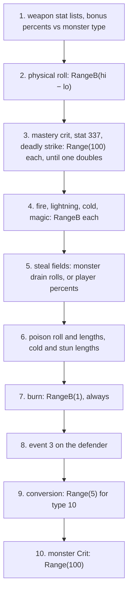

# Combat: the attacker's damage build

## Purpose

`COMBAT_BuildDamage` fills the damage packet of one attack from the attacker's stats: physical damage with enhanced
damage and the weapon's strength and dexterity shares, critical and deadly strike, the four elements, the drain or
steal fields, poison, cold and stun lengths, an unconditional seed step, the physical-to-element conversion a
skill's hit builder sets up, and the monster `Crit` doubling. Every draw is on the **attacker's** seed. The player's normal attack builds even
when the hit test missed; a monster builds only on a hit. The packet then goes through [combat/reductions](reductions.md)
and [combat/delivery](delivery.md). A skill's own packet (phase (3)) and a missile's packet are inputs, not built
here ([combat/overview](README.md)).



## Entry points

| When | Function | Tag |
|---|---|---|
| The player's normal attack, after the hit test, **whatever its result** | fn:SKILL_AttackDo@0x0056F070 → fn:COMBAT_BuildDamage@0x0057B7D0 | [C] (run:2026-10-16-combat) |
| A monster's plain attack, inside the queue, only on a hit | fn:MON_MeleeHit@0x005A5490 → fn:COMBAT_ResolveAndQueue@0x0057DBF0 → fn:COMBAT_BuildDamage@0x0057B7D0 | [C] (run:2026-10-16-combat) |
| The physical roll | fn:COMBAT_RollPhysical@0x0057B420 | [C] (run:2026-10-16-combat) |
| One element's roll | fn:COMBAT_RollElemStat@0x0057A8E0, fn:COMBAT_RollRange@0x0057A880 | [C] (run:2026-10-16-combat) |
| A monster's to-hit and damage stats, at its attack mode change | fn:sub_005A4F50_MonAttackStats@0x005A4F50 | [C] for its draws, [I] for its stats (run:2026-10-16-combat) |

## Inputs

### Tables

| Anchor | Used for |
|---|---|
| tbl:Weapons.txt:StrBonus, `DexBonus` | the strength and dexterity shares of enhanced damage (step 2) |
| tbl:MonStats.txt:Crit | the monster doubling chance (step 10) |
| tbl:MonStats.txt:MonType | the stat-180 bonus by monster type (step 1) |
| tbl:Skills.txt:SrcDam | `srcdam`, the share of the attack's damage out of 128 (128 for the normal attack) |

### Runtime state

| State | Type | Source |
|---|---|---|
| attacker seed | `Seed` at `Unit+0x20` | every draw of this spec |
| packet | `DamagePacket`, 0x70 bytes, zeroed by the caller | fields in 1/256 life unless noted ([combat/overview § Packet](README.md#the-damage-packet)) |
| `critFlag` | i32 argument | 0 for the normal attack: the mastery crit is allowed |
| `srcdam` | i32 argument, 0 means 128 | the caller |
| `edPct` | packet `+0x0C` | enhanced damage the caller or step 1 adds |
| two-handed hold, mastery damage and crit | values | value oracles in the run (`0x0063D340`, `SKILLS_GetMasteryBonus`) |

Stat ids read: 0, 2 (strength, dexterity), 17, 18 (max and min damage percent), 21–24 (one- and two-hand min/max),
25 (enhanced damage), 48–59 (elements and poison), 60–66 (steal, drain, stun), 101 (poison length override), 103, 104,
106 (bypass), 111 (flat damage), 120–122, 141 (deadly strike), 180, 315 (burn length), 326 (poison count), 329–332,
357 (elemental masteries), 337 (critical strike). [I] ([combat/0001 § 12b (e)](../../findings/combat/0001-formulas.md#12b-answers-to-the-archivists-phase-0-questions-backlog-2026-10-16-ae), tbl:ItemStatCost.txt:Stat)

### Constants

| Name | Value | Anchor | Tag |
|---|---|---|---|
| enhanced-damage floor | −90 | 0x0057B4BB–0x0057B628 | [C] (run:2026-10-16-combat) |
| unarmed min/max | 1 / 2 | fn:COMBAT_RollPhysical@0x0057B420 | [I] |
| burn constant | 316 | 0x0057BC2F–0x0057BC8A | [I] |
| conversion minimum length | 50 frames | 0x0057BCB2–0x0057BD71 | [I] |

## Algorithm

### A. `COMBAT_BuildDamage` in order

```
BuildDamage(att, def, pkt, critFlag: i32, srcdam: i32):              [I] (fn:COMBAT_BuildDamage@0x0057B7D0)
  if srcdam = 0: srcdam ← 128
1.  link the weapon's stat lists to att;  pkt.flags |= 0x20                         [I] (0x0057B82A–0x0057B87D, all of step 1)
    if att is a player or a hireling and def is a monster:
      if stat(att, 120) ≠ 0: def's stat 31 ← max(0, stat 31 − stat(att, 120))      ; permanent
      if def is a demon:  pkt.edPct += stat(att, 121)
      if def is undead:   pkt.edPct += (att's weapon is blunt, item type 57) ? 50 : 0;  pkt.edPct += stat(att, 122)
      for each (type, v) in att's stat-180 entries: if def's MonType matches: pkt.edPct += v
2.  if not (pkt.flags & 0x1):
      pkt.phys ← RollPhysical(att, pkt.edPct, pkt.phys, srcdam)                    ; § B, draw#1 if hi > lo
3.    for chance in [masteryCrit(att) if critFlag = 0 and att holds a weapon,       [C] for deadly strike (run:2026-10-16-combat)
                     stat(att, 337), stat(att, 141)]:
        if chance > 0:
          r ← RangeOffset(att.seed, 0, 100)                                        ; draw, = Range(att.seed, 100)
          if r < chance: pkt.result |= 0x2000; pkt.phys ← pkt.phys × 2; stop       ; at most one doubling
4.  pkt.fire  ← ElemRoll(att, 48, 49, 329, pkt.fire,  srcdam)                      ; § C, each a draw if hi > lo
    pkt.light ← ElemRoll(att, 50, 51, 330, pkt.light, srcdam)
    pkt.cold  ← ElemRoll(att, 54, 55, 331, pkt.cold,  srcdam)
    pkt.magic ← ElemRoll(att, 52, 53, 357, pkt.magic, srcdam)
5.  if att is a monster and not a hireling:                                         [C] (0x0057BA55–0x0057BB5A, run:2026-10-16-combat)
      unless pkt.flags & 0x04: pkt.lifeSteal += Roll(60, 61) × srcdam ÷ 128         ; drain rolls, draws as § C
      unless pkt.flags & 0x08: pkt.manaSteal += Roll(62, 63) × srcdam ÷ 128
      unless pkt.flags & 0x10: pkt.stamSteal += Roll(64, 65) × srcdam ÷ 128
    else:
      pkt.lifeSteal += stat(att, 60);  pkt.manaSteal += stat(att, 62)              ; percents, no draw
      if stat(att, 103): pkt.flags |= 0x100;  if stat(att, 104): pkt.flags |= 0x200;  if stat(att, 106): pkt.flags |= 0x400
6.  if stat(att, 58) > 0:                                                           [C] (0x0057BB60–0x0057BC2C, run:2026-10-16-combat)
      p ← RollRange(stat(att, 57), stat(att, 58), mastery 332)                     ; no << 8; draw if hi > lo
      pkt.poison += p × srcdam ÷ 128
      if pkt.poison ≠ 0:
        if stat(att, 101) > 0: pkt.poisonLen += stat(att, 101)
        else: pkt.poisonLen += stat(att, 59);  if stat(att, 326) > 1: pkt.poisonLen ← pkt.poisonLen ÷ stat(att, 326)
    if pkt.cold > 0: pkt.coldLen += stat(att, 56) × srcdam ÷ 128
    if pkt.stunLen = 0: pkt.stunLen += stat(att, 66) × srcdam ÷ 128                ; [I] (0x0057BB60–0x0057BC2C)
7.  b: u32 ← RangeB(att.seed, 1)                                                    ; draw, ALWAYS; b = 0
    pkt.burn ← pkt.burn + max(0, pkt.burn × srcdam + 316 + b) ÷ 128                ; [C] for the draw (run:2026-10-16-combat)
    if pkt.burnLen ≠ 0: pkt.burnLen += stat(att, 315) × srcdam ÷ 128
8.  if att is a player or a hireling and not (pkt.result & 0x20):                   [I] (0x0057BC8D–0x0057BCAD)
      DispatchEvent(3 attackedinmelee, unit: def, other: att, pkt)
9.  if pkt.convType ≠ 0: Convert(pkt)                                               ; § D, [I] (0x0057BCB2–0x0057BD71)
10. if att is a monster and MonStats[att.class].Crit ≠ 0:                           [C] (fn:sub_005A5560_MonCritDouble@0x005A5560, run:2026-10-16-combat)
      r ← Range(att.seed, 100)                                                      ; draw, inlined; compared as (u8) r
      if r < Crit: phys, fire, light, magic, cold, poison ← each × 2;  mark the hit class (packet +0x60 |= 0x10 when free)
```

Step notes:

- 1. Stat 120 lowers the monster's defence permanently; stats 121 and 122 (against demons and undead) and 180
  (against a monster type) change the packet's `edPct`. In the run the `edPct` entering step 2 was a value
  oracle, so step 1's composition is [I]. [I] (fn:sub_0057B660_UndeadDmgBonus@0x0057B660,
  fn:sub_0057B6A0_DmgVsMonType@0x0057B6A0, run:2026-10-16-combat)
- 2. **The player builds on a miss.** `SKILL_AttackDo` calls the builder after the hit test whatever its result, so
  a missed swing still steps the attacker's seed through steps 2–7 (386 misses logged). A monster's builder runs
  only when the result has `0x1` and none of `0x8380`. [C] (fn:SKILL_AttackDo@0x0056F070, 0x0057DC1D–0x0057DC37,
  run:2026-10-16-combat)
- 3. The order is the weapon mastery's crit (only with `critFlag` 0 and a weapon held), stat 337 (`passive_critical_strike`),
  stat 141 (`item_deadlystrike`); each draws only when its chance is above 0, and the first success doubles physical
  damage and stops the chain. Deadly strike reproduced 250 times; the mastery crit was a value oracle and no logged
  unit had stat 337, so the chain order is [I]. [C] for deadly strike (fn:RNG_RangeOffset@0x00472280,
  run:2026-10-16-combat); [I] for the order (0x0057B8A9–0x0057B92F)
- 3. The doubling applies to physical damage only, and only when step 2 ran. [I] (0x0057B8A9–0x0057B92F)
- 3. **A missile does not use this step.** Its critical chain runs once, when the missile is created, on the owner's
  seed, in another order (stat 337 drawn even at 0, then stat 141, then the mastery crit), and its result doubles the
  physical damage at the hit ([overview § B, B4](README.md#b-draw-order-per-event)). [I]
  (fn:sub_0064A850_MissileCritRoll@0x0064A850, fn:sub_0064B860_MissileDamageBlock@0x0064B860)
- 4. The element order is **fire, lightning, cold, magic**, not the stat-id order. [C] (0x0057B932–0x0057BA4C,
  run:2026-10-16-combat)
- 5. A player's or a hireling's steal fields are the percents of stats 60 and 62 as they stand; the leech itself is
  computed at delivery ([combat/delivery § C](delivery.md#c-leech-combat_leech)). A monster's are rolled drain
  amounts. [C] (0x0057BA55–0x0057BB5A, run:2026-10-16-combat)
- 7. **The unconditional `RangeB(att.seed, 1)`.** It steps the attacker's seed once on every build and always returns
  0. With a zero `burn` field the result is `316 ÷ 128` = 2, so a plain attack carries `burn = 2` and `burnLen = 0`,
  and no burning is applied ([combat/delivery](delivery.md)). The constant 316 equals the `burningmin` stat id, which
  suggests a slip in the source; the code is as stated. The draw was asserted in all 3 732 builds, and so was `burn = 2`: the checker compares the whole
  packet at the builder's return. [C] for the draw and for `burn = 2` on a build that enters with `burn = 0` and
  `srcdam` 128 (0x0057BC2F–0x0057BC8A, run:2026-10-16-combat); [I] for the general formula, the constant 316 itself
  (any constant from 256 to 383 gives the same 2) and the `srcdam` read here as a byte (`movzx`, 0x0057BC2F)
  (0x0057BC2F–0x0057BC8A)
- 8. Event 3's handlers are other stat events of the defender (thorns-like effects); none was logged with a draw.
  [I] (fn:UNIT_DispatchEvent@0x005C0C30)
- 10. The comparison takes the low byte of `low mod 100`, which is the same value. 89 doublings reproduced, with the
  packet's `+0x60` flag. [C] (fn:sub_005A5560_MonCritDouble@0x005A5560, fn:sub_00554650_PacketHitClassSet@0x00554650,
  run:2026-10-16-combat) The overlay 54 on the defender is put only when the hit-class flag was already taken. [I]
  (fn:sub_005A5560_MonCritDouble@0x005A5560)

### B. The physical roll (`COMBAT_RollPhysical`)

```
B1. RollPhysical(att, edPct: i32, phys: i32, srcdam: i32) → i32:     [C] (fn:COMBAT_RollPhysical@0x0057B420, run:2026-10-16-combat, all of B1)
      if TwoHandedHold(att): mn ← stat(att, 23); mx ← stat(att, 24)
      else:                  mn ← stat(att, 21); mx ← stat(att, 22)
      if att holds no weapon: mn ← max(mn, 1); mx ← max(mx, 2)                      ; [I] (fn:COMBAT_RollPhysical@0x0057B420)
      mn ← (mn << 8) + (stat(att, 111) << 8);  mx ← (mx << 8) + (stat(att, 111) << 8)
      if mn < 1:   mn ← 256
      if mx ≤ mn:  mx ← mn + 256
      ed: i32 ← edPct + stat(att, 25)
      if att holds a weapon w:
        ed ← ed + Weapons[w].StrBonus × stat(att, 0) ÷ 100 + Weapons[w].DexBonus × stat(att, 2) ÷ 100
        ed ← ed + masteryDamage(att, w)
      else:
        ed ← ed + stat(att, 0)
      ed ← max(ed, −90)
      lo: i32 ← mn + MulDiv(mn, ed + stat(att, 18), 100)
      hi: i32 ← mx + MulDiv(mx, ed + stat(att, 17), 100)
      v: i32 ← phys + lo
      if hi > lo: v ← v + RangeB(att.seed, hi − lo)                                 ; draw
      v ← max(v, 0)
      if srcdam ≠ 128: v ← MulDiv(v, srcdam, 128)
      return v
```

- B1. The roll is `lo + RangeB(hi − lo)`, so the maximum is `hi − 1`, not `hi`. [C] (0x0057B4BB–0x0057B628,
  run:2026-10-16-combat)
- B1. `StrBonus·str ÷ 100` and `DexBonus·dex ÷ 100` are each truncated separately before they are added. [C]
  (tbl:Weapons.txt:StrBonus, run:2026-10-16-combat) The two-handed test (`0x0063D340`) and the mastery damage were
  value oracles. [C] (run:2026-10-16-combat)
- B1. The ≥ −90 floor is taken after the shares and the mastery are added. [C] (0x0057B4BB–0x0057B628,
  run:2026-10-16-combat)

### C. One element (`COMBAT_RollElemStat`, `COMBAT_RollRange`)

```
C1. ElemRoll(att, minStat, maxStat, masteryStat, field: i32, srcdam: i32) → i32:   [C] (fn:COMBAT_RollElemStat@0x0057A8E0, run:2026-10-16-combat, all of C1)
      mn ← stat(att, minStat);  mx ← stat(att, maxStat);  m ← stat(att, masteryStat)
      if mx × 256 < 8: return max(field, 0)                                         ; no draw
      lo: i32 ← (mn << 8) + MulDiv(mn << 8, m, 100)
      hi: i32 ← (mx << 8) + MulDiv(mx << 8, m, 100)
      v: i32 ← field + lo
      if hi > lo: v ← v + RangeB(att.seed, hi − lo)                                 ; draw
      v ← max(v, 0)
      if srcdam ≠ 128: v ← (v × srcdam) ÷ 128                                        ; signed, toward zero
      return v
```

- C1. The poison roll of step 6 and the monster drain rolls of step 5 use the same `RollRange` rule (a draw only when
  `hi > lo`); poison has no `<< 8` (stats 57 and 58 are already in 1/256 per frame). [C] (fn:COMBAT_RollRange@0x0057A880,
  run:2026-10-16-combat)
- C1. `srcdam` scales elements with a plain multiply and a truncating divide, while the physical roll uses `MulDiv`.
  [I] (0x0057B932–0x0057BA4C)

### D. Conversion

```
D1. Convert(pkt):                                                     [I] (0x0057BCB2–0x0057BD71, all of D1)
      m ← MulDiv(pkt.phys, pkt.convPct, 100);  pkt.phys ← max(pkt.phys − m, 0)
      t ← pkt.convType
      if t = 10: t ← Range(att.seed, 5) + 1                                          ; draw
      t = 1: pkt.fire += m          t = 2: pkt.light += m         t = 3: pkt.magic += m
      t = 4: pkt.cold += m; pkt.coldLen ← max(pkt.coldLen, 50)
      t = 5: pkt.poison += m ÷ 8; pkt.poisonLen ← max(pkt.poisonLen, 50)
      t = 11: pkt.fire += m; pkt.burnLen ← max(pkt.burnLen, 50)
      t = 12: pkt.cold += m; pkt.freezeLen ← max(pkt.freezeLen, 50)
```

- D1. Skill hit builders write the conversion fields on a hit, before `COMBAT_ResolveAndQueue`: `convType`
  (`+0x65`) ← the skill's `EType` and `convPct` (`+0x68`) ← its `calc4`, only when `EType` is set and `calc4`
  evaluates above 0. That rule is read in full in start function 32 (store at `0x005D7FA8`); the `+0x65` store is
  also mapped in start functions 6 and 7, and twelve more `EType` stores were not each mapped to the packet. [I] (fn:sub_005D7EA0_SkillSt32Hit@0x005D7EA0, 0x005D7FA8,
  struct:DamagePacket+0x65, struct:DamagePacket+0x68, tbl:Skills.txt:EType, tbl:Skills.txt:calc4,
  [skills/0001 § 11](../../findings/skills/0001-dispatch.md#11-the-skill-packet))
- D1. No store to either field was found on the normal attack's paths read ([combat/overview § A](README.md#a-the-attack-events)),
  and no logged event converted, so § D is unexercised. [I] (struct:DamagePacket+0x65,
  [combat/0001 § Open questions](../../findings/combat/0001-formulas.md#open-questions))

### E. A monster's attack stats (`MonAttackStats`)

A monster's stats 19, 21 and 22 and its `El<e>` elemental stats are written when it enters an attack mode, by
`MonAttackStats` ([monsters/stats § H](../monsters/stats.md#h-to-hit-and-damage-at-attack-time-reference-only)). Its
only draws are one `Range(att.seed, 100)` per `El` group whose mode matches and whose percent is 1..99, and one
`Range(att.seed, 5)` for an element type 10 (`rand`); nothing else steps the seed. 5 060 calls reproduced, 167 with an
`El` group applied, and 2 795 chained to the attack they open. [C] (fn:sub_005A4F50_MonAttackStats@0x005A4F50,
run:2026-10-16-combat) The stats it writes were value inputs of the run, so their formulas stay [I] there.
(fn:sub_005A4F50_MonAttackStats@0x005A4F50)

- E. The mode passed is the **new** mode for every mode change except get-hit (3); mode 5 selects the `A2` columns,
  7 and 8 the `S1` columns, and every other mode, `sequence` (14) included, the `A1` columns. An `El<e>` group applies
  only when its `El<e>Mode` equals the mode passed. [I] (fn:sub_005A7C20_MonSetMode@0x005A7C20, 0x005A7D34)
- E. A `noRatio` monster's `El` attack sets min = max = 0: `MonLvlStats` writes the raw `El<e>MinD/MaxD` of such a
  class to output `+0x24`/`+0x28`, while `MonAttackStats` reads `+0x2C`/`+0x30`. Only the duration (`+0x34`) is set.
  [I] (0x00653BC2–0x00653C2D, 0x005A5160, struct:MonLvlStatsOut+0x2C)
- E. Element types at the hit: 1 fire, 2 lightning, 3 magic set min/max; 4 cold also stat 56 = duration; 5 poison
  min and max `× 10` and stat 59 = duration `× 2`; 6, 7, 8 the life, mana, stamina drains (60/61, 62/63, 64/65); 9
  `stun` only stat 66; 10 `rand` draws `Range(seed, 5) + 1` and uses duration 25 when it is 0; 11 `burn` stats
  316/317 and 315; 12 `frze` sets nothing. [I] (0x005A5300–0x005A53D0, tbl:ElemTypes.txt:Code)

## Outputs

The packet with `phys`, `fire`, `light`, `cold`, `magic`, `poison` and their lengths, the steal fields, `burn`,
`stunLen`, the flags `0x20` and the bypass bits, and the result bit `0x2000` on a doubling; the attacker's seed
advanced by the draws of steps 2–10. Packet fields are 1/256 life except the lengths (frames) and the steal fields of
a player or hireling (percents). [C] (fn:COMBAT_BuildDamage@0x0057B7D0, run:2026-10-16-combat)

## Worked example

The build of [combat/overview § Example 1](README.md#example-1-a-melee-hit-in-hell-with-crushing-blow-and-leech)
(`solo-h3`, Hell, frame 357): the `CombatSolo` Sorceress (strength 405, stats 21/22 = 32/87, stat 141 = 15, fire
3–6, cold 15–45, magic 50–120, poison 153/153 for 100 frames) against a `fallen2`. The entry seed is the to-hit
draw's exit. [C] (run:2026-10-16-combat)

| Step | Computation | Draw on `0109323f:20d5284f` → | Field |
|---|---|---|---|
| 2 | `mn` 32 << 8 = 8192, `mx` 87 << 8 = 22272, `ed` = `100 × 405 ÷ 100` = 405 (a Dimensional Blade: `StrBonus` 100, `DexBonus` 0); `lo` = 8192 + 33177 = 41369, `hi` = 22272 + 90201 = 112473 | `RangeB(71104)` = 50826 → `0be642ca:006e9c81` | phys 92195 |
| 3 | deadly strike 15 | `Range(100)` = 83, no doubling → `fa6da1f3:04f69279` | — |
| 4 | fire 768..1536 | `RangeB(768)` = 120 → `465ee278:6873a378` | fire 888 |
| 4 | lightning: no stats | no draw | 0 |
| 4 | cold 3840..11520 | `RangeB(7680)` = 6608 → `c7ab69d0:1d59def4` | cold 10448 |
| 4 | magic 12800..30720 | `RangeB(17920)` = 9220 → `26a74c04:5347d94e` | magic 22020 |
| 5 | player: life 5 %, mana 7 % | no draw | steal 5, 7 |
| 6 | poison 153..153, length 100; cold length 100 | no draw (`hi = lo`) | poison 153 |
| 7 | burn | `RangeB(1)` = 0 → `9fdf9862:101f40ba` | burn 2 |

The exit seed `9fdf9862:101f40ba` is the one logged at the builder's return. [C] (run:2026-10-16-combat)

## Reimplementation notes

- **Always take the `RangeB(1)` step**, on hits and misses, for players and monsters; skipping it shifts every later
  draw of the attacker. [C] (0x0057BC2F–0x0057BC8A, run:2026-10-16-combat)
- **Build the player's damage on a miss too.** The draws happen; the damage is then discarded by the queue. [C]
  (fn:SKILL_AttackDo@0x0056F070, run:2026-10-16-combat)
- **Elements in the order fire, lightning, cold, magic.** [C] (0x0057B932–0x0057BA4C, run:2026-10-16-combat)
- **No draw for a degenerate range.** `hi ≤ lo` (including equal min and max) draws nothing, unlike the monster HP
  roll of [monsters/stats](../monsters/stats.md), which draws `RangeB(hi − lo + 1)`. [C] (fn:COMBAT_RollRange@0x0057A880,
  run:2026-10-16-combat)
- **The maximum is exclusive.** `lo + RangeB(hi − lo)` never reaches `hi`. [C] (fn:COMBAT_RollPhysical@0x0057B420,
  run:2026-10-16-combat)
- **The monster `Crit` doubles every damage field**, physical and elemental, while a player's critical or deadly
  strike doubles only physical. [C] for the monster (fn:sub_005A5560_MonCritDouble@0x005A5560, run:2026-10-16-combat);
  [I] for the player's physical-only doubling (0x0057B8A9–0x0057B92F)

## Evidence

- [combat/0001](../../findings/combat/0001-formulas.md) §§ 2 (the attack events, the build on a miss), 5 (the
  builder), 12 and 12b (a), (b), (d) (`MonAttackStats` modes, `noRatio`, element types), 14 (the monster `Crit`
  flag), 15 (the confirmed raises).
- [skills/0001](../../findings/skills/0001-dispatch.md) § 11 (the conversion writers).
- [skills/0002](../../findings/skills/0002-missiles.md) § 3 (the missile's critical chain, which is not step 3's).
- [combat/experiments § run:2026-10-16-combat](../../findings/combat/experiments.md#run2026-10-16-combat): 3 732
  builds, 386 on a miss, 250 deadly strikes, 89 monster doublings, 5 060 `MonAttackStats` calls.
- Tables: [Weapons](../../tables/Weapons.md), [MonStats](../../tables/MonStats.md), [ElemTypes](../../tables/ElemTypes.md),
  [ItemStatCost](../../tables/ItemStatCost.md), [Skills](../../tables/Skills.md).
- Upstream: [rng](../rng/README.md), [monsters/stats § H](../monsters/stats.md#h-to-hit-and-damage-at-attack-time-reference-only),
  [items/properties](../items/properties.md) (the item stats an attacker carries).

## Open questions

- ~~The writer of the conversion fields (packet `+0x65`/`+0x68`), probably a skill or an aura (phase (3)); no
  logged event converted, so § D is unexercised.~~ Answered: skill hit builders write them (§ D1,
  [skills/0001 § 11](../../findings/skills/0001-dispatch.md#11-the-skill-packet)).
- [L] The twelve `EType` stores not mapped to the packet, and a run that exercises § D (plan 0045 P1.3, Phase 2).
- [L] The chain order of step 3 beyond deadly strike: the weapon mastery's crit was a value oracle and no unit had
  stat 337.
- [L] The formulas of the stats `MonAttackStats` writes (to-hit, damage, the classic factors, the expansion
  player-count bonus): the run took them as value inputs; a later run that asserts them raises
  [monsters/stats § H](../monsters/stats.md#h-to-hit-and-damage-at-attack-time-reference-only).
- [L] Step 1's bonus percents against demons, undead and monster types, and stat 120's permanent defence
  reduction: the run took `edPct` as a value oracle.
