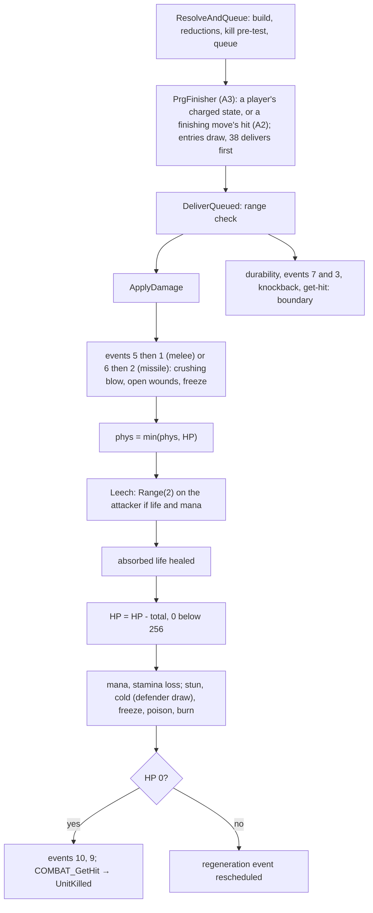
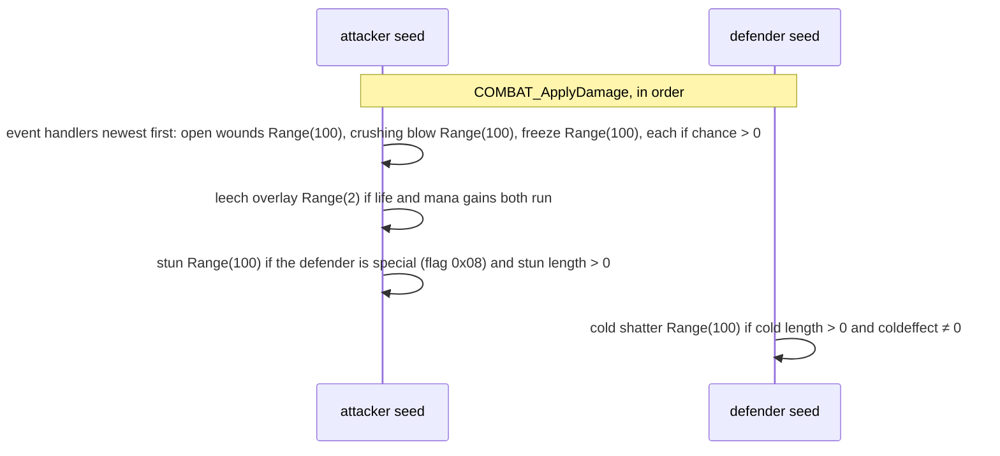

# Combat: queue, delivery, on-hit effects and the life change

## Purpose

A built and reduced packet is queued on the attacker and delivered to the defender: the on-hit stat events of the
attacker (crushing blow, open wounds, freeze), leech, the absorbed life, **the life change**, the mana and stamina
loss, then stun, cold, freeze, poison and burn. Crushing blow, open wounds and leech draw on the **attacker's** seed;
cold draws on the **defender's**. A melee attack queues and delivers in the same call at its hit frame; a missile
delivers directly. The kill hands off to the death path, and get-hit, knockback and durability are named here as the
boundary of the model ([combat/overview § Boundary](README.md#the-adr-0014-boundary)).



## Entry points

| When | Function | Tag |
|---|---|---|
| A melee hit is reduced and queued on the attacker | fn:COMBAT_ResolveAndQueue@0x0057DBF0 → fn:COMBAT_QueueHit@0x0057CA80 | [C] (run:2026-10-16-combat) |
| The queued hit is delivered | fn:COMBAT_DeliverQueued@0x0057D4F0 | [C] (run:2026-10-16-combat) |
| The packet is applied (melee and missile) | fn:COMBAT_ApplyDamage@0x0057C6C0 | [C] (run:2026-10-16-combat) |
| Leech | fn:COMBAT_Leech@0x0057C420 | [C] for players, the mercenary and monsters (run:2026-10-16-combat) |
| Crushing blow, open wounds, freeze (stat events 16, 15, 14) | fn:STATEVENT_CrushingBlow@0x005BFFC0, fn:STATEVENT_OpenWounds@0x005BFE60, fn:STATEVENT_Freeze@0x005BFC60 | [C] for the first two (run:2026-10-16-combat); [C] for freeze on a melee hit (run:2026-10-20-shortfalls) |
| A monster's life tick (poison, open wounds) | fn:sub_005A6920_MonRegenEvent@0x005A6920 | [C] (run:2026-10-16-combat) |
| A player's life tick | fn:sub_00580810_RegenEvent@0x00580810 → fn:sub_00580610_LifeRegenTick@0x00580610 ([stats/states § E](../stats/states.md#e-the-regeneration-tick)) | [C] (run:2026-10-17-stats: 54 719 ticks, 1 082 under poison) |
| A finishing move (do 42, 46, 50, 52) hands its queued hit to the finisher | fn:COMBAT_PrgFinisher@0x005D5220 (A2) | [C] for the six call sites (run:2026-10-21-cat-emu-ass `static.txt`); [C] for the calls of do 42, 46 and 50 as boundaries, do 46's on the path where its hit helper returns for a bad skill id (ADR-0021, run:2026-10-21-cat-emu-ass) |
| The kill | fn:COMBAT_GetHit@0x0057CEE0 → fn:sub_0057CCB0_UnitKilled@0x0057CCB0 | [I] |

## Inputs

### Tables

| Anchor | Used for |
|---|---|
| tbl:DifficultyLevels.txt:LifeStealDivisor, `ManaStealDivisor` | a player attacker's leech (§ C) |
| tbl:DifficultyLevels.txt:MonsterColdDivisor, `MonsterFreezeDivisor` | cold and freeze length on a monster (§ D) |
| tbl:MonStats.txt:Drain | the leech factor `D` of a monster defender, per difficulty (§ C) |
| tbl:MonStats.txt:coldeffect | chill strength and whether a monster can be chilled or frozen (§ D) |
| tbl:MonStats.txt:killable, `boss` | delivery refusal; crushing blow divisor, stun, freeze |
| tbl:ItemStatCost.txt:itemeventfunc1 | stats 134, 135, 136 register handlers 14, 15, 16 on events 5 and 6 |
| tbl:Skills.txt:ItemTarget, `ItemTgtDo`, `ItemEffect`, `ItemCheckStart`, `srvmissilea` | an item cast from handlers 20, 21, 30: its aim, its caster, the effect entry, the start test (§ E5) |

### Runtime state

| State | Type | Source |
|---|---|---|
| attacker and defender seeds | `Seed` at `Unit+0x20` | the draws of § C, § D, § E |
| hit queue | list at `Unit+0xAC` of the attacker | `COMBAT_QueueHit` |
| frame | `Game+0xA8` | the end frame of timed states |
| life, mana, stamina | stats 6–11, 1/256 units | value inputs at the event's entry (ADR-0014) |
| player count of a monster | stat 100, set at creation | [monsters/stats § C](../monsters/stats.md#c-the-player-count-sub_00573930_monplayerbonus) |
| unit type flags | `0x02` superunique, `0x04` champion, `0x08` special (set on every champion, unique and superunique) | [monsters/special](../monsters/special.md), [monsters/spawn § G](../monsters/spawn.md#g-the-special-group-boss-champion-or-unique) |

### Constants

| Name | Value | Anchor | Tag |
|---|---|---|---|
| one life | 256 (life below it is set to 0) | 0x0057C852–0x0057C874 | [C] (run:2026-10-16-combat) |
| crushing blow divisors | player 10, hireling 10, monster 4, boss or superunique 8 | 0x005C0031–0x005C00F6 | [C] for 4 and 8 (run:2026-10-16-combat), 4 on champions (run:2026-10-20-shortfalls) |
| open wounds band steps | 9, 18, 27, 36, 45 per level; + 40 | fn:sub_005BFDA0_OpenWoundsBand@0x005BFDA0 | [C] (run:2026-10-16-combat) |
| open wounds length | 200 frames | 0x005BFEEC–0x005BFF9B | [C] (run:2026-10-16-combat) |
| shatter chance | 20 | 0x0057B0FA–0x0057B124 | [I] |
| stun caps | hireling 13, others 250 frames | 0x0057AB17–0x0057AB44 | [I] |

## Algorithm

### A. Queue and delivery

```
A1. ResolveAndQueue(att, def, pkt, srcdam):                          [C] (fn:COMBAT_ResolveAndQueue@0x0057DBF0, run:2026-10-16-combat, all of A1)
      if (pkt.result & 0x1) and not (pkt.result & 0x8380):          ; hit, not blocked, dodged, avoided, weapon-blocked
        if not (pkt.flags & 0x2): BuildDamage(att, def, pkt, 0, srcdam)       ; combat/damage
        ApplyReductions(att, def, pkt)                                         ; combat/reductions
        total: i32 ← pkt.phys + pkt.fire + pkt.light + pkt.magic + pkt.cold + pkt.poison
                     + (att is a monster ? pkt.lifeSteal : 0)
        if (total & ~0xFF) > (stat(def, 6) & ~0xFF): pkt.result |= 0x2        ; kill pre-test
      QueueHit(att, def, pkt)                                                  ; always; copied onto att's list

A2. DeliverQueued(att, def):                                          [I] (fn:COMBAT_DeliverQueued@0x0057D4F0, all of A2)
      e ← the queued entry for def;  if none: return
      if def is in melee range and (e.pkt.result & 0x1) and att is alive:
        e.pkt.flags ← 0x20
        ApplyDamage(att, def, e.pkt, doReductions: false)                     ; § B
        put overlay pkt+0x6C;  pick the hit class (a global counter, no draw)
        DurabilityLoss(att, def)                                              ; boundary oracle, § F
      DispatchEvent(7 domeleeattack, att);  DispatchEvent(3 attackedinmelee, def)      ; handlers § E5
      if hit: Knockback(att, def)                                             ; boundary oracle, § F
      GetHit(att, def, e.pkt)                                                 ; boundary oracle, § F
      remove e
```

- A1. The player's packet was already built by `SKILL_AttackDo` (flag `0x2`), so `ResolveAndQueue` only reduces it;
  a monster's is built here, and only on a hit. [C] (fn:SKILL_AttackDo@0x0056F070, 0x0057DC1D–0x0057DC37,
  run:2026-10-16-combat)
- A1. The kill pre-test compares whole life points (`& ~0xFF`). [C] (fn:COMBAT_ResolveAndQueue@0x0057DBF0,
  run:2026-10-16-combat)
- A2. A delivery can happen on a later frame than the hit test when a skill do-function queues it (362 such events
  in the run, resynchronised); the attacker's AI may draw in between. [I] (fn:COMBAT_DeliverQueued@0x0057D4F0,
  run:2026-10-16-combat)
- A2. Before delivery, `SKILL_AttackDo` calls the progressive-charge finisher (A3); an attacker under a `meleeonly`
  state (wolf, bear) skips it. The run met no charged state. [I] (fn:COMBAT_PrgFinisher@0x005D5220,
  fn:sub_0056C2D0_AttackDeliverMeleeOnly@0x0056C2D0)
- A2. **The finisher has six direct calls in five functions**: `SKILL_AttackDo` (`0x0056F1CE`) and five sites in the assassin
  finishing moves' do functions, do 42 Dragon Talon (`0x005D5A8C`), do 46 Dragon Claw (`0x005D6399` and `0x005D63E1`,
  one per parity path), do 50 Dragon Tail (`0x005D71F2`) and do 52 Dragon Flight (`0x005D79DF`); start 25 calls it
  nowhere (it only tests for a target). [C] (run:2026-10-21-cat-emu-ass `static.txt`, a scan of every `call` operand,
  [skills/0014 § 1](../../findings/skills/0014-assassin.md#1-the-table-slots-the-shared-shape-the-stock-rows-and-the-callers))
- A2. **What the finishing moves pass.** Do 42, do 46 and do 50 reach the finisher with `QueuedHitFind(caster,
  target)`'s result as its one stack argument (the game in `ECX`, the caster in `EDX`): do 42 with **no null test**, so
  it also calls it with 0; do 46 only when `QueuedHitFind` gives a hit, and with no hit it calls `DeliverQueued(caster,
  target)` instead; do 50 only with a hit, returning 0 before it otherwise, after copying the 0x70-byte packet to its
  frame. The run reached do 46's two calls only where `0x005D6200` returns for a bad skill id; on a valid id the same
  instructions follow its hit test, after that boundary. [C] (ADR-0021, up to `PrgFinisher` @0x005D5A91, @0x005D639E, @0x005D63E6, @0x005D71F7 or `DeliverQueued`
  @0x005D63AB, @0x005D63F3; run:2026-10-21-cat-emu-ass `hit_ass`, fn:sub_005D5A30_SkillDo42DragonTalon@0x005D5A30,
  fn:sub_005D6340_SkillDo46DragonClaw@0x005D6340, fn:sub_005D7180_SkillDo50DragonTail@0x005D7180,
  [skills/0014 § 4](../../findings/skills/0014-assassin.md#4-the-hits-and-the-finishing-moves-do-33-34-35-42-46-50-52))
- A2. Do 52 passes `QueuedHitFind`'s result with no null test, as do 42. The finisher returns at once for a null hit
  or one whose result lacks bit `0x1`, so a null argument runs nothing. [I] (0x005D79D1–0x005D79DF,
  0x005D5229–0x005D523B)
- A2. **After the finisher, each finishing move delivers.** Do 46 runs the finisher only on a hit, then one
  `DeliverQueued(caster, target)` on either path (the jump at `0x005D6391` / `0x005D63D9` skips only the finisher), and
  sets or clears bit 6 by the parity bit; do 42, do 50 and do 52 call `DeliverQueued` after the finisher. Do 42 then
  delivers once more; at its last kick (the count at 0) it first makes one `RNG_Range(caster, 100)` against a value
  `k` (100, or a calc chosen by the target's kind; no draw when `k` ≤ 0); do 50 then makes a fire area hit of `calc1 + stat 329` percent of the kick's
  physical damage for a living caster. [I] (0x005D6386–0x005D6405, 0x005D5A91–0x005D5BE9, 0x005D71F7–0x005D72A0,
  0x005D7982–0x005D79FB)

**A3. The progressive finisher and its `srvprgfunc` entries.**

```
A3. PrgFinisher(att, hit):                                            [I] (fn:COMBAT_PrgFinisher@0x005D5220, all of A3 except as tagged)
      if hit is null or not (hit.result & 0x1) or the target is not in melee range: return
      for each charged progressive state of att (a list, a skill, lvl ← max(stat 351, current level) > 0, an aurastat1):
        n ← clamp(charges, 1, 3)
        peek ← Step(copy of att.seed)                                 ; att.seed itself unchanged (0x005D5368–0x005D538C)
        if Skills.prgstack: for k in 1 .. n − 1: charge stat ← k; Entry(srvprgfunc k)
        Entry(srvprgfunc n)                                           ; always; an entry number outside 1..0xBE runs nothing
        UnitMsgA3(skill, lvl, peek, 0, n)                             ; a client message (0xA3), no game state, no draw
      free the list

Entry 37 or 143 (ring):                                               [C] up to the first MissileCreate (ADR-0021, run:2026-10-21-cat-emu-ass, fn:sub_005D4E70_SkillPrgDo37Ring@0x005D4E70, fn:sub_005D4F40_SkillPrgDo143Ring@0x005D4F40, fn:sub_005D4150_SkillRing64LocalSeed@0x005D4150, fn:sub_005D4870_SkillRing64LocalSeedB@0x005D4870)
      Step(att.seed);  w ← att.seed.low                               ; draw (attacker), at entry, before the record test
      if no Skills record: return 0                                   ; the seed stays stepped
      m ← SrvMissileByCharge(att, skill);  if m ≤ 0: return 0
      (tx, ty) ← the target point;  if none: return 0
      n ← PrgCalcByCharge(att, skill, lvl), or aurarangecalc when 0    ; i32, not tested
      local ← Init(w)                                                 ; high word 0x29A
      b ← 0                                                           ; i32, a byte index into the 64 direction pairs
      do:
        Step(local)
        MissileCreate({flags 3, owner att, class m, at (tx, ty), direction pair at b (the first (30, 0)),
                       skill, lvl, callback 37: 0x005D40F0 / 143: 0x005D4680, callback arg: local.low})
        ; [I] from here (0x005D4657–0x005D467D, 0x005D4D77–0x005D4DAA)
        37: MissileData+0x28 ← SkillGetParam2(280) + 1                ; no null test of the missile
        143: the same, only for a non-null missile of class 568
        b ← b + 4n                                                    ; i32, wraps mod 2³²
      while b < 0x100                                                 ; signed compare
Entry 38 (area hit):                                                  [C] up to DeliverQueued or SkillRollPhys (ADR-0021, run:2026-10-21-cat-emu-ass, fn:sub_005D3E80_SkillPrgDo38AreaHit@0x005D3E80)
      if no Skills record: return 0
      if att has a target: DeliverQueued(att, target)                 ; A2: the queued hit's delivery and its draws (0x005D3EBF–0x005D3ED0)
      (tx, ty) ← the target point;  if none: return 0
      r ← PrgCalcByCharge(att, skill, lvl), or aurarangecalc when 0
      pkt ← 0x70 zero bytes
      SkillRollPhys(att, pkt, skill, lvl)                             ; [I] from here (0x005D3ED5–0x005D3F82)
        pkt.phys ← RangeB(att.seed, max − min) + min                  ; draw (attacker), 0x0056E1C4
      RollElemDamage(att, pkt)                                        ; draw (attacker): RangeB; EType 10: one more Step
      for each unit u of ForUnitsInRange((tx, ty), r, aurafilter):
        AreaHitUnit(u): DefenceRoll(u, isMissile: true, useBlock: false)  ; draws on u.seed (combat/to-hit § C2): no block, avoid not dodge (0x0056BA06–0x0056BA0D)
          then MonCritDouble (combat/damage step 10), ApplyDamage on a hit (§ B), GetHit (§ F)
      return 1
Entry 39 (scatter):                                                   [C] up to the first MissileCreate (ADR-0021, run:2026-10-21-cat-emu-ass, fn:sub_005D3F90_SkillPrgDo39Scatter@0x005D3F90)
      Step(att.seed);  w ← att.seed.low                               ; draw (attacker), at entry, before the record test
      if no Skills record: return 0
      (tx, ty) ← the target point;  if none: return 0
      m ← SrvMissileByCharge(att, skill);  if m ≤ 0: return 0
      r ← PrgCalcByCharge(att, skill, lvl), or aurarangecalc when 0
      local ← Init(w)
      repeat r · r times (i32; ≤ 0: no try):
        dx ← r − Range(local, 2r);  dy ← r − Range(local, 2r)         ; x first; a 2r ≤ 0 gives 0 without a step
        if dx² + dy² ≤ r² and the point (tx + dx, ty + dy) has a room:
          MissileCreate({flags 1, owner att, class m, at (tx + dx, ty + dy), skill, lvl})
                                                                      ; [I] after the first: the remaining tries (0x005D40D6–0x005D40E7)
      return 1
Entry 41 (scatter):                                                   [C] up to the first MissileCreate (ADR-0021, run:2026-10-21-cat-emu-ass, fn:sub_005D5080_SkillPrgDo41Scatter@0x005D5080)
      Step(att.seed);  local ← Init(att.seed.low)                     ; draw (attacker), at entry, before the record test
      if no Skills record: return 0
      (tx, ty) ← the target point;  if none: return 0
      m ← SrvMissileByCharge(att, skill);  if m ≤ 0: return 0
      n ← PrgCalcByCharge(att, skill, lvl);  if n = 0: return 0
      if n < 0: return 1
      repeat n times:
        Step(local);  dx ← (local.low mod 40) − 20                    ; u32 remainder
        Step(local);  dy ← (local.low mod 40) − 20
        if dx = 0 and dy = 0: dx ← 20
        MissileCreate({flags 3, owner att, class m, at (tx, ty), offset (dx, dy), skill, lvl})
        ; [I] from here (0x005D51DA–0x005D5218)
        MissileData seed low ← local.low;  MissileData+0x2C ← dy << 16 | (dx & 0xFFFF)
      return 1
Entry 36 (nova at the target unit):                                   [C] up to the first MissileCreate (ADR-0021, run:2026-10-21-cat-emu-ass, fn:sub_005D4DB0_SkillPrgDo36NovaAtTarget@0x005D4DB0, fn:sub_0056D400_SkillNovaAtUnit@0x0056D400)
      if no target, lvl ≤ 0 or no Skills record: return 0
      m ← SrvMissileByCharge(att, skill);  if m ≤ 0: return 0
      v ← MissileSpeedAtLevel(m, lvl) + calc1                         ; (VelLev · lvl) / 8 + Vel, signed division
      SkillNovaAtUnit(att, target, m, skill, lvl, v)                  ; a nova of m centred on the target's position, owned by att,
                                                                      ; flags 3 (| 4 when v ≠ 0), from the first of the 64 offsets
Entry 40 (one missile at the target point):                           [C] (ADR-0021, run:2026-10-21-cat-emu-ass, fn:sub_005D5010_SkillPrgDo40MissileAt@0x005D5010)
      (tx, ty) ← the target point;  if none or lvl ≤ 0: return 0
      m ← SrvMissileByCharge(att, skill);  if m ≤ 0: return 0         ; no record test of its own (a bad skill gives m = −1)
      MissileCreateAt(att, skill, lvl, m, tx, ty)
```

- A3. **The finisher's own step is a peek**: it copies the seed out (`0x005D5374`), calls `RNG_Step` on the copy
  (`0x005D537B`), keeps the result and copies the seed back (`0x005D538C`). The kept value goes only into the client
  message `0xA3`. [I] (fn:sub_00650E70_Copy64Out@0x00650E70, fn:sub_00650E60_Copy64In@0x00650E60, fn:RNG_Step@0x0045C370,
  fn:sub_00571AA0_UnitMsgA3@0x00571AA0, [skills/0001 § 12](../../findings/skills/0001-dispatch.md#12-progressive-charges))
- A3. **The entries step the attacker's seed at entry.** 37, 39, 41 and 143 step the attacker's seed once inline,
  before the record test, so the step happens even when the entry then creates nothing; up to its boundary (the first
  creation; 38's `DeliverQueued` or `SkillRollPhys`) no entry of 36–41 and 143 draws on the attacker's or the target's
  seed otherwise, and the draws before the first creation are on the local seed (37 and 143: one step; 39: two
  `Range(local, 2r)` per try; 41: two steps). The run's calcs were constant programs, so a calc function's own draws
  are not covered. [C]
  (ADR-0021, run:2026-10-21-cat-emu-ass `prg_ass`, 0x005D4E80, 0x005D4F50,
  [skills/0014 § 5](../../findings/skills/0014-assassin.md#5-the-progressive-entries-3641-and-143))
- A3. **Entry 38 draws on the attacker's seed** after its delivery: `RangeB` twice (physical and elemental) and a
  third time, an `RNG_Step`, for `EType` 10; its area units draw their defence rolls on their own seeds. 36 and 40 draw
  nothing of their own. Every missile an entry creates adds the creation's draws
  ([combat/overview § B4](README.md#b-draw-order-per-event)). [I] (fn:sub_0056E170_SkillRollPhys@0x0056E170, 0x0056E1C4,
  fn:SKILLS_RollElemDamage@0x0056E0C0, fn:sub_0056B9C0_AreaHitUnit@0x0056B9C0,
  [skills/0003 § 1](../../findings/skills/0003-handlers.md#1-progressive-entries-srvprgfunc-and-the-finishers-tail))
- A3. **Entry 38 delivers the queued hit itself** when the attacker has a target, before its own rolls, so the
  attack's delivery (§ B, on both seeds) comes before 38's `RangeB`. [C] (ADR-0021, up to `DeliverQueued` @0x005D3ED5,
  run:2026-10-21-cat-emu-ass `prg_ass`) `SKILL_AttackDo`'s later `DeliverQueued` then finds no entry for the defender.
  [I] (0x005D3E80–0x005D3F82, fn:COMBAT_DeliverQueued@0x0057D4F0)
- A3. **A ring's step count is not tested.** `n` is used as found up to the first creation. [C] (ADR-0021,
  run:2026-10-21-cat-emu-ass `prg_ass`) After it, `n` is not tested either: the ring makes `⌈64 / n⌉` missiles for
  `0 < n < 2²⁹`; for `n = 0` the index does not move and the loop never ends, a creation per pass. [I]
  (0x005D4657–0x005D467D, 0x005D4D77–0x005D4DAA, [skills/0014 § 5](../../findings/skills/0014-assassin.md#5-the-progressive-entries-3641-and-143))
- A3. **A negative ring count does not loop forever.** For `n < 0` the ring reads its direction pair below the two
  64-entry tables on every pass, ever further below its frame, and the signed index ends the loop only by wrapping past
  −2³¹ to a value ≥ 0x100, after about 2³¹ / |4n| passes. Not run. [I] (0x005D4657–0x005D467D, 0x005D4D77–0x005D4DAA,
  [skills/0014 § 5](../../findings/skills/0014-assassin.md#5-the-progressive-entries-3641-and-143)) Whether stock data
  gives a ring 0 or a negative count is an open question.
- A3. **The rings' `MissileData+0x28` write is Royal Strike's.** Both rings store `SkillGetParam2(280) + 1` (the
  immediate `0x118`, row 280 Royal Strike) whatever row runs them; ring 37 for every missile with no null test, ring
  143 only for a non-null missile of class 568 (`royalstrikechainlightning`). [I] (0x005D465E–0x005D4668,
  0x005D4D7D–0x005D4D95, [skills/0003 § 9](../../findings/skills/0003-handlers.md#9-re-seed-sites-rng0002--the-other-initialiser-sites))
- A3. **Entry 36 is also an item effect.** `ItemEffect` 36 on rows 44 Frost Nova and 48 Nova makes an item cast of
  those skills with the effect flag run entry 36: a nova of the row's `srvmissilea` (119 `frostnova`, 90 `nova`)
  centred on the cast's target unit, and nothing without one. The flag is 1 only from a skill-on-attack, -kill or -hit
  stat without `ItemTgtDo` (E5); any other item cast of those rows runs their `srvdofunc`. [I] (tbl:Skills.txt:ItemEffect,
  [skills/0014 § 1](../../findings/skills/0014-assassin.md#1-the-table-slots-the-shared-shape-the-stock-rows-and-the-callers),
  [skills/0015 § 6](../../findings/skills/0015-item.md#6-the-stat-event-handlers-20-21-30))
- A3. **Stock use**: Fists of Fire 143/38/39 and Blades of Ice −/38/39 and Claws of Thunder −/36/37 with `prgstack`
  (an entry number 0 runs nothing), Royal Strike 40/143/41 without (only the current count's entry runs). A Fists of
  Fire finisher at three charges therefore steps the attacker's seed once (143), delivers and draws two or three
  times (38), and steps it once more (39). [I] (0x005D53E0–0x005D5490, tbl:Skills.txt:prgstack,
  [skills/0003 § 1](../../findings/skills/0003-handlers.md#1-progressive-entries-srvprgfunc-and-the-finishers-tail))

### B. Delivery (`COMBAT_ApplyDamage`)



```
B1. ApplyDamage(att, def, pkt, doReductions: bool):                  [C] (fn:COMBAT_ApplyDamage@0x0057C6C0, run:2026-10-16-combat)
      if not hostile(att, def) and not (pkt.flags & 0x1000): pkt.result &= ~0x3; return      ; [I] (0x0057C6D5–0x0057C78E, B1–B2)
      if def is in town and not (att is a monster with the town-capable MonStats bit): pkt.result &= ~0x2; return
      if def is a monster and not MonStats.killable: return
      if def is dead: return
B2.   if doReductions: ApplyReductions(att, def, pkt)                  ; missiles
B3.   if (pkt.result & 0x1) and not (pkt.result & 0x20):               ; [I] for the event order (0x0057C7A5–0x0057C7F3)
        if not doReductions:
          DispatchEvent(5 domeleedamage, unit: att, other: def, pkt)   ; § E
          DispatchEvent(1 damagedinmelee, unit: def, other: att, pkt)
        else:
          if not (pkt.flags & 0x80): DispatchEvent(6 domissiledamage, unit: att, other: def, pkt)
          if pkt.flags & 0x20:       DispatchEvent(2 damagedbymissile, unit: def, other: att, pkt)
B4.   pkt.phys ← min(pkt.phys, stat(def, 6))
      Leech(att, def, pkt)                                             ; § C
      if att is a monster and pkt.result & 0x1: MonOnHitSkill(att, def)          ; 0x005A4390, boundary oracle
      if pkt.absorbHeal > 0 and def is alive and not HasState(def, 92): AddLifeCapped(def, pkt.absorbHeal)
      if pkt.total > 0:                                                ; [C] for the test (0x0057C855–0x0057C857, run:2026-10-20-shortfalls), see note
        hp: i32 ← stat(def, 6) − pkt.total
        stat(def, 6) ← (hp < 256) ? 0 : hp
      stat(def, 8)  ← stat(def, 8)  − pkt.manaSteal,  0 when below 256  ; [I] (0x0057C879–0x0057C889)
      stat(def, 10) ← stat(def, 10) − pkt.stamSteal,  0 when below 256
      ApplyStun; ApplyCold; ApplyFreeze; ApplyPoison; ApplyBurn         ; § D
B5.   if stat(def, 6) ≤ 0: pkt.result |= 0x2
      else: pkt.result &= ~0x2;  if def is a monster and pkt.total ≠ 0 and stat(def, 74) ≠ 0: reschedule its life tick
      if (pkt.result & 0x2) and not (pkt.result & 0x20):
        DispatchEvent(10 killed, unit: def);  DispatchEvent(9 kill, unit: att)   ; [I] (0x0057C8DD–0x0057C970); handlers § E5
```

Step notes:

- B3. The handlers of one event run **newest first** (`UNIT_AddEvent` pushes at the head). In the run the open-wounds
  handler of the logged characters ran before the crushing-blow handler; a reimplementation keeps the unit's own
  registration order. [I] (fn:UNIT_AddEvent@0x005C0AD0, fn:UNIT_DispatchEvent@0x005C0C30)
- B3. The stat events see the defender's life **before** this hit's damage: crushing blow takes its share of the
  current life, then the packet's total is subtracted from what is left. [C] (fn:STATEVENT_CrushingBlow@0x005BFFC0,
  run:2026-10-16-combat)
- B4. `phys = min(phys, HP)` is taken after the stat events, so the leech of a killing blow is computed on the life
  that was left. [C] (0x0057C7F8–0x0057C8D8, run:2026-10-16-combat)
- B4. **The life change**: `HP − total`, and 0 when the result is below 256 (one life point). [C] (0x0057C852–0x0057C874,
  run:2026-10-16-combat) The absorbed life is healed only when positive (`UNIT_AddLifeCapped` returns at once for
  an amount ≤ 0); 32 percent-absorb heals of the player reproduced, and 186 negative absorbed amounts healed
  nothing. [C] (fn:UNIT_AddLifeCapped@0x0057A980, run:2026-10-16-combat, run:2026-10-20-shortfalls)
- B4. **A total of 0 or less changes nothing.** `test edi, edi` / `jle` at 0x0057C855–0x0057C857 skips the
  subtraction (and the 256 floor) when `total ≤ 0`. In run:2026-10-20-shortfalls 488 deliveries with a negative total
  on the player (MDR above the elemental damage, [combat/reductions § B1](reductions.md#b-the-rows-g_damageresisttable)),
  113 with a total of 0 on the player and 32 at 0 on a monster left the defender's life unchanged. [C]
  (0x0057C855–0x0057C857, fn:COMBAT_ApplyDamage@0x0057C6C0, run:2026-10-20-shortfalls)
- B4. For a player attacker the defender's mana and stamina losses read the steal fields after `Leech` scaled them
  (`<< 6` and the divisor), so a monster defender with mana loses `manaSteal·64/divisor` in 1/256 units. [I]
  (0x0057C879–0x0057C889)
- B5. A dead monster goes to `COMBAT_GetHit` and `sub_0057CCB0_UnitKilled`, the hand-off to the death and drop path
  ([items/tc](../items/tc.md)). [I] (fn:COMBAT_GetHit@0x0057CEE0, fn:sub_0057CCB0_UnitKilled@0x0057CCB0)

### C. Leech (`COMBAT_Leech`)

```
C1. Leech(att, def, pkt):                                            [C] (fn:COMBAT_Leech@0x0057C420, run:2026-10-16-combat, all of C1)
      if pkt.lifeSteal = 0 and pkt.manaSteal = 0: return
      D: i32 ← def is a monster ? MonStats[def.class].Drain[difficulty] : 100
      if D = 0: return                                                ; a blank Drain: no leech
      life: i32 ← pkt.lifeSteal << 6;  mana: i32 ← pkt.manaSteal << 6
      if att is a player:
        if LifeStealDivisor ≠ 0: life ← life ÷ LifeStealDivisor       ; 1, 2, 3
        if ManaStealDivisor ≠ 0: mana ← mana ÷ ManaStealDivisor
      pkt.lifeSteal ← life;  pkt.manaSteal ← mana
      if att is a player or a hireling:
        if pkt.phys ≤ 0: return
        if mana ≠ 0:
          m: i32 ← MulDiv(pkt.phys, mana, 100);  if D ≠ 100: m ← MulDiv(m, D, 100)
          m ← m ÷ 64;  att mana ← (m > 0) ? min(att mana + m, att max mana) : att mana + m
        if life ≠ 0:
          l: i32 ← MulDiv(pkt.phys, life, 100);  if D ≠ 100: l ← MulDiv(l, D, 100)
          l ← l ÷ 64;  att life ← (l > 0) ? min(att life + l, att max life) : att life + l
          if mana ≠ 0: r ← Range(att.seed, 2)                         ; draw: picks overlay 151 (r = 0) or 152
      else:                                                           ; a monster attacker, [C] (0x0057C47D–0x0057C4CE, run:2026-10-16-combat)
        fields back >> 6;  gain ← min(life, pkt.phys) + min(mana, def mana) + min(stam, def stamina)
        if D ≠ 100: gain ← MulDiv(gain, D, 100);  heal att by gain up to its max life;  overlay 151
```

- C1. **Leech is computed on the physical damage after reductions** (and after `min(phys, HP)`), in 1/256 units: the
  steal percent is `<< 6` and the gain `÷ 64`. The difficulty divisors apply to **player** attackers only; leech was
  logged 364, 681 and 455 times in Normal, Nightmare and Hell, with 1 500 `Range(2)` overlay draws. [C]
  (fn:COMBAT_Leech@0x0057C420, tbl:DifficultyLevels.txt:LifeStealDivisor, run:2026-10-16-combat)
- C1. Mana is computed and added before life; the `Range(2)` draw happens only when both gains ran, after the life
  gain. [C] (0x0057C560–0x0057C568, run:2026-10-16-combat)
- C1. A hireling attacker uses the player formula without the divisors. [I] (fn:sub_0063EE90_HirelingType@0x0063EE90,
  fn:COMBAT_Leech@0x0057C420)
- C1. The monster branch (taken when `0x00645270` reports an owner type) reproduced with 0 mismatches in 80 events
  (Nightmare 7, Hell 73): the fields shifted back `>> 6`, the gain capped by the defender's damage, mana and stamina. [C]
  (0x0057C47D–0x0057C4CE, run:2026-10-16-combat)
- C1. `Drain` 0 or blank means no leech from that monster at all; the stock `Drain` cuts leech further in Nightmare
  and Hell for many classes (`fallen2`: 100 / 85 / 75). [C] (tbl:MonStats.txt:Drain, run:2026-10-16-combat)

### D. Stun, cold, freeze, poison, burn

```
D1. ApplyStun(att, def, len = pkt.stunLen):                          [I] (fn:COMBAT_ApplyStun@0x0057AAE0, all of D1)
      if len ≤ 0: return
      if def is a monster with type flag 0x08 (special: a champion, unique or superunique):
        if Range(att.seed, 100) < 90: return                         ; draw (attacker), inlined; [C] (run:2026-10-16-combat, 34)
      if def is a boss: return
      if MonStats[def.class].Velocity = 0: return
      len ← def is a hireling ? min(len, 13) : min(len, 250)
      state 21 (stunned) until frame + len

D2. ApplyCold(att, def, len = pkt.coldLen):                          [C] for the draw (fn:COMBAT_ApplyCold@0x0057AF80, run:2026-10-16-combat)
      if len ≤ 0: return
      ce: i8 ← def is a monster ? MonStats[def.class].coldeffect[difficulty] : −50
      if ce = 0: return                                              ; no chill, no draw
      if def is a monster and ce < 0: len ← len ÷ MonsterColdDivisor
      len ← max(len, 1)
      state 11 (cold) until frame + len, stats 67, 68, 69 ← ce        ; a longer chill extends, a shorter one does not shorten
      r ← Range(def.seed, 100)                                       ; draw (DEFENDER), inlined
      if r < 20 and def is a monster without the MonStats2 flag (0x004638A0): state 107 (shatter) on, else off

D3. ApplyFreeze(att, def, len = pkt.freezeLen):                      [I] (fn:COMBAT_ApplyFreeze@0x0057B230, all of D3)
      if def is a player, a boss, a unique or a hireling: ApplyCold(att, def, len); return
      if def has state 54: return
      if coldeffect[difficulty] ≥ 0: return
      len ← len ÷ MonsterFreezeDivisor;  state 1 (freeze) until frame + len;  mode change;  timer at frame + 1 + len

D4. ApplyPoison(att, def, dmg = pkt.poison, len = pkt.poisonLen):    [I] (fn:COMBAT_ApplyPoison@0x0057AC50, all of D4)
      if dmg ≤ 0 or len ≤ 0: return
      if def has a poison state with damage > dmg: return            ; replaced only when dmg ≥ the old one
      state 2 (poison) with stat 74 (hpregen) ← −dmg until frame + len
    ApplyBurn: the same with state 115 and (pkt.burn, pkt.burnLen)    ; a plain attack has burnLen 0: no state
```

- D2. **The cold draw is on the defender's seed**, after the chill is applied, whatever the outcome. It reproduced in
  every logged event with a cold length (the defender's exit seed asserted). [C] (0x0057B0FA–0x0057B124, run:2026-10-16-combat)
  The chill strength and the shatter flag were not asserted. [I] (fn:COMBAT_ApplyCold@0x0057AF80)
- D2. `coldeffect` 0 means the monster is not chilled and no draw happens; a player is chilled at −50. The
  `MonsterColdDivisor` (1, 2, 4) shortens a monster's chill only. [I] (fn:sub_0057AF30_MonColdEffect@0x0057AF30,
  tbl:DifficultyLevels.txt:MonsterColdDivisor)
- D1. The stun draw on a unique reproduced with 0 mismatches in 34 events; the stun goes on only when `r ≥ 90`. [C]
  (0x0057AB17–0x0057AB44, run:2026-10-16-combat)
- D3. A player, a boss, a unique or a hireling is chilled instead of frozen, for the same length. The 81 freeze
  packets of run:2026-10-20-shortfalls (E3) were checked up to their nested delivery; what D3 does inside it (the
  state, the divisor, the mode change) was not asserted. [I] (0x0057B2F1, tbl:DifficultyLevels.txt:MonsterFreezeDivisor,
  run:2026-10-20-shortfalls)

### E. The stat events: crushing blow, open wounds, freeze

Stats 134, 135 and 136 register `itemeventfunc` 14, 15 and 16 on events 5 (`domeleedamage`) and 6
(`domissiledamage`); each handler gets the attacker, the defender, the packet and `stat id << 16 | layer`. [I]
(data:g_StatEventFuncs@0x007325B0, fn:sub_0056E740_AddStatEvent@0x0056E740, tbl:ItemStatCost.txt:itemeventfunc1)

```
E1. CrushingBlow(att, def, pkt, event):                              [C] (fn:STATEVENT_CrushingBlow@0x005BFFC0, run:2026-10-16-combat, all of E1 except as tagged)
      c: i32 ← stat(att, 136)
      if c ≤ 0: return                                               ; no draw
      r ← Range(att.seed, 100)                                       ; draw (attacker), inlined
      if r ≥ c: return
      if def is a player or a hireling: k: i32 ← 10                  ; [I] (0x005C0031–0x005C00F6)
      else:
        k ← (MonStats[def.class].boss or def has type flag 0x02) ? 8 : 4         ; [C] for 8 (fn:MONSTATS_IsBoss@0x0063E9F0, run:2026-10-16-combat) and for 4 on champions (run:2026-10-20-shortfalls)
        n: i32 ← max(stat(def, 100), 1)
        k ← k + MulDiv(k, PlayerHpPct(n), 100)                       ; + 50 % per player beyond the first
      if event = 6: k ← k × 2                                        ; missile, [I] (0x005C0031–0x005C00F6)
      cb: i32 ← stat(def, 6) ÷ k
      if stat(def, 36) > 0: cb ← cb − MulDiv(cb, min(stat(def, 36), 100), 100)
      stat(def, 6) ← max(stat(def, 6) − cb, 0);  if 0: pkt.result |= 0x2
      if cb > 0: overlay 147

E2. OpenWounds(att, def, pkt, event):                                [C] (fn:STATEVENT_OpenWounds@0x005BFE60, run:2026-10-16-combat, all of E2 except as tagged)
      c: i32 ← stat(att, 135)
      if c ≤ 0: return                                               ; no draw
      r ← Range(att.seed, 100)                                       ; draw (attacker), inlined
      if r ≥ c: return
      L: i32 ← max(stat(att, 12), 1)
      dmg: i32 ← Band(L) + 40
      if def is a player: dmg ← dmg ÷ 4;  if event = 6: dmg ← dmg ÷ 2              ; [I] (0x005BFEEC–0x005BFF9B)
      else if def has type flags 0x0C (champion or unique): dmg ← dmg ÷ 2     ; [C] for the special bit 0x08 (run:2026-10-16-combat, 383), [I] for the champion bit 0x04 alone
      state 62 (openwounds) for 200 frames with stat 74 ← −dmg       ; STATE_ApplyTimed; a new wound restarts it

    Band(L): L < 2 → 0;  L ≤ 15 → (L − 1)·9;  L ≤ 30 → 126 + (L − 15)·18;  L ≤ 45 → 396 + (L − 30)·27;
             L ≤ 60 → 801 + (L − 45)·36;  else 1341 + (L − 60)·45

E3. Freeze(att, def, pkt, event):                                    [C] on a melee hit (fn:STATEVENT_Freeze@0x005BFC60, run:2026-10-20-shortfalls, all of E3 but the missile terms); [I] for the missile terms
      x: i32 ← max(stat(att, 134) − 1, 0)
      c: i32 ← ((x − 1)·4 − dlvl + 10 + alvl [− 6 for a missile])·5 [÷ 3 for a missile];  c ← clamp(c, 0, 100)
      r ← Range(att.seed, 100)                                       ; draw (attacker)
      if r < c: len ← clamp((c − r)·2 + 25, 25, 250);  ApplyDamage(att, def, fresh packet with freezeLen = len, doReductions: true)
```

- E1. **Crushing blow takes a share of the current life**, 1/4 for normal monsters (247 events) **and uniques** (63),
  raised by the player-count percent of [monsters/stats § C](../monsters/stats.md#c-the-player-count-sub_00573930_monplayerbonus)
  (at `/players` 2, 3 and 8: 5, 40 and 124 events), then lowered by positive physical resistance. Two community pages
  give 1/8 for champions and uniques and one says the player count does not matter; for uniques and the player count
  1.14d does neither. [C] (fn:sub_005738F0_PlayerHpPct@0x005738F0, 0x005C0031–0x005C00F6, run:2026-10-16-combat)
  **Champions take 1/4 as well**, raised by the player count: 52 crushing blows on defenders with type flags `0x0C`
  (40 in Nightmare at `/players` 8), every life value asserted. [C] (fn:STATEVENT_CrushingBlow@0x005BFFC0,
  0x005C0031–0x005C00F6, run:2026-10-20-shortfalls)
- E1. **A champion carries the special flag `0x08` as well as `0x04`**: `MonMarkSpecial` sets `0x08` on every
  champion-pack member before the champion roll sets `0x04` ([monsters/spawn § G](../monsters/spawn.md#g-the-special-group-boss-champion-or-unique)),
  and of 7 474 monsters first seen in 74 combat logs 164 have both and none has `0x04` alone. `STATEVENT_CrushingBlow`
  reads neither flag, so the community's 1/8 does not apply to champions either. Re-labelled, run:2026-10-16-combat
  holds 72 such events among the 163 it counted as uniques (`0x08`). [C] (fn:sub_005A0320_MonMarkSpecial@0x005A0320,
  fn:STATEVENT_CrushingBlow@0x005BFFC0, run:2026-10-20-shortfalls, run:2026-10-16-combat)
- E1. There is **no difficulty and no classic branch** in crushing blow. [I] (fn:STATEVENT_CrushingBlow@0x005BFFC0)
- E1. `k = 8` for MonStats `boss` (act bosses) and superuniques reproduced with 0 mismatches on an act boss (34
  events, Andariel, Normal, `/players` 8) and on superuniques (55), with the same draw, player-count scaling and
  physical-resistance step as `k = 4`. [C] (fn:MONSTATS_IsBoss@0x0063E9F0, run:2026-10-16-combat)
- E2. `Band(L) + 40` equals the community's per-frame bands; at level 85 it is `1341 + 25·45 + 40` = 2506 per frame,
  logged as stat 74 = −2506 (`solo-h3`, frame 266, a normal monster). Open wounds reproduced 246 times; in all 11 logged windows the bleed ended at the
  application frame + 200. [C] (fn:sub_005BFDA0_OpenWoundsBand@0x005BFDA0, fn:STATE_ApplyTimed@0x0056E970,
  run:2026-10-16-combat)
- E2. **The halving tests the type flags `0x0C`.** All 383 wounds on monsters with the special flag `0x08` were
  halved, Andariel's 63 included (her unit carries `0x08`: stat 74 = −1 275 = −(2 551 ÷ 2) at attacker level 86), and
  all 1 497 on monsters without `0x0C` took the full `Band(L) + 40`. [C] (0x005BFEEC–0x005BFF9B, run:2026-10-16-combat)
  The test never reads MonStats `boss`, so an act boss without `0x08` takes the full amount and a monster with the
  champion flag `0x04` alone is halved; neither was met (Andariel carries `0x08`, so the run cannot tell the two
  readings apart on her). Since a champion also carries `0x08` (E1), no stock spawn separates a `0x04`-only
  defender. [I] (0x005BFEEC–0x005BFF9B, fn:STATEVENT_OpenWounds@0x005BFE60, run:2026-10-20-shortfalls)
- E3. **Freeze on a melee hit reproduced**: 81 rolls of stat 134 (*Frostwind*, stat 134 = 4) on the attacker's seed,
  each with its chance, draw and length (26 to 249 frames) as E3 gives them, up to the nested delivery. The missile
  terms (`− 6`, `÷ 3`) were not met. [C] (fn:STATEVENT_Freeze@0x005BFC60, run:2026-10-20-shortfalls)

**E4. The life tick.** Poison and open wounds bleed through the unit's regeneration event, once per frame.

```
E4. MonLifeTick(game, unit):                                          [C] (fn:sub_005A6920_MonRegenEvent@0x005A6920, run:2026-10-16-combat, all of E4)
      s: i32 ← stat(unit, 74)
      if unit has a state with the `life` flag (poison, preventheal, openwounds): s ← s − base stat 74 of the unit
      if HasState(unit, 52) and s ≥ 0: return
      requeue at frame + 1;  if s = 0: end the event
      hp: i32 ← stat(unit, 6) + s
      if hp > stat(unit, 7): hp ← stat(unit, 7); end the event
      if hp < 1: hp ← 0
      stat(unit, 6) ← hp;  if hp = 0: the unit dies with the poisoner or the wounder as killer
```

- E4. **Bleed and poison kill monsters**; under a `life` state a monster's natural regeneration is suspended (the base
  list's stat 74 is subtracted). 6 181 ticks reproduced. [C] (fn:sub_005A6920_MonRegenEvent@0x005A6920,
  tbl:States.txt:life, run:2026-10-16-combat)
- E4. **A player's tick adds stat 74 whatever its sign** ([stats/states § E](../stats/states.md#e-the-regeneration-tick)):
  `sub_00580610_LifeRegenTick` writes `stat 6 + stat 74`, capped at stat 7; 1 082 ticks of a poisoned player
  (negative stat 74) were reproduced by plan 0041's run. [C] (fn:sub_00580610_LifeRegenTick@0x00580610,
  run:2026-10-17-stats)
- E4. **A player's tick never takes life below 256** (one point): a result below 256 is raised to 256, so poison and
  open wounds cannot kill a player. No poisoned tick reached the floor and open wounds never hit the player.
  [I] (fn:sub_00580610_LifeRegenTick@0x00580610, 0x0058065B–0x0058066E)

**E5. The other stat-event handlers.** `UNIT_DispatchEvent` runs a unit's handler records for the event, newest
first; a handler draws on the seed of **its own unit**, the unit that owns the event (the attacker for the `do…`
and `kill` events, the defender for `attacked…`, `damaged…` and `killed`). The handlers registered on stock data
that draw:

| # | Handler | Registered by | Events | Seed | Draw |
|---|---|---|---|---|---|
| 1 | missile at the source | Chilling Armor (60) | `hitbymissile` | defender | none of its own; the missile's creation ([overview § B4](README.md#b-draw-order-per-event)) |
| 3 | shiver armour | Shiver Armor (50) | `attackedinmelee` | defender | `SKILLS_RollElemDamage`: one `RangeB`, one more `RNG_Step` for `EType` 10 |
| 7 | knockback | stat 81 | `domeleedamage`, `domissiledamage` | attacker | one inline step; `low & 0x7F < c` sets result `0x8`, `c` 64, or 32 or 128 by MonStats2 flags |
| 8 | howl | stat 112 | as 7 | attacker | `RangePow2(seed, 128) < stat`: the monster flees |
| 9 | stupidity | stat 113 | as 7 | attacker | `Range(seed, 100)` against `clamp(((alvl + 4·stat − dlvl) + 6)·5 [÷ 3 for a missile], 1, 99)` |
| 14–16 | freeze, open wounds, crushing blow | stats 134–136 | as 7 | attacker | E1–E3 |
| 20 | skill on attack, kill or hit | stats 195, 196, 198 | the attack, kill and hit events | attacker | with no packet or packet flag `0x20`: one inline step, `low mod 100 < stat` casts the item skill |
| 21 | skill on get-hit | stat 201 | `damagedinmelee`, `damagedbymissile` | defender | only with stat 201 > 0 and a packet whose result has bit `0x4` (tested before the draw): `RangeB(seed, 100) < stat` casts |
| 30 | skill on death or level-up | stats 197, 199 | `killed`, `levelup` | the dying or levelling unit | one inline step, `low mod 100 < stat` casts |
| 31 | reanimate | stat 155 | `kill` | attacker | one `RangeB` |

- E5. As above. [I] (data:g_StatEventFuncs@0x007325B0, fn:UNIT_DispatchEvent@0x005C0C30, 0x005BF9CF, 0x005C04D4,
  0x005C0603, 0x005C06BB, fn:STATEVENT_Reanimate@0x005C09E0, [skills/0003 § 3](../../findings/skills/0003-handlers.md#3-the-stat-event-handlers))
- E5. **The other registered handlers draw nothing**: 2, 4, 5, 6, 10, 13, 17, 18, 19 and 22–29; 11 and 12 are named
  by no stock row. Among them the `kill` handler 28 (`0x005C01D0`, stat 86, heal after kill) adds `stat · 256` to the
  attacker's life, capped at its maximum, with no draw. [I] (fn:sub_005C01D0_StatEv28HealAfterKill@0x005C01D0,
  tbl:ItemStatCost.txt:itemeventfunc1, [skills/0003 § 3](../../findings/skills/0003-handlers.md#3-the-stat-event-handlers))
- E5. **The item-skill handlers' draws, up to their casts.** Each reads its chance as `UnitGetStat(unit, stat,
  layer)` of the record's `stat << 16 | layer`, the skill as `layer >> [DataTables+0xC6C]` and the level as `layer &
  [DataTables+0xC70]`. All three return 0 with no draw for no unit or a chance ≤ 0. Handler 20 also returns 0 with no
  draw for a packet whose `+0x00` lacks bit 5; else (no packet, or bit 5 set) it steps its unit's seed once inline and
  goes on when `low mod 100` (unsigned) is below the chance (signed). Handler 21 also returns 0 with no draw with no
  packet or a packet whose `+0x04` lacks bit 2; else it goes on when `RNG_RangeB(unit+0x20, 100)` is below the chance.
  Handler 30 steps its unit's seed once inline whatever the packet and goes on when `low mod 100` is below the chance.
  Each then returns 0 with no cast when the skill has no Skills record (handler 30: the skill outside `[0, Skills
  count)` as well), else casts as below. [C] (ADR-0021; ends at `ItemCastAtUnit` or
  `ItemCastAtXY`; fn:sub_005C0470_StatEv20SkillOnEvent@0x005C0470, fn:sub_005C05A0_StatEv21SkillOnGetHit@0x005C05A0,
  fn:sub_005C0670_StatEv30SkillOnDeathOrLevel@0x005C0670, run:2026-10-21-cat-emu-item `event_item`,
  [skills/0015 § 6](../../findings/skills/0015-item.md#6-the-stat-event-handlers-20-21-30))
- E5. **Who casts, at what, with which effect flag.** Handler 20 without `ItemTgtDo` (Skills `+0x07` bit 5) casts as
  its own unit: `ItemCastAtUnit(ECX unit, EDX skill; level, other, 1)`, or with no other unit `ItemCastAtXY(ECX unit,
  EDX skill; level, the unit's path point, 1)`. With `ItemTgtDo` the other unit is both the caster and the target,
  `ItemCastAtUnit(ECX other, EDX skill; level, other, 0)`, and with no other unit the handler returns 1 with no cast.
  Handlers 21 and 30 cast as their own unit at the other unit or at the point, effect 0. `ItemCastAtUnit` (`ECX` the
  caster, `EDX` the skill, the level the first stack word) refuses no target, a caster with no game (`+0x80`) and a
  caster in state 54, else calls `ITEMSKILL_Cast(game, caster; skill, level, target, 0, 0, &type, &guid, &ox, &oy,
  effect)`; `ItemCastAtXY` makes the game and state tests and passes the aim 0 and the point. [C] (ADR-0021; ends at the cast's
  boundaries below; 0x005C0529, fn:sub_005FDCA0_ItemCastAtUnit@0x005FDCA0, fn:sub_005FDD60_ItemCastAtXY@0x005FDD60,
  tbl:Skills.txt:ItemTgtDo, run:2026-10-21-cat-emu-item `event_item`, `cast_item`,
  [skills/0015 §§ 5, 6](../../findings/skills/0015-item.md#5-itemskill_cast-its-itemtarget-helpers-and-its-callers);
  the argument order as corrected in [skills/0003 § 2](../../findings/skills/0003-handlers.md#2-item-event-casts))
- E5. **`ITEMSKILL_Cast`** refuses id 0 and a row whose `ItemEffect` is 0 with no write; aims the caster's path at
  the given unit or point; then by the **low byte** of `ItemTarget`: 1 aims at the caster, 2–4 call the target
  helpers below, which may refuse, and any other value skips the switch. It ends at `SKILLS_SrvStart(id, lvl, 1)` with
  `ItemCheckStart` (Skills `+0x08` bit 1), else at `SKILLS_SrvDo(id, lvl, 0, 1, effect)`, `ECX` the game and `EDX` the
  caster. For `ItemTarget` blank, 1, 3 or 4 no seed is stepped before these boundaries (helper 3 up to its corpse pick
  `0x0056E390`; helper 4 whole). When helper 2 refuses for want of a room, the cast restores the saved target unit, or
  the saved point, and bit 6 of the caster's `+0xC4`, and returns 0. [C] (ADR-0021; ends at `SKILLS_SrvStart` @0x005FDC1A or `SKILLS_SrvDo`
  @0x005FDC34; fn:ITEMSKILL_Cast@0x005FDA80, fn:sub_005FD9C0_ItemTargetCorpse@0x005FD9C0,
  fn:sub_005FDA10_ItemTargetStoredUnit@0x005FDA10, tbl:Skills.txt:ItemTarget, tbl:Skills.txt:ItemCheckStart,
  run:2026-10-21-cat-emu-item `cast_item`, [skills/0015 § 5](../../findings/skills/0015-item.md#5-itemskill_cast-its-itemtarget-helpers-and-its-callers))
- E5. **So an item cast with `ItemTarget` blank, 1, 3 or 4 draws nothing of its own**: it adds only the handler's
  chance draw above and the cast skill's own start, do function and missiles. Helper 3's corpse pick draws nothing
  either: the static closures of helpers 3 and 4 and of `0x0056E390` hold no LCG step and no RNG call (their indirect
  calls not followed). [I] (fn:sub_0056E390_CorpsePickNear@0x0056E390, `cg.txt` of run:2026-10-21-cat-emu-item,
  [skills/0015 § 5](../../findings/skills/0015-item.md#5-itemskill_cast-its-itemtarget-helpers-and-its-callers))
- E5. **`ItemTarget` 2 draws on the cast's caster.** `ITEMSKILL_Cast` gives the helper `0x005FD850` **its own
  caster** (`EDX = ESI` at `0x005FDB9B`, the call at `0x005FDB9F`). The helper takes the caster's room; with none it
  returns 0 with no draw and the cast is refused. Else, on its first try, it steps **the caster's seed** twice inline
  (the second step from the first's full state) and tests `COLL_PatternTest(room, x + low₁ mod 40 − 20, y + low₂ mod 40 −
  20, …)` at the caster's position, the remainders unsigned, for a caster of type 0, 1 or 3 (the run's casters, whose
  position is their dynamic path's). [C] (ADR-0021; ends at `COLL_PatternTest` @0x005FD979,
  the first try; fn:sub_005FD850_ItemTargetRandomPoint@0x005FD850, 0x005FDB9B, run:2026-10-21-cat-emu-item `cast_item`,
  [skills/0015 § 5](../../findings/skills/0015-item.md#5-itemskill_cast-its-itemtarget-helpers-and-its-callers))
- E5. After the first test: a result of 0 sets the path's target point to the tried point and the helper returns 1;
  any other result makes another try, at most 10, so 2 to 20 steps; all 10 failing return 0 and the cast is refused
  (no `SKILLS_SrvDo`). An item Teleport, the one stock `ItemTarget` 2 row, therefore moves its caster to a free point
  offset by −20 to +19 on each axis from its position. A caster of type 2, 4 or 5 takes that position from its static
  path's dwords. [I] (0x005FD979–0x005FD9B4, 0x005FD89E–0x005FD8A4, fn:COLL_PatternTest@0x0064D870,
  [skills/0015 § 5](../../findings/skills/0015-item.md#5-itemskill_cast-its-itemtarget-helpers-and-its-callers))
- E5. **Whose seed an item Teleport steps.** Joining the handlers' casters to the helper's: the handler's own unit for
  handlers 21 and 30, and for handler 20 without `ItemTgtDo`; **the other unit** for handler 20 with `ItemTgtDo`,
  which Teleport has. So on a skill-on-attack, -kill or -hit stat the struck unit is moved and its seed stepped, and
  on skill-on-get-hit, -death or -level-up the stat's owner. No case runs from a handler through to the helper: the
  join composes the handler family's casts with the cast family's runs, so it stays inferred. [I] (0x005C0529–0x005C0536,
  0x005FDB9B, [skills/0015 § 5](../../findings/skills/0015-item.md#5-itemskill_cast-its-itemtarget-helpers-and-its-callers),
  plan 0046 log, `lane/p46m12` review, ruling 1)
- E5. **The item effect flag is 1 only from handler 20 without `ItemTgtDo`.** Handlers 21 and 30 and handler 20 with
  `ItemTgtDo` pass 0; the two item-use entries pass 0 (`0x005BF1A1`, `0x005BF21C`); charges do not go through
  `ITEMSKILL_Cast`; `SKILLS_SrvDo`'s seven other direct calls pass 0 as its fifth word, and no dword of the image holds
  the address of `SKILLS_SrvDo`, `ITEMSKILL_Cast` or its two callers. So `ItemEffect` 36 (Frost Nova, Nova, A3) and 151
  (Chain Lightning) replace the do function only for skill-on-attack, -kill or -hit stats; any other item cast of
  those rows runs their `srvdofunc`. [I] (0x005C054E, 0x005C0626, 0x005C0718, 0x0056FD29–0x0056FD34,
  fn:SKILLS_SrvDo@0x0056F7F0, tbl:Skills.txt:ItemEffect, [skills/0015 § 6](../../findings/skills/0015-item.md#6-the-stat-event-handlers-20-21-30))
- E5. **Do 151, the item Chain Lightning**, takes `srvmissilea` (`+0x48`, signed) and returns 0 with nothing written
  outside `[0, Missiles count)`; else it sets bit 6 of the caster's `+0xC4`, evaluates `calc1`, and calls
  `SkillMissileCreate(ECX game, EDX srvmissilea; caster, id, lvl, dx, dy, 0, 0, 0)` with `(dx, dy)` the target's
  position minus the caster's, `(0, 0)` without a target. It steps no seed before that call. [C] (ADR-0021; ends at
  `SkillMissileCreate` @0x005CA330; fn:sub_005CA260_SkillDo151ItemChainLightning@0x005CA260,
  run:2026-10-21-cat-emu-item `use_item`, [skills/0015 § 4](../../findings/skills/0015-item.md#4-do-113-and-do-151))
- E5. After that call: no missile returns 0; else the missile's `MissileData+0x28` word gets the `calc1` value and do
  151 returns 1. With the reading of `SkillMissileCreate` (start at the caster's position plus `(dx, dy)`), the item
  Chain Lightning starts at the target unit. [I] (0x005CA330–0x005CA349,
  [skills/0015 § 4](../../findings/skills/0015-item.md#4-do-113-and-do-151))
- E5. **Order on a kill**: the defender's `killed` handlers (30) run before the attacker's `kill` handlers (28, 31,
  and 20 for stat 196), all inside `COMBAT_ApplyDamage` (B5). [I] (0x0057C8DD–0x0057C970)

### F. The boundary at delivery

Durability loss (`COMBAT_DurabilityLoss`: the attacker's weapon one draw, the defender's armour a slot pick
`RangeB(7)`, a weighted `RangeB` and one draw, on the owners' seeds through `ITEMS_DurabilityLossRoll`), the
knockback (`0x005D10C0`), the get-hit decision (`sub_0057CB00_GetHitRoll`, up to two `RangePow2` on the defender)
and the monster's on-hit skill (`0x005A4390`) were boundary oracles in the run: their entry seeds were asserted and
their exit seeds taken. [I] (fn:COMBAT_DurabilityLoss@0x0057D3D0, fn:ITEMS_DurabilityLossRoll@0x00559E30,
fn:sub_0057CB00_GetHitRoll@0x0057CB00, run:2026-10-16-combat) Hit recovery and knockback timing are ADR-0014 phase (5).
The durability loss itself is specified in [items/economy § H](../items/economy.md#h-wear-durability-quantity-charges-replenish).

## Outputs

- The defender's life (stat 6), mana and stamina after the hit, the attacker's life and mana after leech, the
  defender's timed states (stun 21, cold 11, shatter 107, freeze 1, poison 2, open wounds 62, burning 115). [C] for
  life, leech, the open-wounds state (run:2026-10-16-combat); [I] for the other states (fn:COMBAT_ApplyDamage@0x0057C6C0)
  and for freeze's state inside the nested delivery
- The result word with `0x2` on a kill; the hand-off to `COMBAT_GetHit`. [C] (run:2026-10-16-combat)
- The attacker's seed advanced by the stat-event, leech and stun draws; the defender's by the cold draw. [C] for
  crushing blow, open wounds, leech and cold (run:2026-10-16-combat) and for freeze (run:2026-10-20-shortfalls)

## Worked example

**Crushing blow and leech in Hell** — the delivery of [combat/overview § Example 1](README.md#example-1-a-melee-hit-in-hell-with-crushing-blow-and-leech)
(`solo-h3`, frame 357; the `CombatSolo` Sorceress, open wounds 10, crushing blow 20, life steal 5, mana steal 7,
against a `fallen2` at life 74776 with physical resistance 15). Reduced packet: physical 78365, magic 22020, cold
6268, poison 153, total 106806. [C] (run:2026-10-16-combat)

| Step | Computation | Attacker seed `9fdf9862:101f40ba` → | Result |
|---|---|---|---|
| kill pre-test | `106752 > 74752` | — | result `0x7` |
| open wounds (10) | `Range(100)` = 44 ≥ 10 | `4cb2a424:42ae9671` | no wound |
| crushing blow (20) | `Range(100)` = 13 < 20; `k` = 4 (`/players` 1, `PlayerHpPct(1)` = 0); `cb = 74776 ÷ 4` = 18694; `18694 − MulDiv(18694, 15, 100)` = 15890 | `a0532625:1ffd7581` | life 74776 → 58886 |
| `phys = min(phys, HP)` | `min(78365, 58886)` | — | 58886 |
| leech | Hell divisors 3: life `320 ÷ 3` = 106, mana `448 ÷ 3` = 149; `Drain(H)` of `fallen2` = 75; life `MulDiv(MulDiv(58886, 106, 100), 75, 100) ÷ 64` = 731; mana capped at the maximum | `Range(2)` = 0 → `180c9ffa:42dec8c5` | attacker life 1540389 → 1541120 |
| life change | `58886 − 106806` < 256 | — | 0, killed |
| cold | length 60 > 0, `coldeffect(H)` −33 | defender `c5ef0176:3c8fe7bd` → `Range(100)` = 79 → `fb92678b:528e7d64` | no shatter |

**Crushing blow at `/players 8`** (`solo-nm-p8`, Nightmare, frame 426): a `corruptrogue1` created at 8 players (stat
100 = 8), life 138409, no physical resistance. `k = 4 + MulDiv(4, 350, 100)` = 18, `cb = 138409 ÷ 18` = 7689, life
→ 130720. The Nightmare leech fields are `320 ÷ 2` = 160 and `448 ÷ 2` = 224. [C] (run:2026-10-16-combat)

## Reimplementation notes

- **Crushing blow is a share of the defender's current life, before this hit's damage**, and it is 1/4 on uniques
  and champions. [C] (fn:STATEVENT_CrushingBlow@0x005BFFC0, run:2026-10-16-combat, run:2026-10-20-shortfalls)
- **The player count raises the crushing-blow divisor** through the monster's stat 100 (its creation count). [C]
  (fn:sub_005738F0_PlayerHpPct@0x005738F0, run:2026-10-16-combat)
- **Leech uses the reduced, life-capped physical damage**; elemental damage never leeches. [C]
  (fn:COMBAT_Leech@0x0057C420, run:2026-10-16-combat)
- **The leech overlay draw** (`Range(2)` on the attacker) happens only when both life and mana gains ran; a
  reimplementation without overlays must still take it. [C] (0x0057C560–0x0057C568, run:2026-10-16-combat)
- **The cold draw is on the defender's seed**, every time a chill is applied. [C] (0x0057B0FA–0x0057B124,
  run:2026-10-16-combat)
- **Life below 256 is 0.** A hit that leaves less than one life point kills. [C] (0x0057C852–0x0057C874,
  run:2026-10-16-combat)
- **Absorb heals from both percent and flat absorb**, and only a positive amount. [C] for the percent
  (fn:COMBAT_Absorb@0x0057BF10, run:2026-10-16-combat); [I] for the flat (fn:COMBAT_Absorb@0x0057BF10)
- **The finisher's `RNG_Step` is a peek, not a draw.** It steps a copy of the attacker's seed and restores the seed,
  so advancing the seed there shifts every later attacker draw (A3). [I] (fn:COMBAT_PrgFinisher@0x005D5220,
  0x005D5368–0x005D538C)
- **Its entries draw, even when they create nothing.** Entries 37, 39, 41 and 143 step the attacker's seed once at
  entry, before their record test (A3). [C] (ADR-0021, run:2026-10-21-cat-emu-ass, 0x005D4E80, 0x005D4F50) Entry 38
  draws two or three times on it after delivering the queued hit. [I] (0x0056E1C4)
- **The finisher is not only the normal attack's.** The assassin finishing moves (do 42, 46, 50, 52) call it with
  their own queued hit and then deliver (A2); do 46 runs it only on a hit but delivers on both paths. [C] for the call
  sites and the calls of do 42, 46 (on its bad-id path) and 50 up to them (ADR-0021, run:2026-10-21-cat-emu-ass); [I]
  for do 46's calls on a valid id and the deliveries
  after them (0x005D6386–0x005D6405)
- **A ring's step count is used untested.** A ring given 0 never ends; a negative count reads below the direction
  tables until the index wraps (A3). A reimplementation that guards these changes behaviour only for data that makes
  them happen. [I] (0x005D4657–0x005D467D, 0x005D4D77–0x005D4DAA)
- **A handler draws on its own unit's seed**: shiver armour (3) and skill on get-hit (21) on the defender's, skill on
  death (30) on the dying unit's, knockback, howl, stupidity, skill on attack or hit, and reanimate on the attacker's (E5). [I]
  (data:g_StatEventFuncs@0x007325B0, 0x005BF9CF, 0x005C0603)
- **A zero-cost skill is not refused for its cost.** `SKILLS_PayCost` returns 0 for a row with `mana` and `lvlmana`
  both 0 (the scrolls and books, Unsummon), and none of its three calls (`0x0056F7AA` in `SKILLS_SrvStart`,
  `0x0056FA7A` in `SKILLS_SrvDo`, `0x005D6B48`) tests the return. A reimplementation that refuses on 0 refuses those
  skills. [C] for the 0 (ADR-0021, run:2026-10-21-cat-emu-item `cost_item`, fn:SKILLS_PayCost@0x0056BFE0); [I] for
  the untested return (0x0056F7AF, 0x0056FA7F, 0x005D6B4D, [skills/0015 § 7](../../findings/skills/0015-item.md#7-charges-skills_paycost))
- **The item effect is not every item cast's.** An item Nova, Frost Nova or Chain Lightning runs its `ItemEffect` (36,
  151) only from a skill-on-attack, -kill or -hit stat without `ItemTgtDo`; from get-hit, death, level-up or the
  item-use entries it runs the row's `srvdofunc` (E5). [I] (0x005C054E, 0x0056FD29–0x0056FD34)
- **Burning never applies from a plain attack**: the builder leaves `burn = 2` with `burnLen = 0`. [I]
  (0x0057BC2F–0x0057BC8A)

## Evidence

- [combat/0001](../../findings/combat/0001-formulas.md) §§ 6 (resolve, queue, deliver), 8 (delivery), 9 (leech, stun,
  cold, freeze, poison, burn), 10 (stat events), 14 (the finisher and its dated 2026-10-20 correction, the ticks), 15 (the confirmed raises and the
  below-the-floor bullet), 13 (*Leads used*: crushing blow, open wounds, absorb, leech).
- [combat/experiments § run:2026-10-16-combat](../../findings/combat/experiments.md#run2026-10-16-combat): crushing
  blow 316, open wounds 246 with 11 windows, leech 364 / 681 / 455, the stat-74 tick 6 181.
- [combat/0001 § 16](../../findings/combat/0001-formulas.md#16-plan-0047-phase-2-the-shortfalls-run2026-10-20-shortfalls)
  and [combat/experiments § run:2026-10-20-shortfalls](../../findings/combat/experiments.md#run2026-10-20-shortfalls)
  (plan 0047 Phase 2, 0 mismatches over 18 737 events) with its review in the
  [plan 0047 log](../../plans/0047-simulation-shortfalls.md#implementation-log): crushing blow on champions 52, the
  type flags of 7 474 monsters, freeze 81, the total ≤ 0 (488 + 113 on the player, 32 on a monster), the negative
  absorbed amount 186.
- [skills/0001](../../findings/skills/0001-dispatch.md) §§ 10 (item-event casts and the `ItemTarget` 2 helper's draws,
  the dated Phase 1b note), 12 (the finisher's seed save and restore; its callers, as corrected by the dated 2026-10-21 note).
- [skills/0014](../../findings/skills/0014-assassin.md) §§ 1 (the finisher's six calls, `ItemEffect` 36), 4 (the
  finishing moves' calls of the finisher and `DeliverQueued`), 5 (entries 36–41 and 143 up to their first creation and
  the rings' step count), with its review in the [plan 0046 log](../../plans/0046-skills-function-catalogue.md)
  (`lane/p46m11`); [skills/experiments § run:2026-10-21-cat-emu-ass](../../findings/skills/experiments.md#run2026-10-21-cat-emu-ass)
  (8 700 cases, 0 mismatches).
- [skills/0015](../../findings/skills/0015-item.md) §§ 4 (do 151), 5 (`ITEMSKILL_Cast`, its `ItemTarget` helpers and
  its two callers), 6 (handlers 20, 21, 30 and the item effect flag), 7 (`SKILLS_PayCost`), with its review in the
  [plan 0046 log](../../plans/0046-skills-function-catalogue.md) (`lane/p46m12`: fixes 1, 2 and 6, ruling 1);
  [skills/experiments § run:2026-10-21-cat-emu-item](../../findings/skills/experiments.md#run2026-10-21-cat-emu-item)
  (12 000 cases, 0 mismatches).
- [skills/0003](../../findings/skills/0003-handlers.md) §§ 1 (the `srvprgfunc` entries, the finisher's tail and stock
  use, the dated 2026-10-21 note), 2 (item casts, the dated 2026-10-21 notes), 3 (the stat-event handlers, their registrations and draws), 13 (draws per event), as fixed by
  the architect's P1.3 review (plan 0045 log).
- Tables: [DifficultyLevels](../../tables/DifficultyLevels.md), [MonStats](../../tables/MonStats.md),
  [ItemStatCost](../../tables/ItemStatCost.md), [States](../../tables/States.md).
- Upstream: [rng](../rng/README.md), [monsters/stats § C](../monsters/stats.md#c-the-player-count-sub_00573930_monplayerbonus).
  Downstream: [items/tc](../items/tc.md) (the drop at the kill).

## Open questions

- ~~Branches reproduced under the plan's floor of about 30: crushing blow on champions (0 labelled); a total of 0 or
  less leaving life unchanged (B4, 25).~~ Reproduced by run:2026-10-20-shortfalls: crushing blow on champions 52 (E1),
  a total ≤ 0 leaving life unchanged 633 times (488 + 113 + 32, B4).
- [L] Not reached: open wounds on a monster with the champion flag `0x04` alone (no stock spawn carries it, E2) and
  on a player (only another player's item wounds a player: plan 0044's case, not run); freeze from a missile and the
  freezing inside the nested delivery (D3). ~~The player's life tick~~: reproduced by run:2026-10-17-stats under
  poison (E4); its 256 floor was not reached (0 in run:2026-10-20-shortfalls; plan 0047 Phase 2b).
- ~~The state end: when a timed state's stat list is freed at its end frame.~~ At `frame + duration` by unit event 12,
  one event per apply or refresh: [stats/states § C](../stats/states.md#c-expiry-and-removal) (plan 0041).
- ~~Event handlers other than 14, 15 and 16 (skill on hit, knockback, slow and the like) draw on seeds this spec
  does not model.~~ Read from the code: § E5 ([skills/0003 § 3](../../findings/skills/0003-handlers.md#3-the-stat-event-handlers)).
- ~~The progressive server functions the finisher calls (`srvprgfunc` entries 36–41, 143) and `0x00571AA0`, which
  receives the peeked value, are not read.~~ Read from the code: § A3; `0x00571AA0` is a client message
  ([skills/0003 § 1](../../findings/skills/0003-handlers.md#1-progressive-entries-srvprgfunc-and-the-finishers-tail)).
- [L] A run that reaches the finisher itself, its entries past their first creation (A3) and the handlers of E5 past
  their casts: run:2026-10-16-combat met no charged state and took these handlers as boundary oracles (plan 0045
  Phase 2); run:2026-10-21-cat-emu-ass emulated the entries and the finishing moves only up to their boundaries (A2,
  A3), and run:2026-10-21-cat-emu-item handlers 20, 21 and 30 and the item cast only up to theirs (E5). A family
  running handler 20 through `ItemCastAtUnit` to `COLL_PatternTest`, or a run with an item Teleport, would settle whose
  seed an item Teleport steps (plan 0046 log, `lane/p46m12` review, ruling 1).
- [L] Whether stock data gives a ring a step count of 0 (an endless loop) or a negative one (A3): Claws of Thunder's
  `prgcalc3` and Royal Strike's `prgcalc2` at their charge counts, or their `aurarangecalc` when those are 0; a harness
  or calc-table check ([skills/0014 *Open questions*](../../findings/skills/0014-assassin.md#open-questions)).
- ~~The `ItemTarget` helpers of an item cast (E5): which unit helper 2 (`0x005FD850`) is given, the caster or the
  target, and so whose seed its 2 to 20 steps advance; and whether helpers 3 (`0x005FD9C0`) and 4 (`0x005FDA10`)
  draw.~~ Emulated by run:2026-10-21-cat-emu-item (plan 0046 batch `item`): helper 2 is given the cast's own caster,
  whose seed it steps, and helpers 3 and 4 step no seed; whose unit that caster is, for each handler, is a composition
  (§ E5; [skills/0015 § 5](../../findings/skills/0015-item.md#5-itemskill_cast-its-itemtarget-helpers-and-its-callers)).
