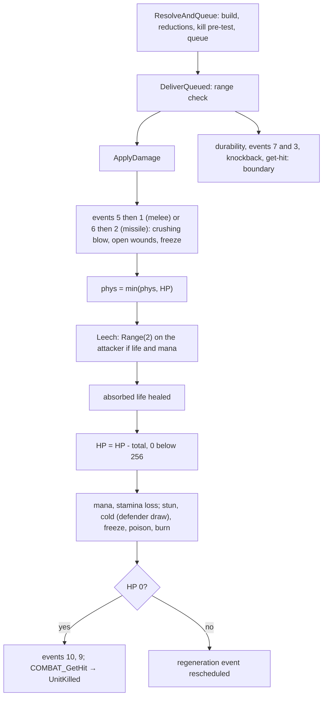
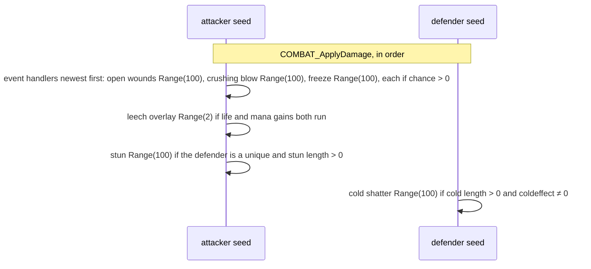

# Combat: queue, delivery, on-hit effects and the life change

## Purpose

A built and reduced packet is queued on the attacker and delivered to the defender: the on-hit stat events of the
attacker (crushing blow, open wounds, freeze), leech, the absorbed life, **the life change**, the mana and stamina
loss, then stun, cold, freeze, poison and burn. Crushing blow, open wounds and leech draw on the **attacker's** seed;
cold draws on the **defender's**. A melee attack queues and delivers in the same call at its hit frame; a missile
delivers directly. The kill hands off to the death path, and get-hit, knockback and durability are named here as the
boundary of the model ([combat/overview § Boundary](README.md#the-adr-0014-boundary)).



## Entry points

| When | Function | Tag |
|---|---|---|
| A melee hit is reduced and queued on the attacker | fn:COMBAT_ResolveAndQueue@0x0057DBF0 → fn:COMBAT_QueueHit@0x0057CA80 | [C] (run:2026-10-16-combat) |
| The queued hit is delivered | fn:COMBAT_DeliverQueued@0x0057D4F0 | [C] (run:2026-10-16-combat) |
| The packet is applied (melee and missile) | fn:COMBAT_ApplyDamage@0x0057C6C0 | [C] (run:2026-10-16-combat) |
| Leech | fn:COMBAT_Leech@0x0057C420 | [C] for players and the mercenary (run:2026-10-16-combat) |
| Crushing blow, open wounds, freeze (stat events 16, 15, 14) | fn:STATEVENT_CrushingBlow@0x005BFFC0, fn:STATEVENT_OpenWounds@0x005BFE60, fn:STATEVENT_Freeze@0x005BFC60 | [C] for the first two (run:2026-10-16-combat) |
| A monster's life tick (poison, open wounds) | fn:sub_005A6920_MonRegenEvent@0x005A6920 | [C] (run:2026-10-16-combat) |
| A player's life tick | fn:sub_00580810_RegenEvent@0x00580810 → fn:sub_00580610_LifeRegenTick@0x00580610 | [I] |
| The kill | fn:COMBAT_GetHit@0x0057CEE0 → fn:sub_0057CCB0_UnitKilled@0x0057CCB0 | [I] |

## Inputs

### Tables

| Anchor | Used for |
|---|---|
| tbl:DifficultyLevels.txt:LifeStealDivisor, `ManaStealDivisor` | a player attacker's leech (§ C) |
| tbl:DifficultyLevels.txt:MonsterColdDivisor, `MonsterFreezeDivisor` | cold and freeze length on a monster (§ D) |
| tbl:MonStats.txt:Drain | the leech factor `D` of a monster defender, per difficulty (§ C) |
| tbl:MonStats.txt:coldeffect | chill strength and whether a monster can be chilled or frozen (§ D) |
| tbl:MonStats.txt:killable, `boss` | delivery refusal; crushing blow divisor, stun, freeze |
| tbl:ItemStatCost.txt:itemeventfunc1 | stats 134, 135, 136 register handlers 14, 15, 16 on events 5 and 6 |

### Runtime state

| State | Type | Source |
|---|---|---|
| attacker and defender seeds | `Seed` at `Unit+0x20` | the draws of § C, § D, § E |
| hit queue | list at `Unit+0xAC` of the attacker | `COMBAT_QueueHit` |
| frame | `Game+0xA8` | the end frame of timed states |
| life, mana, stamina | stats 6–11, 1/256 units | value inputs at the event's entry (ADR-0014) |
| player count of a monster | stat 100, set at creation | [monsters/stats § C](../monsters/stats.md#c-the-player-count-sub_00573930_monplayerbonus) |
| unit type flags | `0x02` superunique, `0x04` champion, `0x08` unique | [monsters/special](../monsters/special.md) |

### Constants

| Name | Value | Anchor | Tag |
|---|---|---|---|
| one life | 256 (life below it is set to 0) | 0x0057C852–0x0057C874 | [C] (run:2026-10-16-combat) |
| crushing blow divisors | player 10, hireling 10, monster 4, boss or superunique 8 | 0x005C0031–0x005C00F6 | [C] for 4 (run:2026-10-16-combat) |
| open wounds band steps | 9, 18, 27, 36, 45 per level; + 40 | fn:sub_005BFDA0_OpenWoundsBand@0x005BFDA0 | [C] (run:2026-10-16-combat) |
| open wounds length | 200 frames | 0x005BFEEC–0x005BFF9B | [C] (run:2026-10-16-combat) |
| shatter chance | 20 | 0x0057B0FA–0x0057B124 | [I] |
| stun caps | hireling 13, others 250 frames | 0x0057AB17–0x0057AB44 | [I] |

## Algorithm

### A. Queue and delivery

```
A1. ResolveAndQueue(att, def, pkt, srcdam):                          [C] (fn:COMBAT_ResolveAndQueue@0x0057DBF0, run:2026-10-16-combat, all of A1)
      if (pkt.result & 0x1) and not (pkt.result & 0x8380):          ; hit, not blocked, dodged, avoided, weapon-blocked
        if not (pkt.flags & 0x2): BuildDamage(att, def, pkt, 0, srcdam)       ; combat/damage
        ApplyReductions(att, def, pkt)                                         ; combat/reductions
        total: i32 ← pkt.phys + pkt.fire + pkt.light + pkt.magic + pkt.cold + pkt.poison
                     + (att is a monster ? pkt.lifeSteal : 0)
        if (total & ~0xFF) > (stat(def, 6) & ~0xFF): pkt.result |= 0x2        ; kill pre-test
      QueueHit(att, def, pkt)                                                  ; always; copied onto att's list

A2. DeliverQueued(att, def):                                          [I] (fn:COMBAT_DeliverQueued@0x0057D4F0, all of A2)
      e ← the queued entry for def;  if none: return
      if def is in melee range and (e.pkt.result & 0x1) and att is alive:
        e.pkt.flags ← 0x20
        ApplyDamage(att, def, e.pkt, doReductions: false)                     ; § B
        put overlay pkt+0x6C;  pick the hit class (a global counter, no draw)
        DurabilityLoss(att, def)                                              ; boundary oracle, § F
      DispatchEvent(7 domeleeattack, att);  DispatchEvent(3 attackedinmelee, def)
      if hit: Knockback(att, def)                                             ; boundary oracle, § F
      GetHit(att, def, e.pkt)                                                 ; boundary oracle, § F
      remove e
```

- A1. The player's packet was already built by `SKILL_AttackDo` (flag `0x2`), so `ResolveAndQueue` only reduces it;
  a monster's is built here, and only on a hit. [C] (fn:SKILL_AttackDo@0x0056F070, 0x0057DC1D–0x0057DC37,
  run:2026-10-16-combat)
- A1. The kill pre-test compares whole life points (`& ~0xFF`). [C] (fn:COMBAT_ResolveAndQueue@0x0057DBF0,
  run:2026-10-16-combat)
- A2. A delivery can happen on a later frame than the hit test when a skill do-function queues it (362 such events
  in the run, resynchronised); the attacker's AI may draw in between. [I] (fn:COMBAT_DeliverQueued@0x0057D4F0,
  run:2026-10-16-combat)
- A2. Before delivery, `SKILL_AttackDo` calls the progressive-charge finisher, which steps the attacker's seed once
  per charged state (with a skill whose charge stat is above 0); the run met none, and an attacker under a `meleeonly`
  state (wolf, bear) skips the finisher. [I] (fn:COMBAT_PrgFinisher@0x005D5220, 0x005D537B,
  fn:sub_0056C2D0_AttackDeliverMeleeOnly@0x0056C2D0)

### B. Delivery (`COMBAT_ApplyDamage`)



```
B1. ApplyDamage(att, def, pkt, doReductions: bool):                  [C] (fn:COMBAT_ApplyDamage@0x0057C6C0, run:2026-10-16-combat)
      if not hostile(att, def) and not (pkt.flags & 0x1000): pkt.result &= ~0x3; return      ; [I] (0x0057C6D5–0x0057C78E, B1–B2)
      if def is in town and not (att is a monster with the town-capable MonStats bit): pkt.result &= ~0x2; return
      if def is a monster and not MonStats.killable: return
      if def is dead: return
B2.   if doReductions: ApplyReductions(att, def, pkt)                  ; missiles
B3.   if (pkt.result & 0x1) and not (pkt.result & 0x20):               ; [I] for the event order (0x0057C7A5–0x0057C7F3)
        if not doReductions:
          DispatchEvent(5 domeleedamage, unit: att, other: def, pkt)   ; § E
          DispatchEvent(1 damagedinmelee, unit: def, other: att, pkt)
        else:
          if not (pkt.flags & 0x80): DispatchEvent(6 domissiledamage, unit: att, other: def, pkt)
          if pkt.flags & 0x20:       DispatchEvent(2 damagedbymissile, unit: def, other: att, pkt)
B4.   pkt.phys ← min(pkt.phys, stat(def, 6))
      Leech(att, def, pkt)                                             ; § C
      if att is a monster and pkt.result & 0x1: MonOnHitSkill(att, def)          ; 0x005A4390, boundary oracle
      if pkt.absorbHeal > 0 and def is alive and not HasState(def, 92): AddLifeCapped(def, pkt.absorbHeal)
      if pkt.total > 0:                                                ; [I] for the test (0x0057C855–0x0057C857), see note
        hp: i32 ← stat(def, 6) − pkt.total
        stat(def, 6) ← (hp < 256) ? 0 : hp
      stat(def, 8)  ← stat(def, 8)  − pkt.manaSteal,  0 when below 256  ; [I] (0x0057C879–0x0057C889)
      stat(def, 10) ← stat(def, 10) − pkt.stamSteal,  0 when below 256
      ApplyStun; ApplyCold; ApplyFreeze; ApplyPoison; ApplyBurn         ; § D
B5.   if stat(def, 6) ≤ 0: pkt.result |= 0x2
      else: pkt.result &= ~0x2;  if def is a monster and pkt.total ≠ 0 and stat(def, 74) ≠ 0: reschedule its life tick
      if (pkt.result & 0x2) and not (pkt.result & 0x20):
        DispatchEvent(10 killed, unit: def);  DispatchEvent(9 kill, unit: att)   ; [I] (0x0057C8DD–0x0057C970)
```

Step notes:

- B3. The handlers of one event run **newest first** (`UNIT_AddEvent` pushes at the head). In the run the open-wounds
  handler of the logged characters ran before the crushing-blow handler; a reimplementation keeps the unit's own
  registration order. [I] (fn:UNIT_AddEvent@0x005C0AD0, fn:UNIT_DispatchEvent@0x005C0C30)
- B3. The stat events see the defender's life **before** this hit's damage: crushing blow takes its share of the
  current life, then the packet's total is subtracted from what is left. [C] (fn:STATEVENT_CrushingBlow@0x005BFFC0,
  run:2026-10-16-combat)
- B4. `phys = min(phys, HP)` is taken after the stat events, so the leech of a killing blow is computed on the life
  that was left. [C] (0x0057C7F8–0x0057C8D8, run:2026-10-16-combat)
- B4. **The life change**: `HP − total`, and 0 when the result is below 256 (one life point). [C] (0x0057C852–0x0057C874,
  run:2026-10-16-combat) The absorbed life is healed only when positive (`UNIT_AddLifeCapped` returns at once for
  an amount ≤ 0); 32 percent-absorb heals of the player reproduced. [C] (fn:UNIT_AddLifeCapped@0x0057A980,
  run:2026-10-16-combat)
- B4. **A total of 0 or less changes nothing.** `test edi, edi` / `jle` at 0x0057C855–0x0057C857 skips the
  subtraction (and the 256 floor) when `total ≤ 0`. The 25 logged events with a negative total (MDR above the
  elemental damage, [combat/reductions § B1](reductions.md#b-the-rows-g_damageresisttable)) left the defender's life
  unchanged, under the plan's floor of about 30. [I] (0x0057C855–0x0057C857, run:2026-10-16-combat)
- B4. For a player attacker the defender's mana and stamina losses read the steal fields after `Leech` scaled them
  (`<< 6` and the divisor), so a monster defender with mana loses `manaSteal·64/divisor` in 1/256 units. [I]
  (0x0057C879–0x0057C889)
- B5. A dead monster goes to `COMBAT_GetHit` and `sub_0057CCB0_UnitKilled`, the hand-off to the death and drop path
  ([items/tc](../items/tc.md)). [I] (fn:COMBAT_GetHit@0x0057CEE0, fn:sub_0057CCB0_UnitKilled@0x0057CCB0)

### C. Leech (`COMBAT_Leech`)

```
C1. Leech(att, def, pkt):                                            [C] (fn:COMBAT_Leech@0x0057C420, run:2026-10-16-combat, all of C1 for players and the mercenary)
      if pkt.lifeSteal = 0 and pkt.manaSteal = 0: return
      D: i32 ← def is a monster ? MonStats[def.class].Drain[difficulty] : 100
      if D = 0: return                                                ; a blank Drain: no leech
      life: i32 ← pkt.lifeSteal << 6;  mana: i32 ← pkt.manaSteal << 6
      if att is a player:
        if LifeStealDivisor ≠ 0: life ← life ÷ LifeStealDivisor       ; 1, 2, 3
        if ManaStealDivisor ≠ 0: mana ← mana ÷ ManaStealDivisor
      pkt.lifeSteal ← life;  pkt.manaSteal ← mana
      if att is a player or a hireling:
        if pkt.phys ≤ 0: return
        if mana ≠ 0:
          m: i32 ← MulDiv(pkt.phys, mana, 100);  if D ≠ 100: m ← MulDiv(m, D, 100)
          m ← m ÷ 64;  att mana ← (m > 0) ? min(att mana + m, att max mana) : att mana + m
        if life ≠ 0:
          l: i32 ← MulDiv(pkt.phys, life, 100);  if D ≠ 100: l ← MulDiv(l, D, 100)
          l ← l ÷ 64;  att life ← (l > 0) ? min(att life + l, att max life) : att life + l
          if mana ≠ 0: r ← Range(att.seed, 2)                         ; draw: picks overlay 151 (r = 0) or 152
      else:                                                           ; a monster attacker, [I] (0x0057C47D–0x0057C4CE)
        fields back >> 6;  gain ← min(life, pkt.phys) + min(mana, def mana) + min(stam, def stamina)
        if D ≠ 100: gain ← MulDiv(gain, D, 100);  heal att by gain up to its max life;  overlay 151
```

- C1. **Leech is computed on the physical damage after reductions** (and after `min(phys, HP)`), in 1/256 units: the
  steal percent is `<< 6` and the gain `÷ 64`. The difficulty divisors apply to **player** attackers only; leech was
  logged 364, 681 and 455 times in Normal, Nightmare and Hell, with 1 500 `Range(2)` overlay draws. [C]
  (fn:COMBAT_Leech@0x0057C420, tbl:DifficultyLevels.txt:LifeStealDivisor, run:2026-10-16-combat)
- C1. Mana is computed and added before life; the `Range(2)` draw happens only when both gains ran, after the life
  gain. [C] (0x0057C560–0x0057C568, run:2026-10-16-combat)
- C1. A hireling attacker uses the player formula without the divisors. [I] (fn:sub_0063EE90_HirelingType@0x0063EE90,
  fn:COMBAT_Leech@0x0057C420)
- C1. The monster branch (taken when `0x00645270` reports an owner type) was met 7 times, under the floor. [I]
  (0x0057C47D–0x0057C4CE, run:2026-10-16-combat)
- C1. `Drain` 0 or blank means no leech from that monster at all; the stock `Drain` cuts leech further in Nightmare
  and Hell for many classes (`fallen2`: 100 / 85 / 75). [C] (tbl:MonStats.txt:Drain, run:2026-10-16-combat)

### D. Stun, cold, freeze, poison, burn

```
D1. ApplyStun(att, def, len = pkt.stunLen):                          [I] (fn:COMBAT_ApplyStun@0x0057AAE0, all of D1)
      if len ≤ 0: return
      if def is a monster with type flag 0x08 (unique):
        if Range(att.seed, 100) < 90: return                         ; draw (attacker), inlined
      if def is a boss: return
      if MonStats[def.class].Velocity = 0: return
      len ← def is a hireling ? min(len, 13) : min(len, 250)
      state 21 (stunned) until frame + len

D2. ApplyCold(att, def, len = pkt.coldLen):                          [C] for the draw (fn:COMBAT_ApplyCold@0x0057AF80, run:2026-10-16-combat)
      if len ≤ 0: return
      ce: i8 ← def is a monster ? MonStats[def.class].coldeffect[difficulty] : −50
      if ce = 0: return                                              ; no chill, no draw
      if def is a monster and ce < 0: len ← len ÷ MonsterColdDivisor
      len ← max(len, 1)
      state 11 (cold) until frame + len, stats 67, 68, 69 ← ce        ; a longer chill extends, a shorter one does not shorten
      r ← Range(def.seed, 100)                                       ; draw (DEFENDER), inlined
      if r < 20 and def is a monster without the MonStats2 flag (0x004638A0): state 107 (shatter) on, else off

D3. ApplyFreeze(att, def, len = pkt.freezeLen):                      [I] (fn:COMBAT_ApplyFreeze@0x0057B230, all of D3)
      if def is a player, a boss, a unique or a hireling: ApplyCold(att, def, len); return
      if def has state 54: return
      if coldeffect[difficulty] ≥ 0: return
      len ← len ÷ MonsterFreezeDivisor;  state 1 (freeze) until frame + len;  mode change;  timer at frame + 1 + len

D4. ApplyPoison(att, def, dmg = pkt.poison, len = pkt.poisonLen):    [I] (fn:COMBAT_ApplyPoison@0x0057AC50, all of D4)
      if dmg ≤ 0 or len ≤ 0: return
      if def has a poison state with damage > dmg: return            ; replaced only when dmg ≥ the old one
      state 2 (poison) with stat 74 (hpregen) ← −dmg until frame + len
    ApplyBurn: the same with state 115 and (pkt.burn, pkt.burnLen)    ; a plain attack has burnLen 0: no state
```

- D2. **The cold draw is on the defender's seed**, after the chill is applied, whatever the outcome. It reproduced in
  every logged event with a cold length (the defender's exit seed asserted). [C] (0x0057B0FA–0x0057B124, run:2026-10-16-combat)
  The chill strength and the shatter flag were not asserted. [I] (fn:COMBAT_ApplyCold@0x0057AF80)
- D2. `coldeffect` 0 means the monster is not chilled and no draw happens; a player is chilled at −50. The
  `MonsterColdDivisor` (1, 2, 4) shortens a monster's chill only. [I] (fn:sub_0057AF30_MonColdEffect@0x0057AF30,
  tbl:DifficultyLevels.txt:MonsterColdDivisor)
- D1. The stun draw on a unique reproduced 17 times, under the floor; the stun goes on only when `r ≥ 90`. [I]
  (0x0057AB17–0x0057AB44, run:2026-10-16-combat)
- D3. A player, a boss, a unique or a hireling is chilled instead of frozen, for the same length. No logged event
  froze. [I] (0x0057B2F1, tbl:DifficultyLevels.txt:MonsterFreezeDivisor)

### E. The stat events: crushing blow, open wounds, freeze

Stats 134, 135 and 136 register `itemeventfunc` 14, 15 and 16 on events 5 (`domeleedamage`) and 6
(`domissiledamage`); each handler gets the attacker, the defender, the packet and `stat id << 16 | layer`. [I]
(data:g_StatEventFuncs@0x007325B0, fn:sub_0056E740_AddStatEvent@0x0056E740, tbl:ItemStatCost.txt:itemeventfunc1)

```
E1. CrushingBlow(att, def, pkt, event):                              [C] (fn:STATEVENT_CrushingBlow@0x005BFFC0, run:2026-10-16-combat, all of E1 except as tagged)
      c: i32 ← stat(att, 136)
      if c ≤ 0: return                                               ; no draw
      r ← Range(att.seed, 100)                                       ; draw (attacker), inlined
      if r ≥ c: return
      if def is a player or a hireling: k: i32 ← 10                  ; [I] (0x005C0031–0x005C00F6)
      else:
        k ← (MonStats[def.class].boss or def has type flag 0x02) ? 8 : 4         ; [I] for 8 (fn:MONSTATS_IsBoss@0x0063E9F0)
        n: i32 ← max(stat(def, 100), 1)
        k ← k + MulDiv(k, PlayerHpPct(n), 100)                       ; + 50 % per player beyond the first
      if event = 6: k ← k × 2                                        ; missile, [I] (0x005C0031–0x005C00F6)
      cb: i32 ← stat(def, 6) ÷ k
      if stat(def, 36) > 0: cb ← cb − MulDiv(cb, min(stat(def, 36), 100), 100)
      stat(def, 6) ← max(stat(def, 6) − cb, 0);  if 0: pkt.result |= 0x2
      if cb > 0: overlay 147

E2. OpenWounds(att, def, pkt, event):                                [C] (fn:STATEVENT_OpenWounds@0x005BFE60, run:2026-10-16-combat, all of E2 except as tagged)
      c: i32 ← stat(att, 135)
      if c ≤ 0: return                                               ; no draw
      r ← Range(att.seed, 100)                                       ; draw (attacker), inlined
      if r ≥ c: return
      L: i32 ← max(stat(att, 12), 1)
      dmg: i32 ← Band(L) + 40
      if def is a player: dmg ← dmg ÷ 4;  if event = 6: dmg ← dmg ÷ 2              ; [I] (0x005BFEEC–0x005BFF9B)
      else if def has type flags 0x0C (champion or unique): dmg ← dmg ÷ 2
      state 62 (openwounds) for 200 frames with stat 74 ← −dmg       ; STATE_ApplyTimed; a new wound restarts it

    Band(L): L < 2 → 0;  L ≤ 15 → (L − 1)·9;  L ≤ 30 → 126 + (L − 15)·18;  L ≤ 45 → 396 + (L − 30)·27;
             L ≤ 60 → 801 + (L − 45)·36;  else 1341 + (L − 60)·45

E3. Freeze(att, def, pkt, event):                                    [I] (fn:STATEVENT_Freeze@0x005BFC60, all of E3)
      x: i32 ← max(stat(att, 134) − 1, 0)
      c: i32 ← ((x − 1)·4 − dlvl + 10 + alvl [− 6 for a missile])·5 [÷ 3 for a missile];  c ← clamp(c, 0, 100)
      r ← Range(att.seed, 100)                                       ; draw (attacker)
      if r < c: len ← clamp((c − r)·2 + 25, 25, 250);  ApplyDamage(att, def, fresh packet with freezeLen = len, doReductions: true)
```

- E1. **Crushing blow takes a share of the current life**, 1/4 for normal monsters (247 events) **and uniques** (63),
  raised by the player-count percent of [monsters/stats § C](../monsters/stats.md#c-the-player-count-sub_00573930_monplayerbonus)
  (at `/players` 2, 3 and 8: 5, 40 and 124 events), then lowered by positive physical resistance. Two community pages
  give 1/8 for champions and uniques and one says the player count does not matter; 1.14d does neither. [C]
  (fn:sub_005738F0_PlayerHpPct@0x005738F0, 0x005C0031–0x005C00F6, run:2026-10-16-combat)
- E1. There is **no difficulty and no classic branch** in crushing blow. [I] (fn:STATEVENT_CrushingBlow@0x005BFFC0)
- E1. `k = 8` for MonStats `boss` (act bosses) and superuniques reproduced on 1 act boss and 5 superunique hits, and
  champions were not labelled (the checker labels a unit with the unique bit first): under the floor. [I]
  (fn:MONSTATS_IsBoss@0x0063E9F0, run:2026-10-16-combat)
- E2. `Band(L) + 40` equals the community's per-frame bands; at level 85 it is `1341 + 25·45 + 40` = 2506 per frame,
  logged as stat 74 = −2506 (`solo-h3`, frame 266, a normal monster). Open wounds reproduced 246 times; in all 11 logged windows the bleed ended at the
  application frame + 200. [C] (fn:sub_005BFDA0_OpenWoundsBand@0x005BFDA0, fn:STATE_ApplyTimed@0x0056E970,
  run:2026-10-16-combat)
- E2. The halving applies to champions and uniques (type flags), **not** to act bosses (MonStats `boss`), which take
  the full amount by the reading; no act boss was wounded in the run. [I] (0x005BFEEC–0x005BFF9B)
- E3. Freeze (stat 134) was not met. [I] (fn:STATEVENT_Freeze@0x005BFC60)

**E4. The life tick.** Poison and open wounds bleed through the unit's regeneration event, once per frame.

```
E4. MonLifeTick(game, unit):                                          [C] (fn:sub_005A6920_MonRegenEvent@0x005A6920, run:2026-10-16-combat, all of E4)
      s: i32 ← stat(unit, 74)
      if unit has a state with the `life` flag (poison, preventheal, openwounds): s ← s − base stat 74 of the unit
      if HasState(unit, 52) and s ≥ 0: return
      requeue at frame + 1;  if s = 0: end the event
      hp: i32 ← stat(unit, 6) + s
      if hp > stat(unit, 7): hp ← stat(unit, 7); end the event
      if hp < 1: hp ← 0
      stat(unit, 6) ← hp;  if hp = 0: the unit dies with the poisoner or the wounder as killer
```

- E4. **Bleed and poison kill monsters**; under a `life` state a monster's natural regeneration is suspended (the base
  list's stat 74 is subtracted). 6 181 ticks reproduced. [C] (fn:sub_005A6920_MonRegenEvent@0x005A6920,
  tbl:States.txt:life, run:2026-10-16-combat)
- E4. **A player's tick never takes life below 256** (one point): `sub_00580610_LifeRegenTick` adds stat 74, caps at
  stat 7, raises a result below 256 to 256. Poison and open wounds cannot kill a player. No window on the player was
  logged. [I] (fn:sub_00580610_LifeRegenTick@0x00580610, 0x0058065B–0x0058066E)

### F. The boundary at delivery

Durability loss (`COMBAT_DurabilityLoss`: the attacker's weapon one draw, the defender's armour a slot pick
`RangeB(7)`, a weighted `RangeB` and one draw, on the owners' seeds through `ITEMS_DurabilityLossRoll`), the
knockback (`0x005D10C0`), the get-hit decision (`sub_0057CB00_GetHitRoll`, up to two `RangePow2` on the defender)
and the monster's on-hit skill (`0x005A4390`) were boundary oracles in the run: their entry seeds were asserted and
their exit seeds taken. [I] (fn:COMBAT_DurabilityLoss@0x0057D3D0, fn:ITEMS_DurabilityLossRoll@0x00559E30,
fn:sub_0057CB00_GetHitRoll@0x0057CB00, run:2026-10-16-combat) Hit recovery and knockback timing are ADR-0014 phase (5).

## Outputs

- The defender's life (stat 6), mana and stamina after the hit, the attacker's life and mana after leech, the
  defender's timed states (stun 21, cold 11, shatter 107, freeze 1, poison 2, open wounds 62, burning 115). [C] for
  life, leech, the open-wounds state (run:2026-10-16-combat); [I] for the other states (fn:COMBAT_ApplyDamage@0x0057C6C0)
- The result word with `0x2` on a kill; the hand-off to `COMBAT_GetHit`. [C] (run:2026-10-16-combat)
- The attacker's seed advanced by the stat-event, leech and stun draws; the defender's by the cold draw. [C] for
  crushing blow, open wounds, leech and cold (run:2026-10-16-combat)

## Worked example

**Crushing blow and leech in Hell** — the delivery of [combat/overview § Example 1](README.md#example-1-a-melee-hit-in-hell-with-crushing-blow-and-leech)
(`solo-h3`, frame 357; the `CombatSolo` Sorceress, open wounds 10, crushing blow 20, life steal 5, mana steal 7,
against a `fallen2` at life 74776 with physical resistance 15). Reduced packet: physical 78365, magic 22020, cold
6268, poison 153, total 106806. [C] (run:2026-10-16-combat)

| Step | Computation | Attacker seed `9fdf9862:101f40ba` → | Result |
|---|---|---|---|
| kill pre-test | `106752 > 74752` | — | result `0x7` |
| open wounds (10) | `Range(100)` = 44 ≥ 10 | `4cb2a424:42ae9671` | no wound |
| crushing blow (20) | `Range(100)` = 13 < 20; `k` = 4 (`/players` 1, `PlayerHpPct(1)` = 0); `cb = 74776 ÷ 4` = 18694; `18694 − MulDiv(18694, 15, 100)` = 15890 | `a0532625:1ffd7581` | life 74776 → 58886 |
| `phys = min(phys, HP)` | `min(78365, 58886)` | — | 58886 |
| leech | Hell divisors 3: life `320 ÷ 3` = 106, mana `448 ÷ 3` = 149; `Drain(H)` of `fallen2` = 75; life `MulDiv(MulDiv(58886, 106, 100), 75, 100) ÷ 64` = 731; mana capped at the maximum | `Range(2)` = 0 → `180c9ffa:42dec8c5` | attacker life 1540389 → 1541120 |
| life change | `58886 − 106806` < 256 | — | 0, killed |
| cold | length 60 > 0, `coldeffect(H)` −33 | defender `c5ef0176:3c8fe7bd` → `Range(100)` = 79 → `fb92678b:528e7d64` | no shatter |

**Crushing blow at `/players 8`** (`solo-nm-p8`, Nightmare, frame 426): a `corruptrogue1` created at 8 players (stat
100 = 8), life 138409, no physical resistance. `k = 4 + MulDiv(4, 350, 100)` = 18, `cb = 138409 ÷ 18` = 7689, life
→ 130720. The Nightmare leech fields are `320 ÷ 2` = 160 and `448 ÷ 2` = 224. [C] (run:2026-10-16-combat)

## Reimplementation notes

- **Crushing blow is a share of the defender's current life, before this hit's damage**, and it is 1/4 on uniques.
  [C] (fn:STATEVENT_CrushingBlow@0x005BFFC0, run:2026-10-16-combat)
- **The player count raises the crushing-blow divisor** through the monster's stat 100 (its creation count). [C]
  (fn:sub_005738F0_PlayerHpPct@0x005738F0, run:2026-10-16-combat)
- **Leech uses the reduced, life-capped physical damage**; elemental damage never leeches. [C]
  (fn:COMBAT_Leech@0x0057C420, run:2026-10-16-combat)
- **The leech overlay draw** (`Range(2)` on the attacker) happens only when both life and mana gains ran; a
  reimplementation without overlays must still take it. [C] (0x0057C560–0x0057C568, run:2026-10-16-combat)
- **The cold draw is on the defender's seed**, every time a chill is applied. [C] (0x0057B0FA–0x0057B124,
  run:2026-10-16-combat)
- **Life below 256 is 0.** A hit that leaves less than one life point kills. [C] (0x0057C852–0x0057C874,
  run:2026-10-16-combat)
- **Absorb heals from both percent and flat absorb**, and only a positive amount. [C] for the percent
  (fn:COMBAT_Absorb@0x0057BF10, run:2026-10-16-combat); [I] for the flat (fn:COMBAT_Absorb@0x0057BF10)
- **Burning never applies from a plain attack**: the builder leaves `burn = 2` with `burnLen = 0`. [I]
  (0x0057BC2F–0x0057BC8A)

## Evidence

- [combat/0001](../../findings/combat/0001-formulas.md) §§ 6 (resolve, queue, deliver), 8 (delivery), 9 (leech, stun,
  cold, freeze, poison, burn), 10 (stat events), 14 (the finisher, the ticks), 15 (the confirmed raises and the
  below-the-floor bullet), 13 (*Leads used*: crushing blow, open wounds, absorb, leech).
- [combat/experiments § run:2026-10-16-combat](../../findings/combat/experiments.md#run2026-10-16-combat): crushing
  blow 316, open wounds 246 with 11 windows, leech 364 / 681 / 455, the stat-74 tick 6 181.
- Tables: [DifficultyLevels](../../tables/DifficultyLevels.md), [MonStats](../../tables/MonStats.md),
  [ItemStatCost](../../tables/ItemStatCost.md), [States](../../tables/States.md).
- Upstream: [rng](../rng/README.md), [monsters/stats § C](../monsters/stats.md#c-the-player-count-sub_00573930_monplayerbonus).
  Downstream: [items/tc](../items/tc.md) (the drop at the kill).

## Open questions

- [L] Branches reproduced under the plan's floor of about 30: crushing blow with `k` = 8 on an act boss (1) and on
  superuniques (5), and champions (0 labelled); the monster leech branch (7); the stun draw on a unique (17); a total
  of 0 or less leaving life unchanged (B4, 25).
- [L] Not reached: open wounds on an act boss (0; the halving reading says act bosses take the full amount) and on a
  player, the freeze handler and freezing, the player's life tick. The resume lane of plan 0037 Phase 2 targets open
  wounds and crushing blow on act bosses.
- [L] The state end: when a timed state's stat list is freed at its end frame (the run measured the open-wounds end
  from the ticks).
- [L] Event handlers other than 14, 15 and 16 (skill on hit, knockback, slow and the like) draw on seeds this spec
  does not model; they are boundary oracles until phase (3).
