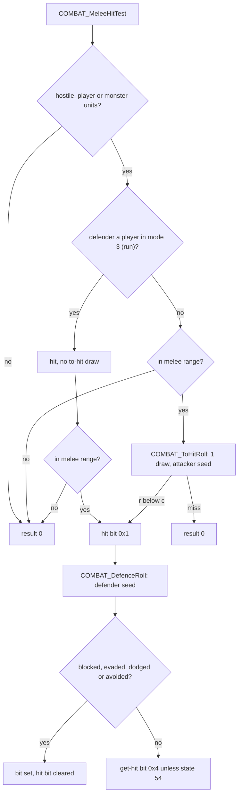
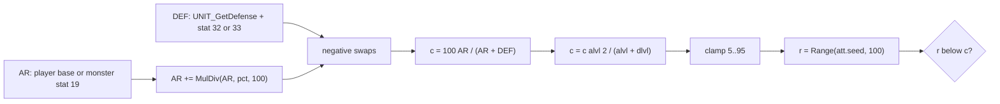
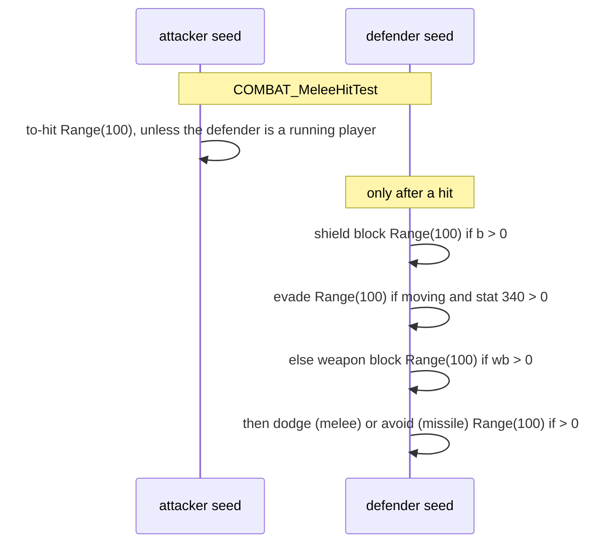

# Combat: the hit test, chance to hit and the defence rolls

## Purpose

At the hit frame of a melee attack the server decides whether the attack connects: a range check, the chance to
hit with one draw on the **attacker's** seed, then the defender's block and avoidance rolls on the **defender's**
seed. The result is the packet's result word, which decides whether the damage build of a monster runs and whether
any damage is applied ([combat/damage](damage.md), [combat/delivery](delivery.md)). Missiles reuse the chance to hit
and the defence roll with their own flags. The event that contains this test, its seeds and its chaining are in
[combat/overview](README.md). Primitives (`Step`, `Range`) are those of [rng](../rng/README.md); `RangeB` in our
symbol names is the second compile of `Range` and behaves the same.



## Entry points

| When | Function | Tag |
|---|---|---|
| A player's normal attack or a skill's melee hit, a monster's plain attack, at the hit frame | fn:COMBAT_MeleeHitTest@0x0057EC10 | [I] (0x0057EC16–0x0057EC28) |
| The chance to hit and its draw | fn:COMBAT_ToHitRoll@0x0057D9B0 | [C] (run:2026-10-16-combat) |
| The defender's block, then evade, weapon block, dodge or avoid | fn:COMBAT_DefenceRoll@0x0057DFB0 → fn:COMBAT_AvoidRoll@0x0057DD60 | [C] for the block (run:2026-10-16-combat) |
| A missile reaching a unit (phase (3); the to-hit and defence calls only) | fn:MISSILE_HitUnit@0x005ADF10, fn:MISSILE_ApplyDamage@0x005AD730 | [I] |

## Inputs

### Tables

| Anchor | Used for |
|---|---|
| tbl:CharStats.txt:ToHitFactor | added to a player's attack rating (A2) |
| tbl:CharStats.txt:BlockFactor | added to a player's block (C2) |
| tbl:MonStats.txt:NoShldBlock | a monster may block without a shield (C2) |
| tbl:MonStats.txt:MonType | the stat-179 attack-rating bonus by monster type (A2) |
| tbl:Skills.txt:ToHit, `LevToHit`, `ToHitCalc` | a skill's attack-rating percent through `SKILLS_GetToHit` ([data/calc § G](../data/calc.md#g-variables)) |

### Runtime state

| State | Type | Source |
|---|---|---|
| attacker and defender units | `Unit`, type 0 player, 1 monster, 3 missile | the attack event ([combat/overview](README.md)) |
| attacker seed, defender seed | `Seed` at `Unit+0x20` | [rng/seeds](../rng/seeds.md) |
| `arPct` | i32, the caller's attack-rating percent | 0 for a monster, stat 325 for the player's normal attack, `SKILLS_GetToHit` for a skill |
| unit stats | i32 values of the unit's stat lists | value inputs (ADR-0014); see the stat ids below |
| unit mode | the unit's animation mode | 2 walk, 3 run, 6 (player); 2, 15 (monster) |
| game type | `Game+0x70`, 0 classic, else expansion | game creation |

Stat ids read here: 0 strength is not read; 2 dexterity, 12 level, 16 and 171 defence percents, 19 attack rating,
20 block, 31 defence, 32 and 33 defence against missiles and melee, 115, 116, 119, 123, 124, 179, 182, 325, 338
dodge, 339 avoid, 340 evade, 348 weapon block. [I] ([combat/0001 § 12b (e)](../../findings/combat/0001-formulas.md#12b-answers-to-the-archivists-phase-0-questions-backlog-2026-10-16-ae), tbl:ItemStatCost.txt:Stat)

### Constants

| Name | Value | Anchor | Tag |
|---|---|---|---|
| to-hit clamp | 5 .. 95 | 0x0057DB22–0x0057DB30 | [C] (run:2026-10-16-combat) |
| block cap | 75 | fn:sub_00622720_UnitBlockChance@0x00622720 | [C] (run:2026-10-16-combat) |
| moving-player block divisor | 3 | 0x0057E011–0x0057E01F | [C] (run:2026-10-16-combat) |
| attacker-monster range bonus | 2 | fn:COMBAT_MeleeHitTest@0x0057EC10 | [I] |

## Algorithm

### A. The chance to hit (`COMBAT_ToHitRoll`)



```
A1. ToHitRoll(att, def, arPct: i32, isMissile: bool) → bool:          [C] (fn:COMBAT_ToHitRoll@0x0057D9B0, run:2026-10-16-combat, all of A1–A6)
      dlvl: i32 ← stat(def, 12);  alvl: i32 ← stat(att, 12)
      DEF: i32 ← Defense(def) + stat(def, isMissile ? 32 : 33)        ; § B
A2.   if att is a player:
        AR: i32 ← (stat(att, 2) − 7) × 5 + stat(att, 19) + CharStats[att.class].ToHitFactor
        TargetMods(att, def, AR, DEF)                                 ; § A7, [I] (fn:COMBAT_ToHitTargetMods@0x0057D8A0)
        pct: i32 ← (not isMissile and att holds a weapon) ? masteryToHit(att, weapon) : 0
        pct ← pct + stat(att, 119) + arPct
        if def is a monster and MonStats[def.class].MonType > 0:
          for each (type, v) in att's stat-179 entries: if def's MonType matches type: pct ← pct + v
      else:
        AR ← stat(att, 19) + arPct + 5 × stat(att, 2)
        pct ← stat(att, 119)
A3.   AR ← AR + MulDiv(AR, pct, 100)
A4.   if DEF < 0: AR ← AR − DEF;  DEF ← 0
      if AR < 0:  DEF ← DEF − AR;  AR ← 0
      if DEF < 0: DEF ← 0
A5.   c: i32 ← (AR + DEF ≠ 0) ? (100 × AR) ÷ (AR + DEF) : 100
      c ← (c × alvl × 2) ÷ (alvl + dlvl)
      c ← (c ≤ 5) ? 5 : ((c ≥ 95) ? 95 : c)
A6.   r: u32 ← Range(att.seed, 100)                                   ; draw#1 (attacker), inlined LCG, low mod 100
      if r < c: PreventHealHook(att, def); return true
      return false
```

Step notes:

- A1–A6. Every division is signed 32-bit and truncates toward zero. `MulDiv(a, b, c)` is the rounding helper of
  [monsters/stats § A](../monsters/stats.md#a-muldiv-and-monlvlstats). The percent `100·AR/(AR+DEF)` is truncated
  **before** the level factor, which is then one multiply and one divide. [C] (0x0057DB01–0x0057DB30,
  run:2026-10-16-combat: 7 669 rolls in 7 822 melee events)
- A2. **`ToHitFactor` is an attack-rating term**, added before the percent; the level term uses plain stat 12 on both
  sides and has no class constant. Logged for the Sorceress (−15, 1 889 attacks) and the Barbarian (+20, 85). This
  contradicts src:arreat-summit-character-basics, which calls the class constants a level bonus; keep the code's
  form. [C] (fn:sub_00622560_PlayerBaseToHit@0x00622560, struct:CharStatsRec+0x3C, run:2026-10-16-combat)
- A2. The player's percent `pct` (the weapon mastery's to-hit, stat 119, the caller's `arPct`, the stat-179 entries)
  was a logged value oracle in the run, so its composition is [I]; the formula from `pct` on is [C].
  (fn:SKILLS_GetMasteryBonus@0x00645830, run:2026-10-16-combat)
- A2. The monster's attack rating `stat 19 + arPct + 5·dex` with `pct` = stat 119 is [C]; a monster's stat 19 at
  that moment is the value `MonAttackStats` wrote at its mode change ([monsters/stats § H](../monsters/stats.md#h-to-hit-and-damage-at-attack-time-reference-only)).
  [C] (fn:COMBAT_ToHitRoll@0x0057D9B0, run:2026-10-16-combat)
- A6. The draw is the inlined LCG on `att.seed` with the unsigned `low mod 100`, the same value as `Range(att.seed,
  100)`. Before the test the binary passes `c` and `r` to an empty debug stub. [C] (0x0057DB35–0x0057DB79,
  fn:DEBUG_ToHitRollStub@0x005347B0, run:2026-10-16-combat)
- A6. On a hit, `PreventHealHook` puts a state on a monster defender when the attacker has stat 117; it draws
  nothing. [I] (fn:sub_0057D810_PreventHealHook@0x0057D810)

**A7. Target modifiers (players only).**

```
A7. TargetMods(att, def, AR, DEF):                                    [I] (fn:COMBAT_ToHitTargetMods@0x0057D8A0, all of A7)
      if stat(att, 115) ≠ 0 and def is a monster, not boss, unique, superunique (type flags 0x0A) nor a hireling:
        DEF ← 0
      p: i32 ← stat(att, 116)
      if def is a player, a boss, a superunique or a hireling: p ← p ÷ 2       ; signed
      p ← clamp(p, 0, 100);  DEF ← DEF − MulDiv(DEF, p, 100)
      if def is a demon:  AR ← AR + stat(att, 123)
      if def is undead:   AR ← AR + stat(att, 124)
```

- A7. Stat 115 is "ignore target defence", 116 the fractional target-defence reduction, 123 and 124 the
  attack-rating bonuses against demons and undead. No run reached these stats. [I] (0x0057D8BA, 0x0057D914,
  fn:MONSTATS_IsDemon@0x0063E940, fn:MONSTATS_IsUndead@0x0063E990)

**A8. Other attack-rating computations.** Two other functions compute an attack rating; neither is on an attack
path. `sub_00583740_AttackRatingCalc` adds `ToHitFactor` a second time and is reached only from a stat-by-id percent
helper; the client's character screen uses plain `÷ 100` instead of `MulDiv`. A reimplementation uses A2–A3. [I]
(fn:sub_00583740_AttackRatingCalc@0x00583740, fn:sub_004E9040_ClientAttackRating@0x004E9040, 0x00583890)

### B. Defence (`UNIT_GetDefense`)

```
B1. Defense(u) → i32:                                                 [I] (fn:UNIT_GetDefense@0x006223F0, all of B1)
      d: i32 ← stat(u, 31) + stat(u, 2) ÷ 4                          ; signed ÷ 4
      p: i32 ← stat(u, 171) + stat(u, 16)  (+ the Holy Shield calc when state 101 is on)
      d ← d + (d × p) ÷ 100
      if stat(u, 182) ≠ 0: d ← d + MulDiv(d, stat(u, 182), 100)
```

- B1. The base term `stat 31 + dex ÷ 4` plus stat 33 reproduced the defence of the player defenders (every monster
  attack on the player) and of the monster defenders in the run. [C] (fn:UNIT_GetDefense@0x006223F0,
  run:2026-10-16-combat) The percent terms (stats 171, 16, 182, the Holy Shield bonus through `SKILLS_EvalCalc`) were
  zero for every logged unit and stay [I]. (fn:UNIT_GetDefense@0x006223F0)

### C. The hit test and the defence rolls



```
C1. MeleeHitTest(att, def, arPct: i32, rangeExtra: i32) → result: u16:            [I] (fn:COMBAT_MeleeHitTest@0x0057EC10, all of C1)
      if att and def are not hostile, or either is not a player or a monster: return 0
      auto: bool ← def is a player and def.mode = 3                                ; running
      reach ← (att is a monster ? 2 : 0) + 1 − (rangeExtra ≠ 0 ? weaponRange(att) + rangeExtra : 0)
      if not InMeleeRange(att, def, reach): return 0
      res: u16 ← auto ? 0x1 : (ToHitRoll(att, def, arPct, false) ? 0x1 : 0)       ; § A
      if res & 0x1:
        d ← DefenceRoll(def, isMissile: false, useBlock: true)                    ; § C2
        if d & 0x02: res |= 0x0100        ; avoided
        if d & 0x04: res |= 0x0080        ; dodged
        if d & 0x10: res |= 0x8000        ; weapon block
        if d & 0x01: res |= 0x0010        ; blocked
        if d ≠ 0: res &= ~0x1
      if res & 0x10: res &= ~0x1
      if (res & 0x1) and not HasState(def, 54): res |= 0x4                         ; get-hit
      return res
```

- C1. **A running player is hit without a to-hit roll**, and no draw happens on the attacker's seed; the block and
  avoidance rolls still run. The run met 26 such hits, under the plan's rare-branch floor of about 30. [I]
  (0x0057EC71–0x0057EC77, run:2026-10-16-combat)
- C1. The result bits are: `0x1` hit, `0x2` killed, `0x4` get-hit, `0x8` knockback, `0x10` blocked, `0x80` dodged,
  `0x100` avoided, `0x200` evaded (missiles), `0x2000` doubled by a critical or deadly strike, `0x8000` weapon block.
  [I] (fn:COMBAT_MeleeHitTest@0x0057EC10, fn:MISSILE_ApplyDamage@0x005AD730, struct:DamagePacket+0x04) The melee
  hit test turns an evade (defence result `0x08`) into "not hit" without a bit of its own; the missile caller sets
  `0x200`. [I]
  (fn:MISSILE_ApplyDamage@0x005AD730)
- C1. The range test is `sub_00622C40_InMeleeRange` with the reach above; state 54 is `uninterruptable`. [I]
  (fn:sub_00622C40_InMeleeRange@0x00622C40, fn:UNIT_HasState@0x00639DF0)

**C2. Shield block.**

```
C2. DefenceRoll(def, isMissile: bool, useBlock: bool) → u32:                     [C] (fn:COMBAT_DefenceRoll@0x0057DFB0, run:2026-10-16-combat, all of C2)
      if useBlock:
        b: i32 ← BlockChance(def, game.expansion)
        if def is a player and IsMoving(def) and def.mode ≠ 2: b ← b ÷ 3            ; moving, not walking
        if b > 0:
          r ← Range(def.seed, 100)                                                ; draw (defender)
          if r < b: return 0x01                                                   ; blocked
      return AvoidRoll(def, isMissile)                                            ; § C3

    BlockChance(u, expansion) → i32:                                              [C] (fn:sub_00622720_UnitBlockChance@0x00622720, run:2026-10-16-combat)
      if u is a player:
        if u holds no shield: return 0
        b: i32 ← stat(u, 20) + CharStats[u.class].BlockFactor
        if expansion: b ← ((stat(u, 2) − 15) × b) ÷ (2 × max(stat(u, 12), 1))
      else:
        b ← (MonStats[u.class].NoShldBlock or u holds a shield) ? stat(u, 20) : 0
      return min(b, 75)
```

- C2. The player's chance was checked against its formula in 2 523 expansion and 395 classic events, the `÷ 3` for a
  moving player who is not walking in 26, and 2 243 blocks occurred. The shield test and the moving test were value
  oracles (`UnitBlockChance`'s shield check, `sub_00622D00_UnitIsMoving`). [C] (fn:sub_00622720_UnitBlockChance@0x00622720,
  fn:sub_00622D00_UnitIsMoving@0x00622D00, run:2026-10-16-combat)
- C2. **The dexterity form applies only in an expansion game**; classic uses `stat 20 + BlockFactor`. The divisor is
  `2·level` with level 0 and 1 both counting as 1. [C] (fn:sub_00622720_UnitBlockChance@0x00622720, tbl:CharStats.txt:BlockFactor,
  run:2026-10-16-combat)
- C2. The `÷ 3` comes after the 75 cap, so a moving player blocks at most 25 %. [C] (0x0057E011–0x0057E01F,
  run:2026-10-16-combat) Which modes `0x00621190` counts as moving (2, 3 and 6 by the reading) is a value oracle;
  see *Open questions*. [I] (0x0057DFD5)
- C2. The draw is inlined on `def.seed`, `low mod 100`, and reported to `DEBUG_DefenceRollStub` before the test. [C]
  (fn:DEBUG_DefenceRollStub@0x005347C0, run:2026-10-16-combat)

**C3. Evade, weapon block, dodge, avoid.**

```
C3. AvoidRoll(def, isMissile: bool) → u32:                                       [I] (fn:COMBAT_AvoidRoll@0x0057DD60, all of C3)
      moving ← (def is a player and def.mode ∈ {2, 3}) or (def is a monster and def.mode ∈ {2, 15})
      if moving:
        e: i32 ← stat(def, 340)
        if e > 0:
          r ← Range(def.seed, 100)                                                ; draw (defender)
          if r < e: return 0x08                                                   ; evaded
        return 0
      wb: i32 ← WeaponBlockChance(def)                                            ; stat 348 by the held weapon's item type
      if wb > 0 and CurrentSkillCheck(def) = 13:
        if Range(def.seed, 100) < wb: return 0x10                                 ; draw (defender); weapon block
      ch: i32 ← isMissile ? stat(def, 339) : stat(def, 338)                       ; avoid : dodge
      if ch > 0:
        if Range(def.seed, 100) < ch: return isMissile ? 0x02 : 0x04              ; draw (defender)
      return 0
```

- C3. Each draw happens only when its chance is above 0, so a defender without these stats draws nothing here. That
  held for every logged event (the defence rolls were asserted by the defender's exit seed). [C] (run:2026-10-16-combat)
- C3. No logged character had evade, weapon block, dodge or avoid, so the branches themselves are [I]: 0 events each.
  The skill check `0x0064F380` that gates weapon block was not read in full. [I] (fn:sub_0057DCA0_WeaponBlockChance@0x0057DCA0,
  0x0057DD60)

**C4. Missiles.** When the missile's record byte `+0x18B` is set, `MISSILE_HitUnit` calls `ToHitRoll(missile's
stat 19 as arPct, isMissile = true)`, which reads stat 32 and skips the weapon mastery; `MISSILE_ApplyDamage` calls
`DefenceRoll(def, isMissile = true, useBlock = (physical ≠ 0))`, so a missile without physical damage cannot be
blocked. The missile path itself belongs to phase (3). [I] (fn:MISSILE_HitUnit@0x005ADF10, fn:MISSILE_ApplyDamage@0x005AD730)
The defence draws of 1 957 missiles on the player or the mercenary reproduced. [C] (run:2026-10-16-combat)

## Outputs

- The result word of the hit test (C1), carried in the packet at `+0x04`: a hit with or without get-hit, or one of
  blocked, dodged, avoided, evaded, weapon block, or 0. [I] (struct:DamagePacket+0x04)
- The attacker's seed advanced by 0 or 1 draw, the defender's by 0 to 3 draws (block, then evade, or weapon block
  and dodge or avoid). [I] (fn:COMBAT_DefenceRoll@0x0057DFB0, fn:COMBAT_AvoidRoll@0x0057DD60) The 0 or 1 draw on each
  seed that the run's characters allowed reproduced. [C] (run:2026-10-16-combat)

## Worked example

**Monster attacks blocked by the player, one per difficulty** (run:2026-10-16-combat). The defenders are the
tool-built `CombatSolo` Sorceress (dexterity 420, level 85 or 86, stat 20 = 33, `BlockFactor` 20), the `CombatBar`
Barbarian (dexterity 420, level 86, `BlockFactor` 25) and the classic `CombatCls` Sorceress (level 85). Seeds are
`low:high` hex. [C] (run:2026-10-16-combat)

| | Normal | Nightmare | Hell | classic Hell |
|---|---|---|---|---|
| session, frame | `bar-n-plains` 1306 | `solo-nm-p8` 448 | `solo-h-p3` 421 | `cls-h-plains` 419 |
| attacker (MonStats) | `fallen1`, level 1 | `corruptrogue1`, level 39 | `corruptrogue1`, level 68 | `fallen1`, level 54 |
| defender | Barbarian, **running** (mode 3) | Sorceress, mode 1 | Sorceress, mode 1 | Sorceress, mode 1 |
| AR, DEF | — (no roll) | 1479, 923 | 4038, 923 | 1263, 507 |
| `100·AR/(AR+DEF)` → `c` | — | 61 → `61·39·2/125` = 38 | 81 → `81·68·2/153` = 72 | 71 → `71·54·2/139` = 55 |
| attacker seed in → out | `aa2e63ff:678278de` unchanged | `31afbfe2:46bd8511` → `5bb74dfb:14b94f7b`, r = 7 | `eeeb6c86:43643019` → `f73e1337:63a6cc21`, r = 3 | `381d8151:0792795e` → `5daa8cb3:1767be19`, r = 27 |
| block chance `b` | `405·58/172` = 136 → 75 → `÷ 3` = 25 | `405·53/172` = 124 → 75 | `405·53/170` = 126 → 75 | classic: `33 + 20` = 53 |
| defender seed in → out | `d651eafd:4f86aa3d` → `d26cceee:596427db`, r = 22 | `14225c5d:18b8278b` → `dd0b8b1c:0865d834`, r = 44 | `ddecc595:116686fc` → `8afc62a5:5c902c70`, r = 33 | `c78b7d83:4aadff39` → `a0f14508:533a88b3`, r = 8 |
| result | blocked (`0x10`) | blocked | blocked | blocked |

DEF is `818 + 420 ÷ 4` = 923 for the expansion Sorceress and `407 + 400 ÷ 4` = 507 for the classic one. A monster
attack that is blocked runs no damage build, so the attacker's seed ends where the to-hit roll left it. The Normal
case shows the running defender: no to-hit draw, and a third of the capped block. [C] (run:2026-10-16-combat)

## Reimplementation notes

- **`ToHitFactor` is not a level bonus.** Add it to the attack rating (A2); 1.14d has no class term in `2·alvl/(alvl
  + dlvl)`. [C] (fn:sub_00622560_PlayerBaseToHit@0x00622560, run:2026-10-16-combat)
- **Truncate the percent first.** `c = 100·AR/(AR+DEF)` is an integer before the level factor; computing
  `100·AR·2·alvl / ((AR+DEF)·(alvl+dlvl))` in one step gives different values. [C] (0x0057DB01–0x0057DB30,
  run:2026-10-16-combat)
- **The clamp uses `≤ 5` and `≥ 95`**, so a hit is never certain and never impossible for a rolled attack. [C]
  (0x0057DB22–0x0057DB30, run:2026-10-16-combat)
- **The block draw is on the defender's seed**, the to-hit draw on the attacker's: a reimplementation that keeps one
  combat RNG gets every later draw wrong. [C] (fn:COMBAT_DefenceRoll@0x0057DFB0, run:2026-10-16-combat)
- **No difficulty branch** exists in the chance to hit or in the block chance; only the classic/expansion block form
  differs. [I] (fn:COMBAT_ToHitRoll@0x0057D9B0, fn:COMBAT_DefenceRoll@0x0057DFB0)
- **Defence comes before the block.** A miss draws no block; a running defender skips the to-hit draw but still draws
  the block. [I] (fn:COMBAT_MeleeHitTest@0x0057EC10)

## Evidence

- [combat/0001](../../findings/combat/0001-formulas.md) §§ 3 (to-hit, defence, target modifiers, 3.4 `ToHitFactor`),
  4 (hit test and defence rolls), 13 (*Leads used*: the `ToHitFactor` contradiction, the block formula held with
  refinement), 14 (the debug stubs), 15 (the confirmed raises).
- [combat/experiments § run:2026-10-16-combat](../../findings/combat/experiments.md#run2026-10-16-combat): 7 669
  to-hit rolls, 2 243 blocks, the block formula in 2 523 expansion and 395 classic events.
- Tables: [CharStats](../../tables/CharStats.md), [MonStats](../../tables/MonStats.md),
  [ItemStatCost](../../tables/ItemStatCost.md), [Skills](../../tables/Skills.md).
- Upstream: [rng](../rng/README.md), [player/creation](../player/creation.md) (the class's base attributes),
  [monsters/stats § H](../monsters/stats.md#h-to-hit-and-damage-at-attack-time-reference-only) (a monster's stat 19 at
  attack time), [data/calc § G](../data/calc.md#g-variables) (`SKILLS_GetToHit`).

## Open questions

- [L] Evade, weapon block, dodge and avoid (C3): 0 events in run:2026-10-16-combat; a character with those stats
  (an Amazon's passives, a weapon-block item) would settle the draw order. The skill check `0x0064F380` (value 13)
  that gates weapon block is unread ([combat/0001 *Open questions*](../../findings/combat/0001-formulas.md#open-questions)).
- [L] Whether `0x00621190` (the "moving" test of C2) returns the player's mode or a separate state; the run took it
  as a value oracle.
- [L] The running player's automatic hit (C1): 26 events, under the floor of about 30; a resume run may raise it.
- [L] The target modifiers of A7 and the defence percents of B1: no logged unit carried them.
