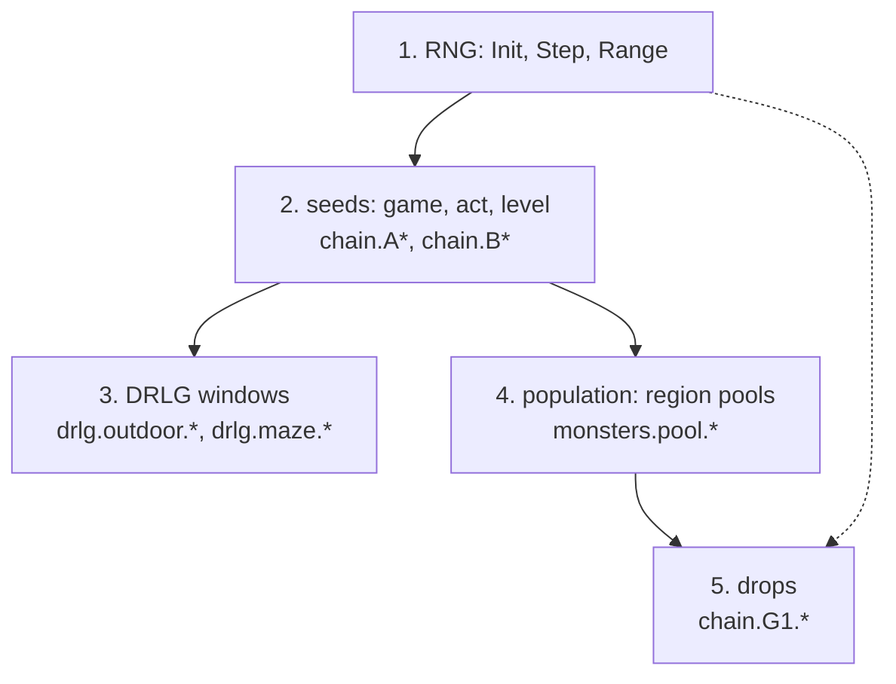

# Conformance: running the golden traces against a reimplementation

## Purpose

A reimplementation is right when, for the same seed and inputs, it produces the same values as the game. This page
says how to find out without the binary: run the published cases of the [golden-trace format](../../formats/golden-trace.md)
through your code, write your outputs under the format's field names, and compare them with `tools/golden.py check`.
It is a reading guide to the cases, **not a spec of game behaviour**: it states no mechanic of its own. Each field
below names the spec section that defines the value, and the spec wins on any disagreement. The format, the tool
and the sets are plan 0059's ([plan](../../plans/0059-golden-traces.md), Phases 1 and 2); the cases are derived values
only (seeds, ids, counts, digests), never table rows or file bytes.

## What you run

| Step | Command and file | Tag |
|---|---|---|
| 1. Take a set | the committed sample [golden/sample-v1.jsonl](../../formats/golden/sample-v1.jsonl) (28 cases), or the v1 full set (5 073 cases) regenerated locally with `golden.py emit` from your own game files and the project's kept logs | [I] (fmt:golden-trace § Set v1; plan 0059 owner question 1) |
| 2. Read the inputs | each case line holds `id`, `kind`, `type`, `inputs` (what you are given) and `expected` (what you must produce) | [I] (fmt:golden-trace § Case; `tools/test_golden.py` `test_sample_fields_registered`) |
| 3. Write your outputs | one JSON line per case, `{"id": ..., "outputs": {field: value}}`; values compare as canonical JSON; seeds are `low:high`, 8 hex digits each, lower case | [I] (fmt:golden-trace, tests `test_canon`, `test_outputs_form_missing_field_missing_case_quirks`) |
| 4. Compare | `python3 -I tools/golden.py check SET CANDIDATE`; exit 0 only when no field differs and no case is missing; `--fields PREFIX` restricts the run to the fields whose name starts with the prefix | [I] (fmt:golden-trace, tests `test_self_pass_and_altered_fail`, `test_patterns_and_check`) |
| 5. Compare table sets | the header's `tables_digest` is not checked by `check`; compare it with yours first, because a different table set gives different cases | [I] (fmt:golden-trace § Header and Open questions) |

A set checked against itself passes, and one altered field fails it with the field named: the sample run prints
`MISMATCH world:o:p2-s1-4832-cn2.log [observed]` and below it `chain.A1.game_seed: expected "…", got "…"`, then
`golden: FAIL (1 cases differ, 0 missing)`. [I] (fmt:golden-trace, tests `test_sample_self_and_altered`, run by hand on the sample, 2026-10-30)

## The order

The order is the chain's: game seed, then act and level seeds, then each level's generator, then the population, then
a death's drop ([chain § Algorithm](../chain/README.md#algorithm) A to G). [C] (run:2026-10-21-chain2, chain spec § Algorithm
header tags, run:2026-10-21-chain2)

- **No field tests the RNG alone.** The primitives of [rng](../rng/README.md) are exercised through every seed field:
  a wrong `Init` or `Step` breaks `chain.A1.game_seed` first, a wrong range reduction breaks the first field that
  takes a draw. Test the primitives against the [rng worked example](../rng/README.md#worked-example) before the
  traces. [I] (the field list holds no RNG-only field, fmt:golden-trace `fields`)
- **The three later groups can be run in any order after the seeds**, because a `drlg` case gives its `window_seed`
  as input and a `drop` case gives its `unit_seed` and `game_seed` as inputs: a failure there does not depend on your
  seeds being right. A `world` case is the only one that derives everything from `-seed`. [I]
  (fmt:golden-trace § Case, inputs by type)
- Run it by stage with `--fields`: `chain.A`, `chain.B`, `drlg.`, `monsters.pool`, `chain.G1`. [I]
  (fmt:golden-trace, tests `test_patterns_and_check`)

## Which spec section each field tests

The Tag column is what the set can show for the field: the tag is C where observed cases hold it (the expected values are
those of a kept log of the real game, reproduced by the models before the case was written), I where the set holds
it only as a prediction from the reviewed model (no kept log shows the draws). Counts are the full v1 set's.

### World (type `world`)

| Field | Spec section it tests | Observed / predicted | Tag |
|---|---|---|---|
| `chain.A1.game_seed`, `chain.A1.map_seed` | [chain A1](../chain/README.md#algorithm); [rng/seeds step 1](../rng/seeds.md#algorithm), the override branch | 37 / 612 | [C] (fn:GAME_InitSeeds@0x0052C280, run:2026-10-21-chain2) |
| `chain.A2.monster_regions_seed` | [chain A2](../chain/README.md#algorithm); [monsters/pool § A](../monsters/pool.md#a-the-region-seed-sub_00547d20_monregionsinit) | 0 / 612 | [I] (fmt:golden-trace § Set v1, gaps) |
| `chain.A3.object_region_seed`, `chain.A3.game_seed_after` | [chain A3](../chain/README.md#algorithm) | 37 / 612 | [C] (fn:GAME_InitSeeds@0x0052C280, run:2026-10-21-chain2) |
| `chain.A4.store_seed`, `.quest_seed`, `.game_seed_after_creation` | [chain A4](../chain/README.md#algorithm) | 0 / 612 | [I] (fmt:golden-trace § Set v1, gaps) |
| `chain.B1.level_seed_base.N` | [chain B1](../chain/README.md#algorithm); [rng/seeds step 3](../rng/seeds.md#algorithm) | 63 / 3 060 | [C] (fn:DRLG_ActCreate@0x00642DA0, run:2026-10-21-chain2) |
| `chain.B2.level_seed.N` | [chain B2](../chain/README.md#algorithm); [rng/seeds step 4](../rng/seeds.md#algorithm) | 624 / 52 632 | [C] (fn:DRLG_LevelCreate@0x00642AE0, run:2026-10-21-chain2) |
| `chain.B2.level_seeds_digest` | [chain B2](../chain/README.md#algorithm), over every level | 0 / 612 | [I] (fmt:golden-trace § Set v1, gaps) |

### DRLG windows (type `drlg`, observed only)

| Field | Spec section it tests | Cases | Tag |
|---|---|---|---|
| `drlg.outdoor.seed_after` | [drlg/outdoor § A, the window](../drlg/outdoor.md#a-the-window) | 334 | [C] (fmt:golden-trace § Making a set, `golden.py emit --drlg`) |
| `drlg.outdoor.presets_digest`, `.preset_count` | [drlg/outdoor § D, placement primitives](../drlg/outdoor.md#d-placement-primitives) and the act sections H to L | 334 | [C] (fmt:golden-trace, `emit --drlg`) |
| `drlg.outdoor.rooms_digest`, `.room_count` | [drlg/outdoor § B to E](../drlg/outdoor.md#b-the-cell-grid-and-its-bits), the out rooms in creation order | 334 | [C] (fmt:golden-trace, `emit --drlg`) |
| `drlg.maze.seed_after` | [drlg/maze § A, the window](../drlg/maze.md#a-the-window) | 50 | [C] (fmt:golden-trace, `emit --drlg`) |
| `drlg.maze.rooms_digest`, `.room_count` | [drlg/maze § C to I](../drlg/maze.md#c-random-growth), rooms in creation order, positions relative to the bounding box's minimum | 50 | [C] (fmt:golden-trace, `emit --drlg`) |

The outdoor `difficulty` input is read from the log's name, not shown by the log; 67 outdoor cases rest on the
default of Normal. [I] (fmt:golden-trace § Case, `drlg`)

### Monster pools (type `world`, predicted only)

| Field | Spec section it tests | Cases | Tag |
|---|---|---|---|
| `monsters.pool.mlvl.N` | [monsters/pool § E, the monster level](../monsters/pool.md#e-the-monster-level-sub_00573cb0_monstatsinit) | 612 worlds, 86 levels each | [I] (fmt:golden-trace § Set v1, gaps) |
| `monsters.pool.den.N`, `.uniques.N` | [monsters/pool § Inputs](../monsters/pool.md#inputs), the level's density and unique range | same | [I] (fmt:golden-trace, Set v1 gaps) |
| `monsters.pool.region.N` | [monsters/pool § B and C](../monsters/pool.md#b-the-region-build-sub_005479c0_monregionsbuild), the region pool by class id | same | [I] (fmt:golden-trace, Set v1 gaps) |
| `monsters.pool.digest` | the four values above, every level | 612 | [I] (fmt:golden-trace, Set v1 gaps) |

The chain2 logs show no pool value, so a pool field tests the model, not a kept log. [I]
(fmt:golden-trace § Set v1, gaps)

### Drops (type `drop`, observed only)

All are the fields of one `TC_ResolveDrops` call with the quality roll modelled; the call's inputs (`tc`, `ilvl`, the
seeds, difficulty, game type, source and killer) are given. 3 784 cases from run:2026-10-21-chain2 and 256 from
run:2026-10-15-items-chain; all three difficulties and both game types occur.

| Field | Spec section it tests | Tag |
|---|---|---|
| `chain.G1.nodrop` | [items/tc § F, NoDrop scaling](../items/tc.md#f-nodrop-scaling) | [C] (run:2026-10-21-chain2, run:2026-10-15-items-chain) |
| `chain.G1.pick` | [items/tc § E, entry selection](../items/tc.md#e-entry-selection) | [C] (run:2026-10-21-chain2, run:2026-10-15-items-chain) |
| `chain.G1.select` | [items/tc § E](../items/tc.md#e-entry-selection) | [C] (run:2026-10-21-chain2, run:2026-10-15-items-chain) |
| `chain.G1.subtc` | [items/tc § G, recursion into a sub-class](../items/tc.md#g-recursion-into-a-sub-tc) | [C] (run:2026-10-21-chain2, run:2026-10-15-items-chain) |
| `chain.G1.quality` | [items/quality, the quality roll](../items/quality.md#algorithm) | [C] (run:2026-10-21-chain2, run:2026-10-15-items-chain) |
| `chain.G1.item` | [items/tc § H, item pick and hand-off](../items/tc.md#h-item-pick-and-hand-off); [items/quality](../items/quality.md#algorithm) | [C] (run:2026-10-21-chain2, run:2026-10-15-items-chain) |
| `chain.G1.count` | [items/tc § D, the resolver](../items/tc.md#d-the-resolver--tc_resolvedrops) | [C] (run:2026-10-21-chain2, run:2026-10-15-items-chain) |
| `chain.G1.end_seed` | [items/tc, draw order on `src.seed`](../items/tc.md#draw-order-on-srcseed) | [C] (run:2026-10-21-chain2, run:2026-10-15-items-chain) |

Every field above is a row of `golden.py fields`; none is left without a spec section. [I] (fmt:golden-trace, tests
`test_sample_fields_registered`)

## How to read a mismatch

The report counts compared and different fields per field pattern, then prints each failing case with its `kind`, its
`quirks` and the first differences as `field: expected …, got …`. Missing cases are listed apart. [I]
(fmt:golden-trace, tests `test_outputs_form_missing_field_missing_case_quirks`)

1. **Take the first failing field in the order above**, not the first line printed [I] (fmt:golden-trace, Checking). A seed that differs
   makes every later seed of the same case differ; fix `chain.A1.*` before `chain.B*`. [I] (the B seeds derive from the
   game and map seeds, [chain B1, B2](../chain/README.md#algorithm))
2. **A `world` mismatch is in the seed tree**: open the step named by the field and compare draw by draw with the
   worked examples of [chain](../chain/README.md#worked-example) and [rng/seeds](../rng/seeds.md#worked-example). [I] (run:2026-10-21-chain2, fmt:golden-trace)
3. **A `drlg` mismatch with a right `seed_after`** means the draws were taken in the right order and the geometry
   differs; with a wrong `seed_after` a draw was added, dropped or reordered. [I] (fmt:golden-trace, fields: each window holds `seed_after` and the room list)
4. **A digest field says only that the list differs**, not where. Your list must be in the same order and form;
   digest it with `golden.py digest --value` and compare against the `_count` field first. [I]
   (fmt:golden-trace § Checking)
5. **A `drop` mismatch**: `nodrop`, `pick`, `select` and `subtc` come before `quality`, `item`, `count`; `end_seed`
   differing with every other field equal means a draw was taken or skipped after the last item. [I]
   (fn:TC_ResolveDrops@0x0055A6D0, items/tc § Draw order on `src.seed`)
6. **Check the case's quirks line** (below) and the stage's quirks before suspecting the spec. [I] (fmt:golden-trace, quirks field)

## Observed and predicted cases

| Kind | Meaning | If you fail it | Tag |
|---|---|---|---|
| `observed` | the expected values are those of a kept log of the real game; the models reproduced them before the case was written | reopen your code first, and if your reading follows the spec to the letter, reopen the spec: file a backlog entry for the architect with the case id | [I] (fmt:golden-trace § Case, `tools/test_golden.py` `test_drop_case`) |
| `predicted` | the expected values come from the reviewed model alone, for seeds no run kept | the model or your code is wrong, and the set cannot say which; an observed case on the same field wins | [I] (run:2026-10-21-chain2, run:2026-10-15-items-chain) |

The kinds are never mixed in one case. An observed case has a source (log name, a hash of the log and, when given, the
run); a predicted case names the tool. [I] (fmt:golden-trace § Case)

## The `quirks` field

Each case carries a `quirks` list of ids from the [quirks catalogue](../quirks/README.md): the traps that change an
output of that case. Ids are `Q<n>` and **permanent**: an id is never renumbered or reused. [I]
(fmt:golden-trace, quirks catalogue, accepted at the plan 0057 Phase 1 review)

- **Version 1 files carry `[]` in every case**, and `emit` never invents an id. The lists are filled when a later
  version of the set ties cases to the catalogue. `check` treats ids as opaque strings and prints a failing case's ids. [I]
  (fmt:golden-trace, tests `test_outputs_form_missing_field_missing_case_quirks`)
- Until then, read the catalogue by stage. The entries below are those the catalogue lists for the specs the fields
  test; read the owning spec's section before acting on an entry. [I] (fmt:golden-trace, quirks catalogue)

| Stage | Entries to read |
|---|---|
| RNG and seeds | Q1, Q2, Q119 (reduction and state), Q42 (the level seed is a wrapping sum), Q51, Q121 (the two roots) |
| Outdoor window | Q8 (signed sizes and rotation), Q157 (preset file rotation) |
| Maze window | Q150 to Q156 (list order, growth draws, merge, hell start, unused draws) |
| Monster pool | Q11, Q46 (`raritySum`), Q101 (candidate count) |
| Drops | Q33, Q34 (`NoDrop` arithmetic), Q96 (item count `max`), Q32 (quality division) |

## What v1 does not cover

- **Item seeds after the drop**: `chain.G1.item` stops at the base item and its quality; the item builder's seeds and
  the affixes, uniques, sets and sockets that follow ([chain G2, G3, H](../chain/README.md#algorithm)) are not fields. [I]
  (fmt:golden-trace § Open questions)
- **Room populations** (monsters, packs, objects of an activated room, [chain D to E](../chain/README.md#algorithm)):
  only the level's region pool is a field. [I] (fmt:golden-trace, Open questions)
- **Simulation events** (AI, skills, missiles, combat, frame windows): version 2, after plans 0052 and 0055. [I] (fmt:golden-trace, Scope of version 1,
  plan 0059 Phase 4)
- **Cases the kept logs cannot make**: outdoor levels in no reproducing log (27 are covered), maze windows of level
  types other than 3, 10 and 13, the forced-variant items-chain logs (edited `itemratio`), and any predicted `drlg` or
  `drop` case. [I] (fmt:golden-trace § Set v1, gaps)
- **Fields not checked**: `game_exe_sha256` and `tables_digest` (compare them yourself). [I] (fmt:golden-trace, Open questions)
- A pass means the covered fields match; it does not say the rest of the game does. [I] (fmt:golden-trace, Scope of version 1)

## Open questions

- **[L]** The format takes new fields without a header version bump. Whether the item-seed and room-population
  fields arrive as a v1 extension or as set version 2 is not decided (plan 0059 Phase 4 and the Phase 1 ruling 2).
- **[L]** The `quirks` lists are empty in v1; which cases a quirk changes, and who assigns the ids to cases, is open
  until plan 0057 ties its entries to the sets.
