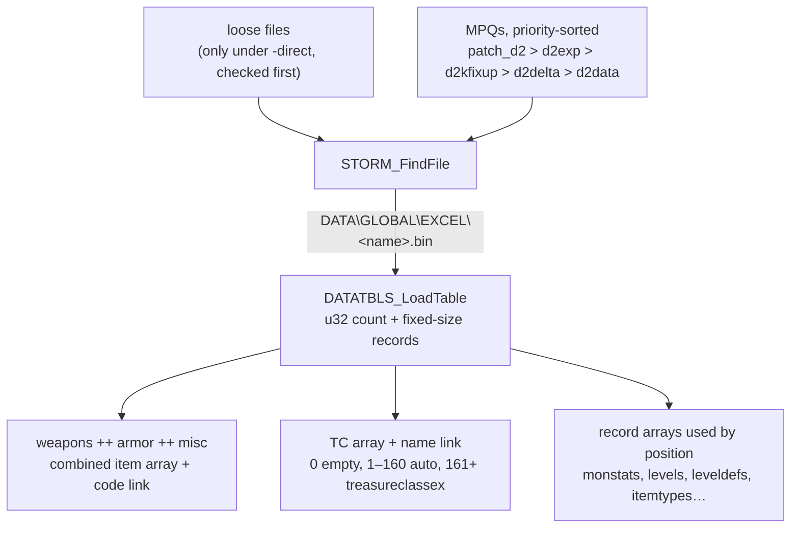

# Data: how the game gets its tables

## Purpose

Every table-driven spec reads excel records. This subsystem says **which bytes those are**: which
archive a file comes from, which form of a table is loaded, how a record is addressed, and how a
code or a name in one table becomes a record index in another. It runs once, at startup, before any
game is created. It draws no random numbers.

## Files

| File | Covers | Status |
|---|---|---|
| [excel.md](excel.md) | MPQ precedence and file lookup, `.bin` vs `.txt`, record addressing, code and name links, the treasure-class index space, monster references, string-table keys (stored indices), cell values, the `.txt` compiler | reviewed |
| [calc.md](calc.md) | the formula bytecode in `*code.bin`: encoding and opcodes, the `.txt` compiler, the evaluator `CALC_Eval`, the skills/missiles/items contexts, their function tables and variables | reviewed |
| [strings.md](strings.md) | string tables at run time: load order and condition, index → text, key → index, hash probing, UTF-8 → UTF-16, the 5382 rule, fallbacks and fatal paths | reviewed |

Per-table record layouts are not specs. They live in [`docs/tables/`](../../tables/README.md), one doc per
table, and the container formats in [`docs/formats/`](../../formats/) ([excel-bin](../../formats/excel-bin.md),
[tbl](../../formats/tbl.md), [mpq](../../formats/mpq.md)).

## Data flow

- [C] Every excel table is read from its compiled `.bin`; no `.txt` is parsed in a stock run.
  (fn:DATATBLS_LoadTable@0x006122F0, data:g_DataTblsLoadBin@0x00744308; [data/0001](../../findings/data/0001-excel-loader.md#answer-summary))
- [C] File lookup searches the open MPQs by descending priority, so for excel data `patch_d2` > `d2exp` > `d2data`:
  a kept log reads each kind of file the archives hold with different bytes with 0 mismatches on that order, and with
  any other copy it fails. Loose files are consulted only under `-direct`, and then before every archive: the loose run's
  three loose files were never read, and the direct run, with only the switch changed, read all three from disk.
  (fn:STORM_FindFile@0x00417F10, fn:sub_00406870_InitFileIO@0x00406870, run:2026-10-27-sweep-data-load;
  [data/0002 § S1b](../../findings/data/0002-mpq-precedence.md#plan-0038-batch-s1b-2026-10-16),
  [§ H3b](../../findings/data/0002-mpq-precedence.md#plan-0038-batch-h3b-run2026-10-27-sweep-data-load))
- [I] The optional `d2kfixup` and `d2delta` would sit between `d2exp` and `d2data` ([excel § A](excel.md#a-archives-and-file-lookup)
  A1, A2). Our install ships neither, so no run shows their place. (fn:STORM_LinkArchive@0x0041B6B0)
- [C] The live treasure-class table is `treasureclassex`. `TreasureClass.txt` is never loaded.
  (fn:TC_LoadTreasureClassEx@0x006547D0; [data/0001](../../findings/data/0001-excel-loader.md#7-treasure-classes-at-load-time))
- [C] Each loaded `.bin` holds fixed-size records whose stride is the one the game's consumers use,
  for all 86 loaded tables. (fn:DATATBLS_LoadTable@0x006122F0; [data/0001 §4](../../findings/data/0001-excel-loader.md#4-record-size-corroboration-all-88-bin-tables))

## Entry points

| When | Function | Tag |
|---|---|---|
| Startup, before the excel load | fn:MPQ_OpenCoreArchives@0x004FAB90, fn:MPQ_OpenGameArchives@0x004FAEC0 | [C] run:2026-10-27-sweep-data-load |
| Startup, all tables | fn:DATATBLS_LoadAll@0x00619300 (fixed call sequence, one loader per table) | [C] run:2026-10-27-sweep-data-load |
| A consumer resolves an item code | fn:ITEMS_GetByCode@0x00633640 → fn:EXCEL_FindCode@0x006BD130 | [C] run:2026-10-27-sweep-data-load |
| A TC name is resolved (at load) | fn:EXCEL_FindName@0x006BD3C0 on data:g_TCLink@0x0096C5E8, called from fn:TC_ParseItemCell@0x00654440, fn:TC_BuildChestTable@0x0065A2C0 (from fn:TC_LoadAll@0x0065A390) and, under `-txt`, the `.txt` parser (0x006BDDEC) | [C] run:2026-10-27-sweep-data-load |

- [C] The four rows are logged in the H3b runs: the 12 archive opens before the first string-table and excel load,
  one `DATATBLS_LoadAll` call with the same 73 table loads in the same order in every stock-mode run, 1 147 item-code
  calls that return the code's combined position, and 3 728 `EXCEL_FindName` calls on the TC link that return the TC
  index of the name (−1 for the 6 names that are no TC). In the stock run no TC name lookup ran in play. (run:2026-10-27-sweep-data-load,
  [data/0001 § H3b](../../findings/data/0001-excel-loader.md#plan-0038-batch-h3b-run2026-10-27-sweep-data-load),
  [data/0002 § H3b](../../findings/data/0002-mpq-precedence.md#plan-0038-batch-h3b-run2026-10-27-sweep-data-load))
- [I] `TC_GetByName` (0x00654DD0), the name → TC wrapper, is dead code: no call, jump or pointer in the image names it,
  and its breakpoint had no hit in the seven runs. A computed call target is not excluded.
  (fn:TC_GetByName@0x00654DD0, run:2026-10-27-sweep-data-load)

## Downstream

- `items/tc` (plan 0004) consumes the TC index space and the `ItemN` resolution in [excel.md](excel.md#g-treasure-classes).
- `monsters/*` and `drlg/*` index `monstats`, `levels` and `leveldefs` by record position ([excel.md](excel.md#h-monster-references)).
- `data/strings` takes over at the string index stored in the records ([excel.md](excel.md#i-string-table-keys), then [strings.md](strings.md)).
- [data/calc](calc.md) takes over at the `*code.bin` offsets stored in formula columns.
