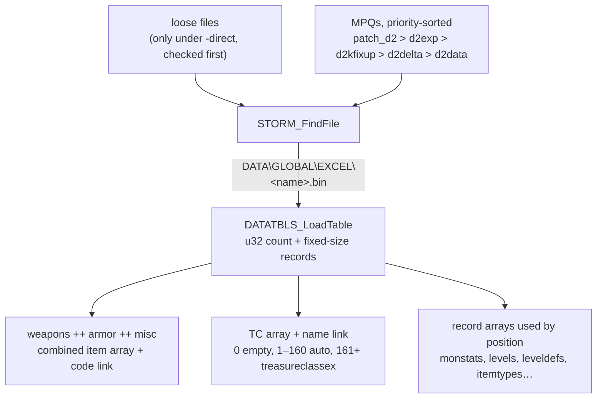

# Data: how the game gets its tables

## Purpose

Every table-driven spec reads excel records. This subsystem says **which bytes those are**: which
archive a file comes from, which form of a table is loaded, how a record is addressed, and how a
code or a name in one table becomes a record index in another. It runs once, at startup, before any
game is created. It draws no random numbers.

## Files

| File | Covers | Status |
|---|---|---|
| [excel.md](excel.md) | MPQ precedence and file lookup, `.bin` vs `.txt`, record addressing, code and name links, the treasure-class index space, monster references, string-table keys (stored indices), cell values, the `.txt` compiler | reviewed |
| [calc.md](calc.md) | the formula bytecode in `*code.bin`: encoding and opcodes, the `.txt` compiler, the evaluator `CALC_Eval`, the skills/missiles/items contexts, their function tables and variables | reviewed |
| [strings.md](strings.md) | string tables at run time: load order and condition, index → text, key → index, hash probing, UTF-8 → UTF-16, the 5382 rule, fallbacks and fatal paths | reviewed |

Per-table record layouts are not specs. They live in [`docs/tables/`](../../tables/README.md), one doc per
table, and the container formats in [`docs/formats/`](../../formats/) ([excel-bin](../../formats/excel-bin.md),
[tbl](../../formats/tbl.md), [mpq](../../formats/mpq.md)).

## Data flow

- [C] Every excel table is read from its compiled `.bin`; no `.txt` is parsed in a stock run.
  (fn:DATATBLS_LoadTable@0x006122F0, data:g_DataTblsLoadBin@0x00744308; [data/0001](../../findings/data/0001-excel-loader.md#answer-summary))
- [I] File lookup searches the open MPQs by descending priority (`patch_d2` > `d2exp` > `d2data` for
  excel data); loose files are consulted only under `-direct`, and then before every archive.
  (fn:STORM_FindFile@0x00417F10; [data/0002](../../findings/data/0002-mpq-precedence.md#answer-summary))
- [C] The live treasure-class table is `treasureclassex`. `TreasureClass.txt` is never loaded.
  (fn:TC_LoadTreasureClassEx@0x006547D0; [data/0001](../../findings/data/0001-excel-loader.md#7-treasure-classes-at-load-time))
- [C] Each loaded `.bin` holds fixed-size records whose stride is the one the game's consumers use,
  for all 86 loaded tables. (fn:DATATBLS_LoadTable@0x006122F0; [data/0001 §4](../../findings/data/0001-excel-loader.md#4-record-size-corroboration-all-88-bin-tables))

## Entry points

| When | Function | Tag |
|---|---|---|
| Startup, before the excel load | fn:MPQ_OpenCoreArchives@0x004FAB90, fn:MPQ_OpenGameArchives@0x004FAEC0 | [I] |
| Startup, all tables | fn:DATATBLS_LoadAll@0x00619300 (fixed call sequence, one loader per table) | [I] |
| A consumer resolves an item code | fn:ITEMS_GetByCode@0x00633640 → fn:EXCEL_FindCode@0x006BD130 | [I] |
| A consumer resolves a TC name | fn:TC_GetByName@0x00654DD0 → fn:EXCEL_FindName@0x006BD3C0 | [I] |

## Downstream

- `items/tc` (plan 0004) consumes the TC index space and the `ItemN` resolution in [excel.md](excel.md#g-treasure-classes).
- `monsters/*` and `drlg/*` index `monstats`, `levels` and `leveldefs` by record position ([excel.md](excel.md#h-monster-references)).
- `data/strings` takes over at the string index stored in the records ([excel.md](excel.md#i-string-table-keys), then [strings.md](strings.md)).
- [data/calc](calc.md) takes over at the `*code.bin` offsets stored in formula columns.
