# Excel tables: file lookup, load, record addressing, code and name links

## Purpose

At startup the game opens its MPQ archives, then loads every excel table from its compiled `.bin`
into memory, builds a few lookup structures (item codes, treasure-class names) and derives the
runtime treasure-class array. This spec defines, for a reimplementer who reads the shipped `.bin`
files: which file a path resolves to, how records are addressed, how codes and names become
indices, what the stored index values mean, and how the treasure-class index space is numbered.
Nothing here draws random numbers. Per-table record layouts are in [`docs/tables/`](../../tables/README.md)
and are linked, not repeated.

## Entry points

| When | Function | Tag |
|---|---|---|
| Startup: file I/O mode from `-direct` | fn:sub_00405C30_InitGame@0x00405C30 → fn:sub_00406870_InitFileIO@0x00406870 | [I] |
| Startup: core archives | fn:MPQ_OpenCoreArchives@0x004FAB90 | [I] |
| Startup: game archives | fn:MPQ_OpenGameArchives@0x004FAEC0 | [I] |
| On demand: video archive | fn:MPQ_OpenVideoArchives@0x004FAD10 | [I] |
| Command-line options applied (`-txt`) | fn:sub_0044D9F0_ApplyOptions@0x0044D9F0 → fn:sub_0044D9C0_ApplyTxtOption@0x0044D9C0 | [I] |
| Startup: every table, fixed order | fn:DATATBLS_LoadAll@0x00619300 | [I] |
| One table | fn:DATATBLS_LoadTable@0x006122F0 | [C] |
| Item code → item | fn:ITEMS_GetByCode@0x00633640 | [I] |
| TC name → TC | fn:TC_GetByName@0x00654DD0 | [I] |
| TC index → TC | fn:TC_GetByIndex@0x00654E00 | [I] |

## Inputs

### Tables

| Anchor | Used for |
|---|---|
| fmt:excel-bin#bin | `u32 count` header and fixed-size record array of every `.bin` ([excel-bin.md](../../formats/excel-bin.md#bin-compiled-form)) |
| fmt:tbl | string-table key → index scheme ([tbl.md](../../formats/tbl.md#key--index-as-the-excel-bin-files-store-it)) |
| tbl:Weapons.txt:code, tbl:Armor.txt:code, tbl:Misc.txt:code | item code key, record `+0x080` ([Weapons](../../tables/Weapons.md), [Armor](../../tables/Armor.md), [Misc](../../tables/Misc.md)) |
| tbl:ItemTypes.txt:Code, tbl:ItemTypes.txt:TreasureClass | auto item-type TCs (`+0x000`, `+0x01D`) ([ItemTypes](../../tables/ItemTypes.md)) |
| tbl:TreasureClassEx.txt:Treasure Class, Picks, group, Item1..10, Prob1..10 | runtime TC array ([TreasureClassEx](../../tables/TreasureClassEx.md)) |
| tbl:MonStats.txt:Id, TreasureClass1…TreasureClass4(H) | monster ordinal, TC references ([MonStats](../../tables/MonStats.md)) |
| tbl:Levels.txt:mon1… | monster references ([Levels](../../tables/Levels.md)) |
| `leveldefs.bin` | second half of `Levels.txt` ([Levels § leveldefs](../../tables/Levels.md#leveldefsbin-156-b)) |

### Runtime state

| State | Type | Source |
|---|---|---|
| `direct` | bool, config `+0x204` | command-line flag `-direct` (entry `0x00706124`) |
| `compileTxt` | bool, data:g_DataTblsCompileTxt@0x0096C8B4 | command-line flag `-txt` (config `+0x215`, entry `0x007063A8`) |
| `loadBin` | u32, data:g_DataTblsLoadBin@0x00744308 | initialised to 1, never written |
| archive list | list of `{priority: i32, …}`, head data:g_StormArchiveList@0x0070835C | built by step A2 |
| language id | u8, first byte of `data\local\use` | selects the string-table directory (step I) |
| expansion game | bool | selects the `d2X*` archives (step A1) |

### Constants

| Name | Value | Anchor | Tag |
|---|---|---|---|
| excel directory | `DATA\GLOBAL\EXCEL\` | fn:DATATBLS_OpenExcelFile@0x00612280 | [I] |
| priority of `patch_d2` / `d2exp` / `d2X*` / others | 5000 / 3000 / 3000 / 1000 | fn:MPQ_OpenCoreArchives@0x004FAB90, fn:MPQ_OpenGameArchives@0x004FAEC0 | [I] |
| combined item record stride | `0x1A8` (424) | fn:ITEMS_LoadItemTables@0x006315D0 | [I] |
| TC entry size (runtime) | `0x2C` | fn:TC_Alloc@0x00653F90 | [I] |
| auto-TC levels | 3, 6, …, 96 (32 values) | fn:TC_BuildAutoTCs@0x006541C0 | [I] |
| first TCEx index | 161 (= 1 + 5 × 32 in the shipped data) | fn:TC_LoadAll@0x0065A390, tbl:MonStats.txt:TreasureClass1 | [C] |
| TC count limit | `0xFFFE` (more is fatal) | fn:TC_LoadAll@0x0065A390 | [I] |
| name key length | 31 characters (node `char[32]`) | fn:EXCEL_FindName@0x006BD3C0 | [I] |
| string index bases | `string.tbl` 0, `patchstring.tbl` 10000, `expansionstring.tbl` 20000 | fmt:tbl | [C] |
| "not found" string index | 5382 (`string.tbl` key `dummy`) | fmt:tbl | [C] |

## Algorithm

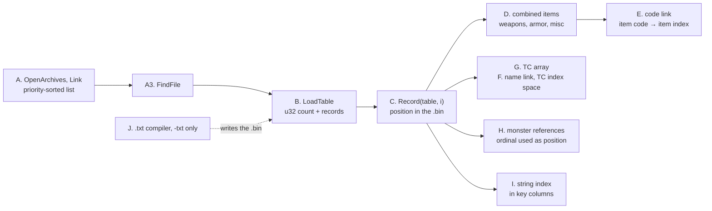

### A. Archives and file lookup

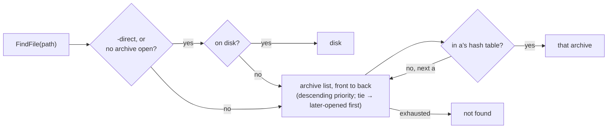

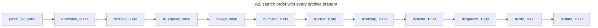

```
A1. OpenArchives(expansion: bool):                                   [I] (fn:MPQ_OpenCoreArchives@0x004FAB90, fn:MPQ_OpenGameArchives@0x004FAEC0)
      for (name, prio) in [ (d2data,1000), (d2sfx,1000), (d2speech,1000),
                            (d2delta,1000), (d2kfixup,1000),
                            (patch_d2,5000), (d2exp,3000) ]:          ; core, this order
        if the file exists: a ← Open(name); a.priority ← prio; Link(a)
      for (name, prio) in [ (d2char,1000), (d2music,1000) ]: same     ; game archives
      if expansion:
        for (name, prio) in [ (d2Xmusic,3000), (d2Xtalk,3000), (d2Xvideo,3000) ]: same
      ; d2video (1000) is opened and linked later, on demand     [I] (fn:MPQ_OpenVideoArchives@0x004FAD10)

A2. Link(a):                                                         [I] (fn:STORM_LinkArchive@0x0041B6B0, 0x0041B955)
      n ← first node of the list with n.priority ≤ a.priority        ; signed compare
      insert a before n (append when there is none)
      ; result: descending priority; on a tie, the later-opened archive is searched first

A3. FindFile(path) → source:                                         [I] (fn:STORM_FindFile@0x00417F10, fn:STORM_GetDirectFlags@0x00418B50, fn:STORM_DiskPath@0x00415B00)
      diskAllowed: bool ← direct or (no archive is open)
      if diskAllowed and path exists on disk (relative to the working directory):
        return disk                                                  ; checked before any archive
      for a in archive list, front to back:
        if a's hash table contains path: return a                    ; first hit wins
      return not found
```

Step notes:

- A1. `d2kfixup.mpq` and `d2delta.mpq` are optional; their absence is not an error. `d2exp.mpq` is opened
  whenever the file exists, for classic games too, so classic and expansion games read the same
  excel data. [I] ([data/0002](../../findings/data/0002-mpq-precedence.md#answer-summary), fn:MPQ_OpenCoreArchives@0x004FAB90)
- A1. Without `-direct`, startup fails unless `d2data`, `d2sfx` and `d2speech` opened (and, when the
  expansion is detected, `d2exp`); with `-direct` it continues regardless. [I] (fn:MPQ_OpenCoreArchives@0x004FAB90)
- A2. With every archive present, the search order is `patch_d2`, `d2Xvideo`, `d2Xtalk`, `d2Xmusic`,
  `d2exp`, `d2music`, `d2char`, `d2kfixup`, `d2delta`, `d2speech`, `d2sfx`, `d2data`. For files under
  `data\global\` this means **`patch_d2` > `d2exp` > `d2kfixup` > `d2delta` > `d2data`**. [I]
  ([data/0002 §2](../../findings/data/0002-mpq-precedence.md#2-archive-open-and-the-sorted-list))
- A3. The game writes the direct flag only from the `-direct` byte, so in a stock run (archives open,
  no `-direct`) the disk is never read and a loose file never overrides an archive. Under `-direct`,
  a loose file beats every MPQ. [I] (fn:sub_00406870_InitFileIO@0x00406870, data:g_StormDirectFlags@0x00779058)
- A3. Every excel table and `data\local\use` go through `FILE_LoadWhole`, which calls this lookup
  with no archive restriction. [I] (fn:FILE_LoadWhole@0x00517079)

### B. Loading one table

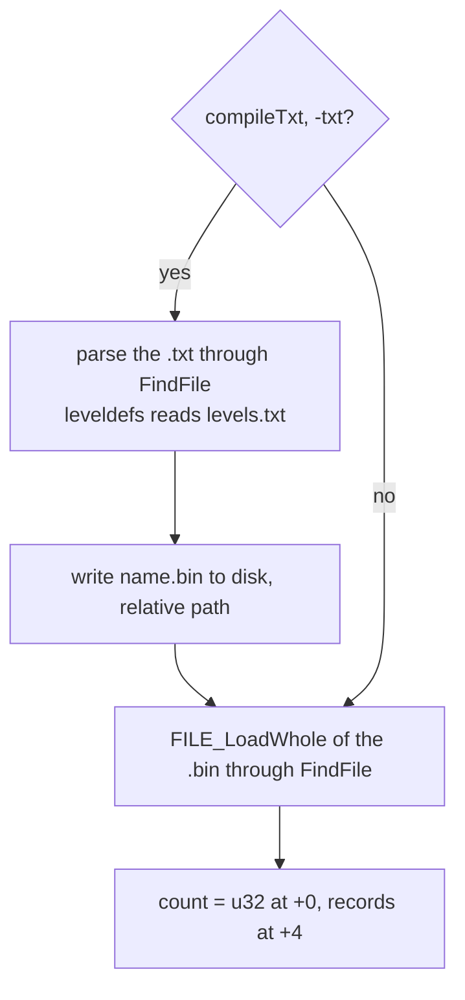

```
B1. LoadTable(name) → (records, count: u32):                         [C] (fn:DATATBLS_LoadTable@0x006122F0)
      if compileTxt:                                                 [I] (all of B1a–B1b; fn:DATATBLS_SetCompileTxt@0x006125A0)
B1a.    src ← (name equals "leveldefs", case-insensitive) ? "levels" : name
        parse FindFile("DATA\GLOBAL\EXCEL\" + src + ".txt"), fatal if absent
B1b.    write the records to DATA\GLOBAL\EXCEL\<name>.bin ON DISK (relative path)
      buf ← FILE_LoadWhole("DATA\GLOBAL\EXCEL\" + name + ".bin")    ; via A3; fatal if absent
      count ← u32 LE at buf+0
      records ← buf + 4
      return (records, count)
```

Step notes:

- B1. The `loadBin` branch is always taken: its flag is initialised to 1 and every one of its 30
  references only compares it. The alternative branch (parse `.txt` in memory) is dead. [C]
  (data:g_DataTblsLoadBin@0x00744308; corroborated by the record-size match of step C1)
- B1a–B1b. `-txt` writes freshly compiled `.bin` files to disk, and **then** loads the `.bin` through
  A3 like a stock run. Without `-direct` the disk copy is invisible, so `-txt` alone changes nothing
  that is loaded. Only `-direct -txt` makes the game run on `.txt` content. [I]
  ([data/0001 §1–2](../../findings/data/0001-excel-loader.md#1-load-path-of-one-table))
- B1. In a stock run the authoritative side of the five mixed-archive tables is the `.bin`:
  `automagic`, `RarePrefix`, `RareSuffix` from `patch_d2`; `inventory`, `PlrMode` from `d2exp` (the
  `patch_d2` `.txt` edits to these two are not live). [I] ([data/0001](../../findings/data/0001-excel-loader.md#answer-summary),
  [tables/README](../../tables/README.md#source-and-shape))
- B1. `TreasureClass.txt`, `Aiparms.txt`, `MonName.txt` and `WeaponClass.txt` have no loader.
  `cubemod.bin` and `cubetype.bin` ship but are never loaded (their names do not occur in
  `Game.exe`). [I] / [C] respectively ([data/0001 §3–4](../../findings/data/0001-excel-loader.md#3-what-is-registered-datatbls_loadall-0x00619300))
- B1. 15 small code-list tables (`playerclass`, `bodylocs`, `monmode` 4-byte form, …) and the
  2-byte `monstats`/`skilldesc` calls are loaded only under `-txt`; they serve the `.txt` compiler.
  A stock run never loads them. [I] (fn:DATATBLS_LoadCodeLists@0x00612750)
- B1. The four header-less `*code.bin` files (`itemscode`, `misscode`, `skillscode`, `skilldesccode`)
  are loaded whole as raw buffers, not through B1. Their contents are [data/calc](calc.md). [I]
  (fn:DATATBLS_LoadCodeBin@0x00613E90)

### C. Addressing records


```
C1. Record(table, i) = records + i × recSize(table)        for 0 ≤ i < count        [C] (fn:DATATBLS_LoadTable@0x006122F0, data/0001 §4)
      recSize(table) is the Rec column of docs/tables/README.md (= (fileSize − 4) ÷ count)
C2. A record index is a position in the .bin, not a .txt line number:                 [C] (fmt:excel-bin)
      every `Expansion` marker row of the .txt has no record, so records after
      the marker sit one lower than their .txt data row.
C3. leveldefs record i and levels record i describe the same level;                   [C] (fn:DRLG_LoadLevelDefs@0x0061DE00, tbl:Levels.txt)
      leveldefs' count is not stored, it equals levels' count.                         [I] (fn:DRLG_LoadLevelDefs@0x0061DE00)
```

Step notes:

- C1. The `.bin` path ignores the record size passed by the caller, so the stride is fixed by each
  consumer's struct. For all 86 loaded tables that stride equals the file's record size (0
  mismatches), which is why `(fileSize − 4) ÷ count` is safe to use. Records are packed, with no
  alignment padding. [C] ([data/0001 §4](../../findings/data/0001-excel-loader.md#4-record-size-corroboration-all-88-bin-tables),
  fmt:excel-bin)
- C1. Where the tables of `items/tc` land (all fields of the data-tables block data:g_DataTables@0x0096BC30): [I]
  ([data/0001 §5](../../findings/data/0001-excel-loader.md#5-where-the-nine-phase-1-tables-land))

  | Table | Records | Count | Lookup link |
  |---|---|---|---|
  | `itemratio` | data:g_pItemRatio@0x0096CC4C | `0x0096CC48` | — |
  | `itemtypes` | data:g_pItemTypes@0x0096C828 | `0x0096C82C` | — |
  | `weapons` / `armor` / `misc` | sub-ranges of the combined item array (step D) | `0x0096CA64` / `0x0096CA6C` / `0x0096CA74` | — |
  | combined items | data:g_pItems@0x0096CA5C | data:g_nItems@0x0096CA58 | data:g_ItemCodeLink@0x0096BCC4 (codes) |
  | `monstats` | data:g_pMonStats@0x0096C6A8 | `0x0096C6B0` | data:g_MonStatsLink@0x0096C6AC |
  | `levels` | data:g_pLevels@0x0096C888 | `0x0096C88C` | — |
  | `leveldefs` | data:g_pLevelDefs@0x0096C890 | (= levels) | — |
  | `treasureclassex` | freed after step G | — | runtime TCs: data:g_pTreasureClasses@0x0096C5EC, data:g_nTreasureClasses@0x0096C5F0, data:g_TCLink@0x0096C5E8 (names) |

### D. The combined item table


```
D1. LoadItems():                                                      [I] (fn:ITEMS_LoadItemTables@0x006315D0, 0x006333E1–0x0063343B)
      (W, nW) ← LoadTable("weapons"); (A, nA) ← LoadTable("armor"); (M, nM) ← LoadTable("misc")
      items ← W ++ A ++ M                                            ; one array, stride 0x1A8, in this order
      nItems ← nW + nA + nM
      weapons, armor, misc pointers ← the three sub-ranges of items  ; the file buffers are freed
D2.   for i in 0 ..< nItems:                                          [I] (0x00633491)
        AddCode(itemCodeLink, code: u32 ← item[i]+0x080 read as u32 LE)     ; step E2
D3. GetItemByCode(code: u32) → (record, index: i32):                  [I] (fn:ITEMS_GetByCode@0x00633640)
      index ← FindCode(itemCodeLink, code)                           ; step E1, −1 if absent
      record ← items + index × 0x1A8
```

The **item index** used everywhere else is the position in this combined array: weapons first, then
armor, then misc. With the shipped counts (306, 202, 151) weapons are 0..305, armor 306..507, misc
508..658. [I] (fn:ITEMS_LoadItemTables@0x006315D0; counts from [tables/README](../../tables/README.md))

### E. Code links (4-character codes)

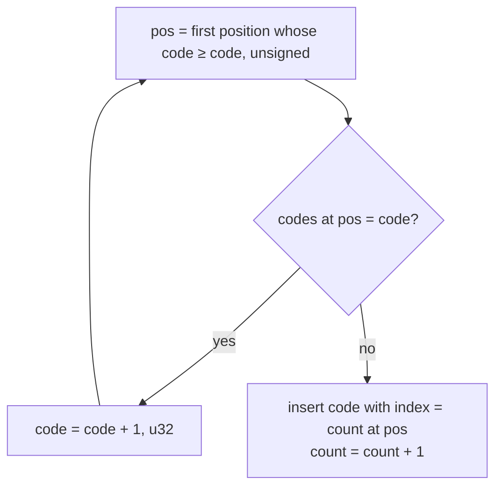

A link is a 16-byte object `{count: i32, capacity: i32, codes: *{code: u32, index: i32}, nameRoot}`
used either for codes or for names, never both (mixing is a fatal error). [I] (fn:EXCEL_LinkCreate@0x006BD040)

```
E1. FindCode(link, code: u32) → i32:                                  [I] (fn:EXCEL_FindCode@0x006BD130)
      lo: i32 ← 0;  hi: i32 ← link.count
      while lo < hi:
        mid ← lo + (hi − lo) ÷ 2
        k ← link.codes[mid].code
        if code > k: lo ← mid + 1                                     ; UNSIGNED compare
        else if code < k: hi ← mid
        else: return link.codes[mid].index
      return −1

E2. AddCode(link, code: u32) → i32:                                   [I] (fn:EXCEL_AddCode@0x006BD230)
      grow codes by 64 entries when count ≥ capacity
      loop:
        pos ← first position whose code ≥ code (unsigned)
        if pos < count and codes[pos].code = code:
          code ← code + 1                                             ; u32, then retry
        else: break
      insert {code, index: count} at pos (shifting the tail up)
      count ← count + 1
      return count − 1
```

Step notes:

- E1. Codes are compared as unsigned 32-bit values; there is no hashing. A 4-character code
  `"hax "` is the u32 `0x20786168` (its four bytes read little-endian). [I] (fn:EXCEL_FindCode@0x006BD130,
  fn:STR_ToItemCode@0x00650EB0)
- E2. **Duplicate codes:** the first record keeps its code; a later record with the same code is
  registered under `code + 1` (or the next free value), so it is unreachable by its written code and
  reachable by an unrelated one. The index returned is still the insertion count. The shipped
  weapons/armor/misc have no duplicate codes (659 distinct), so this never fires on stock data. [I]
  (fn:EXCEL_AddCode@0x006BD230; data check in [Weapons](../../tables/Weapons.md#row-identity))
- E1. Item codes are **case-sensitive**: no case folding happens on this path. [I] (fn:EXCEL_FindCode@0x006BD130)

### F. Name links (TC names, monster Ids)

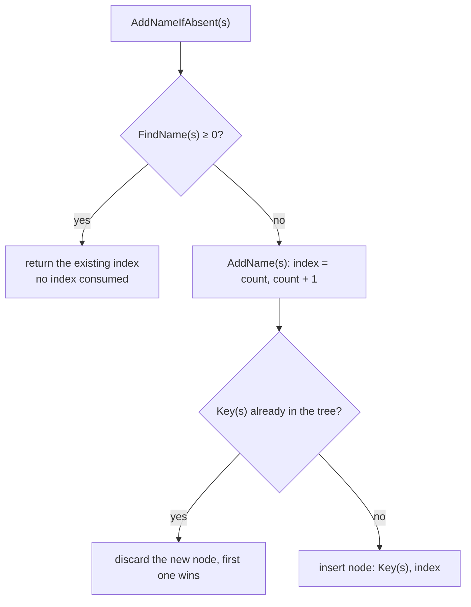

```
F1. Key(s) = lowercase(first 31 bytes of s)       ; only A–Z → a–z, all other bytes unchanged     [I] (fn:STR_ToLowerN@0x004113C0, table 0x006CEB98)

F2. FindName(link, s) → i32:                                          [I] (fn:EXCEL_FindName@0x006BD3C0)
      walk the binary search tree from link.nameRoot comparing Key(s) to node.name
      with a byte-wise strcmp; equal → return node.index; fell off → return −1

F3. AddName(link, s) → i32:                                           [I] (fn:EXCEL_AddName@0x006BD500)
      index ← link.count;  link.count ← link.count + 1               ; ALWAYS consumes an index
      if a node with Key(s) exists: discard the new node             ; first one wins
      else: insert node {name: Key(s), index} into the tree (unbalanced, insertion order)
      return index

F4. AddNameIfAbsent(link, s) → i32:                                   [I] (fn:EXCEL_AddNameIfAbsent@0x006BD5A0)
      i ← FindName(link, s)
      if i ≥ 0: return i                                              ; NO index consumed; the existing index
      else: return AddName(link, s)                                   ; the new index
```

Step notes:

- F1–F2. Names are **case-insensitive** (ASCII only) and only their first 31 characters count. With
  the duplicate rule of F3, a lookup returns the **first** record registered under that key. [I]
  ([data/0001 §6](../../findings/data/0001-excel-loader.md#6-codeindex-and-nameindex))
- F3 vs F4. The difference matters for numbering: `AddName` leaves a gap (the duplicate's index has
  no name), `AddNameIfAbsent` produces ordinals among distinct names. The TC loader uses `AddName`
  (step G); the compiler used `AddNameIfAbsent` for the monstats `Id` (step H). [I]
  (fn:TC_Alloc@0x00653F90, fn:EXCEL_AddNameIfAbsent@0x006BD5A0)

### G. Treasure classes

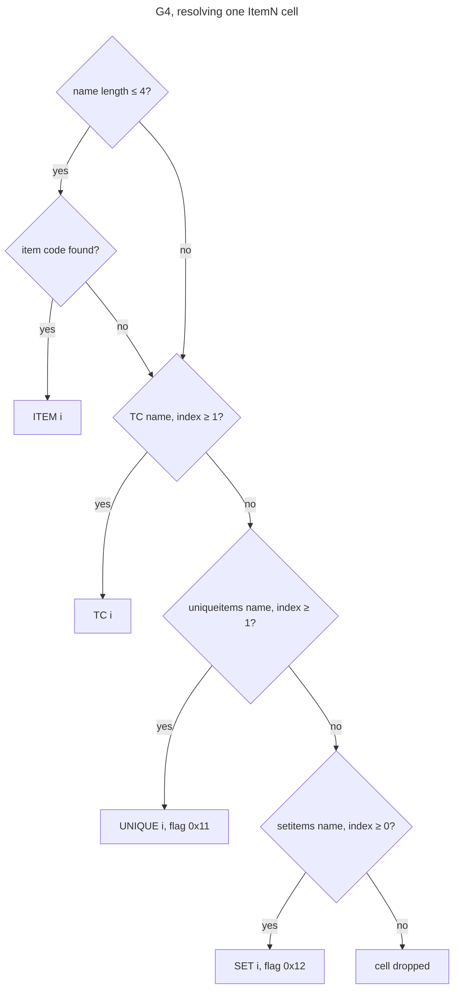

The live table is **`treasureclassex`**. `TreasureClass.txt` is never loaded; the string
`treasureclass` in `Game.exe` is the name of an `itemtypes` column. [C]
(fn:TC_LoadTreasureClassEx@0x006547D0, 0x006EA76C; corroborated by the data check in G5)

```
G1. LoadTCs():                                                        [I] (fn:TC_LoadAll@0x0065A390)
      tcLink ← new link
      Alloc("")                                                       ; index 0: empty name, empty TC
      BuildAutoTCs()                                                  ; G2
      LoadTreasureClassEx()                                           ; G3
      post-pass (fn 0x0065A2C0, not specified here)
      if tcCount > 0xFFFE: fatal

    Alloc(name) → index: AddName(tcLink, name) (F3); grow the TC array by 16 entries of 0x2C as needed   [I] (fn:TC_Alloc@0x00653F90)

G2. BuildAutoTCs():                                                   [I] (fn:TC_BuildAutoTCs@0x006541C0)
      for t in itemtypes records, in record order:
        if itemtypes[t].TreasureClass (+0x01D, u8) ≠ 0:
          for level in 3, 6, …, 96:
            Alloc(<itemtypes[t].Code> followed by <level> in decimal)  ; "%s%d"
            fill it with the items of type t whose byte +0x0FD lies in (level − 3, level]
              (the exact name text, further item filters, the TC header fields and the
               per-entry probability and flags are not yet in a finding; see Open questions)

G3. LoadTreasureClassEx():                                            [I] (fn:TC_LoadTreasureClassEx@0x006547D0)
      (R, n) ← LoadTable("treasureclassex")
      autoTypes ← number of item types that passed G2's test          ; 5 in the shipped data
      for r in 0 ..< n:
        if R[r].name (+0x000, char[32]) is empty: stop                ; first empty name ends the table
        idx ← Alloc(R[r].name)
        picks: i32 ← R[r].Picks;  if picks = 0: picks ← 1
        group ← R[r].group;       if group ≠ 0: group ← group + autoTypes
        copy level, Magic, Rare, Set, Unique, NoDrop
        for k in 1 ... 10:
          if R[r].Item[k] is empty: stop reading items                ; later columns are ignored
          if R[r].Prob[k] < 1: skip this cell                         ; signed compare
          ParseItemCell(R[r].Item[k], R[r].Prob[k])                   ; G4

G4. ParseItemCell(text, prob):                                        [I] (fn:TC_ParseItemCell@0x00654440)
      if text starts with '"': skip that one character
      every later '"' becomes NUL, so the name ends at the first inner '"'   [I] (fn:TC_ParseItemCell@0x00654440, 0x00654458–0x00654475)
      split at the first ','; the tail holds modifiers (mul=, cu=, cs=, cr=,
        cm=, ce=, cg=, ma=, mg=), specified by items/tc
      if length(name) ≤ 4:
        (rec, i) ← GetItemByCode(STR_ToItemCode(name))                ; D3; first 4 chars, space-padded
        if found: entry is ITEM i;                     done
      i ← FindName(tcLink, name);       if i ≥ 1: entry is TC i;      done   ; 0 (empty TC) = miss
      i ← FindName(uniqueitems link, name); if i ≥ 1: entry is UNIQUE i (flag 0x11); done
      i ← FindName(setitems link, name);    if i ≥ 0: entry is SET i (flag 0x12);   done
      drop the cell
```

G5. **The TC index space** that results, and that every stored TC reference uses: [C]
(fn:TC_LoadAll@0x0065A390, tbl:MonStats.txt:TreasureClass1; data check over all 4362 non-blank
`monstats` TC cells, 0 mismatches)

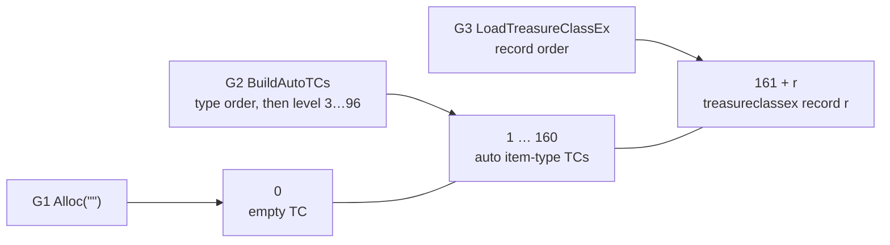

| Index | TC |
|---|---|
| 0 | the empty TC (empty name); a stored 0 means "no TC" |
| 1 … 160 | the auto item-type TCs of G2 (5 types × 32 levels) |
| 161 + r | `treasureclassex` record `r` (r = 0 … 851) |

Step notes:

- G2. The order inside 1…160 follows the loop: item type in `itemtypes` record order, then level
  ascending, so the auto TC for the `j`-th qualifying type (0-based) at level `L` is index
  `1 + 32 × j + (L ÷ 3 − 1)`. [I] (fn:TC_BuildAutoTCs@0x006541C0)
- G3. The shipped table's last record (852) has an empty name, so it ends the loop and 852 TCs are
  loaded: 1 + 160 + 852 = 1013 runtime TCs. [I] (fn:TC_LoadTreasureClassEx@0x006547D0,
  [TreasureClassEx § Row identity](../../tables/TreasureClassEx.md#row-identity))
- G4. A name of up to 4 characters that is both an item code and a TC name resolves to the **item**.
  TC and unique/set names are case-insensitive (F1); item codes are case-sensitive (E1). [I]
  (fn:TC_ParseItemCell@0x00654440)
- G4. `uniqueitems` index 0 can never be named from a TC (the test is `≥ 1`); `setitems` index 0 can. [I]
  (fn:TC_ParseItemCell@0x00654440)
- G. `TC_GetByIndex` applies a `group`/`level` upgrade walk when a TC is fetched; that belongs to
  `items/tc`, not to the load. [I] (fn:TC_GetByIndex@0x00654E00)

### H. Monster references

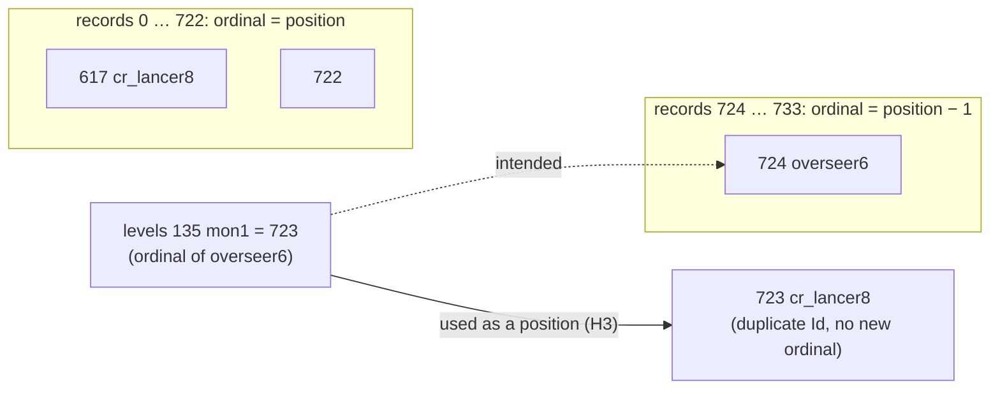

```
H1. Monster records are addressed by position:                        [I] (0x006538A0, 0x00651040, 0x00650F00)
      MonStats(i) = g_pMonStats + i × 0x1A8, valid for 0 ≤ i < count
H2. Every stored monster reference (monstats BaseId, NextInClass, spawn, minion1/2;   [C] (tbl:MonStats.txt:Id, tbl:Levels.txt:mon1)
    levels mon*, nmon*, umon*, cmon*) holds the ordinal of the referenced Id among
    DISTINCT monstats Ids (F4 numbering), which monstats.bin also stores at +0x000.
H3. The game uses that stored value directly as the record position of H1;           [I] (data/0001 §8)
    nothing remaps it at load.
```

Consequence: `monstats.txt` repeats `cr_lancer8` (records 617 and 723). Ordinals and record
positions agree for records 0…722 and diverge after, so a reference to any monster in records
724…733 reaches the record **one before** it. In the shipped data only three cells are affected:
*Act 5 - Pandemonium 3* (`levels` record 135) `mon1`, `nmon1`, `umon1` name `overseer6` (record 724)
and store 723, which is the second `cr_lancer8` record. [I] (H2 is [C] by data, H3 is [I];
[MonStats § Row identity](../../tables/MonStats.md#row-identity), [data/0001 §8](../../findings/data/0001-excel-loader.md#8-answers-to-the-archivists-phase-1-questions))
For the monster-region pool H3 is observed: the pool code addresses `g_pMonStats + 0x1A8 × index`, and
*Pandemonium 3*'s region held class 723, the second `cr_lancer8`, in every logged game. [C]
(fn:sub_005475E0_MonRegionPool@0x005475E0, run:2026-10-12-mon-pool, [monsters/0001 § 8](../../findings/monsters/0001-level-pool.md#8-ordinal-723-and-g_monstatslink-backlog-spec-writer--reverser-a))
`g_MonStatsLink`, the monstats name link, is filled when a table is compiled and appears only in table
descriptors; no game-time name lookup goes through it. [I] (data:g_MonStatsLink@0x0096C6AC,
fn:MONSTATS_Load@0x00651210, [monsters/0001 § 8](../../findings/monsters/0001-level-pool.md#8-ordinal-723-and-g_monstatslink-backlog-spec-writer--reverser-a))

### I. String-table keys

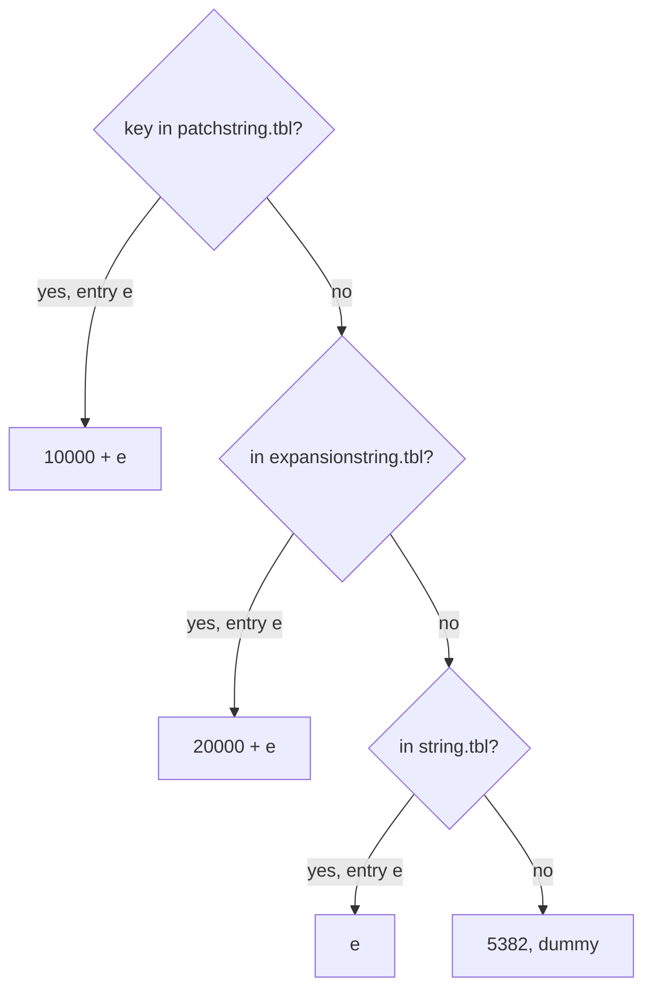

```
I1. Language: lang ← first byte of data\local\use (via A3); if lang > 13: lang ← 0      [I] (fn:LNG_GetLanguageIndex@0x00525150)
      code ← language table[lang] (0 ENG, 1 ESP, 2 DEU, 3 FRA, 4 POR, 5 ITA, 6 JPN,
             7 KOR, 8 SIN, 9 CHI, 10 POL, 11 RUS, 12 ENG/HAN); unknown → entry 0     [I] (fn:LNG_GetLanguageCode@0x00525260, data:g_LanguageTable@0x007303DC)
      string tables: data\local\lng\<code>\string.tbl, expansionstring.tbl, patchstring.tbl

I2. Stored string index of a key column (namestr, spelldescstr, monstats NameStr/DescStr):   [C] (fmt:tbl, fmt:excel-bin)
      if key is in patchstring.tbl at entry e:          index ← 10000 + e
      else if key is in expansionstring.tbl at entry e: index ← 20000 + e
      else if key is in string.tbl at entry e:          index ← e
      else (blank or unknown key):                      index ← 5382   ; string.tbl "dummy"
      stored as u16
    The compiler's converter is STRTABLE_KeyToIndex: it calls          [C] (fn:STRTABLE_KeyToIndex@0x006117B0, fn:STRTABLE_GetByKey@0x00524D30, data/0003)
    STRTABLE_GetByKey, which returns 0 for an empty or unknown key,
    and replaces 0 by 5382 (0x1506).

I3. Text of a stored index (u16) at run time:                          [C] (fn:STRTABLE_GetByIndex@0x00524A30, fn:STRTABLE_EntryToString@0x00524930, data/0003, run:2026-10-15-strings)
      if index ≥ 20000:
        if expansionstring.tbl is loaded: (file, e) ← (expansionstring, index − 20000)
        else: index ← 11078, then as below                           ; [I] not reached (0x00524A33–0x00524A49, data/strings § C)
      if index ≥ 10000 and patchstring.tbl is loaded and file unset:
        (file, e) ← (patchstring, index − 10000)
      else if file unset: (file, e) ← (string, index)
      if e ≥ file.count: e ← 500                                       ; [I] not reached: entry 500 of the same file (fn:STRTABLE_EntryToString@0x00524930)
      return the value of the node file.index[e] names                  ; an unused node is fatal
```

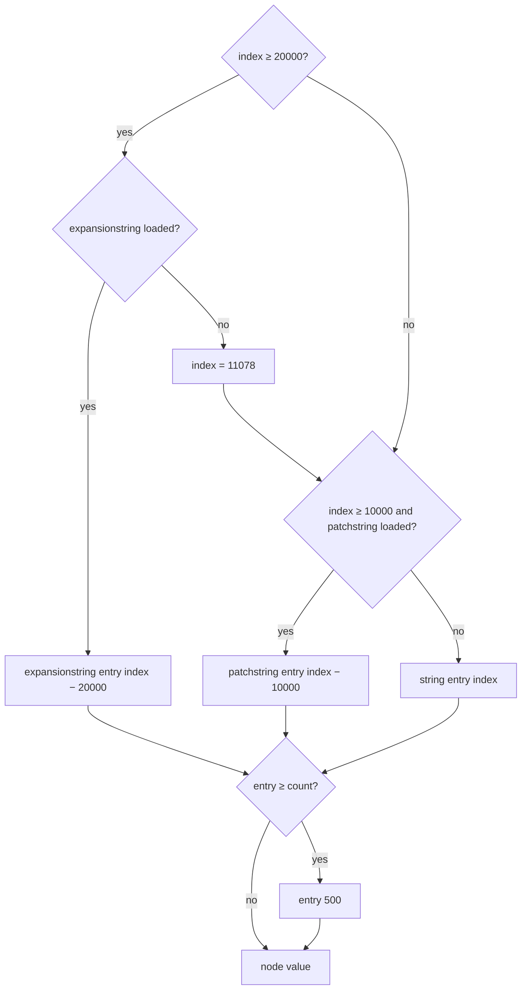

Step notes:

- I1. The language byte affects only localisation (string tables, fonts, charset), never
  `data\global\` or any excel table. [I] ([data/0002 §4](../../findings/data/0002-mpq-precedence.md#4-the-language-byte))
- I2. This is what the shipped `.bin` files contain, verified against the English tables over 2 278
  cells of the nine documented tables, and over 2 344 cells of all 28 laid-out tables (776 blank and 15
  non-blank unknown keys store 5382; each precedence pair is exercised: patchstring over string, patchstring
  over expansionstring, expansionstring over string). One exception: monstats `uberandariel`
  `NameStr = Lilith` stores 5382 although `Lilith` is entry 1154 (index 11154) of the shipped `eng`
  `patchstring.tbl` (Open questions). The values are the English ones: the `deu` and `fra` `string.tbl`
  have fewer entries. [C] / [I] for the language remark ([tbl.md](../../formats/tbl.md#key--index-as-the-excel-bin-files-store-it),
  [data/0004](../../findings/data/0004-cell-converters.md#answer-summary))
- I2. Entry 0 of `string.tbl` (key `WarrivAct1IntroGossip1`) also gets 0 from `STRTABLE_GetByKey`, so it
  would compile to 5382; no cell names it. [I] (fn:STRTABLE_GetByKey@0x00524D30, [data/0004](../../findings/data/0004-cell-converters.md))
- I3. Text lookup is by entry position, so a language whose `string.tbl` has other entries (the `deu`
  and `fra` files have 5322) shows other text for the same stored index, and an index past a file's
  count shows entry 500. The key → index search `STRTABLE_GetByKey` is patchstring → expansionstring
  (when loaded) → string, the I2 order; the hash lookup is case-sensitive. [I] ([data/0003](../../findings/data/0003-string-tables.md#answer-summary),
  [tbl.md § Override order](../../formats/tbl.md#override-order), fn:STRTABLE_FindInTable@0x00524C60)
- I3. The game loads `string.tbl`, then `patchstring.tbl`, then `expansionstring.tbl` **whenever `d2exp.mpq`
  exists**, in a classic game too (the load flag is `HasExpansionMpq()`, not the game's mode), so on a stock LoD
  install the 11078 path is unreachable; a missing table is a crash, with no fallback to `eng`. [C] for the load
  condition by run:2026-10-15-strings, [I] for the crash (fn:STRTABLE_LoadAll@0x005259C0,
  fn:sub_00408F20_HasExpansionMpq@0x00408F20, fn:STRTABLE_LoadFile@0x00525920,
  [data/0003](../../findings/data/0003-string-tables.md#answer-summary))
- I3. The whole run-time lookup (loading, index → text, key → index, hash probing, text conversion, fallbacks) is
  specified in [data/strings](strings.md); this section keeps the stored-index view.

### J. Compiling a `.txt` (`-txt` only)

Only a reimplementation that compiles `.txt` itself needs this section: the compiler is what produced
the shipped `.bin` content, so the stored values of § Cell values follow from it. Each rule is `[C]`
where a named cell of the 28 laid-out tables exercises it (`tools/excel_bin.py survey`: 7 425 records,
555 659 cells, 0 unexplained), else `[I]` from the code. Field types are the descriptor entry types of
[data/0004 § 2](../../findings/data/0004-cell-converters.md#2-cell-types-second-pass-0x006bdb50-loop).

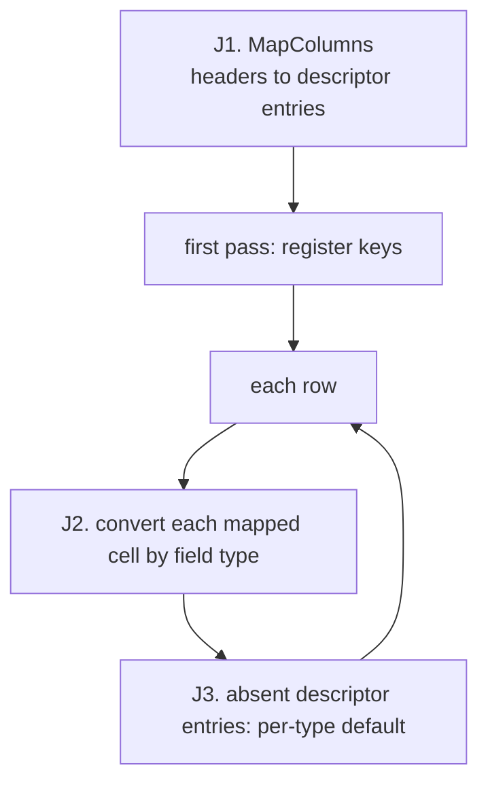

```
J1. MapColumns(headers, descriptor) → map:                             [C] (fn:EXCEL_MapColumns@0x006BCE20, 0x006BD00F)
      for each header h, in column order:
        e ← the descriptor entry, not yet matched, whose column equals h ignoring case
        if e exists: map[col] ← e;  mark e matched                      ; a repeated header finds nothing
        else: map[col] ← 0x7FFF                                         ; the column's cells are skipped
      append every unmatched entry after the file's columns              ; these get J3

J2. Convert a cell by its field type (record zeroed before the row):
J2a. integer (types 2–6, 8, 0x1A):                                     [C] (fn:EXCEL_ParseTxt@0x006BD780, 0x006BDE15–0x006BDE3E)
       optional leading '-', then v ← v × 10 + (byte − 0x30) per byte   ; no validation
       store v truncated to the field width
J2b.   byte is sign-extended, so a byte ≥ 0x80 adds a negative digit;  [I] (0x006BDE20)
       type 5 stores only a non-empty cell; type 0x1A sets or clears one bit
J2c. code lookup (0x0B dword, 0x0D byte, 0x0F word):                   [I] (0x006BDD82, fn:EXCEL_FindCode@0x006BD130)
       ; the sub-rules a named cell exercises (4-character cut, blank, duplicates): step notes
       key ← first ≤ 4 bytes of the cell, padded with spaces            ; blank → "    "
       store FindCode(link, key) at the field width                     ; −1 when absent
J2d. name lookup (0x13 dword, 0x14 word, 0x15 byte):                   [I] (0x006BDDE7, fn:EXCEL_FindName@0x006BD3C0)
       key ← first ≤ 31 bytes of the cell                               ; blank → ""
       store FindName(link, key) at the field width                     ; −1 when absent
J2e. string key (0x16): store STRTABLE_KeyToIndex(cell) as u16 (I2)    [C] (fn:STRTABLE_KeyToIndex@0x006117B0, 0x006BDEE5–0x006BDEED)
J2f. callbacks (0x17–0x19): link(cell, record, offset, len, row, col)  [I] (0x006BDB50)
       the item calc callback stores −1 for a blank cell or an           [I] (fn:sub_00631530_ItemCalcCell@0x00631530, 0x00631552)
       expression that fails to compile, else the expression's offset

J3. After each row, for each appended (absent) entry, by type:          (0x006BDFA0–0x006BE031, jump table 0x006BE128)
```

| Type | Default for an absent column | Exercised by | Tag |
|---|---|---|---|
| 1 string | 0 (empty) | misc `setinvfile` | [C] (0x006BE128) |
| 2, 3, 4, 6 integer | 0 | weapons `minac`, `pSpell`, `spelldesc`, `absorbs`, `spellicon`; misc `auto prefix` | [C] (0x006BE128) |
| 9 4-char code | four zero bytes | misc `normcode`, `ubercode`, `ultracode`; weapons `BetterGem` | [C] (0x006BE128) |
| 0x16 string key | word 0, no converter call | weapons/armor `spelldescstr` | [C] (0x006BE128) |
| 0x0D byte code lookup | `0xFF` | armor/misc `hit class`, automagic `classspecific` | [C] (0x006BE128) |
| 0x0F word code lookup | `0xFFFF` | magicsuffix/automagic `etype4`, `etype5` | [C] (0x006BE128) |
| 0x14 word name lookup | `0xFFFF` | weapons/armor `state`, `cstate1`/`2`, `stat1`–`3` | [C] (0x006BE128) |
| 0x19 calc callback | called with no cell → −1 | weapons/armor `calc1`–`3`, `len`, `spelldesccalc` | [C] (0x006BE128, 0x00631552) |
| 5, 7, 8; 0x0A, 0x0C, 0x0E, 0x10–0x12 registrations | 0 | none | [I] (0x006BE128) |
| 0x0B, 0x13 dword lookups | −1 | none | [I] (0x006BE128) |
| 0x15 byte name lookup | `0xFF` | none | [I] (0x006BE128) |
| 0x17, 0x18 callbacks | called with no cell; the effect is the callback's | none | [I] (0x006BE128) |
| 0x1A bit flag | untouched (the record was zeroed) | none | [I] (0x006BE128) |

Step notes:

- J1. **A header that occurs twice feeds its field from the first occurrence**; the second maps to
  `0x7FFF`. Matching is case-insensitive (`alternateGfx` / `alternategfx`), and a header the descriptor
  lacks (`HratliMagicLvl`) is ignored. The survey depends on all three (armor's second `mindam`/`maxdam`).
  [C] (fn:EXCEL_MapColumns@0x006BCE20, [data/0004](../../findings/data/0004-cell-converters.md#answer-summary))
- J2a. **No validation, truncation to the width:** misc `TMogMin`/`TMogMax` of the three Khalim parts hold a
  single space and store −16 (`0xF0`); misc `rarity` 999 stores 231 in a u8 (7 rows, the only out-of-range
  integer cells). [C] (0x006BDE20–0x006BDE29, 0x006BDE56)
- J2c. **The key is cut to 4 characters:** magicprefix `itype1` = `staff` finds `staf` (9 cells), magicsuffix
  `itype2` = `ring ` finds `ring` (3 cells). [C] (0x006BDD82)
- J2c–J2d. **A blank cell is looked up**, not skipped: it gets the target row whose key is blank (itemtypes row
  0 for the item-type references, the empty-named TC 0 for monstats `TreasureClass*`), or −1 when the target
  has no blank key. [C] (0x006BDD82, 0x006BDDE7) A non-blank key that matches nothing takes the same −1 path;
  no cell has one. [I] (0x006BDD82, 0x006BDDE7)
- J2c–J2d. **A duplicated key resolves to its first row:** 15 443 blank itemtypes references store row 0, the
  first of the blank-code itemtypes rows (E2 keeps the first and bumps later duplicates); monstats
  `NextInClass` = `cr_lancer8` and the `Sk*mode` cells naming a repeated `monseq` value store the first
  occurrence's ordinal (F). [C] (fn:EXCEL_AddCode@0x006BD230, fn:EXCEL_AddNameIfAbsent@0x006BD5A0)
- J2. Before any lookup, a first pass registers the keys of the registration columns (0x0A, 0x0C, 0x0E,
  0x10–0x12): codes through `EXCEL_AddCode` (an index above 255 / 65535 for a u8 / u16 field is fatal),
  names through `EXCEL_AddName` or `EXCEL_AddNameIfAbsent`. Callbacks run in `.txt` column order. [I]
  (0x006BD99F, 0x006BDA34, 0x006BDA74)
- J3. The record is zeroed before parsing, so a 0 default and "not written" give the same byte; the −1
  defaults are real writes. [I] (fn:EXCEL_ParseTxt@0x006BD780, [data/0004 § 1](../../findings/data/0004-cell-converters.md#1-column-map-and-the-defaults-pass))
- J2f–J3. **Callback order within a row.** The second pass walks the row's cells in `.txt` column order, and a
  type `0x17`–`0x19` entry calls its callback when its column is reached, so a formula's pool bytes are appended in
  header order, not descriptor order. After the row's last cell, the entries the `.txt` lacks run in descriptor
  order (J1 appends them that way) through the J3 jump table, where the three callback types call their callback
  with no cell (an absent `calc` column → −1). So the callback order is the `.txt` columns, then the absent entries.
  Stock `skills.txt` has `skpoints`, `delay`, `perdelay` in header order against the descriptor's `perdelay`,
  `skpoints`, `delay`; no stock row fills `perdelay` with either, so both orders rebuild the stock pools, but an
  edited row with all three filled puts `perdelay`'s bytes after `delay`'s. [I] (fn:EXCEL_ParseTxt@0x006BD780
  0x006BDB50–0x006BDF77, fn:EXCEL_MapColumns@0x006BCE20 0x006BCFA0–0x006BCFDC, 0x006BDFA0–0x006BE031,
  tbl:Skills.txt:perdelay, [data/0005 § 9](../../findings/data/0005-calc.md#9-compile-order-within-a-row-backlog-2026-10-15-static))
- J4. **Descriptor facts the data can't show.** `levels.txt` `camt1`..`camt4` are four descriptor entries that
  all write `+0x0DC` (s16), so the last `camt` column present lands in `+0x0DC` and `+0x0DE..+0x0E3` are never
  written, while the critter code reads `+0x0DC + 2k`; the stock cells are blank, so a stock run is unaffected.
  `levels` `Id` compiles as a u8. `LvlTypes` `Expansion` is an s32 read as a dword. [I] (0x0046C524, 0x0061FB97,
  [data/0004](../../findings/data/0004-cell-converters.md#answer-summary))
- J4. **Record bytes no column fills.** Filled at load, after the table: items `+0x0F0` (`gemoffset`,
  rewritten by `GEMS_Load`), monstats `+0x02A` (first `MonEquip` row, `MONEQUIP_Load`), `+0x036`/`+0x038`
  (walk/run values) and `+0x04A`/`+0x04B` (class-chain length and position), levels `+0x16E`/`+0x1BE`
  (localised `LevelName`/`LevelWarp` text, `DRLG_LoadLevels`). Padding, no reader or writer found by a
  displacement search after the table's record getters: items `+0x123`, `+0x12E`, monstats `+0x00A` and
  `+0x00F` bits 5–7, levels `+0x00A`. Records reached through a cached pointer are outside that search.
  [I] (fn:GEMS_Load@0x00636B70, fn:MONEQUIP_Load@0x00659E60, fn:sub_00650F00_MonStatsSpeeds@0x00650F00,
  fn:sub_00651040_MonClassChain@0x00651040, [data/0004 § 3–4](../../findings/data/0004-cell-converters.md#3-runtime-fillers-of-no-column-fields))
- J4. **More record bytes filled at load** (the 0 in the `.bin` is overwritten):
  - [I] gems `+0x02C`: `GEMS_Load` stores `STRTABLE_GetByKey` of a key built from `+0x28..+0x2A`, which hold the
    compiled item index of `code`, not its text; the lookup fails and every gem stores 0 (data/strings § D2).
    (fn:GEMS_Load@0x00636B70 0x006371D6–0x00637225, [items/0007 § 9](../../findings/items/0007-sockets-runewords.md#9-table-fields-the-socket-path-does-not-use-backlog-2026-10-15-static))
  - [I] gamble `+0x04` (the base's `level`, item record byte `+0xFD` as a u32) and `+0x08` (the item index of `code`,
    `EXCEL_FindCode(g_ItemCodeLink, code)`); the records are then sorted in place by `+0x04`.
    (fn:GAMBLE_LoadTable@0x00638AE0, tbl:Gamble.txt:code, [items/0009 § 7](../../findings/items/0009-vendors.md#7-gambling-gamble_buildinv-0x00578790))
  - [I] charstats `+0x000..+0x01F`: the class's display name as UTF-16 (at most 16 units), looked up from the `class`
    text at `+0x20`, or a fallback built from the key text when not found. (fn:CHARSTATS_LoadTable@0x00613260 0x00613D23,
    fn:sub_00612600_RecWideNameFill@0x00612600, [player/0001 § 9](../../findings/player/0001-creation.md#9-other-charstats-readers-for-the-archivists-table-doc))
  - [I] the merged rare-name records `+0x0C`: `STRTABLE_GetByKey(record + 0x26)`, the row's `name`.
    (fn:sub_00633F40_LoadRareAffixes@0x00633F40 0x006341E0–0x0063420B, [data/0003 § Run](../../findings/data/0003-string-tables.md#run))
  - [I] runes `+0x082` (u16): `STRTABLE_GetByKey(Name)`, looked up row by row, so the two rows named `Runeword95`
    share one string index. `+0x084` is not written. (fn:RUNES_Load@0x006394A0 0x00639C63–0x00639C6E,
    [items/0007 § 9](../../findings/items/0007-sockets-runewords.md#9-table-fields-the-socket-path-does-not-use-backlog-2026-10-15-static))

## Outputs

### Loaded state

- Per table: a record array and a count, at the globals of C1. [C] (fn:DATATBLS_LoadTable@0x006122F0)
- One combined item array with a code link; item index = combined position (D). [I]
- One runtime TC array (1013 entries of 0x2C bytes in the shipped data) with a name link; TC index
  space as in G5. [I] for the size, [C] for the numbering.

### Cell values in a `.bin` record

What a reimplementer reading a stock `.bin` must know about stored values. All rows are [C] by data
behaviour: `tools/excel_bin.py diff` applies them to every cell of the nine documented tables with
no unexplained mismatch. ([excel-bin.md § Cell encoding rules](../../formats/excel-bin.md#cell-encoding-rules))

| Field kind | Stored value | Blank cell | Column absent from the `.txt` |
|---|---|---|---|
| integer (1, 2 or 4 bytes) | the parsed number truncated to the field width, no range check (`999` in a u8 → 231) | 0 | 0 |
| boolean | a whole byte, or one bit of a packed flags word (monstats `+0x0C..+0x0F`) | 0 | 0 |
| string (`char[N]`) | NUL-terminated, rest zero | empty | empty |
| 4-char code | 4 raw bytes, space-padded (`"hax "`) | four spaces | four zero bytes |
| reference to another table | the target's record index, first match on the key | index of the target's empty-key row if it has one (itemtypes: 0 = `None`), else −1 | −1 (all bits set at the width) |
| item-type reference | as above, key cut to 4 characters first (`staff` → `staf`) | 0 | `0xFFFF` |
| monster reference | distinct-Id ordinal (H2) | −1 | −1 |
| TC reference (monstats) | TC index (G5) = TCEx row + 161 | 0 | — |
| TCEx `Item1..10` | the cell text in `char[64]`, resolved at load by G4 | empty | — |
| string key | string index (I2) | 5382 | 0 |
| formula (calc) | s32 offset into the `*code.bin` buffer | −1 | −1 |

The compiler code behind each row is § J, with its own `[C]`/`[I]` split. Signedness is pinned only
where a column holds negative values; elsewhere the table docs mark fields `u`, which is [I]. ([excel-bin.md § Integers](../../formats/excel-bin.md#integers))

## Worked example

Values from the shipped `.bin` files, decoded with `tools/excel_bin.py dump`.

1. **TC reference.** `monstats` record 0 (`skeleton1`) has `TreasureClass1` (`+0x086`, u16) = 430.
   430 ≥ 161, so it is `treasureclassex` record 430 − 161 = 269, named `Act 1 H2H A`. Its runtime
   index is 430, and `FindName(tcLink, "ACT 1 H2H A")` also returns 430 (case-insensitive).
2. **Monster reference.** `levels` record 135 (*Act 5 - Pandemonium 3*) has `mon1` = 723. The `.txt`
   names `overseer6`, which is record 724; record 723 is the second `cr_lancer8`. By H3 the game uses
   record 723.
3. **Item code.** The weapon code `hax` is stored at `+0x080` as `68 61 78 20`, the u32 `0x20786168`.
   It is `weapons` record 0, so `ITEMS_GetByCode(0x20786168)` returns item index 0.
4. **TCEx record 0** is `Gold`, `Picks` 1, `Item1` = `gld` (a 3-character code: G4 tries it as an
   item code first), runtime index 161.

## Reimplementation notes

- **Read the `.bin`, not the `.txt`.** The two agree for the stock data except where noted, but the
  `.bin` is what the game runs on. For `inventory` and `PlrMode` the patched `.txt` is not live.
- **Merge archives in priority order**, not open order: `d2exp` (opened last) still loses to
  `patch_d2`. Overlaying `d2data` → `d2exp` → `patch_d2` (later wins) reproduces the game for
  `data\global\`.
- **Record index ≠ `.txt` line.** Drop every `Expansion` marker row; a tab-only line is a record
  (`uniqueitems` record 401, `treasureclassex` record 852).
- **`leveldefs` has no count**; use `levels`' count.
- **The TCEx loop stops at the first empty name**, and the item loop at the first empty `ItemN`:
  an item in `Item5` after a blank `Item4` is ignored. `Picks` 0 becomes 1. A non-zero `group` is
  shifted by the number of auto-TC item types.
- **A blank item-type reference is 0, not −1**: it names `itemtypes` record 0 (`None`). Other
  blank references are −1. Check the target table before treating 0 as "none".
- **Monster references after the duplicate `cr_lancer8` are off by one.** Use the stored value as a
  record position; do not "fix" it by looking the name up.
- **Codes are case-sensitive, names are not.** A 4-character TC name that equals an item code
  resolves to the item.
- **Name keys are cut at 31 characters** before comparison.
- **Duplicate codes shift to `code + 1`.** Harmless on stock data, but a modded table with a
  duplicate code makes the second record reachable only through a different code.

## Evidence

- [findings/data/0001-excel-loader.md](../../findings/data/0001-excel-loader.md): loader, `-txt`, record
  sizes, table globals, code and name links, TC load, monster references.
- [findings/data/0002-mpq-precedence.md](../../findings/data/0002-mpq-precedence.md): archive order and
  priority, file lookup, `-direct`, language byte.
- [findings/data/0004-cell-converters.md](../../findings/data/0004-cell-converters.md): the `.txt` compiler's
  column map, cell converters and absent-column defaults, the no-column fields (§ J).
- [findings/data/0003-string-tables.md](../../findings/data/0003-string-tables.md): string-key converter, run-time
  index → text, table loading (I2, I3); [tbl.md § Override order](../../formats/tbl.md#override-order) summarises it.
- [findings/monsters/0001-level-pool.md § 8](../../findings/monsters/0001-level-pool.md#8-ordinal-723-and-g_monstatslink-backlog-spec-writer--reverser-a):
  H3 observed for the pool, `g_MonStatsLink`.
- [formats/excel-bin.md](../../formats/excel-bin.md), [formats/tbl.md](../../formats/tbl.md),
  [formats/mpq.md](../../formats/mpq.md): file formats and cell encoding (data behaviour).
- [tables/README.md](../../tables/README.md) and the table docs [TreasureClassEx](../../tables/TreasureClassEx.md),
  [ItemRatio](../../tables/ItemRatio.md), [ItemTypes](../../tables/ItemTypes.md), [Weapons](../../tables/Weapons.md),
  [Armor](../../tables/Armor.md), [Misc](../../tables/Misc.md), [MonStats](../../tables/MonStats.md),
  [Levels](../../tables/Levels.md).
- Several lead-level statements in the format and table docs (`.bin` vs `.txt`, MPQ order, item index
  order, the 161 TC slots) predate the findings and are superseded by them; this spec follows the
  findings. The doc updates are queued for the archivist in the backlog.

## Open questions

- [L] `-direct -txt` and the loose-file rule are read from code only. A wine run with a loose
  `DATA\GLOBAL\EXCEL\<table>.bin` that differs from the MPQ copy, with and without `-direct`, and one
  edited `.txt` cell under `-direct -txt`, would confirm A3 and B1a–B1b.
  ([data/0001](../../findings/data/0001-excel-loader.md#open-questions), [data/0002](../../findings/data/0002-mpq-precedence.md#open-questions))
- [L] `d2kfixup.mpq` / `d2delta.mpq` precedence is code-read only; neither ships. A dummy archive
  carrying one excel file would confirm it.
- [L] H3 (monster references used as positions) is observed for the region pool (§ H) but not read in
  all ~189 readers of `g_pMonStats`; whether a spawned unit of class 723 is ever seen in play belongs to
  `monsters/spawn`. The `g_MonStatsLink` part is answered in § H (monsters/0001 § 8).
- [L] G2 details, seen by the architect during the plan 0002 review and not yet in a finding
  (backlog entry architect → reverser on `TC_BuildAutoTCs`, plan 0004 Phase 1). (a) Name: the type
  code is rebuilt by `0x006BD180`, which writes the padding space as NUL, so the names are
  `bow3` … `bow96`; if that lookup fails no TC is allocated for that level, which would shift the
  G5 numbering. (b) Each auto TC has `picks` 1, `group` 0, `level` = L − 3. (c) Item filter, in
  order: `+0x12A` = 0, `+0x133` ≠ 0, `0x00629A90(item, t)`, and the item must not also be of
  itemtypes record 38 unless t is 38; then the `+0x0FD` window. (d) Entry probability
  `max(1, byte +0x1E)` of the record from `0x00555C90(item +0x11E)`; entry flag `0x10` when the
  item's `+0xF6` word ≥ 100. All of this matters to `items/tc` and moves into G2 once recorded.
- [L] The TC post-pass `0x0065A2C0` and the `group`/`level` walk in `TC_GetByIndex` are not read
  (plan 0004).
- ~~Run-time string lookup through the I2 bases, and a non-English `string.tbl`~~: answered in I3
  ([data/0003](../../findings/data/0003-string-tables.md)), plan 0015.
- ~~The cell-encoding defaults, the not-found value and the string-key order have no code anchor~~:
  answered in § J and I2 ([data/0004](../../findings/data/0004-cell-converters.md)), plan 0015.
- [L] The `Lilith` cell (monstats `uberandariel` `NameStr`): `Lilith` is entry 1154 of the shipped `eng`
  `patchstring.tbl` (index 11154) and in no other table, so the converter would store 11154, yet the `.bin`
  holds 5382. The `.bin` was probably compiled against string tables that lacked the key; nothing in the
  code explains it. ([data/0004 § Open questions](../../findings/data/0004-cell-converters.md#open-questions))
- [L] Whether a reader reaches the monstats padding bytes (`+0x00A`, `+0x00F` bits 5–7) through a cached
  record pointer, outside the J4 search. A data breakpoint during a game would settle it.
  ([data/0004 § Open questions](../../findings/data/0004-cell-converters.md#open-questions))
- [L] The u16 list at `0x0096CA78` of item indices whose `+0x0F6` word is 0, built at item load:
  meaning left to the items plans.
