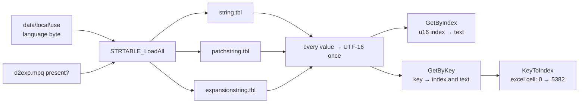
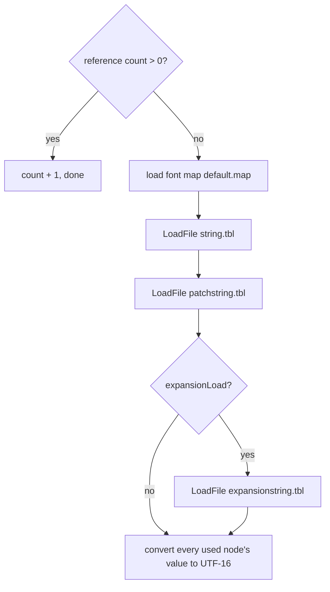
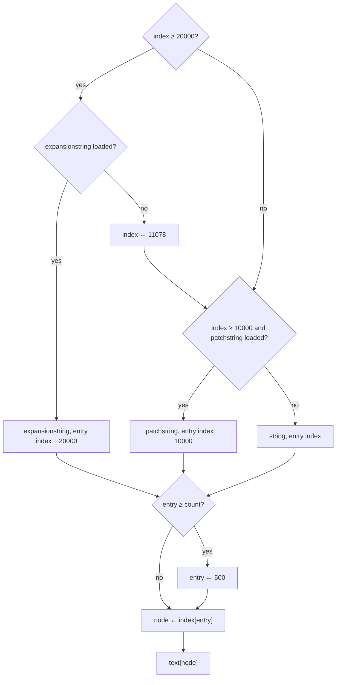
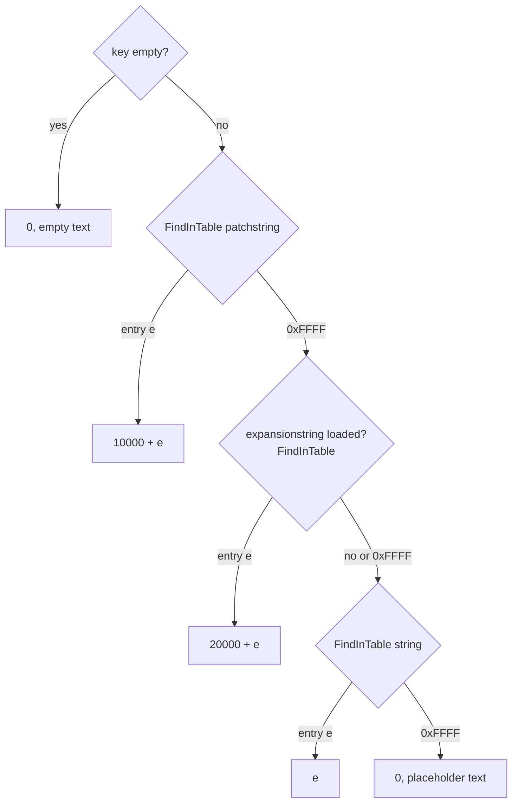
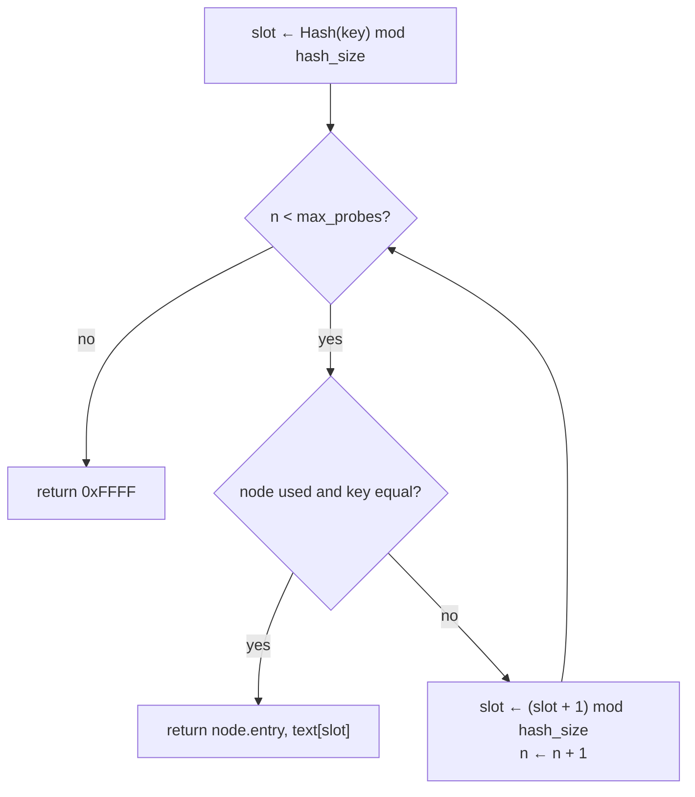

# String tables: loading, index → text, key → index

## Purpose

Excel records and game code name their text by a **string index** (a u16 stored in a record) or by a **string
key** (an ASCII name such as `GloomUM`). This spec says how the game loads the three `.tbl` string tables of the
configured language, how it turns an index into text, and how it turns a key into an index, through the hash table
and its probe walk. The output is a UTF-16 string; fonts, colour codes and rendering are out of scope (plan 0028).
The tables are loaded at program level, before any game is created, under a reference count. Nothing here draws a
random number.



## Entry points

| When | Function | Tag |
|---|---|---|
| Program start, before any game (three callers 0x004359F2, 0x00441B91, 0x0044B911) | fn:STRTABLE_LoadAll@0x005259C0 | [C] |
| One table file, from `LoadAll` | fn:STRTABLE_LoadFile@0x00525920 | [C] |
| Any text shown for a stored index (UI, monster and item names) | fn:STRTABLE_GetByIndex@0x00524A30 | [C] |
| A key looked up at run time (table loaders, e.g. fn:GEMS_Load@0x00636B70, fn:sub_00633730_LoadMagicAffixes@0x00633730, fn:sub_006342B0_LoadUniqueItems@0x006342B0) | fn:STRTABLE_GetByKey@0x00524D30 | [C] |
| A key looked up for its text only (0x00524E35) | fn:STRTABLE_GetStringByKey@0x00524E20 | [I] |
| A `.txt` string-key cell compiled into a `.bin` (`-txt` only) | fn:STRTABLE_KeyToIndex@0x006117B0 | [C] |
| Release (reference count) | fn:STRTABLE_Unload@0x00524E40 | [I] |

- [C] The three `LoadAll` callers run at program level, before any game, and the run saw all three tables
  loaded from the main menu on, in both sessions. (0x004359F2, 0x00441B91, 0x0044B911,
  [data/0003 § Answer](../../findings/data/0003-string-tables.md#answer-summary), run:2026-10-15-strings)
- [I] `GetStringByKey` is a thin key → text call: ten of the run's not-found keys came through it (0x00524E35), and
  their results are those of `GetByKey`. (fn:STRTABLE_GetStringByKey@0x00524E20,
  [run:2026-10-15-strings](../../findings/data/experiments.md#run2026-10-15-strings))

## Inputs

### Tables

| Anchor | Used for |
|---|---|
| fmt:tbl#layout: `crc`, `count`, `hash_size`, `string_start`, `max_probes`, `file_size`, `index[]`, nodes | the three files' bytes ([tbl.md](../../formats/tbl.md#layout)) |
| fmt:tbl#hash-table | the ELF hash, node placement by insertion, the CRC-16 ([tbl.md](../../formats/tbl.md#hash-table)) |
| tbl:MonStats.txt:NameStr, tbl:SuperUniques.txt:Name, tbl:UniquePrefix.txt:Name, tbl:Weapons.txt:namestr | examples of stored u16 string indices, resolved by § C ([data/excel § I](excel.md#i-string-table-keys)) |
| `data\local\font\<charset>\default.map` | the font map behind the character count of § B |

### Runtime state

| State | Type | Source |
|---|---|---|
| language code | 3-letter code (`ENG`…) | first byte of `data\local\use`, [data/excel § I](excel.md#i-string-table-keys) I1; § H |
| `expansionLoad` | bool | `HasExpansionMpq()`: `d2exp.mpq` exists, § A |
| per table: file buffer | bytes or NULL | data:g_pStringTbl@0x008829B4, data:g_pPatchStringTbl@0x008829D0, data:g_pExpStringTbl@0x008829D4 |
| per table: text per node | UTF-16 string pointer per node | data:g_StringTblText@0x008829B8, data:g_PatchStringTblText@0x008829BC, data:g_ExpStringTblText@0x008829C0 |
| not-translated cache | list of (key, placeholder text) | `0x008829B0`, filled by fn:sub_00524AC0_NotXlated@0x00524AC0 |
| load reference count | i32 | `0x008829D8` |

### Constants

| Name | Value | Anchor | Tag |
|---|---|---|---|
| index base `string` | 0 | fn:STRTABLE_GetByIndex@0x00524A30 | [C] |
| index base `patchstring` | 10000 | fn:STRTABLE_GetByIndex@0x00524A30 | [C] |
| index base `expansionstring` | 20000 | fn:STRTABLE_GetByIndex@0x00524A30 | [C] |
| expansion index without `expansionstring` | 11078 | 0x00524A33–0x00524A49 | [I] |
| entry past `count` | 500 | fn:STRTABLE_EntryToString@0x00524930 | [I] |
| excel "not found" index | 5382 (`0x1506`, `string.tbl` key `dummy`) | fn:STRTABLE_KeyToIndex@0x006117B0 | [C] |
| `FindInTable` give-up value | `0xFFFF` | fn:STRTABLE_FindInTable@0x00524C60 | [C] |
| placeholder suffix | `" -not xlated call ken w"` (23 bytes) | data:g_szNotXlatedSuffix@0x00730520 | [C] |
| empty text | the empty UTF-16 string | data:g_EmptyText@0x008829E8 | [C] |
| CRC-16 table | `table[1]` = `0x1021`, MSB first, init `0xFFFF` | data:g_Crc16Table@0x007301D8 | [C] |
| UTF-8 decode table | 6 rows {mask, value, result mask, minimum} | data:g_Utf8DecodeTable@0x007309B8 | [C] |

- [C] The bases, the give-up value, the suffix, the empty text and the decode table are reproduced by `tools/tbl.py`
  against the logged lookups (run:2026-10-15-strings), the CRC parameters by a loaded and a rejected file
  (run:2026-10-12-d2s-io), and 5382 by every string-key cell of the shipped `.bin` tables.
  ([data/0003](../../findings/data/0003-string-tables.md#answer-summary))

## Algorithm

### A. Loading — `STRTABLE_LoadAll`, `STRTABLE_LoadFile`



```
A1. LoadAll(lang, expansionLoad):                                                [I] (fn:STRTABLE_LoadAll@0x005259C0, 0x00525AF5, 0x00525B05–0x00525F5C)
      if refCount > 0: refCount ← refCount + 1; return                           ; loaded once
      LoadFontMap("data\local\font\<charset>\default.map")                       ; § B3
      string      ← LoadFile("data\local\lng\<lang>\string.tbl")
      patchstring ← LoadFile("data\local\lng\<lang>\patchstring.tbl")
      if expansionLoad: expansionstring ← LoadFile("data\local\lng\<lang>\expansionstring.tbl")
      for each loaded table t, each used node n of t:
        t.text[n] ← Utf8ToUtf16(value of n, limit: CharCount(value, n.string_length) + 1)   ; § B
A2. expansionLoad ← HasExpansionMpq()   (d2exp.mpq exists; not the game's mode)  [C] (fn:sub_00408F20_HasExpansionMpq@0x00408F20, 0x00525E11, run:2026-10-15-strings)
A3. LoadFile(path):                                                              [C] (fn:STRTABLE_LoadFile@0x00525920, 0x0052594B–0x00525973, run:2026-10-12-d2s-io)
      buf ← FILE_LoadWhole(path)                                                 ; NULL when the file cannot be opened
      crc: u16 ← CRC16(init 0xFFFF, buf[string_start ..< file_size])
      if crc ≠ header.crc: fatal                                                 ; "failed at (206)"
A4.   for each node: if key_offset ≥ file_size or string_offset ≥ file_size: fatal   [I] (0x00525978–0x005259B0)
A5.   if buf = NULL: the header read faults (access violation), no test, no eng fallback   [I] (fn:FILE_LoadWhole@0x00517079, 0x00516E5F–0x00516E7D, 0x0052593E)
```

Step notes:

- A2. **`expansionstring.tbl` loads whenever `d2exp.mpq` exists, in a classic game too.** The callers push the result
  of `HasExpansionMpq()` as the stack argument of `LoadAll`, and the call runs before any game exists. In the run
  every logged line of both sessions, the classic one included, had the three tables loaded, and the classic session
  resolved 21796, 22730 and 22732 through `expansionstring` (character-select text). [C]
  (fn:sub_00408F20_HasExpansionMpq@0x00408F20, 0x00525E11, [data/0003 § Answer](../../findings/data/0003-string-tables.md#answer-summary),
  [run:2026-10-15-strings](../../findings/data/experiments.md#run2026-10-15-strings))
- A3. The CRC is CRC-16/CCITT-FALSE over `[string_start, file_size)`; a file whose stored `crc` differs halts the game
  at start-up, and one with a recomputed `crc` loads. [C] (fn:STRTABLE_Crc16@0x00525020, data:g_Crc16Table@0x007301D8,
  [tbl.md § Hash table](../../formats/tbl.md#hash-table), run:2026-10-12-d2s-io)
- A5. With `d2exp.mpq` present, a missing `string.tbl`, `patchstring.tbl` or `expansionstring.tbl` crashes the game;
  the fatal paths after a NULL return in `LoadAll` (0x1C3, 0x1F6) are never reached for that reason. [I]
  (0x0052593E, fn:STRTABLE_LoadAll@0x005259C0, [data/0003 § Answer](../../findings/data/0003-string-tables.md#answer-summary))

### B. Text conversion — `UNICODE_Utf8ToUtf16`

```
B1. Utf8DecodeOne(src, avail) → (u16 unit, bytes) or −1:                         [C] (fn:UNICODE_Utf8DecodeOne@0x00526100, data:g_Utf8DecodeTable@0x007309B8, 0x00526115–0x00526181, run:2026-10-15-strings)
      the first byte picks the row (mask, value): 80/00, E0/C0, F0/E0, F8/F0, FC/F8, FE/FC
      each continuation byte must be 10xxxxxx
      cp ← decoded value & row.resultMask                                        ; 7F, 7FF, FFFF, 1FFFFF, 3FFFFFF, 7FFFFFFF
      if cp < row.minimum (0, 80, 800, 10000, 200000, 4000000), a byte is bad, or the sequence is cut: return −1
      return (u16) cp                                                            ; truncated above U+FFFF, no surrogates
B2. Utf8ToUtf16(dst, src, limit):                                                [C] (fn:UNICODE_Utf8ToUtf16@0x00526320, 0x00526363–0x005263C8)
      n: i32 ← 0
      while n < limit − 1 and src not at its end:
        r ← Utf8DecodeOne(src)
        if r = −1: n ← n + 1; break                                              ; the unit is counted, not written
        dst[n] ← r.unit; n ← n + 1; advance src by r.bytes
      dst[n] ← 0
B3. CharCount(str, maxBytes): i32                                                [C] (fn:UNICODE_CharCount@0x00527D50, fn:UNICODE_IsWideByte@0x005276E0, 0x00527D54–0x00527DA4, run:2026-10-15-strings)
      if no font map is loaded: return strlen(str)                               ; [I] not exercised (0x00527D54)
      count ← 0; walk at most maxBytes bytes up to the NUL:
        if IsWideByte(b): count ← count + 1, skip 2 bytes
        else: count ← count + 1, skip 1 byte
      IsWideByte(b) = b ≥ 0x20 and b lies in none of the font map's (lo, hi) ranges
```

Step notes:

- B1. The first byte is sign-extended before masking, which the mask makes harmless. [C] (0x00526115–0x00526181,
  [data/0003 § Text conversion](../../findings/data/0003-string-tables.md#text-conversion))
- B2. **At a bad sequence one unit of `dst`'s old content survives**: the unit is counted, the terminator goes after
  it, and nothing is written in its place. The run saw three such units (keys `"\x80\x02"` …); one read as 0, giving an
  empty text. [C] (0x00526363–0x005263C8, [run:2026-10-15-strings](../../findings/data/experiments.md#run2026-10-15-strings))
- B3. The font map is `data\local\font\<charset>\default.map` (`"KAMAP\n"`, a name ended by 0x1A, then at name end + 5
  a u16 `n`, a u8 range count `r`, `r` (lo, hi) byte pairs, `n` 4-byte pairs and `n` u16). The `eng` charset's
  `font/latin/default.map` has the ranges (0x20–0x7E) and (0xA0–0xFF), so bytes 0x7F–0x9F count as two-byte
  characters. [I] (fn:UNICODE_LoadFontMap@0x00527790, 0x005277A1–0x00527A1F, data:g_FontMapRangeCount@0x00882B22,
  data:g_pFontMapRanges@0x00882B28, data:g_pFontMapTable@0x00882B2C)
- A1/B. **At load a value converts whole**: the limit is `CharCount(value, string_length) + 1`, and over all 9 388
  entries of the three `eng` tables the result equals a plain UTF-8 decode. [C] (0x00525C49–0x00525C64,
  [data/0003 § Text conversion](../../findings/data/0003-string-tables.md#text-conversion), run:2026-10-15-strings)

### C. Index → text — `STRTABLE_GetByIndex`



```
C1. GetByIndex(index: u16) → UTF-16 text:                                        [C] (fn:STRTABLE_GetByIndex@0x00524A30, run:2026-10-15-strings)
      if index ≥ 20000:
        if expansionstring loaded: return EntryToString(expansionstring, index − 20000)
        index ← 11078                                                            ; [I] (0x00524A33–0x00524A49) not reached
      if index ≥ 10000 and patchstring loaded: return EntryToString(patchstring, index − 10000)
      if string not loaded: fatal 0x246                                          ; [I] (fn:STRTABLE_GetByIndex@0x00524A30)
      return EntryToString(string, index)
C2. EntryToString(t, entry: u16):                                                [C] (fn:STRTABLE_EntryToString@0x00524930, run:2026-10-15-strings)
      if entry ≥ t.count: entry ← 500                                            ; [I] not reached (fn:STRTABLE_EntryToString@0x00524930)
      node: u16 ← t.index[entry]
      if node ≥ t.hash_size or not t.nodes[node].used or t.text[node] = NULL: fatal   ; [I] not reached (fn:STRTABLE_EntryToString@0x00524930)
      return t.text[node]
```

Step notes:

- C1. The run logged 336 index lookups (201 distinct: 269 in `string`, 38 in `patchstring`, 29 in
  `expansionstring`), and the table, entry, node and text of each matched the model. [C]
  ([run:2026-10-15-strings](../../findings/data/experiments.md#run2026-10-15-strings), fn:STRTABLE_GetByIndex@0x00524A30)
- C1. **The 11078 path is unreachable on a stock install**: it needs `expansionstring` unloaded, which happens only
  when `d2exp.mpq` is absent (A2). It would land on `patchstring` entry 1078, or on entry 500 when `patchstring` has
  1078 entries or fewer. [I] (0x00524A33–0x00524A49, [data/0003 § Walkthrough](../../findings/data/0003-string-tables.md#walkthrough))
- C1. With `patchstring` not loaded, an index in 10000–19999 is looked up as a `string` entry, where it is past the
  end and falls back to entry 500. [I] (fn:STRTABLE_GetByIndex@0x00524A30, fn:STRTABLE_EntryToString@0x00524930)
- C2. Text lookup is by **entry position**: a language whose `string.tbl` has other entries (the `deu` and `fra`
  files have 5322) shows other text for the same stored index. [I] (fn:STRTABLE_EntryToString@0x00524930,
  [data/excel § I](excel.md#i-string-table-keys), [tbl.md § Unique monster name tables](../../formats/tbl.md#unique-monster-name-tables))

### D. Key → index — `STRTABLE_GetByKey`



```
D1. GetByKey(key, out text) → u16:                                               [C] (fn:STRTABLE_GetByKey@0x00524D30, run:2026-10-15-strings)
      if string or patchstring not loaded: fatal 0x2BA / 0x2BB                  ; [I] (fn:STRTABLE_GetByKey@0x00524D30)
      if key = NULL: fatal 0x2C0                                                 ; [I] (fn:STRTABLE_GetByKey@0x00524D30)
      if key = "": text ← EmptyText; return 0                                    ; no search
      e ← FindInTable(patchstring, key);  if e ≠ 0xFFFF: return 10000 + e
      if expansionstring loaded:
        e ← FindInTable(expansionstring, key);  if e ≠ 0xFFFF: return 20000 + e
      e ← FindInTable(string, key);  if e ≠ 0xFFFF: return e
      text ← NotXlated(key); return 0                                            ; § D2
D2. NotXlated(key):                                                              [C] (fn:sub_00524AC0_NotXlated@0x00524AC0, 0x00524BEF–0x00524C28, data:g_szNotXlatedSuffix@0x00730520, run:2026-10-15-strings)
      if the cache has key: return its text
      b ← key ++ " -not xlated call ken w"
      text ← Utf8ToUtf16(b, limit: CharCount(b))                                 ; no +1: the last character is lost
      add (key, text) to the cache; return text
```

Step notes:

- D1. The order is **`patchstring`, then `expansionstring`, then `string`**, and each `FindInTable` call returns the
  entry it found and also yields that node's text. The run logged 3 928 key lookups (1 964 distinct keys per session,
  79 found nowhere, 1 empty), each with every table searched, the index and the text as modelled. [C]
  (fn:STRTABLE_GetByKey@0x00524D30, [run:2026-10-15-strings](../../findings/data/experiments.md#run2026-10-15-strings))
- D1. **Entry 0 of `string` cannot be told from "not found"**: both return 0. `string.tbl` entry 0 is
  `WarrivAct1IntroGossip1`. [I] (fn:STRTABLE_GetByKey@0x00524D30, [data/excel § I](excel.md#i-string-table-keys))
- D2. **The placeholder loses its last character**, because the limit is the character count without the `+ 1` of
  load time: `"funeralpire"` gives `"funeralpire -not xlated call ken "` (with a trailing space). A key byte in 0x7F–0x9F
  counts as two bytes in the `latin` map and loses one more character (`"\x7f\x02"` →
  `"\x7f\x02 -not xlated call ken"`), and a key starting with a bad UTF-8 sequence leaves a single unwritten unit (B2).
  [C] (0x00524BEF–0x00524C28, [data/0003 § Text conversion](../../findings/data/0003-string-tables.md#text-conversion),
  run:2026-10-15-strings)
- D2. The run's not-found keys were the 68 two-byte keys `GEMS_Load` builds on its stack (`"-\x02"` … `"\x82\x02"`,
  caller 0x0063721C), `"Elite Uniques"` from `LoadUniqueItems`, and ten keys through `GetStringByKey` (`funeralpire`,
  `burninglogs`, `stma` …); the one empty key came from `LoadMagicAffixes`. [C] (fn:GEMS_Load@0x00636B70,
  fn:sub_006342B0_LoadUniqueItems@0x006342B0, fn:sub_00633730_LoadMagicAffixes@0x00633730,
  [run:2026-10-15-strings](../../findings/data/experiments.md#run2026-10-15-strings))
- D2. **Why the 68 gems keys miss.** The key is bytes `+0x28..+0x2A` of the gems record (a space read as 0, then a
  NUL). The loop treats `+0x28` as the gem's 4-character `code`, but in 1.14d that field holds the item index the
  `code` column compiles to (557..642 for the 69 rows), which is where the two-byte keys come from. The lookup meant to
  give the gem's name string by its code finds nothing, and every gem stores 0 at `+0x2C` (0x00637225). [I]
  (fn:GEMS_Load@0x00636B70 0x006371D6–0x00637225, [data/0003 § Run](../../findings/data/0003-string-tables.md#run),
  [items/0007 § 9](../../findings/items/0007-sockets-runewords.md))
- **Rare names, a load-time key and a client-side index.** `sub_00633F40_LoadRareAffixes` fills `+0x0C` of each
  merged rare-name record (0x48 bytes: the suffix and prefix tables together) with `STRTABLE_GetByKey(record + 0x26)`,
  the row's `name`; the `.bin` holds 0 there. The client's item-name builder takes a rare item's two merged ids
  (`ITEMS_GetRareName1`, item data `+0x32`, and `0x00628040`, `+0x34`), resolves each through `RAREAFFIX_GetRecord`
  and shows `STRTABLE_GetByIndex(record + 0x0C)` for each; when that index is 0 it shows the raw `name` between `(`
  and `)` instead. The two texts go to two separate buffers. [I] (fn:sub_00633F40_LoadRareAffixes@0x00633F40
  0x006341E0–0x0063420B, fn:RAREAFFIX_GetRecord@0x00634260, fn:ITEMS_GetRareName1@0x00627FE0,
  fn:STRTABLE_GetByIndex@0x00524A30, 0x0048C5C1–0x0048C726, [data/0003 § Run](../../findings/data/0003-string-tables.md#run))

### E. Hash probing — `STRTABLE_FindInTable`, `STRTABLE_Hash`



```
E1. Hash(key, size): u32                                                         [C] (fn:STRTABLE_Hash@0x005249E0, run:2026-10-15-strings)
      h: u32 ← 0
      for each byte b of key up to the NUL:
        c: i32 ← sign-extend(b)                                                  ; movsx: bytes ≥ 0x80 are negative
        h ← (h << 4) + c                                                         ; u32 wrap
        g: u32 ← h & 0xF0000000
        if g ≠ 0: h ← h ^ (g >> 24)
        h ← h & ~g
      return h mod size
E2. FindInTable(t, key, out text) → u16:                                         [C] (fn:STRTABLE_FindInTable@0x00524C60, 0x00524C7D–0x00524CDC, run:2026-10-15-strings)
      slot: u32 ← Hash(key, t.hash_size)
      for n in 0 ..< t.max_probes:
        if t.nodes[slot].used = 1 and strcmp(key at t.nodes[slot].key_offset, key) = 0:
          if t.text[slot] = NULL: fatal 0x296                                    ; [I] not reached (fn:STRTABLE_FindInTable@0x00524C60)
          text ← t.text[slot]; return t.nodes[slot].entry
        slot ← (slot + 1) mod t.hash_size                                        ; an unused node is skipped, not a stop
      return 0xFFFF
```

Step notes:

- E1. **The hash reads signed chars.** On the shipped tables no key has a byte ≥ 0x80, so signed and unsigned agree on
  every stored key; a looked-up key can still have one: for `"\x80\x02"` the game's home slot in `patchstring` is 361,
  the unsigned hash would give 869 (also `"\x81\x02"` 345 / 885, `"\x82\x02"` 329 / 901). [C] (fn:STRTABLE_Hash@0x005249E0,
  [tbl.md § Hash table](../../formats/tbl.md#hash-table), [run:2026-10-15-strings](../../findings/data/experiments.md#run2026-10-15-strings))
- E2. **A miss always examines `max_probes` nodes**, through unused ones (1 179 in `patchstring`, 2 453 in
  `expansionstring`, 5 192 in `string` for the `eng` files). The run logged 5 688 such misses, each over all
  `max_probes` nodes. [C] (0x00524C7D–0x00524CDC, [run:2026-10-15-strings](../../findings/data/experiments.md#run2026-10-15-strings))
- E2. The match is an exact, case-sensitive `strcmp`. [C] (fn:STRTABLE_FindInTable@0x00524C60, run:2026-10-15-strings)
- E2. **A duplicated key returns its lowest entry**: the nodes were placed by inserting entries in order along the
  same probe chain, so the first used node with that key is the first entry. The run hit three: `Berserker's`
  (string 1826, not 2507), `Eschuta's temper` (expansionstring 1586, not 1620), `fire` (string 3272, not 3328). [C]
  (fn:STRTABLE_FindInTable@0x00524C60, fmt:tbl#hash-table, [data/0003 § Walkthrough](../../findings/data/0003-string-tables.md#walkthrough),
  run:2026-10-15-strings)
- E2. Hit chains can be long: 885 hits per session matched after more than one node, the longest after 5 159 nodes
  (`"not used"` in `string`, home 157 → slot 5315, entry 5384). [C] ([run:2026-10-15-strings](../../findings/data/experiments.md#run2026-10-15-strings))

### F. Excel string-key cells — the 5382 rule

```
F1. KeyToIndex(cell key) → u16:                                                  [C] (fn:STRTABLE_KeyToIndex@0x006117B0, 0x006117B9–0x006117C6, fmt:tbl)
      i ← GetByKey(key)
      if i = 0: i ← 5382                                                         ; 0x1506, string.tbl key "dummy"
      return i
```

- [C] This is the stored value of every string-key cell in the shipped `.bin` tables (2 344 present cells; 776 blank
  and 15 unknown keys store 5382), with one exception that nothing in the code explains: monstats `uberandariel`
  `NameStr = Lilith` stores 5382 although `Lilith` is a `patchstring.tbl` key (see [data/excel § I](excel.md#i-string-table-keys)
  and its Open questions). It runs only when a `.txt` is compiled;
  a stock run reads the stored indices. (fn:STRTABLE_KeyToIndex@0x006117B0,
  [data/0003 § Answer](../../findings/data/0003-string-tables.md#answer-summary), [data/excel § J](excel.md#j-compiling-a-txt--txt-only))

### G. Index bases, fallbacks and fatal paths

| Case | Result | Reached on stock data | Needed by a reimplementation | Tag |
|---|---|---|---|---|
| index 0–9999 | `string` entry `index` | yes | yes | [C] (fn:STRTABLE_GetByIndex@0x00524A30, run:2026-10-15-strings) |
| index 10000–19999 | `patchstring` entry `index − 10000` | yes | yes | [C] (fn:STRTABLE_GetByIndex@0x00524A30, run:2026-10-15-strings) |
| index ≥ 20000 | `expansionstring` entry `index − 20000` | yes, classic games too | yes | [C] (fn:STRTABLE_GetByIndex@0x00524A30, run:2026-10-15-strings) |
| index ≥ 20000, no `expansionstring` | index ← 11078 | no: needs `d2exp.mpq` absent | only for an install without `d2exp.mpq` | [I] (0x00524A33–0x00524A49) |
| entry ≥ `count` | entry 500 of the same table | no stock index exceeds a count | only for edited or foreign-language tables | [I] (fn:STRTABLE_EntryToString@0x00524930) |
| key empty | 0, empty text, no search | yes | yes | [C] (fn:STRTABLE_GetByKey@0x00524D30, run:2026-10-15-strings) |
| key found nowhere | 0, placeholder text | yes | yes, for the text (D2) | [C] (fn:sub_00524AC0_NotXlated@0x00524AC0, run:2026-10-15-strings) |
| excel cell blank or unknown | 5382 | yes (in the shipped `.bin`) | only for a `.txt` compiler | [C] (fn:STRTABLE_KeyToIndex@0x006117B0) |
| `crc` mismatch | fatal at load | forced only | guards a corrupt file | [C] (fn:STRTABLE_LoadFile@0x00525920, run:2026-10-12-d2s-io) |
| node `key_offset`/`string_offset` ≥ `file_size` | fatal at load | no | guards a corrupt file | [I] (0x00525978–0x005259B0) |
| `index[entry]` names an unused node, or a NULL text | fatal | no | guards a corrupt file | [I] (fn:STRTABLE_EntryToString@0x00524930) |
| matched node with NULL text | fatal 0x296 | no | guards a corrupt file | [I] (fn:STRTABLE_FindInTable@0x00524C60) |
| `string` not loaded at `GetByIndex`; `string`/`patchstring` not loaded or NULL key at `GetByKey` | fatal 0x246; 0x2BA / 0x2BB; 0x2C0 | no | guards a programming error | [I] (fn:STRTABLE_GetByIndex@0x00524A30, fn:STRTABLE_GetByKey@0x00524D30) |
| table file missing | access violation, no `eng` fallback | no | guards a broken install | [I] (0x0052593E) |

### H. Language

- [I] The language code comes from the first byte of `data\local\use` (I1 of [data/excel § I](excel.md#i-string-table-keys)).
  The shipped files hold 0x00 (`ENG`) in the MPQ copy and in the loose `Use` and `Use_eng`; the loose `Use_rus` holds
  0x0B (`RUS`) and is read only when copied over `Use` with `-direct`. `RUS` has no `.tbl` file anywhere in the
  install, so `LoadAll` would crash at `string.tbl` (A5). No shipped file selects `pol`, `por` or any other language.
  (fn:LNG_GetLanguageIndex@0x00525150, [data/0003 § Language](../../findings/data/0003-string-tables.md#language),
  [data/0002 § 4](../../findings/data/0002-mpq-precedence.md#4-the-language-byte))
- [I] Any language other than `eng` would also crash at `expansionstring.tbl` while `d2exp.mpq` exists, since only
  `eng` ships that file. (fn:STRTABLE_LoadAll@0x005259C0, [tbl.md § Files](../../formats/tbl.md#files),
  [data/0003 § Answer](../../findings/data/0003-string-tables.md#answer-summary))

## Outputs

- `GetByIndex`: a pointer to a NUL-terminated UTF-16 string (u16 units, BMP only), shared, made once at load. [C]
  (fn:STRTABLE_GetByIndex@0x00524A30, fn:UNICODE_Utf8ToUtf16@0x00526320, run:2026-10-15-strings)
- `GetByKey`: a u16 index (`0`, `entry`, `10000 + entry` or `20000 + entry`) and a text pointer (the node's text,
  the empty text or the cached placeholder). [C] (fn:STRTABLE_GetByKey@0x00524D30, run:2026-10-15-strings)
- `KeyToIndex`: the u16 a `.bin` cell stores. [C] (fn:STRTABLE_KeyToIndex@0x006117B0, fmt:tbl)

## Worked example

Source: [run:2026-10-15-strings](../../findings/data/experiments.md#run2026-10-15-strings), expansion session, and the
same lookups through `python3 -I tools/tbl.py probe|key|index workspace/merged/data/local/lng/eng spx …` (English
tables: `string` 5 391 entries / 5 393 nodes / `max_probes` 5 192, `patchstring` 1 179 / 1 181 / 1 179,
`expansionstring` 2 818 / 2 819 / 2 453).

**A key lookup with a probe chain longer than one: `GetByKey("of Amianthus")`.** [C] (fn:STRTABLE_GetByKey@0x00524D30,
fn:STRTABLE_FindInTable@0x00524C60, run:2026-10-15-strings)

| step | table | home slot | nodes examined | result |
|---|---|---|---|---|
| 1 | `patchstring` | 961 | all 1 179 (`max_probes`) | miss, `0xFFFF` |
| 2 | `expansionstring` | 34 | 3: slot 34 (`Shocking`, entry 709), 35 (`Consecrated`, entry 851), 36 (`of Amianthus`) | entry 925 |
| — | `string` | not searched | — | — |

Result: index `20000 + 925` = **20925**, text `of Amianthus`. Note that the patchstring miss costs 1 179 node visits
before the expansion hit.

**Index lookups.** [C] for the first row, logged in the classic session; [I] for the others, `tools/tbl.py` model
output of the code (the second on a path no stock install reaches).
(fn:STRTABLE_GetByIndex@0x00524A30, fn:STRTABLE_EntryToString@0x00524930, run:2026-10-15-strings)

| index | tables loaded | table, entry | node | text |
|---|---|---|---|---|
| 21796 | `spx` (classic game, `d2exp.mpq` present) | `expansionstring` 1796 | 124 | `CHARACTER` |
| 21796 | `sp` (no `d2exp.mpq`) | `patchstring` 1078 (via 11078) | 469 | `Missing string` |
| 5382 | `spx` | `string` 5382 (key `dummy`) | 5313 | `an evil force` |

**A key found nowhere.** `GetByKey("funeralpire")` misses `patchstring`, `expansionstring` and `string`, each over
all its `max_probes` nodes, and returns 0 with `"funeralpire -not xlated call ken "`. [C]
(fn:sub_00524AC0_NotXlated@0x00524AC0, run:2026-10-15-strings)

## Reimplementation notes

- **What a reimplementation needs.** For names and UI text: § A's load order with `expansionLoad = d2exp.mpq
  exists`, § C's index bases (0 / 10000 / 20000), § B's UTF-8 → UTF-16 decode (a whole-value decode at load), and,
  where code looks keys up at run time, § D and § E (the table order, the duplicate rule, the empty-key and not-found
  returns, the placeholder text). The 5382 rule (§ F) matters only to a `.txt` compiler. [C]
  (fn:STRTABLE_GetByIndex@0x00524A30, fn:STRTABLE_GetByKey@0x00524D30, run:2026-10-15-strings)
- **What only guards corrupt files.** The CRC check, the offset checks, the node checks, the NULL-text fatal and the
  missing-file crash (§ G rows marked "guards"). A reimplementation that reads only the stock tables can drop them
  without changing any output; the 11078 and entry-500 fallbacks matter only to an install without `d2exp.mpq` or to
  edited tables. [I] (fn:STRTABLE_LoadFile@0x00525920, fn:STRTABLE_EntryToString@0x00524930)
- **An exact-match map can replace the probe walk** if it returns the lowest entry of a duplicated key and `0xFFFF`
  for an absent key: every entry of every shipped file is found within `max_probes` nodes of its home slot, and the
  walk returns the first-inserted node of a key. [I] (fn:STRTABLE_FindInTable@0x00524C60, fmt:tbl#hash-table)
- **Signed hash.** Hash keys as signed chars: a key byte ≥ 0x80 (`GEMS_Load`'s keys) gives a different home slot than
  the unsigned ELF hash. On a miss the home slot does not change the result, since every miss walks `max_probes` nodes. [C]
  (fn:STRTABLE_Hash@0x005249E0, run:2026-10-15-strings)
- **Classic is not "no expansion table".** Do not unload or skip `expansionstring` in a classic game: a classic game on
  a LoD install resolves indices ≥ 20000 normally. [C] (0x00525E11, run:2026-10-15-strings)
- **Stored indices are language-bound.** The `.bin` indices are the English ones; another language's `string.tbl` may
  have other entries at the same position. [I] (fn:STRTABLE_EntryToString@0x00524930, [data/excel § I](excel.md#i-string-table-keys))
- **Entry 0 of `string`** is indistinguishable from "not found" through `GetByKey`. [I] (fn:STRTABLE_GetByKey@0x00524D30)

## Evidence

- [findings/data/0003-string-tables.md](../../findings/data/0003-string-tables.md): every section (loading, index,
  key, hash, text conversion, language, the run).
- [findings/data/experiments.md § run:2026-10-15-strings](../../findings/data/experiments.md#run2026-10-15-strings):
  the lookup log and the `tools/tbl.py check` counts.
- [findings/save/experiments.md § run:2026-10-12-d2s-io](../../findings/save/experiments.md#run2026-10-12-d2s-io): the
  CRC check.
- [findings/data/0002-mpq-precedence.md § 4](../../findings/data/0002-mpq-precedence.md#4-the-language-byte): the
  language byte.
- [formats/tbl.md](../../formats/tbl.md): the bytes, the hash and the node placement. Its § Override order predates the
  run (it still says "only in an expansion game"); this spec follows data/0003.
- [specs/data/excel.md § I](excel.md#i-string-table-keys): the stored indices and the language table.
- `tools/tbl.py` (`GameStrings`, `index`, `key`, `probe`, `check`): the model.

## Open questions

- [L] The entry-500 and 11078 fallbacks, the node and offset fatal checks and the NULL-text fatal are read from the
  code and not reached by any stock case; forcing them means editing a `.tbl`, which the CRC check already makes
  fatal. They stay `[I]` above. (fn:STRTABLE_EntryToString@0x00524930, 0x00524A33, [data/0003 § Open questions](../../findings/data/0003-string-tables.md#open-questions))
- [L] The other charsets' `default.map` files and the map's two other tables are not read; they matter only for
  non-`eng` text and presentation. ([data/0003 § Open questions](../../findings/data/0003-string-tables.md#open-questions))
- [L] How the client's item-name line joins a rare item's two name texts (order, separator; § D, *Rare names*): the
  builder after 0x0048C726 is not read. ([data/0003 § Open questions](../../findings/data/0003-string-tables.md#open-questions))
