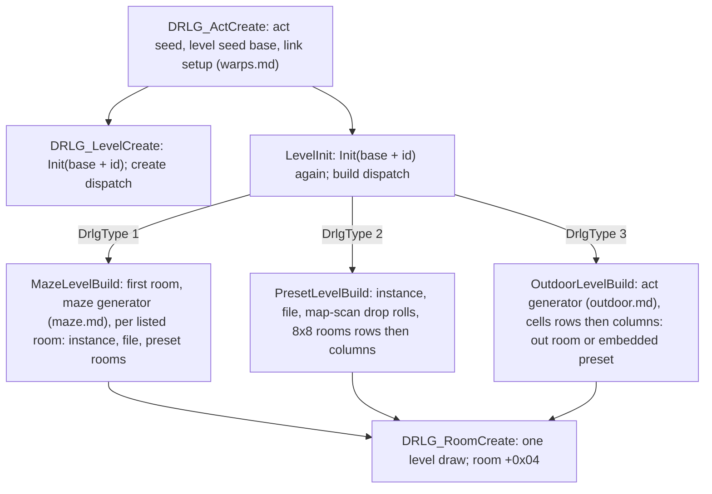
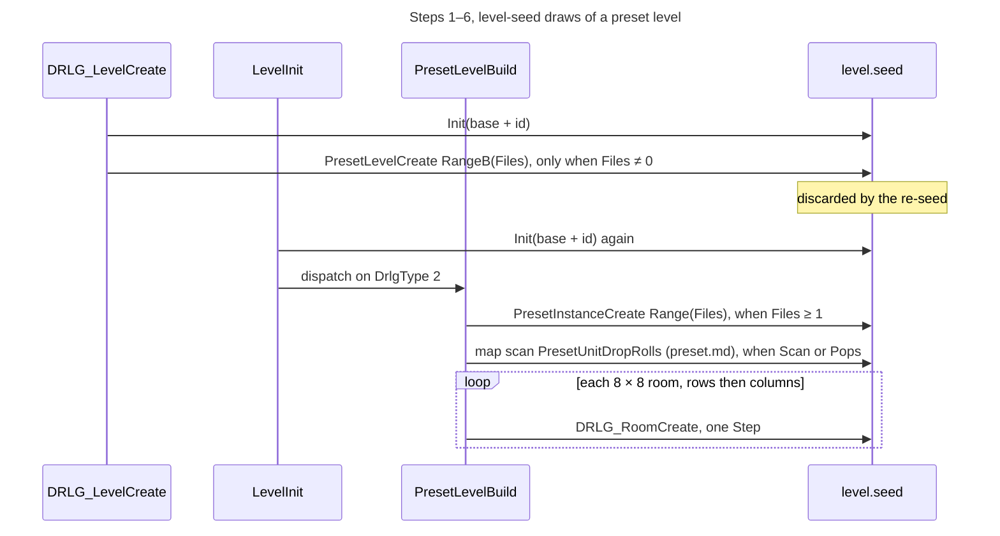
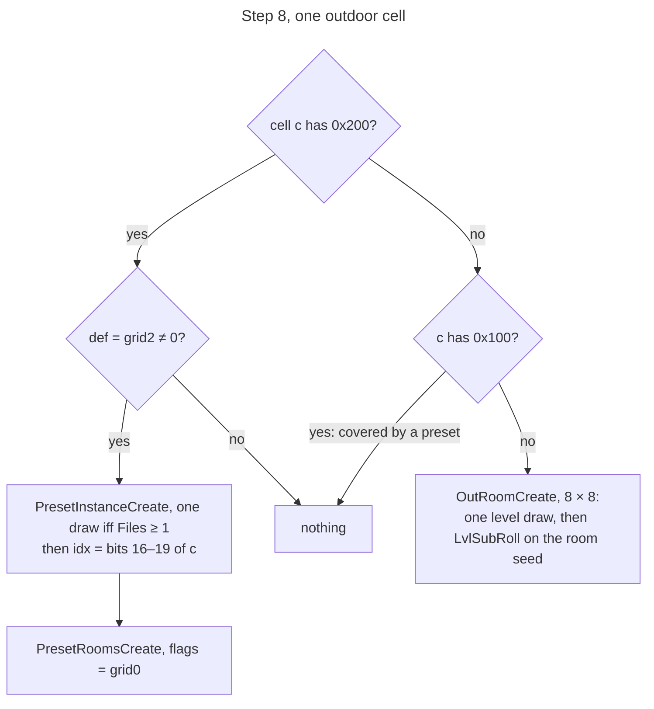
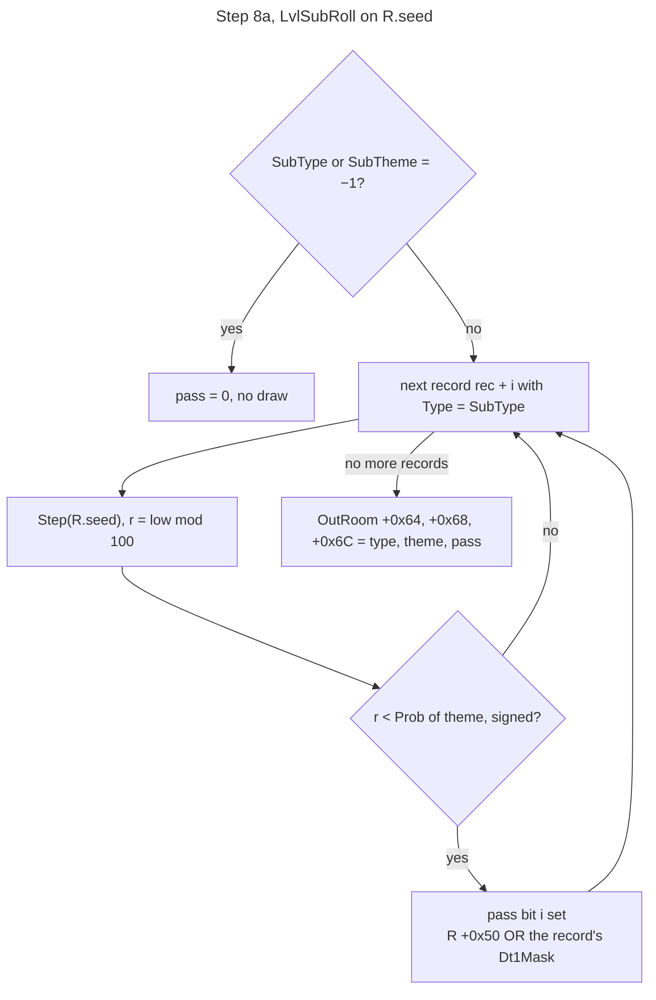
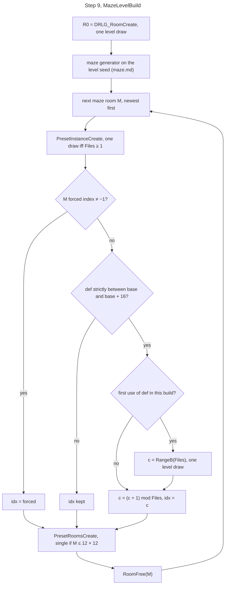

# DRLG overview: act → level → room, generator dispatch and room-creation order

## Purpose

Given an act and a level id, this spec says how the game turns the level seed into DRLG rooms: the
two dispatches on `Levels.DrlgType`, every draw each generator makes on the level seed, the order in
which rooms are created (each creation is one level draw, so the order fixes every room's seed), and
how a preset's DS1 file is chosen. The maze generator that runs inside step 9 is specified in
[maze.md](maze.md), and the act's level links, the warp slots and the warp points built after every level
are in [warps.md](warps.md). The outdoor generators that run inside step 7 (the act layouts, the border pass,
the placements and the file rotation) are specified in [outdoor.md](outdoor.md). The preset-unit drop rolls, which also draw on the
level seed, are specified in [preset.md](preset.md). What happens when a
room is activated (its tiles and the k room-seed draws) is in [room-tiles.md](room-tiles.md), and the active room's
collision grid, its logic regions and the spawn position tests are in [collision.md](collision.md).
Primitives (`Step`, `Range`, `RangeB`, `Init`) are those of [rng](../rng/README.md). The act and level
seeds are defined in [rng/seeds](../rng/seeds.md) steps 3–5.

## Entry points

| When | Function | Tag |
|---|---|---|
| Act created (server and client copy) | fn:DRLG_ActCreate@0x00642DA0 | [C] |
| Level record created and seeded | fn:DRLG_LevelCreate@0x00642AE0 | [C] |
| Level built (rooms created), lazily, on first need after each load | fn:sub_006424A0_LevelInit@0x006424A0 | [C] |
| Maze level: create / build | fn:sub_00673B10_MazeLevelCreate@0x00673B10 / fn:sub_00673B30_MazeLevelBuild@0x00673B30 | [C] |
| Preset level: create / build | fn:sub_00667430_PresetLevelCreate@0x00667430 / fn:sub_00668100_PresetLevelBuild@0x00668100 | [C] |
| Outdoor level: create / build | fn:sub_00675320_OutdoorLevelCreate@0x00675320 / fn:sub_00675360_OutdoorLevelBuild@0x00675360 | [C] |
| One DRLG room created (one level draw) | fn:DRLG_RoomCreate@0x0066B3E0 | [C] |
| Level unloaded (rooms and per-build state freed) | fn:sub_00642010_LevelUnload@0x00642010, run:2026-10-16-sweep-roomk | [C] |
| DRLG room activated (tiles, k, active room) | fn:sub_0061B730_RoomActivateB@0x0061B730 → fn:DRLG_RoomActivate@0x006422A0, see [room-tiles.md](room-tiles.md) | [C] |

- [C] `LevelInit` is called by `DRLG_ActCreate` (the act's town, after the link setup), by
  `sub_00642C30_RoomFromCoords`, by `sub_00668100_PresetLevelBuild` (the linked levels of a preset level,
  below) and from `0x0066B2B0` (`LevelPointFind`) and `0x0066C220`: all five logged by return address (23, 28, 1,
  16 and 123 builds). (fn:DRLG_ActCreate@0x00642DA0, fn:sub_00642C30_RoomFromCoords@0x00642C30,
  run:2026-10-16-sweep-roomk, [drlg/0003 § Plan 0038 batch H5c](../../findings/drlg/0003-generator-dispatch.md#plan-0038-batch-h5c-run2026-10-16-sweep-roomk))
- [I] `LevelInit` is also called from `0x0066B030` (two sites), which no run reached.
  ([drlg/0003](../../findings/drlg/0003-generator-dispatch.md#level-creation-and-the-re-seed))

## Inputs

### Tables

| Anchor | Used for |
|---|---|
| tbl:Levels.txt:DrlgType | both dispatches: 1 maze, 2 preset, 3 outdoor (leveldefs `+0x30`) |
| tbl:Levels.txt:LevelType | the level type (level `+0x1C0`): outdoor room DT1 mask, maze file-rotation base |
| tbl:Levels.txt:SubType, tbl:Levels.txt:SubTheme | `LvlSub` records rolled for each outdoor room (leveldefs `+0x38`, `+0x3C`) |
| tbl:LvlPrest.txt:LevelId | `LvlPrestByLevel`: the first record whose `LevelId` is the level's id |
| tbl:LvlPrest.txt:Def | `LvlPrestByDef`: the record of a preset def |
| tbl:LvlPrest.txt:Files | operand of the file-index draw (`+0x40`) |
| tbl:LvlPrest.txt:File1 | `File1..6` (`+0x44 + 0x3C·i`): the DS1 of index i |
| tbl:LvlPrest.txt:SizeX, tbl:LvlPrest.txt:SizeY | preset instance size, when both are non-zero (`+0x28`, `+0x2C`) |
| tbl:LvlPrest.txt:Scan, tbl:LvlPrest.txt:Pops | map-scan gate before a preset's rooms are made (`+0x34`, `+0x38`) |
| tbl:LvlPrest.txt:Dt1Mask | every preset room's DT1 mask (`+0x1AC`), see [room-tiles.md](room-tiles.md) |
| tbl:LvlMaze.txt:Level, tbl:LvlMaze.txt:SizeX, tbl:LvlMaze.txt:SizeY | the first maze room's size |
| tbl:LvlSub.txt:Prob0 | `Prob[SubTheme]` of each `SubType` record in the outdoor room roll (`+0x11C`) |
| tbl:LvlSub.txt:Dt1Mask | OR-ed into an outdoor room's DT1 mask when its record is picked (`+0x48`) |

### Runtime state

Offsets are byte offsets into the owner. No struct in `re/types/` exists yet.

| State | Type | Owner offset | Source |
|---|---|---|---|
| level seed base | `u32` | act `+0x470` | [rng/seeds](../rng/seeds.md) step 3b |
| level seed | `Seed` | level `+0x1C4` | step 1, step 2 |
| level id, `DrlgType`, level type | `u32` | level `+0x1D0`, —, `+0x1C0` | leveldefs |
| preset level data: file index | `i32` | level data `+0x04` | step 3 |
| preset instances | list, prepended | level `+0x1B0` | step 4 |
| maze file-rotation counters | list of `{Def, Files, c, next}`, 0x10 bytes each | level `+0x1CC` | step 9 |
| level's rooms | list, prepended (next at room `+0x24`), count `+0x08` | level `+0x10` | step 5 |
| DRLG room first draw | `u32` | DRLG room `+0x04` | [rng/seeds](../rng/seeds.md) step 5 |
| DRLG room seed | `Seed` | DRLG room `+0x14` | [rng/seeds](../rng/seeds.md) step 5 |
| DRLG room type | `u32`: 1 outdoor, 2 preset | DRLG room `+0x48` | step 5 |
| DRLG room DT1 mask | `u32` | DRLG room `+0x50` | steps 6, 8 |
| preset instance | 0x58 bytes: `+0x04` file index, `+0x08` record, `+0x0C` DS1, `+0x3C` client-objects flag | — | step 4 |
| outdoor room SubType pass | `+0x64` type, `+0x68` theme, `+0x6C` mask | OutRoom (DRLG room `+0x20`) | step 8 |

### Constants

| Name | Value | Anchor | Tag |
|---|---|---|---|
| preset room block | 8 × 8 cells | fn:sub_00667ED0_PresetRoomsCreate@0x00667ED0 | [C] |
| maze room single-room limit | 12 × 12 | fn:sub_00673A60_MazeLevelRooms@0x00673A60 | [C] |
| outdoor room DT1 mask by level type, checked types | 2 → `0x44103`; 16 → `0x1`; 21 → `0x4`; 31 → `0x11` | fn:sub_006750F0_OutdoorRoomsCreate@0x006750F0, run:2026-10-11-drlg-roomk, run:2026-10-14-collision, run:2026-10-16-sweep-roomk | [C] |
| outdoor room DT1 mask by level type, other types | 22, 27, 28 → `0x1`; 30 → `0x11`; any other type → 0 | fn:sub_006750F0_OutdoorRoomsCreate@0x006750F0 | [I] |
| `MAZE_DEF_BASE` by level type | 3 → `0x34`, 4 → `0x6C`, 7 → `0xA7`, 8 → `0xCD`, 10 → `0x101`, 13 → `0x12D`, 17 → `0x19D`, 18 → `0x1E1`, 22 → `0x2F1`, 24 → `0x298`, 25 → `0x2C0`, 28 → `0x344`, 33 → `0x3EA`, 34 → `0x422`, 35 → `0x41C`; other types: no rotation | fn:sub_006738C0_MazePresetFile@0x006738C0 (`switch` at `0x00673909`) | [C] |

- [C] The outdoor mask values are checked against the logged rooms for four level types: 2 in 56 Blood Moor rooms
  (run:2026-10-11-drlg-roomk), 16 and 21 in 40 and 20 rooms (run:2026-10-14-collision), and 31 in 145 type-1 rooms of
  levels 111, 112 and 117, with the `SubType` masks ORed (run:2026-10-16-sweep-roomk). No run logged a type-1 room of
  types 22, 27, 28 or 30, so the second row is read from the code only.
  ([drlg/0002](../../findings/drlg/0002-room-build-draws.md#answer-summary), [drlg/0002 § Plan 0038 batch H5c](../../findings/drlg/0002-room-build-draws.md#plan-0038-batch-h5c-run2026-10-16-sweep-roomk))

## Algorithm











`L` is the level, `L.seed` its seed, `base` the act's level seed base. Every `Range`, `RangeB` and
`Step` below on `L.seed` is a **level draw**, and the level seed has no other consumer outside the
named oracles and the preset drop rolls of step 5a ([preset.md](preset.md)).

```
1. CreateLevel(act, id) → L:                                          [C] (fn:DRLG_LevelCreate@0x00642AE0, run:2026-10-12-drlg-gen)
     Init(L.seed, (u32) (base + id))                                  ; rng/seeds step 4
     dispatch on DrlgType:
       1 → MazeLevelCreate:   the lvlmaze row by level id, position   ; no draw
       2 → PresetLevelCreate:                                         ; step 3
       3 → OutdoorLevelCreate: allocate the 0x268-byte outdoor record ; no draw
     prepend L to the act's level list

2. LevelInit(L):                                                      [C] (fn:sub_006424A0_LevelInit@0x006424A0, run:2026-10-12-drlg-gen)
     Init(L.seed, (u32) (base + L.id))                                ; again, same start value
     L.rotations ← empty                                              ; see step note 9
     dispatch on DrlgType: 1 → MazeLevelBuild (9), 2 → PresetLevelBuild (6), 3 → OutdoorLevelBuild (7)
     LevelRoomStateRestore(L); LevelWarpPointsBuild(L)                ; no draw; warps.md § E [C] (fn:sub_00642390_LevelRoomStateRestore@0x00642390, fn:sub_006423D0_LevelWarpPointsBuild@0x006423D0, run:2026-10-15-drlg-maze)

3. PresetLevelCreate(L):                                              [C] (fn:sub_00667430_PresetLevelCreate@0x00667430, run:2026-10-12-drlg-gen)
     P ← LvlPrestByLevel(L.id)                                        ; fatal if none
     files: i32 ← P.Files
     L.data.idx: i32 ← (files ≠ 0) ? RangeB(L.seed, files) : −1       ; level draw iff files ≠ 0

4. PresetInstanceCreate(L, def, rect, seed = L.seed) → ps:            [C] (fn:sub_00666ED0_PresetInstanceCreate@0x00666ED0, run:2026-10-12-drlg-gen)
     ps.def ← def;  ps.rec ← LvlPrestByDef(def)
     n: i32 ← ps.rec.Files
     ps.idx: i32 ← Range(L.seed, n)                                   ; level draw iff n ≥ 1; n ≤ 0 → 0, no draw
     ps.x, ps.y ← rect.x, rect.y
     (ps.w, ps.h) ← (SizeX ≠ 0 and SizeY ≠ 0) ? (SizeX, SizeY) : (rect.w, rect.h)
     ps[+0x3C] ← 1;  prepend ps to L[+0x1B0]
     The DS1 the instance loads is ps.rec.File(ps.idx + 1).

5. PresetRoomsCreate(L, ps, flags, single):                           [C] (fn:sub_00667ED0_PresetRoomsCreate@0x00667ED0, fn:sub_00666680_PresetRoomCreate@0x00666680, run:2026-10-12-drlg-gen)
   5a. PresetMapScan(L, ps):                                          [C] (fn:DRLG_PresetMapScan@0x00667970, run:2026-10-13-drlg-preset)
         room-flag grid ← flags | the seam bits of the level (warps.md § D)   ; always, no draw
                                                                      [C] (fn:DRLG_PresetMapScan@0x00667970, run:2026-10-15-drlg-maze)
         if ps.rec.Scan = 0 and ps.rec.Pops = 0: nothing more
         else: load File(ps.idx + 1) into ps[+0x0C];
               PresetUnitDropRolls on L.seed                          ; preset.md steps 2a, 3; step note 5
               if Scan: warp-slot, waypoint and level-point cells     ; warps.md § D, no draw
   5b. if single:                                                     ; one room for the whole preset
         R ← DRLG_RoomCreate(L, 2) over ps's rect                     ; one level draw
       else:
         for y0 in 0, 8, 16, … < ps.h:                                ; rows outer
           for x0 in 0, 8, 16, … < ps.w:                              ; columns inner
             R ← DRLG_RoomCreate(L, 2) at (ps.x + x0, ps.y + y0),     ; one level draw
                 size min(8, ps.w − x0) × min(8, ps.h − y0)
       every R: R[+0x50] ← ps.rec.Dt1Mask; R → ps (R[+0x20] preset room data)
                                                                      [C] (fn:sub_00667ED0_PresetRoomsCreate@0x00667ED0, tbl:LvlPrest.txt:Dt1Mask, run:2026-10-11-drlg-roomk)
       DRLG_RoomCreate itself: rng/seeds step 5 (Step(L.seed); R.seed ← Init(L.seed.low); Step(R.seed); R[+0x04] ← R.seed.low)

6. PresetLevelBuild(L):                                               [C] (fn:sub_00668100_PresetLevelBuild@0x00668100, run:2026-10-12-drlg-gen)
     ps ← PresetInstanceCreate(L, LvlPrestByLevel(L.id).Def, L.rect)  ; step 4: one draw iff Files ≥ 1
     if L.data.idx = −1: L.data.idx ← ps.idx  else: ps.idx ← L.data.idx
     PresetRoomsCreate(L, ps, flags 0, single false)
     if L.id ∈ {40, 103, 109}: act[+0x488](…)                         ; town callback   [C] (0x00668100, run:2026-10-16-sweep-roomk)
     else if act[+0x454] ≠ 0 and ps.rec.AutoMap ≠ 0:                  [C] (fn:sub_00668100_PresetLevelBuild@0x00668100, tbl:LvlPrest.txt:AutoMap, run:2026-10-16-sweep-roomk)
       LevelInit every linked level not yet built; activate this level's rooms

7. OutdoorLevelBuild(L):                                              [C] (fn:sub_00675360_OutdoorLevelBuild@0x00675360, run:2026-10-12-drlg-gen)
     cw: i32 ← L.w ÷ 8;  ch: i32 ← L.h ÷ 8                            ; signed, toward zero; four cw × ch cell grids
     outdoor generator on L.seed: 0x0067D050, 0x00675080, then the act's generator
       (L.id = 134 → the Act II one, else by act index)               ; outdoor.md § A–L
     OutdoorRoomsCreate(L)                                            ; step 8

8. OutdoorRoomsCreate(L):                                             [C] (fn:sub_006750F0_OutdoorRoomsCreate@0x006750F0, run:2026-10-12-drlg-gen)
     mask: u32 ← outdoor room DT1 mask of L's level type (Constants)
     for cy in 0 ..< ch:                                              ; rows outer
       for cx in 0 ..< cw:                                            ; columns inner
         c: u32 ← cell(cx, cy)                                        ; the outdoor generator's output (outdoor.md § B)
         x: i32 ← L.rect.x + 8·cx;  y: i32 ← L.rect.y + 8·cy          ; cell position [C] (fn:sub_006750F0_OutdoorRoomsCreate@0x006750F0, 0x0067522A, 0x0067523F, run:2026-10-15-drlg-outdoor: 11 516 out rooms)
         if c & 0x200:                                                ; preset anchor cell
           def ← grid2(cx, cy)
           if def ≠ 0:
             ps ← PresetInstanceCreate(L, def, {x, y, 0, 0})          ; one draw iff Files ≥ 1
             ps.idx ← (c >> 16) & 0xF                                 ; overwrites the draw
             PresetRoomsCreate(L, ps, flags = grid0(cx, cy), single false)
         else if not (c & 0x100):
           OutRoomCreate(L, (x, y), 8 × 8, mask)                      ; 8a
         ; c & 0x100 without 0x200: covered by a preset, nothing
   8a. OutRoomCreate:                                                 [C] (fn:sub_0067D540_OutRoomCreate@0x0067D540, fn:sub_006706A0_LvlSubRoll@0x006706A0, run:2026-10-12-drlg-gen)
         R ← DRLG_RoomCreate(L, 1)                                    ; one level draw
         R[+0x50] ← mask
         LvlSubRoll(R):                                               ; on R.seed, after R's own creation draws
           t ← Levels[L.id].SubType;  th ← Levels[L.id].SubTheme
           pass: u32 ← 0
           if t = −1 or th = −1: skip the loop                        ; no draw: [C] with both −1 (fn:sub_006706A0_LvlSubRoll@0x006706A0, 0x006706A9, 0x006706B8, run:2026-10-15-drlg-outdoor: 1636 calls),
                                                                      ; [I] with only one −1, no stock case (fn:sub_006706A0_LvlSubRoll@0x006706A0, step note 8)
           rec ← the first LvlSub record with Type = t
           for i ← 0, 1, …, while records rec+i have Type = t:
             Step(R.seed)                                             ; room draw, one per record
             r: u32 ← R.seed.low mod 100                              ; unsigned
             if (i32) r < LvlSub[rec+i].Prob[th]:                     ; signed compare
               pass |= 1 << i;  R[+0x50] |= LvlSub[rec+i].Dt1Mask
           OutRoom +0x64, +0x68, +0x6C ← t, th, pass

9. MazeLevelBuild(L):                                                 [C] (fn:sub_00673B30_MazeLevelBuild@0x00673B30, run:2026-10-12-drlg-gen)
     R0 ← DRLG_RoomCreate(L, 2)                                       ; one level draw
     R0.size ← (lvlmaze.SizeX, lvlmaze.SizeY), centred in L.rect; link R0 to L
     maze generator on L.seed and the maze rooms' seeds               ; maze.md: creates and removes maze rooms
                                                                      [C] (fn:sub_00673B30_MazeLevelBuild@0x00673B30, run:2026-10-15-drlg-maze)
     for M in L.rooms, list order (newest first; M.next read before the call):
       MazeLevelRooms(L, M)                                           ; 9a
   9a. MazeLevelRooms(L, M):                                          [C] (fn:sub_00673A60_MazeLevelRooms@0x00673A60, run:2026-10-12-drlg-gen)
         ps ← PresetInstanceCreate(L, M.def, M.rect)                  ; one draw iff Files ≥ 1
         MazePresetFile(ps, forced = M.idx, L)                        ; 9b
         PresetRoomsCreate(L, ps, flags 0, single = (M.w ≤ 12 and M.h ≤ 12))
         unit nodes of M with [+0x0C] = 1 → 0x0066B5E0                ; no draw [C] (0x0066B5E0, run:2026-10-15-drlg-maze: 393 maze builds)
         RoomFree(M)                                                  ; the level keeps only the preset rooms
   9b. MazePresetFile(ps, forced, L):                                 [C] (fn:sub_006738C0_MazePresetFile@0x006738C0, run:2026-10-12-drlg-gen)
         if forced ≠ −1: ps.idx ← forced; return
         b ← MAZE_DEF_BASE[L.levelType], or return (ps.idx kept) if the type has none
         if b < ps.def < b + 16:                                      ; strict on both sides
           if L.rotations has no node for ps.def:                     ; first use in this build
             c: i32 ← RangeB(L.seed, Files)                           ; one level draw (Files ≥ 1)
             add {ps.def, Files, c} to L.rotations
           node.c ← (node.c + 1) mod node.Files                       ; signed idiv
           ps.idx ← node.c
```

Step notes:

1. The create-time dispatch makes at most one level draw (the preset level's index). [C]
   (fn:DRLG_LevelCreate@0x00642AE0, run:2026-10-12-drlg-gen: 149 level creations) `DRLG_LevelCreate` also
   copies leveldefs `+0x34` (`LevelType`) to level `+0x1C0`, its only DRLG writer; the room DT1 list and
   the maze rotation read the type from there. [C] (fn:DRLG_LevelCreate@0x00642AE0, 0x00642B23–0x00642B2D,
   tbl:Levels.txt:LevelType, run:2026-10-12-drlg-gen, run:2026-10-11-drlg-roomk: every logged copy of `+0x1C0` over
   123 levels equals `LevelType`; [drlg/0003 § Plan 0038 batch S4a](../../findings/drlg/0003-generator-dispatch.md#plan-0038-batch-s4a-2026-10-16))
2. **The level seed is initialised twice with the same value.** Every level draw that creates rooms
   happens after `LevelInit`'s re-seed, so the create-time draw is discarded, and the room sequence
   doesn't depend on anything that ran between creation and build. [C]
   (fn:sub_006424A0_LevelInit@0x006424A0, run:2026-10-12-drlg-gen: 32 builds) A level is built lazily.
   When the player leaves it, `sub_00642010_LevelUnload` frees its rooms and its rotation list, and on
   re-entry `LevelInit` runs again on the same level object. [C] (fn:sub_00642010_LevelUnload@0x00642010,
   `0x00642159`–`0x0064217F`, fn:sub_0066C100_RoomFree@0x0066C100, run:2026-10-16-sweep-roomk: 188 unloads, 59
   rebuilds of an unloaded level object, no level built twice without an unload between; [drlg/0003 § Plan 0038 batch H5c](../../findings/drlg/0003-generator-dispatch.md#plan-0038-batch-h5c-run2026-10-16-sweep-roomk)) The rebuild repeats the same
   draws, files and rooms: in the owner's Catacombs entry levels 35 and 36 were built three times each
   and level 34 twice, all identical to the model. [C] (run:2026-10-12-drlg-gen)
3. `PresetLevelCreate` uses `RangeB`, the second compile of the guarded range ([rng](../rng/README.md)
   step 2). With `Files = 0` the index is −1 and no draw is made. [C]
   (fn:sub_00667430_PresetLevelCreate@0x00667430, fn:RNG_RangeB@0x0045C3E0, run:2026-10-12-drlg-gen)
4. **`Files` is the operand, not the number of named files.** `PresetInstanceCreate` always passes
   `LvlPrest +0x40`. A power-of-two operand is reduced with a mask, any other with an unsigned `mod`,
   which give the same result ([rng](../rng/README.md) step note 2). [C]
   (fn:sub_00666ED0_PresetInstanceCreate@0x00666ED0, run:2026-10-12-drlg-gen: 960 instances, each
   loading exactly the predicted file) An index ≥ `Files` arises only from an override: the level's
   index (step 6), an outdoor cell's bits 16–19 (step 8) or a maze cell's forced index (step 9b). In the
   run that covered 9 of the 81 records whose `Files` and named count disagree. [C]
   (run:2026-10-12-drlg-gen, tbl:LvlPrest.txt:Files) The other 72 can only get their index through the
   same three overrides. [C] (fn:sub_006772C0_LevelLinkBuild@0x006772C0,
   fn:sub_006750F0_OutdoorRoomsCreate@0x006750F0, fn:sub_006738C0_MazePresetFile@0x006738C0,
   fn:sub_00666ED0_PresetInstanceCreate@0x00666ED0: three call sites and one `PresetSetFile` site, Ghidra and objdump
   agreeing; [drlg/0003 § Plan 0038 batch S4b](../../findings/drlg/0003-generator-dispatch.md#plan-0038-batch-s4b-2026-10-16))
   Neither record lookup tests `Expansion`. This has no stock observable: every `Expansion` 1 record is an Act V
   record, and a classic game builds no Act V level ([drlg/0003 § Plan 0038 batch S4a](../../findings/drlg/0003-generator-dispatch.md#plan-0038-batch-s4a-2026-10-16)). [I] (fn:sub_0061F0E0_LvlPrestByLevel@0x0061F0E0,
   fn:sub_0061F0B0_LvlPrestByDef@0x0061F0B0, tbl:LvlPrest.txt:Expansion)
5. **The map scan steps the level seed.** At build time `DRLG_PresetUnitDropRolls` runs from
   `PresetMapScan` on the level seed, between the instance draw and the first room creation: one level
   draw per drawing unit of the DS1 ([preset.md](preset.md) steps 2a and 3). With the rolls modelled the
   run replays with every seed asserted: 91 calls (52 in the five scripted logs, 39 in the owner's
   Catacombs log), 2 of which drew (both in Act II), 21 244 checks, 0 mismatches. [C]
   (fn:DRLG_PresetMapScan@0x00667970, fn:DRLG_PresetUnitDropRolls@0x00667620,
   run:2026-10-12-drlg-gen, run:2026-10-13-drlg-preset) When the map scan has loaded the DS1, the
   activation-time DS1 load skips its own rolls on the room seed ([room-tiles.md](room-tiles.md) step 1,
   [preset.md](preset.md) step 2b). [C] (fn:DRLG_PresetRoomLoadDs1@0x00667890,
   run:2026-10-13-drlg-preset) The 8 × 8 split gives the Act I town (56 × 40) 35 rooms
   and a 24 × 24 preset 9, created rows outer, columns inner. [C]
   (fn:sub_00667ED0_PresetRoomsCreate@0x00667ED0, run:2026-10-12-drlg-gen)
6. **The level's index wins at build time unless it is −1.** The create-time `RangeB` and the build-time
   `Range` start from the same seed value, so they agree whenever nothing overwrote the level's index. [C]
   (fn:sub_00668100_PresetLevelBuild@0x00668100, run:2026-10-12-drlg-gen) The act's link setup
   overwrites it for levels 1 and 40 (the town orientation, from the link value) and for level 27 (one
   act-seed draw while it builds level 6): levels 1 and 40 changed index between creation and build in
   run:2026-10-12-drlg-gen, and level 27 was built with its drawn index in run:2026-10-13-drlg-preset
   ([preset.md](preset.md) step 7). [C] (fn:sub_006772C0_LevelLinkBuild@0x006772C0, run:2026-10-12-drlg-gen,
   run:2026-10-13-drlg-preset) The level-27 draw is the link builder's only act-seed draw, made while its
   per-entry loop handles level 6, after the layout of table `0x006F0840`
   ([warps.md § C](warps.md#c-level-rectangles-and-the-links-after-the-layout)). [C]
   (fn:sub_006772C0_LevelLinkBuild@0x006772C0, run:2026-10-15-drlg-maze) The town callback made no level draw in the run. [C] (run:2026-10-12-drlg-gen)
7. The seed entering the outdoor generator is the re-seeded level seed. The generator itself, from the
   vertex ring to the cell grids, is [outdoor.md](outdoor.md#a-the-window): 522 windows of 29 levels
   reproduced, every level-seed step checked. [C] (fn:sub_00675360_OutdoorLevelBuild@0x00675360,
   run:2026-10-12-drlg-gen, run:2026-10-15-drlg-outdoor) Level 134 takes the Act II generator. [I]
   (fn:sub_00675360_OutdoorLevelBuild@0x00675360)
8. Every embedded preset in the run was followed by the cell override, and its instance loaded that
   file: 914 instances, 830 with a draw and 84 with `Files = 0`. The cell value, bits 16–19 included, is the
   outdoor generator's output ([outdoor.md § B](outdoor.md#b-the-cell-grid-and-its-bits)). [C] (fn:sub_00666EC0_PresetSetFile@0x00666EC0,
   run:2026-10-12-drlg-gen) `LvlSubRoll` draws on the **new room's** seed, right after the room's own
   creation draws (rng/seeds step 5), so these draws come before the activation re-seed and are not
   part of k. The rolled mask and the room seed are reproduced 466 times. [C]
   (fn:sub_006706A0_LvlSubRoll@0x006706A0, run:2026-10-12-drlg-gen) With `SubType` and `SubTheme` both −1 the
   roll returns a pass mask of 0 at once, with no draw: 1636 logged calls, seed unchanged. [C]
   (fn:sub_006706A0_LvlSubRoll@0x006706A0, 0x006706A9, 0x006706B8, run:2026-10-12-drlg-gen,
   run:2026-10-15-drlg-outdoor, [drlg/0003 § Plan 0038 batch S4a](../../findings/drlg/0003-generator-dispatch.md#plan-0038-batch-s4a-2026-10-16)) With only one of them −1 the same return is taken; a `SubType`
   with no record also gives 0 and no draw; the theme index is not bounds-checked. None of the three has a stock
   case: only level 120 has one −1 and it has no out room, no level names a `SubType` without a record, and none has
   a `SubTheme` above 4. [I] (fn:sub_006706A0_LvlSubRoll@0x006706A0, 0x006706A9, 0x006706B8) Each room's position is
   `L.rect + 8·(cx, cy)`; an embedded preset gets the rect `{x, y, 0, 0}` and its rooms' size and position come from
   the preset (`drlg/preset`). The position changes no draw. [C] (fn:sub_006750F0_OutdoorRoomsCreate@0x006750F0,
   0x006751A8–0x006751C9, 0x006751FA–0x00675222, run:2026-10-15-drlg-outdoor: every one of 11 516 out rooms has its
   logged rect and creation order, and the level seed matches after every window; [drlg/0003 § Plan 0038 batch S4a](../../findings/drlg/0003-generator-dispatch.md#plan-0038-batch-s4a-2026-10-16)) The DT1 mask it produces (the
   level-type value OR the picked records' `Dt1Mask`) equals the room's `+0x50` in all 56 Blood Moor
   rooms. [C] (fn:sub_0067D540_OutRoomCreate@0x0067D540, run:2026-10-11-drlg-roomk)
9. **Maze rooms become preset rooms.** The maze generator works with its own rooms. Afterwards each
   listed maze room is converted into a preset instance, which creates the level's real (type 2)
   rooms, and is freed. The seed entering the maze oracle is the seed after the first room's draw;
   the conversion order is the room list the oracle leaves, newest first. [C]
   (fn:sub_00673B30_MazeLevelBuild@0x00673B30, fn:sub_00673A60_MazeLevelRooms@0x00673A60,
   run:2026-10-12-drlg-gen: Den of Evil, Sewers Level 1, Catacombs Levels 2–4) The generator's room
   count, positions, `Def`s, forced indices and list order are [maze.md](maze.md)'s; the conversion walks
   the list it leaves. [C] (fn:sub_00673B30_MazeLevelBuild@0x00673B30, run:2026-10-15-drlg-maze: 230 windows)
   **Rotation counters are per build.** The list lives at
   level `+0x1CC`, nodes are prepended at `0x006739DA`, and `LevelUnload` frees it and zeroes the field,
   so each build starts without counters. [C] (fn:sub_006738C0_MazePresetFile@0x006738C0,
   fn:sub_00642010_LevelUnload@0x00642010, run:2026-10-12-drlg-gen, run:2026-10-15-drlg-maze: per-build counters
   reproduce 1648 first-use draws and 2424 rotations over 393 builds, rebuilds included; run:2026-10-16-sweep-roomk:
   `LevelUnload` frees a non-empty list in 76 unloads; [drlg/0003 § Plan 0038 batch S4a](../../findings/drlg/0003-generator-dispatch.md#plan-0038-batch-s4a-2026-10-16)) Every use, the first included, advances the counter before
   it is used: the first use of a def yields `(RangeB + 1) mod Files`. [C]
   (fn:sub_006738C0_MazePresetFile@0x006738C0, run:2026-10-12-drlg-gen: 16 first uses and 18 rotations in
   the scripted entries, 42 and 73 in the owner's Catacombs entry)

### Act-seed consumers

- [C] Before any level is built, `DRLG_ActCreate` runs the per-act link setup, specified in
  [warps.md § A–C](warps.md#a-per-act-link-setup):
  `sub_00678AD0_ActLinkInit` switches on the act index to one of `sub_00677750_ActLinkAct1`,
  `sub_00677790_ActLinkAct2`, `sub_006789B0_ActLinkAct3`, `sub_00678A20_ActLinkAct4`,
  `sub_00678A70_ActLinkAct5`, which run `sub_006772C0_LevelLinkBuild` and the `LinkPick` callbacks on a
  copy of the act seed. `LevelLinkBuild` creates each linked level (`sub_00642BB0_LevelEnsure`), writes its
  position, writes the link value into the index of preset levels 1 and 40, and writes level 27's index
  from one act-seed draw while it handles level 6. Then `DRLG_ActCreate` creates the act's town level and
  calls `LevelInit` on it. Acts I, II, IV and V are reproduced (run:2026-10-15-drlg-maze: 196 link builds);
  Act III's jungle layout steps the act seed itself and is [outdoor.md § J](outdoor.md#j-act-iii), reproduced in
  run:2026-10-15-drlg-outdoor. See also [rng/seeds](../rng/seeds.md) step 3d.
  (fn:DRLG_ActCreate@0x00642DA0, fn:sub_00678AD0_ActLinkInit@0x00678AD0, fn:sub_00677750_ActLinkAct1@0x00677750,
  fn:sub_00677790_ActLinkAct2@0x00677790, fn:sub_006789B0_ActLinkAct3@0x006789B0,
  fn:sub_00678A20_ActLinkAct4@0x00678A20, fn:sub_00678A70_ActLinkAct5@0x00678A70,
  fn:sub_006772C0_LevelLinkBuild@0x006772C0, fn:sub_00642BB0_LevelEnsure@0x00642BB0)

### Sub-generator boundaries

- [C] The outdoor act layouts (`0x0067D050`, `0x00675080`, `sub_006807F0_OutdoorAct1` … `sub_0067E600_OutdoorAct5`,
  window from the re-seed at `0x00675360` to the entry of `OutdoorRoomsCreate` at `0x006750F0`) were the first oracle until
  plan 0026; they are now modelled ([outdoor.md](outdoor.md)), and the run:2026-10-12-drlg-gen and
  run:2026-10-15-drlg-maze logs replay through them with 0 mismatches (206937 checks).
  (fn:sub_00675360_OutdoorLevelBuild@0x00675360, run:2026-10-15-drlg-outdoor) The maze generator was a second
  oracle (window `0x00673B41`–`0x00673F44`) until plan 0022; it is now modelled ([maze.md](maze.md)), and the
  logs of run:2026-10-12-drlg-gen replay through it with 0 mismatches. [C] (fn:sub_00673B30_MazeLevelBuild@0x00673B30,
  run:2026-10-15-drlg-maze) The preset-unit drop rolls were a third oracle until plan 0016; they are now
  modelled ([preset.md](preset.md)), and `tools/drlg.py gen --preset-oracle` keeps the old boundary for
  replays. [C] (fn:DRLG_PresetUnitDropRolls@0x00667620, run:2026-10-13-drlg-preset)
- [C] Under the two dispatch roots, 56 functions draw: 7 are the modelled level- and room-seed draws of
  this spec, 1 is the preset-unit drop rolls ([preset.md](preset.md)), 24 are inside the maze window, 17 inside the outdoor window and
  7 are the room activation path of [room-tiles.md](room-tiles.md), reached from `PresetLevelBuild`. Ghidra's
  `rngcallgraph` and an objdump walk of the same roots find the same 56 functions and 98 sites.
  (`re/rngclass/drlg-gen.txt`, fn:sub_006424A0_LevelInit@0x006424A0,
  [drlg/0003](../../findings/drlg/0003-generator-dispatch.md#completeness-of-the-rng-picture), [drlg/0003 § Plan 0038 batch S4b](../../findings/drlg/0003-generator-dispatch.md#plan-0038-batch-s4b-2026-10-16))

## Outputs

For each built level: its DRLG rooms, linked at level `+0x10` (newest first), each with its type
(`+0x48`), rect, first draw `+0x04` (which seeds it at activation), DT1 mask `+0x50`, and for type 2 its
preset instance with the chosen file index. For outdoor rooms also the SubType pass (`+0x64`–`+0x6C`)
that their activation applies. The level seed ends where the last modelled draw leaves it. [C]
(fn:sub_006424A0_LevelInit@0x006424A0, run:2026-10-12-drlg-gen: the seed at every build's end and the room
count of every build checked)

## Worked example

**Den of Evil (level 8), map seed 12345.** From `tools/drlg.py gen` over
`workspace/logs/gen-12345-bloodmoor.log` (run:2026-10-12-drlg-gen) and recomputed with `tools/rng.py`;
seeds are `low:high`, hex. `base = 015B2E77` ([rng/seeds](../rng/seeds.md) worked example). Level 8 is
`DrlgType` 1, level type 3, so `MAZE_DEF_BASE` is `0x34` and defs 53–67 rotate.

| Step | Operation | Level seed after | Result |
|---|---|---|---|
| 2 | `Init(base + 8)` | `015B2E7F:0000029A` | |
| 9 | first maze room: `DRLG_RoomCreate` | `E18C3A55:0090CE8A` | room `+0x04 = C176B603` |
| 9 | maze generator ([maze.md](maze.md#worked-example), example 1) | `334AA35A:02E00A8C` | list: def 98 at (1500, 1024), def 83 at (1524, 1000), def 58 at (1500, 1000), all 24 × 24, forced index −1 |
| 9a, 4 | def 98, `Files 1`: `Range(1)` | `12CE5ECE:1564B05F` | idx 0 (a draw even though n = 1) |
| 9b | 98 is outside (52, 68): kept | | `Act1\Caves\CaveNSpec.ds1` |
| 5 | 24 × 24 → 9 rooms, rows then columns | `42DB84E5:07D80981` … `F38BE870:3FC9280D` | first room `+0x04 = 88CC16D3` |
| 9a, 4 | def 83, `Files 2`: `Range(2)` | `83D2063D:6594D62E` | idx `0x83D2063D & 1 = 1` |
| 9b | 83 is outside (52, 68): kept | | `Act1\Caves\CaveWPre2.ds1` (`File2`) |
| 5 | first room of its split, at (1524, 1000), 8 × 8 | `0EE3F31F:36FB3592` | room `+0x04 = step(Init(0EE3F31F)).low = 8E258975` |
| 9a, 4 | def 58, `Files 2`: `Range(2)` | `35E895EF:42FA8C7C` | idx 1, then overridden |
| 9b | 58 is inside (52, 68), first use: `RangeB(2)` | `80265D67:167C1E75` | c = 1, then (1 + 1) mod 2 = 0 → idx 0, `Act1\Caves\CaveSE.ds1` |

The room with `+0x04 = 8E258975` is the worked example of [room-tiles.md](room-tiles.md#worked-example),
which takes it from creation to its active-room seed. The file the generator chose for it
(`CaveWPre2.ds1`) is the one whose grids the room-tile run reproduces.

## Reimplementation notes

- **Don't carry the create-time seed into the build.** Re-initialise the level seed in `LevelInit`; a
  model that continues from `PresetLevelCreate`'s draw is off by one draw for every preset level. [C]
  (fn:sub_006424A0_LevelInit@0x006424A0, run:2026-10-12-drlg-gen)
- **`Range(1)` draws.** A preset with `Files = 1` still consumes one level draw, and `Files ≤ 0` consumes
  none. [C] (fn:sub_00666ED0_PresetInstanceCreate@0x00666ED0, run:2026-10-12-drlg-gen)
- **Overwritten draws still count.** An outdoor cell's preset index replaces the instance draw, and a maze
  rotation replaces it too, but the instance draw was made and stepped the level seed. [C]
  (fn:sub_006750F0_OutdoorRoomsCreate@0x006750F0, fn:sub_006738C0_MazePresetFile@0x006738C0,
  run:2026-10-12-drlg-gen)
- **The rotation starts one past the draw.** The first use of a rotating maze def yields
  `(RangeB + 1) mod Files`, not the drawn value. Reset the counters at every `LevelInit`; keeping them
  across a level's rebuilds breaks the rebuild (this was the 226-mismatch checker bug of the owner's run).
  [C] (fn:sub_006738C0_MazePresetFile@0x006738C0, run:2026-10-12-drlg-gen)
- **The maze conversion walks a list that is newest first**, and the maze rooms themselves are freed: a
  maze level's activated rooms are all preset (type 2) rooms. [C] (fn:sub_00673A60_MazeLevelRooms@0x00673A60,
  run:2026-10-11-drlg-roomk: every Catacombs room had `+0x48 = 2`)
- **`LvlSubRoll` uses the room seed, not the level seed**, and runs at creation, before the activation
  re-seed: its draws never count in k. [C] (fn:sub_006706A0_LvlSubRoll@0x006706A0, run:2026-10-12-drlg-gen)

## Evidence

- [findings/drlg/0003-generator-dispatch.md](../../findings/drlg/0003-generator-dispatch.md): both dispatches,
  the level-seed draws per generator, the file index, the maze rotation, the oracles.
- [findings/drlg/0004-preset-units.md](../../findings/drlg/0004-preset-units.md) and [preset.md](preset.md):
  the drop rolls on the level seed (step note 5) and level 27's index (step note 6).
- [findings/drlg/0002-room-build-draws.md](../../findings/drlg/0002-room-build-draws.md): the room mask rules,
  `LvlSubRoll`, maze rooms as type 2.
- Plan 0038 re-tag: the "Plan 0038 batch S4a", "S4b" and "H5c" sections of
  [drlg/0003](../../findings/drlg/0003-generator-dispatch.md#plan-0038-batch-s4a-2026-10-16) and
  [drlg/0002](../../findings/drlg/0002-room-build-draws.md#plan-0038-batch-h5c-run2026-10-16-sweep-roomk), with
  [findings/drlg/experiments.md § run:2026-10-16-sweep-roomk](../../findings/drlg/experiments.md#run2026-10-16-sweep-roomk).
- [findings/drlg/experiments.md § run:2026-10-12-drlg-gen](../../findings/drlg/experiments.md#run2026-10-12-drlg-gen):
  5 scripted entries (14545 checks) and the owner's Catacombs entry (6608 checks), 0 mismatches.
- [maze.md](maze.md) and [warps.md](warps.md) (plan 0022): the maze generator, the act links and the warp points;
  [findings/drlg/experiments.md § run:2026-10-15-drlg-maze](../../findings/drlg/experiments.md#run2026-10-15-drlg-maze).
- [outdoor.md](outdoor.md) (plan 0026): the outdoor generators;
  [findings/drlg/experiments.md § run:2026-10-15-drlg-outdoor](../../findings/drlg/experiments.md#run2026-10-15-drlg-outdoor).
- [findings/drlg/experiments.md § run:2026-10-11-drlg-roomk](../../findings/drlg/experiments.md#run2026-10-11-drlg-roomk):
  the room masks and DT1 lists of 520 rooms.
- [rng/seeds](../rng/seeds.md): act, level and room seeds; [rng](../rng/README.md): primitives.
- Tables: [Levels](../../tables/Levels.md), [LvlPrest](../../tables/LvlPrest.md), [LvlMaze](../../tables/LvlMaze.md),
  [LvlSub](../../tables/LvlSub.md), [LvlTypes](../../tables/LvlTypes.md).

## Open questions

- ~~The outdoor act layouts are an oracle here~~: [outdoor.md](outdoor.md) (plan 0026), which replaced the oracle
  and re-ran the recorded logs.
- ~~Which code fills an outdoor cell's bits 16–19~~: `OutPresetPlace` and the seam opening,
  [outdoor.md § B, § D, § E](outdoor.md#b-the-cell-grid-and-its-bits). A maze cell's forced index is
  [maze.md](maze.md)'s (`DefFromExits`, the fixed rooms, Arcane, the hell start).
- ~~Where level 27's act-seed draw falls~~: step note 6 and [warps.md § C](warps.md#c-level-rectangles-and-the-links-after-the-layout).
- ~~`0x00642390` and `0x006423D0`~~: a room-state restore and the warp points, [warps.md § E](warps.md#e-warp-points).
- ~~The `LvlSubRoll` −1 branch and the outdoor cell position (step 8) are read from the code only.~~ Settled at plan
  0038 Phase 3 (step note 8): both −1 and the cell position are confirmed by run:2026-10-15-drlg-outdoor; the case
  with only one of the two −1 has no stock level with an out room and stays inferred there.
