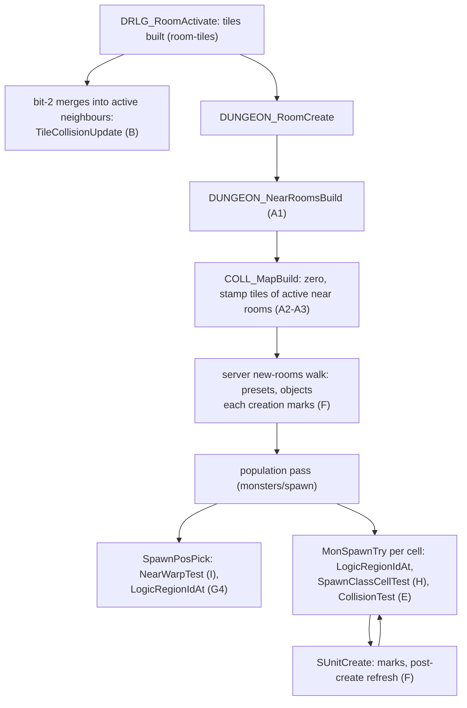
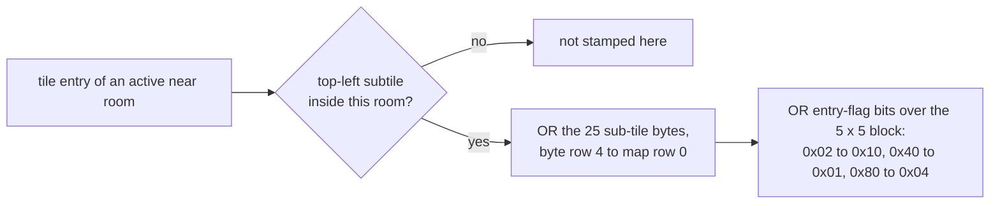
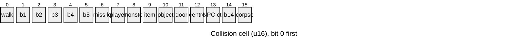
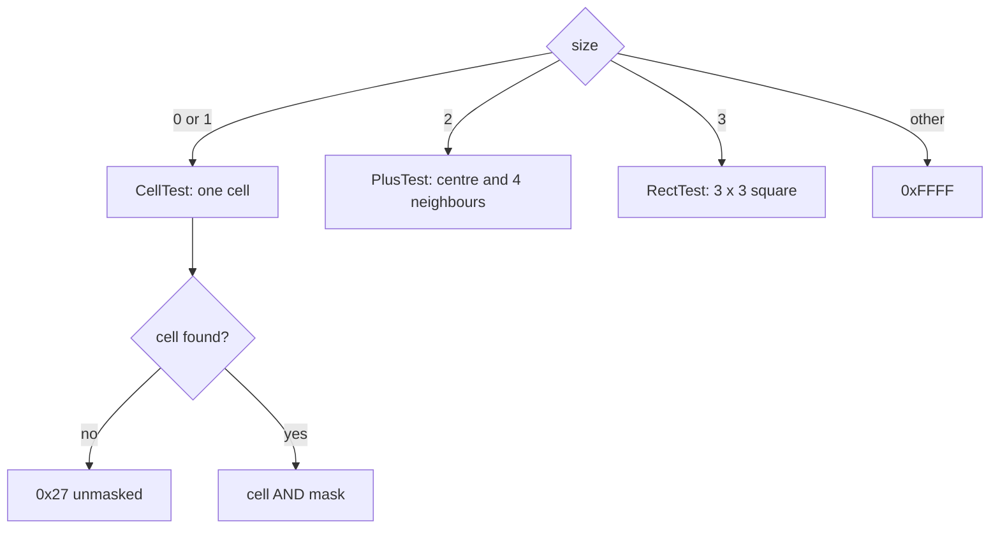
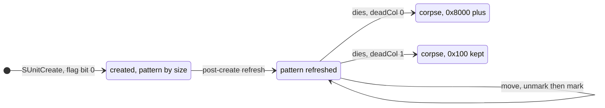
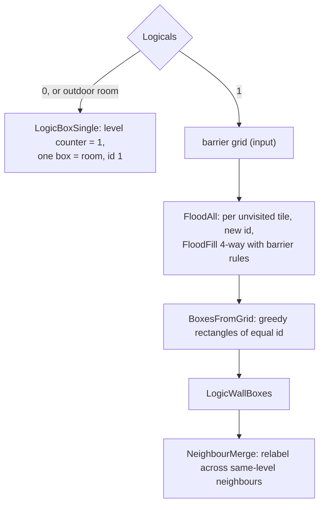
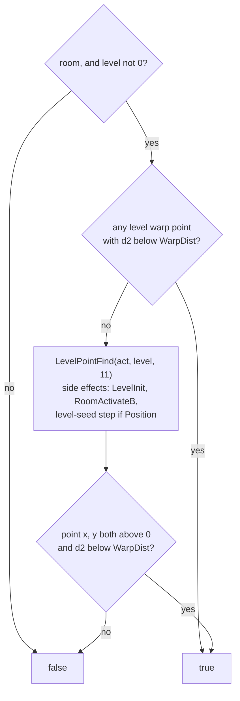
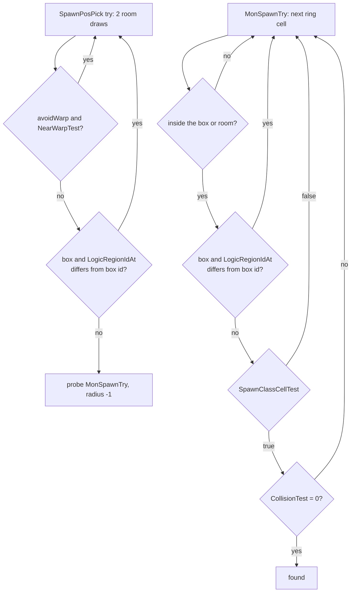

# Room collision grid, unit marks, logic regions and the spawn position tests

## Purpose

Every active room on the server owns a grid of u16 cells, one per subtile of its rectangle. The grid is
built once, when the room is activated, from the DT1 sub-tile bytes of the tiles that lie in the room. After
that, every unit that stands in the room marks its footprint into the grid and unmarks it when it moves,
dies or leaves. This spec gives the build, the marks, the meaning of each bit as the spawn code reads it, and
the four position tests that the population pass of [monsters/spawn](../monsters/spawn.md) calls:
`CollisionTest`, `LogicRegionIdAt`, `SpawnClassCellTest` and `NearWarpTest`. It also gives the `spawnCol` 1
tile placement `SpawnPosOnTile` and the logic regions that `LogicRegionIdAt` reads. None of the tests draws,
except `NearWarpTest` in one case (§ I) and `SpawnPosOnTile`, which makes one room draw. Movement, pathing and
line of sight read the same grid. They are named here, not specified.

## Entry points

| When | Function | Tag |
|---|---|---|
| Active room created at the end of `DRLG_RoomActivate`: near list, then the grid build | fn:DUNGEON_RoomCreate@0x00619890 → fn:DUNGEON_NearRoomsBuild@0x00619800, fn:COLL_MapBuild@0x0064C900, run:2026-10-14-collision (1439 activation dumps) | [C] |
| A bit-2 merge re-picks or hides a tile of an active neighbour | fn:sub_0064C860_TileCollisionUpdate@0x0064C860 (from fn:sub_0066E740_Bit2TileMerge@0x0066E740) | [I] |
| A unit is created with create flag bit 0: its path and its mark | fn:sub_00554850_SUnitPathCreate@0x00554850 → fn:PATH_DynamicCreate@0x00649D00, fn:UNIT_CollMarkRect@0x00620A70, run:2026-10-14-collision (410 monster creations) | [C] |
| A monster's post-create pattern refresh | fn:sub_005543B0_MonAlignSet@0x005543B0 → fn:sub_00554340_MonAlignPatternRefresh@0x00554340 → fn:sub_00649CA0_PathPatternRefresh@0x00649CA0, run:2026-10-14-collision (410 of 410 creations) | [C] |
| A monster or player dies (corpse mark) | fn:sub_00649F70_UnitCorpseColl@0x00649F70, run:2026-10-14-collision (408 monster deaths) | [C] |
| A preset room's logic regions, by `Logicals` | fn:sub_0066CCB0_LogicBoxSingle@0x0066CCB0, fn:sub_0066D110_LogicRegionsFromDs1@0x0066D110; the selection run:2026-10-13-drlg-preset, the flood run:2026-10-14-collision (378 floods) | [C] |
| Position tests of the population pass | fn:sub_0064D9B0_CollisionTest@0x0064D9B0, fn:sub_0061B130_LogicRegionIdAt@0x0061B130, fn:sub_005FD350_SpawnClassCellTest@0x005FD350, fn:sub_0054DB50_NearWarpTest@0x0054DB50, run:2026-10-14-collision (all calls of 360 pass rooms) | [C] |
| `spawnCol` 1 placement (the frog demons) | fn:sub_005B2700_SpawnPosOnTile@0x005B2700, run:2026-10-14-collision (195 calls) | [C] |

- [C] `COLL_MapBuild` has one caller, `DUNGEON_RoomCreate` (`0x00619946`), the last step of `DRLG_RoomActivate` after the
  DRLG room's tiles are built ([room-tiles](room-tiles.md)). The grid lives until `DUNGEON_RoomFree` frees it through
  `COLL_MapFree`. (fn:DUNGEON_RoomCreate@0x00619890, fn:DRLG_RoomActivate@0x006422A0, fn:DUNGEON_RoomFree@0x0061A840,
  fn:COLL_MapFree@0x0064CA10, run:2026-10-14-collision)
- [I] The client builds its own grids with the same code (`DUNGEON_RoomCreate` is shared). Only the server grid,
  which the population pass reads, is in scope. (fn:DUNGEON_RoomCreate@0x00619890,
  [drlg/0005 § 11](../../findings/drlg/0005-collision.md#11-readers-only-named))

## Inputs

### Tables

| Anchor | Used for |
|---|---|
| fmt:dt1#sub-tile-flags | the 25 sub-tile bytes of a tile record (`+0x28`), OR-ed into the grid (§ A) |
| tbl:MonStats2.txt:SizeX | s8 `+0x08`: a monster's footprint size, for its test (§ E) and its mark (§ F) |
| tbl:MonStats2.txt:spawnCol | u8 `+0x0A`: the spawn test mask (§ D) and the tile placement (§ J) |
| tbl:MonStats2.txt:deadCol | `+0x06` bit 3: whether a monster corpse re-marks (§ F) |
| tbl:MonStats.txt:BaseId | `+0x02`: the five classes of `SpawnClassCellTest` (§ H), wraiths (38) at creation (§ F) |
| tbl:MonStats.txt:npc, tbl:MonStats.txt:interact | `+0x0D` bits 0 and 1: the NPC footprint patterns 3 and 4 (§ F) |
| tbl:MonStats.txt:flying, tbl:MonStats.txt:opendoors | `+0x0D` bit 6, `+0x0C` bit 3: the monster move mask (named only) |
| tbl:Levels.txt:WarpDist | `+0x0C`: the squared-distance limit of `NearWarpTest` (§ I) |
| tbl:Levels.txt:Position | leveldefs `+0x90`: the waypoint-point branch of `NearWarpTest` (§ I) |
| tbl:LvlPrest.txt:Logicals | which logic-region builder a preset room runs (§ G; the selection is in [preset.md](preset.md)) |
| Objects (no table doc yet): `SizeX` `+0xD0`, `SizeY` `+0xD4`, `HasCollision0..7` `+0x120 + mode`, `IsDoor` `+0x13A`, `BlocksVis` `+0x13B`, `SubClass` `+0x167`, `BlockMissile` `+0x1B6` | an object's mark rectangle and mask (§ F) |
| Missiles (no table doc yet): `Collision` `+0x184`, size `+0x18A` | a missile's mark (§ F) |

### Runtime state

| State | Type | Source |
|---|---|---|
| active room rectangle | i32 x0, y0, w, h at active room `+0x4C`, subtiles; the DRLG room's tile rectangle × 5 | [room-tiles](room-tiles.md), struct:DungeonRoom+0x4C |
| near list | active rooms, at active room `+0x00`, count `+0x24`, self included | § A step 1, struct:DungeonRoom+0x00 |
| collision map | `CollMap` at active room `+0x20`: `{x0, y0, w, h}` at `+0x00`, the tile rectangle at `+0x10`, `cells` (u16, `w·h`) at `+0x20` | § A, struct:CollMap+0x20 |
| tile entries | floor, wall and shadow arrays of the DRLG room's RoomTile, 0x30 bytes each: position `+0x08`/`+0x0C` (tiles, relative to the owning room), flags `+0x14`, tile `+0x18` | [room-tiles](room-tiles.md) step 8, struct:RoomTileEntry+0x14 |
| unit path | footprint pattern `+0x48`, mark mask `+0x4C`, move test mask `+0x50` | § F, struct:DynPathColl+0x48 |
| logic record | DRLG room `+0x64`: flags, box count, id grid `+0x08`, box grid `+0x1C`, box list `+0x30` | § G, struct:LogicRecord+0x1C |
| level region counter | i32 level `+0x1DC` | § G |
| level warp points | x[9] level `+0x1E0`, y[9] `+0x204`, count `+0x228` | § I |
| level seed | `Seed` at level `+0x1C4` | [rng/seeds](../rng/seeds.md) |

### Constants

| Name | Value | Anchor | Tag |
|---|---|---|---|
| `OUT_OF_ROOM` | `0x27` (bits 0, 1, 2, 5), returned unmasked for a footprint cell in no reachable room | fn:COLL_CellTest@0x0064D450, run:2026-10-14-collision (83 results exactly `0x27`) | [C] |
| `BAD_SIZE` | `0xFFFF`, `CollisionTest` with a size other than 0..3 | fn:sub_0064D9B0_CollisionTest@0x0064D9B0 | [I] |
| `g_CollPatternBySize` | size 2 → pattern 1, 3 → 2 | data:g_CollPatternBySize@0x006EB3DC, run:2026-10-14-collision (pattern 1: 271, pattern 2: 135 creations) | [C] |
| `g_CollPatternBySize` | size 0 → pattern 0, 1 → 1; any other size → 1 (not reached) | data:g_CollPatternBySize@0x006EB3DC, fn:PATH_PatternFromSize@0x00648580 | [I] |
| spawn mask by `spawnCol` | 0 and 4+: `0x3C01`; 2: `0x3F11` | fn:sub_005B2A00_MonSpawnTry@0x005B2A00, run:2026-10-14-collision (1754 and 10 calls) | [C] |
| spawn mask by `spawnCol` | 1: `0x01C0`; 3: `0` (not reached) | fn:sub_005B2A00_MonSpawnTry@0x005B2A00 | [I] |
| `g_SpawnTileOffsets` | (0, −3), (3, 0), (0, 3), (−3, 0) | data:g_SpawnTileOffsets@0x006E2D50, run:2026-10-14-collision (195 `SpawnPosOnTile` calls) | [C] |
| `g_LogicFloodDirs` | (1, 0), (0, 1), (−1, 0), (0, −1) for d = 0..3 | data:g_LogicFloodDirs@0x006EEE14 | [I] |
| `g_LogicFloodOrientRow`, `g_LogicFloodRules` | step G3 | data:g_LogicFloodOrientRow@0x006EEEA0, data:g_LogicFloodRules@0x006EEE3C | [I] |

- [C] The mask table is the one of [monsters/spawn § Constants](../monsters/spawn.md#constants); `0x3C01` and `0x3F11` were
  exercised in the run, `0x01C0` and `0` were not (Open questions). (fn:sub_005B2A00_MonSpawnTry@0x005B2A00, run:2026-10-14-collision)

### Inputs and oracles

The reproduction (run:2026-10-14-collision) works at boundary B, which the architect ruled at plan 0017 Phase 1. The
tile half of the grid is modelled at activation and compared cell for cell. The marks made inside the population pass
and the predicates are modelled on a grid snapshot taken at pass entry. The rest comes from the log as an
[ADR-0004](../../adrs/0004-boundary-oracles-in-reproduction.md) input. A reimplementation supplies each row from its
owner. Every `[C]` of this spec holds under these inputs. [C] (run:2026-10-14-collision,
[drlg/0005 § 13](../../findings/drlg/0005-collision.md#13-phase-2-reproduction-run2026-10-14-collision))

| Input | Kind | What it holds | Owner | Tag |
|---|---|---|---|---|
| grid snapshot at pass entry (`0x0054EC90`) | value oracle | the cells, rectangles and near lists of the pass room and of every room within two hops. It is the activation grid of § A plus every mark made before the pass: preset units and objects, players, monsters that walked in, items, corpses. The non-gating R3 check: over 360 pass rooms the snapshot differs from the activation model in 1685 cells, 1620 of them explained by the logged preset and object marks; the 65 left in 15 rooms are unit bits (`0x80`, `0x1080`, `0x100`, `0x1100`), no tile bit | this spec (§ A, § F), `objects`, `drlg/preset`, runtime units | [C] (fn:sub_0054EC90_RoomPopulate@0x0054EC90, run:2026-10-14-collision) |
| tile entries at activation: the tile of each entry and its entry flags | input | which DT1 tile each floor, wall and shadow entry holds (the rarity pick) and its flags `+0x14`. 5600 tile records were checked against their DT1 files, 0 differ | [drlg/room-tiles](room-tiles.md) | [C] (fn:COLL_StampTileList@0x0064C790, run:2026-10-14-collision) |
| near list at activation | runtime state | which near rooms were active when the room was activated (§ A step 1), so the activation order | [drlg/overview](README.md), [drlg/room-tiles](room-tiles.md), the game's room activation | [C] (fn:DUNGEON_NearRoomsBuild@0x00619800, run:2026-10-14-collision) |
| logic-box grids of the snapshot rooms | DRLG state | the box list and box grid that `LogicRegionIdAt` reads. The flood that builds them (§ G) is checked separately at its exit, 378 floods | this spec (§ G), [drlg/preset](preset.md) (`Logicals`) | [C] (fn:sub_0066CA50_LogicBoxesFromGrid@0x0066CA50, run:2026-10-14-collision) |
| barrier grid of the flood | input | the `(w+1)·(h+1)` barrier cells of `LOGIC_BarrierGridBuild` | this spec (§ G, not modelled) | [C] (fn:LOGIC_BarrierGridBuild@0x0066C870, run:2026-10-14-collision) |
| level warp points | modelled, [drlg/warps § E](warps.md#e-warp-points) | the level's warp points (`level+0x1E0`, `+0x204`, count `+0x228`), predicted from the build's room flags at all 1646 `NearWarpTest` calls (levels 4, 29, 38, 44, 76, 77, 78, 106). At the 254 calls in levels 4 and 44 the outdoor room's point was logged until plan 0026; it now follows from the out room's flags ([outdoor.md § B](outdoor.md#b-the-cell-grid-and-its-bits)) | [drlg/warps](warps.md); outdoor rooms' bits [drlg/outdoor](outdoor.md) | [C] (fn:sub_006423D0_LevelWarpPointsBuild@0x006423D0, fn:sub_0054DB50_NearWarpTest@0x0054DB50, run:2026-10-15-drlg-maze, run:2026-10-15-drlg-outdoor) |
| type-11 point | input | the level's waypoint point that `LevelPointFind` returns, logged at each `NearWarpTest` that reaches it | [drlg/warps § D](warps.md#d-room-flags-and-level-points-from-a-preset-instance) (the point list), `objects` (the waypoint fallback) | [C] (fn:sub_0054DB50_NearWarpTest@0x0054DB50, run:2026-10-14-collision) |
| seed of another room at its first request in a pass | seed oracle | a frog demon placed by `SpawnPosOnTile` on a near room's tile draws its group and minions from that room's seed, taken from the log the first time (2 calls) | [rng/seeds](../rng/seeds.md) (that room's seed) | [C] (fn:sub_005B2700_SpawnPosOnTile@0x005B2700, run:2026-10-14-collision) |

- [C] The DT1 sub-tile bytes are not an input: the model reads them from the DT1 files ([fmt:dt1](../../formats/dt1.md)),
  and every logged tile record matched its file. (fmt:dt1#sub-tile-flags, run:2026-10-14-collision)
- [C] The plan 0014 logs (run:2026-10-13-mon-spawn) hold no snapshot, warp points or box grids. On them the four tests stay
  value oracles, except the 3887 `SpawnClassCellTest` calls of classes that pass without a test. (run:2026-10-14-collision,
  [monsters/0002 § 9](../../findings/monsters/0002-room-population.md#9-boundary-decision-and-the-phase-2-logging-plan))

## Algorithm



### A. The grid build at activation



```
A1. NearRoomsBuild(R):                                            [C] (fn:DUNGEON_NearRoomsBuild@0x00619800, run:2026-10-14-collision)
      R.near ← the DRLG room's near list (DRLG +0x08, count +0x2C), in order,
               keeping the entries whose active room (DRLG +0x30) exists
      ; the DRLG room's +0x30 is set before, so R is in its own list
      for each active neighbour N ≠ R in R.near:
        rebuild N.near the same way (it now holds R); N's grid is not touched

A2. MapBuild(R):                                                  [C] (fn:COLL_MapBuild@0x0064C900, struct:CollMap+0x20, run:2026-10-14-collision)
      (x0, y0, w, h): i32 ← R's subtile rectangle                  ; = the DRLG room's tile rectangle × 5
      cells: u16[w·h] ← 0                                          ; cell (x, y) at cells[(y − y0)·w + (x − x0)]
      for N in R.near:                                             ; near-list order; self included
        (tx, ty) ← N's tile origin (N's CollMap +0x10, +0x14)
        StampList(R, N.floors, tx, ty)
        StampList(R, N.walls, tx, ty)                              ; every orientation not floor or shadow, roofs (15) included
        StampList(R, N.shadows, tx, ty)                            ; orientation 13

A3. StampList(R, entries, tx, ty):                                [C] (fn:COLL_StampTileList@0x0064C790, fn:COLL_StampTile@0x0064C4C0, fn:COLL_OrTileBlock@0x0064C700, run:2026-10-14-collision)
      for e in entries:                                            ; up to the used count
        sx: i32 ← (e.x + tx)·5;  sy: i32 ← (e.y + ty)·5            ; the entry's top-left subtile
        if not (x0 ≤ sx < x0 + w and y0 ≤ sy < y0 + h): continue   ; half-open
        b: u8[25] ← e.tile's sub-tile bytes                        ; DT1 record +0x28
        for r in 0 ..< 5, c in 0 ..< 5:
          cells[(sy − y0 + r)·w + (sx − x0 + c)] |= b[(4 − r)·5 + c]    ; rows reversed
        v: u16 ← (e.flags & 0x02 ? 0x10 : 0) | (e.flags & 0x40 ? 0x01 : 0) | (e.flags & 0x80 ? 0x04 : 0)
        if v ≠ 0: OR v into the same 5 × 5 cells
```

Step notes:

A1. [C] Only the near list's **active** rooms take part, so the grid depends on which neighbours were active when R was
activated. (fn:DUNGEON_NearRoomsBuild@0x00619800, run:2026-10-14-collision)

A2. [C] There are no border cells: the grid is exactly the room's subtile rectangle. The allocation has `2·h` slack cells after
the grid, which no code read addresses. Nothing is skipped for its orientation or for the hidden flag `0x08`. Orientation
enters only through entry flag `0x02`. (fn:COLL_MapBuild@0x0064C900, fn:DUNGEON_GetWallTiles@0x006196A0,
fn:DUNGEON_GetFloorTiles@0x00619660, fn:DUNGEON_GetShadowTiles@0x006196E0, run:2026-10-14-collision)
[I] The overwrite form `COLL_SetTile` exists, but the build always passes 0 and takes the OR path.
(fn:COLL_SetTile@0x0064C640, fn:COLL_MapBuild@0x0064C900)

A3. [C] An entry's position is relative to its **own** DRLG room, whose tile origin is read from that room's map. Rooms are
tile-aligned, so a tile whose top-left subtile is inside R lies wholly inside R, and the stamp needs no upper clip. The OR
order does not change the result. (fn:COLL_StampTileList@0x0064C790, struct:RoomTileEntry+0x08,
fn:sub_00619DF0_RectContainsPt@0x00619DF0, run:2026-10-14-collision) [C] The entry flags come from
`RoomTileSetFlags`: `0x02` for orientations 8–11 and for cell bit 28, `0x40` for cell bit 17, `0x80` for cell bit 16. The run
saw `0x40` (grid `0x01`) over 21 176 tiles and `0x02` (grid `0x10`) over 4962; `0x80` → `0x04` is never seen and stays `[I]`.
(fn:sub_0066DB20_RoomTileSetFlags@0x0066DB20, struct:RoomTileEntry+0x14, run:2026-10-14-collision)

**Activation order.** A DRLG room's cell grids are (w+1)×(h+1): column `w` and row `h` are the border tiles, built unless
`KillEdge` applies ([room-tiles](room-tiles.md)). Their top-left subtile lies in the right or bottom neighbour. So:

- [C] R's grid holds R's own tiles at columns 0..w−1 and rows 0..h−1, plus the border tiles of each left or top neighbour that is
  **already active** when R activates. (fn:COLL_MapBuild@0x0064C900, fn:sub_0066EC10_RoomCellsBuild@0x0066EC10, run:2026-10-14-collision)
- [C] A grid is never re-stamped when a neighbour activates later. If the right or bottom neighbour is already active when R
  activates, R's border tiles reach no grid at all: the run had 702 such rooms and 5970 border tiles stamped nowhere, 112 cells of
  the earlier rooms that those tiles would have changed. If that neighbour activates later, R's border tiles reach its grid when
  it builds. (fn:DUNGEON_NearRoomsBuild@0x00619800, run:2026-10-14-collision)
- [C] A cell on R's first column or row can therefore hold a tile from R and one from the neighbour (the same DS1 or maze cell,
  built by both rooms), OR-ed together. (fn:COLL_StampTileList@0x0064C790, run:2026-10-14-collision)

### B. Later tile writes

```
B1. TileCollisionUpdate(activeRoom, entry, newTile):              [I] (fn:sub_0064C860_TileCollisionUpdate@0x0064C860, fn:COLL_ClearTile@0x0064C580)
      r ← RoomAtSubtile(activeRoom, the entry's top-left subtile)  ; § C
      if r = none: return
      AND-NOT the 25 bytes of the entry's current tile (+0x18) into r's cells, rows reversed
      if newTile ≠ none: OR newTile's 25 bytes into the same cells
```

- [I] The only caller is `Bit2TileMerge`, during a new room's tile build, and only for a neighbour that is active. Its three
  call sites: an orientation-3 entry merged into another orientation, whose orientation-4 partner becomes hidden and is cleared
  with no re-stamp (`0x0066E822`); an entry turned into orientation 3, which gets `0xC008` and is cleared with no re-stamp, while the
  new orientation-3 tile goes to the building room (`0x0066E8B6`); a re-picked tile, cleared and re-stamped (`0x0066E916`).
  (fn:sub_0066E740_Bit2TileMerge@0x0066E740, fn:sub_0064C860_TileCollisionUpdate@0x0064C860)
- [I] The clear is a plain AND-NOT, so it also removes the same bits that another tile stamped into those cells (for example a
  floor's bit 0 under a wall). An entry that was already hidden when a later room stamps it is stamped in full.
  (fn:COLL_ClearTile@0x0064C580, fn:COLL_StampTileList@0x0064C790)
- [C] In the run the function was called 4 times, each with the tile's top-left in no active room, so it wrote nothing. Its clear
  and re-stamp are unreached (Open questions). (fn:sub_0064C860_TileCollisionUpdate@0x0064C860, run:2026-10-14-collision)

### C. Cell access and the out-of-room values

```
C1. RoomAtSubtile(hint, x, y) → room | none:                      [C] (fn:sub_00463740_RoomAtSubtile@0x00463740, run:2026-10-14-collision)
      if hint holds (x, y) (half-open): return hint
      for n in hint.near: if n holds (x, y): return n              ; near-list order
      return none

C2. Cell(hint, x, y) → u16 | none:                                [C] (fn:DUNGEON_GetCollMap@0x0061A010, run:2026-10-14-collision)
      r ← RoomAtSubtile(hint, x, y)
      if r = none or r has no map or no cells: return none
      return r.cells[(y − r.y0)·r.w + (x − r.x0)]
```

- [C] A cell of an active room that is not in the hint's near list counts as "no room". (fn:sub_00463740_RoomAtSubtile@0x00463740,
  run:2026-10-14-collision)
- [C] When no cell is found, the one-cell test returns `0x27` **unmasked**, and so does the rectangle test for a piece whose
  top-left has no room. The plus test returns **the mask** when its centre has no room. Writes to a missing cell are
  dropped. (fn:COLL_CellTest@0x0064D450, fn:COLL_CellTestNb@0x0064CA50, fn:COLL_RectTest@0x0064CEB0, fn:COLL_PlusTest@0x0064D100,
  run:2026-10-14-collision)
- [C] Nothing writes `0x27` into a grid. It is only a return value. (fn:COLL_CellTest@0x0064D450, run:2026-10-14-collision)

### D. The u16 word, bit by bit



Writers and readers, as the code read names them. The readers are the spawn masks (`0x3C01` for `spawnCol` 0 and 4+, `0x01C0`
for 1, `0x3F11` for 2, `0` for 3), the out-of-room value `0x27`, and the move masks of § F, which are named only.

| Bit | Mask | Writers | Readers | Tag |
|---:|---|---|---|---|
| 0 | `0x0001` | DT1 sub-tile bit 0; entry flag `0x40` over the tile | `0x3C01`, `0x3401`, `0x1C09`, `0x3F11`; in `0x27` | [C] (fn:COLL_StampTileList@0x0064C790, run:2026-10-14-collision: 956 rejections) |
| 1 | `0x0002` | DT1 sub-tile bit 1; doors with `BlocksVis` | no spawn mask; in `0x27`; the line test (named) | [I] (fn:UNIT_GetCollMask@0x006209D0, fn:COLL_LineTest@0x0064E260) |
| 2 | `0x0004` | DT1 sub-tile bit 2; entry flag `0x80`; objects with `BlockMissile` | flying `0x1804`, wraith `0x804`; in `0x27` | [I] (fn:UNIT_GetCollMask@0x006209D0, fn:PATH_MonTestMask@0x00648480) |
| 3 | `0x0008` | none found | player `0x1C09` | [I] (fn:PATH_DynamicCreate@0x00649D00) |
| 4 | `0x0010` | DT1 sub-tile bit 4 (`tombsteps.dt1` only); entry flag `0x02` over the tile | `0x3F11` | [I] (fn:COLL_StampTileList@0x0064C790, fn:sub_005B2A00_MonSpawnTry@0x005B2A00) |
| 5 | `0x0020` | DT1 sub-tile bit 5 | no listed mask; in `0x27` | [I] (fn:COLL_StampTile@0x0064C4C0) |
| 6 | `0x0040` | missiles with Missiles `Collision` ≠ 0 | `0x01C0` | [I] (fn:PATH_SetMarkMask@0x00648C30, fn:sub_005B2A00_MonSpawnTry@0x005B2A00) |
| 7 | `0x0080` | players | `0x01C0` | [I] (fn:PATH_DynamicCreate@0x00649D00) |
| 8 | `0x0100` | live monsters; `deadCol` 1 corpses | `0x01C0`, `0x3F11`, `SpawnPosOnTile`'s centre test | [C] (fn:COLL_PatternMark@0x0064EA90, fn:sub_005B2700_SpawnPosOnTile@0x005B2700, run:2026-10-14-collision) |
| 9 | `0x0200` | ground items | `0x3F11` | [I] (fn:UNIT_GetCollMask@0x006209D0) |
| 10 | `0x0400` | objects (not portals) | `0x3C01`, `0x3401`, `0x1C09`, `0x3F11` | [C] (fn:UNIT_GetCollMask@0x006209D0, run:2026-10-14-collision: 12 rejections) |
| 11 | `0x0800` | doors with `BlocksVis` or `BlockMissile` | `0x3C01`, `0x1C09`, `0x1804`, `0x804`, `0x3F11`; not `0x3401` (`opendoors`) | [I] (fn:UNIT_GetCollMask@0x006209D0) |
| 12 | `0x1000` | players and monsters, patterns 1 and 2 | `0x3C01`, `0x3401`, `0x1C09`, `0x1804`, `0x3F11` | [C] (fn:COLL_PatternMark@0x0064EA90, run:2026-10-14-collision: 306 rejections) |
| 13 | `0x2000` | non-interactive NPCs, patterns 3 and 4 | `0x3C01`, `0x3401`, `0x3F11` | [I] (fn:COLL_PatternMark@0x0064EA90) |
| 14 | `0x4000` | none found | none | [I] (fn:COLL_PatternMark@0x0064EA90) |
| 15 | `0x8000` | corpses (`deadCol` 0 monsters: plus; players: 3×3); portal objects | no listed mask | [C] (fn:sub_00649F70_UnitCorpseColl@0x00649F70, run:2026-10-14-collision) |

- [C] For the spawn test this means: tiles block through bit 0 only, or bits 0 and 4 under `0x3F11`. Earlier monsters block a
  default-mask (`0x3C01`) spawn **only through their `0x1000` cells**: the centre of a size-1 or size-2 monster, the plus of a
  size-3 monster. The monster bit `0x100` is not in `0x3C01`, so the rest of a footprint does not block. The run accepted 67
  placements whose footprint held a cell of exactly `0x100`. (fn:sub_0064D9B0_CollisionTest@0x0064D9B0, fn:COLL_PatternMark@0x0064EA90,
  run:2026-10-14-collision)
- [C] Bits 1, 2 and 5 reach a spawn result only through the unmasked `0x27`: the run's 94 rejections with one of them were
  all from that value (83 results exactly `0x27`). (fn:COLL_CellTest@0x0064D450, run:2026-10-14-collision)
- [I] The names in the diagram are the writers' names. What bits 1, 2, 3, 5 and 14 mean to movement, missiles and line of sight
  is for the readers, which are not read. No admissible community source numbers the DT1 bits beyond bit 0.
  (fn:COLL_LineTest@0x0064E260, [drlg/0005 § Leads used](../../findings/drlg/0005-collision.md#leads-used))

### E. `CollisionTest` by size



```
E1. CollisionTest(hint, x, y, size, mask: u16) → u16:             [C] sizes 2 and 3 (fn:sub_0064D9B0_CollisionTest@0x0064D9B0, run:2026-10-14-collision)
      size 0, 1: return CellTest(hint, x, y, mask)                 ; [I] not reached as a placement test (fn:sub_0064D9B0_CollisionTest@0x0064D9B0)
      size 2:    return PlusTest(hint, x, y, mask)
      size 3:    return RectTest(hint, {x−1, y−1, x+1, y+1}, mask)
      other:     return 0xFFFF                                     ; [I] not reached (fn:sub_0064D9B0_CollisionTest@0x0064D9B0)

E2. CellTest(hint, x, y, mask):                                   [C] (fn:COLL_CellTest@0x0064D450, fn:COLL_CellTestNb@0x0064CA50, run:2026-10-14-collision)
      v ← Cell(hint, x, y)                                         ; § C
      return 0x27 if v = none else v & mask

E3. PlusTest(hint, x, y, mask):                                   [C] (fn:COLL_PlusTest@0x0064D100, run:2026-10-14-collision)
      r ← RoomAtSubtile(hint, x, y)
      if r = none or r has no cells: return mask
      edge: u32 ← (x = r.x0) | (y = r.y0) << 1 | (x = r.x0 + r.w − 1) << 2 | (y = r.y0 + r.h − 1) << 3
      if edge ∈ {5, 7, 10, 11, 13, 14, 15}: return mask             ; a room one cell wide or high
      res ← 0
      for (dx, dy) in (0, 0), (−1, 0), (1, 0), (0, −1), (0, 1):
        if the edge bit for that side puts (x+dx, y+dy) outside r:  ; bit 1 left, 2 top, 4 right, 8 bottom
          res ← res | CellTest(r, x+dx, y+dy, mask)                 ; another room, or 0x27
        else:
          res ← res | (r.cells at (x+dx, y+dy)) & mask
      return res

E4. RectTest(hint, Q = {left, top, right, bottom} inclusive, mask):   [C] (fn:COLL_RectTest@0x0064CEB0, fn:COLL_RectSplit@0x0064CDF0, run:2026-10-14-collision)
      r ← RoomAtSubtile(hint, Q.left, Q.top)
      if r = none or r has no cells: return 0x27
      pieces ← RectSplit(Q, r);  if pieces is empty: return 0x27
      res ← OR over the cells of pieces[0] of (cell & mask)
      for k ≥ 1: res ← res | RectTest(r, pieces[k], mask)          ; recursive, hint = r
      return res

E5. RectSplit(Q, r):                                              [C] (fn:COLL_RectSplit@0x0064CDF0, run:2026-10-14-collision)
      if Q.top > Q.bottom or Q.left > Q.right: return []
      p0 ← Q
      if Q.right ≥ r.x0 + r.w:  p0.right ← r.x0 + r.w − 1;  add {r.x0 + r.w, Q.top, Q.right, Q.bottom}
      if Q.bottom ≥ r.y0 + r.h: p0.bottom ← r.y0 + r.h − 1;  add {p0.left, p0.bottom + 1, p0.right, Q.bottom}
      return [p0, the added pieces in that order]
```

- [C] A non-zero result rejects the cell in `MonSpawnTry`
  ([monsters/spawn § H](../monsters/spawn.md#h-placement-spawnpospick-and-monspawntry), which also has the request flag `0x80` that skips the test). The run's 1764 calls were size 2 with
  `0x3C01` (1276), size 3 with `0x3C01` (478) and size 3 with `0x3F11` (10). (fn:sub_005B2A00_MonSpawnTry@0x005B2A00,
  run:2026-10-14-collision)
- [I] The pool's footprints are `SizeX` 2 (238 pool classes) and 3 (123); `SizeX` 0 (`baaltaunt`) tests one cell and marks nothing.
  (tbl:MonStats2.txt:SizeX, fn:sub_0064D9B0_CollisionTest@0x0064D9B0)
- [I] Movement uses a second numbering, the pattern (path `+0x48`): `COLL_PatternTest` tests pattern 0 as one cell, 1, 3 and 5 as
  the plus, 2 and 4 as the 3×3 square, and returns `0xFFFF` for any other. `COLL_PatternTestBool` is its boolean form.
  (fn:COLL_PatternTest@0x0064D870, fn:COLL_PatternTestBool@0x0064D910)

### F. Unit marks



```
F1. UNIT_CollMark(u):                                             [C] monsters (fn:UNIT_CollMark@0x00649400, run:2026-10-14-collision)
      player (0), monster (1): PatternMark(room(u), x, y, u.path.pattern, u.path.markMask)
      object (2):              RectOrWH(room(u), x, y, SizeX(u), SizeY(u), CollMask(u))      ; [I] (fn:UNIT_CollMarkRect@0x00620A70)
      types 3, 4, 5:           SizeMark(room(u), x, y, UNIT_GetSizeX(u), CollMask(u))        ; [I] (fn:COLL_SizeMark@0x0064EA00)

F2. PatternMark(r, x, y, p, m):                                   [C] patterns 1, 2, 5 (fn:COLL_PatternMark@0x0064EA90, run:2026-10-14-collision)
      0: nothing
      1: PlusOr(m);    if m ≠ 0: CellOr(x, y, 0x1000)
      2: Square3Or(m); if m ≠ 0: PlusOr(0x1000)
      3: PlusOr(m);    if m ≠ 0: CellOr(x, y, 0x2000)              ; [I] not reached (fn:COLL_PatternMark@0x0064EA90)
      4: Square3Or(m); if m ≠ 0: PlusOr(0x2000)                    ; [I] not reached (fn:COLL_PatternMark@0x0064EA90)
      5: PlusOr(m)

F3. SizeMark(r, x, y, s, m):                                      [I] (fn:COLL_SizeMark@0x0064EA00)
      1: CellOr(m);  2: PlusOr(m);  3: Square3Or(m);  else nothing

F4. RectOrWH(r, x, y, w, h, m):                                   [I] (fn:COLL_RectOrWH@0x0064DE30)
      if w = 1 and h = 1: CellOr(x, y, m)
      else: l ← x − (w >> 1);  t ← y − (h >> 1)                    ; unsigned halving
            RectOr({l, t, l + w − 1, t + h − 1}, m)
```

Step notes:

F1. [C] Every OR and AND-NOT looks each cell's room up on its own through `RoomAtSubtile` with the unit's room as hint
(`PlusOr` makes five lookups; the rectangle forms split like § E5). A footprint therefore spans room edges, and its cells
outside every reachable room are dropped. Unmarking ORs nothing back: it is the same footprint with AND-NOT, and no bit is
reference-counted, so unmarking one unit clears a `0x1000` that an overlapping unit also set. (fn:COLL_PlusOr@0x0064DC80,
fn:COLL_PatternUnmark@0x0064EC10, fn:UNIT_CollUnmark@0x00649560, run:2026-10-14-collision)

F2. [C] **Pattern from size** (`PATH_PatternFromSize`, at path creation, at the refresh and at revival): `g_CollPatternBySize`
(Constants). A monster with MonStats `npc` set and `interact` clear takes 3 instead of 1 and 4 instead of 2.
(fn:PATH_PatternFromSize@0x00648580, data:g_CollPatternBySize@0x006EB3DC, fn:sub_0063E860_MonIsNpc@0x0063E860,
tbl:MonStats.txt:npc, tbl:MonStats.txt:interact, run:2026-10-14-collision)

**Footprints and masks by unit.** Sizes come from `UNIT_GetSizeX`: player 2, monster MonStats2 `SizeX` (s8), object Objects
`SizeX`, missile Missiles `+0x18A`, item 1, type 5 0; only objects read a Y size. [I] (fn:UNIT_GetSizeX@0x00620510,
fn:UNIT_GetSizeY@0x006205A0)

| Unit | Footprint | Mark mask | Move test mask (named) | Tag |
|---|---|---|---|---|
| player | pattern 1 (size 2) | `0x80` | `0x1C09` | [I] (fn:PATH_DynamicCreate@0x00649D00) |
| monster | pattern by `SizeX` (F2); a wraith (`BaseId` 38) pattern 5 at creation, pattern by `SizeX` after the post-create refresh | `0x100` | `flying` `0x1804`, `opendoors` `0x3401`, else `0x3C01`; wraith `0x804` | [C] marks (fn:PATH_DynamicCreate@0x00649D00, fn:sub_00649CA0_PathPatternRefresh@0x00649CA0, run:2026-10-14-collision); [I] move masks (fn:PATH_MonTestMask@0x00648480) |
| dead monster, MonStats2 `deadCol` 0 | pattern 5 (plus) | `0x8000` | — | [C] (fn:sub_00649F70_UnitCorpseColl@0x00649F70, run:2026-10-14-collision) |
| dead monster, `deadCol` 1 | unchanged: the corpse call is skipped and the live mark stays | `0x100` | — | [C] (0x004B05DB, 0x004B09FB, run:2026-10-14-collision) |
| dead player, or any corpse call with argument ≠ 0 | 3×3 square, `RectOrWH(x, y, 3, 3)` | `0x8000` | — | [I] (fn:sub_00649F70_UnitCorpseColl@0x00649F70, 0x0057F364) |
| missile | `SizeMark` by size `+0x18A` | 0 at creation; `0x40` set at once by `PATH_SetMarkMask` when Missiles `Collision` ≠ 0 | 0 | [C] (fn:PATH_SetMarkMask@0x00648C30, 0x004CD11D, 0x0059FD64, run:2026-10-14-collision) |
| item on the ground (mode 3) | one cell | `0x200` | — | [I] (fn:UNIT_GetCollMask@0x006209D0) |
| object, `IsDoor` 0 | `SizeX`×`SizeY` (F4), when `HasCollision[mode]` | `SubClass` bit 2 (the two `Portal` rows, ids 59 and 60): `0x8000`; else `0x400`, plus `0x4` with `BlockMissile` | — | [I] (fn:UNIT_GetCollMask@0x006209D0) |
| object, `IsDoor` 1 | `SizeX`×`SizeY` (F4), when `HasCollision[mode]` | `BlocksVis`: `0x806`; else `BlockMissile`: `0x804`; else `0x400` | — | [I] (fn:UNIT_GetCollMask@0x006209D0) |
| type 5 | size 0: nothing written | `0x01` | — | [I] (fn:UNIT_GetCollMask@0x006209D0) |

- [C] **When a mark is made.** `SUnitCreate` with create flag bit 0 calls `SUnitPathCreate`: players, monsters and missiles mark
  through `PATH_DynamicCreate` as soon as the room is known; objects mark through `UNIT_CollMarkRect` when `HasCollision[mode]`
  is set; items mark only in mode 3. `MonSpawnTry` passes flags 1 or 3, and the object populators and the preset dispatch pass 1.
  So the objects of the preset units and of `RoomObjectsPopulate` are in the grid before the population pass, and every monster the
  pass creates marks before the next placement test. (fn:sub_00554850_SUnitPathCreate@0x00554850, fn:sub_00555230_SUnitCreate@0x00555230,
  fn:sub_005557D0_PresetUnitDispatch@0x005557D0, fn:sub_00552610_RoomObjectsPopulate@0x00552610, run:2026-10-14-collision)
- [C] **The marks of one creation in the pass**, seen on all 410 creations of the run (run:2026-10-14-collision):
  1. inside `SUnitCreate`, `UNIT_CollMark` runs **twice**, with the same pattern and `0x100` (both calls return to `0x006494D5`);
  2. then, before `0x005B2EE4`, the post-create alignment setter calls the refresh: `UNIT_CollUnmark` with the creation pattern,
     pattern ← `PATH_PatternFromSize(path +0x44)`, `UNIT_CollMark`.

  The double mark changes nothing, since OR is idempotent. `PATH_PatternFromSize` has no wraith case, so the refresh turns a wraith's
  pattern 5 into pattern 1 (4 of 4 `wraith2` creations). **A wraith the pass has created therefore blocks through its `0x1000`
  centre, like any size-1 or size-2 monster.** Only a size-0 monster blocks nothing. (fn:UNIT_CollMark@0x00649400,
  fn:sub_005543B0_MonAlignSet@0x005543B0, fn:sub_00554340_MonAlignPatternRefresh@0x00554340,
  fn:sub_00649CA0_PathPatternRefresh@0x00649CA0, fn:PATH_PatternFromSize@0x00648580, run:2026-10-14-collision)
- [C] **Corpses.** The monster mode handler tests MonStats2 `deadCol` (`+0x06` bit 3) and calls `UnitCorpseColl(unit, 0)` only when
  it is clear: that call unmarks, sets pattern 5 and mask `0x8000`, and marks again. With `deadCol` set the call is skipped and
  the corpse keeps its live `0x100` mark, pattern and mask (12 deaths of `gargoyletrap`, `trappedsoul1`, `trappedsoul2`; 396
  `deadCol` 0 deaths). (0x004B05DB, 0x004B09FB, fn:sub_00649F70_UnitCorpseColl@0x00649F70, tbl:MonStats2.txt:deadCol,
  run:2026-10-14-collision)
- [C] **Missiles.** Right after `PATH_DynamicCreate`, the missile creator tests Missiles `Collision` (`+0x184`) and calls
  `PATH_SetMarkMask(path, 0x40)` when it is set; that unmarks with mask 0 and marks with `0x40` by size. The run saw 5702
  `firewall` missiles (size 1) mark one cell each. 33 of 684 Missiles rows have `Collision` 1. (fn:PATH_SetMarkMask@0x00648C30,
  fn:PATH_DynamicCreate@0x00649D00, 0x004CD10A, 0x0059FD54, run:2026-10-14-collision)
- [I] **Moves and removal.** A move unmarks the old footprint, tests the new one with the move mask, and marks the new one, or the old
  one again when the move is refused (`COLL_SizeMove`, `COLL_PatternMove`). A mask change unmarks and re-marks. A revival marks
  `0x100` with the pattern by size (birds 157 and 158, the parrot 319 and wraiths get pattern 5). Room release goes through
  `DUNGEON_RoomFree`. None of these runs inside the population pass in the code read. (fn:COLL_PatternMove@0x0064EDA0,
  fn:COLL_SizeMove@0x0064ED20, fn:sub_00649FF0_UnitReviveColl@0x00649FF0, fn:DUNGEON_RoomFree@0x0061A840)

### G. Logic regions

`PresetRoomTilesBuild` runs `LogicRegionsFromDs1` when the preset's `Logicals` is non-zero, and `LogicBoxSingle` otherwise;
type-1 (outdoor) rooms always run `LogicBoxSingle` ([preset.md](preset.md)). [C] (fn:sub_00666AC0_PresetRoomTilesBuild@0x00666AC0,
tbl:LvlPrest.txt:Logicals, run:2026-10-13-drlg-preset)



```
G1. LogicBoxSingle(R):                                            [I] (fn:sub_0066CCB0_LogicBoxSingle@0x0066CCB0, struct:LogicBox+0x28)
      record.flags |= 1
      level.+0x1DC ← 1                                             ; the level's region counter is reset
      one box: id ← level.+0x1DC (= 1), kind 0,
               both rectangles ← R's tile rectangle {x, y, x + w, y + h}

G2. LogicRegionsFromDs1(R, orient, floor, wall):                  [C] (fn:sub_0066D110_LogicRegionsFromDs1@0x0066D110, fn:LOGIC_FloodAll@0x0066C580, run:2026-10-14-collision)
      record.flags |= 2;  LogicWallGridFlag(R, wall)               ; wall cells of entries with flag 4 and no layer bits |= 8
      id: u32[(R.w+1)·(R.h+1)] ← 0                                 ; record +0x08
      if level.+0x1DC = 0: level.+0x1DC ← 1
      base: i32 ← level.+0x1DC;  next ← base
      barrier ← BarrierGridBuild(R)                                ; input (Inputs and oracles)
      for y in 0 ... R.h, x in 0 ... R.w:                          ; rows outer, border row and column included
        if id[x, y] & 0x10000000: continue
        next ← next + 1
        cur: u32 ← (next & 0x0FFFFFFF) | 0x10000000
        if (floor[x, y] & 0x1E0FF00) = 0x1E00000 or floor[x, y] < 0 (as i32): cur ← cur | 0x20000000    ; kind 1
        FloodFill(x, y, −1)
      record.nBoxes ← next − base + 1
      level.+0x1DC ← level.+0x1DC + record.nBoxes
      record.+0x30 ← a zeroed array of nBoxes boxes
      BoxesFromGrid(R);  LogicWallBoxes(R);  NeighbourMerge(R)

G3. FloodFill(x, y, d):                    ; d = direction of arrival, −1 at a seed     [C] (fn:LOGIC_FloodFill@0x0066C3D0, run:2026-10-14-collision)
      loop:
        if (R.x + x, R.y + y) is outside R's tile rectangle, inclusive of x + w and y + h: return
        if id[x, y] & 0x10000000: return
        if barrier[x, y] = 0:
          id[x, y] |= cur
          for k in 0 ..< 4: FloodFill(x + DX[k], y + DY[k], k)     ; g_LogicFloodDirs
          return
        o ← orient[x, y] if the orientation grid exists else 0
        b: u32 ← RULES[5·ROW[o] + d]                               ; d = −1 … 3
        if b & 0x01: id[x, y] |= cur
        if b & 0x02 and d ≠ 2: FloodFill(x + 1, y, 0)
        if b & 0x04 and d ≠ 3: FloodFill(x, y + 1, 1)
        if b & 0x08 and d ≠ 0: FloodFill(x − 1, y, 2)
        if b & 0x10 and d ≠ 1: FloodFill(x, y − 1, 3)
        if b & 0x20 = 0: return
        x ← x + 1;  y ← y + 1;  d ← −1                              ; diagonal step, same loop

G4. LogicRegionIdAt(room, x, y) → i32:                            [C] (fn:sub_0061B130_LogicRegionIdAt@0x0061B130, fn:sub_0066CE30_LogicRegionIdAtTile@0x0066CE30, run:2026-10-14-collision)
      r ← RoomAtSubtile(room, x, y);  if r = none: return 0
      rec ← the logic record of r's DRLG room (+0x10 → +0x64)
      if rec.flags & 1: return rec's first box's id
      box ← rec.boxGrid[x ÷ 5 − tx, y ÷ 5 − ty]                     ; (tx, ty): the DRLG room's tile origin; ÷ truncates toward zero
      return box.id if box else −1
```

Step notes:

G1. [I] Because `LogicBoxSingle` resets the counter, a later flood room on the same level restarts its ids from 1. (fn:sub_0066CCB0_LogicBoxSingle@0x0066CCB0)

G3. [I] `ROW` (`g_LogicFloodOrientRow`, by orientation): 0 → −1, 1 → 0, 2 → 1, 3 → 2, 4 → 2, 5 → 0, 6 → 1, 7 → 3, 8 → 0, 9 → 1,
10 → 0, 11 → 1, 12 → 4, 13 → −1, 14 → 4, 15 and above → 0. `RULES` (`g_LogicFloodRules`) is indexed with d = −1 … 3, so each row reads
five dwords starting one before its base: row 0 `0x17, 0, 5, 0x15, 0x11`; row 1 `0xF, 3, 0, 9, 7`; row 2 `0x27, 0, 0, 5, 3`; rows 3
and 4 `0x1F` five times; row −1 reads the direction table before it, `0xFFFFFFFF, 0, 0, 0xFFFFFFFF, 0`, so every bit is set for
d = −1 and d = 2. (data:g_LogicFloodOrientRow@0x006EEEA0, data:g_LogicFloodRules@0x006EEE3C, data:g_LogicFloodDirs@0x006EEE14)
[C] The flood that reads them is reproduced on 378 floods (id grid, box count, level counter, box list).
(fn:LOGIC_FloodFill@0x0066C3D0, run:2026-10-14-collision)

G2. [I] **Barriers** (`LOGIC_BarrierGridBuild`): a tile is a barrier when one of the room's own wall entries there has layer bits
`0x4000` (wall layer 0), orientation ≠ 15 and no flag `0x800`, or when an entry of a neighbour's bit-2 merge node (kind 0) does,
inside this room's tile rectangle (inclusive). The run took this grid as an input. (fn:LOGIC_BarrierGridBuild@0x0066C870)

G2. [C] **Boxes** (`LogicBoxesFromGrid`): scan the id grid rows outer. At each cell with no box yet, extend right while the id is
equal and unboxed, then down while the whole run matches. Write the box into every covered cell of the box grid and prepend it
to the list. The box's id is `cell & 0x0FFFFFFF` and its kind is cell bit 29. `rect0` is the absolute tile rectangle (end-exclusive). `rect`
(`+0x10`, the one the population pass reads) is `rect0` clipped to `x + w`, `y + h`, or all zero when it starts at or past the room's
right or bottom edge. The zeroed array allocated in G2 stays at the list's tail as one box with id 0. (fn:sub_0066CA50_LogicBoxesFromGrid@0x0066CA50,
struct:LogicRecord+0x1C, struct:LogicBox+0x10, run:2026-10-14-collision)

G2. [I] **Neighbour merge** (`LOGIC_NeighbourMerge`): for each near DRLG room with a logic record and within one tile, `LOGIC_EdgeMerge`
runs twice per tile along the room's x and y spans. Where a tile lies in both rooms and both boxes have non-zero ids, the same level,
different ids and equal kinds, `LOGIC_RegionRelabel` renames every box with the other id, in same-level neighbours too,
recursively. The exact edge coordinates are not traced (Open questions); the run only counted the merges (347 of 378 floods
relabelled boxes). (fn:LOGIC_NeighbourMerge@0x0066D040, fn:LOGIC_EdgeMerge@0x0066CF60, fn:LOGIC_RegionRelabel@0x0066C770)

G4. [C] The run predicted 2665 `LogicRegionIdAt` calls, 1046 from `SpawnPosPick` and 1619 from the ring walk, on the logged box
grids. With no room it returns 0, and the pass never compares with a box of id 0 (it skips such boxes), so such a point always fails
the region test. (fn:sub_0061B130_LogicRegionIdAt@0x0061B130, fn:sub_0054EC90_RoomPopulate@0x0054EC90, run:2026-10-14-collision)

### H. `SpawnClassCellTest(class, room, x, y, flag)`

```
H1. SpawnClassCellTest(class, room, x, y, flag) → bool:           [C] (fn:sub_005FD350_SpawnClassCellTest@0x005FD350, run:2026-10-14-collision)
      b: i16 ← MonStats[class].BaseId, or −1 for an invalid class
      if b = 298 and flag ≠ 0: return true                         ; the pass always passes flag 1
      (dx, dy, mask) ← the row of b in the table below; none: return true
      r ← RoomAtSubtile(room, x + dx, y + dy);  if r = none: return false
      return CollisionTest(r, x + dx, y + dy, 2, mask) = 0
```

| `BaseId` | Class | Cell tested | Mask | Tag |
|---:|---|---|---|---|
| 206 | `crownest1` | (x, y + 3) | `0x3C01` | [C] (run:2026-10-14-collision: 28 tests) |
| 228 | `sarcophagus` | (x, y + 2) | `0x3C01` | [I] (fn:sub_005FD350_SpawnClassCellTest@0x005FD350) |
| 298 | `vilemother1` | passes when `flag` ≠ 0; else (x, y) | `0x3C01` | [C] the pass-through (run:2026-10-14-collision: 71 calls); [I] the cell test (fn:sub_005FD350_SpawnClassCellTest@0x005FD350) |
| 334 | `suckernest1` | (x − 2, y − 2) | `0x01C0` | [I] (fn:sub_005FD350_SpawnClassCellTest@0x005FD350) |
| 528 | `evilhut` | (x + 2, y + 4) | `0x3C01` | [I] (fn:sub_005FD350_SpawnClassCellTest@0x005FD350) |
| any other | — | none: passes | — | [C] (fn:sub_005FD350_SpawnClassCellTest@0x005FD350, run:2026-10-14-collision) |

- [C] The run predicted 1782 calls. The test makes no draw. (fn:sub_005FD350_SpawnClassCellTest@0x005FD350, run:2026-10-14-collision)

### I. `NearWarpTest(game, room, x, y)` and its side effects



```
I1. NearWarpTest(game, room, x, y) → bool:                        [C] (fn:sub_0054DB50_NearWarpTest@0x0054DB50, fn:sub_0061AC10_RoomLevelWarpPoints@0x0061AC10, run:2026-10-14-collision)
      if room = none or its level id = 0: return false
      L ← the level of room's DRLG room (+0x58);  D: i32 ← Levels[L.id].WarpDist
      for i in 0 ..< L.+0x228:                                     ; at most 9
        if (x − L.wx[i])² + (y − L.wy[i])² < D: return true        ; i32, subtiles
      (px, py) ← ActLevelPointFind(act, L.id, 11)                   ; tiles; I2
      if px > 0 and py > 0 and (x − 5·px)² + (y − 5·py)² < D: return true
      return false

I2. LevelPointFind(act, level, type 11) — the waypoint point:      [C] (fn:sub_0066B2B0_LevelPointFind@0x0066B2B0, fn:sub_0066AC40_LevelPointPick@0x0066AC40, fn:sub_0061B730_RoomActivateB@0x0061B730, run:2026-10-14-collision)
      ensure the level; if it is not initialised: LevelInit         ; drlg/overview
      if Levels[level].Position ≠ 0:
        n ← number of the level's points (+0x2C x, +0x30 y, +0x34 type; 12 bytes each, count +0x1D8)
            of type 11 or of the same group
        if n ≥ 1: r ← draw on the level seed (+0x1C4): mask for a power of two, else mod n
                  take match r + 1
        else: take entry 0
      else:
        find the waypoint object among the preset units of the level's rooms (Objects SubClass bit 6), with fallbacks
      RoomActivateB(the room that holds the point)                  ; builds and activates it if it is not active
      return the point
```

Step notes:

I1. [C] The warp points are **per level**, not per room. The run predicted 1645 calls, 543 of them near a warp point and 56 near the
type-11 point. (fn:sub_0054DB50_NearWarpTest@0x0054DB50, tbl:Levels.txt:WarpDist, run:2026-10-14-collision)
[C] They are built at the end of every `LevelInit` by `LevelWarpPointsBuild`, which walks the level's DRLG rooms and adds the centre
tile `(x + w/2, y + h/2)` × 5 of each room whose flags `+0x28` have bits `0x30000`, or one of `0x10..0x800` with a valid `LevelWarpId`.
The `0x30000` test is consumed per room; it does not carry to the next room (the earlier reading of drlg/0005 § 9 is corrected).
The rule and the room flags behind it are [drlg/warps § D–E](warps.md#e-warp-points). (fn:sub_006423D0_LevelWarpPointsBuild@0x006423D0,
fn:sub_006424A0_LevelInit@0x006424A0, fn:sub_0066AF30_LevelWarpId@0x0066AF30, run:2026-10-15-drlg-maze)

I2. **The two side effects.** `NearWarpTest` is not a pure test: when no warp point is near, its waypoint lookup runs inside the
population pass.

- [C] **It can activate a room.** In both branches the lookup calls `RoomActivateB` on the room that holds the point. If that room is not
  active, it is re-seeded, its tiles are built and its grid is built (§ A) inside the call, and it joins the near list of its active
  neighbours in the middle of the pass. In the run this happened 17 times, in levels 4, 44, 76 and 106, all `Position` 0, with the
  level seed unchanged; once the new room joined a snapshot room's near list. A reimplementation must activate the room at this
  point, with every seed draw the activation makes ([room-tiles](room-tiles.md)), or later rooms' activation order and their grids
  diverge. (fn:sub_0061B730_RoomActivateB@0x0061B730, fn:sub_0066B2B0_LevelPointFind@0x0066B2B0, fn:DUNGEON_NearRoomsBuild@0x00619800,
  run:2026-10-14-collision)
- [C] **It can step the level seed.** In a level with `Position` ≠ 0 and at least one matching point, each lookup draws once on the
  level seed `+0x1C4`. Tristram (38) stepped it exactly once on each of its 20 lookups. Around all 1646 calls the run asserted
  the level seed and the level's active rooms; nothing else changed. (fn:sub_0066AC40_LevelPointPick@0x0066AC40,
  tbl:Levels.txt:Position, run:2026-10-14-collision)
- [I] Of the 18 `Position` levels most are towns, and only Tristram was reached; the draw's operand is the match count `n`.
  (fn:sub_0066AC40_LevelPointPick@0x0066AC40, tbl:Levels.txt:Position)

### J. `SpawnPosOnTile(room)` (`spawnCol` 1)

```
J1. SpawnPosOnTile(room) → (x, y) | (0, 0):                       [C] (fn:sub_005B2700_SpawnPosOnTile@0x005B2700, data:g_SpawnTileOffsets@0x006E2D50, fn:COLL_CellTestAt@0x0064CB30, run:2026-10-14-collision)
      n: i32 ← number of room's floor entries
      i: i32 ← RangeB(room.seed, n);  if i = 0: i ← 1             ; one room draw
      for j ← i, i + 1, …, cyclically, stopping before entry i − 1   ; entry i − 1 is never tested
        e ← floor entry j
        if e has no tile or (DT1 flags16 of e's tile) & 0x02 = 0: continue
        (cx, cy) ← ((e.x + tx)·5 + 3, (e.y + ty)·5 + 3)             ; (tx, ty): the room's tile origin
        if CellTestAt(room, cx, cy, 0x100) ≠ 0: continue           ; a monster on the centre, or 0x27
        for (dx, dy) in g_SpawnTileOffsets:
          if CollisionTest(room, cx + dx, cy + dy, 2, 0x1C09) = 0: return (cx, cy)    ; the centre, not the offset cell
      return (0, 0)
```

- [C] Only the frog demons (`frogdemon1..3`, levels 77, 78, 93) reach this placement: `MonSpawnTry` excludes the other seven `spawnCol` 1
  classes by class number. The run predicted 195 calls in levels 77 and 78, with 15 creations. (tbl:MonStats2.txt:spawnCol,
  fn:sub_005B2A00_MonSpawnTry@0x005B2A00, run:2026-10-14-collision)
- [C] The returned point can lie in a near room. The group and minions of that monster then use that room as hint and draw from its
  seed (Inputs and oracles). (fn:sub_005B2700_SpawnPosOnTile@0x005B2700, run:2026-10-14-collision)
- [I] The DT1 flags16 is the tile record's `+0x06` read as a u16 ([fmt:dt1](../../formats/dt1.md)). (fn:TILE_GetFlags16@0x00604BC0)

### The predicate order in the population pass



- [C] Inside `SpawnPosPick` the order per try is `NearWarpTest` (when `avoidWarp`), then `LogicRegionIdAt` (with a box), then the probe.
  Inside `MonSpawnTry` the order per ring cell is the rectangle test (no call), `LogicRegionIdAt` (with a box), `SpawnClassCellTest`,
  then `CollisionTest`. A test that fails skips the later ones, so a reimplementation must not call them: `NearWarpTest`'s side
  effects (§ I) happen only for points that reach it. (fn:sub_0054DC40_SpawnPosPick@0x0054DC40, fn:sub_005B2A00_MonSpawnTry@0x005B2A00,
  run:2026-10-13-mon-spawn, run:2026-10-14-collision)

### Readers only named

- [I] Movement (`COLL_SizeMove`, `COLL_PatternMove`, `COLL_PatternTestBool`, the path code), the free-spot searches (`COLL_FindFreeNear`,
  `COLL_FindFreeSpiral`, which `SpecialMonPlace` uses) and the line walk (`COLL_LineTest`) read the same grid. They wait on a
  `monsters/ai` or `player/movement` row. (fn:COLL_FindFreeNear@0x0064DEA0, fn:COLL_FindFreeSpiral@0x0064E840,
  fn:sub_005A09E0_SpecialMonPlace@0x005A09E0, fn:COLL_LineTest@0x0064E260)

## Outputs

- Per active room: its `CollMap` (§ A), changed afterwards by every mark and unmark (§ F) and by `TileCollisionUpdate` (§ B). [C]
  (fn:COLL_MapBuild@0x0064C900, run:2026-10-14-collision)
- Per preset or outdoor DRLG room: the logic record (one box, or the flood's id grid, box grid and box list), and the level's
  region counter after it (§ G). [C] (fn:sub_0066D110_LogicRegionsFromDs1@0x0066D110, run:2026-10-14-collision)
- To [monsters/spawn](../monsters/spawn.md): the results of the four tests and of `SpawnPosOnTile`; the room draw of
  `SpawnPosOnTile`; and, through `NearWarpTest`, a possible room activation and level-seed draw (§ I). [C]
  (fn:sub_0054DB50_NearWarpTest@0x0054DB50, fn:sub_005B2700_SpawnPosOnTile@0x005B2700, run:2026-10-14-collision)

## Worked example

Source: run:2026-10-14-collision, log `collision-s7-2026-normal-a1.log` (`-seed 2026`, Normal, expansion), level 4 *Stony
Field*. The active room is `0x035A5600` (DRLG room `0x02DCAB00`, type 2, LvlType 2). Its subtile rectangle is (5160, 5120), 40 × 40,
which is the tile rectangle (1032, 1024), 8 × 8. The cells, test results and room seeds below are logged values, which
`tools/collision.py check` predicts (the log passes with 0 mismatches); the draws between the room seeds were recomputed with
`tools/rng.py`. Positions are subtiles, cells are hex.

### 1. One room's grid from its tiles

At activation (the `CB` line 8034) the near list holds five active rooms: `0x035A7780` (tiles 1024, 1016), `0x035A5580` (1024, 1024),
`0x035A7800` (1032, 1016), `0x035A6100` (1040, 1016) and the room itself. The right neighbour `0x035A5680` (1040, 1024) is not
active yet, and no room below is. Of all the entries of these five rooms, 89 have their top-left subtile in the room: its own
64 floors and 25 walls. None of the neighbours contributes a tile. The finished grid has 1600 cells: 699 are `0000`, 570 `0001`,
192 `0010`, 131 `0005` and 8 `0011`.

Three entries cover the window x 5170 … 5189, y 5150 … 5159:

| Entry | Top-left | Flags | Tile | Sub-tile bytes, byte rows 0 … 4 |
|---|---|---|---|---|
| wall, orientation 1 | (5175, 5150) | `0x4005` | `Act1\Outdoors\stonewall.dt1` #48 | each row `05 05 00 00 00` |
| floor | (5185, 5155) | `0x4107` | `Act1\Outdoors\Stones.dt1` #29 | `00 00 00 00 00`, `00 00 00 00 00`, `01 01 00 00 00`, `01 01 01 00 00`, `01 01 01 00 00` |
| floors (three) | (5180, 5150), (5185, 5150), (5180, 5155) | `0x4103` | `Act1\Town\Floor.dt1` #44, #39, #40 | all zero |

- The wall's bytes are `05` in the first two columns of every row, so cells x 5175 and 5176, y 5150 … 5154 are `0005`. Its flags
  have none of `0x02`, `0x40`, `0x80`, so nothing more is OR-ed.
- The Stones floor's byte row 4 goes to map row 0 (y 5155), byte row 3 to y 5156, and byte row 2 to y 5157. So cells
  (5185 … 5187, 5155), (5185 … 5187, 5156) and (5185, 5186, 5157) get `01`. Its flags have `0x02`, so `0010` is OR-ed over the whole
  block, which gives those cells `0011` and the other cells of the block `0010`.
- The town floors have zero bytes, but their flags `0x4103` hold `0x02` as well, so their blocks are `0010`. The floors at x 5170
  and 5175 have flags `0x4001` and stay `0000`.

```text
y \ x  5170 5171 5172 5173 5174 5175 5176 5177 5178 5179 5180 … 5184 5185 5186 5187 5188 5189
5150   0000 0000 0000 0000 0000 0005 0005 0000 0000 0000 0010 … 0010 0010 0010 0010 0010 0010
5154   0000 0000 0000 0000 0000 0005 0005 0000 0000 0000 0010 … 0010 0010 0010 0010 0010 0010
5155   0000 0000 0000 0000 0000 0000 0000 0000 0000 0000 0010 … 0010 0011 0011 0011 0010 0010
5156   0000 0000 0000 0000 0000 0000 0000 0000 0000 0000 0010 … 0010 0011 0011 0011 0010 0010
5157   0000 0000 0000 0000 0000 0000 0000 0000 0000 0000 0010 … 0010 0011 0011 0010 0010 0010
5158   0000 0000 0000 0000 0000 0000 0000 0000 0000 0000 0010 … 0010 0010 0010 0010 0010 0010
5159   0000 0000 0000 0000 0000 0000 0000 0000 0000 0000 0010 … 0010 0010 0010 0010 0010 0010
```

Rows 5151 … 5153 equal row 5150. The dumped grid matches the model cell for cell.

### 2. A contested placement

The population pass of this room starts at line 8304 (`SN`). The snapshot equals the activation grid here, except for one object
the presets and objects window marked (`0x400` at (5164, 5147)). The room's logic record is a single box with id 1, rectangle
(1032, 1024)–(1040, 1032), so the bounds are x 5160 … 5199 and y 5120 … 5159. The snapshot near list of the room is the five rooms
above plus `0x035A5680`, and no room in it holds a subtile with y ≥ 5160.

An attempt's class pick returns `foulcrow1` (class 15), the `spawn` class of the pool's `crownest1`. Its `SizeX` is 2 and its `spawnCol` 0,
so it tests size 2 with mask `0x3C01`. Its leader is created at (5181, 5158). That footprint is all `0010`, and `0010 & 3C01 = 0`, so bit 4 does not block. The
creation marks a plus of `0100` around (5181, 5158) and `1000` on the centre, twice, and the refresh unmarks and marks it again with
pattern 1. The group has two members, each placed with `MonSpawnTry{near the leader, box, class 15, radius 3}` around (5181, 5158).

**Member 1** (line 8453), room seed `FD112001:20B4FEA2` at entry, ring s = 3:

| Draw | Room seed low | Result |
|---|---|---|
| 1 | `ABA92F67`, odd | dx = s = 3, dy = `Range(3)`, direction (0, 1) |
| `Range(3)` | `FD12CBDE` | dy = 0 |
| 2 | `3370F564`, even | dx stays +3 |
| 3 | `BCDB2A05`, odd | dy = −0 = 0 |

The walk starts at (5184, 5158) and moves before each test:

| Cell | Inside? | `CollisionTest(size 2, 0x3C01)` | Why |
|---|---|---|---|
| (5184, 5159) | yes | `0027` | the bottom row: the plus's lower cell (5184, 5160) is in no reachable room, `0x27` unmasked |
| (5184, 5160) … (5184, 5161) | no | — | below the box; at (5184, 5161) = (r, b) the walk turns to (−1, 0) |
| (5183 … 5178, 5161), (5178, 5160) | no | — | at (5178, 5161) = (l, b) the walk turns to (0, −1) |
| (5178, 5159) | yes | `0027` | the same out-of-room lower cell |
| (5178, 5158) | yes | `0000` | → created, room seed `BCDB2A05:1574AC10` |

**Member 2** (line 8482), ring s = 3: draw 1 `439CD1E9` odd → dx = 3, `Range(3)` on `60BBD402` → dy = 2, then `018AA5FB` odd → dx = −3,
then `A389B7EA` even → dy = +2. The start is (5178, 5160) with direction (0, 1). It moves to (5178, 5161), turns at (l, b) to (0, −1), and
passes (5178, 5160), both outside. Member 1 now stands at (5178, 5158): cells (5177 … 5179, 5158), (5178, 5157) and (5178, 5159) hold
`0100`, and (5178, 5158) holds `1100`.

| Cell | `CollisionTest` | Footprint cells that count |
|---|---|---|
| (5178, 5159) | `1027` | (5178, 5158) `1100 & 3C01 = 1000`, plus `0x27` for (5178, 5160) |
| (5178, 5158) | `1000` | its own centre `1100` |
| (5178, 5157) | `1000` | the lower cell (5178, 5158) `1100` |
| (5178, 5156) | `0000` | the lower cell (5178, 5157) is `0100`, and `0100 & 3C01 = 0` → created, room seed `A389B7EA:00A49AD5` |

Member 2 is placed with one cell of member 1's footprint inside its own footprint. Only member 1's `1000` centre blocked it. This
is the R2 case of the plan, and the run had 67 such acceptances. The plan 0014 worked example in
[monsters/spawn](../monsters/spawn.md#worked-example) has the same shape: there (15559, 5615) = 39 = `0x27` and (15558, 5615) =
4096 = `0x1000`. Its log carries no snapshot, so it is not reproduced here.

## Reimplementation notes

- **`0x27` is not masked.** A footprint cell outside every reachable room makes the test return `0x27` or more, whatever the mask,
  so such a cell always rejects. This is what keeps monsters off the rows next to an inactive neighbour. [C]
  (fn:COLL_CellTest@0x0064D450, run:2026-10-14-collision)
- **But a plus whose centre is in no room returns the mask itself**, not `0x27`. A mask of 0 then accepts. [C]
  (fn:COLL_PlusTest@0x0064D100, run:2026-10-14-collision)
- **"Reachable" means the hint room or its near list.** A cell in an active room outside the hint's near list is "no room".
  [C] (fn:sub_00463740_RoomAtSubtile@0x00463740, run:2026-10-14-collision)
- **The grid depends on activation order.** Store, for each room, which near rooms were active at its activation. Never re-stamp
  a grid when a neighbour activates. Border tiles can end up in no grid at all. [C] (fn:COLL_MapBuild@0x0064C900, run:2026-10-14-collision)
- **Rows are reversed.** Byte row 4 of the DT1 sub-tile bytes is the top row of the 5 × 5 block. [C] (fn:COLL_StampTile@0x0064C4C0,
  run:2026-10-14-collision)
- **The monster bit does not block a default spawn.** Only the `0x1000` centre bits do. A reimplementation that tests a monster's
  whole footprint places fewer monsters. [C] (fn:COLL_PatternMark@0x0064EA90, run:2026-10-14-collision)
- **Wraiths: pattern 5 lasts only until the refresh.** Mark the creation pattern, then run the refresh before the next test. A
  model that keeps pattern 5 lets the next member stand on the wraith's centre. [C] (fn:sub_00649CA0_PathPatternRefresh@0x00649CA0,
  run:2026-10-14-collision)
- **Unmarks are not reference-counted.** Clearing one unit's footprint clears the shared bits of an overlapping unit. [C]
  (fn:COLL_PatternUnmark@0x0064EC10, run:2026-10-14-collision)
- **`NearWarpTest` has side effects.** It can activate a room (with all its seed draws and its grid) and step the level seed. Call
  it exactly where the game does, and only when the earlier tests let the point through. [C] (fn:sub_0066B2B0_LevelPointFind@0x0066B2B0,
  run:2026-10-14-collision)
- **`SpawnPosOnTile` never tests entry `i − 1`**, and `i = 0` becomes 1. It returns the tile centre, not the offset cell it tested.
  [C] (fn:sub_005B2700_SpawnPosOnTile@0x005B2700, run:2026-10-14-collision)
- **`LogicBoxSingle` resets the level's region counter.** Flood ids after a single-box room restart from 1. [I]
  (fn:sub_0066CCB0_LogicBoxSingle@0x0066CCB0)

## Evidence

- [findings/drlg/0005-collision.md](../../findings/drlg/0005-collision.md): the whole subsystem, §§ 1–13, with the Phase 1b
  corrections (C1 `deadCol`, C2 missiles) and the Phase 2 wraith correction.
- [findings/drlg/experiments.md § run:2026-10-14-collision](../../findings/drlg/experiments.md#run2026-10-14-collision): seven
  sessions, 1439 activation dumps over 12 LvlTypes, 378 floods, 75 756 population and 20 537 collision checks with 0 mismatches,
  the required cases, R1–R3, C1, C2 and the remaining oracles.
- [findings/monsters/0002 §§ 6 and 9](../../findings/monsters/0002-room-population.md#6-placement-monspawntry): the callers and
  which oracles are replaced.
- `tools/collision.py check`: the model behind the confirmed tags and the worked example.
- Formats and tables: [fmt:dt1 § Sub-tile flags](../../formats/dt1.md#sub-tile-flags) and its survey,
  [MonStats2 § Footprint and collision columns](../../tables/MonStats2.md#footprint-and-collision-columns-plan-0017-phase-0),
  [MonStats](../../tables/MonStats.md), [Levels](../../tables/Levels.md), [LvlPrest](../../tables/LvlPrest.md).
- Types: `re/types/collision.h` (`CollMap`, `DungeonRoom`, `RoomTileEntry`, `DynPathColl`), `re/types/monspawn.h` (`LogicBox`,
  `LogicRecord`, `DrlgGrid`).
- Upstream: [drlg/overview](README.md), [drlg/room-tiles](room-tiles.md), [drlg/preset](preset.md), [rng](../rng/README.md).
  Downstream: [monsters/spawn](../monsters/spawn.md), `objects` (not started).

## Open questions

- [L] **C2's reader.** The `0x40` missile mark is reproduced, but no placement test that reads bit 6 was reached: no `spawnCol` 1 ring
  placement and no `suckernest1` (`0x01C0`) ran with a `Collision` missile in the room. The masks `0x01C0` and `0` are unreached.
- [L] **Entry flag `0x80`** (cell bit 16 → grid `0x04` over the tile) was never seen; which DS1 or maze cells carry cell bits 16, 17 and 28
  stays with drlg/0002. [drlg/room-tiles](room-tiles.md) step 9d gives the floor and shadow entry flags without the `0x02`, `0x40`
  and `0x80` bits that `RoomTileSetFlags` sets from cell bits 28, 17 and 16. The worked example shows floors with `0x02`
  ([backlog](../../backlog.md)).
- [L] **`TileCollisionUpdate`'s clear and re-stamp** (§ B) were never reached: its 4 calls had the tile in no active room.
- [L] **`CollisionTest` sizes 0 and 1** as placement tests, and the `0xFFFF` value for another size, were not reached.
- [L] **`SpawnClassCellTest` `BaseId`s 228 (`sarcophagus`), 334 (`suckernest1`) and 528 (`evilhut`)** were not reached.
- [L] **NPC patterns 3 and 4** (`0x2000` centre bits) were not reached.
- [L] **`flying`.** No `flying` test was seen in the spawn path; a flying class with `spawnCol` 0 placed on a bit-0 cell would show one.
  Not reached.
- [L] **Arcane Sanctuary (74) and Canyon of the Magi (46)**, the other `Position` levels with population: the waypoint menu refused them
  with the test save, so the level-seed step is seen in Tristram only ([backlog](../../backlog.md)).
- [L] The object masks and the item mark (§ F) were not exercised as rejections; the run applied the logged object marks. Rejections on
  bits 4, 8, 9, 11 and 13 were not reached. An `objects` table doc is pending.
- [L] Which bit-2 nodes `LOGIC_BarrierGridBuild` reads from neighbours, and the edge coordinates of the two `LOGIC_EdgeMerge` calls per tile
  (the barrier grid is an input, the merge is only counted).
- [L] No writer of bits 3 and 14 was found.
- [L] Whether a monster created dead also honours `deadCol` (five of the seven `UnitCorpseColl` callers are unread); which callers make the
  two `UNIT_CollMark` calls inside `SUnitCreate`; whether the post-create refresh runs on every path that creates a monster (it ran on
  all 410 pass creations).
- ~~The warp points of outdoor rooms (levels 4 and 44 in the run) still need drlg/outdoor~~: predicted since
  [drlg/outdoor](outdoor.md) (run:2026-10-15-drlg-outdoor). [L] The type-11 point is still taken from the log. The rest of
  the warp points is [drlg/warps](warps.md).
