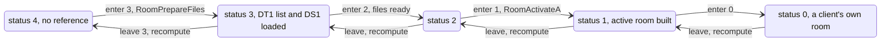
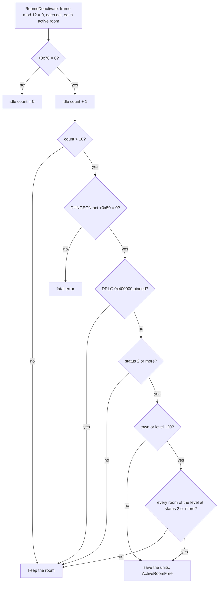
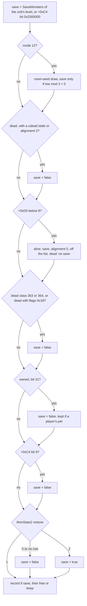
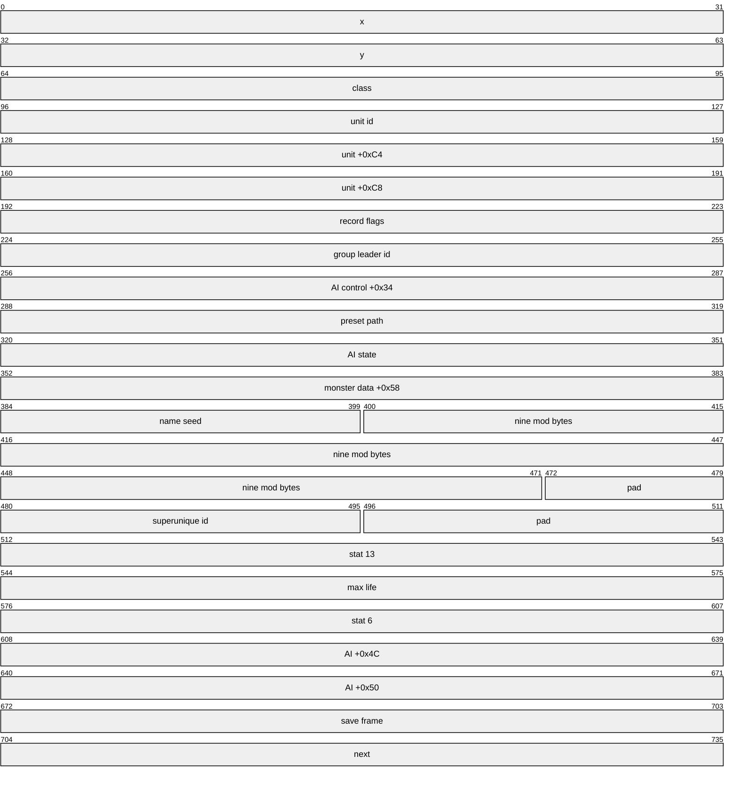
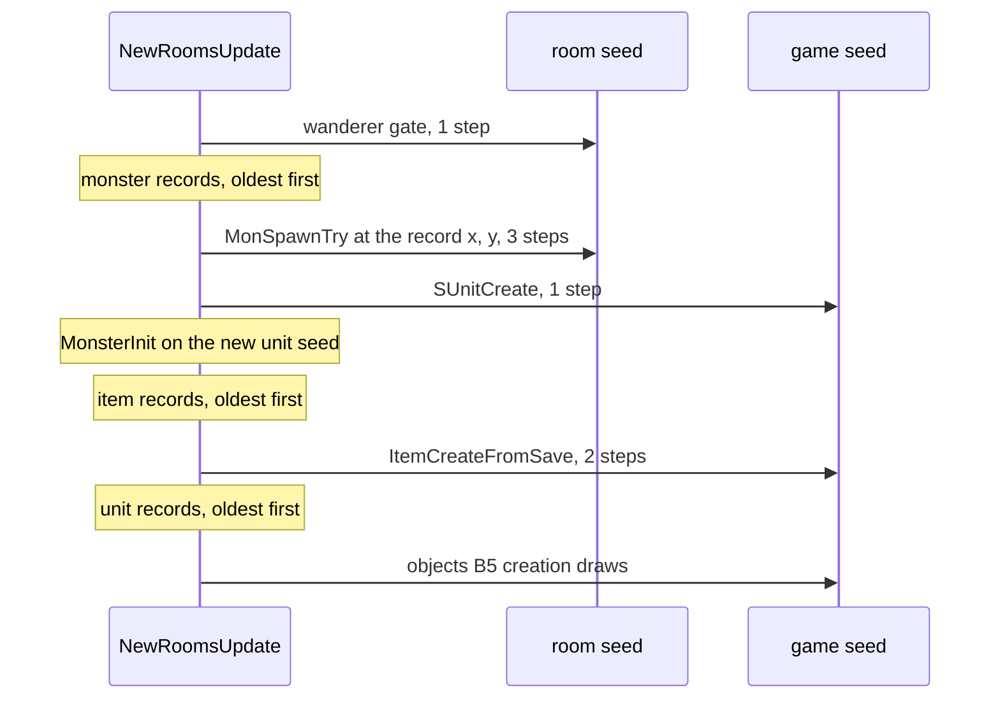
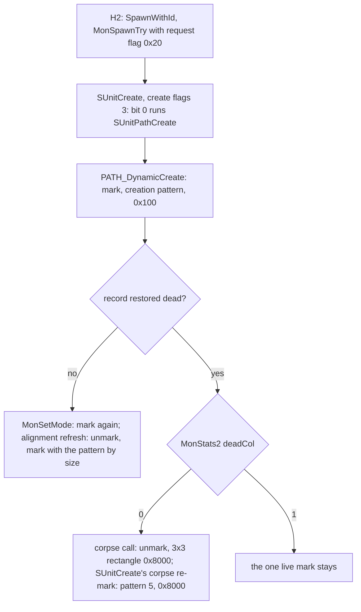
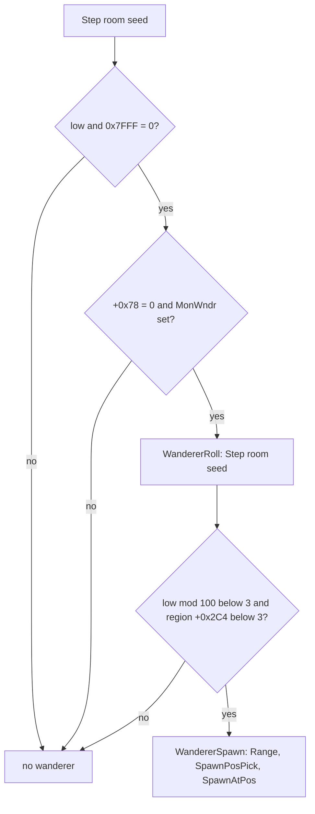

# Room lifecycle: activation, release, the inactive records and the restore

## Purpose

As players move, the server activates the rooms around them and releases rooms that no player has been near for
about 120 frames. A release saves some of the room's units as **inactive records** (monsters, objects, ground items)
and frees the rest. When the room is activated again, the units are re-created from those records instead of a new
population, with their own draws on the room seed and the game seed. This spec defines the reference counts that
drive activation, the client lists, the release timer and test, the save rule, the record layouts, the restore order
and its draws, the stats of a restored monster and the wanderer tick. The room build itself is
[room-tiles](room-tiles.md); the first population is [monsters/spawn](../monsters/spawn.md) and
[objects](../objects/README.md). Primitives (`Step`, `Range`, `Init`) are those of [rng](../rng/README.md).

```mermaid
stateDiagram-v2
  direction LR
  unbuilt: DRLG room, no active room
  fresh: active, flags bit 0 clear
  live: active, populated or restored
  idle: active, +0x78 = 0, idle count rising
  released: released, records saved
  back: active again, flags bit 0 set
  [*] --> unbuilt
  unbuilt --> fresh: distance-1 reference, RoomActivateA
  fresh --> live: next new-rooms walk, presets, restore, objects, population
  live --> idle: last client's near set loses the room
  idle --> live: a pass sees a client again
  idle --> released: 11th client-free pass and the release test
  released --> back: distance-1 reference again
  back --> live: next new-rooms walk, restore only
```



## Entry points

| When | Function | Tag |
|---|---|---|
| Every game frame | fn:sub_0052D870_GameTick@0x0052D870 | [I] |
| A client's room changes | fn:sub_00537B50_ClientRoomChange@0x00537B50 → fn:sub_0061B6F0_DrlgRefMove@0x0061B6F0 | [C] |
| A room gains its first distance-1 reference | fn:sub_0061B2D0_DrlgEnter1Activate@0x0061B2D0 → fn:sub_0061B190_RoomActivateA@0x0061B190 | [C] |
| A room is needed at once (warp, waypoint, level point, preset level build) | fn:sub_0061B730_RoomActivateB@0x0061B730 | [I] |
| New rooms of an act, start of the next frame | fn:sub_0052D160_NewRoomsUpdate@0x0052D160 | [C] |
| Release pass, `frame mod 12 = 0` | fn:sub_0052D240_RoomsDeactivate@0x0052D240 | [C] |
| Save test per unit of a released room | fn:sub_005433F0_InactiveUnitSaveTest@0x005433F0, fn:sub_005431F0_InactiveMonsterSaveTest@0x005431F0 | [C] |
| Restore of a re-activated room | fn:sub_00542B40_RoomInactiveUnitsRestore@0x00542B40 | [C] |
| Wanderer tick, per walked room | fn:sub_0054F060_RoomWandererTick@0x0054F060 | [C] |

## Inputs

### Tables

| Anchor | Used for |
|---|---|
| tbl:Levels.txt:SaveMonsters | leveldefs `+0x94`: the save rule's starting value (§ F); 0 only for levels 0, 1, 40, 50, 75, 103, 109 |
| tbl:Levels.txt:MonWndr | levels `+0x2E`: the wanderer gate (§ I) |
| tbl:Levels.txt:Act | levels `+0x03`: the wanderer list row (§ I) |
| tbl:MonStats2.txt:restore | `+0x130`, a byte, through tbl:MonStats.txt:MonStatsEx: 0 never save, 2 always save (§ F) |
| tbl:MonStats.txt:flying | `+0x0D` bit 6: creation flag `0x80` of a restored monster (§ H) |
| tbl:MonStats.txt:Align | the unit alignment `MonSpawnTry` sets (0 → 0, 1 → 2, 2 → 1), which the record keeps (§ G) |
| tbl:States.txt:udead | a dead monster with a `udead` state is not saved (§ F) |
| tbl:Objects.txt:Restore, tbl:Objects.txt:RestoreVirgins | the object save rule (objects § B4) |

### Runtime state

| State | Type | Owner offset | Source |
|---|---|---|---|
| game frame | `u32`, compared signed in `% 12` and the item expiry, unsigned in the 7500-frame test | game `+0xA8` | `GameTick` |
| game seed | `Seed` | game `+0xD0` | [rng/seeds](../rng/seeds.md) |
| references per distance | 4 × `u16` | DRLG room `+0x0C + 2·d`, d = 0..3 | § B |
| status | `u8`, lowest d with a reference, 4 = none | DRLG room `+0x44` | § B |
| DRLG room flags | `u32`: `0x100000` built, `0x200000` released by the server, `0x400000` pinned | DRLG room `+0x28` | § E, [room-tiles](room-tiles.md#release-and-re-activation) |
| populated bit kept across a release | `u32`, bit 0 | DRLG room `+0x60` | § D |
| active room of the DRLG room | pointer, 0 while released | DRLG room `+0x30` | § E |
| idle count | `u32` | active room `+0x0C` | § E |
| active-room flags | `u32`: bit 0 populated, bit 1 inactive units restored, 4 client copy | active room `+0x34` | § D |
| client list, count | sorted pointers, `u32` | active room `+0x48`, `+0x78` | § C |
| room seed | `Seed` | active room `+0x6C` | [rng/seeds](../rng/seeds.md) step 6 |
| unit list | newest first, next = unit `+0xE8` | active room `+0x74` | § E |
| act room list, new-rooms flag | list (next = room `+0x7C`), `u32` | DUNGEON act `+0x10`, `+0x54` | § D |
| DUNGEON act `+0x50` | `u32`; the constructor's client-act argument: 1 on a client act, 0 on a server act | DUNGEON act `+0x50` | § E |
| inactive room records | one list per act, ordered by x descending | game `+0xD8 + 4·act` | § G |
| region counts | wanderers `+0x2C4`; `+0x2C8`, `+0x2CC` | level region | § H, § I |

### Constants

| Name | Value | Anchor | Tag |
|---|---|---|---|
| release period | every frame with `frame mod 12 = 0` | fn:sub_0052D870_GameTick@0x0052D870 | [C] (run:2026-10-17-lifecycle) |
| idle threshold | release when the count exceeds 10 (the 11th pass) | 0x0052D27B | [C] (run:2026-10-17-lifecycle) |
| dead-monster save draw | `low mod 3 = 0`, unsigned | 0x00543260–0x00543287 | [C] (run:2026-10-17-lifecycle) |
| life kept | 7500 frames, unsigned test | 0x00542819 | [C] (run:2026-10-17-lifecycle) |
| item expiry | frame + 15000, 30000 or 45000; 0 never | fn:sub_00558A10_ItemGroundExpiry@0x00558A10 | [C] for the branches G1 marks, [I] for the others (run:2026-10-17-lifecycle) |
| restored item expiry floor | frame + 15000 | fn:sub_00541990_InactiveItemRestoreOne@0x00541990 | [C] (run:2026-10-17-lifecycle) |
| wanderer gate | `low & 0x7FFF = 0` | 0x0054F089 | [C] (run:2026-10-17-lifecycle), the mask's width [I] (§ I) |
| wanderer roll | `low mod 100 < 3`, region `+0x2C4` < 3 | 0x0054F024–0x0054F041 | [C] for the draw and the `mod 100` ≥ 3 return (run:2026-10-21-sweep-monsters-a), [I] for the region test and the pass below 3 (fn:sub_0054EFF0_WandererRoll@0x0054EFF0) |
| wanderer list | act I: class 270 (`rogue2`), start 0, count 1; other acts count 0 | 0x00731B2C, 0x00731B30 | [I] (fn:sub_0054EF50_WandererSpawn@0x0054EF50) |

## Algorithm

### A. The frame

```
A1. GameTick(game):                                               [I] (fn:sub_0052D870_GameTick@0x0052D870, 0x0052D8EB, 0x0052D938)
      game.frame ← game.frame + 1
      two per-frame passes
      NewRoomsUpdate(game)                                        ; § D: new rooms populated or restored
      unit events                                                 ; players move here
      ClientsRoomSync(game)                                       ; per client: ClientRoomSync → ClientRoomChange (§ B, § C)
      two more passes
      if frame mod 20 = 0: 0x00543E10(game)
      if frame mod 12 = 0: RoomsDeactivate(game)                  ; § E
      if frame mod 11 = 0: level-unload tick of each act          ; § E5
      0x0052D310(game)                                            ; every frame; when frame mod 1500 = 0: 0x00558B90 and the expiry sweep 0x00542AC0, acts 0 to 4
```

- [I] The remainders are signed `%` on the incremented frame. A room activated in frame N by the client sync is
populated or restored by `NewRoomsUpdate` at the start of frame N+1. (fn:sub_0052D870_GameTick@0x0052D870,
fn:sub_0052D440_ClientsRoomSync@0x0052D440, fn:sub_005380D0_ClientRoomSync@0x005380D0)
- [C] The release pass runs on every frame with `frame mod 12 = 0` (15 614 passes), and the new active rooms of a
client's room change are walked at the start of the next frame. (run:2026-10-17-lifecycle,
fn:sub_0052D240_RoomsDeactivate@0x0052D240, fn:sub_0052D160_NewRoomsUpdate@0x0052D160)
- [I] Three other callers populate a room at once through `RoomUpdateOne` (the same body for one room): a unit spawn
at coordinates whose room was not active (`0x0055379D`), the creation of a portal's other end at a level point
(`0x0056CF7D`) and a quest spawn in level 40 (`0x0059E018`). (fn:sub_0052D0F0_RoomUpdateOne@0x0052D0F0)
- [I] **The expiry sweep of item records runs every 1 500 frames.** `GameTick` calls 0x0052D310 on every frame
(0x0052D96C). That function computes `frame mod 1500` (a signed `idiv` by `0x5DC`, 0x0052D310–0x0052D320) and, when it
is 0, calls 0x00558B90 and the sweep 0x00542AC0 for acts 0 to 4 (0x0052D322–0x0052D33D). The sweep frees an act's item
records whose expiry is non-zero and below the game frame (0x00542AF0–0x00542AFF). The `frame mod 20` call above is
0x00543E10, not the sweep; this spec's earlier "20-frame sweep" was that call. run:2026-10-17-h7a-lifecycle agrees and
excludes a 20-frame sweep: five records with expiries 18 720 and 18 324 were still present at frame 19 158, and the
1 500-frame sweep has no pass between those expiries and that frame (18 000 and 19 500). No pass fell between an expiry
and its restore, so the period stays a reading. (fn:sub_0052D870_GameTick@0x0052D870, 0x0052D310, 0x00542AC0,
[drlg/0009 § 11.3 (4)](../../findings/drlg/0009-room-lifecycle.md#113-plan-0038-batch-h7a-run2026-10-17-h7a-lifecycle))

### B. Activation: reference counts per near-list distance

Each DRLG room carries four reference counts, one per near-list distance d = 0..3, and a status. A client's room
holds one reference at distance 0; each room of its near list one at distance 1, and so on outwards to 3. Gaining a
status activates or prepares the room.



```
B1. ClientRoomChange(client, new: active room):                   [C] (fn:sub_00537B50_ClientRoomChange@0x00537B50, run:2026-10-17-lifecycle)
      old ← client[+0x1B4]                                        ; the client's active room
      DrlgRefMove(old.drlg, new.drlg)                             ; B2
      client lists of old's and new's near sets                  ; § C

B2. DrlgRefMove(old, new: DRLG room):                             [C] (fn:sub_0061B6F0_DrlgRefMove@0x0061B6F0, run:2026-10-17-lifecycle, tools/rooms.py)
      if old = new: return
      if new: RefAdd(new, 0)
      if old and old.refs[0] ≠ 0:
        old.refs[0] ← old.refs[0] − 1
        Leave(old, 0)
        RefRemoveNear(old, 1)

B3. RefAdd(R, d):                                                 [C] (fn:sub_0061B490_DrlgRefAdd@0x0061B490, run:2026-10-17-lifecycle)
      RefAddNear(R, d + 1)
      EnterTest(R, d)
      R.refs[d] ← R.refs[d] + 1                                   ; u16, wraps

B4. RefAddNear(R, d):                                             [C] (fn:sub_0061B390_DrlgRefAddNear@0x0061B390, run:2026-10-17-lifecycle)
      for N in R.near (the DRLG near list, in list order):
        if d < 3: RefAddNear(N, d + 1)                            ; recurse first
        EnterTest(N, d)
        N.refs[d] ← N.refs[d] + 1

B5. RefRemoveNear(R, d):                                          [C] (fn:sub_0061B5B0_DrlgRefRemoveNear@0x0061B5B0, 0x0061B5C3–0x0061B5EE, run:2026-10-17-lifecycle)
      for N in R.near, in list order, skipping null entries:
        N.refs[d] ← N.refs[d] − 1
        Leave(N, d)
        if d < 3: RefRemoveNear(N, d + 1)                         ; recurse after

B6. EnterTest(R, d):                                              [C] (data:g_DrlgRefEnterFns@0x00744384, run:2026-10-17-lifecycle)
      if R.status ≥ d and R.refs[0], …, R.refs[d] are all 0: Enter(R, d)

B7. Enter(R, d):                                                  [C] (data:g_DrlgRefEnterFns@0x00744384, 0x0061BB10–0x0061BB44, run:2026-10-17-lifecycle)
      d = 0: R.status ← 0                                         ; fn:sub_0061B2C0_DrlgEnter0@0x0061B2C0
      d = 1: if R has no active room and not (R.flags & 0x100000): RoomActivateA(R)
             R.status ← min(R.status, 1)                          ; fn:sub_0061B2D0_DrlgEnter1Activate@0x0061B2D0
      d = 2: if R.flags & 0x1000000 and not (R.type = 2 and not (R.flags & 0x2000000)) and R.status > 2:
               R.status ← 2
               if R.refs[1] ≠ 0: Enter(R, 1)                      ; fn:sub_0061BB10_DrlgEnter2@0x0061BB10
      d = 3: RoomPrepareFiles(R)                                  ; DT1 list, DS1, then status 3 if higher

B8. Leave(R, d):                                                  [C] (data:g_DrlgRefLeaveFns@0x00744394, fn:sub_0061B560_DrlgLeave3Release@0x0061B560, 0x0061B563–0x0061B58D, run:2026-10-17-lifecycle)
      d < 3, or d = 3 with R.status ≠ 4: Recompute(R)
      d = 3 on a client act, status now 4: RoomTilesRelease(R, EDX 0)   ; the client copy only

B9. Recompute(R):                                                 [C] (fn:sub_0061B4F0_DrlgStatusRecompute@0x0061B4F0, 0x0061B4F0–0x0061B528, run:2026-10-17-lifecycle)
      if R.status < 4 and R.refs[R.status] ≠ 0: return
      R.status ← the lowest d with R.refs[d] ≠ 0, else 4
```

- [C] The model above, replayed on the logged snapshot before each move with the near lists as `DrlgRefAddNear`
builds them, predicts every server callback in kind and room with the refs and status at its entry (634 982 callbacks
in 913 moves), the refs and status of every logged room after the move (52 119), and every activation:
`RoomActivateA` after an enter-1 call on a room with no active room and no `0x100000` (2 377). The status rule holds on
all of them. The order inside each walk (the add walk recurses before its enter test; the remove walk decrements, calls
the leave callback, then recurses, and skips null entries), the leave callbacks and `Recompute` are the instruction-level
reading of [drlg/0009 § 2](../../findings/drlg/0009-room-lifecycle.md#2-activation). (run:2026-10-17-lifecycle,
fn:sub_0061B6F0_DrlgRefMove@0x0061B6F0, fn:sub_0061B390_DrlgRefAddNear@0x0061B390, fn:sub_0061B5B0_DrlgRefRemoveNear@0x0061B5B0)
- [I] A reference counts paths, not rooms: a room reached through several near lists at the same distance holds one
reference per path, so distance-3 counts in the tens are normal (the worked example's room had refs (0, 0, 4, 39) at
its enter-1 call). (fn:sub_0061B390_DrlgRefAddNear@0x0061B390, run:2026-10-17-lifecycle)
- [I] On the server a client therefore activates every room of its room's near list (which holds the room itself,
drlg/0005) and prepares the files of the
rooms at distance 2 and 3. With several clients the counts add up, so the activation set is the union of theirs; no
multiplayer game was logged (plan 0044). (fn:sub_0061B490_DrlgRefAdd@0x0061B490, struct:DrlgRoomLife+0x0C)
- [I] `RoomActivateA` adds to the build of `DRLG_RoomActivate` ([room-tiles](room-tiles.md)) only the neighbour step
when `+0x2C` = 0, the re-seed and type init, and two act counters (`+0x98` byte, `+0x08`); enter 1 also resets the
act's background countdown. `DUNGEON_RoomCreate` prepends the active room to the act list (`act +0x10`), sets the act's
new-rooms flag `+0x54` = 1, and gives the room flags `+0x34` = 4 on a client act, else the DRLG room's `+0x60` bit 0.
(fn:sub_0061B190_RoomActivateA@0x0061B190, fn:DRLG_RoomActivate@0x006422A0, fn:DUNGEON_RoomCreate@0x00619890)
- [I] `RoomActivateB` is the on-demand variant (warp destination, waypoint room, level point, preset level build): it
also builds the DT1 list and loads the DS1 when missing, does nothing for a built room, and returns the active room. A
room activated this way gets **no reference**: its status stays 4 and only the idle timer of § E releases it.
(fn:sub_0061B730_RoomActivateB@0x0061B730)
- [C] A room that `RoomActivateB` activates during the population pass, after the act's walk has passed it (callers
`0x0066ADB1` and `0x0066B3C5`), is released before any walk reaches it if no new room arrives meanwhile (3 rooms). Its
`+0x60` bit 0 stays clear, so it is populated at its next activation. (run:2026-10-17-lifecycle,
fn:sub_0061B730_RoomActivateB@0x0061B730)
- [I] **Client copy.** The client act runs the same reference code from its own loop (`0x0045CB0C`/`0x0045CB7C`, through
`0x0061A070`/`0x0061A0C0`, one distance-1 reference at a position), builds one status-2 room every 5 client ticks
(`ClientBackgroundBuild`; the server act never calls it), runs its level-unload tick every 13 client ticks, and releases a
room's tiles as soon as its status reaches 4 (leave 3).
(fn:sub_0061B920_ClientBackgroundBuild@0x0061B920, fn:sub_00642A00_ActIsClient@0x00642A00, 0x0044C7E6)

### C. The client lists (`+0x78`)

```
C1. after the reference move, ClientRoomChange compares the near sets:   [C] (fn:sub_00537B50_ClientRoomChange@0x00537B50, run:2026-10-17-lifecycle)
      Nnew ← DUNGEON_GetNearRooms(new);  Nold ← DUNGEON_GetNearRooms(old)
      for r in Nnew, in list order, r ∉ Nold: RoomClientEnter(r, client)   ; RoomClientAdd: r[+0x48] gains client, r[+0x78] + 1
      for r in Nold, in list order, r ∉ Nnew: RoomClientLeave(r, client)   ; RoomClientRemove: r[+0x78] − 1
```

- [C] The enter calls come first, then the leave calls (5 418 calls, `+0x78` before each). The near sets are
  `DUNGEON_GetNearRooms`' after the reference move. With one client, room `+0x78` is 1 exactly when the room is in the
  near list of the client's current room (180 132 room-passes). (run:2026-10-17-lifecycle,
  fn:sub_0053A8E0_RoomClientEnter@0x0053A8E0, fn:sub_0053A9B0_RoomClientLeave@0x0053A9B0, fn:sub_0061A660_RoomClientAdd@0x0061A660)
- [I] In general `+0x78` is the number of clients whose current room's near list holds the room; the list `+0x48` is
  kept sorted by pointer. (fn:sub_0061A660_RoomClientAdd@0x0061A660, fn:sub_0061A700_RoomClientRemove@0x0061A700,
  fn:DUNGEON_GetNearRooms@0x00619790, struct:DungeonRoomLife+0x78)
- [I] A room just activated by a client already has `+0x78` ≥ 1 at its first walk, because the same `ClientRoomChange`
  fills the list. (fn:sub_00537B50_ClientRoomChange@0x00537B50, struct:DungeonRoomLife+0x78)

### D. The new-rooms walk: populate once, restore once per activation

```
D1. NewRoomsUpdate(game):                                         [C] (fn:sub_0052D160_NewRoomsUpdate@0x0052D160, run:2026-10-17-lifecycle)
      for act in game.acts[0 ..< 5] with act[+0x54] ≠ 0:
        for room in the act's room list, head first:
          RoomWandererTick(game, room)                            ; § I, one room draw, always
          if room.flags & 1 = 0:
            RoomPresetUnits; RoomInactiveUnitsRestore; RoomObjectsPopulate; RoomPopulate
            room.flags ← room.flags | 1 | 2
          else if RoomRestoredGet(room) = 0:                      ; flags & 2
            RoomInactiveUnitsRestore(game, room)                  ; § H
            room.flags ← room.flags | 2
        act[+0x54] ← 0
```

- [C] Per walked room the wanderer tick comes first. A room with flags bit 0 clear is restored and populated (1 137); a
  room with bit 0 set and bit 1 clear is restored only (1 361); any other room is left alone. A re-activated room's DRLG
  `+0x60` bit 0, which becomes its flags bit 0, is 1 exactly when the room was walked or restored before its release
  (1 414 re-activations). So a re-activated room is **never populated again**: its units come back only from the
  records. (run:2026-10-17-lifecycle, fn:sub_0052D160_NewRoomsUpdate@0x0052D160, fn:sub_00642390_LevelRoomStateRestore@0x00642390)
- [I] No code clears bit 1 (every caller of `RoomRestoredSet` passes 1), and it lives in the active room, which a release
  frees: the restore runs once per activation. (fn:sub_0061A4D0_RoomRestoredGet@0x0061A4D0,
  fn:sub_0061A510_RoomRestoredSet@0x0061A510, 0x0052D20C, 0x0052D12C, 0x0052D14A)
- [I] On a first activation the restore finds no record and draws nothing ([objects § B](../objects/README.md#b-the-window-in-the-room-driver-and-the-revisit) B2);
  the presets, objects and population are [drlg/preset § 6](preset.md#6-handover-to-the-server-spawners-boundary),
  [objects](../objects/README.md) and [monsters/spawn § A](../monsters/spawn.md#a-when-the-pass-runs-and-the-room-seed-before-it).
  (fn:sub_00542B40_RoomInactiveUnitsRestore@0x00542B40)

### E. Release



```
E1. RoomsDeactivate(game):                                        [C] (fn:sub_0052D240_RoomsDeactivate@0x0052D240, fn:sub_0061A790_RoomIdleCount@0x0061A790, run:2026-10-17-lifecycle)
      for a in 0 ..< 5 with an act:
        room ← act's room list head
        while room:
          next ← room.next                                        ; read before the room may be freed
          room.idle ← 0 if room[+0x78] ≠ 0 else room.idle + 1     ; RoomIdleCount, u32
          if room.idle > 10 and RoomReleaseAllowed(act, room):
            for u in room.units, head first (next = u[+0xE8], read before the call):
              InactiveUnitSaveTest(game, u)                       ; § F
            ActiveRoomFree(act, room)                             ; E3
          room ← next

E2. RoomReleaseAllowed(act, room) → bool:                         [C] (fn:sub_0061A3F0_RoomReleaseAllowed@0x0061A3F0, fn:sub_0061BA30_DrlgRoomReleaseTest@0x0061BA30, run:2026-10-17-lifecycle)
      if act[+0x50] ≠ 0: fatal error                              ; [I] never taken, 0 on the server at every pass (0x0061A3F0)
      R ← room.drlg
      if R.flags & 0x400000: return false                         ; pinned
      if R's act is a client act: fatal error                     ; [I] never taken (0x0061BA30)
      if R.status < 2: return false
      if R's level is a town or level 120:
        if any DRLG room of the level has status < 2: return false   ; [I] for level 120, not reached (0x0061BA30)
      return true

E3. ActiveRoomFree(act, room):                                    [I] (fn:sub_0061A910_ActiveRoomFree@0x0061A910, fn:sub_0066B4C0_RoomReleaseWrap@0x0066B4C0, fn:DUNGEON_RoomFree@0x0061A840)
      unlink room from the act list
      for each neighbour of room's near list but room itself: remove room (swap with the last entry)
      RoomReleaseWrap(R ← room.drlg, EDX ← act[+0x50], room.flags):
        R[+0x30] ← 0;  R[+0x60] ← room.flags & 1
        if R.flags & 0x100000: RoomTilesRelease(R, EDX ← (wrapper EDX = 0))   ; room-tiles § Release
      DUNGEON_RoomFree(room):
        for u still in room.units: u[+0xC4] |= 0x800000; unless u[+0xC4] bit 22: u[+0xC8] |= 0x20; unlink u
        free the collision map, the tile lists and the room
```

- [C] **Frames.** The count rises only on passes with `+0x78` = 0 and drops to 0 on any pass that sees a client, so
a room is freed on the 11th client-free pass in a row: 120 frames after the first client-free pass, which falls 0 to 11
frames after the last client's room change **that a pass saw**. Of 2 440 releases, 2 224 came at the first eligible
pass, 120 to 131 frames after the last client left (every value from 120 to 131 seen); 82 came later (a test refused
the first eligible pass, or a visit fell between two passes) and 134 had no logged client leave before them. Every
room each pass frees is predicted. (run:2026-10-17-lifecycle, fn:sub_0061A790_RoomIdleCount@0x0061A790)
- [C] **A visit between two passes does not reset the count.** A client whose room keeps the room in its near set
only between two passes leaves the idle count running (5 cases, each released 36 to 110 frames after that visit). The
model of E1 covers both cases. (run:2026-10-17-lifecycle, fn:sub_0061A790_RoomIdleCount@0x0061A790)
- [C] The release test refused a pinned room 4 592 times and a town room 12 296 times in 19 328 tests; act `+0x50` was
0 at every pass. Once the count exceeds 10 the test is retried on every pass, so a refused room goes at the first later
pass that allows it. A new room starts at count 0. (run:2026-10-17-lifecycle, fn:sub_0061BA30_DrlgRoomReleaseTest@0x0061BA30)
- [I] **Pins.** `RoomPinSet(room, 0)` sets `0x400000` and `RoomPinSet(room, 1)` clears it (`RoomPinSet` passes the
DRLG room and its second argument to `DrlgRoomPinFlag`, its one caller). `PortalObjectCreate` sets it on the rooms of
both portal ends (0x0056D29E, 0x0056D2AC), and two sites that free an object unit clear it (0x005354C5, 0x00584C12).
In the run the pin was an input: six set calls came from portal and object code, and no clear call was seen.
(fn:sub_0061AED0_RoomPinSet@0x0061AED0, fn:sub_0061BAC0_DrlgRoomPinFlag@0x0061BAC0, fn:sub_0056D130_PortalObjectCreate@0x0056D130)
- [I] **The 31 pin sites.** `RoomPinSet` has 31 direct call sites in 24 functions: 18 set the pin and 13 clear it. The
setters are `PortalObjectCreate` (both ends), the quest functions `A1Q4_GibbetOperate`, `A1Q4_StoneOperate`,
`A1Q5_DeathSpawn`, `A2Q6_StaffPlaced`, `A5Q2_MonsterDeath`, `A5Q2_CageFreed`, `A5Q3_FrozenAnyaOperate`,
`A5Q5_StatuesArm`, one branch of `A5Q5_KeepDoorOperate` and `A5Q6_BaalDeath`, `SealObjectCreate`, a function called
from `A3Q5_CompellingOrbOperate`, and two unnamed functions. The clearers are `PlayerPortalClose` and `OBJOP_Portal`
(after the portal units are freed), `A2Q6_LairPortalTimer`, the keep door's other branch, `PermPortalAtUnit`, and five
unnamed functions with no direct call (one is missile do-function 36, Missiles row 625 `baalfx control`). The quest sites set the pin when an event starts and clear it when it ends; that
is a reading of the call order, not a traced lifetime. The per-site table is in
[drlg/0009 § 11.4 (c)](../../findings/drlg/0009-room-lifecycle.md#114-the-plan-0040-phase-1-review-follow-ups-plan-0049-phase-1-lanep49r-static).
(fn:sub_0061AED0_RoomPinSet@0x0061AED0, fn:sub_0061BAC0_DrlgRoomPinFlag@0x0061BAC0, fn:sub_00620BB0_UnitGetRoom@0x00620BB0)
- [C] **DUNGEON act `+0x50` is 1 on a client act and 0 on a server act.** `DUNGEON_ActCreate` stores its third
argument there and builds the client form of the DRLG act when it is non-zero; the server's `ActCreate` passes 0 and
the client's `ClientActLoad` passes 1. The run gave the same values on both sides: 0 on the server at all 30 985
checks, and the negated value 0 at every one of the 8 277 client tiles releases. No other writer of `+0x50` was
scanned, so the values are covered for the run's window only, where neither side saw another.
(fn:DUNGEON_ActCreate@0x006194A0, fn:sub_0053AC70_ActCreate@0x0053AC70, fn:sub_0044E100_ClientActLoad@0x0044E100,
run:2026-10-17-lifecycle, [drlg/0009 § 11.4 (a)](../../findings/drlg/0009-room-lifecycle.md#114-the-plan-0040-phase-1-review-follow-ups-plan-0049-phase-1-lanep49r-static))
- [I] **Level unload.** Every 11 frames on the server (every 13 ticks on the client) the level-unload tick unloads,
after a countdown of 10 ticks, a level with no level references (`+0x0C`) and built rooms (`+0x10`) when
`LevelUnloadCheck` allows, and otherwise re-arms the countdown. That path frees RoomTiles through `RoomFree` and
rebuilds the level ([room-tiles § Release and re-activation](room-tiles.md#release-and-re-activation)).
(fn:sub_00643200_ActLevelsUnloadTick@0x00643200, fn:sub_00643060_LevelUnloadCheck@0x00643060,
fn:sub_00642010_LevelUnload@0x00642010)

**`0x200000` and the wrapper's `EDX`.**

- [C] Every server release calls `RoomTilesRelease` with `EDX` 1 and leaves `0x200000` set in the DRLG room's flags
  (2 440 releases); every client release has `EDX` 0 and leaves it clear (8 277). This follows from the wrapper, which
  passes the logical not of its own `EDX` (the DUNGEON act's `+0x50`, 0 on the server): `0x200000` reads "released by
  the server". (run:2026-10-17-lifecycle, 0x0066B4DE–0x0066B4E0, 0x0061A9D0, 0x0066F232, fn:sub_0066B4C0_RoomReleaseWrap@0x0066B4C0)
- [I] No reader of `0x200000` was found: the only `+0x28` access with that immediate is the write at 0x0066F232.
  (fn:sub_0066F1A0_RoomTilesRelease@0x0066F1A0, 0x0066F232)

### F. The save rule

Each unit of a released room, in list order (newest first), goes through `InactiveUnitSaveTest`. It is saved to a
record, kept (unlinked but alive), or freed.



```
F1. InactiveUnitSaveTest(game, u):                                [C] (fn:sub_005433F0_InactiveUnitSaveTest@0x005433F0, run:2026-10-17-lifecycle)
      type 1 (monster): (save, kept) ← InactiveMonsterSaveTest(game, u)              ; F2
      type 2 (object):  (save, kept) ← objects § B4                                  ; F3
      type 4 (item):    save ← true;  kept ← false                                   ; 1 347 items
      type 5:           save ← true;  kept ← false                                   ; 59 units
      type 0 (player):  state 7 (playerbody) → save, kept; else nothing   ; [I] not reached (0x005433F0)
      type 3 (missile) and any other: free                                           ; 9 missiles
      if kept: (if save: record) and unlink u from the room without freeing it       ; [I] not reached (0x005433F0)
      else:    (if save: record) and free u
      record: InactiveRecordSave(u) → monster record, item record, or unit record    ; § G

F2. InactiveMonsterSaveTest(game, u) → (save, kept), in this order:   [I] (fn:sub_005431F0_InactiveMonsterSaveTest@0x005431F0, fn:sub_00642820_LevelSaveMonsters@0x00642820)
      lvl ← the level of u's current room
      save: bool ← Levels[lvl].SaveMonsters ≠ 0 or u[+0xC4] & 0x2000000      ; [C] when either is set (run:2026-10-17-lifecycle); [I] when both are clear, never met (0x005431F9–0x0054322A)
      kept: bool ← false
      dead: bool ← UnitIsDead(u)
      1. if u.mode = 12:                                          ; [C] (0x00543260–0x00543287, run:2026-10-17-lifecycle)
           Step(u.room.seed)                                      ; draw#1 per mode-12 monster, always
           if u.room.seed.low mod 3 ≠ 0: save ← false             ; unsigned
      2. if dead and (u has a state with the udead flag or u.alignment = 2): save ← false   ; [C] (run:2026-10-17-lifecycle)
      3. if u[+0xD0] < 8: (alive: save ← true, alignment ← 0, TargetListRemove)  (dead: save ← false)
      4. if dead and u.class ∈ {363, 364}: save ← false           ; necroskeleton, necromage
      5. if dead and MonTypeFlag(u, 0x18): save ← false           ; [C] monster flag 0x08 or 0x10 (0x005432EF–0x005432FB)
      6. if u[+0xC4] & 0x80000000:                                ; owned
           save ← false
           if the owner is a player whose pet list holds u: kept ← true;  u[+0xC8] |= 0x100
      7. if u[+0xC4] & 0x200: save ← false
      8. r ← MonStats2[MonStats[u.class].MonStatsEx].restore
         if r = 0 or no row: save ← false
         if r = 2: save ← true                                    ; [C] for r = 1 and 2, 30 (run:2026-10-17-lifecycle)
      return (save, kept)
```

- [C] On the branches the run reached the rule predicts every decision: 4 401 monsters (3 086 saved alive, 413 saved
dead, 902 freed dead); the starting value from `SaveMonsters` and `+0xC4` bit `0x2000000`; the mode-12 draw, seed out =
`Step(seed in)` and `low mod 3`, chained unit to unit on the room seed (1 315 draws); the `udead` (1) and alignment-2
(12) tests on dead units; the `0x18` test on dead units (106); `restore` 1 and 2 (30). A record follows exactly the
units the rule saves. (run:2026-10-17-lifecycle, fn:sub_005431F0_InactiveMonsterSaveTest@0x005431F0, 0x00543260)
- [I] Tests 3, 4, 6 and 7 and `restore` 0 were not reached (no pet or owned monster, no `+0xD0` < 8, no necromancer
summon, no `+0xC4` bit 9, no `restore` 0 class). Since `restore` 2 is tested last it overrides every earlier test, the
dead-unit tests included. (fn:sub_005431F0_InactiveMonsterSaveTest@0x005431F0, tbl:MonStats2.txt:restore)
- [C] **Objects** follow [objects § B](../objects/README.md#b-the-window-in-the-room-driver-and-the-revisit) B4,
whose level flag is `Levels.SaveMonsters` (leveldefs `+0x94`): `save` starts as that flag or the preset flag
`0x2000000`; `Objects.Restore` = 0 or sparkle bit `0x02` → no; `RestoreVirgins` and mode ≠ 0 → no. The rule held on
3 023 objects (`Restore` 0: 15; `RestoreVirgins` on a used object: 30; the starting flag set on all of them, 653 by the
preset flag alone). (run:2026-10-17-lifecycle,
fn:sub_005433F0_InactiveUnitSaveTest@0x005433F0, tbl:Objects.txt:Restore, tbl:Objects.txt:RestoreVirgins)
- [I] Not met for objects: the sparkle bit `0x02` (never set on a tested object) and a start with both flags clear,
so those two refusals are code readings. The object's type-1 timers are removed, and classes 59 and 60 (portals) are
always saved and kept (unit `+0xC8 |= 0x100`); no kept unit was met. (fn:sub_005433F0_InactiveUnitSaveTest@0x005433F0)
- [C] **No logged dead champion was saved.** `MonMarkSpecial` sets monster flag `0x08`; all 15 champions in 30 save
tests carried flags `0x0D` or `0x2D`, and the 6 dead ones were freed by test 5. (run:2026-10-17-lifecycle,
fn:sub_005A0320_MonMarkSpecial@0x005A0320, 0x005432EF)
- [I] So a dead champion is not saved on stock data: every server write of the champion bit `0x04` to monster data
`+0x16` comes after `MonMarkSpecial` on the same unit, and no server instruction clears `0x08`. The four writes are
`SpecialModsRoll` (0x005A083E), reached from `SpecialMonSpawn` only when `SpecialMonPlace` gave a unit and from
`MonMakeSpecial` after its own `MonMarkSpecial` (0x005A496E); `SpecialMonRestore` (0x005A44A3), after `SpecialMonPlace`
returned a unit; and `ChampionMemberMark` (0x005A4905), after `MonMarkSpecial` (0x005A48F4). `SpecialMonPlace` marks
every unit it creates (0x005A0B61), and `MonMarkSpecial` ORs `0x08` into any monster with monster data
(0x005A0369–0x005A0375). This is a code reading: a block copy of monster data is not followed. (drlg/0009 § 11.1 (b);
fn:sub_005A0320_MonMarkSpecial@0x005A0320, fn:sub_005A0760_SpecialModsRoll@0x005A0760,
fn:sub_005A09E0_SpecialMonPlace@0x005A09E0, fn:sub_005A4440_SpecialMonRestore@0x005A4440,
fn:sub_005A48C0_ChampionMemberMark@0x005A48C0, fn:sub_005A4940_MonMakeSpecial@0x005A4940)
- [I] A player's own room is always in its near set, so a released room holds no live player; units that the walk
does not save and does not keep are freed with the room, and are gone for good. (fn:sub_005433F0_InactiveUnitSaveTest@0x005433F0)

### G. The records

All records of a released room hang off one 0x18-byte **room record**, found or inserted by the room's x and y in the
act's list. Each save **prepends** to its list; since the unit walk is newest first, every list ends up oldest first.

| Record | Size | Fields (offset: meaning) | Tag |
|---|---|---|---|
| room record | 0x18 | `+0x00` x, `+0x04` y (the key); `+0x08` item list; `+0x0C` monster list; `+0x10` unit list; `+0x14` next (x descending) | [I] (fn:sub_00541D20_InactiveRoomRecordFind@0x00541D20, struct:InactiveRoomRec+0x00) |
| unit record | 0x34 | objects § B4's record (x, y, type, class, mode, frame, `+0xC4`, `+0xC8`, `+0x20` unit id or shrine timer, `+0x24` sparkle or timer, `+0x28` interact, `+0x2C` unit `+0xB8`); also type 5 and a kept player corpse | [C] (3 037 records, run:2026-10-17-lifecycle, fn:sub_00542E10_InactiveRecordSave@0x00542E10, struct:InactiveUnitRec+0x20) |
| item record | 0x0F + n | `+0x00` next; `+0x04` expiry; `+0x08` `0x00629F20(item)`; `+0x0C` n; `+0x0E` the bytes of `ITEMS_Serialize(item, buf, 0x400, 1, 1, 0)`, socketed children included | [I] (fn:sub_00541B10_InactiveItemSave@0x00541B10, fn:ITEMS_Serialize@0x006313E0, struct:InactiveItemRec+0x04) |

**Monster record** (0x5C, `InactiveMonsterSave`):



| Offset | Field | Tag |
|---|---|---|
| `+0x00`, `+0x04` | x, y of the unit | [C] (run:2026-10-17-lifecycle) |
| `+0x08`, `+0x0C` | class, unit id (the id is reused at the restore) | [C] (run:2026-10-17-lifecycle) |
| `+0x10`, `+0x14` | unit `+0xC4` as read at 0x00542498 (below), unit `+0xC8` | [C] (run:2026-10-17-lifecycle, run:2026-10-17-h7a-lifecycle) |
| `+0x18` | record flags, below | [C] for `0x1`, `0x2`, `0x4`, `0x20`, `0x80`/`0x100`/`0x200`, `0x400`, `0x800` (run:2026-10-17-lifecycle); [I] for `0x40` (fn:sub_005421A0_InactiveMonsterSave@0x005421A0) |
| `+0x1C` | group leader id (AI control `+0x2C` when the AI link type `+0x30` is 1), else −1 | [I] (fn:sub_005421A0_InactiveMonsterSave@0x005421A0) |
| `+0x20`, `+0x24`, `+0x28` | AI control `+0x34`; the preset path moved out of AI control `+0x38`; the AI record's first dword | [I] (fn:sub_00541FE0_InactiveMonAiSave@0x00541FE0, 0x00542098) |
| `+0x2C` | monster data `+0x58` | [I] (fn:sub_005421A0_InactiveMonsterSave@0x005421A0) |
| `+0x30`, `+0x32`, `+0x3C` | name seed (`u16`); nine mod bytes; superunique id (`u16`); `+0x3B` and `+0x3E`–`+0x3F` are padding | [C] for the mods (run:2026-10-17-lifecycle), [I] for the others (fn:sub_005421A0_InactiveMonsterSave@0x005421A0) |
| `+0x40`, `+0x44`, `+0x48` | stat 13; `UnitGetMaxHp` (equal to stat 7 on all 3 499 records); stat 6 | [C] (run:2026-10-17-lifecycle) |
| `+0x4C`, `+0x50` | AI parameters (`InactiveMonAiSave`) | [I] (fn:sub_00541FE0_InactiveMonAiSave@0x00541FE0) |
| `+0x54` | game frame at the save | [C] (run:2026-10-17-lifecycle) |
| `+0x58` | next record of the room's monster list | [I] (fn:sub_005421A0_InactiveMonsterSave@0x005421A0, struct:InactiveMonRec+0x00) |

Record flags `+0x18`: `0x1` placed by `SpecialMonPlace`, `0x2` champion, `0x4` mode 12 or 0 (dying or dead), `0x20`
minion, `0x40` monster data `+0x5C` bit 1, alignment `0x200` (0), `0x80` (1), `0x100` (2), `0x400` the unit is in a
target list (`+0xD0` ≠ 11; `+0xD0` < 8 is a fatal error), `0x800` superunique.

- [C] The 3 499 monster records hold the fields tagged `[C]` above as the unit had them at the save, with the flag bits
  `0x1`, `0x2`, `0x800`, `0x20` from the monster flags and the alignment, `0x400` and `0x4` bits as listed.
  (run:2026-10-17-lifecycle, fn:sub_005421A0_InactiveMonsterSave@0x005421A0, struct:InactiveMonRec+0x18)
- [I] Before writing it, the save removes the states of the list at DataTables `+0x174` and the unit's type-2 timers,
  and moves the preset path out of the monster (`PtrMove`, 0x00542098). The alignment numbers are those `MonSpawnTry`
  sets from MonStats `Align` (0 → 0, 1 → 2, 2 → 1). (fn:sub_005421A0_InactiveMonsterSave@0x005421A0,
  fn:sub_00541FE0_InactiveMonAiSave@0x00541FE0, fn:sub_00666120_PtrMove@0x00666120, tbl:MonStats.txt:Align)
- [C] **The record's `+0xC4` is the unit's value when 0x00542498 reads it, after the state and timer removal**, not
  its value at the save test (0x00543403). In run:2026-10-17-h7a-lifecycle, 4 of 1 689 monster records (level 111,
  classes 454 `minion1` and 462 `suicideminion1`) hold `+0xC4` bit `0x2000` that the unit's save-test line lacked;
  every other field matches. (fn:sub_005421A0_InactiveMonsterSave@0x005421A0, 0x00542498,
  [drlg/0009 § 11.3 (5)](../../findings/drlg/0009-room-lifecycle.md#113-plan-0038-batch-h7a-run2026-10-17-h7a-lifecycle))
- [I] The only immediate store of bit `0x2000` into unit `+0xC4` is in 0x0064C040 (0x0064C07E–0x0064C097), which also
  links the unit into a list of its room; which call reached those 4 units is an open question. The restore does not
  copy the bit back (H3 ORs in only the record's `0x20000` and `0x3000000`), so a reimplementation that takes the
  record's `+0xC4` from the unit at the save test differs from the game only in this bit of the record.
  (0x0064C040, 0x00542498)
- [I] **What a monster loses**: its states and timers, any mode but "dying or dead" (alive records come back in mode 1),
  any position but x and y, and its life after 7500 frames (§ H). A hit's stat or state is gone after a release.
  (fn:sub_005421A0_InactiveMonsterSave@0x005421A0, struct:InactiveMonRec+0x18)

**Item expiry** (`ItemGroundExpiry`, the record's `+0x04`):

```
G1. ItemGroundExpiry(item, frame) → u32:                          [C] except the lines tagged [I] (fn:sub_00558A10_ItemGroundExpiry@0x00558A10, run:2026-10-17-lifecycle)
      if ItemBaseIsQuest(item): return 0                          ; never expires; [I] not reached (0x00558A10)
      q ← ITEMS_GetQuality(item)
      if q = 4: return frame + 30000                              ; magic (66)
      if 5 ≤ q ≤ 9: return frame + 45000                          ; (21)
      if ITEMS_GetBaseType(item) = 4:                             ; gold
        return frame + 45000 if stat 14 > 10000 else frame + 15000   ; [I] the 45000 half not reached (0x00558A10); 15000 (437)
      if ITEMS_IsSocketFiller(item): return frame + 30000         ; (27)
      return frame + 15000                                        ; (796)
```

The additions are 32-bit and wrap; stat 14 is compared signed. [I] (fn:sub_00558A10_ItemGroundExpiry@0x00558A10,
fn:sub_00628CD0_ItemBaseIsQuest@0x00628CD0, fn:ITEMS_GetQuality@0x00627E70, fn:ITEMS_GetBaseType@0x0062B400,
fn:ITEMS_IsSocketFiller@0x0062BEB0)

### H. The restore



```
H1. RoomInactiveUnitsRestore(game, room):                         [C] (fn:sub_00542B40_RoomInactiveUnitsRestore@0x00542B40, run:2026-10-17-lifecycle)
      InactiveMonstersRestore(game, room)                         ; H2
      recs ← InactiveRecordTake(room)                             ; unlinks the room record matched on room x, y
      InactiveItemsRestore(game, room, recs.items)                ; H4
      for rec in recs.units, oldest first:                        ; objects § B5
        if rec.flagsC8 & 0x100: UnitRelocate(the unit with id rec[+0x20], room)   ; [I] kept: portals, a player corpse, mode 17 else fatal (0x00542B40)
        else PresetUnitDispatch(rec.type, rec.class, rec.x, rec.y, rec.mode, rec.flagsC4)   ; every creation draw of objects § G
```

```
H2. InactiveMonstersRestore(game, room), per monster record, oldest first:   [I] (fn:sub_005424F0_InactiveMonstersRestore@0x005424F0)
      if level = 108 and DiabloQuestFlag(game) and not (rec.flags & 4) and rec.class ≠ 243: drop    ; quest 23 +0x13
      else if rec.flagsC8 & 0x100: UnitRelocate(the unit with id rec.id, room)     ; kept, nothing created
      else if rec.flags & 0x400 and rec.flags & (0x80 | 0x100): drop             ; alignment 1 or 2; [C] for 2 (run:2026-10-17-h7a-lifecycle), [I] for 1 (0x00542609)
      else:
        cflags: u32 ← 0x6A if rec.flags & 0x40 else 0x62
        if MonStats[rec.class].flying: cflags ← cflags | 0x80
        mode ← 12 if rec.flags & 4 else 1
        if rec.flags & 0x20:      u ← MinionRestore(rec)          ; H2c, tested first
        else if rec.flags & 1:    u ← SpecialMonRestore(rec)      ; H2b
        else:                     u ← exact path (H2a)
        if u: H3(u, rec)
        else: free the record's AI list
        MonRegionUnitLeave(rec[+0x2C], current level, alignment, dead, rec.flags & 0x40, u)   ; [C] 2 035 (run:2026-10-17-lifecycle)
      free the record and any path still in it

H2a. exact path:                                                  [C] (fn:sub_005B30E0_SpawnWithId@0x005B30E0, run:2026-10-17-lifecycle)
      u ← SpawnWithId(rec.x, rec.y, rec.class, mode, rec.id, radius −1, cflags)
            ; MonSpawnTry: 3 room draws at the centre (monsters/spawn H2), SUnitCreate's game-seed draw, MonsterInit
      if none: radius 5                                           ; 7 room draws in all when it lands (31)
      if none: a SpawnPosPick position, then SpawnWithId there    ; [I] not reached (0x005424F0)
      if none: COLL_FindFreeSpiral                                ; [I] not reached (0x005424F0)

H2b. SpecialMonRestore(rec):                                      [I] (fn:sub_005A4440_SpecialMonRestore@0x005A4440, fn:sub_005A09E0_SpecialMonPlace@0x005A09E0)
      u ← SpecialMonPlace(room, no box, rec.x, rec.y, rec.id, avoid warps) in mode 1     ; record flag 4 is ignored
      mods ← rec.mods
      SpecialModsApply(u, minions: 0)                             ; [C] the flag-1 handlers (0x005A4558, 0x005A214D, 0x005A21A6, run:2026-10-17-lifecycle)
                                                                  ; [I] the pushed 0 is the minions argument (0x005A454E, tested at 0x005A2123)
      name seed ← rec.nameSeed;  the aura when a mod is 30;  the superunique quest hooks

H2c. MinionRestore(rec):                                          [I] (fn:sub_005A46E0_MinionRestore@0x005A46E0)
      u ← SpawnWithId(rec.x, rec.y, rec.class, mode 1, rec.id, radius −1, 0x62)
      if none: radius 4;  if none: a SpawnPosPick position
      mods ← rec.mods;  the flag-0 handlers of mods 1–4 and of each saved mod   ; called by MinionRestore itself (0x005A4811, 0x005A4830)
                                                                  ; so rndname takes no unit-seed step here (0x005A0CE7)

H3. on a created unit u, in this order:                           [I] (0x005427FB–0x00542916)
      MonSetOwner(rec.leaderId, 1, …)                             ; the group link
      SetStat(u, 13, rec.stat13)                                  ; [C] (run:2026-10-17-lifecycle)
      SetStat(u, 7, rec.maxHp)                                    ; [C] (run:2026-10-17-lifecycle)
      SetStat(u, 6, rec.hp if (u32)(frame − rec.frame) < 7500 else rec.maxHp)   ; [C] (0x00542819)
      the AI state and parameters and the preset path back        ; InactiveMonAiRestore
      if rec.flags & 0x400: alignment from the record bits: 2 → target list 8, 1 → list 9, else fatal error 0x691
      for each mod slot i with u.mods[i] ≠ rec.mods[i]: ModAppendApply(rec.mods[i], 0)
      MonAlignSet(u, the saved alignment)
      if rec.flagsC8 & 0x200: u[+0xC8] |= 0x200                  ; the saved bit carried over (0x005428F9–0x00542903)
      u[+0xC4] |= (rec.flagsC4 & 0x20000) | 0x3000000            ; [C] (run:2026-10-17-lifecycle)
```

- [C] Monsters first, then the items, then the unit records, each list oldest first: 2 035 monster records, 876 item
records and 1 799 unit records (1 760 objects, 603 of them operated before the release) came back in that order; the unit
records through `PresetUnitDispatch` with their type, class and position, objects § B5 holding on every object.
(run:2026-10-17-lifecycle, fn:sub_005418C0_InactiveRecordTake@0x005418C0, fn:sub_005557D0_PresetUnitDispatch@0x005557D0)
- [C] **Paths and draws of the monster restore** (2 035 records: 1 836 exact, 144 minion, 55 special). The created unit
has the record's id and class; its mode is 12 for a flag-4 record on the exact path, else 1. The creation takes one
game-seed draw (`SUnitCreate`), and the unit's `+0x28` is the game seed's low word after it, so the restored unit gets a
**new unit seed** and a full `MonsterInit`. An exact placement takes 3 room draws and lands at the record's x, y
(1 808); the radius-5 fallback takes 7 room draws (31). (run:2026-10-17-lifecycle,
fn:sub_005424F0_InactiveMonstersRestore@0x005424F0, fn:sub_00555230_SUnitCreate@0x00555230, fn:sub_005B2A00_MonSpawnTry@0x005B2A00)
- [I] The path is picked by flag `0x20` before flag `1`, so a record with both goes to `MinionRestore`
(0x0054264A–0x0054266D). The level-108 drop, the kept units, the alignment-1 half of the `0x400` drop (record bit
`0x80`, the sign test at 0x00542609–0x0054260B) and the failed creations were not reached; no stock monster the H7a
sessions met was saved with `+0xD0` ≥ 8 and alignment 1. (fn:sub_005424F0_InactiveMonstersRestore@0x005424F0,
fn:sub_005B5210_DiabloQuestFlag@0x005B5210)
- [C] **A record with flag `0x400` and alignment 2 is dropped, with no creation and no game-seed draw.** 4 records, all
class 522 (`act5barb1`) with record flags `0x540`, saved in mode 2 with `+0xD0` = 8 and without `+0xC8` bit `0x100` (so
not the kept path): each of their 4 restores logs no creation, and the game seed after the drop equals the seed
before it. A creation would have taken `SUnitCreate`'s game-seed draw, so a wrong reading could not match by chance.
The test is 0x005425F7–0x00542603 (flag `0x400`, then `0x100`). (run:2026-10-17-h7a-lifecycle,
fn:sub_005424F0_InactiveMonstersRestore@0x005424F0,
[drlg/0009 § 11.3 (3)](../../findings/drlg/0009-room-lifecycle.md#113-plan-0038-batch-h7a-run2026-10-17-h7a-lifecycle))

**Stats of a restored monster.**

- [C] Stats 13 and 7 are the record's, the first instance's values. Stat 6 is the saved life when fewer than
7500 frames passed since the save (1 931 restores) and the saved maximum after that (104); the test is unsigned on
`frame − saveFrame`. 255 of the restored monsters had been damaged before the release. (run:2026-10-17-lifecycle,
fn:sub_00627260_UnitSetStat@0x00627260, 0x00542819)
- [C] The restore never writes stat 12. On the exact path it is the [monsters/stats](../monsters/stats.md)
model's level of the new `MonsterInit` (1 836 restores; classic Nightmare as `Level + 25·d`). (run:2026-10-17-lifecycle,
fn:sub_005424F0_InactiveMonstersRestore@0x005424F0)
- [C] A restored **minion**'s stat 12 is the monsters/stats level plus the handlers of mods 1–4 and its saved
mods (144): a first instance at the pool level comes back 3 higher (`leveladd`; 2 seen), later restores unchanged (142).
Stat 12 does not tell which handler flag the minion path applies (the checker gives 0 mismatches with either), so the
flag-0 reading of H2c stays `[I]`. (run:2026-10-17-lifecycle, fn:sub_005A46E0_MinionRestore@0x005A46E0)
- [C] A restored **champion**'s stat 12 is the result of the **flag-1** handlers: + 2 (`leveladd` + 3,
`champion` − 1); with flag 0 the checker gives 15 mismatches, one level high on each champion restore. A restored unique
comes back at + 3, which does not separate the flag. (run:2026-10-17-lifecycle, fn:sub_005A4440_SpecialMonRestore@0x005A4440)
- [C] **`SpecialMonRestore` applies the flag-1 handlers through its `SpecialModsApply` call** (0x005A4558).
`SpecialModsApply` always calls the special's own handlers with flag 1, mods 1–4 at 0x005A214D and the saved list at
0x005A21A6, and its group callback with flag 0. The code reading and the 15 champion restores above agree, and flag 0
gives 15 mismatches, so the run separates the two readings. (drlg/0009 § 11.1 (c); run:2026-10-17-lifecycle,
fn:sub_005A2120_SpecialModsApply@0x005A2120, data:g_UModAlwaysMods@0x006E2168)
- [I] **The 0 that `SpecialMonRestore` pushes is the `minions` argument** of `SpecialModsApply` (pushed at 0x005A454E,
tested at 0x005A2123), so the special is restored without new minions. drlg/0009 § 6 first read that 0 as the handler
flag. The run does not separate "no minions" from another use of the argument. (fn:sub_005A4440_SpecialMonRestore@0x005A4440,
fn:sub_005A2120_SpecialModsApply@0x005A2120)
- [I] **`MinionRestore` calls the handlers itself with flag 0** (mods 1–4 at 0x005A4811, its nine saved mod bytes at
0x005A4830), after setting `0x10` (0x005A47DF). `rndname` (mod 1) steps the unit seed and writes the name seed only with
flag 1 (0x005A0CE7), so a minion restore takes no unit-seed step where flag 1 would take one; `resist` (8, 27, 28) also
acts only with flag 1 (0x005A138F). That difference would show outside stat 12 on every minion restore; it was not looked
for, and the kept lifecycle logs were not searched for a unit seed after the handlers. (fn:sub_005A46E0_MinionRestore@0x005A46E0,
fn:sub_005A0CE0_UModRndName@0x005A0CE0, fn:sub_005A1370_UModResist@0x005A1370)
- [C] After the writes, `+0xC4` has `0x3000000` and the record's `0x20000`, so a restored unit carries the
preset flag `0x2000000` and is saveable again in any level. `MonRegionUnitLeave` takes record `+0x2C`, the current
level, the alignment, the dead flag and flag `0x40`, and lowers the current level's region `+0x2CC` for an alignment-0
unit without flag `0x40`, and `+0x2C8` too for monster flag `0x01` (2 035). (run:2026-10-17-lifecycle,
fn:sub_00547ED0_MonRegionUnitLeave@0x00547ED0)
- [I] The `+0xC8` bit `0x200` is set only when the record's saved `+0xC8` (record `+0x14`) has it, so the restore carries
that bit over (0x005428F9–0x00542903, drlg/0009 § 6). The group link, the AI restore, the target lists and the mod
re-append are code readings; AI and movement of a restored monster are boundary oracles (ADR-0014 phase 4).
(fn:sub_00541E20_InactiveMonAiRestore@0x00541E20, fn:sub_005A4850_ModAppendApply@0x005A4850, fn:sub_005543B0_MonAlignSet@0x005543B0)
- [I] **A dead special saved without `0x08` or `0x10` would come back alive**: `SpecialMonRestore` places the unit
in mode 1 whatever record flag 4 says, with stat 6 by the 7500-frame rule. By the dead-champion reading of § F (every
champion carries `0x08`) no stock case reaches it. (0x00542693–0x005426C3, fn:sub_005A4440_SpecialMonRestore@0x005A4440)
- [I] A `0x400` record with alignment 0 (the only one the drop lets through) reaches the fatal error `0x691`
(0x0054287F–0x0054288E, 0x00542990). A saved wanderer does not reach it: `WandererSpawn` creates `rogue2` through
`SpawnAtPos` with flags 0, so `MonSpawnTry` runs its `Align` switch, and `rogue2`'s MonStats `Align` 1 gives alignment 2
(§ I). Its record carries `0x400` with the alignment-2 bit `0x100`, and the restore drops it. No write that changes the
wanderer's alignment between its creation and the save test was followed. (0x005427B8–0x005427D4,
0x005B2E94–0x005B2EC2, fn:sub_005B2A00_MonSpawnTry@0x005B2A00, tbl:MonStats.txt:Align,
[drlg/0009 § 11.4 (b)](../../findings/drlg/0009-room-lifecycle.md#114-the-plan-0040-phase-1-review-follow-ups-plan-0049-phase-1-lanep49r-static))

```
H4. InactiveItemsRestore(game, room, recs), oldest first:         [C] except the lines tagged [I] (fn:sub_00541AC0_InactiveItemsRestore@0x00541AC0, fn:sub_00541990_InactiveItemRestoreOne@0x00541990, run:2026-10-17-lifecycle)
      for rec in recs:
        if rec.expiry ≠ 0 and (i32) frame > (i32) rec.expiry: drop    ; [C] 5 records, no item created (run:2026-10-17-h7a-lifecycle)
        it ← ItemCreateFromSave(rec.bytes) at the saved x, y      ; SUnitCreate (type 4)
              ; game seed: draw#1 the unit seed, draw#2 ItemSeedInit
        it[+0x28] ← the saved start seed for an item stored in full, 0 for a simple (compact) item
        it.unitSeed ← Init(it[+0x28])
        socketed children re-created with it                      ; [I] not logged (0x00541990)
        it.expiry ← 0 if rec.expiry = 0                           ; [I] not reached (0x00541990)
                    else max(rec.expiry, frame + 15000)           ; signed max
```

- [C] Two game-seed draws per item (876 of 876; one draw would fail every item). The start seed `+0x28` is the saved
one for an item stored in full (289) and **0** for a simple item, record flags bit `0x200000` (587: gold, potions, keys);
the unit seed is `Init(+0x28)` in both cases. The item comes back at its saved x, y (876), and its expiry is
`max(saved, frame + 15000)` (876). (run:2026-10-17-lifecycle, fn:sub_00558CB0_ItemCreateFromSave@0x00558CB0,
fn:sub_00552E90_ItemSeedInit@0x00552E90) The bit layout of the bytes is [save/d2s § I](../save/d2s.md#i-one-item).
- [C] **An item record whose non-zero expiry has passed is dropped at the restore**: 5 records in 2 restores of one
session at frame 19 158, with expiries 18 720 and 18 324 (four records); no item is re-created for any of them. A
record with expiry 0, kept by the same test, was not reached. (run:2026-10-17-h7a-lifecycle,
fn:sub_00541AC0_InactiveItemsRestore@0x00541AC0,
[drlg/0009 § 11.3 (4)](../../findings/drlg/0009-room-lifecycle.md#113-plan-0038-batch-h7a-run2026-10-17-h7a-lifecycle))

#### H5. The grid marks of a re-created monster



```
H5. the marks of one monster re-created by H2, in order:          [C] (run:2026-10-21-chain2: 1 903 re-creations compared line for line, the dead sequences on 140)
      m ← (the creation pattern of drlg/collision F2, mask 0x100) at the landing cell
      alive (record mode 1):                                     ; 1 729
        PatternMark(m); PatternMark(m)                           ; PATH_DynamicCreate, then MonSetMode
        PatternUnmark(m); PatternMark(pattern by size, 0x100)    ; the alignment refresh
      dead (record mode 12, oracle 25's a10):
        PatternMark(m)                                           ; no MonSetMode mark
        if MonStats2 deadCol = 0:                                ; 134 outside r2-xn1
          PatternUnmark(m); RectOrWH(x, y, 3, 3, 0x8000)         ; the corpse call
          PatternUnmark(m); PatternUnmark(5, 0x100); PatternMark(5, 0x8000)   ; SUnitCreate's corpse re-mark
        else: nothing more                                       ; 6 outside r2-xn1
```

- [C] **A re-created monster marks the grid like a pass creation**, outside any `RW` window: on run 2's nine logs, 1 942
  re-creations in 1 000 logged restore scopes, 1 903 with their logged marks equal to the prediction above line for
  line (cell, room, pattern or size, mask; 1 729 alive, 166 dead with `deadCol` 0, 8 dead with `deadCol` 1), 39 whose
  request made no unit, 0 different. `--cf recreation-off` (no marks) fails r2-xn1 with 63 mismatches, a floor, since
  the checker skips to the next window after each, and restores exactly run 1's two `COLL_WHTest` mismatches.
  (fn:UNIT_CollMark@0x00649400, fn:COLL_PatternMark@0x0064EA90, run:2026-10-21-chain2,
  [chain/0003 § 2](../../findings/chain/0003-end-to-end-run.md#2-run-1s-two-mismatches-and-the-re-creations-marks))
- [C] **The dead sequences** rest on the 140 dead re-creations of the eight run-2 logs other than r2-xn1 (134
  `deadCol` 0, 6 `deadCol` 1): the sequence was first predicted wrong from the code and corrected from r2-xn1's 34 dead
  cases, which are therefore not its evidence. (fn:sub_00649F70_UnitCorpseColl@0x00649F70, 0x00649FD8,
  0x0055546F, run:2026-10-21-chain2)
- [C] The marks are made from the record's class (MonStats size, MonStats2 `deadCol`), its unit id, its landing cell and
  its alive or dead state, which the check takes from the log: chain/0001 oracle 25, a simulation input (monster AI
  and movement), 7 290 re-creations in the run, 103 of which made no unit. The `[C]` covers the marks made from those
  values, not where or in what state a monster is restored. (fn:sub_00541E20_InactiveMonAiRestore@0x00541E20,
  run:2026-10-21-chain2)
- [C] On run 1's 28 logs, which log no restore scope, the same prediction entered the grid unchecked (5 284
  re-creations) and every later position test passed; that admits them for the run's result, not as evidence for the
  marks. (run:2026-10-21-chain2)
- [I] **The call path**, read in the pinned image: a room whose driver flag bit 0 is set gets no `RW` window;
  `RoomUpdateOne` (0x0052D142) and `NewRoomsUpdate` (0x0052D205) call `RoomInactiveUnitsRestore` directly, whose
  monsters go through `SpawnWithId` to `MonSpawnTry` with request flags `0x62`, `0x6A` or `0xE2`. Flag `0x20` makes
  the create flags 3 (0x005B2E10), and bit 0 runs `SUnitPathCreate`, whose monster branch marks through
  `PATH_DynamicCreate` (0x00649E9A) and `MonSetMode` (0x005A7CB1), both into `COLL_PatternMark`, then `MonSpawnTry`'s
  alignment refresh (0x005B2EAB). A record restored dead has no `MonSetMode` mark (`UnitIsDead` tested at 0x005A7CA7);
  with `deadCol` 0 the corpse call (`RectOrWH` 3×3 `0x8000` at 0x00649FD8) and `SUnitCreate`'s corpse re-mark
  (0x0055546F..0x005554A3) follow. (fn:sub_0052D0F0_RoomUpdateOne@0x0052D0F0, fn:sub_0052D160_NewRoomsUpdate@0x0052D160,
  fn:sub_00542B40_RoomInactiveUnitsRestore@0x00542B40, fn:sub_005B30E0_SpawnWithId@0x005B30E0,
  fn:sub_005B2A00_MonSpawnTry@0x005B2A00, fn:sub_00554850_SUnitPathCreate@0x00554850, fn:PATH_DynamicCreate@0x00649D00,
  fn:sub_005A7C20_MonSetMode@0x005A7C20, fn:sub_005541B0_UnitIsDead@0x005541B0, fn:sub_00649F70_UnitCorpseColl@0x00649F70,
  [chain/0003 § 2](../../findings/chain/0003-end-to-end-run.md#2-run-1s-two-mismatches-and-the-re-creations-marks))
- A worked example (two class-5 records, one alive, one dead) is in
  [chain § Worked example 4](../chain/README.md#4-two-revisit-re-creations-and-their-marks).

### I. The wanderer tick



```
I1. RoomWandererTick(game, room):                                 [C] for the first draw, the roll's draw and its ≥ 3 return, [I] for the rest (fn:sub_0054F060_RoomWandererTick@0x0054F060, 0x0054F089, run:2026-10-17-lifecycle, run:2026-10-21-sweep-monsters-a)
      Step(room.seed)                                             ; room draw#1, always
      if room.seed.low & 0x7FFF ≠ 0: return                       ; [C] (run:2026-10-17-lifecycle); the mask's width [I]
      if room[+0x78] ≠ 0 or Levels[level].MonWndr = 0: return     ; [I] (0x0054F096, 0x0054F0AA)
      WandererRoll:                                               ; fn:sub_0054EFF0_WandererRoll@0x0054EFF0
        Step(room.seed)                                           ; room draw#2, [C] (run:2026-10-21-sweep-monsters-a)
        if room.seed.low mod 100 ≥ 3: return                      ; unsigned; [C] (run:2026-10-21-sweep-monsters-a, 0x0054F02B)
        if region[+0x2C4] ≥ 3: return                             ; [I] (0x0054F041)
      WandererSpawn:                                              ; fn:sub_0054EF50_WandererSpawn@0x0054EF50
        a ← Levels[level].Act;  (start, count) ← the bytes at 0x00731B30 + 2·a     ; act I (0, 1), others (0, 0)
        r ← Range(room.seed, count)                               ; room draw#3 (none when count < 1)
        class ← the entry of the list at 0x00731B2C picked by start and r   ; act I: 270
        (x, y) ← SpawnPosPick(no box, class, 0)                   ; monsters/spawn H1
        u ← SpawnAtPos(x, y, class, mode 1, radius −1, flags 0)   ; MonSpawnTry: Align 1 → alignment 2
        TargetListAdd(u, 8);  region[+0x2C4] ← region[+0x2C4] + 1
```

- [C] The gate's draw is one room-seed step per walked room, out = `Step(in)` (11 064 draws), and no roll follows a draw
  whose `low & 0x7FFF` ≠ 0 (11 064; 3 211 of them in rooms with `+0x78` = 0 and `MonWndr` ≠ 0). The tick runs before the
  population or restore of the same room (§ D). (run:2026-10-17-lifecycle, 0x0054F089)
- [C] One gate pass is logged. In run:2026-10-21-sweep-monsters-a, in the Chaos Sanctuary (108, `MonWndr` 1), a tick's
  step left the low word `0xD17D0000`; `WandererRoll` was entered on exactly that seed, stepped it once more (mod 100 =
  82) and, since 82 ≥ 3, drew nothing further, so that tick took two room draws. (run:2026-10-21-sweep-monsters-a,
  fn:sub_0054EFF0_WandererRoll@0x0054EFF0, 0x0054F02B, [monsters/spawn § K](../monsters/spawn.md#k-wanderers-the-tick),
  [monsters/0002 § Plan 0038 batch H4a](../../findings/monsters/0002-room-population.md#plan-0038-batch-h4a-run2026-10-21-sweep-monsters-a))
- [I] That one pass does not separate the rest: the mask's width (its low word had 16 zero bits, so `0x7FFF` and
  `0xFFFF` agree), the `+0x78` test (not logged), the `MonWndr` test (the pass came in a `MonWndr` 1 level, and no logged
  tick passed the mask in a `MonWndr` 0 level), the region `+0x2C4` test and the spawn, since no roll below 3 has been
  met. Read from the code, the gate passes 1 in 32 768 draws and the roll 3 in 100: about 1.1 million room updates of an
  act I `MonWndr` level with `+0x78` = 0 and region `+0x2C4` < 3 per spawn. (0x0054F089, 0x0054F096, 0x0054F0AA,
  0x0054F024–0x0054F041, tbl:Levels.txt:MonWndr)
- [I] Because of `+0x78`, wanderers can appear only in active rooms that no client is near: rooms kept alive by the idle
  timer of § E, or activated by `RoomActivateB` (§ B). (fn:sub_0054F060_RoomWandererTick@0x0054F060, struct:DungeonRoomLife+0x78)

### J. The preset path and the preset list

- [C] The server's preset spawn moves the DS1 path out of the room's preset unit into the new monster:
  `PresetUnitSpawn` moves preset `+0x10` into the monster's AI control `+0x38` with `PtrMove` and leaves 0 behind (49
  moves). That is the server-copy half of the detach [drlg/preset § 5](preset.md#5-from-the-instance-to-the-room) note 4 saw.
  (run:2026-10-17-lifecycle, 0x0055596C, fn:sub_00555910_PresetUnitSpawn@0x00555910, fn:sub_00666120_PtrMove@0x00666120)
- [I] The release moves the path into the monster record (0x00542098) and the restore back into the new monster
  (0x00541EA2). The client copy's detach was not found. (fn:sub_00541FE0_InactiveMonAiSave@0x00541FE0,
  fn:sub_00541E20_InactiveMonAiRestore@0x00541E20)
- [I] A re-activated room never re-dispatches its preset list: `RoomPresetUnits` runs only while flags bit 0 is clear
  (§ D), and the added objects and type-5 units come back from the unit records. Whether the list grows on a rebuild is
  not read. (fn:sub_005559A0_RoomPresetUnits@0x005559A0, fn:sub_0052D160_NewRoomsUpdate@0x0052D160)

### Draw order across the seeds

- [C] **Release** (`frame mod 12 = 0`; acts 0..4, rooms in list order, units in list order): one room-seed draw per mode-12
  monster of the room, on that room's seed; nothing else on the save path draws (1 315 draws). (run:2026-10-17-lifecycle, 0x00543260)
- [C] **New-rooms walk**, per room in list order: the wanderer gate's room draw (I1); then, for a re-activated room, per
  monster record the placement's room draws (3 exact, 7 with the radius-5 fallback), one game-seed draw and
  `MonsterInit`'s unit-seed draws, the mod handlers for specials and minions; per item record two game-seed draws; per
  unit record the object creation draws of objects § G (game seed, object-region seed). (run:2026-10-17-lifecycle,
  fn:sub_0052D160_NewRoomsUpdate@0x0052D160, fn:sub_00542B40_RoomInactiveUnitsRestore@0x00542B40)

## Outputs

- Per room: its status and activation (§ B), its client count (§ C), whether a walk populates or restores it (§ D), the
  frame of its release (§ E) and the DRLG flags it leaves (`0x200000`, `+0x60` bit 0).
- Per released room: one room record with oldest-first lists of monster, item and unit records (§ G); the freed units are
  gone.
- Per restore: the re-created monsters (same id and class, new unit seed, stats 13, 7 and 6 from the record, stat 12 from
  `MonsterInit` and the mods), items (saved bytes, start seed or 0, new expiry) and objects (objects § B5), and the room
  and game seeds after them.

## Worked example

From run:2026-10-17-lifecycle, session `n-cold` (seed 4011, expansion Normal, Cold Plains, level 3): one DRLG room
released and restored. Seeds are `low:high`.

**Release.**

| Frame | Event | Values |
|---|---|---|
| 5331 | `ClientRoomChange`; the room leaves the client's near set (`RoomClientLeave`) | `+0x78` 1 → 0 |
| 5340 | first client-free pass (9 frames later) | idle count 0 → 1 |
| 5352 … 5448 | passes 2 to 10 | idle count 2 … 10 |
| 5460 | 11th pass: count 11 > 10, release test passes | 129 frames after the leave |

The unit list, newest first, at frame 5460 (room seed in at the first draw `2774715a:35808a82`; `SaveMonsters` 1):

| Unit | Mode | Draw (room seed out) | `low mod 3` | Outcome |
|---|---|---|---|---|
| monster id 23, class 19 | 12 | `017a64c4:1074d14f` | 2 | freed |
| monster id 5, class 43 | 12 | `23ea9c23:009dd339` | 1 | freed |
| item id 122, class 334 | 3 | none | — | item record, expiry 5460 + 15000 = 20460 (quality 1, the "else" branch) |
| object id 134, class 2 | 0 | none | — | unit record (mode 0) |
| monster id 20, class 19 | 12 | `dd0daa28:0efb006a` | 0 | monster record |
| monster id 22, class 19 | 12 | `05257132:5c331e08` | 1 | freed |

The monster record: x 4773, y 5230, class 19, id 20, flags `0x204` (dead, alignment 0), stat 13 = 18, max life 512,
stat 6 = 0, frame 5460. Then `ActiveRoomFree`: `RoomTilesRelease` with `EDX` 1; the DRLG flags go from `0x05382000` to
`0x05282000` (`0x100000` cleared, `0x200000` set).

**Re-activation and restore.**

| Frame | Event | Values |
|---|---|---|
| 6569 | the client's move: enter 1 on the room at refs (0, 0, 4, 39), status 2 → `RoomActivateA`, `DRLG_RoomActivate` with `+0x60` bit 0 = 1 | flags bit 0 set |
| 6570 | walk: wanderer gate `a76720d5:0000029a` → `6b921683:45d28c06` | `low & 0x7FFF` = `0x1683`, no roll; `+0x78` = 1; bit 1 clear → restore only |
| 6570 | monster id 20: exact path, mode 12; room seed 3 draws → `cf2c6407:393e653d`; game seed `435998df:3f239997` → `0b8dad32:1c1756af` | at (4773, 5230); unit `+0x28` = `0x0b8dad32` |
| 6570 | stats after `MonsterInit` 6 = 7 = 1024; after the writes 13 = 18, 7 = 512, 6 = 0 (1110 frames < 7500), 12 = 1 | the corpse is back |
| 6570 | `MonRegionUnitLeave`: alignment 0, no flag `0x40` | level 3 region `+0x2CC` 246 → 245 |
| 6570 | item: game seed 2 draws → `b8da0560:25a03951`; stored in full, start seed `0x2e560a9d` (the saved one); unit seed `2e560a9d:0000029a` | at (4782, 5234); expiry max(20460, 6570 + 15000) = 21570 |
| 6570 | object class 2 through `PresetUnitDispatch`, mode 0: game seed 1 draw → `f0ac5c31:4d19a762` | at (4787, 5227) |

Each step checks against `Step`: for example `Step(2774715a:35808a82)` = `017a64c4:1074d14f`, and
`0x017a64c4 mod 3` = 2. The log shows the restored item under unit id 135 (122 at the save); the id rule of an item
restore is not specified here.

## Reimplementation notes

- **Releases are per room, not per level.** Rooms of one level are freed one by one as their own counts run out; the
  level unload (§ E5) is a separate, later path.
- **Count the passes, not the frames.** A visit that starts and ends between two passes leaves the idle count running
  (§ E). Releasing "120 frames after the player left" diverges on exactly those visits.
- **The mode-12 draw is taken for every dead monster of a released room**, before any other test, even when the other
  tests then decide; skipping it shifts the room seed of every later dead monster in the room.
- **A restored room is not populated again**, and units that the save rule frees never come back: a pool monster killed
  and freed is gone, a pool monster alive in a `SaveMonsters` level comes back unless a later test refuses it.
- **A restored monster is a new unit** with the old id and class: new unit seed, full `MonsterInit`, then stats 13, 7 and
  6 overwritten. Stat 12 comes from `MonsterInit` and the re-applied mods, so a minion's first restore raises it by 3 and a
  champion's comes out with the flag-1 handlers.
- **Item seeds**: two game-seed draws per restored item even though the start seed is then overwritten, and a simple item
  (gold, potions, keys) comes back with start seed 0 and unit seed `Init(0)`.
- **References count paths**, one per near-list route (§ B). The leave callbacks fire on every decrement; the enter
  callbacks only through the enter test.
- `0x200000` has no reader in 1.14d: setting it is only needed for bit-exact room flags.

## Evidence

- [findings/drlg/0009-room-lifecycle.md](../../findings/drlg/0009-room-lifecycle.md): §§ 1–9 (the code reading) and
  [§ 11](../../findings/drlg/0009-room-lifecycle.md#11-phase-2-run2026-10-17-lifecycle) (the run's raises and
  corrections); the plan 0040 Phase 1 and Phase 2 rulings in the [plan log](../../plans/done/0040-drlg-room-lifecycle.md#implementation-log).
- [findings/drlg/experiments.md § run:2026-10-17-lifecycle](../../findings/drlg/experiments.md#run2026-10-17-lifecycle):
  13 sessions, 2 215 807 checks, 0 mismatches under `tools/rooms.py check` (with the monsters/stats model for stat 12).
- [findings/drlg/experiments.md § run:2026-10-17-h7a-lifecycle](../../findings/drlg/experiments.md#run2026-10-17-h7a-lifecycle)
  and [drlg/0009 § 11.3](../../findings/drlg/0009-room-lifecycle.md#113-plan-0038-batch-h7a-run2026-10-17-h7a-lifecycle)
  (plan 0038 batch H7a): 3 sessions, 4 mismatches over 675 849 checks, all the record `+0xC4` bit `0x2000` of § G;
  the `0x400` drop's alignment-2 half and the expired-item drop; the 1 500-frame sweep; the town-follow recipes.
  [§ 11.1](../../findings/drlg/0009-room-lifecycle.md#111-static-follow-ups-of-the-phase-2-review-lanerbs3) and
  [§ 11.2](../../findings/drlg/0009-room-lifecycle.md#112-the-town-follow-static-remainder-lanerbs4) hold the static
  town-follow reads.
- [findings/chain/0003-end-to-end-run.md § 2](../../findings/chain/0003-end-to-end-run.md#2-run-1s-two-mismatches-and-the-re-creations-marks)
  and [run:2026-10-21-chain2](../../findings/chain/experiments.md#run2026-10-21-chain2): the re-creation marks (H5),
  1 903 compared line for line; the call path read from the image.
- [drlg/room-tiles § Release and re-activation](room-tiles.md#release-and-re-activation): what the tiles release frees.
- [objects § B](../objects/README.md#b-the-window-in-the-room-driver-and-the-revisit): the object save (B4) and
  re-creation (B5).
- [monsters/spawn](../monsters/spawn.md) § A, § H and § K; [monsters/special](../monsters/special.md);
  [monsters/stats](../monsters/stats.md); [save/d2s § I](../save/d2s.md#i-one-item); [rng](../rng/README.md).
- Tables: [Levels](../../tables/Levels.md), [MonStats](../../tables/MonStats.md), [MonStats2](../../tables/MonStats2.md),
  [Objects](../../tables/Objects.md), [States](../../tables/States.md).

## Open questions

- [L] **The town-follow case** (Phase 2 shortfall): whether a hostile pool monster can enter a town room at all. If it
  can, the save rule frees it without a record at the town's release (`SaveMonsters` 0, no `0x2000000`), against the
  community claim that such monsters stay "injured" (drlg/0009 *Leads used*). The run met only the other half: all 172
  monsters the save test saw in a `SaveMonsters` 0 level (120 in level 1, 52 in level 103) carried `0x2000000` and were
  saved. What the code shows, as readings (drlg/0009 § 11.1 (a), § 11.2): the server's path planner refuses a path
  whose target room is a town room for a monster that is not an NPC (0x006483A0), and that target test is the only town
  barrier on a planned walk, since the walk changes the unit's room with no town test (`PathRoomUpdate` 0x0064FAD0).
  The straight branch (`+0x34` bit `0x40000`, path types 4, 10 and 14) reaches a monster only through 9
  `MonAiPathOverride` calls not followed. `UnitTeleport` (0x00554EA0) and the Teleport do function (0x005CA360) test no
  destination room. MonStats `inTown`, the earlier lead, has two readers, both in combat. Plan 0038 batch **H7a**
  (`lifecycle`, run:2026-10-17-h7a-lifecycle, drlg/0009 § 11.3 (1)–(2)) was its route, and it left the case open:
  the walk across a town room is a recorded shortfall, since a geometry scan of the 106 town layouts in the kept logs
  found no shortest route through a town cell (each town's interior meets its neighbour at one gate, and on 21 camp
  layouts at one more run of 1 or 2 cells; a sample of layouts, shortest routes only); the teleport recipe was withdrawn, since both monster AIs read that pick a teleport
  point (the unique mod's `UModTeleportTry` 0x005B11F0 and the Zakarum priests' 0x005F72D0 through 0x005FD470) refuse
  a town room. Not shown: whether a stock town's geometry allows such a route, and whether any monster AI teleports
  to a town point. Unfollowed, out of plan 0038: 152 register-skill `MonAiUseSkill` calls, the 9 `MonAiPathOverride`
  calls and 19 `UnitTeleport` calls. The case stays a named shortfall of plan 0040 Phase 2. Owner: reverser.
- ~~A champion without monster flag `0x08`~~ answered by the § F reading from drlg/0009 § 11.1 (b): every server write of
  the champion bit follows `MonMarkSpecial`, so no champion path skips it (still a code reading; a block copy of monster data is
  not followed).
- ~~Which call in `SpecialMonRestore` applies the flag-1 handlers~~ answered in § H from drlg/0009 § 11.1 (c): its
  `SpecialModsApply` call.
- [L] **Which handler flag the minion restore really applies** (§ H): stat 12 does not separate them, so H2c's flag 0
  stays a code reading. A kept lifecycle log that shows a minion's unit seed after the handlers would check it without a
  run (the `rndname` step). Owner: reverser.
- [L] **The wanderer spawn** was never reached: one gate pass is logged (§ I), and its roll (82) returned. The gate
  passes 1 in 32 768 draws and the roll 3 in 100. The wanderer's alignment is answered as a code reading in § H from
  drlg/0009 § 11.4 (b): `MonSpawnTry` sets 2, so a saved wanderer is dropped.
- [L] **Unreached branches**, each `[I]` above: the 0 expiry (no quest item was saved), the 1 500-frame expiry sweep
  `0x00542AC0` freeing a record (§ A), the 45000 gold expiry, save tests 3, 4, 6 and 7 and `restore` 0, kept monsters
  and units, the alignment-1 half of the `0x400` drop (no stock monster the H7a sessions met was saved with `+0xD0` ≥ 8
  and alignment 1), the level-108 rule, a kept player corpse, a minion restored without its boss, the level-120 half of
  the release test, the placement fallbacks after radius 5.
- [L] **Which call sets unit `+0xC4` bit `0x2000`** between the save test and the monster record's copy at 0x00542498
  (§ G): a state's removal callback is the candidate; a logger breakpoint at 0x0064C08B during a release would name it
  (drlg/0009 § 11.3 (5)). Owner: reverser.
- [L] The client copy's detach of a preset path (§ J). (DUNGEON act `+0x50`'s meaning is answered in § E from
  drlg/0009 § 11.4 (a): the constructor's client-act argument.)
- [L] The meanings of monster data `+0x58` and `+0x5C` bit 1, record `+0x2C`, the state list at DataTables `+0x174`,
  and the item record's `+0x08`.
- [L] Multiplayer: the activation set as the union of the clients' (§ B) and `+0x78` above 1 were not logged
  (plan 0044).
