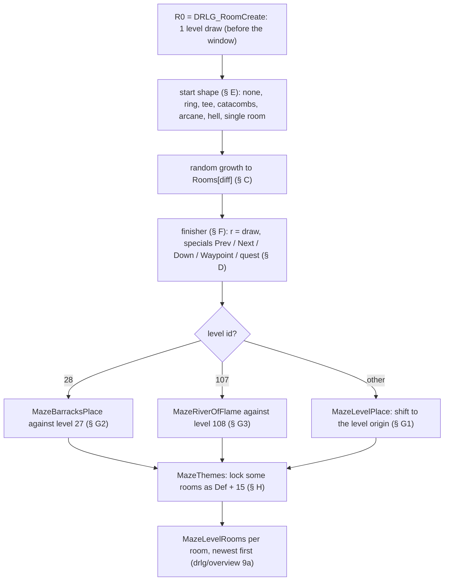
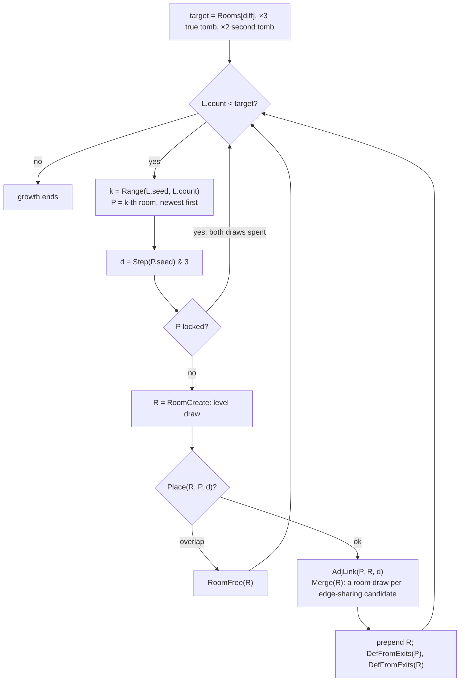
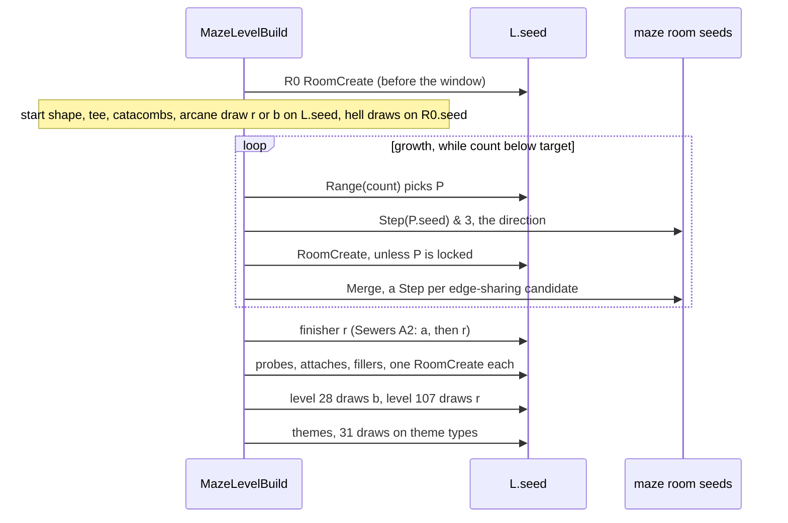

# Maze generator: room growth, `Def`s, special rooms and themes

## Purpose

A `DrlgType` 1 level is built from **maze rooms**. They are DRLG rooms of one `LvlMaze` size, laid edge to edge on
the level's tile grid. Each gets a `LvlPrest` `Def` from its exits, and some a forced file index. This spec covers
the generator from the first room to the room list that
[drlg/overview](README.md) step 9a then converts into preset instances. It replaces the maze oracle that the overview
used to have. It gives the growth loop, the extra links (`Merge`), the special rooms (stairs, waypoint, quest rooms)
that replace dead ends, the fixed shapes of some level types, the placement on the level rectangle (and the two levels
placed against a neighbour level), and the theme pass. Every draw is listed with its seed, in order. The draws come
from the level seed and from the maze rooms' own seeds. Primitives (`Step`, `Range`, `Init`) are those of
[rng](../rng/README.md). The level and room seeds are those of [rng/seeds](../rng/seeds.md) steps 4–5. Which warp
each special room carries, and the level links, are in [warps.md](warps.md).

## Entry points

| When | Function | Tag |
|---|---|---|
| Maze level record created (the `LvlMaze` row by level id; no draw) | fn:sub_00673B10_MazeLevelCreate@0x00673B10 → fn:sub_0061F490_LvlMazeByLevel@0x0061F490 | [I] |
| Maze level built, from `LevelInit` after the re-seed | fn:sub_00673B30_MazeLevelBuild@0x00673B30, run:2026-10-15-drlg-maze (230 windows) | [C] |
| Conversion of each maze room into a preset instance (boundary of this spec) | fn:sub_00673A60_MazeLevelRooms@0x00673A60, [drlg/overview](README.md) step 9a | [C] |

- [I] `LvlMazeByLevel` takes the first `LvlMaze` row whose `Level` equals the level id, and stops the game with a fatal
  error if there is none. Its only caller is `MazeLevelCreate`, so the 11 `LvlMaze` rows of non-maze levels are never
  read. (fn:sub_0061F490_LvlMazeByLevel@0x0061F490, fn:sub_00673B10_MazeLevelCreate@0x00673B10,
  [drlg/0006 § 8 (e)](../../findings/drlg/0006-maze.md#8-answers-to-the-phase-0-questions-backlog-archivist--reverser-2026-10-14))

## Inputs

### Tables

| Anchor | Used for |
|---|---|
| tbl:LvlMaze.txt:Level | row key (`+0x00`), first match |
| tbl:LvlMaze.txt:Rooms | `Rooms`, `Rooms(N)`, `Rooms(H)` at `+0x04 + 4·difficulty`: the target of random growth (§ C) |
| tbl:LvlMaze.txt:SizeX, tbl:LvlMaze.txt:SizeY | `+0x10`/`+0x14`: the size of every maze room of the level |
| tbl:LvlMaze.txt:Merge | `+0x18`: per-mille chance of an extra link to an edge-sharing room (§ B6) |
| tbl:Levels.txt:LevelType | the level type (level `+0x1C0`): selects the chain (§ F), the `Def` base (Constants) and the theme pass |
| tbl:LvlPrest.txt:Def | the record blocks the `Def`s name; see [LvlPrest § Maze presets](../../tables/LvlPrest.md#maze-presets-plan-0022-phase-0) |

### Runtime state

| State | Type | Owner offset | Source |
|---|---|---|---|
| level seed `L.seed` | `Seed` | level `+0x1C4` | re-seeded by `LevelInit` ([drlg/overview](README.md) step 2) |
| level id, level type | `u32` | level `+0x1D0`, `+0x1C0` | leveldefs |
| level rectangle `L.rect` (tiles) | `{x, y, w, h}` `i32` | level `+0x1C`–`+0x28` | [warps.md § C](warps.md#c-level-rectangles-and-the-links-after-the-layout) |
| level room list, count | list, prepended (next at room `+0x24`); `i32` | level `+0x10`, `+0x08` | this spec |
| maze room seed `R.seed` | `Seed` | DRLG room `+0x14` | `DRLG_RoomCreate` ([rng/seeds](../rng/seeds.md) step 5) |
| maze room rect | `{x, y, w, h}` `i32` | DRLG room `+0x34` | this spec |
| maze room adjacency | list of `{room, dir}`, prepended | DRLG room `+0x00` (struct:RoomAdj+0x04 is `dir`) | this spec |
| maze room `Def`, forced index, lock | `i32`, `i32`, bit 1 | struct:MazeRoomData+0x00, struct:MazeRoomData+0x04, struct:MazeRoomData+0x0C | this spec |
| difficulty | `u32` 0..2 | act `+0x450` | game |
| act index (0-based) | `u32` | act `+0x480` | game |
| the two Act II tombs | `u32` level ids | act `+0x094` (the true tomb), `+0x484` | [rng/seeds](../rng/seeds.md) step 3c |
| level 27's preset file index, level 27's rect (level 28 only) | `i32`; rect | level 27 | [warps.md](warps.md) (the link builder's level-6 draw) |
| level 108's rect (level 107 only) | rect | level 108 | [warps.md § C](warps.md#c-level-rectangles-and-the-links-after-the-layout) |

### Constants

| Name | Value | Anchor | Tag |
|---|---|---|---|
| direction codes | 0 W, 1 N, 2 E, 3 S; 4 NW, 5 NE, 6 SE, 7 SW (diagonals only in `MazeFillAround`) | fn:sub_00670880_MazeRoomPlace@0x00670880 | [C] |
| exit mask bits | W 1, E 2, S 4, N 8 | fn:sub_006709B0_MazeRoomDefFromExits@0x006709B0 | [C] |
| `Def` base by level type (`DefFromExits`) | 3 `0x34`, 4 `0x6C`, 7 `0xA7`, 8 `0xCD`, 10 `0x101`, 13 `0x12D`, 17 `0x19D`, 18 `0x1E1`, 19 `0x1FD`, 22 `0x2F1`, 24 `0x298`, 25 `0x2C0`, 28 `0x344`, 34 `0x422` | fn:sub_006709B0_MazeRoomDefFromExits@0x006709B0 | [C] |
| type 33 (Ice) | `Def = mask` when `Rooms[diff] = 1`, else `0x3EA + mask` | fn:sub_006709B0_MazeRoomDefFromExits@0x006709B0, fn:sub_00670810_MazeIsSingleRoom@0x00670810 | [C] |
| corner tables (types 14, 15, 23, 32) | by mask: 14 Harem SW 356, SE 355, NW 357, NE 354; 15 Basement SW 360, SE 359, NW 361, NE 358; 23 Spider SW 659, SE 660, NW 661, NE 662; 32 Temple SW 1045, SE 1044, NW 1043, NE 1042; every other mask 0 | fn:sub_006709B0_MazeRoomDefFromExits@0x006709B0 (data 0x006EF6D8–0x006EF7D8) | [C] |
| type 35 (Act V lava) mask table | N 1053, S 1054, E 1055, W 1056, EW 1057, NS 1058; every other mask 0 | fn:sub_006709B0_MazeRoomDefFromExits@0x006709B0 | [C] |
| theme types and bases | 3 `0x34`, 4 `0x6C`, 7 `0xA7`, 8 `0xCD`, 10 `0x101`, 13 `0x12D`, 17 `0x19D`, 22 `0x2F1`, 24 `0x298`, 25 `0x2C0` | fn:sub_006735F0_MazeThemes@0x006735F0 | [C] |
| tee Prev records | type 17: 447, 444, 446, 445; type 34: 1075, 1077, 1076, 1074 (index 0..3) | fn:sub_006718C0_MazeTeeStart@0x006718C0 (data 0x006EF888, 0x006EF88C, stride 8) | [C] |
| Act V hell start entries | `0x006EF828`, 4 × `{Def, dir, idx} ×2` (§ E5) | fn:sub_00671430_MazeHellStart@0x00671430 | [C] |
| special tables | `MazeSpecial` `{matchDef, def, idx, dir}`, 16 bytes, 4 per table, from `0x006EF8A8` to `0x006F05D7` (§ D) | data:g_MazeSpecialTables@0x006EF8A8, fn:sub_006724E0_MazeSpecialPlace@0x006724E0, [drlg/0006 § 6](../../findings/drlg/0006-maze.md#6-the-special-tables) | [C] |
| filler record | 836 `Act 4 - Lava X` | fn:sub_00671320_MazeFillAround@0x00671320 | [C] |

- [C] The base table of `DefFromExits` is the rotation base of `MazePresetFile` ([drlg/overview](README.md)
  Constants), with 0x1FD (Arcane) added here. The values 0x3EA and 0x41C are used only by `MazePresetFile`.
  (fn:sub_006709B0_MazeRoomDefFromExits@0x006709B0, fn:sub_006738C0_MazePresetFile@0x006738C0, run:2026-10-15-drlg-maze)
- [C] No expansion or classic flag enters the maze code. One model with no mode input reproduces 46 classic windows
  (levels 9, 56, 65, 84, 86, 92, 100, 107) and the expansion windows of the same levels.
  (fn:sub_00673B30_MazeLevelBuild@0x00673B30, run:2026-10-15-drlg-outdoor, run:2026-10-15-drlg-maze)

## Algorithm



Notation: `L` the level, `L.seed` its seed, `L.rooms` its room list (newest first), `L.count` its length. `R.seed` is a
maze room's own seed. `Step(s)` advances seed `s` once and returns its new low word (`u32`). `Range(s, n)` is the
guarded range of [rng](../rng/README.md): `n < 1` gives 0 with no draw, otherwise one `Step`, then `lo & (n − 1)` for a
power of two or `lo mod n` (unsigned). A **level draw** is a `Step` of `L.seed`; a **room draw** is a `Step` of a maze
room's seed. Rects are in tiles. `÷` truncates toward zero.

### A. The window

```
A1. MazeLevelBuild(L):                                               [C] (fn:sub_00673B30_MazeLevelBuild@0x00673B30, run:2026-10-15-drlg-maze)
      R0 ← RoomCreate(L)                                             ; B1: one level draw, before the window
      R0.x ← L.x + (L.w − R0.w) ÷ 2;  R0.y ← L.y + (L.h − R0.h) ÷ 2   ; centred
      LevelRoomLink(L, R0)                                           ; prepend
      ── window start (seed after R0's draw) ──
      chain of L's level type (§ F): start shape, growth, finisher
      if L.id = 28: MazeBarracksPlace(L)                             ; § G2
      else if L.id = 107: MazeRiverOfFlame(L)                        ; § G3
      else: MazeLevelPlace(L)                                        ; § G1
      MazeThemes(L)                                                  ; § H
      ── window end ──
      for M in L.rooms (newest first): MazeLevelRooms(L, M)          ; drlg/overview 9a
```

- [C] The run checked, per window, every level draw against a hardware watchpoint on the level seed (12388 draws), the
  room list in list order with absolute rects, `Def`s and forced indices, and the seed after the window: 230 windows,
  41 maze levels, all 20 maze level types, 0 mismatches. (fn:sub_00673B30_MazeLevelBuild@0x00673B30,
  run:2026-10-15-drlg-maze)
- [I] R0's centred position cancels out: every placement path of § G translates all rooms by an offset computed from
  the rooms' own positions. So only the relative layout and the level rect decide the final rects.
  (fn:sub_00642590_MazeLevelPlace@0x00642590, fn:sub_00673120_MazeBarracksPlace@0x00673120,
  fn:sub_00673320_MazeRiverOfFlame@0x00673320)

### B. Primitives

```
B1. RoomCreate(L) → R:                                               [C] (fn:DRLG_RoomCreate@0x0066B3E0, run:2026-10-15-drlg-maze)
      Step(L.seed)                                                   ; level draw
      R.seed ← Init(L.seed.low);  Step(R.seed);  R[+0x04] ← R.seed.low ; rng/seeds step 5
      R.w, R.h ← LvlMaze.SizeX, LvlMaze.SizeY
      R.def ← 0;  R.idx ← −1;  R.locked ← false;  R.adj ← empty

B2. Gap(A, B) → (gx, gy): i32                                        [C] (fn:sub_0066B800_RectGap@0x0066B800, run:2026-10-12-drlg-gen)
      gx ← (A.x < B.x) ? B.x − A.w − A.x : A.x − B.w − B.x;  gy likewise on y, h
      overlap(A, B) ⇔ gx < 0 and gy < 0                              ; rooms that only touch do not overlap

B3. Place(R, P, d) → bool:                                           [C] (fn:sub_00670880_MazeRoomPlace@0x00670880, fn:sub_0066B900_LevelRectFree@0x0066B900, run:2026-10-12-drlg-gen)
      (R.x, R.y) ← d = 0: (P.x − P.w, P.y)        1: (P.x, P.y − P.h)
                   d = 2: (P.x + P.w, P.y)        3: (P.x, P.y + P.h)
                   d = 4: (P.x − P.w, P.y − P.h)  5: (P.x + P.w, P.y − P.h)
                   d = 6: (P.x + P.w, P.y + P.h)  7: (P.x − P.w, P.y + P.h)
      if overlap(R, Q) for any Q in P.adj: return false
      if overlap(R, Q) for any Q in L.rooms with Q ≠ R, Q ≠ P: return false
      return true                                                    ; no test against L.rect

B4. AdjLink(A, B, d):                                                [C] (fn:sub_0066B5E0_RoomAdjLink@0x0066B5E0, fn:sub_0066B560_RoomAdjAdd@0x0066B560, run:2026-10-12-drlg-gen)
      prepend {B, d} to A.adj unless B is already in A.adj
      prepend {A, (d − 2) & 3} to B.adj unless A is already in B.adj

B5. DefFromExits(R):                                                 [C] (fn:sub_006709B0_MazeRoomDefFromExits@0x006709B0, run:2026-10-15-drlg-maze)
      mask: u32 ← OR over R.adj of {0: 1, 1: 8, 2: 2, 3: 4}[dir]     ; diagonal links add nothing
      idx: i32 ← −1
      by L's level type:
        based types: def ← base + mask                               ; mask 0 gives base itself
        33: def ← (Rooms[diff] = 1) ? mask : 0x3EA + mask
        14, 15, 23, 32: def ← corner table[mask];  35: def ← lava table[mask]
        15 extra: L.id = 52 and def = 361 → idx ← 2;  L.id = 54 and def ∈ {361, 359} → idx ← 3
        23 extra: L.id = 84 and def = 662 → def ← 664;  L.id = 85 and def = 661 → def ← 663
        any other type: fatal
      if def ≠ 0: R.def ← def;  R.idx ← idx;  R.locked ← false        ; def 0 leaves the room unchanged

B6. Merge(R):                     ; R is new and not yet in L.rooms  [C] (fn:sub_00670C70_MazeRoomMerge@0x00670C70, run:2026-10-15-drlg-maze)
      if R.locked: return
      for P in L.rooms (newest first), P not locked:
        (gx, gy) ← Gap(R, P)
        if gx < 1 and gy < 1 and gx ≠ gy and P not in R.adj:         ; shares an edge, not a corner
          v: u32 ← Step(P.seed) mod 1000                             ; room draw on P, unsigned mod
          if (i32) v < LvlMaze.Merge:                                ; signed compare
            d ← RectAdjDir(P, R)                                     ; side of P that R touches, or −1
            if d ≠ −1: AdjLink(P, R, d);  DefFromExits(P)

B7. Grow(P, d, merge = true) → R | none:                             [C] (fn:sub_00670F60_MazeRing@0x00670F60, fn:sub_00671210_MazeGrow@0x00671210, run:2026-10-15-drlg-maze)
      R ← RoomCreate(L)                                              ; level draw, spent even on failure
      if not Place(R, P, d): RoomFree(R); return none
      AdjLink(P, R, d)
      if merge: Merge(R)
      LevelRoomLink(L, R)                                            ; prepend
      DefFromExits(P);  DefFromExits(R)
      return R

B8. AddFixed(P, d, def, idx, recalcParent) → R | none:               [C] (fn:sub_00670DE0_MazeRoomAddFixed@0x00670DE0, run:2026-10-15-drlg-maze)
      R ← RoomCreate(L);  if not Place(R, P, d): RoomFree(R); return none
      AdjLink(P, R, d);  LevelRoomLink(L, R)                         ; no merge
      if recalcParent: DefFromExits(P)
      R.locked ← true;  R.def ← def;  R.idx ← idx

B9. Probe(R, d) → bool:          ; "can R grow in d"                 [C] (fn:sub_00672340_MazeProbe@0x00672340, fn:sub_0066C100_RoomFree@0x0066C100, run:2026-10-12-drlg-gen)
      if R.locked or R.adj has a link with dir d: return false       ; no draw
      T ← RoomCreate(L)                                              ; a real room: one level draw
      if not Place(T, R, d): RoomFree(T); return false
      AdjLink(R, T, d);  LevelRoomLink(L, T);  DefFromExits(T)
      RoomFree(T)                                                    ; unlinked from R and from L
      return true

B10. Find(d) → room | none:       ; FindWest/North/East/South         [C] except FindWest [I] (fn:sub_006723E0_MazeFindNorth@0x006723E0, fn:sub_00672460_MazeFindEast@0x00672460, fn:sub_006724A0_MazeFindSouth@0x006724A0, fn:sub_00672420_MazeFindWest@0x00672420, run:2026-10-15-drlg-maze)
      key ← d = 0: x (lowest);  1: y (lowest);  2: −x (highest x);  3: −y (highest y)
      best ← none
      for R in L.rooms (newest first):
        if best = none or key(R) < key(best):                        ; strictly better only
          if Probe(R, d): best ← R
      return best
```

Step notes:

- B3. [C] The parent's own `w`/`h` set the offset. Every maze room has the `LvlMaze` size, the fixed `Def`s of levels 28
  and 107 included. (fn:sub_00670880_MazeRoomPlace@0x00670880, run:2026-10-12-drlg-gen)
- B5. [C] `DefFromExits` is called with "unlock" at every call site, so it also **clears the lock** and resets the forced
  index (except for the two Basement levels). Basement 1 (52) takes `File3` of `Basement NW` (361). Basement 3 (54)
  takes `File4` of `Basement NW`/`Basement SE`. The two Spider substitutions give Spider Cavern (84) and Arachnid Lair
  (85) their `Spider Chest` rooms. (fn:sub_006709B0_MazeRoomDefFromExits@0x006709B0, run:2026-10-15-drlg-maze: 52, 54,
  84, 85)
- B6. [C] **The merge draw is made whatever `Merge` is.** With `Merge` 1000 every edge-sharing pair links, and with
  `Merge` 0 none does, but each candidate's seed is still stepped. That step changes the next growth direction drawn
  from that room (§ C). (fn:sub_00670C70_MazeRoomMerge@0x00670C70, run:2026-10-15-drlg-maze)
- B6. [C] A merge seen from R skips rooms already in `R.adj`, so R's parent is never drawn on. `RectAdjDir(P, R)` returns
  0 when R is west of P and touches it (`P.x = R.x + R.w`), 2 when R is east of P (`R.x = P.x + P.w`), else 1 when R is
  north (`P.y = R.y + R.h`), else 3 when R is south (`R.y = P.y + P.h`), else −1.
  (fn:sub_00670C70_MazeRoomMerge@0x00670C70, fn:sub_00642240_RectAdjDir@0x00642240, run:2026-10-12-drlg-gen)
- B9. [C] A probe spends a level draw whenever it gets past the lock and link test. Because the finders probe only a
  room that beats the current best, **the number of probe draws depends on the list order**.
  (fn:sub_00672340_MazeProbe@0x00672340, fn:sub_006723E0_MazeFindNorth@0x006723E0, run:2026-10-12-drlg-gen)
- B10. [I] `MazeFindWest` was never called in the run (level 27's index was 1 in every log, so the Barracks took
  `FindSouth`). It is read as the mirror of `FindEast`. (fn:sub_00672420_MazeFindWest@0x00672420)
- B1–B9. [C] The maze rooms are freed after the conversion, so their room draws leave no trace outside the window. Only
  the level seed matters to later steps. (fn:sub_00671210_MazeGrow@0x00671210, fn:sub_00673A60_MazeLevelRooms@0x00673A60,
  run:2026-10-12-drlg-gen)

### C. Random growth



```
C1. MazeGrow(L):                                                     [C] (fn:sub_00671210_MazeGrow@0x00671210, fn:sub_006711A0_MazeRoomPickRandom@0x006711A0, run:2026-10-15-drlg-maze)
      target: i32 ← LvlMaze.Rooms[act.difficulty]
      if L.id = act[+0x094]: target ← target × 3                     ; [I] no tomb 66–72 built (0x00671210)
      if L.id = act[+0x484]: target ← target × 2                     ; [I] no tomb 66–72 built (0x00671210)
      while L.count < target:
        k: u32 ← Range(L.seed, L.count)                              ; level draw
        P ← the k-th room of L.rooms (0 = newest)
        d: u32 ← Step(P.seed) & 3                                    ; room draw on the PICKED room
        if not P.locked: Grow(P, d)                                  ; B7
```

- C1. [C] The count is read per difficulty: 22 levels were built on all three difficulties, and the nightmare and hell
  counts were reproduced (99 windows). (fn:sub_00671210_MazeGrow@0x00671210, tbl:LvlMaze.txt:Rooms,
  run:2026-10-15-drlg-maze)
- C1. [C] A locked pick, or a placement that overlaps, adds no room, but its draws are spent. The loop then picks again,
  so the number of level draws per growth step is not fixed: 1 (locked) or 2 (create) per iteration, plus the room
  draws. (fn:sub_00671210_MazeGrow@0x00671210, run:2026-10-15-drlg-maze)
- C1. [C] The growth target counts R0 and the start shape's rooms. Specials attached later, the level 28/107 extras
  and the hell fillers come on top of it. The fixed-shape types (14, 15, 23, 32, 19, 35, the single-room Ice levels)
  never run growth. (fn:sub_00671210_MazeGrow@0x00671210, fn:sub_00673B30_MazeLevelBuild@0x00673B30,
  run:2026-10-15-drlg-maze)

### D. Special rooms

A **special** is one `MazeSpecial` entry `{matchDef, def, idx, dir}` taken from a 4-entry table at the current
rotation `r`.

```
D1. SpecialPlace(entry, rotate: bool):                               [C] (fn:sub_006724E0_MazeSpecialPlace@0x006724E0, fn:sub_00670EB0_MazeSpecialAttach@0x00670EB0, drlg/0006 § 6, run:2026-10-15-drlg-maze)
      R ← first room in L.rooms (newest first) with not R.locked and R.def = entry.matchDef
      if R: R.locked ← true;  R.def ← entry.def;  R.idx ← entry.idx  ; replaces a dead end, no draw
      else: Attach(entry)                                            ; D2
      if rotate: r ← (r + 1) & 3

D2. Attach(entry):                                                   [I] (fn:sub_00670EB0_MazeSpecialAttach@0x00670EB0, drlg/0006 § 6)
      for P in L.rooms (newest first), P not locked:
        R ← RoomCreate(L)                                            ; level draw per candidate tried
        if Place(R, P, entry.dir):
          AdjLink(P, R, entry.dir);  LevelRoomLink(L, R);  DefFromExits(P)
          R.locked ← true;  R.def ← entry.def;  R.idx ← entry.idx
          return
      ; no room could take it: nothing placed
```

- D1. [C] Each finisher draws `r` once and then places its specials in order, each from the entry `r` of its own table,
  with `r ← (r + 1) & 3` after each one. Consecutive specials therefore face different directions. The attach that
  succeeds on the first candidate tried is reproduced (Den of Evil, Cave Level 1, § Worked example).
  (fn:sub_006724E0_MazeSpecialPlace@0x006724E0, [drlg/0006 § 6](../../findings/drlg/0006-maze.md#6-the-special-tables),
  run:2026-10-15-drlg-maze)
- D2. [I] A candidate whose placement fails spends its level draw and the walk goes on. The case where no room can take
  the special was not reached. (fn:sub_00670EB0_MazeSpecialAttach@0x00670EB0,
  [drlg/0006 § 6](../../findings/drlg/0006-maze.md#6-the-special-tables), run:2026-10-15-drlg-maze)
- [C] **The table layout.** 47 of the 50 four-entry tables follow one rule, which gives every entry of those 47 tables
  as read from the data. With `m` the block's `DefFromExits` base and `b` the special's first record, entry `r` matches the
  dead end whose only exit is N, E, S, W for `r` = 0, 1, 2, 3 (`matchDef` = `m` + 8, 2, 4, 1) and attaches in the opposite
  direction (`dir` 3, 0, 1, 2), so the new room's single exit faces its parent. Its `def` is `b` + 3, 1, 2, 0 (so a block
  reads W, E, S, N) and its `idx` −1. (data:g_MazeSpecialTables@0x006EF8A8, fn:sub_006724E0_MazeSpecialPlace@0x006724E0,
  [drlg/0006 § 6 *The layout rule*](../../findings/drlg/0006-maze.md#6-the-special-tables), run:2026-10-15-drlg-maze)
- [C] The three exceptions keep `matchDef`, `dir` and `idx` and give `def` = `b` + 0, 2, 1, 3: Baal Next (`0x006F0368`,
  1078–1081), Baal Waypoint (`0x006F03A8`, 1082–1085) and Ice Waypoint (`0x006F0598`, 1034–1037). The Temple tables
  (below) and the single entries of Lair 64 and River of Flame (§ F, § G3) are outside the rule.
  (data 0x006F0368, 0x006F03A8, 0x006F0598, [drlg/0006 § 6](../../findings/drlg/0006-maze.md#6-the-special-tables))
- [C] Every stock entry of the tables has `idx` −1. Forced indices come only from `AddFixed`, `DefFromExits` and the start
  shapes. (data:g_MazeSpecialTables@0x006EF8A8, [drlg/0006 § 6](../../findings/drlg/0006-maze.md#6-the-special-tables))
- [C] The special tables by block (level type in parentheses, `m` in brackets), each at the address its finisher adds to `16·r` (data:g_MazeSpecialTables@0x006EF8A8):

  | Block | Specials (table address: records) |
  |---|---|
  | Cave (3) [52] | Prev `0x006EF8A8`: 83–86, Den of Evil `0x006EF8E8`: 95–98, Down `0x006EF928`: 91–94, Coldcrow `0x006EF968`: 99–102, Next `0x006EF9A8`: 87–90 |
  | Crypt (4) [108] | Prev `0x006EF9E8`: 139–142, Bonebreak `0x006EFA28`: 147–150, Chest `0x006EFAA8`: 151–154, Next `0x006EFAE8`: 143–146 (Portal `0x006EFA68`: 155–158, no reference in the finisher) |
  | Barracks (7) [167] | Next `0x006F03E8`: 198–201, Forge `0x006F0428`: 202–205 |
  | Jail (8) [205] | Prev `0x006EFB28`: 236–239, Cath `0x006EFB68`: 244–247, Next `0x006EFBA8`: 240–243, Waypoint `0x006EFBE8`: 248–251, Pitspawn `0x006EFC28`: 252–255 |
  | Catacombs (10) [257] | Next `0x006EFC68`: 291–294, Waypoint `0x006EFCA8`: 295–298 |
  | Sewer A2 (13) [301] | Prev `0x006EFCE8`: 332–335, Next `0x006EFD28`: 337–340, Waypoint `0x006EFD68`: 345–348, Radament `0x006EFDA8`: 341–344, Chest `0x006EFDE8`: 349–352 |
  | Tomb (17) [413] | Next `0x006EFE28`: 448–451, Waypoint `0x006EFE68`: 476–479, Chest `0x006EFEA8`: 472–475, Leatherarm `0x006EFEE8`: 464–467, Cube `0x006EFF28`: 456–459, Treasure `0x006EFF68`: 452–455, Tal Rasha `0x006EFFA8`: 460–463, Kaa `0x006EFFE8`: 468–471 |
  | Lair (18) [481] | Prev `0x006F0028`: 497–500, Next `0x006F0068`: 501–504, Treasure `0x006F00A8`: 505–508 (read only through its entry 3, § F), Tight Spot `0x006F00E8`: 509 (one entry) |
  | Arcane (19) [509] | Summoner `0x006F00F8`: 525–528 |
  | Dungeon (24) [664] | Prev `0x006F0138`: 695–698, Next `0x006F0178`: 699–702 |
  | Sewer A3 (25) [704] | Drain `0x006F01B8`: 739–742, Chest `0x006F01F8`: 743–746 |
  | Durance (22) [753] | Prev `0x006F0238`: 784–787, Waypoint `0x006F0278`: 792–795, Next `0x006F02B8`: 788–791 |
  | Temple (32) | Down `0x006F02F8`: 1046–1048, Waypoint `0x006F0328`: 1049–1052 |
  | Baal (34) [1058] | Next `0x006F0368`: 1078–1081, Waypoint `0x006F03A8`: 1082–1085 (exceptions) |
  | Ice (33) [1002] | Prev `0x006F0498`: 1018–1021, Next `0x006F04D8`: 1022–1025, Down `0x006F0518`: 1026–1029, Theme `0x006F0558`: 1030–1033, Waypoint `0x006F0598`: 1034–1037 (exception) |

  (data:g_MazeSpecialTables@0x006EF8A8, fn:sub_006724E0_MazeSpecialPlace@0x006724E0,
  [drlg/0006 § 6 *The tables by block*](../../findings/drlg/0006-maze.md#6-the-special-tables), run:2026-10-15-drlg-maze)
- [C] **Temple tables** (as `matchDef → def, dir`; `idx` −1). Down `0x006F02F8` has **three** entries: 1042 → 1046 (1),
  1043 → 1047 (0), 1045 → 1048 (3). Waypoint `0x006F0328` has four: 1042 → 1049 (1), 1043 → 1050 (0), 1045 → 1052 (3),
  1044 → 1051 (2). Down is placed from `0x006F02F8 + 16r` unless the level is 124, and Waypoint on level 123 from
  `0x006F0328 + 16r`. (data 0x006F02F8–0x006F0367, fn:sub_00673000_MazeSpecialsTemple@0x00673000,
  [drlg/0006 § 6 *Temple*](../../findings/drlg/0006-maze.md#6-the-special-tables), run:2026-10-15-drlg-maze: 122, 123)
- [I] Down reads `r` 0..2 only (the draw is `mod 3`), so the word after its third entry, which is Waypoint's entry 0, is
  never read as Down's entry 3. Waypoint is read after Down has advanced `r`, so at `r` 1..3, and its entry 0 is never
  read either. (fn:sub_00673000_MazeSpecialsTemple@0x00673000,
  [drlg/0006 § 6 *Temple*](../../findings/drlg/0006-maze.md#6-the-special-tables))

### E. Start shapes

```
E1. Ring(n):                                                         [C] (fn:sub_00670F60_MazeRing@0x00670F60, run:2026-10-15-drlg-maze)
      cur ← R0
      repeat n − 1: cur ← Grow(cur, 1)                               ; north
      repeat n − 1: cur ← Grow(cur, 0)                               ; west
      repeat n − 1: cur ← Grow(cur, 3)                               ; south
      repeat n − 2: cur ← Grow(cur, 2)                               ; east
      AdjLink(cur, R0, 2);  DefFromExits(cur);  DefFromExits(R0)     ; close the ring

E2. Tee (types 17, 34):                                              [C] (fn:sub_006718C0_MazeTeeStart@0x006718C0, run:2026-10-15-drlg-maze)
      r: u32 ← Step(L.seed) & 3                                      ; level draw
      repeat 3: Grow(R0, r);  r ← (r + 1) & 3
      R0.def ← tee Prev record[r];  R0.locked ← true;  R0.idx ← −1    ; r is now (r₀ + 3) & 3

E3. CatacombsStart (type 10):                                        [C] (fn:sub_006714D0_MazeCatacombsStart@0x006714D0, run:2026-10-15-drlg-maze)
      if L.id = 34: Grow(R0, d) for d = 1, 2, 3, 0;  R0.def ← 290     ; Catacombs Prev NSEW
      else:
        b: u32 ← Step(L.seed) & 1                                    ; level draw (35, 36)
        if b = 0: Grow(R0, 1);  Grow(R0, 3);  R0.def ← 289            ; Prev NS
        else:     Grow(R0, 0);  Grow(R0, 2);  R0.def ← 288            ; Prev EW
      R0.locked ← true;  R0.idx ← −1

E4. Arcane (type 19, level 74):                                      [C] (fn:sub_006719F0_MazeArcane@0x006719F0, run:2026-10-15-drlg-maze: 8 windows)
      r: u32 ← Step(L.seed) & 3                                      ; level draw
      for a in 0 ..< 4:                                              ; one arm per direction, d = a
        A1, A2, A3 ← (a + 1) & 3, (a + 2) & 3, (a + 3) & 3
        cur ← R0;  s ← []
        for dd in a, a, A3, a, a, a, a, A1: cur ← Grow(cur, dd); append cur to s   ; s0..s7
        Grow(cur, a)                                                 ; a dead end, not recorded
        cur ← Grow(cur, A1); append                                  ; s9 (from s7)
        for dd in A2, A2: cur ← Grow(cur, dd); append                ; s10, s11
        Grow(cur, A3)                                                ; a dead end, not recorded
        cur ← Grow(cur, A2); append;  cur ← Grow(cur, A2); append     ; s13, s14
        arm[a] ← s
      for a in 0 ..< 4: for R in arm[a]: R.idx ← (a + r) & 3
      R0.idx ← 4

E5. HellStart (type 35):                                             [C] (fn:sub_00671430_MazeHellStart@0x00671430, run:2026-10-15-drlg-maze: level 125)
      e: u32 ← (Step(R0.seed) & 3) × 2                               ; ROOM draw on R0, not the level seed
      for each of the entries e, e + 1 at 0x006EF828:
        AddFixed(R0, entry.dir, entry.def, entry.idx, recalcParent: true)
      FillAround(836, exclude: none)                                 ; E6

E6. FillAround(def, exclude):                                        [C] (fn:sub_00671320_MazeFillAround@0x00671320, run:2026-10-15-drlg-maze)
      for P in L.rooms as they are now (newest first), P ≠ exclude:  ; fillers made here are not walked
        for d in 0 ..< 8:
          R ← RoomCreate(L)                                          ; level draw, 8 per walked room
          if Place(R, P, d): AdjLink(P, R, d);  LevelRoomLink(L, R);  R.locked ← true;  R.def ← def;  R.idx ← −1
          else: RoomFree(R)
      ; no DefFromExits
```

- E1. [C] `Ring(2)` is a 2 × 2 square of four rooms (R0, north, north-west, west) in which every room has exactly two
  exits. Every `Grow` of a ring merges. (fn:sub_00670F60_MazeRing@0x00670F60, run:2026-10-15-drlg-maze)
- E1, E4. [C] **A failed placement crashes the straight-line shapes.** In `MazeRing`, the catacombs chains and Arcane's
  arms, the next room's parent is the room just made. A failed placement leaves a null parent. No stock level fails
  there, because these shapes start from a lone room. (fn:sub_00670F60_MazeRing@0x00670F60,
  fn:sub_006719F0_MazeArcane@0x006719F0)
- E4. [C] So `File1..4` of the Arcane records are the four arm styles, and `File5` is the centre. The two dead ends of
  each arm keep index −1. Arcane's `Merge` is 1000, so every edge-sharing pair links.
  (fn:sub_006719F0_MazeArcane@0x006719F0, tbl:LvlMaze.txt:Merge, run:2026-10-15-drlg-maze)
- E5. [C] The entries are, by `e ÷ 2`: 0: 1054 north (idx 0), 1053 south (idx 1); 1: the same with idx 1, 0; 2: 1055 west
  (idx 1), 1056 east (idx 0); 3: the same with idx 0, 1. Each `AddFixed` recomputes R0's `Def`, so R0 ends as NS 1058 or
  EW 1057. (fn:sub_00671430_MazeHellStart@0x00671430, run:2026-10-15-drlg-maze)
- E6. [C] Diagonal links (directions 4–7) occur only here, and no `Def` is recomputed, so the fillers never change their
  neighbours' `Def`s. (fn:sub_00671320_MazeFillAround@0x00671320, run:2026-10-15-drlg-maze)

### F. The chain per level type

| Type | Levels | Start | Growth | Finisher (`r` = `Step(L.seed) & 3` unless stated; specials in order) | Tag |
|---|---|---|---|---|---|
| 3 caves | 8–12 | — | yes | `r`; Prev; 8: Den of Evil, else Down; 9: + Coldcrow; 10: + Next | [C] 8, 9 / [I] 10–12 (0x00672550) |
| 4 crypts | 18–24, 133 | — | yes | `r`; Prev; 18: Bonebreak; 19, 133: Chest; 21–24: Next | [C] 18, 19 / [I] others (0x00672610) |
| 7 Barracks | 28 | `Ring(2)` | yes | none; the level 28 placement (§ G2) places its specials | [C] (0x00673120) |
| 8 Jail | 29–31 | `Ring(2)` | yes | `r`; Prev; 29: Waypoint; 30: Pitspawn; 31: Cath, else Next | [C] 29, 30 / [I] 31 (0x006726D0) |
| 10 Catacombs | 34–36 | E3 | yes | `r`; Next; 35: Waypoint | [C] (0x006727A0) |
| 13 Sewers A2 | 47–49, 65 | `Ring(2)` | yes | `a`, then `r` (F2); 47: the dock path; 48: Prev, Waypoint, Next; 49: Prev, Radament; 65: Prev, Chest | [C] (0x00672810) |
| 14 Harem, 15 Basement, 23 Spider | 51–54, 84, 85 | `Ring(2)` | no | none | [C] (0x00670F60) |
| 17 Tomb | 55–61, 66–72 | tee; 61: R0 locked as 480 `Tomb Tainted Sun X` | yes (not 61) | F3; 61 has none | [C] 57, 58, 61 / [I] others (0x00672BE0) |
| 18 Lair | 62–64 | `Ring(2)` | yes | `r`; 64: Tight Spot (fixed entry), then `r ← 3`, Treasure (fixed entry, `r` → 0), Prev; else Next, Prev | [C] 62 / [I] 63, 64 (0x00672DC0, drlg/0006 § 6 *Lair 64*) |
| 19 Arcane | 74 | E4 | no | `r`; Summoner | [C] (0x00672E50) |
| 22 Durance | 100, 101 | `Ring(2)` | yes | `r`; Prev; 101: Waypoint, Next; 100: Next | [C] (0x00672F60) |
| 24 Dungeon | 86–89 | `Ring(2)` | yes | `r`; Prev, Next | [C] 86, 88 / [I] 87, 89 (0x00672EA0) |
| 25 Sewers A3 | 92 | `Ring(5)`, then F4 | yes | `r`; Drain, Chest | [C] (0x00672F00) |
| 28 Act IV lava | 107 | — | yes | none; the level 107 placement (§ G3) | [C] (0x00673320) |
| 32 Temple | 122, 123 | `Ring(2)` | no | `r ← Step(L.seed) mod 3`; not 124: Down; 123: Waypoint | [C] (0x00673000) |
| 33 Ice | 113, 115, 118 | `Ring(2)` | yes | `r`; Prev, Next, Down; 115: Theme; 113, 115, 118: Waypoint | [C] (0x00673530) |
| 33 Ice | 114, 116, 119 | R0 locked: 114 `Range(L.seed, 2)` = 1 → 1038, 0 → 1039; 116 → 1040; 119 → 1041 | no | none | [C] (0x00673B30) |
| 34 Baal | 128–130 | tee | yes | `r`; Next; 129: Waypoint | [C] 129 / [I] 128, 130 (0x006730B0) |
| 35 Act V lava | 125–127, 135 | E5 | no | none | [C] 125 / [I] others (0x00671430) |

(fn:sub_00673B30_MazeLevelBuild@0x00673B30, fn:sub_00672550_MazeSpecialsCave@0x00672550, fn:sub_00672610_MazeSpecialsCrypt@0x00672610,
fn:sub_006726D0_MazeSpecialsJail@0x006726D0, fn:sub_006727A0_MazeSpecialsCatacombs@0x006727A0, fn:sub_00672DC0_MazeSpecialsLair@0x00672DC0,
fn:sub_00672E50_MazeSpecialsArcane@0x00672E50, fn:sub_00672EA0_MazeSpecialsDungeon@0x00672EA0, fn:sub_00672F00_MazeSpecialsSewerA3@0x00672F00,
fn:sub_00672F60_MazeSpecialsDurance@0x00672F60, fn:sub_00673000_MazeSpecialsTemple@0x00673000, fn:sub_00673530_MazeSpecialsIce@0x00673530,
fn:sub_006730B0_MazeSpecialsBaal@0x006730B0; the tags cite run:2026-10-15-drlg-maze)

- F1. [C] The table order is the call order: start shape, then growth, then the finisher draw `r`, then the specials.
  The single-room Ice levels and level 61 break out of the chain after their fixed room, with no growth and no
  finisher. Placement (§ G) and themes (§ H) follow for every type. (fn:sub_00673B30_MazeLevelBuild@0x00673B30,
  run:2026-10-15-drlg-maze)

```
F2. Sewers A2 finisher (type 13):                                    [C] (fn:sub_00672810_MazeSpecialsSewerA2@0x00672810, fn:sub_00670DE0_MazeRoomAddFixed@0x00670DE0, run:2026-10-15-drlg-maze)
      a: u32 ← (Step(L.seed) & 1) × 2 | 1                            ; 1 or 3; drawn on every type-13 level
      r: u32 ← Step(L.seed) & 3
      if L.id = 47:                                                  ; the dock path
        P ← Find(1);  R1 ← Grow(P, 1);  R2 ← Grow(R1, 1)
        AddFixed(R2, 0, 333, idx 0, recalcParent: true)              ; Sewer Prev E
        P ← Find(2);  R1 ← Grow(P, 2);  R2 ← Grow(R1, 2)
        dock ← AddFixed(R2, a, 336, idx 0, recalcParent: true)       ; Sewer Prev NS, the dock
        R ← RoomCreate(L)
        if Place(R, dock, a): AdjLink(dock, R, a);  LevelRoomLink(L, R);  DefFromExits(R)   ; no merge
        else: RoomFree(R)
        SpecialPlace(Next[r], rotate)
      else: the specials of the table row, each SpecialPlace(table[r], rotate)

F3. Tomb finisher (type 17):                                         [C] (fn:sub_00672BE0_MazeSpecialsTomb@0x00672BE0, run:2026-10-15-drlg-maze: 57, 58)
      P ← first room in L.rooms (newest first) with P.def > 428       ; the tee's Prev record
      r ← {444: 3, 445: 1, 446: 0, 447: 2}[P.def];  fatal for any other Def      ; no draw
      55–58: Next;  57: Waypoint
      59 or 61: Chest
      66–72 and L.id ≠ act[+0x094]: Chest;  59: Leatherarm
      60: Cube;  59 or 61: Treasure
      L.id = act[+0x094]: Tal Rasha                                  ; [I] not reached (0x00672BE0)
      L.id = act[+0x484]: Kaa                                        ; [I] not reached (0x00672BE0)

F4. Level 92 corners:                                                [C] (fn:sub_00673B30_MazeLevelBuild@0x00673B30, run:2026-10-15-drlg-maze: 2 windows)
      after Ring(5): for (want, new) in (0x2C5, 735), (0x2C6, 736), (0x2C9, 737), (0x2CA, 738):
        R ← first unlocked room with R.def = want;  R.locked ← true;  R.def ← new;  R.idx ← −1
```

- F2. [C] On levels 48, 49 and 65 the `a` draw is still made and its value is unused.
  (fn:sub_00672810_MazeSpecialsSewerA2@0x00672810, run:2026-10-15-drlg-maze)
- F3. [C] The Tomb finisher makes no draw of its own: its rotation comes from the tee's draw. Level 61 never reaches it.
  (fn:sub_00672BE0_MazeSpecialsTomb@0x00672BE0, run:2026-10-15-drlg-maze)
- [C] **Lair 64's entries**, as read from the data: Tight Spot is the single entry at `0x006F00E8`, `{485 → 509, idx −1,
  dir 1}`; the fixed Treasure address `0x006F00D8` is entry 3 of the Treasure table, `{482 → 505, −1, dir 2}` (a W dead
  end); the Prev entry 0 that follows is `{489 → 500, −1, dir 3}`. (data 0x006F00E8, 0x006F00D8, 0x006F0028,
  [drlg/0006 § 6 *Lair 64*](../../findings/drlg/0006-maze.md#6-the-special-tables))
- [I] **Lair 64's sequence**: after the draw `r`, Tight Spot with `&r`, then `r ← 3` and Treasure from the fixed address
  (so `r` becomes 0), then Prev from `0x006F0028 + 16r`. Level 64 was not built in the run; level 62 reproduces the other
  branch (Next from `0x006F0068 + 16r`, then Prev). (fn:sub_00672DC0_MazeSpecialsLair@0x00672DC0,
  [drlg/0006 § 6 *Lair 64*](../../findings/drlg/0006-maze.md#6-the-special-tables))

### G. Placement

```
G1. MazeLevelPlace(L):                                               [C] (fn:sub_00642590_MazeLevelPlace@0x00642590, fn:sub_00642520_LevelRoomsBounds@0x00642520, run:2026-10-15-drlg-maze)
      (x0, y0, x1, y1) ← bounding box of L.rooms
      if L.w < x1 − x0 or L.h < y1 − y0: fatal                       ; [I] never reached (0x00642590)
      every room: (x, y) ← (x + L.x − x0, y + L.y − y0)

G2. MazeBarracksPlace(L)  (level 28):                                [C] for k = 1 (fn:sub_00673120_MazeBarracksPlace@0x00673120, run:2026-10-15-drlg-maze: 8 windows)
      ensure level 27; k: i32 ← level 27's preset file index           ; written by the act link builder (warps.md)
      P ← Find({0: 2, 1: 3, 2: 0}[k])                                 ; East, South or West: g_BarracksFinders[k]
      C ← AddFixed(P, {0: 2, 1: 3, 2: 0}[k], 167, idx k, recalcParent: true)   ; Barracks Court Connect
      LevelAdjAdd(L → 27, dir {0: 2, 1: 3, 2: 0}[k])                  ; no draw
      (sx, sy) ← LvlMaze.SizeX, SizeY;  Q ← level 27's rect
      (dx, dy) ← k = 0: (Q.x − C.x − sx,       Q.y + Q.h ÷ 2 − C.y)
                 k = 1: (Q.x + Q.w ÷ 2 − C.x − 6, Q.y − C.y − sy)
                 k = 2: (Q.x + Q.w − C.x,      Q.y + Q.h ÷ 2 − C.y + 1)
      r ← k
      b: u32 ← Step(L.seed)                                          ; level draw
      if b & 1: SpecialPlace(Next[r], rotate); SpecialPlace(Forge[r], rotate)
      else:     SpecialPlace(Forge[r], rotate); SpecialPlace(Next[r], rotate)
      every room: (x, y) ← (x + dx, y + dy)
      L.rect ← bounding box of L.rooms

G3. MazeRiverOfFlame(L)  (level 107):                                [C] (fn:sub_00673320_MazeRiverOfFlame@0x00673320, run:2026-10-15-drlg-maze: 8 windows)
      if act index = 4: return                                       ; [I] no placement at all then (0x00673320)
      ensure level 108
      P ← Find(3);  AddFixed(P, 3, 852, idx −1, recalcParent: true)  ; Lava Warp N
      P ← Find(1);  B ← AddFixed(P, 1, 855, idx −1, recalcParent: true)   ; Bridge 1
      repeat 2:                                                      ; Bridge 2, no merge, no Def update
        R ← RoomCreate(L);  if not Place(R, B, 1): fatal (null parent)
        AdjLink(B, R, 1);  LevelRoomLink(L, R);  R.locked ← true;  R.def ← 856;  R.idx ← −1;  B ← R
      LevelAdjAdd(L → 108, dir 1)                                    ; no draw
      r: u32 ← Step(L.seed) & 1                                      ; level draw
      SpecialPlace(g_RiverForgeSpecials[r], no rotation)             ; r 0: {837 → 853, dir 2} Forge W; r 1: {838 → 854, dir 0} Forge E
      FillAround(836, exclude: B)                                    ; E6, every room but the last bridge
      Q ← level 108's rect
      every room: (x, y) ← (x + Q.x + 2·B.w − B.x, y + Q.y + Q.h − B.y)
      L.rect ← bounding box of L.rooms
```

- G2. [C] The finder is taken from `g_BarracksFinders`, three function pointers: `k` 0 `MazeFindEast`, 1 `MazeFindSouth`,
  2 `MazeFindWest` (read at `0x0067313E`). (data:g_BarracksFinders@0x006F0468, fn:sub_00673120_MazeBarracksPlace@0x00673120,
  [drlg/0006 § 6](../../findings/drlg/0006-maze.md#6-the-special-tables))
- G3. [C] The forge entry is `g_RiverForgeSpecials` `0x006F0474 + 16·r`, two entries, the W and E dead ends of base 836:
  `{837 → 853 Forge W, idx −1, dir 2}` and `{838 → 854 Forge E, idx −1, dir 0}`. No rotation pointer is passed (`0x0067349F`).
  (data:g_RiverForgeSpecials@0x006F0474, fn:sub_00673320_MazeRiverOfFlame@0x00673320,
  [drlg/0006 § 6](../../findings/drlg/0006-maze.md#6-the-special-tables), run:2026-10-15-drlg-maze)
- G1. [C] No test against the level rectangle is made during growth. The rooms grow freely around R0, and this shift puts
  the bounding box at the level origin. (fn:sub_00642590_MazeLevelPlace@0x00642590, run:2026-10-15-drlg-maze)
- G2. [I] For k = 0 and 2 (`FindEast`, `FindWest`), and for the translations they use, the run had no case: level 27's
  index was 1 in every log. (fn:sub_00673120_MazeBarracksPlace@0x00673120, fn:sub_00672420_MazeFindWest@0x00672420)
- G2, G3. [C] These two levels **set their own level rectangle** to the rooms' bounding box. Every other maze level keeps
  the rect that `LevelSetPosition` gave it ([warps.md § C](warps.md#c-level-rectangles-and-the-links-after-the-layout)).
  (fn:sub_00673120_MazeBarracksPlace@0x00673120, fn:sub_00673320_MazeRiverOfFlame@0x00673320, run:2026-10-15-drlg-maze)
- G2, G3. [I] The level-adjacency node to level 27 or 108 is what joins them without a warp: these are the `Vis` pairs
  27↔28 and 107↔108 whose `Warp` is −1 ([warps.md § B](warps.md#b-the-act-link-builder)).
  (fn:sub_0066B790_LevelAdjAdd@0x0066B790, fn:sub_00673120_MazeBarracksPlace@0x00673120)

### H. Themes

```
H1. MazeThemes(L):                                                   [C] (fn:sub_006735F0_MazeThemes@0x006735F0, run:2026-10-15-drlg-maze)
      if L's type has no theme base, or L.id = 8: return             ; no draw
      base ← theme base of L's type
      s: u32 ← Step(L.seed) mod 15                                   ; level draw, unsigned
      want: i32 ← max(2, L.count ÷ 5 + 1);  tries: i32 ← 2 · L.count
      perm ← [0, 1, …, 14]
      repeat 15:
        a ← Step(L.seed) mod 15;  b ← Step(L.seed) mod 15            ; two level draws
        swap perm[a], perm[b]
      while want > 0 and tries > 0:
        v ← base + perm[s]
        R ← first room in L.rooms (newest first) with not R.locked and R.def = v
        if R: R.locked ← true;  R.def ← v + 15;  R.idx ← −1;  want ← want − 1
        tries ← tries − 1;  s ← (s + 1) mod 15
```

- H1. [C] The pass always makes **31 level draws** on the theme types, whatever it then finds. `perm[k] = 0` names `base`
  itself, and mask 15 (`NSEW`) is never themed. The `+ 15` records are the `… Theme …` records of each block, for example
  53 `Cave W` → 68 `Cave Theme W`. The specials are placed before the theme pass, so a dead end is themed only if no
  special took it. (fn:sub_006735F0_MazeThemes@0x006735F0, tbl:LvlPrest.txt:Def, run:2026-10-15-drlg-maze)

### I. Draw order



- [C] Every level draw of the window is one of: a `RoomCreate` (growth, probes, attaches, fixed rooms, fillers, start
  shapes), a growth pick `Range(L.count)`, a finisher or start-shape draw (`r`, `a`, `b`, level 114's `Range(2)`), or a
  theme draw. Room draws are the growth directions, the merges, and the hell start's `Step(R0.seed)`.
  (fn:sub_00673B30_MazeLevelBuild@0x00673B30, run:2026-10-15-drlg-maze: 12388 level draws matched one by one)

## Outputs

The level's room list (newest first): per maze room its rect (absolute tiles, after § G), `Def` and forced index
(−1 for none). Also the level seed at the window end. For levels 28 and 107, the level rect too. [C]
(fn:sub_00673B30_MazeLevelBuild@0x00673B30, run:2026-10-15-drlg-maze) The conversion into preset instances, the file
rotation and the preset rooms are [drlg/overview](README.md) steps 9a–9b. The warps each special's DS1 holds, and the
level's warp points, are [warps.md](warps.md). [C] (fn:sub_00673A60_MazeLevelRooms@0x00673A60,
fn:sub_006423D0_LevelWarpPointsBuild@0x006423D0, run:2026-10-15-drlg-maze)

## Worked example

Seeds are `low:high`, hex. Directions: 0 W, 1 N, 2 E, 3 S.

**1. Den of Evil (level 8), map seed 12345, normal** (run:2026-10-12-drlg-gen, `workspace/logs/gen-12345-bloodmoor.log`). `LvlMaze`: `Rooms` 1/1/1, 24 × 24, `Merge` 500. Level rect
`(1500, 1000, 200, 200)`. The window starts at `E18C3A55:0090CE8A` (after R0's draw, [drlg/overview](README.md#worked-example)).

| # | Draw | Seed after | Value | Effect |
|---|---|---|---|---|
| — | growth | — | — | `L.count` 1 = `Rooms`: no iteration, no draw |
| 1 | finisher `r = Step(L.seed) & 3` | `C20781F3:5E130228` | 3 | |
| 2 | Prev, entry 3 `{53 → 83, dir 2}` | `06E4B227:50ED9B57` | — | no room has `Def` 53 (R0 has `Def` 0): `Attach` creates room 2 east of R0; R0 → 54; `r` → 0 |
| 3 | Den of Evil, entry 0 `{60 → 98, dir 3}` | `334AA35A:02E00A8C` | — | R0 is 54, not 60: `Attach` creates room 3 south of R0; R0 → 58; `r` → 1 |
| — | `MazeLevelPlace` | — | — | box from R0's centre `(1588, 1088)` and its neighbours: shift `(−88, −88)` |
| — | themes | — | — | level 8: skipped, no draw |

Result, list order: def 98 at `(1500, 1024)`, def 83 at `(1524, 1000)`, def 58 at `(1500, 1000)`, all 24 × 24, forced index
−1. The seed at the window end, `334AA35A:02E00A8C`, is the one the overview's conversion starts from. [C]
(fn:sub_00673B30_MazeLevelBuild@0x00673B30, fn:sub_00670EB0_MazeSpecialAttach@0x00670EB0, run:2026-10-12-drlg-gen)

**2. Cave Level 1 (level 9), map seed 2027, normal** (run:2026-10-15-drlg-maze, `workspace/logs/maze/maze-s8-2027-normal.log`;
all 44 level draws of the window checked one by one against the watchpoint log). `Rooms` 4, 24 × 24, `Merge` 500. Level
rect `(1500, 1300, 200, 200)`, so R0 starts at `(1588, 1388)`. The window starts at `F0A5F27C:2FA59211`. Rooms are numbered
in creation order; positions below are before the shift.

| # | Draw (level draws numbered) | Value | Effect |
|---|---|---|---|
| 1 | `Range(L.seed, 1)` | 0 | P = R0 (room 1) |
| — | `Step(R1.seed) & 3` | 1 | N |
| 2 | `RoomCreate` | — | room 2 at `(1588, 1364)`, linked; merge: no edge-sharing candidate; R1 → 60, R2 → 56 |
| 3 | `Range(L.seed, 2)` | 1 | list `[2, 1]`: P = room 1 |
| — | `Step(R1.seed) & 3` | 0 | W |
| 4 | `RoomCreate` | — | room 3 at `(1564, 1388)`; R1 → 61, R3 → 54 |
| 5 | `Range(L.seed, 3)` | 0 | P = room 3 |
| — | `Step(R3.seed) & 3` | 2 | E |
| 6 | `RoomCreate` | — | room 4 at R1's place: overlap, freed |
| 7 | `Range(L.seed, 3)` | 0 | P = room 3 |
| — | `Step(R3.seed) & 3` | 2 | E |
| 8 | `RoomCreate` | — | room 5: overlap, freed |
| 9 | `Range(L.seed, 3)` | 1 | P = room 2 |
| — | `Step(R2.seed) & 3` | 2 | E |
| 10 | `RoomCreate` | — | room 6 at `(1612, 1364)`; R2 → 58, R6 → 53. Count 4: growth ends |
| 11 | finisher `r` | 3 | |
| — | Prev, entry 3 `{53 → 83, dir 2}` | — | room 6 is 53: it becomes 83, no draw; `r` → 0 |
| 12 | Down, entry 0 `{60 → 94, dir 3}` | — | no 60: `Attach`; room 6 is locked, room 3 takes room 7 to its south; R3 → 58; `r` → 1 |
| 13 | Coldcrow, entry 1 `{54 → 100, dir 0}` | — | no 54: `Attach` on room 3 again, room 8 to its west; R3 → 59; `r` → 2 |
| — | `MazeLevelPlace` | — | box from `(1540, 1364)`: shift `(−40, −64)` |
| 14 | themes `s = Step mod 15` | 0 | `want` 2, `tries` 12 |
| 15–44 | 15 swaps `(a, b)` | (5,7) (4,13) (13,12) (10,11) (10,5) (10,9) (14,10) (12,14) (5,0) (4,10) (7,11) (3,9) (10,14) (8,2) (10,7) | `perm` = 11, 1, 8, 7, 14, 0, 6, … |
| — | walk | — | s 0: 63 none; 1: 53 none; 2: 60 none; 3: 59 → room 3 becomes 74; 4: 66 none; 5: 52 none; 6: 58 → room 2 becomes 73 |

Result, list order (absolute, after the shift): 100 at `(1500, 1324)`, 94 at `(1524, 1348)`, 83 at `(1572, 1300)`, 74 at
`(1524, 1324)`, 73 at `(1548, 1300)`, 61 at `(1548, 1324)`, all 24 × 24, forced index −1. The seed at the window end is
`DA8E82CF:13CC9FB4`. The conversion then loads `CaveECrow.ds1` for the Coldcrow room. [C]
(fn:sub_00671210_MazeGrow@0x00671210, fn:sub_006724E0_MazeSpecialPlace@0x006724E0, fn:sub_006735F0_MazeThemes@0x006735F0,
run:2026-10-15-drlg-maze) The warp points this level ends with are the example of [warps.md](warps.md#worked-example).

## Reimplementation notes

- **The growth direction comes from the picked room's own seed**, not the level seed. The first guess (the level seed)
  fails on every logged window. [C] (fn:sub_00671210_MazeGrow@0x00671210, run:2026-10-12-drlg-gen)
- **A failed or locked growth step still spends its draws**: the level-seed pick, the room-seed direction and, for an
  unlocked parent, the `RoomCreate`. [C] (fn:sub_00671210_MazeGrow@0x00671210, run:2026-10-15-drlg-maze)
- **Probes create real rooms.** `Find*` looks like a search, but each probe that passes the cheap tests spends a level
  draw. The draw count depends on the list order. [C] (fn:sub_00672340_MazeProbe@0x00672340, run:2026-10-12-drlg-gen)
- **`Merge` draws even when it cannot link** (`Merge` 0) **and when it always links** (`Merge` 1000). Skip the draw and the
  candidate room's next growth direction is wrong. [C] (fn:sub_00670C70_MazeRoomMerge@0x00670C70, run:2026-10-15-drlg-maze)
- **`DefFromExits` unlocks.** A locked parent that a later fixed room recomputes becomes unlocked again (the catacombs
  and tee starts relock R0 after their growth for this reason). [C] (fn:sub_006709B0_MazeRoomDefFromExits@0x006709B0,
  run:2026-10-15-drlg-maze)
- **Mask 0 gives `base`**, not "no change", for the based types. Only a zero table value (quadrant, lava, single-room Ice)
  leaves the `Def` as it was. [C] (fn:sub_006709B0_MazeRoomDefFromExits@0x006709B0, run:2026-10-15-drlg-maze)
- **The hell start draws on R0's seed**, not the level seed. [C] (fn:sub_00671430_MazeHellStart@0x00671430,
  run:2026-10-15-drlg-maze)
- **Unused draws:** the Sewers A2 `a` on levels other than 47, and the 31 theme draws when nothing is themed. [C]
  (fn:sub_00672810_MazeSpecialsSewerA2@0x00672810, fn:sub_006735F0_MazeThemes@0x006735F0, run:2026-10-15-drlg-maze)
- **The Temple rotation is `mod 3`**, and the Tomb rotation comes from the Prev record, not from a draw. [C]
  (fn:sub_00673000_MazeSpecialsTemple@0x00673000, fn:sub_00672BE0_MazeSpecialsTomb@0x00672BE0, run:2026-10-15-drlg-maze)
- **Lists are newest first.** The growth pick indexes the list, the specials, merges and themes walk it, and the conversion
  walks it, all from the head. [C] (fn:sub_006711A0_MazeRoomPickRandom@0x006711A0, fn:sub_0066B970_LevelRoomLink@0x0066B970,
  run:2026-10-15-drlg-maze)

## Evidence

- [findings/drlg/0006-maze.md](../../findings/drlg/0006-maze.md): the generator, every chain and branch, § 10 the Phase 2
  reproduction.
- [findings/drlg/experiments.md § run:2026-10-15-drlg-maze](../../findings/drlg/experiments.md#run2026-10-15-drlg-maze):
  230 windows over 41 maze levels, 12388 level draws, 0 mismatches; § run:2026-10-12-drlg-gen for the Den of Evil.
- Reference model: `python3 -I tools/drlg.py gen` replays the windows of both runs (the worked examples included). It is a
  check of this spec, not a source: every statement above cites the code, the data or a run.
- [findings/drlg/0003-generator-dispatch.md](../../findings/drlg/0003-generator-dispatch.md): the window's place in the
  build, the conversion.
- Tables: [LvlMaze](../../tables/LvlMaze.md), [LvlPrest § Maze presets](../../tables/LvlPrest.md#maze-presets-plan-0022-phase-0),
  [Levels](../../tables/Levels.md). Types: `re/types/maze.h` (`MazeRoomData`, `RoomAdj`, `MazeSpecial`).
- [drlg/overview](README.md), [warps.md](warps.md), [rng/seeds](../rng/seeds.md), [rng](../rng/README.md).

## Open questions

- [L] The paths the run did not reach (run:2026-10-15-drlg-maze): `MazeFindWest` and the Barracks indices 0 and 2, the true-tomb and Kaa entries and
  the ×3/×2 counts of the tombs 66–72, Lair 64's special sequence, Crypt 21–24 and 133, Jail 31, the caves 10–12, Dungeon
  87 and 89, `MazeSpecialAttach` with no room able to take the special, and `MazeLevelPlace`'s fatal error. Their
  statements above are `[I]`; a run with another map seed (level 27's index 0 or 2) and an Act II game reaching the tombs
  would close most of them. ([drlg/0006 § 10](../../findings/drlg/0006-maze.md#10-phase-2-reproduction-run2026-10-15-drlg-maze))
- [L] Whether any stock seed reaches `MazeLevelPlace`'s fatal error (Arcane's 61 rooms within its `Levels` size is the
  tightest case).
- [L] `sub_00670D70_MazeRoomAdd` and `0x00670E70` have no caller in the window. If other code calls them, they belong
  here.
