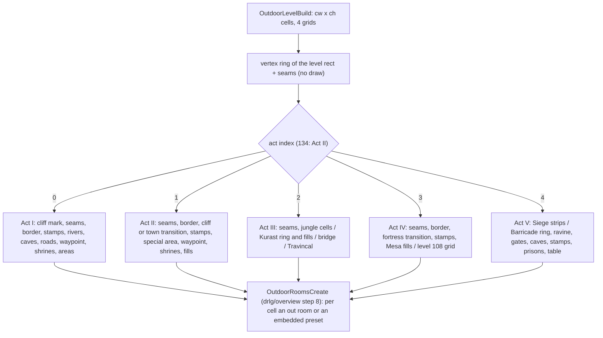
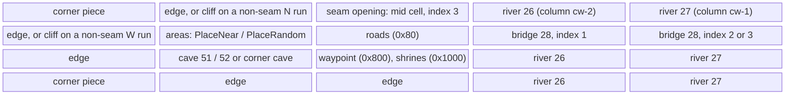
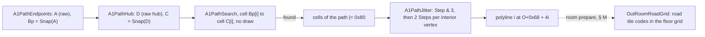
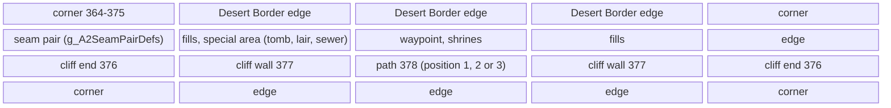
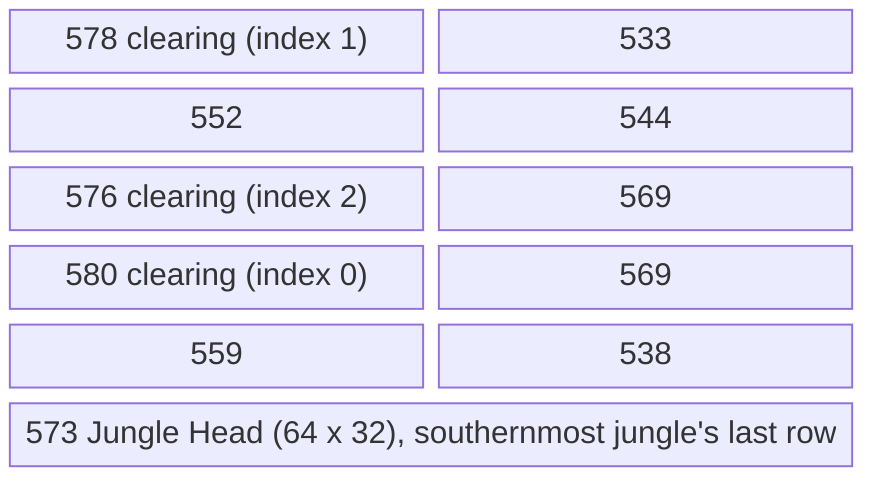
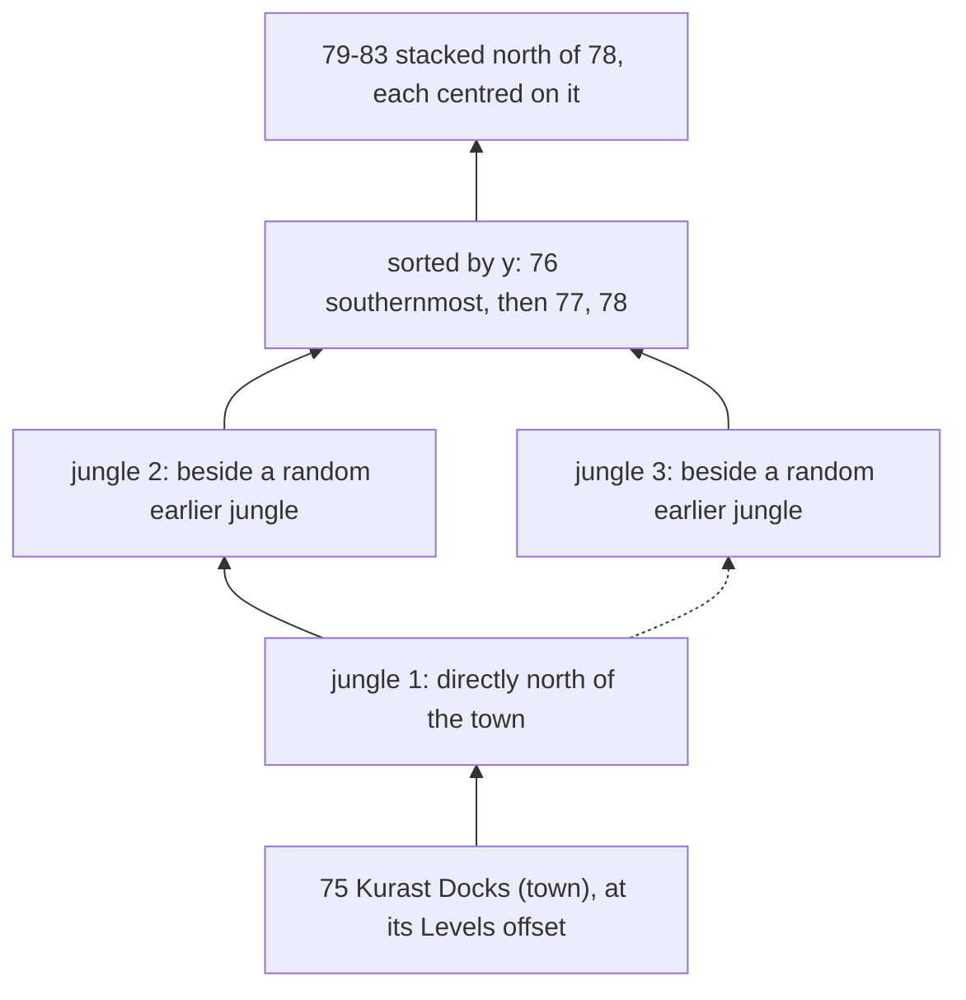
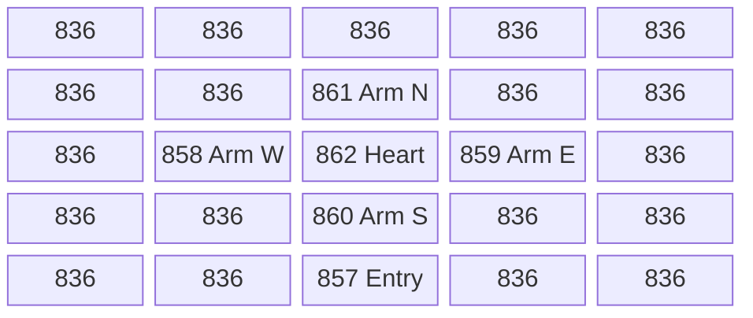

# Outdoor generators: the cell grid, borders, placements and the act layouts

## Purpose

A `DrlgType` 3 level is a grid of 8 × 8-tile **cells**. The outdoor generator of the level's act fills four cell grids:
which cells are border, seam, road, waypoint or shrine cells, and which preset (`LvlPrest` `Def`, with its file index)
covers which cells. [drlg/overview](README.md) step 8 then turns every cell into an outdoor room or an embedded preset.
This spec covers everything `OutdoorLevelBuild` runs between allocating the grids and `OutdoorRoomsCreate`: the level
outline and its seams, the border pass, the placement primitives and the per-`Def` file rotation, the waypoint and
shrine marks, the border stamps (`LvlSub` `tag_type` 2), and the generator of each act. It also covers Act III's jungle
layout, which runs at act creation on the act seed and gives Act III its level rectangles and links, and the fill of an
out room's grids at its room prepare (§ M), where Act I's roads become road tiles. Every draw is listed
with its seed, in order. The level seed is the one [drlg/overview](README.md) step 2 re-seeds; the act seed is that of
[rng/seeds](../rng/seeds.md) step 3. Primitives (`Step`, `Range`, `RangeB`) are those of [rng](../rng/README.md). The act
link builder that places the other acts' outdoor levels, and the warp points built from the rooms' flags, are in
[warps.md](warps.md).

## Entry points

| When | Function | Tag |
|---|---|---|
| Outdoor level record created (0x268-byte outdoor record; no draw) | fn:sub_00675320_OutdoorLevelCreate@0x00675320 | [I] |
| Outdoor level built, from `LevelInit` after the re-seed | fn:sub_00675360_OutdoorLevelBuild@0x00675360, run:2026-10-15-drlg-outdoor (522 windows) | [C] |
| Act III created: the jungle layout and the Kurast stack on the act seed | fn:sub_006789B0_ActLinkAct3@0x006789B0 → fn:sub_00677880_JungleLayout@0x00677880, run:2026-10-15-drlg-outdoor | [C] |
| Cells become rooms (boundary of this spec) | fn:sub_006750F0_OutdoorRoomsCreate@0x006750F0, [drlg/overview](README.md) step 8 | [C] |

- [C] The generator's output is reproduced bit-exactly: 522 outdoor windows of 29 levels (2–7, 17, 41–46, 76–83,
  104–106, 108, 110–112, 117), each in 4 to 11 map seeds and in normal, nightmare and hell, Acts I–IV in classic and
  expansion games. Every level-seed step inside the window (1443544), the final def grid, grid0 and cell grid, the seed
  after the window, the preset anchors with their file indices and the out rooms match, 0 mismatches.
  (fn:sub_00675360_OutdoorLevelBuild@0x00675360, run:2026-10-15-drlg-outdoor,
  [drlg/0008 § 15](../../findings/drlg/0008-outdoor.md#15-phase-2-reproduction-run2026-10-15-drlg-outdoor))
- [I] Levels 39 (Moo Moo Farm) and 134 (Pandemonium 2, "Forgotten Sands") are named boundaries of that run: no harness
  game reached them, so every statement about them below is `[I]` (see *Open questions*).
  (fn:sub_00675360_OutdoorLevelBuild@0x00675360)

## Inputs

### Tables

| Anchor | Used for |
|---|---|
| tbl:Levels.txt:SizeX, tbl:Levels.txt:SizeY | the level size the link builder starts from ([warps.md § B](warps.md#b-the-act-link-builder)); level 76's size for the three jungles, 79–83's for the Kurast stack (§ J) |
| tbl:Levels.txt:OffsetX, tbl:Levels.txt:OffsetY | level 75's position (Act III's anchor, § J1); level 117's position |
| tbl:Levels.txt:Vis0, tbl:Levels.txt:Warp0 | `Vis0..7`/`Warp0..7`: a slot with `Warp` −1 is a walkable seam (§ C); slot *k* gives the warp-slot flag `0x10 << k` (§ E1) |
| tbl:Levels.txt:LevelType | the border style (§ E2) |
| tbl:LvlPrest.txt:Files | the operand of the file rotation (§ D2) |
| tbl:LvlPrest.txt:SizeX, tbl:LvlPrest.txt:SizeY | a preset's footprint in cells, `SizeX ÷ 8` × `SizeY ÷ 8` (§ D1) |
| tbl:LvlSub.txt:Type, tbl:LvlSub.txt:File | the border-stamp records of a `Type` and their DS1 groups (§ G) |
| tbl:LvlSub.txt:BordType, tbl:LvlSub.txt:GridSize | how a border-stamp record stamps, and its cell scale (§ G) |

Which `LvlPrest` records each act places is surveyed in [LvlPrest § Outdoor presets](../../tables/LvlPrest.md#outdoor-presets-plan-0026-phase-0)
and [§ Outdoor placement](../../tables/LvlPrest.md#outdoor-placement-plan-0026-phase-1); the outdoor levels, their sizes and
the sizes the link picks overwrite are in [Levels § Outdoor survey](../../tables/Levels.md#outdoor-survey-plan-0026-phase-0);
the border-stamp records are in [LvlSub § Border stamps](../../tables/LvlSub.md#border-stamps-the-tag_type-2-records-plan-0026-phase-1).

### Runtime state

| State | Type | Owner offset | Source |
|---|---|---|---|
| level seed `L.seed` | `Seed` | level `+0x1C4` | re-seeded by `LevelInit` ([drlg/overview](README.md) step 2) |
| level id | `u32` | level `+0x1D0` | leveldefs |
| level rectangle `L.rect` `{x, y, w, h}` (tiles) | `i32` | level `+0x1C` | [warps.md § C](warps.md#c-level-rectangles-and-the-links-after-the-layout); Act III from § J1 |
| file-rotation counters | list of `{def, Files, c}`, prepended | level `+0x1CC` | § D2; emptied by `LevelUnload` before each build ([drlg/overview](README.md) step note 9) |
| outdoor record `O` | 0x268 bytes | level `+0x14` | `OutdoorLevelCreate` |
| outdoor flags `O.flags` | `u32` | `O+0x00` | Act I: `LinkOutdoorFlags` at act creation (§ H); Act IV: `g_LinkPickOutdoorFlag` on level 104 ([warps.md § A](warps.md#a-per-act-link-setup)); Act I also sets `0x20`, `0x40` itself |
| def grid, grid0, cell grid, grid3 | `cw × ch` `u32` each | `O+0x04`, `O+0x18`, `O+0x2C`, `O+0x40` | § B |
| `cw`, `ch` | `i32` | `O+0x5C`, `O+0x60` | § A |
| vertex ring | list of 0x14-byte vertices | `O+0x64` | § C |
| Act I road lists | six vertex lists; endpoint arrays of 0x14-byte entries | `O+0x68..+0x7C`; `O+0x80`, `+0xF8`, `+0x170`, `+0x1E8`, count `+0x260` | § H6 |
| level adjacency list | sorted nodes `{nbr, side, isPreset, +0xC, &nbr.rect, next}` | `O+0x264` | `LevelBorderAdj` at act creation (§ C1) |
| act seed | `Seed` | act `+0x000` | [rng/seeds](../rng/seeds.md) step 3 (Act III jungle layout, § J1) |
| Act III gate bit | `u32` | act `+0x474` | the Act III act-seed bit of [rng/seeds](../rng/seeds.md) step 3 (§ J5) |
| jungle `Def` array, clearing count | pointer; `i32` | level `+0x1BC`, `+0x1B8` | § J1 (levels 76–78) |
| difficulty | `u32` 0..2 | act `+0x450` | game; read only for `Levels` sizes |

- [C] `O.flags` bits `0x4`, `0x8`, `0x10`, `0x80`, `0x100`, `0x200` and `0x400` of the Act I levels are set at act creation
  by `LinkOutdoorFlags` from table `0x006F1258`, matched against the sides the link builder chose; the act inputs of every
  logged window match the model. (fn:sub_00677180_LinkOutdoorFlags@0x00677180, run:2026-10-15-drlg-outdoor)
- [C] On Act IV, level 104's flags carry `0x400000` or `0x800000` from the Outer Steppes link pick.
  (fn:sub_00678A20_ActLinkAct4@0x00678A20, fn:sub_00676C00_LinkPick@0x00676C00, run:2026-10-15-drlg-outdoor)

### Constants

| Name | Value | Anchor | Tag |
|---|---|---|---|
| occupied mask | `0x1B81` (cell bits 0, 7, 8, 9, 11, 12) | fn:sub_00674230_OutPresetFits@0x00674230, fn:sub_00674200_OutCellFree@0x00674200 | [C] |

The generators read about thirty constant tables from `Game.exe`'s `.data`. They are code constants, not game data, and
each is written out in full in the section that uses it. All of them are `[C]`: the reference model reads exactly these
values from the exe and run:2026-10-15-drlg-outdoor reproduces with them ([drlg/0008 § 16](../../findings/drlg/0008-outdoor.md#16-the-tables-and-sub-steps-in-full-plan-0026-phase-3-follow-up-2026-10-15)).
Several are read through a displaced base, or overlap a neighbour; the section says which entries are read.

| Table | Shape | Anchor | Section |
|---|---|---|---|
| `g_BorderDirIdx` | `i32[3][3]` | data:g_BorderDirIdx@0x006F0FD0 | § E2a |
| `g_BorderDefs`, `g_BorderDefsA5` | `i32[13][4]`, `i32[12][2]` | data:g_BorderDefs@0x006F0620, data:g_BorderDefsA5@0x006F06F0 | § E2a |
| `g_BorderCornerIdx` | `i32[9][9]` | data:g_BorderCornerIdx@0x006F1088 | § E3 |
| `g_A2SeamPairDefs` | `i32[5][2]` | data:g_A2SeamPairDefs@0x006F112C | § E2a |
| `g_OutSideProbe` | `i32[4][2]` | data:g_OutSideProbe@0x006F05D8 | § E1 |
| `g_OutShrineFlag` | `i32[4]` | data:g_OutShrineFlag@0x006F061C | § F2 |
| `g_OutNbrDx`, `g_OutNbrDy` | `i8[8]` each | data:g_OutNbrDx@0x006F0614, data:g_OutNbrDy@0x006F060C | § D6 |
| `g_LinkOutdoorFlags` | 15 × `i32[6]` | data:g_LinkOutdoorFlags@0x006F1258 | § H0 |
| `g_A1RiverIdx` | `i32[12][2]` used | data:g_A1RiverIdx@0x006F2680 | § H3 |
| `g_A1HubDx`, `g_A1HubDy` | `i32[4]` each | data:g_A1HubDx@0x006F2810, data:g_A1HubDy@0x006F2800 | § H6c |
| `g_A1SearchDx`, `g_A1SearchDy`, `g_A1SearchTurns` | `i8[4]`, `i8[4]`, `u8[4][4]` | data:g_A1SearchDx@0x006F2854, data:g_A1SearchDy@0x006F2850, data:g_A1SearchTurns@0x006F2840 | § H6d |
| `g_DirOctant` | `i32[25][3]`, column 0 read | data:g_DirOctant@0x006F1518 | § H6d |
| `g_A1JitterDx`, `g_A1JitterDy` | `i32[4]` each | data:g_A1JitterDx@0x006F2820, data:g_A1JitterDy@0x006F2830 | § H6e |
| `g_GridOps` | 6 operations | data:g_GridOps@0x00749BAC | § M1 |
| `g_RoadCodes` | `u8[256]` | data:g_RoadCodes@0x006F2700 | § M2 |
| `g_A2CliffLayouts`, `g_A2KingTombCliff` | `i32[8][5][4]`, `i32[9][4]` | data:g_A2CliffLayouts@0x006F2390, data:g_A2KingTombCliff@0x006F2610 | § I3 |
| `g_JungleSideDefs`, `g_JungleClearingDefs` | `i32[16][4]`, `i32` by `v >> 4` | data:g_JungleSideDefs@0x006F13F0, data:g_JungleClearingDefs@0x006F13BC | § J2 |
| `g_JungleClearingOff`, `g_JungleClearingPerm` | `i32[3]`, `i32[6][3]` | data:g_JungleClearingOff@0x006F2370, data:g_JungleClearingPerm@0x006F2328 | § J4 |
| `g_A4MesaBase`, `g_A4PitsBase` | `i32[3]` each | data:g_A4MesaBase@0x006F22B0, data:g_A4PitsBase@0x006F22A4 | § K1 |
| `g_A4DiabloGrid` | `i32[25]` | data:g_A4DiabloGrid@0x006F22C0 | § K2 |
| `g_A5RavineStep`, `g_A5CaveEntries`, `g_A5SubDefMap`, `g_A5PlaceTable` | `i32[12][2]`, `i32[3][5]`, `i32[10][5]`, `i32[15][7]` | data:g_A5RavineStep@0x006F1FD8, data:g_A5CaveEntries@0x006F1F9C, data:g_A5SubDefMap@0x006F2038, data:g_A5PlaceTable@0x006F2100 | § L |

## Algorithm



Notation: `L` the level, `O` its outdoor record. A cell is `(x, y)`, `x` the column (0 ..< `cw`), `y` the row
(0 ..< `ch`). `cell(x, y)`, `def(x, y)` and `grid0(x, y)` are the three grids of § B. `Step(s)` advances seed `s` once and
returns its new low word (`u32`); a **level draw** is a `Step` of `L.seed`, an **act draw** a `Step` of the act seed.
`Range(s, n)` and `RangeB(s, n)` are the guarded range of [rng](../rng/README.md): `n < 1` gives 0 with no draw, otherwise
one `Step`, then the low word `& (n − 1)` for a power of two or unsigned `mod n`. With no seed named, the seed is
`L.seed`. `÷` is signed division truncating toward zero, `%` the signed C remainder. `Place(x, y, def, file)` is
`OutPresetPlace` with `borderFlag` 0 (§ D1); `file = −1` means "from the rotation" (§ D2).

### A. The window

```
A1. OutdoorLevelBuild(L):                                            [C] (fn:sub_00675360_OutdoorLevelBuild@0x00675360, run:2026-10-15-drlg-outdoor)
      O.+0x54 ← 0;  O.+0x58 ← 0
      cw: i32 ← L.w ÷ 8;  ch: i32 ← L.h ÷ 8
      def grid, grid0, cell grid, grid3 ← cw × ch u32, zeroed
      VertexRingBuild(L); OutVertsToCells(O.ring)                    ; § C, no draw
      ── window start: L.seed as LevelInit re-seeded it ──
      a: u32 ← (L.id = 134) ? 1 : DRLG_ActFromLevelId(L.id)          ; 0-based act index
      OutdoorAct[a](L)                                               ; § H (0) … § L (4)
      ── window end ──
      OutdoorRoomsCreate(L)                                          ; drlg/overview step 8
```

- [C] Nothing before the act switch draws: the seed entering the act generator is the re-seeded level seed, and the
  window's level-seed steps are exactly the act generator's. (fn:sub_00675360_OutdoorLevelBuild@0x00675360,
  fn:DRLG_ActFromLevelId@0x006427F0, run:2026-10-15-drlg-outdoor)
- [C] The dispatch by level (fn:sub_00675360_OutdoorLevelBuild@0x00675360):

  | Act index | Generator | Levels |
  |---|---|---|
  | 0 | fn:sub_006807F0_OutdoorAct1@0x006807F0 | 2–7, 17, 39 |
  | 1 | fn:sub_0067F980_OutdoorAct2@0x0067F980 | 41–46, 134 |
  | 2 | fn:sub_0067F450_OutdoorAct3@0x0067F450 | 76–83 |
  | 3 | fn:sub_0067E890_OutdoorAct4@0x0067E890 | 104–106, 108 |
  | 4 | fn:sub_0067E600_OutdoorAct5@0x0067E600 | 110–112, 117 |

  (fn:sub_00675360_OutdoorLevelBuild@0x00675360, run:2026-10-15-drlg-outdoor; levels 39 and 134 `[I]`)
- [C] No generator branches on difficulty, expansion or player count: one model with no such input reproduces all three
  difficulties and, on Acts I–IV, classic and expansion games. Act III's jungle sizes come from `Levels`
  `SizeX/Y[difficulty]`, which are equal in all three difficulties. (fn:sub_00675360_OutdoorLevelBuild@0x00675360,
  tbl:Levels.txt:SizeX, run:2026-10-15-drlg-outdoor)
- [I] The generators write the def grid, grid0 and the cell grid in place. No generator writes grid3; `OutdoorRoomsCreate`
  passes it on. (fn:sub_006750F0_OutdoorRoomsCreate@0x006750F0)
- [C] The level size is the one the link builder wrote, which for four levels is not the `Levels` size: Blood Moor (2) is
  56 × 96 or 96 × 56 (its link pick), and the Barricade-type levels 111, 112 and 117 are 64 × 160 or 160 × 64 (one
  act-seed-copy bit each), so 8 × 20 or 20 × 8 cells. (fn:sub_00676650_LinkPick@0x00676650, fn:sub_0067D830_LinkPick@0x0067D830,
  fn:sub_0067D980_LinkPick@0x0067D980, fn:sub_0067D8E0_LinkPick@0x0067D8E0, run:2026-10-15-drlg-outdoor;
  [warps.md § B](warps.md#b-the-act-link-builder))

### B. The cell grid and its bits

| Grid | Content |
|---|---|
| def grid `O+0x04` | the preset `Def` at its **anchor** cell (its top-left), 0 elsewhere |
| grid0 `O+0x18` | the room flags of the cell: an out room's `+0x28`, an embedded preset's `flags` |
| cell grid `O+0x2C` | the bits below |
| grid3 `O+0x40` | not written by the generators |

| Cell bit | Meaning | Set by | Read by |
|---|---|---|---|
| `0x1` | border or seam cell | `OutSeamMark`, the border pass, `OutPresetPlace` with `borderFlag` for `Def` 4–15 and 364–375, the Act V ring | `OutCornerFlood`, the occupied mask |
| `0x2` | typed (cliff) seam or border | `OutSeamMark`, the border pass | Act I river test |
| `0x80` | road | Act I roads | `PlaceNear`, the occupied mask |
| `0x100` | covered: no room | `OutCellCover`, `OutCornerFlood` | `OutdoorRoomsCreate`, the occupied mask |
| `0x200` | preset footprint | `OutPresetPlace` | `OutdoorRoomsCreate`, the occupied mask |
| `0x400` | seam opening | the border pass (act index 0, 3, 4), the Act V ring | `OutCellNotOpening`, Act V gates, `OutWaypointPlace` (level 3) |
| `0x800` | waypoint | `OutWaypointPlace` | the occupied mask |
| `0x1000` | shrine | `OutShrinesPlace` | the occupied mask |
| `0xF0000` | preset file index (bits 16–19) | `OutPresetPlace`, the seam opening | `OutdoorRoomsCreate` → the instance's file index |

| grid0 bit | Meaning | Set by |
|---|---|---|
| `0x10 << k` | warp slot *k*: the cell borders the level named by `Vis`*k* | `OutSeamMark` (§ E1) |
| `0x1000 << r` | shrine record *r* of `SubShrine` | `OutShrinesPlace` (§ F2) |
| `0x10000`, `0x20000` | waypoint record 0, 1 of `SubWaypoint` | `OutWaypointPlace` (§ F1) |

- [C] The cell, def and grid0 bits above are what the generators leave: the three final grids match cell for cell in
  every window of the run (55676 cells per grid). (fn:sub_006743C0_OutPresetPlace@0x006743C0,
  fn:sub_00675770_OutSeamMark@0x00675770, fn:sub_00675850_OutBorderBuild@0x00675850, run:2026-10-15-drlg-outdoor)
- [C] A placement fits only on cells with none of the occupied-mask bits (`0x1B81`). (fn:sub_00674230_OutPresetFits@0x00674230,
  fn:sub_00674200_OutCellFree@0x00674200, run:2026-10-15-drlg-outdoor)
- [C] **Out-room flags.** `OutRoomCreate` sets an out room's `+0x28` to its grid0 cell `| 0x80000`, and `| 0x40000` as well
  on the client copy. So the shrine, waypoint and warp-slot bits are room bits: the room prepare runs the `SubShrine` and
  `SubWaypoint` passes from them ([room-tiles.md](room-tiles.md) step 5), and the warp points of a level with out rooms
  follow from them ([warps.md § E](warps.md#e-warp-points)). 6092 out-room flags were checked at the warp-point build
  (1000 with a shrine bit, 150 with a warp slot, 134 with a waypoint). (fn:sub_0067D540_OutRoomCreate@0x0067D540,
  fn:sub_006423D0_LevelWarpPointsBuild@0x006423D0, run:2026-10-15-drlg-outdoor)
- [I] No outdoor generator writes cell bits 20–25. The warp slot of an outdoor seam room is the grid0 flag `0x10 << k`; a
  warp inside an embedded preset comes from its DS1 cells ([warps.md § D](warps.md#d-room-flags-and-level-points-from-a-preset-instance)).
  (fn:sub_00675770_OutSeamMark@0x00675770, fn:DRLG_PresetMapScan@0x00667970)

### C. The level outline

[C] The **adjacency list** (`O+0x264`) is built at act creation by `LevelBorderAdj` ([warps.md § A](warps.md#a-per-act-link-setup)):
one node per `Vis` slot whose `Warp` is −1. The **vertex ring** is the level rectangle's outline with an extra vertex
wherever a seam starts or ends. (fn:sub_00677680_LevelBorderAdj@0x00677680, fn:sub_0067D050_VertexRingBuild@0x0067D050,
run:2026-10-15-drlg-outdoor)

```
C1. LevelBorderAdj(L) → per Vis slot k with Warp[k] = −1:            [C] (fn:sub_00677680_LevelBorderAdj@0x00677680, fn:sub_0066B790_LevelAdjAdd@0x0066B790, run:2026-10-15-drlg-outdoor)
      n ← { nbr: level Vis[k], side: RectAdjDir(L.rect, nbr.rect)   ; 0 W, 1 N, 2 E, 3 S
            isPreset: nbr's DrlgType = 2, +0xC: 0, rect: &nbr.rect }
      LevelAdjInsert(n, O.adj)                                       ; sorted, C2
C2. order (LevelAdjLess): side ascending; then W by y ascending,     [C] (fn:sub_0066B6A0_LevelAdjLess@0x0066B6A0, fn:sub_0066B720_LevelAdjInsert@0x0066B720, run:2026-10-15-drlg-outdoor)
      N by x descending, E by y descending, S by x ascending

C3. VertexRingBuild(L):                                              [C] (fn:sub_0067D050_VertexRingBuild@0x0067D050, run:2026-10-15-drlg-outdoor)
      r ← L.rect with w − 1, h − 1;  each neighbour rect likewise     ; inclusive while building, restored after
      ring: v0 (r.x, r.y + r.h) → v1 (r.x, r.y) → v2 (r.x + r.w, r.y) → v3 (r.x + r.w, r.y + r.h) → v0
                                                                     ; W side going up, then N, E, S
      VertexRingSeams(ring, r, O.adj)                                ; C4
      every vertex −= (L.x, L.y)                                     ; level-relative tiles
C4. VertexRingSeams, per node n in list order, q ← n.rect:           [C] (fn:sub_0067CE20_VertexRingSeams@0x0067CE20, run:2026-10-15-drlg-outdoor)
      side 0: start v0, edge from v0.y (s) to v1.y (e), c ← −1, a ← q.y + q.h, b ← q.y
      side 1: start v1, edge from v1.x to v2.x,         c ← +1, a ← q.x,       b ← q.x + q.w
      side 2: start v2, edge from v2.y to v3.y,         c ← +1, a ← q.y,       b ← q.y + q.h
      side 3: start v3, edge from v3.x to v0.x,         c ← −1, a ← q.x + q.w, b ← q.x
      p ← start
      if a·c ≤ s·c:  if s·c > b·c: next node                         ; ends before the edge starts
      else:          if a·c > e·c: next node;  p ← insert a vertex after p at a
      VertexMarkSeam(p, n.isPreset)                                  ; p.flags |= 1; if isPreset: p.flags |= 2
      if b·c < e·c: insert a vertex after p at b                     ; the seam ends inside the edge
C5. OutVertsToCells(ring): every vertex ÷ 8 (signed);                [C] (fn:sub_00675080_OutVertsToCells@0x00675080, run:2026-10-15-drlg-outdoor)
      a vertex equal to its successor is merged into it (flags or-ed)
```

- [C] A vertex's flag bit 0 means the segment to the next vertex borders a walkable neighbour; bit 1 means that neighbour
  is a preset level (a town). The vertex `type` (byte `+8`) is 0 from this builder; Act I's cliff mark sets 1 (§ H1).
  (fn:sub_0067CE20_VertexRingSeams@0x0067CE20, fn:sub_00680070_A1CliffMark@0x00680070, run:2026-10-15-drlg-outdoor)
- [C] `VertexMarkSeam(v, isPreset)` (`EAX` the vertex, one stack argument) is the only writer of these two bits here:
  `v.flags |= 1`, then `v.flags |= 2` when `isPreset` is non-zero; its caller is `VertexRingSeams`.
  (fn:sub_0067CE00_VertexMarkSeam@0x0067CE00, fn:sub_0067CE20_VertexRingSeams@0x0067CE20, run:2026-10-15-drlg-outdoor)
- [I] A vertex merge in `OutVertsToCells` happened in no logged window. (fn:sub_00675080_OutVertsToCells@0x00675080)
- [I] `LevelAdjInsert` compares against the head only while the list holds one node. (fn:sub_0066B720_LevelAdjInsert@0x0066B720)

### D. Placement primitives

```
D1. OutPresetPlace(L, x, y, def, file, borderFlag):                   [C] (fn:sub_006743C0_OutPresetPlace@0x006743C0, run:2026-10-15-drlg-outdoor)
      w: i32 ← LvlPrest[def].SizeX ÷ 8;  h: i32 ← LvlPrest[def].SizeY ÷ 8
      if file = −1: file ← OutPresetFileRotate(L, def)               ; D2, before any cell is written
      for yy in y ..< y + h:                                         ; rows outer
        for xx in x ..< x + w:
          cell(xx, yy) ← (cell & ~0xF0000) | (file << 16) | 0x200
          if borderFlag and (4 ≤ def ≤ 15 or 364 ≤ def ≤ 375): cell(xx, yy) |= 0x1
          def(xx, yy) ← 0
      def(x, y) ← def                                                ; the anchor

D2. OutPresetFileRotate(L, def) → i32:                                [C] (fn:sub_00674320_OutPresetFileRotate@0x00674320, run:2026-10-15-drlg-outdoor)
      node ← the node of def in L[+0x1CC]
      if none:                                                       ; first use of def in this build
        files: i32 ← LvlPrest[def].Files
        node ← prepend { def, files, c: RangeB(L.seed, files) }       ; level draw iff files ≥ 1
      node.c ← (node.c + 1) % node.files                             ; signed; every use, the first included
      return node.c

D3. OutPresetFits(L, x, y, def, pad, sides) → bool:                   [C] (fn:sub_00674230_OutPresetFits@0x00674230, run:2026-10-15-drlg-outdoor)
      footprint ← D1's w × h at (x, y) (def 0: 1 × 1), grown by pad on each side in sides (1 N, 2 E, 4 S, 8 W)
      true iff every footprint cell is inside the grid and (cell & 0x1B81) = 0

D4. Shuffle(N, W') → list:                                            [C] (fn:sub_00674730_OutPresetPlaceRandom@0x00674730, run:2026-10-15-drlg-outdoor)
      list[i] ← (i % W', i ÷ W') for i in 0 ..< N
      repeat N times: a ← Range(L.seed, N); b ← Range(L.seed, N); swap list[a], list[b]   ; 2N level draws

D5. PlaceRandom(L, def, file, pad, sides) → bool:                     [C] (fn:sub_00674730_OutPresetPlaceRandom@0x00674730, run:2026-10-15-drlg-outdoor)
      N: i32 ← (cw − 2)·(ch − 2);  if N = 0: return false            ; no draw
      list ← Shuffle(N, cw − 2)
      for (x, y) in list: if OutPresetFits(x + 1, y + 1, def, pad, sides): Place(x + 1, y + 1, def, file); return true
      return false                                                   ; silent unless the caller tests it

D6. PlaceNear(L, def, file) → bool:                                   [C] (fn:sub_00674920_OutPresetPlaceNear@0x00674920, run:2026-10-15-drlg-outdoor)
      N ← (cw − 2)·(ch − 2);  if N = 0: return false
      list ← Shuffle(N, cw − 2)
      for (x, y) in list with cell(x + 1, y + 1) & 0x80:             ; road cells
        for k in 0 ..< 8 (W, N, S, E, NW, SE, NE, SW):
          (px, py) ← (x + 1 + g_OutNbrDx[k], y + 1 + g_OutNbrDy[k])   ; i8, sign-extended
          ; g_OutNbrDx = −1, 0, 0, +1, −1, +1, +1, −1;  g_OutNbrDy = 0, −1, +1, 0, −1, +1, −1, +1
          if OutPresetFits(px, py, def, 0, 0xF): Place(px, py, def, file); return true
      return PlaceRandom(L, def, file, 0, 0xF)                        ; a second shuffle

D7. PlaceFar(L, rect, def, file, pad, sides) → bool:                  [C] (fn:sub_006744F0_OutPresetPlaceFar@0x006744F0, run:2026-10-15-drlg-outdoor)
      ox ← Range(L.seed, cw − 2);  oy ← Range(L.seed, ch − 2)        ; 2 level draws
      best ← none
      for r in 0 ... ch − 2: y ← (r + oy) % (ch − 2) + 1             ; inclusive bounds
        for c in 0 ... cw − 2: x ← (c + ox) % (cw − 2) + 1
          if OutPresetFits(x, y, def, pad, sides):
            a ← |8x + L.x + 4 − (rect.x + rect.w ÷ 2)|;  b ← |8y + L.y + 4 − (rect.y + rect.h ÷ 2)|
            d ← (a > b ? b + 2a : a + 2b) ÷ 2
            if d > best.d: best ← (x, y, d)                          ; the first strict maximum
      if best: Place(best.x, best.y, def, file); return true
      return false

D8. OutCellClear(x, y): def(x, y) ← 0; cell(x, y) ← 0.               [C] (fn:sub_00674160_OutCellClear@0x00674160, fn:sub_006741A0_OutCellCover@0x006741A0, run:2026-10-15-drlg-outdoor)
    OutCellCover(x, y): def(x, y) ← 0; cell(x, y) ← 0x100.
    OutCellNotOpening(x, y): (cell & 0x400) = 0.  OutCellFree(x, y): (cell & 0x1B81) = 0.
```

- [C] The neighbour offsets of D6 are the two `i8[8]` tables `g_OutNbrDx` and `g_OutNbrDy`, in the order W, N, S, E, NW,
  SE, NE, SW (values in D6). (data:g_OutNbrDx@0x006F0614, data:g_OutNbrDy@0x006F060C,
  fn:sub_00674920_OutPresetPlaceNear@0x00674920, run:2026-10-15-drlg-outdoor)
- [C] D2 is the commonest level-seed draw of the window. The first use of a `Def` draws `RangeB(Files)` even when `Files`
  is 1, and the index used is one past the drawn value: `(RangeB + 1) % Files`. Every `Def` rotates; there is no
  `Def`-range test. (fn:sub_00674320_OutPresetFileRotate@0x00674320, run:2026-10-15-drlg-outdoor)
- [I] A `Def` with `Files` 0 placed with `file = −1` would divide by zero in D2. (fn:sub_00674320_OutPresetFileRotate@0x00674320)
- [C] `PlaceRandom` draws its `2N` even when nothing fits; then one rotation draw when a placed `Def` with `file = −1` is
  new to the build. (fn:sub_00674730_OutPresetPlaceRandom@0x00674730, run:2026-10-15-drlg-outdoor)
- [I] `PlaceFar`'s inclusive bounds visit row `oy` and column `ox` twice, which only matters for ties.
  (fn:sub_006744F0_OutPresetPlaceFar@0x006744F0)

### E. Seams and the border pass

```
E1. OutSeamMark(L): for each ring vertex v with v.flags & 1:          [C] (fn:sub_00675770_OutSeamMark@0x00675770, fn:sub_00674040_SeamWarpFlag@0x00674040, run:2026-10-15-drlg-outdoor)
      f: u32 ← SeamWarpFlag(L, v)
      grid0 |= f on every cell of the segment v … v.next (end included)
      cell  |= (v.type ≠ 0 ? 3 : 1) on the same cells
    SeamWarpFlag(L, v) → u32:                                         [C] (fn:sub_00674040_SeamWarpFlag@0x00674040, data:g_OutSideProbe@0x006F05D8, run:2026-10-15-drlg-outdoor)
      (x, y) ← v's cell
      side: i32 ← x = 0       ? (y = 0 ? 1 : 0)
                 : y = 0       ? 1 + (x = cw − 1)
                 : x = cw − 1  ? 2 + (y = ch − 1)
                 : y = ch − 1  ? 3
                 : none → return 0
      (dx, dy) ← g_OutSideProbe[side]                                ; W (−4, +4), N (+4, −4), E (+12, +4), S (+4, +12)
      probe ← (8x + L.x + dx, 8y + L.y + dy)                         ; level tiles, 4 tiles outside the vertex cell
      n ← the adjacency node of that side whose rect contains probe;  none → return 0
      return 0x10 << (the first k with Vis[k] = n.nbr.id)            ; a node with +0xC ≠ 0 gives 0
```

- [C] `g_OutSideProbe` is `i32[4][2]` `{dx, dy}` by side 0 W, 1 N, 2 E, 3 S, with the values in E1. A corner vertex takes
  the side of the segment that leaves it in ring order: by the rule in E1, (0, 0) is N, (cw − 1, 0) E, (cw − 1, ch − 1) S
  and (0, ch − 1) W.
  (data:g_OutSideProbe@0x006F05D8, fn:sub_00674040_SeamWarpFlag@0x00674040, run:2026-10-15-drlg-outdoor)

```
E2. OutBorderBuild(L):                                               [C] (fn:sub_00675850_OutBorderBuild@0x00675850, fn:sub_006755C0_BorderEdgeDef@0x006755C0, fn:sub_00675600_BorderCornerDef@0x00675600, run:2026-10-15-drlg-outdoor)
      act ← DRLG_ActFromLevelId(L.id)
      style(t) ← LevelType 2: (t ≠ 0 ? 0 : 1);  16: 2;  27: 3;  31: 4 + (L.id = 117);  else −1
      for v in the ring from its head (v0), each vertex once; n ← v.next:
        d ← sign(n − v) per axis;  cv: u32 ← (v.type ≠ 0) ? 3 : 1;  e ← BorderEdgeDef(d, style(v.type))   ; E2a
        if not (v.flags & 2):                                        ; not a town seam
          for each cell c from v + d to n inclusive: Place(c, e, −1); cell(c) |= cv
        if (v.flags & 1) and not (v.flags & 2):                      ; seam with an outdoor level
          m ← min(v, n) + (len · |d|) ÷ 2                            ; the segment's mid cell
          act 0 or 4: cell(m) ← (cell(m) & ~0xF0000) | (L.id = 17 ? 0x40400 : 0x30400)
          act 3:      cell(m) ← (cell(m) & ~0xF0000) | 0x30400
          act 1:      k ← dx + 2·dy + 2;  Place(m, g_A2SeamPairDefs[k][0], −1);  Place(m + |d|, g_A2SeamPairDefs[k][1], −1)
          act 2:      nothing
        t ← v.type or n.type;  if t ≠ 0: cv |= 2
        c ← BorderCornerDef(in code of v → n, out code of n → n.next, style(t))   ; E3
        if c = 0: nothing                                            ; no piece, no cell bit
        else:
          if c = 19: c ← (v.type = 1) ? (n.type = 1 ? 19 : 20) : 21
          Place(n, c, −1);  cell(n) |= cv
      OutCornerFlood(L)                                              ; E4
```

- [C] The border pass's only level-seed draws are D2's first uses: one `RangeB(Files)` per distinct border `Def`, in
  first-use order along the ring from v0 (the bottom-left corner, going up the W side). Its callers are Act I, Act II and
  Act IV except level 108; Act V lays its own ring (§ L2), and Act III none. (fn:sub_00675850_OutBorderBuild@0x00675850,
  run:2026-10-15-drlg-outdoor)
- [C] **The seam opening** is a direct cell write after the piece is placed: index 3 (the `…o` files of `Wild Border 1–4`
  and `Mesa Border 1–4`), or 4 on level 17 (`Bord1oe`), and bit `0x400`. It overrides the index the rotation gave that cell,
  but the rotation draw was made. (fn:sub_00675850_OutBorderBuild@0x00675850, run:2026-10-15-drlg-outdoor)
- [C] A corner piece replaces the edge piece placed at `n`; both uses count in the rotation. (fn:sub_00675850_OutBorderBuild@0x00675850,
  run:2026-10-15-drlg-outdoor)
- [C] **The corner exceptions.** A `BorderCornerDef` result of 0 places nothing and sets no cell bit. A result of 19 (the
  cliff style's row 6) becomes 19 when `v.type` and `n.type` are both 1, 20 when `v.type` is 1 and `n.type` is not, and 21
  when `v.type` is 0 (the cliff style then came from `n.type`). The corner is placed at `n` with file −1.
  (fn:sub_00675850_OutBorderBuild@0x00675850, run:2026-10-15-drlg-outdoor)

#### E2a. Edge pieces and the style tables

```
BorderEdgeDef(dx, dy, style) → i32:                                   [C] (fn:sub_006755C0_BorderEdgeDef@0x006755C0, data:g_BorderDirIdx@0x006F0FD0, run:2026-10-15-drlg-outdoor)
  di: i32 ← g_BorderDirIdx[dx + 3·dy]                                ; centre-based: dx, dy ∈ −1..1
  return style ≥ 4 ? g_BorderDefsA5[2·di + style − 4]                ; row 1 + di of the table below
                   : g_BorderDefs[4·(di + 1) + style]
```

- [C] `g_BorderDirIdx` (`i32[3][3]`, centre at `0x006F0FD0`) maps a ring segment's unit step to its direction index `di`:
  `(−1, 0)` (moving W, the S side) → 0; `(0, −1)` (moving N, the W side) → 1; `(+1, 0)` (moving E, the N side) → 2;
  `(0, +1)` (moving S, the E side) → 3. The other five entries are −1 and are never read: ring segments are axis-aligned
  and non-empty. (data:g_BorderDirIdx@0x006F0FD0, fn:sub_006755C0_BorderEdgeDef@0x006755C0, run:2026-10-15-drlg-outdoor)
- [C] **The style table.** `g_BorderDefs` (`i32[13][4]`, styles 0–3) and `g_BorderDefsA5` (`i32[12][2]`, styles 4–5) read
  as one table of rows 1–12. Row 0 of `g_BorderDefs` (`0x2000, 0x4000, 0x8000, 0`) is the tail of `g_OutShrineFlag` and is
  never read as a `Def`; row *r* of `g_BorderDefsA5` is row *r* + 1 below. The edge piece of direction `di` is row `1 + di`;
  the corner piece of corner index `k` (E3) is row `k`. (data:g_BorderDefs@0x006F0620, data:g_BorderDefsA5@0x006F06F0,
  run:2026-10-15-drlg-outdoor)

  | Row | style 0 cliff | 1 wild | 2 desert | 3 mesa | 4 Barricade | 5 Barricade snow |
  |---|---|---|---|---|---|---|
  | 1 (edge, moving W) | 0 | 4 | 364 | 799 | 881 | 957 |
  | 2 (edge, moving N) | 16 | 5 | 365 | 800 | 882 | 958 |
  | 3 (edge, moving E) | 17 | 6 | 366 | 801 | 883 | 959 |
  | 4 (edge, moving S) | 0 | 7 | 367 | 802 | 884 | 960 |
  | 5 | 18 | 8 | 368 | 803 | 885 | 961 |
  | 6 | 19 | 9 | 369 | 804 | 886 | 962 |
  | 7 | 22 | 10 | 370 | 805 | 887 | 963 |
  | 8 | 0 | 11 | 371 | 806 | 888 | 964 |
  | 9 | 0 | 12 | 372 | 807 | 889 | 965 |
  | 10 | 23 | 13 | 373 | 808 | 890 | 966 |
  | 11 | 0 | 14 | 374 | 809 | 891 | 967 |
  | 12 | 0 | 15 | 375 | 810 | 892 | 968 |

- [C] **The Act II seam pairs**, `g_A2SeamPairDefs` (`i32[5][2]`, by `k = dx + 2·dy + 2` of the seam segment's unit step):
  k 0 (moving N, the W side) `373, 372`; k 1 (moving W, the S side) `372, 375`; k 2 `0, 0` (never read); k 3 (moving E,
  the N side) `373, 374`; k 4 (moving S, the E side) `374, 375`. The first goes at the mid cell `m`, the second at
  `m + (|dx|, |dy|)`, both with file −1. (data:g_A2SeamPairDefs@0x006F112C, fn:sub_00675850_OutBorderBuild@0x00675850,
  run:2026-10-15-drlg-outdoor)

```
E3. BorderCornerDef(inCode, outCode, style) → i32:                    [C] (fn:sub_00675600_BorderCornerDef@0x00675600, data:g_BorderCornerIdx@0x006F1088, run:2026-10-15-drlg-outdoor)
      code(seg from vertex p, unit step (dx, dy)):                   ; the caller passes (a, b), the callee adds ±2
        (a, b) ← (p.flags & 2) ? (dx, dy) : (2dx, 2dy)               ; OutBorderBuild; Act V always doubles (§ L2)
        return e(a) + b,  e(z) = z < 0 ? z − 2 : z > 0 ? z + 2 : 0
                                                                     ; plain: W −4, E +4, N −2, S +2
                                                                     ; from a preset-seam vertex: W −3, E +3, N −1, S +1
      inCode ← code(v → n);  outCode ← code(n → n.next)
      k: i32 ← g_BorderCornerIdx[inCode + 9·outCode]                 ; centre at 0x006F1088; both codes −4..4
      if k = −1: return 0
      return style ≥ 4 ? g_BorderDefsA5[2k + style − 6] : g_BorderDefs[4k + style]   ; row k of E2a's table
```

- [C] **`g_BorderCornerIdx`** (`i32[9][9]`, `0x006F0FE8`–`0x006F110B`, read as `[0x006F1088 + 4·(in + 9·out)]`). Rows are
  the out code, columns the in code; `·` is −1 (no corner piece). (data:g_BorderCornerIdx@0x006F1088,
  fn:sub_00675850_OutBorderBuild@0x00675850, fn:sub_0067DCF0_BarricadeBorderRing@0x0067DCF0, run:2026-10-15-drlg-outdoor)

  | out \ in | −4 | −3 | −2 | −1 | 0 | +1 | +2 | +3 | +4 |
  |---|---|---|---|---|---|---|---|---|---|
  | −4 | 1 | 9 | 9 | · | · | 1 | 8 | · | · |
  | −3 | 12 | · | · | · | · | 12 | 4 | · | · |
  | −2 | 5 | 2 | 2 | 10 | · | · | · | · | 10 |
  | −1 | 1 | 9 | 9 | · | · | · | · | · | · |
  | 0 | · | · | · | · | · | · | · | · | · |
  | +1 | · | · | · | · | · | · | 11 | 11 | 3 |
  | +2 | 12 | · | · | · | · | 12 | 4 | 4 | 7 |
  | +3 | · | · | 2 | 10 | · | · | · | · | 10 |
  | +4 | · | · | 6 | 3 | · | · | 11 | 11 | 3 |

  The four corners of a plain rectangle: SW (in W −4, out N −2) → row 5, NW (in N −2, out E +4) → row 6, NE (in E +4,
  out S +2) → row 7, SE (in S +2, out W −4) → row 8. A vertex inserted mid-edge by a seam keeps the direction (in N, out N
  → row 2: the edge piece again). Rows 9–12 and the ±3/±1 codes serve the seam ends next to a preset (town) neighbour.

```
E4. OutCornerFlood(L):                                                [C] (fn:sub_00675670_OutCornerFlood@0x00675670, run:2026-10-15-drlg-outdoor)
      for (xFar, yFar, dx, dy) in ((0, 0, +1, +1), (1, 0, −1, +1), (0, 1, +1, −1), (1, 1, −1, −1)):   ; NW, NE, SW, SE
        x0: i32 ← xFar ? cw − 1 : 0;  y: i32 ← yFar ? ch − 1 : 0
        while (cell(x0, y) & 1) = 0:                                 ; rows, from the corner inward
          x: i32 ← x0
          while (cell(x, y) & 1) = 0:  cell(x, y) |= 0x100;  x ← x + dx
          y ← y + dy
```

- [C] E4 has no bounds test: each pass stops on a bit-0 cell, which the ring guarantees. (fn:sub_00675670_OutCornerFlood@0x00675670, run:2026-10-15-drlg-outdoor)

### F. Waypoint and shrines

```
F1. OutWaypointPlace(L):                                              [C] (fn:sub_00674B70_OutWaypointPlace@0x00674B70, run:2026-10-15-drlg-outdoor)
      if L.id = 3:                                                   ; Cold Plains, no draw
        f ← 0x10 << (the first k with Vis[k] = 2)                    ; the Blood Moor seam
        first (x, y), rows outer, with (grid0 & f) and (cell & 0x400):
          clamp (x, y) into 1 … cw − 2 × 1 … ch − 2
          grid0 |= 0x20000; cell |= 0x800; return                    ; waypoint record 1
      N ← (cw − 2)·(ch − 2);  if N = 0: return
      list ← Shuffle(N, cw − 2)                                      ; 2N level draws
      first (x, y) in list with OutCellFree(x + 1, y + 1): grid0 |= 0x10000; cell |= 0x800   ; waypoint record 0
F2. OutShrinesPlace(L, count = 5):                                    [C] (fn:sub_00674E40_OutShrinesPlace@0x00674E40, run:2026-10-15-drlg-outdoor)
      r: u32 ← Step(L.seed) & 3                                      ; always, before the shuffle
      N ← (cw − 2)·(ch − 2);  if N = 0: return
      list ← Shuffle(N, cw − 2)                                      ; 2N level draws
      for (x, y) in list while count > 0, with OutCellFree(x + 1, y + 1):
        grid0 |= g_OutShrineFlag[r];  cell |= 0x1000;  r ← (r + 1) & 3;  count ← count − 1
                                                                     ; g_OutShrineFlag = 0x1000, 0x2000, 0x4000, 0x8000
```

- [C] Neither pass places a preset. They mark cells, and the out room made there runs the `SubWaypoint` or `SubShrine`
  `LvlSub` pass with the marked record ([room-tiles.md](room-tiles.md) step 5). Every call site passes `count` 5.
  (fn:sub_00674B70_OutWaypointPlace@0x00674B70, fn:sub_00674E40_OutShrinesPlace@0x00674E40, run:2026-10-15-drlg-outdoor)
- [C] `g_OutShrineFlag` (`i32[4]`) holds the grid0 bit of shrine record *r*: `0x1000 << r`.
  (data:g_OutShrineFlag@0x006F061C, fn:sub_00674E40_OutShrinesPlace@0x00674E40, run:2026-10-15-drlg-outdoor)
- [I] A waypoint pass that finds no free cell happened in no logged window. (fn:sub_00674B70_OutWaypointPlace@0x00674B70)
- [C] Frigid Highlands (111) gets its waypoint from no outdoor pass: the `To Siege` preset (`Def` 880) holds a waypoint
  unit, and the DS1 scan sets `0x30000` on its room ([warps.md § D](warps.md#d-room-flags-and-level-points-from-a-preset-instance)).
  (fn:DRLG_PresetMapScan@0x00667970, fn:sub_0067E4B0_BarricadeToSiege@0x0067E4B0, run:2026-10-15-drlg-outdoor)

### G. Border stamps

[C] The five `LvlSub` records with `BordType` ≠ −1 (`Type` 0 `Border - Cliffs`, 1 `- Middle`, 2 `- Corner`, 3 `- Border`, 12
`Barricade`) are not rolled per room. The outdoor generators apply every record of a `Type` to the cell grid on the level
seed. A record's DS1 holds **groups**; a group is a rewrite rule whose variant 0 is the pattern to match and whose
variant `v + 1` is the replacement. (fn:sub_006752A0_OutBorderSubApply@0x006752A0, fn:sub_0066F690_BorderSubGroup@0x0066F690,
tbl:LvlSub.txt:BordType, run:2026-10-15-drlg-outdoor)

```
G1. OutBorderSubApply(L, Type, baseDef):                              [C] (fn:sub_006752A0_OutBorderSubApply@0x006752A0, fn:sub_00670750_BorderSubApplyType@0x00670750, run:2026-10-15-drlg-outdoor)
      context: baseDef, wildcard −1, Type, the tests OutCellNotOpening and OutPresetFits, and the writers
               OutCellClear, OutCellCover, OutPresetPlace
      for rec ← LVLSUB_GetRecordByType(Type) while rec.Type = Type, rec ← rec + 1:
        LvlSubLoadDs1(rec);  BorderSubRecord(rec)                    ; G2
G2. BorderSubRecord(rec):                                             [C] (fn:sub_0066F990_BorderSubRecord@0x0066F990, tbl:LvlSub.txt:BordType, run:2026-10-15-drlg-outdoor)
      groups ← the DS1's group count;  if groups = 0: return
      if wildcard = −1: wildcard ← 62
      s ← (rec.BordType = 0) ? RangeB(L.seed, groups) : 0             ; level draw iff BordType 0
      for i in 0 ..< groups:
        ok ← BorderSubGroup(rec, G[(s + i) % groups])                ; G3
        if ok and rec.BordType = 0: return
G3. BorderSubGroup(rec, g) → bool:                                    [C] (fn:sub_0066F690_BorderSubGroup@0x0066F690, tbl:LvlSub.txt:GridSize, run:2026-10-15-drlg-outdoor)
      GS ← rec.GridSize;  off ← (Type = 1 and (O.flags & 0xC)) ? −1 : 1
      nx ← cw − g.w·GS + off;  ny ← ch − g.h·GS + 1;  N ← nx·ny;  if N = 0: return false
      skip22 ← Type = 1 and 2 ≤ L.id ≤ 7 and nx < 6 and ny < 6
      list ← Shuffle(N, nx)                                          ; 2N level draws
      for (px, py) in list:
        if skip22 and (px, py) = (2, 2): continue
        if BorderSubFits(px, py, g, rec):                            ; G4
          v ← Range(L.seed, g.variants)                              ; level draw
          BorderSubStamp(px, py, g, rec, variant v + 1)              ; G4
          if rec.BordType ≤ 1: return true                           ; BordType 2: keep stamping
      return false
```

- G4. [C] **Match and stamp.** Positions snap down to multiples of `GS`, and group cell `(gx, gy)` covers outdoor cell
  `(px + GS·gx, py + GS·gy)`. The match reads variant 0: a wall cell with bit 0 names the border piece
  `baseDef + ((W >> 8) & 0xFF) − 1` (63 means any), which must be the cell's `Def` and must not be a seam opening; a
  floor cell with `F & 2` must be free. The stamp writes variant `v + 1`: wall pieces are placed with file 0 and
  `borderFlag` 1 (no rotation draw), floor cells with `F & 2` are cleared to open cells (`OutCellClear`), and the others
  are covered (`OutCellCover`). (fn:sub_0066F3B0_BorderSubFits@0x0066F3B0, fn:sub_0066F520_BorderSubStamp@0x0066F520,
  run:2026-10-15-drlg-outdoor)
- [C] **`BordType`**: 0 = one `RangeB(groups)` picks the start group, and the record stops after its first stamp; 1 = every
  group is tried and stamped at most once; 2 = every group is stamped at every matching position. Stock: `Border - Cliffs`
  1, `- Middle` 0, `- Corner` 1, `- Border` 2, `Barricade` 2. **`GridSize`**: 1, and 2 for `Barricade`.
  (fn:sub_0066F990_BorderSubRecord@0x0066F990, fn:sub_0066F690_BorderSubGroup@0x0066F690, tbl:LvlSub.txt:BordType,
  tbl:LvlSub.txt:GridSize, run:2026-10-15-drlg-outdoor)
- [C] No mask and no `Prob`, `Trials`, `Max` or `Dt1Mask` is read for these records. The call sites, in order: Act I levels
  2–7 `Type` 0, then 1 and 2, then 3 (base 4, § H1); Act II `Type` 2, 1, 3 (base 364); Act IV 104–106 `Type` 1, 2, 3 (base
  799); Act V `Type` 12 with its own context (§ L5). (fn:sub_006807F0_OutdoorAct1@0x006807F0,
  fn:sub_0067F630_OutA2BorderSubs@0x0067F630, fn:sub_0067E890_OutdoorAct4@0x0067E890, fn:sub_0067E0E0_BarricadeLvlSub@0x0067E0E0,
  run:2026-10-15-drlg-outdoor)

### H. Act I

Levels 2–7 (the wilderness), 17 (Burial Grounds, `Levels` "Graveyard") and 39 (Moo Moo Farm, not reached: see *Entry points*).



H0. [C] **The Act I outdoor flags** (`LinkOutdoorFlags`, at act creation, no draw). For each Act I link entry `i` whose
level `L` has `DrlgType` 3, every row of `g_LinkOutdoorFlags` (15 rows of `i32[6]` `{level, not1, not2, dirI, dirNext,
flag}`) with (`level` = `L.id` or `level` = 0) and `L.id` ≠ `not1` and `L.id` ≠ `not2` and `B.dir[i]` = `dirI` and
`B.dir[i + 1]` = `dirNext` ORs `flag` into `O.flags`; `B.dir` are the sides the link builder chose
([warps.md § B](warps.md#b-the-act-link-builder)). The `O.flags` of every logged window match.
(data:g_LinkOutdoorFlags@0x006F1258, fn:sub_00677180_LinkOutdoorFlags@0x00677180, run:2026-10-15-drlg-outdoor)

| Rows | `level` | `not1`, `not2` | (`dirI`, `dirNext`) → `flag` |
|---|---|---|---|
| 0–1 | 0 (any) | 2, 3 | (1, 0), (2, 3) → `0x4` |
| 2–3 | 0 (any) | 3, 17 | (2, 1), (3, 0) → `0x8` |
| 4–5 | 0 (any) | 3, 17 | (1, 1), (3, 3) → `0x10` |
| 6–9 | 2 | — | (0, 0), (2, 2), (3, 0), (3, 2) → `0x8` |
| 10–11 | 2 | — | (0, 1), (1, 1) → `0x400` |
| 12 | 2 | — | (2, 1) → `0x200` |
| 13 | 2 | — | (2, 2) → `0x80` |
| 14 | 2 | — | (3, 2) → `0x100` |

The last row's `flag` (`0x006F13BC`, 256) is also entry 0 of `g_JungleClearingDefs` (§ J2), where it is never read.

```
H1. OutdoorAct1(L):                                                  [C] (fn:sub_006807F0_OutdoorAct1@0x006807F0, run:2026-10-15-drlg-outdoor)
      if L.id ∉ {2, 3, 17}: A1CliffMark(L)                           ; no draw: vertex type 1 on non-seam up/right runs; O.flags |= 0x20
      OutSeamMark(L);  OutBorderBuild(L)                             ; § E
      if 2 ≤ L.id ≤ 7:
        OutBorderSubApply(L, 0, 4);  A1RiverEastAndCave(L)           ; § G, H2
        OutBorderSubApply(L, 1, 4);  OutBorderSubApply(L, 2, 4);  A1RiverMidTransCave(L)   ; H4
        OutBorderSubApply(L, 3, 4);  A1Paths(L)                      ; H6
      if L.id = 39: OutBorderSubApply(L, 0, 4) … OutBorderSubApply(L, 3, 4)   ; [I] (fn:sub_006807F0_OutdoorAct1@0x006807F0)
      if 3 ≤ L.id ≤ 6: OutWaypointPlace(L)                           ; § F1
      if 2 ≤ L.id ≤ 7: OutShrinesPlace(L, 5)                         ; § F2
      A1Areas(L)                                                     ; H7
```

```
H2. A1RiverEastAndCave(L):                                           [C] (fn:sub_00680200_A1RiverEastAndCave@0x00680200, fn:sub_006801A0_A1CliffCaveTry@0x006801A0, run:2026-10-15-drlg-outdoor)
      if (O.flags & 0xC) and A1RiverColumnClear(cw − 2): A1RiverPlace(cw − 2)   ; H3
      if (O.flags & 0x20) and not (O.flags & 0x40):                  ; a cave in a cliff piece
        r ← Step(L.seed)                                             ; level draw
        scan rows outer if (r & 1) = 0, else columns outer (the bounds cw and ch swapped)
        first cell with def 16 → Place(25 Cave Left, −1); with def 17 → Place(24 Cave Right, −1)
        O.flags |= 0x40;  none found → fatal error
      if (O.flags & 0x1C) and not (O.flags & 0x40):                  ; a corner cave
        r ← Step(L.seed) & 3                                         ; level draw
        x ← (r & 1) ? 3 : cw − ((O.flags & 0x10) ? 4 : 5);  y ← (r >> 1) ? 3 : ch − 4
        Place(x, y, 51 + (L.id = 2), −1);  O.flags |= 0x40           ; no fit test; 52 is the Den of Evil entrance
H3. A1RiverPlace(L, x):                                              [C] (fn:sub_0067FE90_A1RiverPlace@0x0067FE90, fn:sub_0067FC70_A1RiverColumnClear@0x0067FC70, run:2026-10-15-drlg-outdoor)
      for y in 0 ..< ch:  for (col, def) in ((x, 26 River Upper), (x + 1, 27 River Lower)):
        p ← def(col, y);  c ← cell(col, y)
        idx ← p = 0 ? (c & 0x100 ? 0 : 3) : (p = 7 and (c & 0xF0000) = 0x30000) ? 3 : g_A1RiverIdx[p][def − 26]
        Place(col, y, def, idx)                                      ; replaces the border piece; explicit index, no draw
      if O.flags & 0x14: A1BridgePlace(L, x)
    A1RiverColumnClear(x): no cliff bit (bit 1) in columns x and x + 1.
    A1BridgePlace(L, x):                                             [C] (fn:sub_0067FD20_A1BridgePlace@0x0067FD20, run:2026-10-15-drlg-outdoor)
      s ← Range(L.seed, ch − 2)                                      ; level draw
      first y = (k + s) % (ch − 2) + 1 (k = 0, 1, …) with free cells beside it and index 3 in both river cells:
        Place(x, y, 28, 1);  Place(x + 1, y, 28, 2 + ((O.flags & 4) ≠ 0))
H4. A1RiverMidTransCave(L):                                          [C] (fn:sub_006803D0_A1RiverMidTransCave@0x006803D0, run:2026-10-15-drlg-outdoor)
      if (O.flags & 0x10) and A1RiverColumnClear(cw ÷ 2 − 1): A1RiverPlace(cw ÷ 2 − 1)
      town transitions (explicit indices, no draw):
        0x80: Place(0, 0, 3, 1);  0x100: Place(cw − 7, 0, 3, 2);  0x200: Place(0, 1, 2, 1);  0x400: Place(0, ch − 6, 2, 1)
      if not (O.flags & 0x40):
        L.id = 2: ok ← PlaceFar(L, rect of level 1, 52 DOE Entrance, −1, pad 1, sides 0xF)   ; 2 draws + rotation
        else:     ok ← PlaceRandom(L, 51 Cave Entrance, −1, pad 1, sides 0xF)              ; 2N draws + rotation
        not ok → fatal error;  O.flags |= 0x40
```

- [C] **The river index table** `g_A1RiverIdx` is read as `[0x006F2680 + 8·p]` for the 26 piece and `[0x006F2684 + 8·p]`
  for the 27 piece, `p` the border `Def` in the cell. Only rows `p` 4–15 are read (`0x006F26A0`–`0x006F26FF`, `i32[12][2]`):
  rows 0–3 would overlap the King Tomb table, but `p` = 0 takes the covered rule and no river column holds `Def` 1–3. For
  `p` = 7 at the seam opening (file bits `0x30000`) both pieces take 3. (data:g_A1RiverIdx@0x006F2680,
  fn:sub_0067FE90_A1RiverPlace@0x0067FE90, run:2026-10-15-drlg-outdoor)

  | border `Def` p | 4 | 5 | 6 | 7 | 8 | 9 | 10 | 11 | 12 | 13 | 14 | 15 |
  |---|---|---|---|---|---|---|---|---|---|---|---|---|
  | 26 River Upper | 2 | 0 | 1 | 3 | 0 | 0 | 1 | 2 | 2 | 1 | 3 | 3 |
  | 27 River Lower | 2 | 3 | 1 | 0 | 2 | 1 | 0 | 0 | 3 | 3 | 1 | 2 |

- [I] A `Def` above 15 in a river column would read past the table into the road-code bytes; `A1RiverColumnClear` keeps
  the cliff pieces out, and no logged window had one. (fn:sub_0067FE90_A1RiverPlace@0x0067FE90,
  fn:sub_0067FC70_A1RiverColumnClear@0x0067FC70)
- [C] `O.flags` selects the river columns (`0xC` east, `0x10` middle), the bridge (`0x14`), the corner cave and level 2's
  town transitions. (fn:sub_00677180_LinkOutdoorFlags@0x00677180, fn:sub_00680200_A1RiverEastAndCave@0x00680200,
  fn:sub_006803D0_A1RiverMidTransCave@0x006803D0, run:2026-10-15-drlg-outdoor)
- [I] The cliff-cave scan with swapped bounds differs from the plain scan only on a non-square level; `BridgeFind` on a
  non-square Blood Moor with flag `0x10` was not reached. (fn:sub_00680200_A1RiverEastAndCave@0x00680200,
  fn:sub_0067FC20_A1BridgeFindMid@0x0067FC20)

#### H6. Roads



```
H6. A1Paths(L):                                                      [C] (fn:sub_00681420_A1Paths@0x00681420, fn:sub_006817D0_A1PathSearch@0x006817D0, fn:sub_00681240_A1PathJitter@0x00681240, run:2026-10-15-drlg-outdoor)
      n: i32 ← A1PathEndpoints(L)                                    ; H6a, no draw: A[], Bp[]
      A1PathHub(L, n)                                                ; H6c, no draw: D[], C[]
      for i in 0 ..< n:
        path ← A1PathSearch(cell(Bp[i]), cell(C[i]))                 ; H6d, no draw
        if found:
          cell |= 0x80 on every cell of the path inside the grid     ; GridPointsOr
          A1PathJitter(L, i, path)                                   ; H6e: 1 + 2·(cells − 2) level draws
      cell(p) = ((p.x − L.x) ÷ 8, (p.y − L.y) ÷ 8)                   ; tile point → cell
```

Points `{x, y, dir}` are in map tiles, the frame of `L.rect`. The endpoint arrays are 0x14-byte entries (`x`, `y`, `dir` a
`u8` at `+8`): `A` at `O+0x80` (raw), `Bp` at `O+0xF8` (snapped), `C` at `O+0x170` (the snapped hub), `D` at `O+0x1E8`
(the raw hub), and the count at `O+0x260`. [C] (fn:sub_00680D70_A1PathEndpoints@0x00680D70, fn:sub_00681000_A1PathHub@0x00681000,
run:2026-10-15-drlg-outdoor)

```
H6a. A1PathEndpoints(L) → i32:                                        [C] (fn:sub_00680D70_A1PathEndpoints@0x00680D70, run:2026-10-15-drlg-outdoor)
       n: i32 ← 0
       for node in O.adj (list order, § C2):  r ← node.nbr.rect
         if node.nbr.id = 1:                                         ; Rogue Encampment
           A[n] ← by node.side: 0 (r.x + 59, r.y + 19); 1 (r.x + 29, r.y + 35); 2 (r.x + 4, r.y + 22); 3 (r.x + 29, r.y + 3)
           A[n].dir ← node.side;  n ← n + 1
         else if node.nbr.id = 26:                                   ; Monastery Gate
           A[n] ← (r.x + 27, r.y + 13), dir 1;  n ← n + 1
       for x in 0 ..< cw:  for y in 0 ..< ch:                        ; columns outer
         d: i32 ← def(x, y);  f: u32 ← (cell(x, y) >> 16) & 0xF;  dir: i32 ← 4
         if   d = 4 and f = 3: dir ← 3                               ; the seam openings
         elif d = 5 and f = 3: dir ← 0
         elif d = 6 and f = 3: dir ← 1
         elif d = 7 and f = 3: dir ← 2
         elif d = 24: dir ← 1                                        ; Cave Right
         elif d = 25: dir ← 0                                        ; Cave Left
         elif d = 28 and f = 1 and x = cw − 2: dir ← 2               ; the east river's bridge
         elif d = 51 or d = 52: dir ← (f ≠ 0) ? 1 : 0                ; the caves
         if dir ≠ 4: A[n] ← (L.x + 3 + 8x, L.y + 3 + 8y, dir);  n ← n + 1
       for i in 0 ..< n: Bp[i] ← Snap(L, A[i])
       return n

H6b. Snap(L, p) → point:                                              [C] (fn:sub_00680CC0_A1PathSnap@0x00680CC0, run:2026-10-15-drlg-outdoor)
       rx: i32 ← p.x − L.x;  ry: i32 ← p.y − L.y
       dir 0: rx ← (rx ÷ 8)·8 + 11;   dir 1: ry ← (ry ÷ 8)·8 + 11
       dir 2: rx ← (rx ÷ 8)·8 − 5;    dir 3: ry ← (ry ÷ 8)·8 − 5;    dir 4: unchanged
       return (rx + L.x, ry + L.y, p.dir)
```

- [C] The endpoint arrays have no bound check: six entries fit before `O+0xF8`. (fn:sub_00680D70_A1PathEndpoints@0x00680D70,
  run:2026-10-15-drlg-outdoor)

```
H6c. A1PathHub(L, n):                                                 [C] (fn:sub_00681000_A1PathHub@0x00681000, fn:sub_0067FB90_A1BridgeFind@0x0067FB90, data:g_A1HubDx@0x006F2810, data:g_A1HubDy@0x006F2800, run:2026-10-15-drlg-outdoor)
       (bx, by): i32 ← (−1, −1)
       if O.flags & 0x10:                                            ; the middle river
         (bx, by) ← A1BridgeFind(cw ÷ 2 − 1): the column and the first y in 1 … cw − 2 (sic: the bound is cw)
                    with def = 28 and file index 1; (−1, −1) when none
       if bx ≠ −1:
         X: i32 ← L.x + 3 + 8·bx;  Y: i32 ← L.y + 3 + 8·by
         for i in 0 ..< n: D[i] ← (A[i].x > X) ? (X + 8, Y, dir 0) : (X, Y, dir 2)
       else if n > 0:
         if n = 1: (cx, cy) ← (cw ÷ 2, ch ÷ 2)
         else: cx: i32 ← Σi (A[i].x − L.x) ÷ (8n);  cy: i32 ← Σi (A[i].y − L.y) ÷ (8n)   ; i32 sums, one division
         for r in 0 ..< 8:  for j in 0 ..< 4:                        ; r outer; j: W, S, N, E
           (hx, hy) ← (cx + g_A1HubDx[j]·r, cy + g_A1HubDy[j]·r)
           if 0 ≤ hx < cw and 0 ≤ hy < ch and OutCellFree(hx, hy): leave both loops
         ; none found: (hx, hy) keep the last point tried (r 7, j 3)
         D[0] ← (L.x + 3 + 8hx, L.y + 3 + 8hy, dir 4);  D[i] ← D[0] for every i ≥ 1
       for i in 0 ..< n: C[i] ← Snap(L, D[i])
       ; g_A1HubDx = −1, 0, 0, +1;  g_A1HubDy = 0, +1, −1, 0   (i32[4] each)
```

```
H6d. A1PathSearch(s, t) → path or none:                               [C] (fn:sub_006817D0_A1PathSearch@0x006817D0, fn:sub_00681630_A1PathSearchStep@0x00681630, fn:sub_00681560_A1PathBacktrack@0x00681560, fn:sub_006815C0_A1PathCellOpen@0x006815C0, run:2026-10-15-drlg-outdoor)
       h(x, y): i32 ← min(a, b) + 2·max(a, b),  a ← |x − t.x|, b ← |y − t.y|
       if |s.x − t.x| + |s.y − t.y| ≤ 1: return [s, t]                ; the trivial path
       h0: i32 ← h(s);  bound: i32 ← h0 + h0 ÷ 2;  top: i32 ← bound + 35
       do:
         pool ← one node, root ← {f h0, h h0, g 0, pos s, tried −1, row 0, ptr 0, dir DirOf(s), parent none, child none}
         node ← SearchStep(root, bound);  bound ← bound + 5
         if pool count > 899: return none                            ; exhausted: no road
         if node: return node, node.parent, …, root                  ; head = target end
       while bound < top
       return none

     SearchStep(node, bound) → node or none:
       loop:
         if node.pos = t: return node
         np ← node.pos + (g_A1SearchDx[node.dir], g_A1SearchDy[node.dir])
         open: bool ← np = t or (np inside the grid and (cell(np) & 0x200) = 0 and np not on node's parent chain)
         if open and (f: i32 ← h(np) + node.g + 2) ≤ bound:
           c ← node.child, or else a new pool node (the pool full at 900 → return none) linked as node.child, c.parent ← node
           td ← DirOf(np);  c.row ← (node.dir − td) & 3;  c.ptr ← 0
           c.f ← f;  c.h ← h(np);  c.g ← node.g + 2;  c.pos ← np;  c.tried ← 0
           c.dir ← (g_A1SearchTurns[c.row][0] + td) & 3
           node ← c;  continue
         node ← Backtrack(node);  if none: return none

     Backtrack(n) → node or none:
       if n.tried < 4: n.ptr ← n.ptr + 1;  n.dir ← (g_A1SearchTurns[n.row][n.ptr] + n.dir) & 3
       n.tried ← n.tried + 1
       while n.tried = 3:
         if n = root: return none
         n ← n.parent;  n.ptr ← n.ptr + 1;  n.dir ← (g_A1SearchTurns[n.row][n.ptr] + n.dir) & 3;  n.tried ← n.tried + 1
       return n

     DirOf(p) → i32:                                                 ; toward t
       (dx, dy): i32 ← t − p                                        ; DirFromDelta:
       if |dx| ≥ 2·|dy|: dy ← (dy < 0) ? −1 : dy & 1
       else if |dy| ≥ 2·|dx|: dx ← (dx < 0) ? −1 : dx & 1
       dx ← clamp(dx, −2, 2);  dy ← clamp(dy, −2, 2)
       return (g_DirOctant[5·dx + dy + 12][0] ÷ 2) & 3
```

- [C] **The search tables.** Moves are 4-neighbour by `dir`: `g_A1SearchDx` (`i8[4]`) `−1, 0, +1, 0` and `g_A1SearchDy`
  `0, +1, 0, −1`, so dir 0 W, 1 S, 2 E, 3 N. `g_A1SearchTurns` (`u8[4][4]`, increments added to `dir`): row 0 `0 1 2 3`,
  row 1 `0 1 1 1`, row 2 `3 2 1 2`, row 3 `0 3 2 1`. So the root (tried −1) tries `d, d+1, d+3, d+2`, and a child of row
  `r` tries three directions: row 0 `td, td+1, td+3`; row 1 `td, td+1, td+2`; row 2 `td+3, td+1, td+2`; row 3 `td,
  td+3, td+1` (mod 4). The root's `ptr` reaches 4 only after its last try. (data:g_A1SearchDx@0x006F2854,
  data:g_A1SearchDy@0x006F2850, data:g_A1SearchTurns@0x006F2840, fn:sub_00681560_A1PathBacktrack@0x00681560,
  run:2026-10-15-drlg-outdoor)
- [C] **`g_DirOctant`** (`i32[25][3]`; only column 0 is read here), by `5·dx + dy + 12` after `DirFromDelta`'s clamp. The
  clamp step is skipped when the second rule sets `dx` to −1, which is in range anyway.
  (data:g_DirOctant@0x006F1518, fn:sub_00678CF0_DirFromDelta@0x00678CF0, fn:sub_00678B80_DirOctantIndex@0x00678B80,
  run:2026-10-15-drlg-outdoor)

  | dx \ dy | −2 | −1 | 0 | +1 | +2 |
  |---|---|---|---|---|---|
  | −2 | 5 | 4 | 4 | 4 | 3 |
  | −1 | 6 | 5 | 4 | 3 | 2 |
  | 0 | 6 | 6 | 6 | 2 | 2 |
  | +1 | 6 | 7 | 0 | 1 | 2 |
  | +2 | 7 | 0 | 0 | 0 | 1 |

- [C] **Every move costs 2.** The code computes `x = nx or y = ny ? 2 : 3`, and a 4-neighbour move always takes the 2.
  Preset footprints (`0x200`) block; the target is always open. Every road cell of every Act I window matches.
  (fn:sub_00681630_A1PathSearchStep@0x00681630, fn:sub_006815C0_A1PathCellOpen@0x006815C0, run:2026-10-15-drlg-outdoor)

```
H6e. A1PathJitter(L, i, path):                                        [C] (fn:sub_00681240_A1PathJitter@0x00681240, data:g_A1JitterDx@0x006F2820, data:g_A1JitterDy@0x006F2830, run:2026-10-15-drlg-outdoor)
       r: u32 ← Step(L.seed) & 3                                     ; level draw, before the path test
       if no path: return
       if D[i].dir ≠ 4: prepend a vertex (D[i].x, D[i].y)            ; a bridge hub: its raw point
       the target-cell vertex ← (C[i].x, C[i].y)
       for each vertex v after the target-cell vertex that has a successor:   ; the interior cells, target → start
         s1: u32 ← Step(L.seed);  s2: u32 ← Step(L.seed)             ; 2 level draws
         v.x ← L.x + 8·v.x + 3 + ((s1 & 1) + 2)·g_A1JitterDx[r]
         v.y ← L.y + 8·v.y + 3 + ((s2 & 1) + 2)·g_A1JitterDy[r]
         r ← (r + 1) & 3
       the last vertex (the start cell) ← (Bp[i].x, Bp[i].y);  append a vertex (A[i].x, A[i].y)
       polyline i ← the list, stored at O+0x68 + 4i                  ; map tiles
       ; g_A1JitterDx = +1, 0, −1, 0;  g_A1JitterDy = 0, +1, 0, −1   (i32[4] each)
```

- [C] Each interior point moves 2 or 3 tiles along one axis, the axis rotating E, S, W, N from the drawn `r`. The trivial
  path `[s, t]` has no interior vertex and draws only the first `Step`. The jitter's draws were checked one by one, and its
  points through the road tiles of every logged Act I out room (§ M; the 2026-10-15 addendum to the run).
  (fn:sub_00681240_A1PathJitter@0x00681240, fn:sub_00681420_A1Paths@0x00681420, run:2026-10-15-drlg-outdoor)
- [I] Roads with 5 or 6 endpoints, a failed search and an exhausted pool happened in no logged window.
  (fn:sub_00680D70_A1PathEndpoints@0x00680D70, fn:sub_006817D0_A1PathSearch@0x006817D0)
- [C] The road tiles are made later, at the room prepare of each out room, from these polylines (§ M), outside the level
  window and with no draw. (fn:sub_00680C80_OutRoomRoadGrid@0x00680C80, fn:sub_0067D2D0_OutRoomGridPrepare@0x0067D2D0,
  run:2026-10-15-drlg-outdoor)

#### H7. Areas

H7. [C] **Areas** (`A1Areas`, after the waypoint and shrines). `Near(d)` = `PlaceNear(d, −1)`; `Rand(d)` =
`PlaceRandom(d, −1, 0, 0xF)`; `OneOrTwo(d, s)` = `r ← Step(L.seed)`; if `(r & 3) = 0`: `Near(d)` twice, else `Near(d)` once;
then, if `s`: `Step(L.seed) & 1` ≠ 0 → `Near(49)`. Failures are silent. (fn:sub_00680580_A1Areas@0x00680580,
fn:sub_006804E0_A1PlaceOneOrTwo@0x006804E0, run:2026-10-15-drlg-outdoor; level 39 `[I]`)

| Level | Sequence |
|---|---|
| 2 Blood Moor | `Near(46)`, `OneOrTwo(47, 0)`, `Rand(29)`, `Rand(30)` |
| 3 Cold Plains | `OneOrTwo(48, 1)`, `Rand(44)`, `Rand(29)`, `Rand(30)` |
| 4 Stony Field | `Near(160)`, `Near(45)`, `Rand(162)`, `OneOrTwo(47, 1)`, `OneOrTwo(42, 0)`, `Rand(31)` |
| 5 Dark Wood | `Rand(161)`, `Rand(41)`, `Rand(40)`, `OneOrTwo(48, 1)`, `OneOrTwo(43, 0)`, `Rand(29)`, `Rand(30)` |
| 6 Black Marsh | `Rand(163)`, `Rand(38)`, `Rand(39)`, `OneOrTwo(47, 1)`, `OneOrTwo(42, 0)`, `Rand(29)`, `Rand(30)` |
| 7 Tamoe Highland | `OneOrTwo(48, 1)`, `OneOrTwo(43, 0)`, `Rand(31)` |
| 17 Burial Grounds | `Place(1, 1, 108, −1)`: no fit test, one rotation draw |
| 39 Moo Moo Farm | `Rand(50)`, `Rand(46)`, `Rand(31)`, `Rand(38)`, `Rand(39)`, `Rand(29)`, `Rand(30)` |

**Act I draw sequence** (level seed, in order; every `Place` with file −1 adds D2's first-use draw when its `Def` is new):

1. Border pass: one `RangeB(Files)` per distinct edge and corner `Def`, in ring order from v0 (§ E2).
2. Levels 2–7: `Type` 0 stamps (§ G: one `RangeB(groups)` for `BordType` 0, `2N` per group tried, one `Range(variants)` per stamp).
3. Levels 2–7, H2: the east river's bridge `Range(ch − 2)` (if it has one); the cliff cave's `Step` and its `Def`'s first use;
   the corner cave's `Step` and first use.
4. Levels 2–7: `Type` 1, then `Type` 2 stamps.
5. Levels 2–7, H4: the middle river's bridge `Range(ch − 2)`; the cave entrance (`PlaceFar` 2 draws on level 2, else
   `PlaceRandom` `2N`) and its first use.
6. Levels 2–7: `Type` 3 stamps; then the roads' jitter, `1 + 2·(vertices − 2)` per found path (H6).
7. Levels 3–6: the waypoint shuffle, `2N` (none on level 3, which uses the seam rule).
8. Levels 2–7: the shrines' `Step & 3`, then `2N`.
9. The areas of H7, in table order: each `Near` is `2N`, plus `2N` more when it falls back to `PlaceRandom`; each `Rand`
   `2N`; each `OneOrTwo` one `Step`, plus one more when `s` is 1; each placed new `Def` one first-use draw.

All of 1–9 [C] (fn:sub_006807F0_OutdoorAct1@0x006807F0, run:2026-10-15-drlg-outdoor: every step checked one by one).

### I. Act II

Levels 41–46 and 134 (134 not reached: see *Entry points*).



```
I1. OutdoorAct2(L):                                                  [C] (fn:sub_0067F980_OutdoorAct2@0x0067F980, run:2026-10-15-drlg-outdoor)
      OutSeamMark(L);  OutBorderBuild(L)                             ; § E (act 1: the seam pairs)
      41:  TownTransition (I6): 362 at (cw − 1, 0), or 363 at (0, ch − 1) when Lut Gholein is on side 3
           BorderSubs; SpecialArea(388); OutShrinesPlace(5)
           PlaceList({395, 411, 401, 402, 399, 398, 403}, 7, perFile 0)
      42:  Cliff; BorderSubs; SpecialArea(388); OutWaypointPlace; OutShrinesPlace(5); Fills2
      43:  Cliff; BorderSubs; SpecialArea(390); PlaceList({396, 397}, 2, 0); OutWaypointPlace; OutShrinesPlace(5); Fills3
      44:  Cliff; BorderSubs; SpecialArea(412); PlaceList({413, 408, 409, 410}, 4, 0); OutWaypointPlace; OutShrinesPlace(5); Fills4
      45:  SpecialArea(389)                                          ; nothing else
      46:  KingTombCliff (I3, fixed indices, then Place(4, 4, 394, −1)); BorderSubs; OutShrinesPlace(5); FillsValley
      134: Place(4, 4, 394, −1); BorderSubs; FillsValley; OutShrinesPlace(5)   ; [I] (fn:sub_0067F980_OutdoorAct2@0x0067F980); fills before shrines
I2. BorderSubs (OutA2BorderSubs): OutBorderSubApply(L, 2, 364); (L, 1, 364); (L, 3, 364).   [C] (fn:sub_0067F630_OutA2BorderSubs@0x0067F630, run:2026-10-15-drlg-outdoor)
I3. Cliff (OutA2Cliff):                                               [C] (fn:sub_0067F5C0_OutA2Cliff@0x0067F5C0, data:g_A2CliffLayouts@0x006F2390, run:2026-10-15-drlg-outdoor)
      k: u32 ← Step(L.seed) & 7                                      ; level draw
      for each entry {def, file, x, y} of g_A2CliffLayouts[k], in row order (5 entries):
        Place(x, y, def, file)                                       ; no fit test; file −1 takes the rotation
    KingTombCliff (OutA2KingTombCliff, level 46):                    [C] (fn:sub_0067F8D0_OutA2KingTombCliff@0x0067F8D0, data:g_A2KingTombCliff@0x006F2610, run:2026-10-15-drlg-outdoor)
      for each entry {def, file, x, y} of g_A2KingTombCliff (9 entries): Place(x, y, def, file)   ; no file −1: no draw
      Place(4, 4, 394, −1)                                           ; 394's first use draws
I4. PlaceList(defs, n, perFile):                                      [C] (fn:sub_0067F470_OutA2PlaceList@0x0067F470, run:2026-10-15-drlg-outdoor)
      k ← Range(L.seed, n)                                           ; drawn for n = 1 too
      repeat n times:
        if perFile: for i in 0 ..< Files(defs[k]): PlaceRandom(defs[k], i, 0, 0xF)
        else:       PlaceRandom(defs[k], −1, 0, 0xF)
        k ← (k + 1) % n
I5. SpecialArea (OutA2SpecialArea):                                   [C] (fn:sub_0067F670_OutA2SpecialArea@0x0067F670, run:2026-10-15-drlg-outdoor)
      def ← by L.id: 41 → 388, 42 → 388, 43 → 390, 44 → 412, 45 → 389       ; jump table 0x0067F6D0
      other level, or PlaceRandom(def, −1, pad 0, sides 0xF) = false → fatal error (string 0xAA), exit
I6. TownTransition (OutA2TownTransition, level 41):                   [C] (fn:sub_0067F560_OutA2TownTransition@0x0067F560, run:2026-10-15-drlg-outdoor)
      node ← the first adjacency node (O.adj order) whose neighbour is level 40 (Lut Gholein);  none → nothing
      node.side = 3: OutPresetPlace(0, ch − 1, 363, −1)
      else:          OutPresetPlace(cw − 1, 0, 362, −1)                ; direct placement: no fit test, no pad or sides
```

- [C] **The cliff layouts**, `g_A2CliffLayouts` (`i32[8][5][4]` `{def, file, x, y}`, 0x50 bytes per layout). An entry is
  written `def/file@(x, y)`; `·` is file −1 (from the rotation). k 0–2 are a horizontal cliff on row 4, k 3–4 an L with the
  16 × 16 corner 382 at (4, 4), k 5–7 a vertical cliff on column 4. All eight layouts were reached.
  (data:g_A2CliffLayouts@0x006F2390, fn:sub_0067F5C0_OutA2Cliff@0x0067F5C0, run:2026-10-15-drlg-outdoor)

  | k | pieces in placing order |
  |---|---|
  | 0 | 376/1@(0,4), 378/·@(2,4), 377/·@(4,4), 377/·@(6,4), 376/2@(8,4) |
  | 1 | 376/1@(0,4), 377/·@(2,4), 378/·@(4,4), 377/·@(6,4), 376/2@(8,4) |
  | 2 | 376/1@(0,4), 377/·@(2,4), 377/·@(4,4), 378/·@(6,4), 376/2@(8,4) |
  | 3 | 376/2@(8,4), 377/·@(6,4), 382/·@(4,4), 381/·@(4,6), 379/2@(4,8) |
  | 4 | 376/2@(8,4), 378/·@(6,4), 382/·@(4,4), 380/·@(4,6), 379/2@(4,8) |
  | 5 | 379/1@(4,0), 381/·@(4,2), 380/·@(4,4), 380/·@(4,6), 379/2@(4,8) |
  | 6 | 379/1@(4,0), 380/·@(4,2), 381/·@(4,4), 380/·@(4,6), 379/2@(4,8) |
  | 7 | 379/1@(4,0), 380/·@(4,2), 380/·@(4,4), 381/·@(4,6), 379/2@(4,8) |

- [C] **The King Tomb cliff** of level 46, `g_A2KingTombCliff` (`i32[9][4]`, same layout), in placing order: `384/0@(8,0)`,
  `383/2@(6,0)`, `383/1@(4,0)`, `383/0@(2,0)`, `387/0@(0,0)`, `385/0@(0,2)`, `385/1@(0,4)`, `385/2@(0,6)`, `386/0@(0,8)`.
  No entry passes file −1, so the cliff makes no draw. (data:g_A2KingTombCliff@0x006F2610,
  fn:sub_0067F8D0_OutA2KingTombCliff@0x0067F8D0, run:2026-10-15-drlg-outdoor)
- [C] **The fill lists**, each a `PlaceList` with `perFile` 0 followed by lists with `perFile` 1: `Fills2` `{395, 411, 400, 398}`
  then `{404–407}` per file; `Fills3` `{411, 399, 398, 403}` then `{395}` per file twice; `Fills4` `{395, 400, 398, 404, 405}`
  then `{411}` per file twice; `FillsValley` `{401, 402, 406, 407, 403}` then `{392, 393}` per file.
  (fn:sub_0067F740_OutA2FillsDesert2@0x0067F740, fn:sub_0067F7D0_OutA2FillsDesert3@0x0067F7D0,
  fn:sub_0067F870_OutA2FillsDesert4@0x0067F870, fn:sub_0067F920_OutA2FillsValley@0x0067F920, run:2026-10-15-drlg-outdoor)
- [I] No waypoint pass runs on 41, 45, 46 or 134, and 45 has no shrine pass. A failed `SpecialArea` is fatal; every other
  failed placement is silent. (fn:sub_0067F670_OutA2SpecialArea@0x0067F670, fn:sub_0067F980_OutdoorAct2@0x0067F980)

**Act II draw sequence** (in order; plus D2's first-use draws for every new `Def` placed with file −1):

1. Border pass first uses, the seam pairs' included (§ E2).
2. Levels 42–44: the cliff's `Step & 7`.
3. The three stamp `Type`s 2, 1, 3 (levels 41–44, 46, 134).
4. `SpecialArea`'s placement draws (levels 41–45; on 45 a `PlaceRandom`, `2N` and a first use, worked example 2).
5. Levels 43, 44: `PlaceList`: `Range(n)`, then `2N` per placement.
6. Levels 42–44: the waypoint `2N`. Then the shrines `Step & 3` and `2N` (not on 45; on 134 after the fills).
7. The fill lists: per `PlaceList` one `Range(n)` and `2N` per placement (on 41 its single list comes after the shrines).

All of 1–7 [C] (fn:sub_0067F980_OutdoorAct2@0x0067F980, run:2026-10-15-drlg-outdoor; level 134 `[I]`).

### J. Act III

Levels 76–78 (the jungles: Spider Forest, Great Marsh, Flayer Jungle; `Levels` "Jungle 1–3"), 79–82 (Lower Kurast,
Kurast Bazaar, Upper Kurast, Kurast Causeway; "Kurast 1–4") and 83 (Travincal). [C] Their rectangles and links come from
the jungle layout, made at act creation on the **act seed**; each level's window then fills it from the `Def` array the
layout left. (fn:sub_006789B0_ActLinkAct3@0x006789B0, fn:sub_0067E910_OutJungleCells@0x0067E910, run:2026-10-15-drlg-outdoor)





```
J1. ActLinkAct3(act):                                                [C] (fn:sub_006789B0_ActLinkAct3@0x006789B0, run:2026-10-15-drlg-outdoor)
      T ← level 75 at its Levels offset
      L78 ← JungleLayout(T)                                          ; J2, act draws
      KurastStack(L78)                                               ; J3, no draw
      LevelSeamsByTouch(75, 83);  LevelBorderAdj(75 … 83)            ; warps.md § A, § C
```

```
J2. JungleLayout(T):                                                  [C] (fn:sub_00677880_JungleLayout@0x00677880, fn:sub_006777D0_JungleRectRel@0x006777D0, fn:sub_0066B860_RectGapTest@0x0066B860, run:2026-10-15-drlg-outdoor)
      A ← the act seed itself (act +0x000), not a copy
      W, H: i32 ← Levels[76].SizeX, SizeY [difficulty];  nx ← W ÷ 32;  ny ← H ÷ 32       ; 64 × 192: 2 × 6
  J2a. the three rectangles
      rec[0] ← {T.x, T.y − H, W, H, dir 0, no parent};  n: i32 ← 1      ; jungle 1, directly north of the town
      minx ← T.x;  miny ← T.y − H;  maxx ← T.x + W;  maxy ← T.y
      while n < 3:
        k: i32 ← Range(A, n)                                         ; act draw (0x00677966)
        d: u32 ← Step(A) % 5                                         ; act draw (0x0067799A), unsigned
        R ← JungleRectRel(rec[k], W, H, d)
        if R overlaps any rec (RectGapTest(rec[m], R, 0) = 0 for some m): continue   ; new k and d
        append R to rec[k].kids (more than 3 → fatal 0x63E);  rec[n] ← R;  n ← n + 1
        minx ← min(minx, R.x);  miny ← min(miny, R.y);  maxx ← max(maxx, R.x + R.w)  ; maxy is not updated
      if (maxx − minx) % 32 ≠ 0 or (maxy − miny) % 32 ≠ 0: fatal 0x64D / 0x64E
      gw: i32 ← (maxx − minx) ÷ 32 + 2;  gh: i32 ← (maxy − miny) ÷ 32 + 2   ; 32-tile cells, 1-cell margin
  J2b. restart:                                                      ; also the target of J2d's test
      owner, order, marks, res ← 0 on all gw × gh cells
      for j in 0 ..< 3 (creation order):  R ← rec[j]
        cx0: i32 ← (R.x − minx) ÷ 32 + 1;  cy0: i32 ← (R.y − miny) ÷ 32 + 1;  bottom ← cy0 + ny − 1
        s: i32 ← (j = 0) ? Step(A) & 1 : (R.dir odd ? 1 : 0)         ; act draw for j = 0 (0x00677C43): entry column
        side(s) ← s ? −1 : +1                                        ; toward the other column
      retry:
        R's nx × ny cells: owner ← j + 1;  order, marks, res ← 0
        col: i32 ← cx0 + s                                           ; s as the previous try left it
        if j ≠ 0: marks(col, bottom) ← 1;  marks(col + side(s), bottom) ← 2
        for K in R.kids (attach order), by K.dir:                     ; the link cells to the children
          0 → marks(cx0, cy0) ← 1;  1 → marks(cx0, cy0 + 3) ← 1;  2 → marks(cx0 + 1, cy0 + 3) ← 1
          3 → marks(cx0, cy0 + 1) ← 1;  4 → marks(cx0 + 1, cy0 + 1) ← 1
        cnt: i32 ← (j ≠ 0) ? 1 : 0;  run: i32 ← 0;  row: i32 ← bottom;  num: i32 ← 100·(j + 1)
        while row ≥ cy0:                                             ; the path, bottom row up
          order(col, row) ← num;  num ← num + 1
          if run ≠ 0 and row ≠ cy0 and Step(A) % 3 = 0:              ; act draw (0x00677E4F), only when both tests pass
            run ← 0;  col ← col + side(s);  s ← s ^ 1                 ; a sideways move, same row
          else:
            run ← run + 1;  o ← (col + side(s), row)                 ; the other column
            if run > 1 and row > 1 and marks(o) = 0: marks(o) ← 2;  cnt ← cnt + 1   ; dead-end candidate; row is absolute
            row ← row − 1
        if cnt < 2: goto retry
        while cnt > 3:                                               ; trim
          t: i32 ← Range(A, cnt)                                     ; act draw (0x00677F1C)
          the t-th (0-based) cell of R with marks 2, rows outer then columns: marks ← 0;  cnt ← cnt − 1
  J2c. exit masks                                                    ; W 1, E 2, S 4, N 8; neighbours U (N), D (S), Rt (E), Lf (W)
      for every grid cell c, rows outer, columns inner:
        m: u32 ← 0
        if marks(c) = 1:                                             ; a link to a child or to the parent
          best: i32 ← INT_MAX
          for (nb, bit) in (U, 8), (D, 4), (Rt, 2), (Lf, 1):
            if order(nb) ≠ 0 and order(nb) < best and owner(nb) = owner(c): m ← bit;  best ← order(nb)   ; replaces m
          the chosen neighbour gets the opposite bit in res (8 → res(U) |= 4, 4 → res(D) |= 8, 2 → res(Rt) |= 1, 1 → res(Lf) |= 2)
          for each neighbour nb with marks(nb) = 1 and owner(nb) ≠ owner(c): m |= its bit
        if order(c) ≠ 0: for each neighbour nb with |order(c) − order(nb)| = 1: m |= its bit
        res(c) |= m
  J2d. clearings                                                     ; one act draw per grid cell, margin included
      for every grid cell c, rows outer, columns inner:
        r: u32 ← Step(A) & 3                                         ; act draw (0x006782AA)
        v: u32 ← res(c);  zero: bool ← (v = 0)
        if marks(c) = 2:                                             ; a dead-end candidate
          nb ← (U, D, Rt, Lf);  bit ← (0x80, 0x40, 0x20, 0x10)        ; the clearing side N, S, E, W
          first q of ((i + r) & 3 for i in 0 ..< 4) with owner(nb[q]) = owner(c) and 0 < res(nb[q]) < 15: v |= bit[q]
          if v = 0: goto restart                                     ; no path cell beside it
          if zero:
            found ← false
            first q (same rotation) with owner(nb[q]) ≠ owner(c) and marks(nb[q]) = 2: v |= bit[q];  found ← true
            t1: u32 ← Step(A) & 1                                    ; act draw (0x006784AE), always on this branch
            r ← Step(A) & 3                                          ; act draw (0x006784D9), always on this branch
            if t1 ≠ 0 and not found:
              first q of ((i + r) & 3) with 0 < res(nb[q]) < 15 and (v & bit[q]) = 0: v |= bit[q]
          if v & 0x80: res(U) |= 0x40;   if v & 0x40: res(D) |= 0x80
          if v & 0x20: res(Rt) |= 0x10;  if v & 0x10: res(Lf) |= 0x20
          marks(c) ← 0
        res(c) |= v
  J2e. Defs
      for every cell: v ← res;  low ← v & 15
        low = 0:             Def ← (v ≥ 16) ? g_JungleClearingDefs[v >> 4] : 0      ; 0 from the table → fatal 0x799
        low ≠ 0 and v < 16:  Def ← 529 + low                                       ; 530–544
        low ≠ 0 and v ≥ 16:  d: i32 ← low
                             for (b, col) in (0x10, 0), (0x20, 1), (0x40, 2), (0x80, 3): if v & b: d ← g_JungleSideDefs[d][col]
                             d = 0 → fatal 0x78C;  Def ← d                           ; 545–572
      R.defs ← R's nx·ny cells, rows outer;  R.clr ← the count of its Defs > 574
      bubble-sort rec by y descending (stable) → levels 76, 77, 78
      each L: L[+0x1BC] ← its defs;  L[+0x1B8] ← its clr

JungleRectRel(parent, w, h, d) → rect:                                [C] (fn:sub_006777D0_JungleRectRel@0x006777D0, run:2026-10-15-drlg-outdoor)
      (dx, dy) ← d 0: (0, −h);  1: (−w, q1);  2: (+w, q1);  3: (−w, q2);  4: (+w, q2)
      q1 ← −h ÷ 3 (the code: hi32(h · 0x55555555) − h, >> 1, plus its sign bit);  q2 ← (−2h) ÷ 3 (signed, magic 0x55555556)
      return {parent.x + dx, parent.y + dy, w, h, dir d}             ; h = 192 (the only size): q1 −64, q2 −128
```

- [C] **`g_JungleSideDefs`** (`i32[16][4]`): row = the cell's path exit mask, column = the clearing side bit W `0x10`, E
  `0x20`, S `0x40`, N `0x80`. Rows 0 and 15 are all 0. (data:g_JungleSideDefs@0x006F13F0, fn:sub_00677880_JungleLayout@0x00677880,
  run:2026-10-15-drlg-outdoor)

  | mask | W | E | S | N | | mask | W | E | S | N |
  |---|---|---|---|---|---|---|---|---|---|---|
  | 1 W | 0 | 545 | 546 | 547 | | 8 N | 561 | 562 | 563 | 0 |
  | 2 E | 548 | 0 | 549 | 550 | | 9 N+W | 0 | 564 | 565 | 0 |
  | 3 E+W | 0 | 0 | 551 | 552 | | 10 N+E | 566 | 0 | 567 | 0 |
  | 4 S | 553 | 554 | 0 | 555 | | 11 N+E+W | 0 | 0 | 568 | 0 |
  | 5 S+W | 0 | 556 | 0 | 557 | | 12 N+S | 569 | 570 | 0 | 0 |
  | 6 S+E | 558 | 0 | 0 | 559 | | 13 N+S+W | 0 | 571 | 0 | 0 |
  | 7 S+E+W | 0 | 0 | 0 | 560 | | 14 N+S+E | 572 | 0 | 0 | 0 |

- [C] **`g_JungleClearingDefs`**, read as `[0x006F13BC + 4·(v >> 4)]`; `v >> 4` is the clearing's own sides (W 1, E 2,
  S 4, N 8): 1 → 575, 2 → 576, 3 → 577, 4 → 578, 5 → 579, 6 → 580, 7 → 0, 8 → 581, 9 → 582, 10 → 583, 11 → 0, 12 → 584.
  Entry 0 is the last flag of `g_LinkOutdoorFlags` (never read here, since `v ≥ 16`), and entries 13–15 are row 0 of
  `g_JungleSideDefs`. Entries 7, 11 and 13–15 are 0, so a clearing with three or four sides is fatal (0x799).
  (data:g_JungleClearingDefs@0x006F13BC, fn:sub_00677880_JungleLayout@0x00677880, run:2026-10-15-drlg-outdoor)
- [I] The side lookup of J2e has no bound: a second side bit on one cell would index a row `d` ≥ 545, past the table.
  No logged layout had one (every `LNKS` list and Act III window of the run matches). (fn:sub_00677880_JungleLayout@0x00677880)

```
J3. KurastStack(L78):                                                 [C] (fn:sub_00678910_KurastStack@0x00678910, run:2026-10-15-drlg-outdoor)
      acc: i32 ← 0
      for id in 79, 80, 81, 82, 83:
        (w, h) ← Levels[id].SizeX, SizeY [difficulty];  acc ← acc − h
        rect(id) ← (L78.x + L78.w ÷ 2 − w ÷ 2, L78.y + acc, w, h)     ; signed ÷; no draw
```

- [C] Jungle 1 is directly north of the town; the other two attach to random earlier jungles, so the three form a chain or
  a fork, and a jungle can be a dead end. The layout's act-seed steps are its own: 119 for map seed 12345.
  (fn:sub_00677880_JungleLayout@0x00677880, run:2026-10-11-seed-tree, run:2026-10-15-drlg-outdoor)
- [C] J1 also gives Act III's `LevelLinks` list (through `LevelSeamsByTouch`) and the adjacency lists: 18 Act III lists of
  run:2026-10-15-drlg-outdoor and 16 of run:2026-10-15-drlg-maze match the model. (fn:sub_006789B0_ActLinkAct3@0x006789B0,
  fn:sub_006775C0_LevelSeamsByTouch@0x006775C0, run:2026-10-15-drlg-maze, run:2026-10-15-drlg-outdoor)
- [C] The jungle restart and the path retry were reached in layouts whose Act III windows match.
  (fn:sub_00677880_JungleLayout@0x00677880, run:2026-10-15-drlg-outdoor)

```
J4. OutdoorAct3(L):  OutSeamMark(L); OutJungleCells(L); OutKurastLevel(L); OutTravincal(L)   ; each tests the id
                                                                     [C] (fn:sub_0067F450_OutdoorAct3@0x0067F450, run:2026-10-15-drlg-outdoor)
    OutJungleCells (76 … 78):                                        [C] (fn:sub_0067E910_OutJungleCells@0x0067E910, run:2026-10-15-drlg-outdoor)
      r: i32 ← Range(L.seed, L[+0x1B8] = 3 ? 6 : 2)                  ; always the first draw
      e: i32 ← 0;  k: i32 ← 0
      for each block row j (ny = 6 rows of 4 cells):
        76, last row: Place(0, 4j, 573 Jungle Head, file (defs[nx·ny − 1] = 0 ? 1 : 0));  e ← e + 2
        78, row 0:    Place(0, 0, 574 Jungle Tail, file (defs[1] = 0 ? 1 : 0));  e ← e + 2
        else for each block column i (nx = 2):
          d: i32 ← defs[e];  e ← e + 1;  idx: i32 ← −1
          if d > 574:                                                ; a clearing
            d ← d + g_JungleClearingOff[L.id]                         ; read as [0x006F2240 + 4·L.id]: 76 → 0, 77 → 10, 78 → 20
            idx ← g_JungleClearingPerm[r][k];  k ← k + 1              ; more than 3 clearings → fatal 0x47
          if d ≠ 0: Place(4i, 4j, d, idx)                            ; −1 takes the rotation
```

- [C] Each clearing of a jungle level gets a distinct file of its three through permutation row `r`. Level 76 takes the
  Webby clearings 575–584, 77 the Boggy 585–594, 78 the Pygmy 595–604. (fn:sub_0067E910_OutJungleCells@0x0067E910,
  run:2026-10-15-drlg-outdoor)
- [C] **The clearing tables.** The offset table is read as `[0x006F2240 + 4·L.id]`, so its data are the three `i32` at
  `0x006F2370`–`0x006F237B` for levels 76, 77, 78: `0, 10, 20`. `g_JungleClearingPerm` (`i32[6][3]`, read as `[k + 3r]`)
  has the rows `0 1 2`, `1 0 2`, `0 2 1`, `1 2 0`, `2 0 1`, `2 1 0`; `r` is `Range(6)` with three clearings, else
  `Range(2)` (rows 0–1), and `k` counts the clearings in placing order. (data:g_JungleClearingOff@0x006F2370,
  data:g_JungleClearingPerm@0x006F2328, fn:sub_0067E910_OutJungleCells@0x0067E910, run:2026-10-15-drlg-outdoor)

```
J5. OutKurastLevel (79 … 82):                                        [C] (fn:sub_0067F190_OutKurastLevel@0x0067F190, run:2026-10-15-drlg-outdoor)
      ; RingSlums, RingBurbs, RingMetro: J5a
      79: RingSlums;  PlaceRandom(631, 0);  Fill(618, 618, 4);  Fill(616, 617, 0);  Fill(615, 615, 0)
      80: RingBurbs;  Place(3, 3, 629, 0);  Place(cw − 4, 3, 629, 1);  PlaceRandom(630, 0);  PlaceRandom(630, 1);
          PlaceRandom(631, 0);  Fill(635 …);  Fill(633, 634);  Fill(632)
      81: RingMetro;  Place(3, ch − 4, 646, 0);  Place(cw − 4, ch − 4, 646, 1);  PlaceRandom(647, 0);  PlaceRandom(647, 1);
          PlaceRandom(631, 0);  Fill(651 …);  Fill(649, 650);  Fill(648)
      82: Place(0, 0, 652, 0)                                        ; the bridge, explicit index: no draw
    Fill = OutFillRandom(lo, hi, max):                               [C] (fn:sub_0067EED0_OutFillRandom@0x0067EED0, run:2026-10-15-drlg-outdoor)
      list ← the shuffle of all cw·ch cells                          ; 2·cw·ch level draws
      for each cell: d ← lo + Range(L.seed, hi − lo + 1)             ; drawn also when hi = lo
        if OutPresetFits: Place(d, −1); stop after max placements when max > 0
J6. OutTravincal (83): Place 653 at (0, 0), 654 (2, 0), 655 (6, 0), 656 (0, 4), 657 (2, 4), 658 (6, 4), all file −1.   [C] (fn:sub_0067F3B0_OutTravincal@0x0067F3B0, run:2026-10-15-drlg-outdoor)
```

```
J5a. The Kurast rings: every piece file −1, no fit test.              [C] (fn:sub_0067EAD0_OutKurastRingSlums@0x0067EAD0, fn:sub_0067EC30_OutKurastRingBurbs@0x0067EC30, fn:sub_0067ED70_OutKurastRingMetro@0x0067ED70, run:2026-10-15-drlg-outdoor)
       b: u32 ← act[+0x474];  mid: i32 ← (cw − 1) ÷ 2;  P(x, y, d) = Place(x, y, d, −1)
     RingSlums (79):
       gate ← b ? 1 : cw − 2
       for x in 1 ... cw − 2: P(x, 0, 605 + 8·(x = gate))                         ; north row, 613 the gate
       x ← 1;  while x < cw − 1: P(x, ch − 1, 606 + 8·(x = mid));  x ← x + 1 + (x = mid)   ; 614 the 16-wide south gate
       for y in 1 ... ch − 2: P(cw − 1, y, 607);  P(0, y, 608)
       P(0, 0, 610);  P(cw − 1, 0, 609);  P(0, ch − 1, 612);  P(cw − 1, ch − 1, 611)
     RingBurbs (80):
       (ng, sg) ← b ? (cw − 2, 1) : (1, cw − 2)
       for x in 1 ... cw − 2: P(x, 0, 619 + 8·(x = ng));  P(x, ch − 1, 620 + 8·(x = sg))
       for y in 1 ... ch − 2: P(cw − 1, y, 621);  P(0, y, 622)
       P(0, 0, 624);  P(cw − 1, 0, 623);  P(0, ch − 1, 626);  P(cw − 1, ch − 1, 625)
     RingMetro (81):
       sg ← b ? cw − 2 : 1
       x ← 1;  while x < cw − 1: P(x, 0, 636 + 8·(x = mid));  x ← x + 1 + (x = mid)       ; 644 the 16-wide north gate
       for x in 1 ... cw − 2: P(x, ch − 1, 637 + 8·(x = sg))
       for y in 1 ... ch − 2: P(cw − 1, y, 638);  P(0, y, 639)
       P(0, 0, 641);  P(cw − 1, 0, 640);  P(0, ch − 1, 643);  P(cw − 1, ch − 1, 642)
```

- [C] **The Kurast rings** (79 pieces 605–614, 80 619–628, 81 636–645) depend on the Act III act-seed bit at act `+0x474`:
  79's north gate is at `x = 1` or `cw − 2`, and 80 and 81 swap their gate sides on it. `mid = (cw − 1) ÷ 2` places the
  16-wide south gate of 79 and north gate of 81. Every first use of a ring `Def` draws its rotation, in J5a's order.
  Level 82 has no ring. All three rings were reached (79 20, 80 18, 81 18 windows).
  (fn:sub_0067EAD0_OutKurastRingSlums@0x0067EAD0, fn:sub_0067EC30_OutKurastRingBurbs@0x0067EC30,
  fn:sub_0067ED70_OutKurastRingMetro@0x0067ED70, run:2026-10-15-drlg-outdoor)

**Act III draw sequence**:

1. At act creation, on the act seed: the jungle layout of J2 (rect picks, entry columns, path steps, dead-end trims,
   clearing steps), in that order per jungle, with restarts.
2. Levels 76–78: `Range(6 or 2)`, then a first-use draw for every new `Def` placed with file −1 (the clearings, the Head
   and the Tail take explicit indices).
3. Levels 79–81: the ring's placements, then per `PlaceRandom` `2N`, then per `Fill` `2·cw·ch` plus one `Range` per cell
   visited, plus first uses.
4. Level 82: no draw. Level 83: the six first uses.

All of 1–4 [C] (fn:sub_00677880_JungleLayout@0x00677880, fn:sub_0067F450_OutdoorAct3@0x0067F450, run:2026-10-15-drlg-outdoor).

### K. Act IV

Levels 104–106 (Outer Steppes, Plains of Despair, City of the Damned: `Levels` "Mesa 1–3") and 108 (Chaos Sanctuary,
"Diablo 1").



```
K1. OutdoorAct4(L):                                                  [C] (fn:sub_0067E890_OutdoorAct4@0x0067E890, run:2026-10-15-drlg-outdoor)
      OutSeamMark(L)
      if L.id = 108: DiabloGrid(L); return                           ; K2
      OutBorderBuild(L)
      FortressTransition: O.flags & 0x400000 → Place(0, 1, 798, −1);  O.flags & 0x800000 → Place(0, 4, 798, −1)
      OutBorderSubApply(L, 1, 799); (L, 2, 799); (L, 3, 799)
      MesaFills:                                                     ; all PlaceRandom(·, −1, 0, 0xF); failures ignored
        if L.id = 106: PlaceRandom(811)
        a: i32 ← g_A4MesaBase[L.id − 104];  p: i32 ← g_A4PitsBase[L.id − 104]   ; 104, 105, 106: a 812, 817, 823; p 828, 832, 832
        PlaceRandom(a); PlaceRandom(a + 1) ×2; (a + 2) ×2; (a + 3) ×2; if L.id = 105: PlaceRandom(822); (a + 4) ×4
        PlaceRandom(p); (p + 1) ×2; (p + 2) ×2; (p + 3) ×4
K2. DiabloGrid(L): for i in 0 ..< 25: Place((i % 5)·3, (i ÷ 5)·3, g_A4DiabloGrid[i], −1)   ; i = 5·row + column
                                                                     [C] (fn:sub_0067E840_OutA4DiabloGrid@0x0067E840, run:2026-10-15-drlg-outdoor)
```

- [C] **The Mesa bases** `g_A4MesaBase` (`i32[3]`) `812, 817, 823` and `g_A4PitsBase` (`i32[3]`) `828, 832, 832`, by
  `L.id − 104`. (data:g_A4MesaBase@0x006F22B0, data:g_A4PitsBase@0x006F22A4, fn:sub_0067E6A0_OutA4MesaFills@0x0067E6A0,
  run:2026-10-15-drlg-outdoor)
- [C] Level 108's grid `g_A4DiabloGrid` (`i32[25]`, `i` = 5·row + column, block `(3·column, 3·row)`) is 836 (`Lava X`)
  everywhere except 861 at `i` 7 (N arm, block (2, 1)), 858 at 11 (W, (1, 2)), 862 at 12 (Heart, (2, 2)), 859 at 13 (E,
  (3, 2)), 860 at 17 (S, (2, 3)) and 857 at 22 (Entry, (2, 4)). The window makes exactly the 7 first-use draws, in grid
  order: 836, 861, 858, 862, 859, 860, 857. (data:g_A4DiabloGrid@0x006F22C0, fn:sub_0067E840_OutA4DiabloGrid@0x0067E840,
  run:2026-10-15-drlg-outdoor)
- [I] Records 852–856 (`Lava Warp`, `Forge`, `Bridge`) are placed by no outdoor code. (fn:sub_0067E840_OutA4DiabloGrid@0x0067E840)

**Act IV draw sequence**: (1) border pass first uses; (2) the Fortress Transition's first use; (3) stamps of `Type` 1, 2, 3;
(4) the Mesa fills in K1's order, `2N` each plus first uses. Level 108: the 7 first uses only. [C]
(fn:sub_0067E890_OutdoorAct4@0x0067E890, run:2026-10-15-drlg-outdoor)

### L. Act V

Levels 110 (Bloody Foothills, `Levels` "Siege 1"), 111 (Frigid Highlands, "Barricade 1"), 112 (Arreat Plateau,
"Barricade 2") and 117 (Frozen Tundra, "Barricade Snow"). Act V is expansion only.


```
L1. OutdoorAct5(L):                                                  [C] (fn:sub_0067E600_OutdoorAct5@0x0067E600, run:2026-10-15-drlg-outdoor)
      if L.id = 110: SiegeStrips(L); return                          ; no seam mark, no draw
      OutSeamMark(L);  BarricadeBorderRing(L);  BarricadeRavine(L);  BarricadeGates(L);  BarricadeCaveEntries(L)
      if L.id = 111: BarricadeToSiege(L)                             ; Place(cw − 2, ch − 4, 880, −1); Place(cw − 2, ch − 6, 896, −1)
      BarricadeLvlSub(L);  BarricadePrisons(L) (111 only);  BarricadeTablePlace(L)
    SiegeStrips: Place(28 − 2k, 0, 865 + k, 0) for k in 0 ..< 15     ; explicit index 0
```

- [C] Level 110 makes no level-seed draw in its window: `To Town` 865 is at the east end (column 28) and `To Barricade` 879
  at column 0, all with index 0. (fn:sub_0067E560_SiegeStrips@0x0067E560, run:2026-10-15-drlg-outdoor)
```
L2. BarricadeBorderRing(L):                                           [C] (fn:sub_0067DCF0_BarricadeBorderRing@0x0067DCF0, fn:sub_0067DCE0_BarricadeBorderStyle@0x0067DCE0, fn:sub_0067D280_VertexDir@0x0067D280, run:2026-10-15-drlg-outdoor)
      s: i32 ← 4 + (L.id = 117)                                      ; style 4 dirt, 5 snow
      for v in the ring from its head;  n ← v.next:
        (dx, dy) ← VertexDir(v);  (dx2, dy2) ← VertexDir(n)          ; unit steps v → n, n → n.next
        e ← BorderEdgeDef(dx, dy, s)                                 ; § E2a
        if not (v.flags & 2):
          (x, y) ← (v.x & ~1, v.y & ~1)
          while (x, y) ≠ (n.x & ~1, n.y & ~1):
            x ← x + 2dx;  y ← y + 2dy;  Place(x, y, e, −1);  cell(x, y) |= 1   ; the anchor cell only
        if v.flags & 1:                                              ; any seam, preset or not
          gx ← (max(v.x, n.x) − 4·|dx|) & ~1;  gy ← (max(v.y, n.y) − 4·|dy|) & ~1
          cell(gx, gy) |= 0x400;  cell(gx + 2·|dx|, gy + 2·|dy|) |= 0x400   ; two blocks, 4 cells before the far end
        c ← BorderCornerDef(e(2dx) + 2dy, e(2dx2) + 2dy2, s)           ; § E3, always the doubled form
        if c ≠ 0: Place(n.x & ~1, n.y & ~1, c, −1);  that cell |= 1
      if L.id = 111: cell(cw − 2, ch − 4) |= 0x400;  cell(cw − 2, ch − 3) |= 0x400
```

- L2. [C] **Ring.** Pieces are 16 × 16 (2 × 2 cells) on even cells (`& ~1` clears bit 0). Per ring segment, edge pieces
  881–884 (+76 on snow) run from the vertex to the next, then the corner 885–888 at the turn replaces the last edge piece;
  both uses count for the rotation. Only a piece's anchor cell gets bit 0. (fn:sub_0067DCF0_BarricadeBorderRing@0x0067DCF0,
  data:g_BorderDefsA5@0x006F06F0, run:2026-10-15-drlg-outdoor)

```
L3. BarricadeRavine(L):                                               [C] (fn:sub_0067DEF0_BarricadeRavine@0x0067DEF0, data:g_A5RavineStep@0x006F1FD8, run:2026-10-15-drlg-outdoor)
      o: i32 ← (L.id = 117) ? 76 : 0
      (x, y) ← (cw − 2, 0)                                           ; the NE corner block
      while (x, y) ≠ (0, ch − 2):
        k: i32 ← def(x, y) − (881 + o)                               ; a ring piece, row k + 1 of § E2a: 0 … 11
        Place(x, y, 893 + o + k, −1)
        x ← x + 2·g_A5RavineStep[k].dx;  y ← y + 2·g_A5RavineStep[k].dy
      Place(cw − 2, 0, 906 + o, −1);  Place(0, ch − 2, 905 + o, −1)   ; the NE and SW ends
```

- L3. [C] **`g_A5RavineStep`** (`i32[12][2]` `{dx, dy}`, by `k`): each ring piece's outgoing direction. k 0 `(−1, 0)`, 1
  `(0, −1)`, 2 `(+1, 0)`, 3 `(0, +1)`, 4 `(0, −1)`, 5 `(+1, 0)`, 6 `(0, +1)`, 7 `(−1, 0)`, 8 `(−1, 0)`, 9 `(0, −1)`, 10
  `(+1, 0)`, 11 `(0, +1)`. The walk runs down the east column and along the bottom row; every ravine piece takes file −1,
  so each new ravine `Def` draws its first use. (data:g_A5RavineStep@0x006F1FD8, fn:sub_0067DEF0_BarricadeRavine@0x0067DEF0,
  run:2026-10-15-drlg-outdoor)
- L4. [C] **Gates.** Each edge's first `0x400` cell gets one gate, file −1: 909 top, 908 bottom, 910 left, 907 right.
  (fn:sub_0067DB50_BarricadeGates@0x0067DB50, run:2026-10-15-drlg-outdoor)
- L4. [C] **Caves**, `g_A5CaveEntries` (`i32[3][5]` `{level, file, far, defTall, defWide}`): `(112, 0, 0, 913, 914)`,
  `(117, 0, 1, 983, 984)`, `(117, 0, 0, 985, 986)`. For each row of the level, in table order: a wide level (`L.h < L.w`)
  gets `Place(far ? cw − 2 : 0, 2, defWide, file)`, a tall one `Place(2, far ? ch − 2 : 0, defTall, file)`. No fit test, no
  draw. (data:g_A5CaveEntries@0x006F1F9C, fn:sub_0067DA70_BarricadeCaveEntries@0x0067DA70, run:2026-10-15-drlg-outdoor)
- L5. [C] **Stamps.** `Type` 12 (`Barricade`, `BordType` 2, `GridSize` 2) through G1's record loop with base 0, the Act V
  match callback and `Def` map: DS1 main index 48 names the border or ravine piece expected, 49 the Barricade piece 915–930
  (987–1002 on snow) it becomes; sub 31 of main 48 is the wildcard −5. (fn:sub_0067E0E0_BarricadeLvlSub@0x0067E0E0,
  fn:sub_0067E000_BarricadeSubDefMap@0x0067E000, fn:sub_0067E080_BarricadeSubMatch@0x0067E080, run:2026-10-15-drlg-outdoor)
- L5. [C] **The stamp `Def` map**, `g_A5SubDefMap` (`i32[10][5]` `{main, subLo, subHi, defDirt, defSnow}`). For a DS1
  wall cell with `main = (W >> 20) & 0x3F` and `sub = (W >> 8) & 0xFF`, main 48 or 49, the first row with that `main` and
  `subLo ≤ sub ≤ subHi` gives `(L.id = 117 ? defSnow : defDirt) − subLo + sub`. No matching row, or another `main`, is a
  fatal error. (data:g_A5SubDefMap@0x006F2038, fn:sub_0067E000_BarricadeSubDefMap@0x0067E000, run:2026-10-15-drlg-outdoor)

  | Row | main | sub | defDirt | defSnow | gives (dirt) |
  |---|---|---|---|---|---|
  | 0 | 49 | 1–16 | 915 | 987 | 915–930 |
  | 1 | 49 | 31–46 | 915 | 987 | 915–930 |
  | 2 | 48 | 1 | 883 | 959 | 883 |
  | 3 | 48 | 2–3 | 881 | 957 | 881–882 |
  | 4 | 48 | 4 | 884 | 960 | 884 |
  | 5 | 48 | 5 | 895 | 971 | 895 |
  | 6 | 48 | 6–7 | 893 | 969 | 893–894 |
  | 7 | 48 | 8 | 896 | 972 | 896 |
  | 8 | 48 | 30 | 0 | 0 | 0 |
  | 9 | 48 | 31 | −5 | −5 | −5, the wildcard |
- L6. [C] **Prisons (111).** While fewer than 3 and up to 90 attempts: `x ← 2·Range(L.seed, cw ÷ 2)`,
  `y ← 2·Range(L.seed, ch ÷ 2)`; a Barricade 1–8 piece (915–922) there becomes `Def + 16` (931–938, file −1). Then two more
  `Range` draws, always, start a full scan for the rest. Fewer than 3 is a fatal error. (fn:sub_0067E240_BarricadePrisons@0x0067E240,
  run:2026-10-15-drlg-outdoor)
- [I] The prisons' fallback scan found work in no logged window. (fn:sub_0067E240_BarricadePrisons@0x0067E240)
- L7. [C] **Table**, `g_A5PlaceTable` (`i32[15][7]` `{level, defTall, defWide, file, unused, count, required}`; column 4
  is not read). For each row of the level, in table order: `Def ← L.w < L.h ? defTall : defWide`, then `count` ×
  `PlaceRandom(Def, file, pad 0, sides 0xF)`; if `count ≤ 0` or the last call failed, and the row is `required`, error
  0x219 and exit. So only the last call of a `required` row is tested. (data:g_A5PlaceTable@0x006F2100,
  fn:sub_0067E160_BarricadeTablePlace@0x0067E160, run:2026-10-15-drlg-outdoor)

  | Level | rows `defTall/defWide file ×count` in table order (✓ required) |
  |---|---|
  | 111 | 955/956 0 ×1 ✓; 944/947 · ×1; 942/945 · ×4; 943/946 · ×4 |
  | 112 | 955/956 0 ×1 ✓; 953/953 · ×1 ✓; 941 · ×1; 939 · ×1; 940 · ×5 |
  | 117 | 955/956 1 ×1 ✓; 954/954 · ×1 ✓; 948 · ×4; 949 · ×4; 950 · ×4; 951 · ×3 |

  `·` is file −1; a single `Def` is the same for tall and wide. The table's own order is the portals of 111, 112, 117 (rows
  0–2), the waypoints of 112 and 117 (3–4), then the fills of 111, 112 and 117 (5–14); the unused column holds 25, 25, 25,
  25, 25, 10, 20, 20, 10, 8, 15, 9, 9, 9, 5. (data:g_A5PlaceTable@0x006F2100, run:2026-10-15-drlg-outdoor)

**Act V draw sequence** (levels 111, 112, 117): (1) the ring's first uses (edges and corners, dirt or snow); (2) the
ravine pieces' first uses, in walk order, then the two ends'; (3) the gates' first uses; (4) 111: the `To Siege` pieces'
first uses; (5) `Type` 12 stamps (`2N` per group, `Range(variants)` per stamp, every matching position); (6) 111: the
prisons' `Range` pairs, the two extra `Range`s and the prisons' first uses; (7) the table rows, `2N` per `PlaceRandom`
plus first uses. The caves make no draw. Level 110: none. [C]
(fn:sub_0067E600_OutdoorAct5@0x0067E600, run:2026-10-15-drlg-outdoor)

### M. The out-room grids at the room prepare (and the Act I road tiles)

This step runs outside the level window: it is the first part of the room prepare of every out room (room type 1), when
[room-tiles.md](room-tiles.md) step 5 prepares the room, before its first `LvlSub` pass. It makes no draw. The room-tiles
model still takes these three grids from the log of its own run rather than computing them (its logs carry no outdoor
lines; the switch-over is a reverser backlog item), so room-tiles.md lists them as an input; this section is what fills
them.


```
M1. OutRoomGridPrepare(L, R), up to 0x0067D3BC:                       [C] (fn:sub_0067D2D0_OutRoomGridPrepare@0x0067D2D0, fn:sub_0067CB80_GridAlloc@0x0067CB80, data:g_GridOps@0x00749BAC, run:2026-10-15-drlg-outdoor)
      ; R the room, tile rect R+0x34 … +0x40 with w = h = 8;  OR ← R + 0x20, its OutRoom
      orientation (OR+0x00), wall (OR+0x14), floor (OR+0x28) ← GridAlloc(w + 1, h + 1)   ; zeroed u32 cells
      for y in 0 ..< 8:  for x in 0 ..< 8:  floor(x, y) ← 0x40002     ; op 3 (set); row 8 and column 8 stay 0
      if DRLG_ActFromLevelId(L.id) = 0: OutRoomRoadGrid(L, R)        ; M2
      ; then RoomTileAlloc, the SubWaypoint, SubShrine and SubType passes and the theme fill (room-tiles.md step 5)
```

- [C] **`g_GridOps`**, the cell operations of the grid helpers: op 0 or, 1 and, 2 xor, 3 set, 4 no-op, 5 and-not. The
  theme fill that follows skips cells with any bit of `0x3F0FF80`, so it adds its value to the `0x40002` cells and to row
  and column 8, but not to road cells (bit `0x80`). (data:g_GridOps@0x00749BAC, fn:sub_0067D2D0_OutRoomGridPrepare@0x0067D2D0,
  run:2026-10-15-drlg-outdoor)

```
M2. OutRoomRoadGrid(L, R):                                            [C] (fn:sub_00680C80_OutRoomRoadGrid@0x00680C80, fn:sub_00680A70_RoadRasterize@0x00680A70, fn:sub_00680B10_RoadCodes@0x00680B10, fn:sub_006809C0_Road3x3Load@0x006809C0, run:2026-10-15-drlg-outdoor)
      G ← GridAlloc(OR+0x3C, w + 3, h + 3)                            ; zeroed; G(X, Y) is tile (R.x − 1 + X, R.y − 1 + Y)
      RoadRasterize:  rect ← {R.x − 1, R.y − 1, w + 3, h + 3}
        for i in 0 ..< O[+0x260]:  for each segment p → p.next of polyline i (§ H6e):
          GridLineOp(G, p, rect, value 1, op or, width 2)            ; M3
      RoadCodes:
        for X in 1 ... w + 1:  for Y in h + 1 down to 1:              ; columns outer, rows bottom-up (a sliding 3 × 3 window)
          if G(X, Y) = 0: continue
          m: u32 ← [G(X+1, Y−1)]<<7 | [G(X+1, Y)]<<6 | [G(X+1, Y+1)]<<5 | [G(X, Y−1)]<<4
                 | [G(X, Y+1)]<<3   | [G(X−1, Y−1)]<<2 | [G(X−1, Y)]<<1 | [G(X−1, Y+1)]
          if m ≠ 0 and (b: u8 ← g_RoadCodes[m]) ≠ 0: floor(X − 1, Y − 1) ← (b << 8) | 0x82   ; op 3 (set)
```

- [C] `[ ]` is 1 for a non-zero cell. The mask bits name the neighbours of the centre: 7 NE, 6 E, 5 SE, 4 N, 3 S, 2 NW,
  1 W, 0 SW. (fn:sub_00680B10_RoadCodes@0x00680B10, fn:sub_006809C0_Road3x3Load@0x006809C0, run:2026-10-15-drlg-outdoor)

```
M3. GridLineOp(G, p, rect, value, op, n):                             [C] (fn:sub_0067C8E0_GridLineOp@0x0067C8E0, fn:sub_0066B980_RectContains@0x0066B980, run:2026-10-15-drlg-outdoor)
      ; the segment p → p.next; ECX grid, EDX vertex, stack: rect, value, op, width n
      (x, y): i32 ← p;  dx: i32 ← p.next.x − x;  dy: i32 ← p.next.y − y
      sx ← dx < 0 ? −1 : 1;  sy ← dy < 0 ? −1 : 1;  ax ← |dx|;  ay ← |dy|;  err: i32 ← 0
      Put(px, py): if rect.x ≤ px < rect.x + rect.w and rect.y ≤ py < rect.y + rect.h:
                     G(px − rect.x, py − rect.y) ← op(G(px − rect.x, py − rect.y), value)
      if ax < ay:                                                    ; y-major: the width runs along +x
        for k in 0 ..< n: Put(x + k, y)
        repeat ay times:
          y ← y + sy;  err ← err + ax;  if err > ay: x ← x + sx;  err ← err − ay
          for k in 0 ..< n: Put(x + k, y)
      else:                                                          ; x-major: the width runs along +y
        for k in 0 ..< n: Put(x, y + k)
        repeat ax times:
          x ← x + sx;  err ← err + ay;  if err > ax: y ← y + sy;  err ← err − ax
          for k in 0 ..< n: Put(x, y + k)
```

- [C] Both ends of a segment are drawn, and the minor axis steps when the error exceeds the whole major length, not half
  of it. (fn:sub_0067C8E0_GridLineOp@0x0067C8E0, run:2026-10-15-drlg-outdoor)
- [C] **`g_RoadCodes`** (`u8[256]`, by the mask `m`; 0 writes nothing). (data:g_RoadCodes@0x006F2700,
  fn:sub_00680B10_RoadCodes@0x00680B10, run:2026-10-15-drlg-outdoor)

  | m | codes, m + 0 … m + 15 |
  |---|---|
  | 0–15 | 0 0 16 16 0 0 16 16 14 14 6 19 14 14 6 19 |
  | 16–31 | 15 15 5 5 15 15 21 21 8 8 10 38 8 8 40 20 |
  | 32–47 | as 0–15 |
  | 48–63 | as 16–31 |
  | 64–79 | 13 13 7 7 13 13 13 7 4 4 11 37 4 4 11 43 |
  | 80–95 | 3 3 12 12 3 3 39 39 9 9 2 43 9 9 44 26 |
  | 96–111 | 13 13 7 7 13 13 13 7 23 23 41 17 23 23 41 17 |
  | 112–127 | 3 3 12 12 3 3 39 39 42 42 46 42 42 42 33 31 |
  | 128–143 | as 0–15 |
  | 144–159 | 15 15 5 5 15 15 21 21 8 8 10 38 8 8 35 20 |
  | 160–175 | as 0–15 |
  | 176–191 | as 16–31 |
  | 192–207 | 13 13 7 7 13 13 13 7 4 4 11 37 4 4 11 37 |
  | 208–223 | 18 18 35 35 18 18 22 22 36 36 45 34 36 36 28 29 |
  | 224–239 | as 96–111 |
  | 240–255 | 18 18 35 35 18 18 22 22 24 24 25 32 24 24 30 1 |

- [C] **Checked.** From the latest outdoor model of each level, the reference model predicts the three grids of every
  type-1 room at its first `LvlSub` pass, in the 38 logs that carry both the outdoor window and the room-prepare lines: all
  2712 out rooms (Acts I, II, III and V; 744 with road tiles) match cell for cell, 352204 checks, 0 mismatches (the
  2026-10-15 addendum to the run). (fn:sub_0067D2D0_OutRoomGridPrepare@0x0067D2D0, fn:sub_00680C80_OutRoomRoadGrid@0x00680C80,
  run:2026-10-15-drlg-outdoor)

## Outputs

- [C] The three grids of § B (def grid, grid0, cell grid) and `O.flags`, which `OutdoorRoomsCreate`
  ([drlg/overview](README.md) step 8) turns into rooms, rows outer: a `0x200` cell with a non-zero def-grid entry makes the
  embedded preset (its file index overwritten by bits 16–19, its `flags` from grid0), another `0x200` cell or a `0x100` cell
  makes nothing, and any other cell makes one 8 × 8 out room whose `+0x28` is grid0 `| 0x80000`. 22422 preset anchors and
  7376 out rooms were checked. (fn:sub_006750F0_OutdoorRoomsCreate@0x006750F0, fn:sub_0067D540_OutRoomCreate@0x0067D540,
  run:2026-10-15-drlg-outdoor)
- [C] The level seed after the window. (fn:sub_00675360_OutdoorLevelBuild@0x00675360, run:2026-10-15-drlg-outdoor)
- [C] At act creation, Act III's level rectangles (75–83), the jungle `Def` arrays and clearing counts of 76–78, its
  `LevelLinks` list and its adjacency lists (§ J1), and the act seed after the jungle layout. (fn:sub_006789B0_ActLinkAct3@0x006789B0,
  run:2026-10-15-drlg-outdoor)
- [C] On Act I levels 2–7, the road polylines at `O+0x68` (§ H6e), which the room prepare rasterises (§ M).
  (fn:sub_00681420_A1Paths@0x00681420, fn:sub_00681240_A1PathJitter@0x00681240, fn:sub_00680C80_OutRoomRoadGrid@0x00680C80,
  run:2026-10-15-drlg-outdoor)
- [C] At each out room's prepare, its orientation, wall and floor grids before the first `LvlSub` pass (§ M).
  (fn:sub_0067D2D0_OutRoomGridPrepare@0x0067D2D0, run:2026-10-15-drlg-outdoor)

## Worked example

Seeds are `low:high`, hex. All from run:2026-10-15-drlg-outdoor; `Files` values are the `LvlPrest` operands the run's
instances showed. [C] The window starts at the re-seeded `Init(base + id)`, whose high word is `0000029A` (666).
(fn:sub_006424A0_LevelInit@0x006424A0, run:2026-10-15-drlg-outdoor)

**1. Burial Grounds (level 17), map seed 3103, classic normal** (`workspace/logs/outdoor/od-s3-3103-classic-normal.log`).
Rect `(1136, 968, 40, 48)`, 5 × 6 cells, `O.flags` 0. Seed in `3CD4C686:0000029A`. Act I on level 17: no cliff mark, the
seam mark, the border pass, then `Place(1, 1, 108, −1)` (H7). The seam with the neighbour runs along the bottom row.

| # | Draw | Low word after | `Files` | Effect |
|---|---|---|---|---|
| 1 | `RangeB(3)`, W edge `Def` 5 | `870C27B8` | 3 | `mod 3` = 1 → `c` 2: (0, 4) index 2, (0, 3) 0, (0, 2) 1, (0, 1) 2, (0, 0) overwritten |
| 2 | `RangeB(1)`, corner `Def` 9 at (0, 0) | `C46159C3` | 1 | index 0 |
| 3 | `RangeB(3)`, N edge `Def` 6 | `448D8B46` | 3 | `mod 3` = 1: (1, 0) index 2, (2, 0) 0, (3, 0) 1 |
| 4 | `RangeB(1)`, corner `Def` 10 at (4, 0) | `65502E62` | 1 | |
| 5 | `RangeB(3)`, E edge `Def` 7 | `A12E9953` | 3 | `mod 3` = 2 → `c` 0: (4, 1) index 0, (4, 2) 1, (4, 3) 2, (4, 4) 0 |
| 6 | `RangeB(1)`, corner `Def` 11 at (4, 5) | `5D8E7562` | 1 | |
| 7 | `RangeB(3)`, S edge `Def` 4 | `C1ADC517` | 3 | `mod 3` = 1: (3, 5) index 2; the opening at (1, 5) |
| 8 | `RangeB(1)`, corner `Def` 8 at (0, 5) | `E6652864` | 1 | |
| 9 | `RangeB(1)`, `Def` 108 at (1, 1) | `28B0827C` | 1 | index 0; 24 × 32: cells (1 … 3, 1 … 4) |

Seed out `28B0827C:60189741`. The final cell at (1, 5) is `0x40601`: index 4, the opening `0x400`, footprint `0x200`,
border `0x1`. grid0 holds the warp-slot flag `0x40` (slot 2) on cells (0 … 2, 5), the seam segment. Every cell is border
or footprint, so `OutdoorRoomsCreate` makes no out room here, only the embedded presets. [C]
(fn:sub_00675850_OutBorderBuild@0x00675850, fn:sub_00674320_OutPresetFileRotate@0x00674320, fn:sub_00680580_A1Areas@0x00680580,
run:2026-10-15-drlg-outdoor)

**2. Valley of Snakes (level 45, `Levels` "Desert 5"), same game.** Rect `(872, 744, 32, 32)`, 4 × 4 cells. Seed in
`3CD4C6A2:0000029A`, 19 draws, seed out `CD6C4C8F:3E5692E2`. Every border `Def` here has `Files` 1 (index 0).

| # | Draw | Effect |
|---|---|---|
| 1 | first use of the W edge piece | placed at (0, 2), (0, 1), (0, 0), and every one of them overwritten below: it is not in the final grid |
| 2–3 | first uses of the seam pair 373, 372 | the W side is a seam with an outdoor level (grid0 `0x10`, slot 0): 373 at the mid cell (0, 1), 372 at (0, 2) |
| 4–10 | first uses of corner 369, N edge 366, corner 370, E edge 367, corner 371, S edge 364, corner 368 | ring order from v0 |
| 11–18 | `SpecialArea(389)`: `PlaceRandom` shuffle, N = 4, four swaps of `Range(4)` pairs: (3, 2), (2, 3), (1, 1), (3, 3) | the list ends as it started, `[(0,0), (1,0), (0,1), (1,1)]`: 389 (16 × 16) fits at (1, 1) |
| 19 | first use of 389 | index 0 |

[C] (fn:sub_00675850_OutBorderBuild@0x00675850, fn:sub_00674730_OutPresetPlaceRandom@0x00674730, fn:sub_0067F670_OutA2SpecialArea@0x0067F670,
run:2026-10-15-drlg-outdoor) The low words of draws 11–18 are `29D0C97F`, `359DFD8E`, `1A78E0D6`, `F55E662F`,
`7483A7B9`, `71158971`, `6AE1371F`, `95757C5F`.

**3. Chaos Sanctuary (level 108), same game.** Rect `(1500, 1000, 120, 120)`, 15 × 15 cells. Seed in `3CD4C6E1:0000029A`.

| # | `Def` (block) | `Files` | Low word after | Index |
|---|---|---|---|---|
| 1 | 836 (0, 0) | 1 | `7BA19DBF` | 0 (all 19 blocks) |
| 2 | 861 (2, 1) | 2 | `3D331D4C` | `lo & 1` = 0 → 1 |
| 3 | 858 (1, 2) | 2 | `2D291BB7` | 1 → 0 |
| 4 | 862 (2, 2) | 1 | `2F49E619` | 0 |
| 5 | 859 (3, 2) | 2 | `59782E0C` | 0 → 1 |
| 6 | 860 (2, 3) | 2 | `1C637668` | 0 → 1 |
| 7 | 857 (2, 4) | 1 | `94E5C6A5` | 0 |

Seed out `94E5C6A5:0BD73402`. [C] (fn:sub_0067E840_OutA4DiabloGrid@0x0067E840, fn:sub_00674320_OutPresetFileRotate@0x00674320,
run:2026-10-15-drlg-outdoor)

**4. Spider Forest (level 76), map seed 3103, classic normal.** Rect `(1000, 808, 64, 192)`, 8 × 24 cells, three
clearings. Seed in `3CD4C6C1:0000029A`, 7 draws, seed out `C0C6D42A:0D2F6FCB`. Draw 1 is `Range(6)` (three clearings);
draws 2–7 are the first uses of the six jungle `Def`s placed with file −1 (533, 538, 544, 552, 559, 569; 569 is
used twice). The blocks, west
column then east, from the north row: (578, 533), (552, 544), (576, 569), (580, 569), (559, 538), and the `Jungle Head` 573
over the whole last row. The clearings 578, 576 and 580 take indices 1, 2 and 0 from the permutation, with no draw. [C]
(fn:sub_0067E910_OutJungleCells@0x0067E910, run:2026-10-15-drlg-outdoor)

**5. Draw counts per window** (test vectors: seed into and out of the window, the number of level draws, cells and the
final `O.flags`). Map seed 3101, expansion normal (`od-s1-3101-normal.log`), server copy:

| Level | Rect | Cells | `O.flags` | Seed in | Seed out | Draws |
|---|---|---|---|---|---|---|
| 2 | (1064, 1120, 96, 56) | 12 × 7 | `0x148` | `6747A4ED:0000029A` | `D450AAF1:2607E4A5` | 3724 |
| 3 | (984, 1080, 80, 80) | 10 × 10 | `0x40` | `6747A4EE:0000029A` | `257339BC:15E46021` | 5127 |
| 17 | (968, 1160, 40, 48) | 5 × 6 | 0 | `6747A4FC:0000029A` | `8705C99A:0822B921` | 9 |
| 41 | (1000, 920, 80, 80) | 10 × 10 | 0 | `6747A514:0000029A` | `4474724A:5BC5999C` | 4029 |
| 45 | (1048, 824, 32, 32) | 4 × 4 | 0 | `6747A518:0000029A` | `019AA0B7:34226D3E` | 19 |
| 76 | (1000, 808, 64, 192) | 8 × 24 | 0 | `6747A537:0000029A` | `E7209ACB:59A4DDDC` | 8 |
| 79 | (1056, 616, 80, 64) | 10 × 8 | 0 | `6747A53A:0000029A` | `A386D481:560F0233` | 776 |
| 82 | (1072, 472, 48, 16) | 6 × 2 | 0 | `6747A53D:0000029A` | `6747A53D:0000029A` | 0 |
| 83 | (1064, 408, 64, 64) | 8 × 8 | 0 | `6747A53E:0000029A` | `61201543:63DBC94E` | 6 |
| 104 | (1032, 992, 80, 64) | 10 × 8 | `0x400000` | `6747A553:0000029A` | `48730D9A:0FB784FE` | 3953 |
| 108 | (1500, 1000, 120, 120) | 15 × 15 | 0 | `6747A557:0000029A` | `AB0C034D:31784D68` | 7 |
| 110 | (760, 1000, 240, 48) | 30 × 6 | 0 | `6747A559:0000029A` | `6747A559:0000029A` | 0 |
| 111 | (696, 872, 64, 160) | 8 × 20 | 0 | `6747A55A:0000029A` | `E645993C:40AF44A9` | 2376 |
| 117 | (2000, 1896, 64, 160) | 8 × 20 | 0 | `6747A560:0000029A` | `5AFE4F8E:69787FC5` | 3802 |

[C] (fn:sub_00675360_OutdoorLevelBuild@0x00675360, run:2026-10-15-drlg-outdoor) Levels 82 and 110 draw nothing (an explicit
index, and the Siege strips); 83's six draws are the six Travincal first uses (J6); 108's seven are example 3's; 76's eight
are the `Range(6 or 2)` and seven first uses. Blood Moor is 12 × 7 cells (its link pick), and 111 and 117 are 8 × 20
(their link picks).

## Reimplementation notes

- **Every first use draws, `Files` 1 included,** and the first index is one past the draw: `(RangeB(Files) + 1) % Files`.
  Reset the counters at every build. [C] (fn:sub_00674320_OutPresetFileRotate@0x00674320, run:2026-10-15-drlg-outdoor)
- **A piece that is overwritten still drew.** The border pass places edge pieces where corners, seam pairs, rivers and
  openings later go; their first uses count (example 2). [C] (fn:sub_00675850_OutBorderBuild@0x00675850, run:2026-10-15-drlg-outdoor)
- **A failed placement still shuffles.** `PlaceRandom`, `PlaceNear` and the waypoint and shrine passes make their `2N`
  draws whether or not a cell fits; `PlaceNear` makes `4N` when it falls back. [C] (fn:sub_00674730_OutPresetPlaceRandom@0x00674730,
  fn:sub_00674920_OutPresetPlaceNear@0x00674920, run:2026-10-15-drlg-outdoor)
- **`Range(1)` draws in `PlaceList` and in `OutFillRandom`** (`hi = lo`). [C] (fn:sub_0067F470_OutA2PlaceList@0x0067F470,
  fn:sub_0067EED0_OutFillRandom@0x0067EED0, run:2026-10-15-drlg-outdoor)
- **The shrine draw comes first**, before the shuffle and even when there is no interior. [C] (fn:sub_00674E40_OutShrinesPlace@0x00674E40,
  run:2026-10-15-drlg-outdoor)
- **The seam opening is a cell write, not a rotation index.** Index 3 (4 on level 17) goes into bits 16–19 after the piece
  is placed. [C] (fn:sub_00675850_OutBorderBuild@0x00675850, run:2026-10-15-drlg-outdoor)
- **Use the link builder's size.** Blood Moor and the Barricade levels are not their `Levels` size. [C]
  (fn:sub_00676650_LinkPick@0x00676650, fn:sub_0067D830_LinkPick@0x0067D830, run:2026-10-15-drlg-outdoor)
- **Act III's jungle layout steps the act seed itself**, not the link builder's copy, at act creation; Act III's level
  windows then start from their re-seeded level seeds like every other act. [C] (fn:sub_00677880_JungleLayout@0x00677880,
  run:2026-10-11-seed-tree, run:2026-10-15-drlg-outdoor)
- **Conditional draws in the jungle walk.** The path's `Step(A) % 3` is drawn only when `run ≠ 0` and the row is not the
  top one (C short-circuit); on J2d's unpaired branch both further steps are drawn whatever the first gives. [C]
  (fn:sub_00677880_JungleLayout@0x00677880, run:2026-10-15-drlg-outdoor)
- **Displaced table bases.** The clearing offsets are indexed by the level id from `0x006F2240` (data at `0x006F2370`),
  the river indices by the border `Def` from `0x006F2680` (rows 4–15 used); store them as the small tables given in § J4
  and § H3. [C] (data:g_JungleClearingOff@0x006F2370, data:g_A1RiverIdx@0x006F2680, run:2026-10-15-drlg-outdoor)
- **The road search's step cost is always 2**, although the code holds a 3 for a diagonal step that its 4-neighbour moves
  never take. [C] (fn:sub_00681630_A1PathSearchStep@0x00681630, run:2026-10-15-drlg-outdoor)
- **Signed arithmetic.** `cw`, `ch`, the footprints and the mid cell use signed `÷`; the rotation uses signed `%`. [C]
  (fn:sub_00675360_OutdoorLevelBuild@0x00675360, fn:sub_00674320_OutPresetFileRotate@0x00674320, run:2026-10-15-drlg-outdoor)

## Evidence

- [findings/drlg/0008-outdoor.md](../../findings/drlg/0008-outdoor.md): the window, the cell bits, the outline, the
  placers, the border pass, the stamps, the five act generators, the jungle layout; § 15 the Phase 2 reproduction;
  [§ 16](../../findings/drlg/0008-outdoor.md#16-the-tables-and-sub-steps-in-full-plan-0026-phase-3-follow-up-2026-10-15)
  every constant table in full and the sub-steps (roads, jungle layout, Kurast rings, Act V ring and ravine, the out-room
  grids and road tiles).
- [findings/drlg/0007-warps.md](../../findings/drlg/0007-warps.md) § 3 and § 5: the act link builder that gives the level
  rects, the adjacency lists and the outdoor flags; the warp points from the out rooms' flags.
- [findings/drlg/0003-generator-dispatch.md](../../findings/drlg/0003-generator-dispatch.md): the dispatch and the
  `OutdoorRoomsCreate` boundary.
- [findings/drlg/experiments.md § run:2026-10-15-drlg-outdoor](../../findings/drlg/experiments.md#run2026-10-15-drlg-outdoor):
  522 windows, 572211 checks, 0 mismatches; its 2026-10-15 addendum (the out-room grids at the first `LvlSub` pass,
  352204 checks, 0 mismatches); the earlier reading check in the 2026-10-14 addendum to
  [run:2026-10-12-drlg-gen](../../findings/drlg/experiments.md#run2026-10-12-drlg-gen).
- Reference model: `python3 -I tools/drlg.py gen` replays the run (the worked examples included). It is a check of this
  spec, not a source: every statement above cites the code, the data or a run.
- Tables: [Levels § Outdoor survey](../../tables/Levels.md#outdoor-survey-plan-0026-phase-0),
  [LvlPrest § Outdoor presets](../../tables/LvlPrest.md#outdoor-presets-plan-0026-phase-0) and
  [§ Outdoor placement](../../tables/LvlPrest.md#outdoor-placement-plan-0026-phase-1),
  [LvlSub § Border stamps](../../tables/LvlSub.md#border-stamps-the-tag_type-2-records-plan-0026-phase-1),
  [LvlTypes](../../tables/LvlTypes.md); formats: [ds1](../../formats/ds1.md) (the stamp groups). Types: `re/types/outdoor.h`.
- [drlg/overview](README.md) steps 2, 7, 8; [warps.md](warps.md) § A–C, § E; [room-tiles.md](room-tiles.md) step 5;
  [rng/seeds](../rng/seeds.md); [rng](../rng/README.md).

## Open questions

- [L] **Levels 39 and 134 are named boundaries** of run:2026-10-15-drlg-outdoor (architect ruling, plan 0026 log): level 39
  needs the cow portal, which needs a Tome of Town Portal in the cube that `tools/d2s.py build` cannot write yet (backlog
  reverser → archivist, 2026-10-15); level 134's Pandemonium key transmute did nothing in a single-player hell game, and
  the code path that refuses it is unread. Their generator code is read (§ H7, § I1) and stays `[I]`.
- [L] **Branches no log reached**: a link-builder backtrack, a vertex merge (C5), the prisons' fallback scan (L6), a
  waypoint pass with no free cell (F1), roads with 5 or 6 endpoints, a failed search or an exhausted pool (H6), `BridgeFind`
  (whose row bound is `cw`, H6c) and the swapped cliff-cave scan on a non-square Blood Moor (H2). Also the reads past a
  table that the stock tables never reach: a second side bit on one jungle cell (J2e), a river-column `Def` above 15 (H3),
  and `LinkOutdoorFlags`' `B.dir[i + 1]` past link entry 14 (H0), where the code reads the next slot.
- [L] Who writes adjacency node `+0xC` (no writer found, so `SeamWarpFlag` always returns the slot flag). `0x0067F7A0`,
  `0x0067DB00`, `0x00675DE0`, `0x00675EB0` and `0x00675F80` have no caller.
