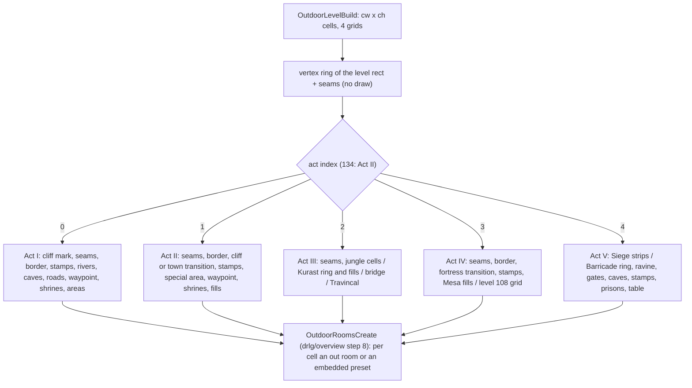
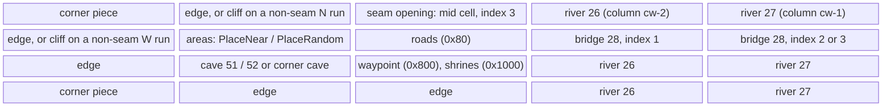
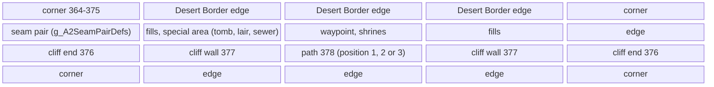
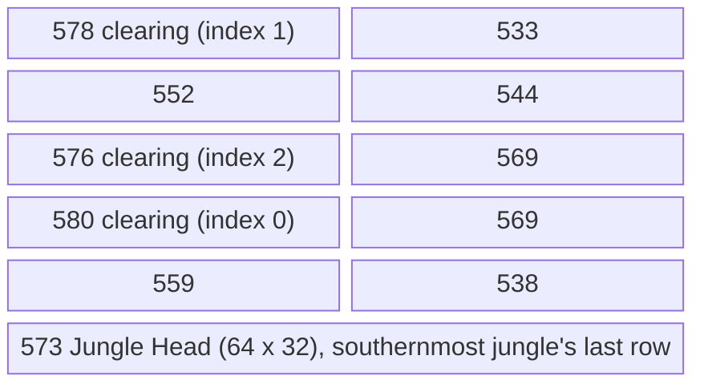
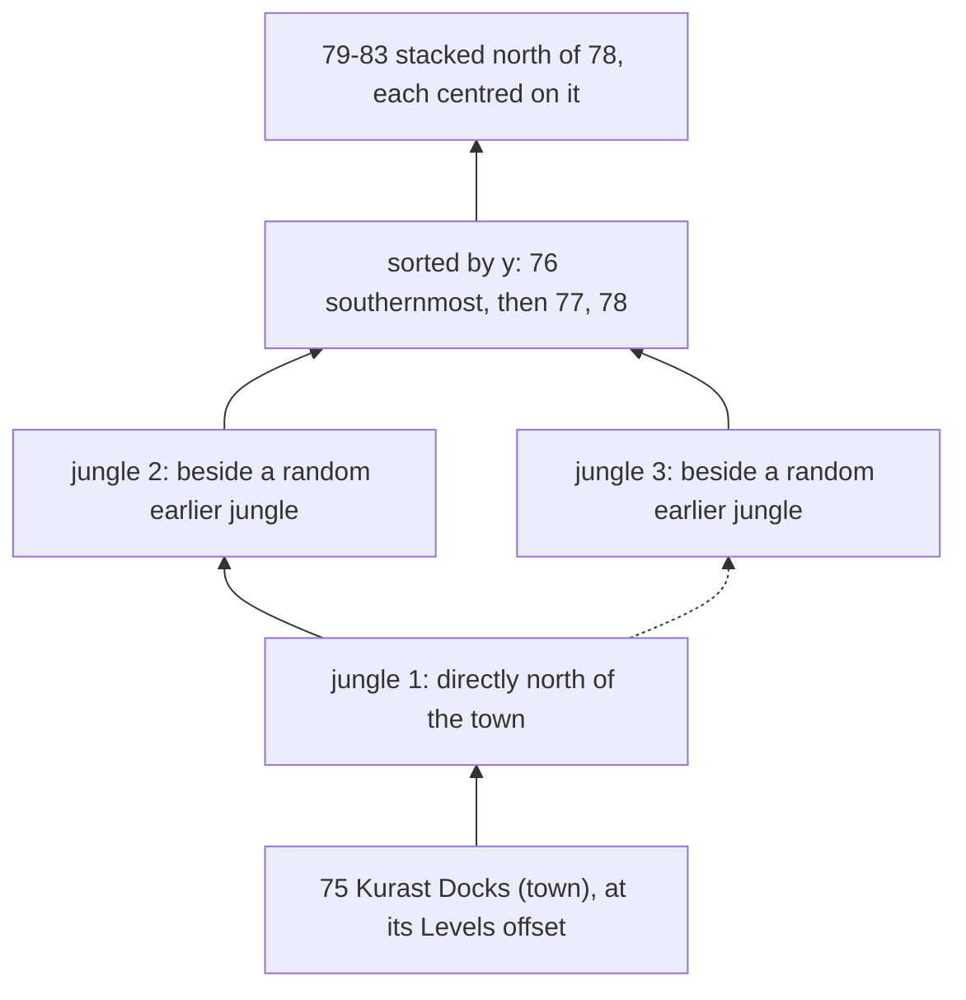
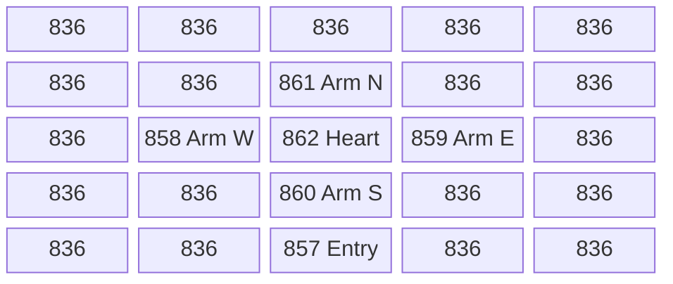

# Outdoor generators: the cell grid, borders, placements and the act layouts

## Purpose

A `DrlgType` 3 level is a grid of 8 × 8-tile **cells**. The outdoor generator of the level's act fills four cell grids:
which cells are border, seam, road, waypoint or shrine cells, and which preset (`LvlPrest` `Def`, with its file index)
covers which cells. [drlg/overview](README.md) step 8 then turns every cell into an outdoor room or an embedded preset.
This spec covers everything `OutdoorLevelBuild` runs between allocating the grids and `OutdoorRoomsCreate`: the level
outline and its seams, the border pass, the placement primitives and the per-`Def` file rotation, the waypoint and
shrine marks, the border stamps (`LvlSub` `tag_type` 2), and the generator of each act. It also covers Act III's jungle
layout, which runs at act creation on the act seed and gives Act III its level rectangles and links. Every draw is listed
with its seed, in order. The level seed is the one [drlg/overview](README.md) step 2 re-seeds; the act seed is that of
[rng/seeds](../rng/seeds.md) step 3. Primitives (`Step`, `Range`, `RangeB`) are those of [rng](../rng/README.md). The act
link builder that places the other acts' outdoor levels, and the warp points built from the rooms' flags, are in
[warps.md](warps.md).

## Entry points

| When | Function | Tag |
|---|---|---|
| Outdoor level record created (0x268-byte outdoor record; no draw) | fn:sub_00675320_OutdoorLevelCreate@0x00675320 | [I] |
| Outdoor level built, from `LevelInit` after the re-seed | fn:sub_00675360_OutdoorLevelBuild@0x00675360, run:2026-10-15-drlg-outdoor (522 windows) | [C] |
| Act III created: the jungle layout and the Kurast stack on the act seed | fn:sub_006789B0_ActLinkAct3@0x006789B0 → fn:sub_00677880_JungleLayout@0x00677880, run:2026-10-15-drlg-outdoor | [C] |
| Cells become rooms (boundary of this spec) | fn:sub_006750F0_OutdoorRoomsCreate@0x006750F0, [drlg/overview](README.md) step 8 | [C] |

- [C] The generator's output is reproduced bit-exactly: 522 outdoor windows of 29 levels (2–7, 17, 41–46, 76–83,
  104–106, 108, 110–112, 117), each in 4 to 11 map seeds and in normal, nightmare and hell, Acts I–IV in classic and
  expansion games. Every level-seed step inside the window (1443544), the final def grid, grid0 and cell grid, the seed
  after the window, the preset anchors with their file indices and the out rooms match, 0 mismatches.
  (fn:sub_00675360_OutdoorLevelBuild@0x00675360, run:2026-10-15-drlg-outdoor,
  [drlg/0008 § 15](../../findings/drlg/0008-outdoor.md#15-phase-2-reproduction-run2026-10-15-drlg-outdoor))
- [I] Levels 39 (Moo Moo Farm) and 134 (Pandemonium 2, "Forgotten Sands") are named boundaries of that run: no harness
  game reached them, so every statement about them below is `[I]` (see *Open questions*).
  (fn:sub_00675360_OutdoorLevelBuild@0x00675360)

## Inputs

### Tables

| Anchor | Used for |
|---|---|
| tbl:Levels.txt:SizeX, tbl:Levels.txt:SizeY | the level size the link builder starts from ([warps.md § B](warps.md#b-the-act-link-builder)); level 76's size for the three jungles, 79–83's for the Kurast stack (§ J) |
| tbl:Levels.txt:OffsetX, tbl:Levels.txt:OffsetY | level 75's position (Act III's anchor, § J1); level 117's position |
| tbl:Levels.txt:Vis0, tbl:Levels.txt:Warp0 | `Vis0..7`/`Warp0..7`: a slot with `Warp` −1 is a walkable seam (§ C); slot *k* gives the warp-slot flag `0x10 << k` (§ E1) |
| tbl:Levels.txt:LevelType | the border style (§ E2) |
| tbl:LvlPrest.txt:Files | the operand of the file rotation (§ D2) |
| tbl:LvlPrest.txt:SizeX, tbl:LvlPrest.txt:SizeY | a preset's footprint in cells, `SizeX ÷ 8` × `SizeY ÷ 8` (§ D1) |
| tbl:LvlSub.txt:Type, tbl:LvlSub.txt:File | the border-stamp records of a `Type` and their DS1 groups (§ G) |
| tbl:LvlSub.txt:BordType, tbl:LvlSub.txt:GridSize | how a border-stamp record stamps, and its cell scale (§ G) |

Which `LvlPrest` records each act places is surveyed in [LvlPrest § Outdoor presets](../../tables/LvlPrest.md#outdoor-presets-plan-0026-phase-0)
and [§ Outdoor placement](../../tables/LvlPrest.md#outdoor-placement-plan-0026-phase-1); the outdoor levels, their sizes and
the sizes the link picks overwrite are in [Levels § Outdoor survey](../../tables/Levels.md#outdoor-survey-plan-0026-phase-0);
the border-stamp records are in [LvlSub § Border stamps](../../tables/LvlSub.md#border-stamps-the-tag_type-2-records-plan-0026-phase-1).

### Runtime state

| State | Type | Owner offset | Source |
|---|---|---|---|
| level seed `L.seed` | `Seed` | level `+0x1C4` | re-seeded by `LevelInit` ([drlg/overview](README.md) step 2) |
| level id | `u32` | level `+0x1D0` | leveldefs |
| level rectangle `L.rect` `{x, y, w, h}` (tiles) | `i32` | level `+0x1C` | [warps.md § C](warps.md#c-level-rectangles-and-the-links-after-the-layout); Act III from § J1 |
| file-rotation counters | list of `{def, Files, c}`, prepended | level `+0x1CC` | § D2; emptied by `LevelUnload` before each build ([drlg/overview](README.md) step note 9) |
| outdoor record `O` | 0x268 bytes | level `+0x14` | `OutdoorLevelCreate` |
| outdoor flags `O.flags` | `u32` | `O+0x00` | Act I: `LinkOutdoorFlags` at act creation (§ H); Act IV: `g_LinkPickOutdoorFlag` on level 104 ([warps.md § A](warps.md#a-per-act-link-setup)); Act I also sets `0x20`, `0x40` itself |
| def grid, grid0, cell grid, grid3 | `cw × ch` `u32` each | `O+0x04`, `O+0x18`, `O+0x2C`, `O+0x40` | § B |
| `cw`, `ch` | `i32` | `O+0x5C`, `O+0x60` | § A |
| vertex ring | list of 0x14-byte vertices | `O+0x64` | § C |
| Act I road lists | six vertex lists; endpoint arrays of 0x14-byte entries | `O+0x68..+0x7C`; `O+0x80`, `+0xF8`, `+0x170`, `+0x1E8`, count `+0x260` | § H6 |
| level adjacency list | sorted nodes `{nbr, side, isPreset, +0xC, &nbr.rect, next}` | `O+0x264` | `LevelBorderAdj` at act creation (§ C1) |
| act seed | `Seed` | act `+0x000` | [rng/seeds](../rng/seeds.md) step 3 (Act III jungle layout, § J1) |
| Act III gate bit | `u32` | act `+0x474` | the Act III act-seed bit of [rng/seeds](../rng/seeds.md) step 3 (§ J5) |
| jungle `Def` array, clearing count | pointer; `i32` | level `+0x1BC`, `+0x1B8` | § J1 (levels 76–78) |
| difficulty | `u32` 0..2 | act `+0x450` | game; read only for `Levels` sizes |

- [C] `O.flags` bits `0x4`, `0x8`, `0x10`, `0x80`, `0x100`, `0x200` and `0x400` of the Act I levels are set at act creation
  by `LinkOutdoorFlags` from table `0x006F1258`, matched against the sides the link builder chose; the act inputs of every
  logged window match the model. (fn:sub_00677180_LinkOutdoorFlags@0x00677180, run:2026-10-15-drlg-outdoor)
- [C] On Act IV, level 104's flags carry `0x400000` or `0x800000` from the Outer Steppes link pick.
  (fn:sub_00678A20_ActLinkAct4@0x00678A20, fn:sub_00676C00_LinkPick@0x00676C00, run:2026-10-15-drlg-outdoor)

### Constants

| Name | Value | Anchor | Tag |
|---|---|---|---|
| occupied mask | `0x1B81` (cell bits 0, 7, 8, 9, 11, 12) | fn:sub_00674230_OutPresetFits@0x00674230, fn:sub_00674200_OutCellFree@0x00674200 | [C] |
| border and edge `Def`s by style, `g_BorderDefs` | rows 1–12 hold the edge and corner pieces of the styles cliff, wild, desert, mesa: row 1 `0, 4, 364, 799` … row 12 `0, 15, 375, 810`; the cliff column is 0 on rows 1, 4, 8, 9, 11, 12 | data:g_BorderDefs@0x006F0620 | [C] |
| Act V ring `Def`s, `g_BorderDefsA5` | row *r*: `881 + r` (dirt), `957 + r` (snow) | data:g_BorderDefsA5@0x006F06F0 | [C] |
| edge-row index by direction | `g_BorderDirIdx` | data:g_BorderDirIdx@0x006F0FD0 | [C] |
| corner index table | 9 × 9, rows −4..4 (§ E2) | data:g_BorderCornerIdx@0x006F1088 | [C] |
| Act II seam pair `Def`s | `g_A2SeamPairDefs`, indexed `dx + 2·dy + 2` | data:g_A2SeamPairDefs@0x006F112C | [C] |
| side probe | a point 4 tiles outside the grid per side | data:g_OutSideProbe@0x006F05D8 | [C] |
| neighbour order of `PlaceNear` | W, N, S, E, NW, SE, NE, SW | data:g_OutNbrDx@0x006F0614, data:g_OutNbrDy@0x006F060C | [C] |
| Act I river index table | by border `Def` (§ H3) | `0x006F2680`, fn:sub_0067FE90_A1RiverPlace@0x0067FE90 | [C] |
| Act II cliff layouts | 8 layouts × 5 `{def, idx, x, y}` | `0x006F2390`, fn:sub_0067F5C0_OutA2Cliff@0x0067F5C0 | [C] |
| King Tomb cliff | nine fixed pieces 383–387, indices 0–2 | `0x006F2610`, fn:sub_0067F8D0_OutA2KingTombCliff@0x0067F8D0 | [C] |
| jungle tables | side bits `0x006F13F0` (545–572), clearings `0x006F13BC` (575–584); clearing permutation `0x006F2240`, `0x006F2328` | fn:sub_00677880_JungleLayout@0x00677880, fn:sub_0067E910_OutJungleCells@0x0067E910 | [C] |
| level 108 grid | 25 `Def`s (§ K2) | `0x006F22C0`, fn:sub_0067E840_OutA4DiabloGrid@0x0067E840 | [C] |
| Act V tables | ravine directions `0x006F1FD8`, caves `0x006F1F9C`, placement table `0x006F2100` (§ L) | fn:sub_0067DEF0_BarricadeRavine@0x0067DEF0, fn:sub_0067DA70_BarricadeCaveEntries@0x0067DA70, fn:sub_0067E160_BarricadeTablePlace@0x0067E160 | [C] |

The contents of the tables named only by address are not written out in the finding; see *Open questions*.

## Algorithm



Notation: `L` the level, `O` its outdoor record. A cell is `(x, y)`, `x` the column (0 ..< `cw`), `y` the row
(0 ..< `ch`). `cell(x, y)`, `def(x, y)` and `grid0(x, y)` are the three grids of § B. `Step(s)` advances seed `s` once and
returns its new low word (`u32`); a **level draw** is a `Step` of `L.seed`, an **act draw** a `Step` of the act seed.
`Range(s, n)` and `RangeB(s, n)` are the guarded range of [rng](../rng/README.md): `n < 1` gives 0 with no draw, otherwise
one `Step`, then the low word `& (n − 1)` for a power of two or unsigned `mod n`. With no seed named, the seed is
`L.seed`. `÷` is signed division truncating toward zero, `%` the signed C remainder. `Place(x, y, def, file)` is
`OutPresetPlace` with `borderFlag` 0 (§ D1); `file = −1` means "from the rotation" (§ D2).

### A. The window

```
A1. OutdoorLevelBuild(L):                                            [C] (fn:sub_00675360_OutdoorLevelBuild@0x00675360, run:2026-10-15-drlg-outdoor)
      O.+0x54 ← 0;  O.+0x58 ← 0
      cw: i32 ← L.w ÷ 8;  ch: i32 ← L.h ÷ 8
      def grid, grid0, cell grid, grid3 ← cw × ch u32, zeroed
      VertexRingBuild(L); OutVertsToCells(O.ring)                    ; § C, no draw
      ── window start: L.seed as LevelInit re-seeded it ──
      a: u32 ← (L.id = 134) ? 1 : DRLG_ActFromLevelId(L.id)          ; 0-based act index
      OutdoorAct[a](L)                                               ; § H (0) … § L (4)
      ── window end ──
      OutdoorRoomsCreate(L)                                          ; drlg/overview step 8
```

- [C] Nothing before the act switch draws: the seed entering the act generator is the re-seeded level seed, and the
  window's level-seed steps are exactly the act generator's. (fn:sub_00675360_OutdoorLevelBuild@0x00675360,
  fn:DRLG_ActFromLevelId@0x006427F0, run:2026-10-15-drlg-outdoor)
- [C] The dispatch by level (fn:sub_00675360_OutdoorLevelBuild@0x00675360):

  | Act index | Generator | Levels |
  |---|---|---|
  | 0 | fn:sub_006807F0_OutdoorAct1@0x006807F0 | 2–7, 17, 39 |
  | 1 | fn:sub_0067F980_OutdoorAct2@0x0067F980 | 41–46, 134 |
  | 2 | fn:sub_0067F450_OutdoorAct3@0x0067F450 | 76–83 |
  | 3 | fn:sub_0067E890_OutdoorAct4@0x0067E890 | 104–106, 108 |
  | 4 | fn:sub_0067E600_OutdoorAct5@0x0067E600 | 110–112, 117 |

  (fn:sub_00675360_OutdoorLevelBuild@0x00675360, run:2026-10-15-drlg-outdoor; levels 39 and 134 `[I]`)
- [C] No generator branches on difficulty, expansion or player count: one model with no such input reproduces all three
  difficulties and, on Acts I–IV, classic and expansion games. Act III's jungle sizes come from `Levels`
  `SizeX/Y[difficulty]`, which are equal in all three difficulties. (fn:sub_00675360_OutdoorLevelBuild@0x00675360,
  tbl:Levels.txt:SizeX, run:2026-10-15-drlg-outdoor)
- [I] The generators write the def grid, grid0 and the cell grid in place. No generator writes grid3; `OutdoorRoomsCreate`
  passes it on. (fn:sub_006750F0_OutdoorRoomsCreate@0x006750F0)
- [C] The level size is the one the link builder wrote, which for four levels is not the `Levels` size: Blood Moor (2) is
  56 × 96 or 96 × 56 (its link pick), and the Barricade-type levels 111, 112 and 117 are 64 × 160 or 160 × 64 (one
  act-seed-copy bit each), so 8 × 20 or 20 × 8 cells. (fn:sub_00676650_LinkPick@0x00676650, fn:sub_0067D830_LinkPick@0x0067D830,
  fn:sub_0067D980_LinkPick@0x0067D980, fn:sub_0067D8E0_LinkPick@0x0067D8E0, run:2026-10-15-drlg-outdoor;
  [warps.md § B](warps.md#b-the-act-link-builder))

### B. The cell grid and its bits

| Grid | Content |
|---|---|
| def grid `O+0x04` | the preset `Def` at its **anchor** cell (its top-left), 0 elsewhere |
| grid0 `O+0x18` | the room flags of the cell: an out room's `+0x28`, an embedded preset's `flags` |
| cell grid `O+0x2C` | the bits below |
| grid3 `O+0x40` | not written by the generators |

| Cell bit | Meaning | Set by | Read by |
|---|---|---|---|
| `0x1` | border or seam cell | `OutSeamMark`, the border pass, `OutPresetPlace` with `borderFlag` for `Def` 4–15 and 364–375, the Act V ring | `OutCornerFlood`, the occupied mask |
| `0x2` | typed (cliff) seam or border | `OutSeamMark`, the border pass | Act I river test |
| `0x80` | road | Act I roads | `PlaceNear`, the occupied mask |
| `0x100` | covered: no room | `OutCellCover`, `OutCornerFlood` | `OutdoorRoomsCreate`, the occupied mask |
| `0x200` | preset footprint | `OutPresetPlace` | `OutdoorRoomsCreate`, the occupied mask |
| `0x400` | seam opening | the border pass (act index 0, 3, 4), the Act V ring | `OutCellNotOpening`, Act V gates, `OutWaypointPlace` (level 3) |
| `0x800` | waypoint | `OutWaypointPlace` | the occupied mask |
| `0x1000` | shrine | `OutShrinesPlace` | the occupied mask |
| `0xF0000` | preset file index (bits 16–19) | `OutPresetPlace`, the seam opening | `OutdoorRoomsCreate` → the instance's file index |

| grid0 bit | Meaning | Set by |
|---|---|---|
| `0x10 << k` | warp slot *k*: the cell borders the level named by `Vis`*k* | `OutSeamMark` (§ E1) |
| `0x1000 << r` | shrine record *r* of `SubShrine` | `OutShrinesPlace` (§ F2) |
| `0x10000`, `0x20000` | waypoint record 0, 1 of `SubWaypoint` | `OutWaypointPlace` (§ F1) |

- [C] The cell, def and grid0 bits above are what the generators leave: the three final grids match cell for cell in
  every window of the run (55676 cells per grid). (fn:sub_006743C0_OutPresetPlace@0x006743C0,
  fn:sub_00675770_OutSeamMark@0x00675770, fn:sub_00675850_OutBorderBuild@0x00675850, run:2026-10-15-drlg-outdoor)
- [C] A placement fits only on cells with none of the occupied-mask bits (`0x1B81`). (fn:sub_00674230_OutPresetFits@0x00674230,
  fn:sub_00674200_OutCellFree@0x00674200, run:2026-10-15-drlg-outdoor)
- [C] **Out-room flags.** `OutRoomCreate` sets an out room's `+0x28` to its grid0 cell `| 0x80000`, and `| 0x40000` as well
  on the client copy. So the shrine, waypoint and warp-slot bits are room bits: the room prepare runs the `SubShrine` and
  `SubWaypoint` passes from them ([room-tiles.md](room-tiles.md) step 5), and the warp points of a level with out rooms
  follow from them ([warps.md § E](warps.md#e-warp-points)). 6092 out-room flags were checked at the warp-point build
  (1000 with a shrine bit, 150 with a warp slot, 134 with a waypoint). (fn:sub_0067D540_OutRoomCreate@0x0067D540,
  fn:sub_006423D0_LevelWarpPointsBuild@0x006423D0, run:2026-10-15-drlg-outdoor)
- [I] No outdoor generator writes cell bits 20–25. The warp slot of an outdoor seam room is the grid0 flag `0x10 << k`; a
  warp inside an embedded preset comes from its DS1 cells ([warps.md § D](warps.md#d-room-flags-and-level-points-from-a-preset-instance)).
  (fn:sub_00675770_OutSeamMark@0x00675770, fn:DRLG_PresetMapScan@0x00667970)

### C. The level outline

[C] The **adjacency list** (`O+0x264`) is built at act creation by `LevelBorderAdj` ([warps.md § A](warps.md#a-per-act-link-setup)):
one node per `Vis` slot whose `Warp` is −1. The **vertex ring** is the level rectangle's outline with an extra vertex
wherever a seam starts or ends. (fn:sub_00677680_LevelBorderAdj@0x00677680, fn:sub_0067D050_VertexRingBuild@0x0067D050,
run:2026-10-15-drlg-outdoor)

```
C1. LevelBorderAdj(L) → per Vis slot k with Warp[k] = −1:            [C] (fn:sub_00677680_LevelBorderAdj@0x00677680, fn:sub_0066B790_LevelAdjAdd@0x0066B790, run:2026-10-15-drlg-outdoor)
      n ← { nbr: level Vis[k], side: RectAdjDir(L.rect, nbr.rect)   ; 0 W, 1 N, 2 E, 3 S
            isPreset: nbr's DrlgType = 2, +0xC: 0, rect: &nbr.rect }
      LevelAdjInsert(n, O.adj)                                       ; sorted, C2
C2. order (LevelAdjLess): side ascending; then W by y ascending,     [C] (fn:sub_0066B6A0_LevelAdjLess@0x0066B6A0, fn:sub_0066B720_LevelAdjInsert@0x0066B720, run:2026-10-15-drlg-outdoor)
      N by x descending, E by y descending, S by x ascending

C3. VertexRingBuild(L):                                              [C] (fn:sub_0067D050_VertexRingBuild@0x0067D050, run:2026-10-15-drlg-outdoor)
      r ← L.rect with w − 1, h − 1;  each neighbour rect likewise     ; inclusive while building, restored after
      ring: v0 (r.x, r.y + r.h) → v1 (r.x, r.y) → v2 (r.x + r.w, r.y) → v3 (r.x + r.w, r.y + r.h) → v0
                                                                     ; W side going up, then N, E, S
      VertexRingSeams(ring, r, O.adj)                                ; C4
      every vertex −= (L.x, L.y)                                     ; level-relative tiles
C4. VertexRingSeams, per node n in list order, q ← n.rect:           [C] (fn:sub_0067CE20_VertexRingSeams@0x0067CE20, run:2026-10-15-drlg-outdoor)
      side 0: start v0, edge from v0.y (s) to v1.y (e), c ← −1, a ← q.y + q.h, b ← q.y
      side 1: start v1, edge from v1.x to v2.x,         c ← +1, a ← q.x,       b ← q.x + q.w
      side 2: start v2, edge from v2.y to v3.y,         c ← +1, a ← q.y,       b ← q.y + q.h
      side 3: start v3, edge from v3.x to v0.x,         c ← −1, a ← q.x + q.w, b ← q.x
      p ← start
      if a·c ≤ s·c:  if s·c > b·c: next node                         ; ends before the edge starts
      else:          if a·c > e·c: next node;  p ← insert a vertex after p at a
      p.flags |= 1;  if n.isPreset: p.flags |= 2                     ; the segment from p is a seam
      if b·c < e·c: insert a vertex after p at b                     ; the seam ends inside the edge
C5. OutVertsToCells(ring): every vertex ÷ 8 (signed);                [C] (fn:sub_00675080_OutVertsToCells@0x00675080, run:2026-10-15-drlg-outdoor)
      a vertex equal to its successor is merged into it (flags or-ed)
```

- [C] A vertex's flag bit 0 means the segment to the next vertex borders a walkable neighbour; bit 1 means that neighbour
  is a preset level (a town). The vertex `type` (byte `+8`) is 0 from this builder; Act I's cliff mark sets 1 (§ H1).
  (fn:sub_0067CE20_VertexRingSeams@0x0067CE20, 0x0067CE00,
  fn:sub_00680070_A1CliffMark@0x00680070, run:2026-10-15-drlg-outdoor)
- [I] A vertex merge in `OutVertsToCells` happened in no logged window. (fn:sub_00675080_OutVertsToCells@0x00675080)
- [I] `LevelAdjInsert` compares against the head only while the list holds one node. (fn:sub_0066B720_LevelAdjInsert@0x0066B720)

### D. Placement primitives

```
D1. OutPresetPlace(L, x, y, def, file, borderFlag):                   [C] (fn:sub_006743C0_OutPresetPlace@0x006743C0, run:2026-10-15-drlg-outdoor)
      w: i32 ← LvlPrest[def].SizeX ÷ 8;  h: i32 ← LvlPrest[def].SizeY ÷ 8
      if file = −1: file ← OutPresetFileRotate(L, def)               ; D2, before any cell is written
      for yy in y ..< y + h:                                         ; rows outer
        for xx in x ..< x + w:
          cell(xx, yy) ← (cell & ~0xF0000) | (file << 16) | 0x200
          if borderFlag and (4 ≤ def ≤ 15 or 364 ≤ def ≤ 375): cell(xx, yy) |= 0x1
          def(xx, yy) ← 0
      def(x, y) ← def                                                ; the anchor

D2. OutPresetFileRotate(L, def) → i32:                                [C] (fn:sub_00674320_OutPresetFileRotate@0x00674320, run:2026-10-15-drlg-outdoor)
      node ← the node of def in L[+0x1CC]
      if none:                                                       ; first use of def in this build
        files: i32 ← LvlPrest[def].Files
        node ← prepend { def, files, c: RangeB(L.seed, files) }       ; level draw iff files ≥ 1
      node.c ← (node.c + 1) % node.files                             ; signed; every use, the first included
      return node.c

D3. OutPresetFits(L, x, y, def, pad, sides) → bool:                   [C] (fn:sub_00674230_OutPresetFits@0x00674230, run:2026-10-15-drlg-outdoor)
      footprint ← D1's w × h at (x, y) (def 0: 1 × 1), grown by pad on each side in sides (1 N, 2 E, 4 S, 8 W)
      true iff every footprint cell is inside the grid and (cell & 0x1B81) = 0

D4. Shuffle(N, W') → list:                                            [C] (fn:sub_00674730_OutPresetPlaceRandom@0x00674730, run:2026-10-15-drlg-outdoor)
      list[i] ← (i % W', i ÷ W') for i in 0 ..< N
      repeat N times: a ← Range(L.seed, N); b ← Range(L.seed, N); swap list[a], list[b]   ; 2N level draws

D5. PlaceRandom(L, def, file, pad, sides) → bool:                     [C] (fn:sub_00674730_OutPresetPlaceRandom@0x00674730, run:2026-10-15-drlg-outdoor)
      N: i32 ← (cw − 2)·(ch − 2);  if N = 0: return false            ; no draw
      list ← Shuffle(N, cw − 2)
      for (x, y) in list: if OutPresetFits(x + 1, y + 1, def, pad, sides): Place(x + 1, y + 1, def, file); return true
      return false                                                   ; silent unless the caller tests it

D6. PlaceNear(L, def, file) → bool:                                   [C] (fn:sub_00674920_OutPresetPlaceNear@0x00674920, run:2026-10-15-drlg-outdoor)
      N ← (cw − 2)·(ch − 2);  if N = 0: return false
      list ← Shuffle(N, cw − 2)
      for (x, y) in list with cell(x + 1, y + 1) & 0x80:             ; road cells
        for k in 0 ..< 8 (W, N, S, E, NW, SE, NE, SW):
          (px, py) ← (x + 1 + dx[k], y + 1 + dy[k])
          if OutPresetFits(px, py, def, 0, 0xF): Place(px, py, def, file); return true
      return PlaceRandom(L, def, file, 0, 0xF)                        ; a second shuffle

D7. PlaceFar(L, rect, def, file, pad, sides) → bool:                  [C] (fn:sub_006744F0_OutPresetPlaceFar@0x006744F0, run:2026-10-15-drlg-outdoor)
      ox ← Range(L.seed, cw − 2);  oy ← Range(L.seed, ch − 2)        ; 2 level draws
      best ← none
      for r in 0 ... ch − 2: y ← (r + oy) % (ch − 2) + 1             ; inclusive bounds
        for c in 0 ... cw − 2: x ← (c + ox) % (cw − 2) + 1
          if OutPresetFits(x, y, def, pad, sides):
            a ← |8x + L.x + 4 − (rect.x + rect.w ÷ 2)|;  b ← |8y + L.y + 4 − (rect.y + rect.h ÷ 2)|
            d ← (a > b ? b + 2a : a + 2b) ÷ 2
            if d > best.d: best ← (x, y, d)                          ; the first strict maximum
      if best: Place(best.x, best.y, def, file); return true
      return false

D8. OutCellClear(x, y): def(x, y) ← 0; cell(x, y) ← 0.               [C] (fn:sub_00674160_OutCellClear@0x00674160, fn:sub_006741A0_OutCellCover@0x006741A0, run:2026-10-15-drlg-outdoor)
    OutCellCover(x, y): def(x, y) ← 0; cell(x, y) ← 0x100.
    OutCellNotOpening(x, y): (cell & 0x400) = 0.  OutCellFree(x, y): (cell & 0x1B81) = 0.
```

- [C] D2 is the commonest level-seed draw of the window. The first use of a `Def` draws `RangeB(Files)` even when `Files`
  is 1, and the index used is one past the drawn value: `(RangeB + 1) % Files`. Every `Def` rotates; there is no
  `Def`-range test. (fn:sub_00674320_OutPresetFileRotate@0x00674320, run:2026-10-15-drlg-outdoor)
- [I] A `Def` with `Files` 0 placed with `file = −1` would divide by zero in D2. (fn:sub_00674320_OutPresetFileRotate@0x00674320)
- [C] `PlaceRandom` draws its `2N` even when nothing fits; then one rotation draw when a placed `Def` with `file = −1` is
  new to the build. (fn:sub_00674730_OutPresetPlaceRandom@0x00674730, run:2026-10-15-drlg-outdoor)
- [I] `PlaceFar`'s inclusive bounds visit row `oy` and column `ox` twice, which only matters for ties.
  (fn:sub_006744F0_OutPresetPlaceFar@0x006744F0)

### E. Seams and the border pass

```
E1. OutSeamMark(L): for each ring vertex v with v.flags & 1:          [C] (fn:sub_00675770_OutSeamMark@0x00675770, fn:sub_00674040_SeamWarpFlag@0x00674040, run:2026-10-15-drlg-outdoor)
      f ← SeamWarpFlag(L, v)
      grid0 |= f on every cell of the segment v … v.next (end included)
      cell  |= (v.type ≠ 0 ? 3 : 1) on the same cells
    SeamWarpFlag(L, v): the side of v; a probe point 4 tiles outside the grid on that side (g_OutSideProbe);
      the adjacency node of that side whose rect contains the probe; 0x10 << (the first k with Vis[k] = nbr.id)
      (a node with +0xC ≠ 0 gives 0)
```

```
E2. OutBorderBuild(L):                                               [C] (fn:sub_00675850_OutBorderBuild@0x00675850, fn:sub_006755C0_BorderEdgeDef@0x006755C0, fn:sub_00675600_BorderCornerDef@0x00675600, run:2026-10-15-drlg-outdoor)
      act ← DRLG_ActFromLevelId(L.id)
      style(t) ← LevelType 2: (t ≠ 0 ? 0 : 1);  16: 2;  27: 3;  31: 4 + (L.id = 117);  else −1
      for v in the ring from its head (v0), each vertex once; n ← v.next:
        d ← sign(n − v) per axis;  cv ← (v.type ≠ 0) ? 3 : 1;  e ← BorderEdgeDef(d, style(v.type))
        if not (v.flags & 2):                                        ; not a town seam
          for each cell c from v + d to n inclusive: Place(c, e, −1); cell(c) |= cv
        if (v.flags & 1) and not (v.flags & 2):                      ; seam with an outdoor level
          m ← min(v, n) + (len · |d|) ÷ 2                            ; the segment's mid cell
          act 0 or 4: cell(m) ← (cell(m) & ~0xF0000) | (L.id = 17 ? 0x40400 : 0x30400)
          act 3:      cell(m) ← (cell(m) & ~0xF0000) | 0x30400
          act 1:      k ← dx + 2·dy + 2;  Place(m, pair[k].a, −1);  Place(m + |d|, pair[k].b, −1)   ; g_A2SeamPairDefs
          act 2:      nothing
        t ← v.type or n.type;  if t ≠ 0: cv |= 2
        k ← CornerIndex(v, n, n.next)                                ; E3
        if k ≠ −1 and (c ← BorderCornerDef(k, style(t))) ≠ 0: Place(n, c, −1); cell(n) |= cv
      OutCornerFlood(L)                                              ; E4
```

- [C] The border pass's only level-seed draws are D2's first uses: one `RangeB(Files)` per distinct border `Def`, in
  first-use order along the ring from v0 (the bottom-left corner, going up the W side). Its callers are Act I, Act II and
  Act IV except level 108; Act V lays its own ring (§ L2), and Act III none. (fn:sub_00675850_OutBorderBuild@0x00675850,
  run:2026-10-15-drlg-outdoor)
- [C] **The seam opening** is a direct cell write after the piece is placed: index 3 (the `…o` files of `Wild Border 1–4`
  and `Mesa Border 1–4`), or 4 on level 17 (`Bord1oe`), and bit `0x400`. It overrides the index the rotation gave that cell,
  but the rotation draw was made. (fn:sub_00675850_OutBorderBuild@0x00675850, run:2026-10-15-drlg-outdoor)
- [C] A corner piece replaces the edge piece placed at `n`; both uses count in the rotation. (fn:sub_00675850_OutBorderBuild@0x00675850,
  run:2026-10-15-drlg-outdoor)

```
E3. CornerIndex:                                                     [C] (fn:sub_00675850_OutBorderBuild@0x00675850, data:g_BorderCornerIdx@0x006F1088, run:2026-10-15-drlg-outdoor)
      (dx, dy) ← direction v → n;  (dx2, dy2) ← direction n → n.next
      e(z) ← z = 0 ? 0 : z ± 2 (away from 0)
      idx ← (v.flags & 2 ? e(dx) : e(2dx)) + 9·(n.flags & 2 ? e(dx2) + dy2 : e(2dx2) + 2dy2) + (v.flags & 2 ? dy : 2dy)
      k ← g_BorderCornerIdx[idx]                                     ; the 9 × 9 table, rows −4..4
      a corner Def of 19 becomes 19 + (n.type ≠ 1) when v.type = 1, and 21 otherwise
E4. OutCornerFlood(L): from each grid corner, cells get 0x100 up to a cell with bit 0.   [C] (fn:sub_00675670_OutCornerFlood@0x00675670, run:2026-10-15-drlg-outdoor)
```

### F. Waypoint and shrines

```
F1. OutWaypointPlace(L):                                              [C] (fn:sub_00674B70_OutWaypointPlace@0x00674B70, run:2026-10-15-drlg-outdoor)
      if L.id = 3:                                                   ; Cold Plains, no draw
        f ← 0x10 << (the first k with Vis[k] = 2)                    ; the Blood Moor seam
        first (x, y), rows outer, with (grid0 & f) and (cell & 0x400):
          clamp (x, y) into 1 … cw − 2 × 1 … ch − 2
          grid0 |= 0x20000; cell |= 0x800; return                    ; waypoint record 1
      N ← (cw − 2)·(ch − 2);  if N = 0: return
      list ← Shuffle(N, cw − 2)                                      ; 2N level draws
      first (x, y) in list with OutCellFree(x + 1, y + 1): grid0 |= 0x10000; cell |= 0x800   ; waypoint record 0
F2. OutShrinesPlace(L, count = 5):                                    [C] (fn:sub_00674E40_OutShrinesPlace@0x00674E40, run:2026-10-15-drlg-outdoor)
      r: u32 ← Step(L.seed) & 3                                      ; always, before the shuffle
      N ← (cw − 2)·(ch − 2);  if N = 0: return
      list ← Shuffle(N, cw − 2)                                      ; 2N level draws
      for (x, y) in list while count > 0, with OutCellFree(x + 1, y + 1):
        grid0 |= 0x1000 << r;  cell |= 0x1000;  r ← (r + 1) & 3;  count ← count − 1
```

- [C] Neither pass places a preset. They mark cells, and the out room made there runs the `SubWaypoint` or `SubShrine`
  `LvlSub` pass with the marked record ([room-tiles.md](room-tiles.md) step 5). Every call site passes `count` 5.
  (fn:sub_00674B70_OutWaypointPlace@0x00674B70, fn:sub_00674E40_OutShrinesPlace@0x00674E40, run:2026-10-15-drlg-outdoor)
- [I] A waypoint pass that finds no free cell happened in no logged window. (fn:sub_00674B70_OutWaypointPlace@0x00674B70)
- [C] Frigid Highlands (111) gets its waypoint from no outdoor pass: the `To Siege` preset (`Def` 880) holds a waypoint
  unit, and the DS1 scan sets `0x30000` on its room ([warps.md § D](warps.md#d-room-flags-and-level-points-from-a-preset-instance)).
  (fn:DRLG_PresetMapScan@0x00667970, fn:sub_0067E4B0_BarricadeToSiege@0x0067E4B0, run:2026-10-15-drlg-outdoor)

### G. Border stamps

[C] The five `LvlSub` records with `BordType` ≠ −1 (`Type` 0 `Border - Cliffs`, 1 `- Middle`, 2 `- Corner`, 3 `- Border`, 12
`Barricade`) are not rolled per room. The outdoor generators apply every record of a `Type` to the cell grid on the level
seed. A record's DS1 holds **groups**; a group is a rewrite rule whose variant 0 is the pattern to match and whose
variant `v + 1` is the replacement. (fn:sub_006752A0_OutBorderSubApply@0x006752A0, fn:sub_0066F690_BorderSubGroup@0x0066F690,
tbl:LvlSub.txt:BordType, run:2026-10-15-drlg-outdoor)

```
G1. OutBorderSubApply(L, Type, baseDef):                              [C] (fn:sub_006752A0_OutBorderSubApply@0x006752A0, fn:sub_00670750_BorderSubApplyType@0x00670750, run:2026-10-15-drlg-outdoor)
      context: baseDef, wildcard −1, Type, the tests OutCellNotOpening and OutPresetFits, and the writers
               OutCellClear, OutCellCover, OutPresetPlace
      for rec ← LVLSUB_GetRecordByType(Type) while rec.Type = Type, rec ← rec + 1:
        LvlSubLoadDs1(rec);  BorderSubRecord(rec)                    ; G2
G2. BorderSubRecord(rec):                                             [C] (fn:sub_0066F990_BorderSubRecord@0x0066F990, tbl:LvlSub.txt:BordType, run:2026-10-15-drlg-outdoor)
      groups ← the DS1's group count;  if groups = 0: return
      if wildcard = −1: wildcard ← 62
      s ← (rec.BordType = 0) ? RangeB(L.seed, groups) : 0             ; level draw iff BordType 0
      for i in 0 ..< groups:
        ok ← BorderSubGroup(rec, G[(s + i) % groups])                ; G3
        if ok and rec.BordType = 0: return
G3. BorderSubGroup(rec, g) → bool:                                    [C] (fn:sub_0066F690_BorderSubGroup@0x0066F690, tbl:LvlSub.txt:GridSize, run:2026-10-15-drlg-outdoor)
      GS ← rec.GridSize;  off ← (Type = 1 and (O.flags & 0xC)) ? −1 : 1
      nx ← cw − g.w·GS + off;  ny ← ch − g.h·GS + 1;  N ← nx·ny;  if N = 0: return false
      skip22 ← Type = 1 and 2 ≤ L.id ≤ 7 and nx < 6 and ny < 6
      list ← Shuffle(N, nx)                                          ; 2N level draws
      for (px, py) in list:
        if skip22 and (px, py) = (2, 2): continue
        if BorderSubFits(px, py, g, rec):                            ; G4
          v ← Range(L.seed, g.variants)                              ; level draw
          BorderSubStamp(px, py, g, rec, variant v + 1)              ; G4
          if rec.BordType ≤ 1: return true                           ; BordType 2: keep stamping
      return false
```

- G4. [C] **Match and stamp.** Positions snap down to multiples of `GS`, and group cell `(gx, gy)` covers outdoor cell
  `(px + GS·gx, py + GS·gy)`. The match reads variant 0: a wall cell with bit 0 names the border piece
  `baseDef + ((W >> 8) & 0xFF) − 1` (63 means any), which must be the cell's `Def` and must not be a seam opening; a
  floor cell with `F & 2` must be free. The stamp writes variant `v + 1`: wall pieces are placed with file 0 and
  `borderFlag` 1 (no rotation draw), floor cells with `F & 2` are cleared to open cells (`OutCellClear`), and the others
  are covered (`OutCellCover`). (fn:sub_0066F3B0_BorderSubFits@0x0066F3B0, fn:sub_0066F520_BorderSubStamp@0x0066F520,
  run:2026-10-15-drlg-outdoor)
- [C] **`BordType`**: 0 = one `RangeB(groups)` picks the start group, and the record stops after its first stamp; 1 = every
  group is tried and stamped at most once; 2 = every group is stamped at every matching position. Stock: `Border - Cliffs`
  1, `- Middle` 0, `- Corner` 1, `- Border` 2, `Barricade` 2. **`GridSize`**: 1, and 2 for `Barricade`.
  (fn:sub_0066F990_BorderSubRecord@0x0066F990, fn:sub_0066F690_BorderSubGroup@0x0066F690, tbl:LvlSub.txt:BordType,
  tbl:LvlSub.txt:GridSize, run:2026-10-15-drlg-outdoor)
- [C] No mask and no `Prob`, `Trials`, `Max` or `Dt1Mask` is read for these records. The call sites, in order: Act I levels
  2–7 `Type` 0, then 1 and 2, then 3 (base 4, § H1); Act II `Type` 2, 1, 3 (base 364); Act IV 104–106 `Type` 1, 2, 3 (base
  799); Act V `Type` 12 with its own context (§ L5). (fn:sub_006807F0_OutdoorAct1@0x006807F0,
  fn:sub_0067F630_OutA2BorderSubs@0x0067F630, fn:sub_0067E890_OutdoorAct4@0x0067E890, fn:sub_0067E0E0_BarricadeLvlSub@0x0067E0E0,
  run:2026-10-15-drlg-outdoor)

### H. Act I

Levels 2–7 (the wilderness), 17 (Burial Grounds, `Levels` "Graveyard") and 39 (Moo Moo Farm, not reached: see *Entry points*).



```
H1. OutdoorAct1(L):                                                  [C] (fn:sub_006807F0_OutdoorAct1@0x006807F0, run:2026-10-15-drlg-outdoor)
      if L.id ∉ {2, 3, 17}: A1CliffMark(L)                           ; no draw: vertex type 1 on non-seam up/right runs; O.flags |= 0x20
      OutSeamMark(L);  OutBorderBuild(L)                             ; § E
      if 2 ≤ L.id ≤ 7:
        OutBorderSubApply(L, 0, 4);  A1RiverEastAndCave(L)           ; § G, H2
        OutBorderSubApply(L, 1, 4);  OutBorderSubApply(L, 2, 4);  A1RiverMidTransCave(L)   ; H4
        OutBorderSubApply(L, 3, 4);  A1Paths(L)                      ; H6
      if L.id = 39: OutBorderSubApply(L, 0, 4) … OutBorderSubApply(L, 3, 4)   ; [I] (fn:sub_006807F0_OutdoorAct1@0x006807F0)
      if 3 ≤ L.id ≤ 6: OutWaypointPlace(L)                           ; § F1
      if 2 ≤ L.id ≤ 7: OutShrinesPlace(L, 5)                         ; § F2
      A1Areas(L)                                                     ; H7
```

```
H2. A1RiverEastAndCave(L):                                           [C] (fn:sub_00680200_A1RiverEastAndCave@0x00680200, fn:sub_006801A0_A1CliffCaveTry@0x006801A0, run:2026-10-15-drlg-outdoor)
      if (O.flags & 0xC) and A1RiverColumnClear(cw − 2): A1RiverPlace(cw − 2)   ; H3
      if (O.flags & 0x20) and not (O.flags & 0x40):                  ; a cave in a cliff piece
        r ← Step(L.seed)                                             ; level draw
        scan rows outer if (r & 1) = 0, else columns outer (the bounds cw and ch swapped)
        first cell with def 16 → Place(25 Cave Left, −1); with def 17 → Place(24 Cave Right, −1)
        O.flags |= 0x40;  none found → fatal error
      if (O.flags & 0x1C) and not (O.flags & 0x40):                  ; a corner cave
        r ← Step(L.seed) & 3                                         ; level draw
        x ← (r & 1) ? 3 : cw − ((O.flags & 0x10) ? 4 : 5);  y ← (r >> 1) ? 3 : ch − 4
        Place(x, y, 51 + (L.id = 2), −1);  O.flags |= 0x40           ; no fit test; 52 is the Den of Evil entrance
H3. A1RiverPlace(L, x):                                              [C] (fn:sub_0067FE90_A1RiverPlace@0x0067FE90, fn:sub_0067FC70_A1RiverColumnClear@0x0067FC70, run:2026-10-15-drlg-outdoor)
      for y in 0 ..< ch:  for (col, def) in ((x, 26 River Upper), (x + 1, 27 River Lower)):
        p ← def(col, y);  c ← cell(col, y)
        idx ← p = 0 ? (c & 0x100 ? 0 : 3) : (p = 7 and (c & 0xF0000) = 0x30000) ? 3 : T[p]   ; T at 0x006F2680
        Place(col, y, def, idx)                                      ; replaces the border piece; explicit index, no draw
      if O.flags & 0x14: A1BridgePlace(L, x)
    A1RiverColumnClear(x): no cliff bit in columns x and x + 1.
    A1BridgePlace(L, x):                                             [C] (fn:sub_0067FD20_A1BridgePlace@0x0067FD20, run:2026-10-15-drlg-outdoor)
      s ← Range(L.seed, ch − 2)                                      ; level draw
      first y = (k + s) % (ch − 2) + 1 (k = 0, 1, …) with free cells beside it and index 3 in both river cells:
        Place(x, y, 28, 1);  Place(x + 1, y, 28, 2 + ((O.flags & 4) ≠ 0))
H4. A1RiverMidTransCave(L):                                          [C] (fn:sub_006803D0_A1RiverMidTransCave@0x006803D0, run:2026-10-15-drlg-outdoor)
      if (O.flags & 0x10) and A1RiverColumnClear(cw ÷ 2 − 1): A1RiverPlace(cw ÷ 2 − 1)
      town transitions (explicit indices, no draw):
        0x80: Place(0, 0, 3, 1);  0x100: Place(cw − 7, 0, 3, 2);  0x200: Place(0, 1, 2, 1);  0x400: Place(0, ch − 6, 2, 1)
      if not (O.flags & 0x40):
        L.id = 2: ok ← PlaceFar(L, rect of level 1, 52 DOE Entrance, −1, pad 1, sides 0xF)   ; 2 draws + rotation
        else:     ok ← PlaceRandom(L, 51 Cave Entrance, −1, pad 1, sides 0xF)              ; 2N draws + rotation
        not ok → fatal error;  O.flags |= 0x40
```

- [C] `O.flags` selects the river columns (`0xC` east, `0x10` middle), the bridge (`0x14`), the corner cave and level 2's
  town transitions. (fn:sub_00677180_LinkOutdoorFlags@0x00677180, fn:sub_00680200_A1RiverEastAndCave@0x00680200,
  fn:sub_006803D0_A1RiverMidTransCave@0x006803D0, run:2026-10-15-drlg-outdoor)
- [I] The cliff-cave scan with swapped bounds differs from the plain scan only on a non-square level; `BridgeFind` on a
  non-square Blood Moor with flag `0x10` was not reached. (fn:sub_00680200_A1RiverEastAndCave@0x00680200,
  fn:sub_0067FC20_A1BridgeFindMid@0x0067FC20)

```
H6. A1Paths(L):                                                      [C] (fn:sub_00681420_A1Paths@0x00681420, fn:sub_006817D0_A1PathSearch@0x006817D0, fn:sub_00681240_A1PathJitter@0x00681240, run:2026-10-15-drlg-outdoor)
      endpoints ← A1PathEndpoints(L): the seams of the town (level 1) and of Monastery Gate (26), the seam openings
                  (Def 4–7 at index 3), the cliff caves (24, 25), the east bridge, the caves (51, 52)        ; no draw
      for each endpoint:
        hub ← A1PathHub: the middle bridge, or the first free cell spiralling out of the endpoints' centroid   ; no draw
        path ← A1PathSearch(endpoint, hub)                           ; no draw: deterministic iterative deepening,
                                                                     ;   cost 2 straight, 3 per turn, preset cells blocked
        if found:
          cell |= 0x80 on the path's cells                           ; GridPointsOr
          A1PathJitter: r ← Step(L.seed) & 3, then 2 level draws per interior vertex   ; 1 + 2·(vertices − 2) draws
          the polyline → O+0x68 …                                    ; read by the room prepare (room-tiles.md)
```

- [I] Search details matched while modelling: the bound starts at `h0 + h0 ÷ 2` and grows by 5 per pass while below
  `bound0 + 35`, with at most 899 pool nodes; the root tries 4 directions and other nodes 3, in the order rows at
  `0x006F2840`. (fn:sub_00681630_A1PathSearchStep@0x00681630, fn:sub_00681560_A1PathBacktrack@0x00681560)
- [I] Roads with 5 or 6 endpoints, a failed search and an exhausted pool happened in no logged window; the endpoint
  arrays have no bound check. (fn:sub_00680D70_A1PathEndpoints@0x00680D70, fn:sub_006817D0_A1PathSearch@0x006817D0)
- [I] The road tiles themselves are drawn later, at the room prepare, from these polylines and on room seeds, outside this
  window. (fn:sub_00680C80_OutRoomRoadGrid@0x00680C80, fn:sub_00680A70_RoadRasterize@0x00680A70, fn:sub_00680B10_RoadCodes@0x00680B10)

H7. [C] **Areas** (`A1Areas`, after the waypoint and shrines). `Near(d)` = `PlaceNear(d, −1)`; `Rand(d)` =
`PlaceRandom(d, −1, 0, 0xF)`; `OneOrTwo(d, s)` = `r ← Step(L.seed)`; if `(r & 3) = 0`: `Near(d)` twice, else `Near(d)` once;
then, if `s`: `Step(L.seed) & 1` ≠ 0 → `Near(49)`. Failures are silent. (fn:sub_00680580_A1Areas@0x00680580,
fn:sub_006804E0_A1PlaceOneOrTwo@0x006804E0, run:2026-10-15-drlg-outdoor; level 39 `[I]`)

| Level | Sequence |
|---|---|
| 2 Blood Moor | `Near(46)`, `OneOrTwo(47, 0)`, `Rand(29)`, `Rand(30)` |
| 3 Cold Plains | `OneOrTwo(48, 1)`, `Rand(44)`, `Rand(29)`, `Rand(30)` |
| 4 Stony Field | `Near(160)`, `Near(45)`, `Rand(162)`, `OneOrTwo(47, 1)`, `OneOrTwo(42, 0)`, `Rand(31)` |
| 5 Dark Wood | `Rand(161)`, `Rand(41)`, `Rand(40)`, `OneOrTwo(48, 1)`, `OneOrTwo(43, 0)`, `Rand(29)`, `Rand(30)` |
| 6 Black Marsh | `Rand(163)`, `Rand(38)`, `Rand(39)`, `OneOrTwo(47, 1)`, `OneOrTwo(42, 0)`, `Rand(29)`, `Rand(30)` |
| 7 Tamoe Highland | `OneOrTwo(48, 1)`, `OneOrTwo(43, 0)`, `Rand(31)` |
| 17 Burial Grounds | `Place(1, 1, 108, −1)`: no fit test, one rotation draw |
| 39 Moo Moo Farm | `Rand(50)`, `Rand(46)`, `Rand(31)`, `Rand(38)`, `Rand(39)`, `Rand(29)`, `Rand(30)` |

**Act I draw sequence** (level seed, in order; every `Place` with file −1 adds D2's first-use draw when its `Def` is new):

1. Border pass: one `RangeB(Files)` per distinct edge and corner `Def`, in ring order from v0 (§ E2).
2. Levels 2–7: `Type` 0 stamps (§ G: one `RangeB(groups)` for `BordType` 0, `2N` per group tried, one `Range(variants)` per stamp).
3. Levels 2–7, H2: the east river's bridge `Range(ch − 2)` (if it has one); the cliff cave's `Step` and its `Def`'s first use;
   the corner cave's `Step` and first use.
4. Levels 2–7: `Type` 1, then `Type` 2 stamps.
5. Levels 2–7, H4: the middle river's bridge `Range(ch − 2)`; the cave entrance (`PlaceFar` 2 draws on level 2, else
   `PlaceRandom` `2N`) and its first use.
6. Levels 2–7: `Type` 3 stamps; then the roads' jitter, `1 + 2·(vertices − 2)` per found path (H6).
7. Levels 3–6: the waypoint shuffle, `2N` (none on level 3, which uses the seam rule).
8. Levels 2–7: the shrines' `Step & 3`, then `2N`.
9. The areas of H7, in table order: each `Near` is `2N`, plus `2N` more when it falls back to `PlaceRandom`; each `Rand`
   `2N`; each `OneOrTwo` one `Step`, plus one more when `s` is 1; each placed new `Def` one first-use draw.

All of 1–9 [C] (fn:sub_006807F0_OutdoorAct1@0x006807F0, run:2026-10-15-drlg-outdoor: every step checked one by one).

### I. Act II

Levels 41–46 and 134 (134 not reached: see *Entry points*).



```
I1. OutdoorAct2(L):                                                  [C] (fn:sub_0067F980_OutdoorAct2@0x0067F980, run:2026-10-15-drlg-outdoor)
      OutSeamMark(L);  OutBorderBuild(L)                             ; § E (act 1: the seam pairs)
      41:  TownTransition: 362 at (cw − 1, 0), or 363 at (0, ch − 1) when Lut Gholein is on side 3
           BorderSubs; SpecialArea(388); OutShrinesPlace(5)
           PlaceList({395, 411, 401, 402, 399, 398, 403}, 7, perFile 0)
      42:  Cliff; BorderSubs; SpecialArea(388); OutWaypointPlace; OutShrinesPlace(5); Fills2
      43:  Cliff; BorderSubs; SpecialArea(390); PlaceList({396, 397}, 2, 0); OutWaypointPlace; OutShrinesPlace(5); Fills3
      44:  Cliff; BorderSubs; SpecialArea(412); PlaceList({413, 408, 409, 410}, 4, 0); OutWaypointPlace; OutShrinesPlace(5); Fills4
      45:  SpecialArea(389)                                          ; nothing else
      46:  KingTombCliff (fixed indices); Place(4, 4, 394, −1); BorderSubs; OutShrinesPlace(5); FillsValley
      134: Place(4, 4, 394, −1); BorderSubs; FillsValley; OutShrinesPlace(5)   ; [I] (fn:sub_0067F980_OutdoorAct2@0x0067F980); fills before shrines
I2. BorderSubs (OutA2BorderSubs): OutBorderSubApply(L, 2, 364); (L, 1, 364); (L, 3, 364).   [C] (fn:sub_0067F630_OutA2BorderSubs@0x0067F630, run:2026-10-15-drlg-outdoor)
I3. Cliff (OutA2Cliff): k ← Step(L.seed) & 7; then the 5 Place of layout k of the table at 0x006F2390 ({def, idx, x, y}).   [C] (fn:sub_0067F5C0_OutA2Cliff@0x0067F5C0, run:2026-10-15-drlg-outdoor)
I4. PlaceList(defs, n, perFile):                                      [C] (fn:sub_0067F470_OutA2PlaceList@0x0067F470, run:2026-10-15-drlg-outdoor)
      k ← Range(L.seed, n)                                           ; drawn for n = 1 too
      repeat n times:
        if perFile: for i in 0 ..< Files(defs[k]): PlaceRandom(defs[k], i, 0, 0xF)
        else:       PlaceRandom(defs[k], −1, 0, 0xF)
        k ← (k + 1) % n
I5. SpecialArea(def): the tomb, lair or sewer by level; a failure is a fatal error.   [C] (fn:sub_0067F670_OutA2SpecialArea@0x0067F670, run:2026-10-15-drlg-outdoor)
```

- [C] **The cliff layouts.** k 0–2: a horizontal cliff on row 4, with `376` ends at indices 1 and 2, the path piece 378 at
  position 1, 2 or 3 and walls 377; k 3–4: an L with the 16 × 16 corner 382 at (4, 4); k 5–7: a vertical cliff on column 4,
  with `379` ends and the path 381. The King Tomb cliff of level 46 (table `0x006F2610`) is nine fixed pieces 383–387 with
  indices 0–2. All eight layouts were reached. (fn:sub_0067F5C0_OutA2Cliff@0x0067F5C0, fn:sub_0067F8D0_OutA2KingTombCliff@0x0067F8D0,
  run:2026-10-15-drlg-outdoor)
- [C] **The fill lists**, each a `PlaceList` with `perFile` 0 followed by lists with `perFile` 1: `Fills2` `{395, 411, 400, 398}`
  then `{404–407}` per file; `Fills3` `{411, 399, 398, 403}` then `{395}` per file twice; `Fills4` `{395, 400, 398, 404, 405}`
  then `{411}` per file twice; `FillsValley` `{401, 402, 406, 407, 403}` then `{392, 393}` per file.
  (fn:sub_0067F740_OutA2FillsDesert2@0x0067F740, fn:sub_0067F7D0_OutA2FillsDesert3@0x0067F7D0,
  fn:sub_0067F870_OutA2FillsDesert4@0x0067F870, fn:sub_0067F920_OutA2FillsValley@0x0067F920, run:2026-10-15-drlg-outdoor)
- [I] No waypoint pass runs on 41, 45, 46 or 134, and 45 has no shrine pass. A failed `SpecialArea` is fatal; every other
  failed placement is silent. (fn:sub_0067F670_OutA2SpecialArea@0x0067F670, fn:sub_0067F980_OutdoorAct2@0x0067F980)

**Act II draw sequence** (in order; plus D2's first-use draws for every new `Def` placed with file −1):

1. Border pass first uses, the seam pairs' included (§ E2).
2. Levels 42–44: the cliff's `Step & 7`.
3. The three stamp `Type`s 2, 1, 3 (levels 41–44, 46, 134).
4. `SpecialArea`'s placement draws (levels 41–45; on 45 a `PlaceRandom`, `2N` and a first use, worked example 2).
5. Levels 43, 44: `PlaceList`: `Range(n)`, then `2N` per placement.
6. Levels 42–44: the waypoint `2N`. Then the shrines `Step & 3` and `2N` (not on 45; on 134 after the fills).
7. The fill lists: per `PlaceList` one `Range(n)` and `2N` per placement (on 41 its single list comes after the shrines).

All of 1–7 [C] (fn:sub_0067F980_OutdoorAct2@0x0067F980, run:2026-10-15-drlg-outdoor; level 134 `[I]`).

### J. Act III

Levels 76–78 (the jungles: Spider Forest, Great Marsh, Flayer Jungle; `Levels` "Jungle 1–3"), 79–82 (Lower Kurast,
Kurast Bazaar, Upper Kurast, Kurast Causeway; "Kurast 1–4") and 83 (Travincal). [C] Their rectangles and links come from
the jungle layout, made at act creation on the **act seed**; each level's window then fills it from the `Def` array the
layout left. (fn:sub_006789B0_ActLinkAct3@0x006789B0, fn:sub_0067E910_OutJungleCells@0x0067E910, run:2026-10-15-drlg-outdoor)





```
J1. ActLinkAct3(act):                                                [C] (fn:sub_006789B0_ActLinkAct3@0x006789B0, run:2026-10-15-drlg-outdoor)
      T ← level 75 at its Levels offset
      L78 ← JungleLayout(T)                                          ; J2, act draws
      KurastStack(L78)                                               ; J3, no draw
      LevelSeamsByTouch(75, 83);  LevelBorderAdj(75 … 83)            ; warps.md § A, § C
J2. JungleLayout(T):  A ← the act seed itself (act +0x000), not a copy   [C] (fn:sub_00677880_JungleLayout@0x00677880, fn:sub_006777D0_JungleRectRel@0x006777D0, run:2026-10-15-drlg-outdoor)
      W, H ← Levels[76].SizeX, SizeY [difficulty];  nx ← W ÷ 32;  ny ← H ÷ 32       ; 64 × 192: 2 × 6
      rec[0] ← {T.x, T.y − H}                                        ; jungle 1, directly north of the town
      n ← 1
      while n < 3:
        k ← Range(A, n);  d ← Step(A) % 5                            ; act draws
        R ← JungleRectRel(rec[k], d)                                 ; d: N, W/E up h/3, W/E up 2h/3
        if R overlaps any rec: retry;  else rec[n] ← R (a child of rec[k]); n ← n + 1
      on a grid of 32-tile cells with a 1-cell margin, per jungle k (restartable):
        entry column s ← (k = 0) ? Step(A) & 1 : (R.dir odd)
        walk the path from the bottom row up: on each row but the first and the last,
          Step(A) % 3 = 0 moves it one column across
        cells beside the path become dead-end candidates; retry the jungle while fewer than 2;
          trim to 3 with Range(A, count)
      exit masks (W 1, E 2, S 4, N 8): the path, the links to the parent and the children, the level seams
      clearings: one Step(A) per cell (r ← low & 3), pairing each candidate with a path cell or a neighbour level's
        candidate, two more steps on the unpaired branch; a candidate with no path beside it restarts the whole grid
      masks → Defs: 529 + mask (530–544); side bits through 0x006F13F0 (545–572); clearings through 0x006F13BC (575–584)
      sort the three by y descending: level 76 is the southernmost, then 77, 78
      each L: L[+0x1BC] ← its Def array, L[+0x1B8] ← its clearing count
J3. KurastStack(L78): 79 … 83 stacked north of 78, each centred on it.   [C] (fn:sub_00678910_KurastStack@0x00678910, run:2026-10-15-drlg-outdoor)
```

- [C] Jungle 1 is directly north of the town; the other two attach to random earlier jungles, so the three form a chain or
  a fork, and a jungle can be a dead end. The layout's act-seed steps are its own: 119 for map seed 12345.
  (fn:sub_00677880_JungleLayout@0x00677880, run:2026-10-11-seed-tree, run:2026-10-15-drlg-outdoor)
- [C] J1 also gives Act III's `LevelLinks` list (through `LevelSeamsByTouch`) and the adjacency lists: 18 Act III lists of
  run:2026-10-15-drlg-outdoor and 16 of run:2026-10-15-drlg-maze match the model. (fn:sub_006789B0_ActLinkAct3@0x006789B0,
  fn:sub_006775C0_LevelSeamsByTouch@0x006775C0, run:2026-10-15-drlg-maze, run:2026-10-15-drlg-outdoor)
- [C] The jungle restart and the path retry were reached in layouts whose Act III windows match.
  (fn:sub_00677880_JungleLayout@0x00677880, run:2026-10-15-drlg-outdoor)

```
J4. OutdoorAct3(L):  OutSeamMark(L); OutJungleCells(L); OutKurastLevel(L); OutTravincal(L)   ; each tests the id
                                                                     [C] (fn:sub_0067F450_OutdoorAct3@0x0067F450, run:2026-10-15-drlg-outdoor)
    OutJungleCells (76 … 78):                                        [C] (fn:sub_0067E910_OutJungleCells@0x0067E910, run:2026-10-15-drlg-outdoor)
      r ← Range(L.seed, L[+0x1B8] = 3 ? 6 : 2)                       ; always the first draw
      e ← 0;  k ← 0
      for each block row j (6 rows of 4 cells):
        76, last row: Place(0, 4j, 573 Jungle Head, file (defs[last] = 0))
        78, row 0:    Place(0, 0, 574 Jungle Tail, file (defs[1] = 0))
        else for each block column i:
          d ← defs[e];  e ← e + 1
          if d > 574: d ← d + {76: 0, 77: 10, 78: 20}[L.id];  idx ← PERM[k + 3r];  k ← k + 1   ; 0x006F2240, 0x006F2328
          if d ≠ 0: Place(4i, 4j, d, idx if set, else −1)
```

- [C] Each clearing of a jungle level gets a distinct file of its three through permutation row `r`. Level 76 takes the
  Webby clearings 575–584, 77 the Boggy 585–594, 78 the Pygmy 595–604. (fn:sub_0067E910_OutJungleCells@0x0067E910,
  run:2026-10-15-drlg-outdoor)

```
J5. OutKurastLevel (79 … 82):                                        [C] (fn:sub_0067F190_OutKurastLevel@0x0067F190, run:2026-10-15-drlg-outdoor)
      79: RingSlums;  PlaceRandom(631, 0);  Fill(618, 618, 4);  Fill(616, 617, 0);  Fill(615, 615, 0)
      80: RingBurbs;  Place(3, 3, 629, 0);  Place(cw − 4, 3, 629, 1);  PlaceRandom(630, 0);  PlaceRandom(630, 1);
          PlaceRandom(631, 0);  Fill(635 …);  Fill(633, 634);  Fill(632)
      81: RingMetro;  Place(3, ch − 4, 646, 0);  Place(cw − 4, ch − 4, 646, 1);  PlaceRandom(647, 0);  PlaceRandom(647, 1);
          PlaceRandom(631, 0);  Fill(651 …);  Fill(649, 650);  Fill(648)
      82: Place(0, 0, 652, 0)                                        ; the bridge, explicit index: no draw
    Fill = OutFillRandom(lo, hi, max):                               [C] (fn:sub_0067EED0_OutFillRandom@0x0067EED0, run:2026-10-15-drlg-outdoor)
      list ← the shuffle of all cw·ch cells                          ; 2·cw·ch level draws
      for each cell: d ← lo + Range(L.seed, hi − lo + 1)             ; drawn also when hi = lo
        if OutPresetFits: Place(d, −1); stop after max placements when max > 0
J6. OutTravincal (83): Place 653 at (0, 0), 654 (2, 0), 655 (6, 0), 656 (0, 4), 657 (2, 4), 658 (6, 4), all file −1.   [C] (fn:sub_0067F3B0_OutTravincal@0x0067F3B0, run:2026-10-15-drlg-outdoor)
```

- [C] **The Kurast rings** (79 pieces 605–614, 80 619–628, 81 636–645) depend on the Act III act-seed bit at act `+0x474`:
  79's north gate is at `x = 1` or `cw − 2`, and 80 and 81 swap their gate sides on it. `mid = (cw − 1) ÷ 2` places the
  16-wide south gate of 79 and north gate of 81. All three rings were reached (79 20, 80 18, 81 18 windows).
  (fn:sub_0067EAD0_OutKurastRingSlums@0x0067EAD0, fn:sub_0067EC30_OutKurastRingBurbs@0x0067EC30,
  fn:sub_0067ED70_OutKurastRingMetro@0x0067ED70, run:2026-10-15-drlg-outdoor)

**Act III draw sequence**:

1. At act creation, on the act seed: the jungle layout of J2 (rect picks, entry columns, path steps, dead-end trims,
   clearing steps), in that order per jungle, with restarts.
2. Levels 76–78: `Range(6 or 2)`, then a first-use draw for every new `Def` placed with file −1 (the clearings, the Head
   and the Tail take explicit indices).
3. Levels 79–81: the ring's placements, then per `PlaceRandom` `2N`, then per `Fill` `2·cw·ch` plus one `Range` per cell
   visited, plus first uses.
4. Level 82: no draw. Level 83: the six first uses.

All of 1–4 [C] (fn:sub_00677880_JungleLayout@0x00677880, fn:sub_0067F450_OutdoorAct3@0x0067F450, run:2026-10-15-drlg-outdoor).

### K. Act IV

Levels 104–106 (Outer Steppes, Plains of Despair, City of the Damned: `Levels` "Mesa 1–3") and 108 (Chaos Sanctuary,
"Diablo 1").



```
K1. OutdoorAct4(L):                                                  [C] (fn:sub_0067E890_OutdoorAct4@0x0067E890, run:2026-10-15-drlg-outdoor)
      OutSeamMark(L)
      if L.id = 108: DiabloGrid(L); return                           ; K2
      OutBorderBuild(L)
      FortressTransition: O.flags & 0x400000 → Place(0, 1, 798, −1);  O.flags & 0x800000 → Place(0, 4, 798, −1)
      OutBorderSubApply(L, 1, 799); (L, 2, 799); (L, 3, 799)
      MesaFills:                                                     ; all PlaceRandom(·, −1, 0, 0xF); failures ignored
        if L.id = 106: PlaceRandom(811)
        a ← {104: 812, 105: 817, 106: 823}[L.id];  p ← {104: 828, 105: 832, 106: 832}[L.id]
        PlaceRandom(a); PlaceRandom(a + 1) ×2; (a + 2) ×2; (a + 3) ×2; if L.id = 105: PlaceRandom(822); (a + 4) ×4
        PlaceRandom(p); (p + 1) ×2; (p + 2) ×2; (p + 3) ×4
K2. DiabloGrid(L): for i in 0 ..< 25: Place((i % 5)·3, (i ÷ 5)·3, T[i], −1)   ; T at 0x006F22C0
                                                                     [C] (fn:sub_0067E840_OutA4DiabloGrid@0x0067E840, run:2026-10-15-drlg-outdoor)
```

- [C] Level 108's grid is 836 (`Lava X`) everywhere except 861 (N arm, block (2, 1)), 858 (W, (1, 2)), 862 (Heart, (2, 2)),
  859 (E, (3, 2)), 860 (S, (2, 3)) and 857 (Entry, (2, 4)). The window makes exactly the 7 first-use draws, in grid order:
  836, 861, 858, 862, 859, 860, 857. (fn:sub_0067E840_OutA4DiabloGrid@0x0067E840, run:2026-10-15-drlg-outdoor)
- [I] Records 852–856 (`Lava Warp`, `Forge`, `Bridge`) are placed by no outdoor code. (fn:sub_0067E840_OutA4DiabloGrid@0x0067E840)

**Act IV draw sequence**: (1) border pass first uses; (2) the Fortress Transition's first use; (3) stamps of `Type` 1, 2, 3;
(4) the Mesa fills in K1's order, `2N` each plus first uses. Level 108: the 7 first uses only. [C]
(fn:sub_0067E890_OutdoorAct4@0x0067E890, run:2026-10-15-drlg-outdoor)

### L. Act V

Levels 110 (Bloody Foothills, `Levels` "Siege 1"), 111 (Frigid Highlands, "Barricade 1"), 112 (Arreat Plateau,
"Barricade 2") and 117 (Frozen Tundra, "Barricade Snow"). Act V is expansion only.


```
L1. OutdoorAct5(L):                                                  [C] (fn:sub_0067E600_OutdoorAct5@0x0067E600, run:2026-10-15-drlg-outdoor)
      if L.id = 110: SiegeStrips(L); return                          ; no seam mark, no draw
      OutSeamMark(L);  BarricadeBorderRing(L);  BarricadeRavine(L);  BarricadeGates(L);  BarricadeCaveEntries(L)
      if L.id = 111: BarricadeToSiege(L)                             ; Place(cw − 2, ch − 4, 880, −1); Place(cw − 2, ch − 6, 896, −1)
      BarricadeLvlSub(L);  BarricadePrisons(L) (111 only);  BarricadeTablePlace(L)
    SiegeStrips: Place(28 − 2k, 0, 865 + k, 0) for k in 0 ..< 15     ; explicit index 0
```

- [C] Level 110 makes no level-seed draw in its window: `To Town` 865 is at the east end (column 28) and `To Barricade` 879
  at column 0, all with index 0. (fn:sub_0067E560_SiegeStrips@0x0067E560, run:2026-10-15-drlg-outdoor)
- L2. [C] **Ring** (`BarricadeBorderRing`; style 4 dirt, 5 snow on 117 from `BarricadeBorderStyle`). Pieces are 16 × 16
  (2 × 2 cells) on even cells. Per ring segment, edge pieces 881–884 (+76 on snow) run from the vertex to the next, then the
  corner 885–888 at the turn replaces the last edge piece; both uses count for the rotation. A seam segment marks `0x400` on
  two blocks 4 cells before its far end; level 111 also marks (cw − 2, ch − 4 … ch − 3). (fn:sub_0067DCF0_BarricadeBorderRing@0x0067DCF0,
  fn:sub_0067DCE0_BarricadeBorderStyle@0x0067DCE0, data:g_BorderDefsA5@0x006F06F0, run:2026-10-15-drlg-outdoor)
- L3. [C] **Ravine.** From the NE corner, following each piece's outgoing direction (table `0x006F1FD8`), every ring piece
  down the east column and along the bottom row becomes ravine piece 893 + k; then 906 at the NE end and 905 at the SW end.
  (fn:sub_0067DEF0_BarricadeRavine@0x0067DEF0, run:2026-10-15-drlg-outdoor)
- L4. [C] **Gates and caves.** Each edge's first `0x400` cell gets one gate, file −1: 909 top, 908 bottom, 910 left, 907
  right. Caves (table `0x006F1F9C`, index 0, no draw): 112 gets 913/914 at its near short edge; 117 gets 983/984 at the far
  and 985/986 at the near short edge. (fn:sub_0067DB50_BarricadeGates@0x0067DB50, fn:sub_0067DA70_BarricadeCaveEntries@0x0067DA70,
  run:2026-10-15-drlg-outdoor)
- L5. [C] **Stamps.** `Type` 12 (`Barricade`, `BordType` 2, `GridSize` 2) through G1's record loop with base 0, the Act V
  match callback and `Def` map: DS1 main index 48 names the border or ravine piece expected, 49 the Barricade piece 915–930
  (987–1002 on snow) it becomes; sub 31 of main 48 is the wildcard −5. (fn:sub_0067E0E0_BarricadeLvlSub@0x0067E0E0,
  fn:sub_0067E000_BarricadeSubDefMap@0x0067E000, fn:sub_0067E080_BarricadeSubMatch@0x0067E080, run:2026-10-15-drlg-outdoor)
- L6. [C] **Prisons (111).** While fewer than 3 and up to 90 attempts: `x ← 2·Range(L.seed, cw ÷ 2)`,
  `y ← 2·Range(L.seed, ch ÷ 2)`; a Barricade 1–8 piece (915–922) there becomes `Def + 16` (931–938, file −1). Then two more
  `Range` draws, always, start a full scan for the rest. Fewer than 3 is a fatal error. (fn:sub_0067E240_BarricadePrisons@0x0067E240,
  run:2026-10-15-drlg-outdoor)
- [I] The prisons' fallback scan found work in no logged window. (fn:sub_0067E240_BarricadePrisons@0x0067E240)
- L7. [C] **Table** (`0x006F2100`, rows `{level, defTall, defWide, idx, -, count, required}` in table order, `count` ×
  `PlaceRandom` each): the Hell portal 955/956 (index 0 on 111 and 112, index 1 on 117), the waypoints 953 (112) and 954 (117),
  ruins 942–947 (111), building and fillers 939–941 (112), snow lakes and treasure 948–951 (117). Only the last call of a
  `required` row is tested. (fn:sub_0067E160_BarricadeTablePlace@0x0067E160, run:2026-10-15-drlg-outdoor)

**Act V draw sequence** (levels 111, 112, 117): (1) the ring's first uses (edges and corners, dirt or snow); (2) the
gates' first uses (the ravine pieces' file argument is an open question); (3) 111: the `To Siege` pieces' first uses; (4) `Type` 12 stamps (`2N` per group,
`Range(variants)` per stamp, every matching position); (5) 111: the prisons' `Range` pairs, the two extra `Range`s and the
prisons' first uses; (6) the table rows, `2N` per `PlaceRandom` plus first uses. Level 110: none. [C]
(fn:sub_0067E600_OutdoorAct5@0x0067E600, run:2026-10-15-drlg-outdoor)

## Outputs

- [C] The three grids of § B (def grid, grid0, cell grid) and `O.flags`, which `OutdoorRoomsCreate`
  ([drlg/overview](README.md) step 8) turns into rooms, rows outer: a `0x200` cell with a non-zero def-grid entry makes the
  embedded preset (its file index overwritten by bits 16–19, its `flags` from grid0), another `0x200` cell or a `0x100` cell
  makes nothing, and any other cell makes one 8 × 8 out room whose `+0x28` is grid0 `| 0x80000`. 22422 preset anchors and
  7376 out rooms were checked. (fn:sub_006750F0_OutdoorRoomsCreate@0x006750F0, fn:sub_0067D540_OutRoomCreate@0x0067D540,
  run:2026-10-15-drlg-outdoor)
- [C] The level seed after the window. (fn:sub_00675360_OutdoorLevelBuild@0x00675360, run:2026-10-15-drlg-outdoor)
- [C] At act creation, Act III's level rectangles (75–83), the jungle `Def` arrays and clearing counts of 76–78, its
  `LevelLinks` list and its adjacency lists (§ J1), and the act seed after the jungle layout. (fn:sub_006789B0_ActLinkAct3@0x006789B0,
  run:2026-10-15-drlg-outdoor)
- [I] On Act I levels 2–7, the road polylines at `O+0x68`, which the room prepare rasterises.
  (fn:sub_00681420_A1Paths@0x00681420, fn:sub_00680C80_OutRoomRoadGrid@0x00680C80)

## Worked example

Seeds are `low:high`, hex. All from run:2026-10-15-drlg-outdoor; `Files` values are the `LvlPrest` operands the run's
instances showed. [C] The window starts at the re-seeded `Init(base + id)`, whose high word is `0000029A` (666).
(fn:sub_006424A0_LevelInit@0x006424A0, run:2026-10-15-drlg-outdoor)

**1. Burial Grounds (level 17), map seed 3103, classic normal** (`workspace/logs/outdoor/od-s3-3103-classic-normal.log`).
Rect `(1136, 968, 40, 48)`, 5 × 6 cells, `O.flags` 0. Seed in `3CD4C686:0000029A`. Act I on level 17: no cliff mark, the
seam mark, the border pass, then `Place(1, 1, 108, −1)` (H7). The seam with the neighbour runs along the bottom row.

| # | Draw | Low word after | `Files` | Effect |
|---|---|---|---|---|
| 1 | `RangeB(3)`, W edge `Def` 5 | `870C27B8` | 3 | `mod 3` = 1 → `c` 2: (0, 4) index 2, (0, 3) 0, (0, 2) 1, (0, 1) 2, (0, 0) overwritten |
| 2 | `RangeB(1)`, corner `Def` 9 at (0, 0) | `C46159C3` | 1 | index 0 |
| 3 | `RangeB(3)`, N edge `Def` 6 | `448D8B46` | 3 | `mod 3` = 1: (1, 0) index 2, (2, 0) 0, (3, 0) 1 |
| 4 | `RangeB(1)`, corner `Def` 10 at (4, 0) | `65502E62` | 1 | |
| 5 | `RangeB(3)`, E edge `Def` 7 | `A12E9953` | 3 | `mod 3` = 2 → `c` 0: (4, 1) index 0, (4, 2) 1, (4, 3) 2, (4, 4) 0 |
| 6 | `RangeB(1)`, corner `Def` 11 at (4, 5) | `5D8E7562` | 1 | |
| 7 | `RangeB(3)`, S edge `Def` 4 | `C1ADC517` | 3 | `mod 3` = 1: (3, 5) index 2; the opening at (1, 5) |
| 8 | `RangeB(1)`, corner `Def` 8 at (0, 5) | `E6652864` | 1 | |
| 9 | `RangeB(1)`, `Def` 108 at (1, 1) | `28B0827C` | 1 | index 0; 24 × 32: cells (1 … 3, 1 … 4) |

Seed out `28B0827C:60189741`. The final cell at (1, 5) is `0x40601`: index 4, the opening `0x400`, footprint `0x200`,
border `0x1`. grid0 holds the warp-slot flag `0x40` (slot 2) on cells (0 … 2, 5), the seam segment. Every cell is border
or footprint, so `OutdoorRoomsCreate` makes no out room here, only the embedded presets. [C]
(fn:sub_00675850_OutBorderBuild@0x00675850, fn:sub_00674320_OutPresetFileRotate@0x00674320, fn:sub_00680580_A1Areas@0x00680580,
run:2026-10-15-drlg-outdoor)

**2. Valley of Snakes (level 45, `Levels` "Desert 5"), same game.** Rect `(872, 744, 32, 32)`, 4 × 4 cells. Seed in
`3CD4C6A2:0000029A`, 19 draws, seed out `CD6C4C8F:3E5692E2`. Every border `Def` here has `Files` 1 (index 0).

| # | Draw | Effect |
|---|---|---|
| 1 | first use of the W edge piece | placed at (0, 2), (0, 1), (0, 0), and every one of them overwritten below: it is not in the final grid |
| 2–3 | first uses of the seam pair 373, 372 | the W side is a seam with an outdoor level (grid0 `0x10`, slot 0): 373 at the mid cell (0, 1), 372 at (0, 2) |
| 4–10 | first uses of corner 369, N edge 366, corner 370, E edge 367, corner 371, S edge 364, corner 368 | ring order from v0 |
| 11–18 | `SpecialArea(389)`: `PlaceRandom` shuffle, N = 4, four swaps of `Range(4)` pairs: (3, 2), (2, 3), (1, 1), (3, 3) | the list ends as it started, `[(0,0), (1,0), (0,1), (1,1)]`: 389 (16 × 16) fits at (1, 1) |
| 19 | first use of 389 | index 0 |

[C] (fn:sub_00675850_OutBorderBuild@0x00675850, fn:sub_00674730_OutPresetPlaceRandom@0x00674730, fn:sub_0067F670_OutA2SpecialArea@0x0067F670,
run:2026-10-15-drlg-outdoor) The low words of draws 11–18 are `29D0C97F`, `359DFD8E`, `1A78E0D6`, `F55E662F`,
`7483A7B9`, `71158971`, `6AE1371F`, `95757C5F`.

**3. Chaos Sanctuary (level 108), same game.** Rect `(1500, 1000, 120, 120)`, 15 × 15 cells. Seed in `3CD4C6E1:0000029A`.

| # | `Def` (block) | `Files` | Low word after | Index |
|---|---|---|---|---|
| 1 | 836 (0, 0) | 1 | `7BA19DBF` | 0 (all 19 blocks) |
| 2 | 861 (2, 1) | 2 | `3D331D4C` | `lo & 1` = 0 → 1 |
| 3 | 858 (1, 2) | 2 | `2D291BB7` | 1 → 0 |
| 4 | 862 (2, 2) | 1 | `2F49E619` | 0 |
| 5 | 859 (3, 2) | 2 | `59782E0C` | 0 → 1 |
| 6 | 860 (2, 3) | 2 | `1C637668` | 0 → 1 |
| 7 | 857 (2, 4) | 1 | `94E5C6A5` | 0 |

Seed out `94E5C6A5:0BD73402`. [C] (fn:sub_0067E840_OutA4DiabloGrid@0x0067E840, fn:sub_00674320_OutPresetFileRotate@0x00674320,
run:2026-10-15-drlg-outdoor)

**4. Spider Forest (level 76), map seed 3103, classic normal.** Rect `(1000, 808, 64, 192)`, 8 × 24 cells, three
clearings. Seed in `3CD4C6C1:0000029A`, 7 draws, seed out `C0C6D42A:0D2F6FCB`. Draw 1 is `Range(6)` (three clearings);
draws 2–7 are the first uses of the six jungle `Def`s placed with file −1 (533, 538, 544, 552, 559, 569; 569 is
used twice). The blocks, west
column then east, from the north row: (578, 533), (552, 544), (576, 569), (580, 569), (559, 538), and the `Jungle Head` 573
over the whole last row. The clearings 578, 576 and 580 take indices 1, 2 and 0 from the permutation, with no draw. [C]
(fn:sub_0067E910_OutJungleCells@0x0067E910, run:2026-10-15-drlg-outdoor)

**5. Draw counts per window** (test vectors: seed into and out of the window, the number of level draws, cells and the
final `O.flags`). Map seed 3101, expansion normal (`od-s1-3101-normal.log`), server copy:

| Level | Rect | Cells | `O.flags` | Seed in | Seed out | Draws |
|---|---|---|---|---|---|---|
| 2 | (1064, 1120, 96, 56) | 12 × 7 | `0x148` | `6747A4ED:0000029A` | `D450AAF1:2607E4A5` | 3724 |
| 3 | (984, 1080, 80, 80) | 10 × 10 | `0x40` | `6747A4EE:0000029A` | `257339BC:15E46021` | 5127 |
| 17 | (968, 1160, 40, 48) | 5 × 6 | 0 | `6747A4FC:0000029A` | `8705C99A:0822B921` | 9 |
| 41 | (1000, 920, 80, 80) | 10 × 10 | 0 | `6747A514:0000029A` | `4474724A:5BC5999C` | 4029 |
| 45 | (1048, 824, 32, 32) | 4 × 4 | 0 | `6747A518:0000029A` | `019AA0B7:34226D3E` | 19 |
| 76 | (1000, 808, 64, 192) | 8 × 24 | 0 | `6747A537:0000029A` | `E7209ACB:59A4DDDC` | 8 |
| 79 | (1056, 616, 80, 64) | 10 × 8 | 0 | `6747A53A:0000029A` | `A386D481:560F0233` | 776 |
| 82 | (1072, 472, 48, 16) | 6 × 2 | 0 | `6747A53D:0000029A` | `6747A53D:0000029A` | 0 |
| 83 | (1064, 408, 64, 64) | 8 × 8 | 0 | `6747A53E:0000029A` | `61201543:63DBC94E` | 6 |
| 104 | (1032, 992, 80, 64) | 10 × 8 | `0x400000` | `6747A553:0000029A` | `48730D9A:0FB784FE` | 3953 |
| 108 | (1500, 1000, 120, 120) | 15 × 15 | 0 | `6747A557:0000029A` | `AB0C034D:31784D68` | 7 |
| 110 | (760, 1000, 240, 48) | 30 × 6 | 0 | `6747A559:0000029A` | `6747A559:0000029A` | 0 |
| 111 | (696, 872, 64, 160) | 8 × 20 | 0 | `6747A55A:0000029A` | `E645993C:40AF44A9` | 2376 |
| 117 | (2000, 1896, 64, 160) | 8 × 20 | 0 | `6747A560:0000029A` | `5AFE4F8E:69787FC5` | 3802 |

[C] (fn:sub_00675360_OutdoorLevelBuild@0x00675360, run:2026-10-15-drlg-outdoor) Levels 82 and 110 draw nothing (an explicit
index, and the Siege strips); 83's six draws are the six Travincal first uses (J6); 108's seven are example 3's; 76's eight
are the `Range(6 or 2)` and seven first uses. Blood Moor is 12 × 7 cells (its link pick), and 111 and 117 are 8 × 20
(their link picks).

## Reimplementation notes

- **Every first use draws, `Files` 1 included,** and the first index is one past the draw: `(RangeB(Files) + 1) % Files`.
  Reset the counters at every build. [C] (fn:sub_00674320_OutPresetFileRotate@0x00674320, run:2026-10-15-drlg-outdoor)
- **A piece that is overwritten still drew.** The border pass places edge pieces where corners, seam pairs, rivers and
  openings later go; their first uses count (example 2). [C] (fn:sub_00675850_OutBorderBuild@0x00675850, run:2026-10-15-drlg-outdoor)
- **A failed placement still shuffles.** `PlaceRandom`, `PlaceNear` and the waypoint and shrine passes make their `2N`
  draws whether or not a cell fits; `PlaceNear` makes `4N` when it falls back. [C] (fn:sub_00674730_OutPresetPlaceRandom@0x00674730,
  fn:sub_00674920_OutPresetPlaceNear@0x00674920, run:2026-10-15-drlg-outdoor)
- **`Range(1)` draws in `PlaceList` and in `OutFillRandom`** (`hi = lo`). [C] (fn:sub_0067F470_OutA2PlaceList@0x0067F470,
  fn:sub_0067EED0_OutFillRandom@0x0067EED0, run:2026-10-15-drlg-outdoor)
- **The shrine draw comes first**, before the shuffle and even when there is no interior. [C] (fn:sub_00674E40_OutShrinesPlace@0x00674E40,
  run:2026-10-15-drlg-outdoor)
- **The seam opening is a cell write, not a rotation index.** Index 3 (4 on level 17) goes into bits 16–19 after the piece
  is placed. [C] (fn:sub_00675850_OutBorderBuild@0x00675850, run:2026-10-15-drlg-outdoor)
- **Use the link builder's size.** Blood Moor and the Barricade levels are not their `Levels` size. [C]
  (fn:sub_00676650_LinkPick@0x00676650, fn:sub_0067D830_LinkPick@0x0067D830, run:2026-10-15-drlg-outdoor)
- **Act III's jungle layout steps the act seed itself**, not the link builder's copy, at act creation; Act III's level
  windows then start from their re-seeded level seeds like every other act. [C] (fn:sub_00677880_JungleLayout@0x00677880,
  run:2026-10-11-seed-tree, run:2026-10-15-drlg-outdoor)
- **Signed arithmetic.** `cw`, `ch`, the footprints and the mid cell use signed `÷`; the rotation uses signed `%`. [C]
  (fn:sub_00675360_OutdoorLevelBuild@0x00675360, fn:sub_00674320_OutPresetFileRotate@0x00674320, run:2026-10-15-drlg-outdoor)

## Evidence

- [findings/drlg/0008-outdoor.md](../../findings/drlg/0008-outdoor.md): the window, the cell bits, the outline, the
  placers, the border pass, the stamps, the five act generators, the jungle layout; § 15 the Phase 2 reproduction.
- [findings/drlg/0007-warps.md](../../findings/drlg/0007-warps.md) § 3 and § 5: the act link builder that gives the level
  rects, the adjacency lists and the outdoor flags; the warp points from the out rooms' flags.
- [findings/drlg/0003-generator-dispatch.md](../../findings/drlg/0003-generator-dispatch.md): the dispatch and the
  `OutdoorRoomsCreate` boundary.
- [findings/drlg/experiments.md § run:2026-10-15-drlg-outdoor](../../findings/drlg/experiments.md#run2026-10-15-drlg-outdoor):
  522 windows, 572211 checks, 0 mismatches; the earlier reading check in the 2026-10-14 addendum to
  [run:2026-10-12-drlg-gen](../../findings/drlg/experiments.md#run2026-10-12-drlg-gen).
- Reference model: `python3 -I tools/drlg.py gen` replays the run (the worked examples included). It is a check of this
  spec, not a source: every statement above cites the code, the data or a run.
- Tables: [Levels § Outdoor survey](../../tables/Levels.md#outdoor-survey-plan-0026-phase-0),
  [LvlPrest § Outdoor presets](../../tables/LvlPrest.md#outdoor-presets-plan-0026-phase-0) and
  [§ Outdoor placement](../../tables/LvlPrest.md#outdoor-placement-plan-0026-phase-1),
  [LvlSub § Border stamps](../../tables/LvlSub.md#border-stamps-the-tag_type-2-records-plan-0026-phase-1),
  [LvlTypes](../../tables/LvlTypes.md); formats: [ds1](../../formats/ds1.md) (the stamp groups). Types: `re/types/outdoor.h`.
- [drlg/overview](README.md) steps 2, 7, 8; [warps.md](warps.md) § A–C, § E; [room-tiles.md](room-tiles.md) step 5;
  [rng/seeds](../rng/seeds.md); [rng](../rng/README.md).

## Open questions

- [L] **Levels 39 and 134 are named boundaries** of run:2026-10-15-drlg-outdoor (architect ruling, plan 0026 log): level 39
  needs the cow portal, which needs a Tome of Town Portal in the cube that `tools/d2s.py build` cannot write yet (backlog
  reverser → archivist, 2026-10-15); level 134's Pandemonium key transmute did nothing in a single-player hell game, and
  the code path that refuses it is unread. Their generator code is read (§ H7, § I1) and stays `[I]`.
- [L] **Branches no log reached**: a link-builder backtrack, a vertex merge (C5), the prisons' fallback scan (L6), a
  waypoint pass with no free cell (F1), roads with 5 or 6 endpoints, a failed search or an exhausted pool (H6), `BridgeFind`
  and the swapped cliff-cave scan on a non-square Blood Moor (H2).
- [L] **Table contents not written out in a finding.** A reimplementation needs the values of: `g_BorderDefs` rows 2–11 and
  its cliff column, `g_BorderDirIdx`, `g_BorderCornerIdx` (`0x006F1088`), `g_A2SeamPairDefs`, `g_OutSideProbe`, the river
  index table `0x006F2680`, `LinkOutdoorFlags`' table `0x006F1258`, the Act II cliff layouts `0x006F2390` and the King Tomb
  cliff `0x006F2610` (with their indices, and whether any entry passes file −1), the jungle tables `0x006F13F0`,
  `0x006F13BC`, `0x006F2240`, `0x006F2328`, the level 108 grid `0x006F22C0` beyond the blocks named in § K2, the road
  direction rows `0x006F2840`, and the Act V tables `0x006F1FD8`, `0x006F1F9C` and `0x006F2100`. Backlog spec-writer →
  reverser, 2026-10-15.
- [L] **Steps stated only in outline by the finding**: the Kurast ring functions (which pieces go where, their files), the
  Act II town transition's and special areas' file and pad arguments, the jungle path walk (direction rule, the dead-end
  candidate set, the trim, the clearing pairing and the restart test), `JungleRectRel`'s five placements, `KurastStack`'s
  offsets, the road endpoints' order, the hub spiral and the jitter arithmetic, `OutCornerFlood`'s flood order, the Act V
  ring's seam marks and the ravine's `k` and file argument, and the corner-index exceptions. The run reproduces them, so their behaviour is
  confirmed, but the finding does not write them out at the level a reimplementation needs. Same backlog entry.
- [L] Who writes adjacency node `+0xC` (no writer found, so `SeamWarpFlag` always returns the slot flag), and
  `0x0067C8E0`'s exact arguments. `0x0067F7A0`, `0x0067DB00`, `0x00675DE0`, `0x00675EB0` and `0x00675F80` have no caller.
- [L] The road tiles (`OutRoomRoadGrid`) and the rest of the out room's grids before its first `LvlSub` pass are made at
  the room prepare, outside this window, and are not specified ([room-tiles.md § Open questions](room-tiles.md#open-questions)).
