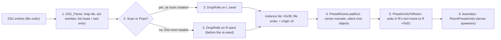
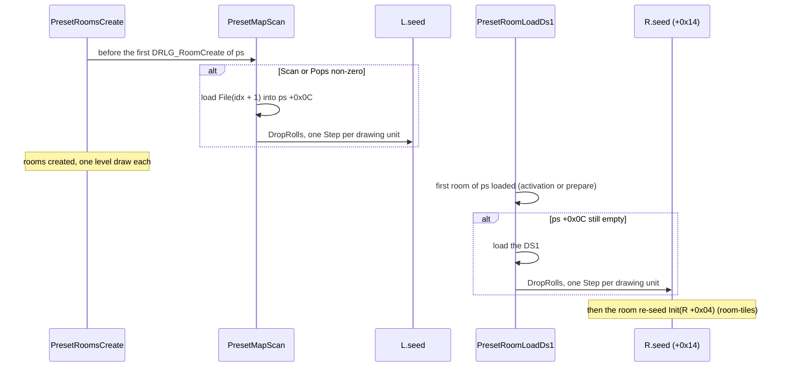
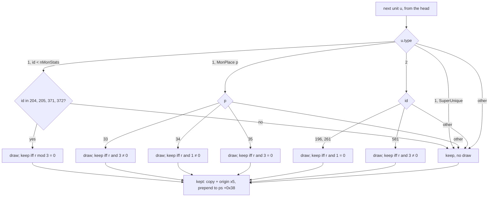
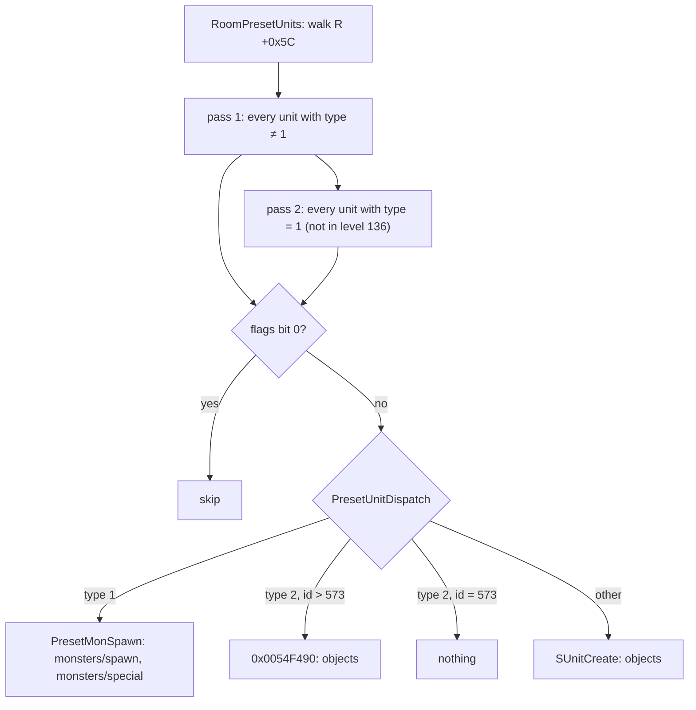

# Preset units: the DS1 unit list, the keep/drop rolls and the LvlPrest columns

## Purpose

A preset instance (a placed `LvlPrest` record, [README.md](README.md) step 4) carries the units its DS1 names:
objects, monsters, NPCs and their paths. This spec says which of them a DRLG room ends up with: the act rewrites
that turn some monsters into objects, the **keep/drop rolls** that remove ten unit ids by chance (one draw each,
on the level seed or on a room seed), the units the game adds itself, and how the instance's list is split into
room lists. The room list is handed over to the server's spawners at `sub_005559A0_RoomPresetUnits`, which is
where this spec stops. It also gives the effect of each `LvlPrest` column that the tile build does not use, and
level 27's file index. Primitives (`Step`, `Init`) are those of [rng](../rng/README.md); the level and room seeds
are those of [rng/seeds](../rng/seeds.md).

## Entry points

| When | Function | Tag |
|---|---|---|
| DS1 parsed (unit list built, act rewrites) | fn:DS1_Parse@0x00665950 | [C] |
| Preset rooms created, `Scan` or `Pops` non-zero: DS1 load and the rolls on the level seed | fn:DRLG_PresetMapScan@0x00667970, from fn:sub_00667ED0_PresetRoomsCreate@0x00667ED0 | [C] |
| Preset room activated or prepared: DS1 load and the rolls on the room seed, the added units | fn:DRLG_PresetRoomLoadDs1@0x00667890, from fn:sub_0061B730_RoomActivateB@0x0061B730 and fn:sub_0061B320_RoomPrepareFiles@0x0061B320 | [C] |
| Keep/drop rolls | fn:DRLG_PresetUnitDropRolls@0x00667620 | [C] |
| Instance list → room list (type-2 grid prepare) | fn:DRLG_PresetUnitsToRoom@0x00666710 | [C] |
| Server handover (boundary) | fn:sub_005559A0_RoomPresetUnits@0x005559A0 | [C] |
| Level 27's file index, while the act's links are built | fn:sub_006772C0_LevelLinkBuild@0x006772C0 (`0x006774F9`) | [C] |

- [C] `PresetRoomLoadDs1` is called from `RoomActivateB` (`0x0061B752`) and `RoomPrepareFiles` (`0x0061B343`), and
  `PresetUnitDropRolls` has exactly two call sites, `0x006678E2` (in `PresetRoomLoadDs1`) and `0x00667A35` (in
  `PresetMapScan`). Ghidra's xrefs and radare2's `axt` agree, neither function's address is stored as a pointer, and
  every logged roll is modelled at one of the two sites with the room and level seeds after every build matching.
  (fn:DRLG_PresetRoomLoadDs1@0x00667890, fn:DRLG_PresetUnitDropRolls@0x00667620,
  [drlg/0004 § Which seed, and when](../../findings/drlg/0004-preset-units.md#which-seed-and-when), run:2026-10-13-drlg-preset,
  [drlg/0004 § Plan 0038 batch S4a](../../findings/drlg/0004-preset-units.md#plan-0038-batch-s4a-2026-10-16))

## Inputs

### Tables

| Anchor | Used for |
|---|---|
| fmt:ds1#objects-v--2 | the DS1 unit entries: `type`, `id`, `x`, `y` (subtiles), `flags` |
| fmt:ds1#npc-paths-v--14 | the paths and their points (`action`, `x`, `y`) |
| fmt:ds1#header | `act` (clamped to ≤ 4), which picks the per-act id tables and the act rewrites |
| tbl:MonPreset.txt:Place | the per-act list a type-1 `id` indexes (see [MonPreset](../../tables/MonPreset.md)) |
| data:g_Ds1ObjectIds@0x00748AD8 | the 5 × 150 per-act table a type-2 `id < 150` indexes |
| tbl:MonStats.txt:hcIdx, tbl:MonPlace.txt:code | names of the ids the rolls and rewrites test (names only) |
| tbl:LvlPrest.txt:Scan, tbl:LvlPrest.txt:Pops | which caller rolls (`+0x34`, `+0x38`) |
| tbl:LvlPrest.txt:Def | the client river objects and the Blood Moor centre monster are chosen by `Def` (`+0x00`) |
| tbl:LvlPrest.txt:Populate, tbl:LvlPrest.txt:Logicals, tbl:LvlPrest.txt:Outdoors, tbl:LvlPrest.txt:Animate, tbl:LvlPrest.txt:AutoMap, tbl:LvlPrest.txt:PopPad | § LvlPrest columns |

### Runtime state

Struct offsets are those of `re/types/preset.h`.

| State | Type | Owner offset | Source |
|---|---|---|---|
| preset instance | `PresetInstance`, 0x58 bytes | level `+0x1B0` list | [README.md](README.md) step 4 |
| instance origin, size | 4 × `i32`, tiles | struct:PresetInstance+0x10 (x, y), `+0x18` (w, h) | [README.md](README.md) step 4 |
| instance DS1 | pointer, 0 until the first load | struct:PresetInstance+0x0C | step 2 |
| instance unit list | `PresetUnit` list, head first | struct:PresetInstance+0x38 | step 3 |
| pending flag | `i32`, 1 at create | struct:PresetInstance+0x3C | step 4 |
| preset unit | `PresetUnit`, 0x20 bytes: `mode`, `id` (struct:PresetUnit+0x04), `x`, `y` (subtiles), `type`, `flags` (struct:PresetUnit+0x1C), path (struct:PresetUnit+0x10) | — | step 1 |
| level seed | `Seed` | level `+0x1C4` | [README.md](README.md) step 2 |
| DRLG room seed | `Seed` | room `+0x14` | [rng/seeds](../rng/seeds.md) step 5 |
| room rect | 4 × `i32`, tiles | room `+0x34`..`+0x40` | [README.md](README.md) step 5 |
| room flags | `u32`: `0x40000` client copy, `0x80000` outdoors, `0x800000` no random population, `0x2000000` DS1 loaded | room `+0x28` | step 2, § LvlPrest columns |
| room unit list | `PresetUnit` list, head first | room `+0x5C` | step 5 |
| act seed | `Seed` (a copy, in the link builder) | act | [rng/seeds](../rng/seeds.md) step 3d, `drlg/warps` |
| `nMonStats`, `nSuperUniques` | `i32`: 734, 66 in the pinned data | — | [MonStats](../../tables/MonStats.md), [MonPreset](../../tables/MonPreset.md) |

### Constants

| Name | Value | Anchor | Tag |
|---|---|---|---|
| subtiles per tile | 5 | fn:sub_00643560_TileToSubtile@0x00643560 | [C] |
| drawing ids | MonStats 204, 205, 371, 372; MonPlace 33, 34, 35; objects 196, 261, 581 | fn:DRLG_PresetUnitDropRolls@0x00667620 | [C] |
| act rewrites | act index 2: MonStats 297 → object 382, 366 → object 404; act index 4: 514 → object 461, 537..539 → object `1013 − id` | fn:DS1_Parse@0x00665950 (`0x00665CB2`) | [C] |
| client river object `Def`s | 1, 3, 26, 27, 28, 300 | fn:DRLG_PresetRoomLoadDs1@0x00667890 | [C] |
| row-skip floor mains | bits 20–25 = 4 with bits 8–15 ∈ {0, 4, 8, 16, 29, 39} (switch table `0x0066638C`) | fn:DRLG_PresetClientUnitsB@0x00666220, 0x00666368, run:2026-10-15-acts-3-5 | [C] |
| centre monster | MonStats 266 (`navi`), `Def` 4–7, level 2, file index 3 | fn:sub_006664A0_PresetCentreMonster@0x006664A0, run:2026-10-16-sweep-mazes | [C] |
| town levels | 1, 40, 75, 103, 109 (the byte table at `0x006426C8`, decoded over every id; its callers `DRLG_RoomNoPopNearTown` and `OBJ_PopulateGate` agree) | fn:sub_006426A0_LevelIsTown@0x006426A0, fn:DRLG_RoomNoPopNearTown@0x0066BD50, [drlg/0004 § Plan 0038 batch S4b](../../findings/drlg/0004-preset-units.md#plan-0038-batch-s4b-2026-10-16) | [C] |

- [C] The rows above tagged `[C]` were reproduced in run:2026-10-13-drlg-preset and run:2026-10-15-acts-3-5 for the
  values those runs reached: every drawing id with both outcomes, every act rewrite, the row skip for main 16; the
  centre monster in run:2026-10-16-sweep-mazes. The values no stock data reaches (the row skip's other five mains) are
  listed per step below, with their own `[I]` tag. (run:2026-10-13-drlg-preset, run:2026-10-15-acts-3-5,
  run:2026-10-16-sweep-mazes)

## Algorithm

`ps` is a preset instance, `L` its level, `R` a DRLG room of `ps`. Positions are in **subtiles** (5 per tile)
unless they say tiles. Lists are written head first; "prepend" puts a unit at the head.



### 1. The DS1 unit list

```
1. ParseUnits(ds1) → list:                                                 [C] (fn:DS1_Parse@0x00665950, run:2026-10-13-drlg-preset)
     act: i32 ← min(ds1.act, 4)
     list ← empty
     for each object entry e of the DS1, in file order:
       u ← {type: e.type, id: MapId(e, act), mode, x: e.x, y: e.y, flags: e.flags, path: none}
       if u.id = −1, or e.type = 1 and ds1.version < 5: skip e            [I] no stock case (fmt:ds1#objects-v--2, step note 6)
       ActRewrite(u, act)                                                  ; step 1b
       prepend u to list                                                   ; head = last entry in the file
     for each path p of the DS1: attach p to the first unit of list       [C] (fmt:ds1#npc-paths-v--14, run:2026-10-13-drlg-preset, step note 6)
       (= the last in file order) whose (x, y) equals p's; no such unit → p is dropped   ; [I] the drop: no stock case (fn:DS1_Parse@0x00665950)

1a. MapId(e, act) → i32:                                                   [C] the branches stock DS1s take (fmt:ds1#objects-v--2, fn:MONPRESET_GetActList@0x00659B40, data:g_Ds1ObjectIds@0x00748AD8, run:2026-10-13-drlg-preset, step note 6)
     type 1: entry e.id of the act's MonPreset list:
             a MonStats class → class; a SuperUnique row → nMonStats + row;
             a MonPlace row → nMonStats + nSuperUniques + row; other kind → −1   ; [I] other kind: no stock case (fn:DS1_Parse@0x00665950)
     type 2: version ≥ 6 and id < 150 → g_Ds1ObjectIds[act][id]; version ≥ 6 → id − 150; else id   ; [I] the last two: no stock case (fn:DS1_Parse@0x00665950)

1b. ActRewrite(u, act):                                                    [C] (fn:DS1_Parse@0x00665950, 0x00665CB2, run:2026-10-13-drlg-preset, run:2026-10-15-acts-3-5)
     if act = 2 and u.id < nMonStats:
       u.id = 297 (natalya)       → u.id ← 382, u.type ← 2, u.mode ← 0
       u.id = 366 (compellingorb) → u.id ← 404, u.type ← 2, u.mode ← 0
     if act = 4 and 0 ≤ u.id < nMonStats:
       u.id = 514 (nihlathak)     → u.id ← 461, u.type ← 2, u.mode ← 0
       536 < u.id ≤ 539           → u.id ← 1013 − u.id, u.type ← 2, u.mode ← 0
```

Step notes:

1. The list built here is in **reverse file order**: the head is the last unit in the file. The rolls (step 3)
   walk it from the head. [C] (fn:DS1_Parse@0x00665950, run:2026-10-13-drlg-preset)
2. The act rewrites compare the id **after** the MonPreset mapping, so only an entry that maps into the MonStats
   range can match; a SuperUnique or MonPlace id is never rewritten. Both rewrite branches first test
   `id < nMonStats` (`0x00665CC0`, `0x00665CFC`), and SuperUnique and MonPlace ids are mapped to `nMonStats + k`
   (`0x00665C8E`, `0x00665CA9`); the logged instance lists keep such units unchanged and are reproduced. [C]
   (0x00665CB2–0x00665D3E, fn:DS1_Parse@0x00665950, run:2026-10-15-acts-3-5, [drlg/0004 § Plan 0038 batch S4b](../../findings/drlg/0004-preset-units.md#plan-0038-batch-s4b-2026-10-16)) The act-2 comparisons go through `MONSTATS_ValidId`, which returns `id` when
   `0 ≤ id < nMonStats` and −1 otherwise, both compares signed; it is a range check, not an id table. Under emulation
   (ADR-0015) 2 000 calls with the count and `id` across their edges (0, 1, 733, 734, −1, `INT32_MIN`, `0x7FFFFFFF`)
   gave exactly that. [C] (fn:MONSTATS_ValidId@0x004E6C50, 0x004E6C52, 0x004E6C5C, run:2026-10-17-sweep-emu2,
   [drlg/0004 § Plan 0038 batch S1f](../../findings/drlg/0004-preset-units.md#plan-0038-batch-s1f-2026-10-17))
3. run:2026-10-13-drlg-preset reproduced lists that contained the rewrites 297 → 382 (8 times, act index 2) and
   514 → 461 (10 times, act index 4). run:2026-10-15-acts-3-5 reproduced the other two in rolled instance lists:
   366 → 404 twice (`TravN.ds1`, Travincal, act index 2) and 537 → 476, 538 → 475, 539 → 474 three times each
   (`MtnTop.ds1`, Arreat Summit, act index 4). [C] (0x00665CB2, run:2026-10-13-drlg-preset, run:2026-10-15-acts-3-5)
4. A unit's `mode` is 1 for a monster and 0 for an object (3 for an item, which no shipped preset DS1 holds): all
   48 916 type-1 units of the logged instance lists have mode 1, and all 128 951 type-2 units mode 0. [C]
   (struct:PresetUnit+0x04, [ds1 § Preset unit survey](../../formats/ds1.md#preset-unit-survey), run:2026-10-13-drlg-preset,
   [drlg/0004 § Plan 0038 batch S4a](../../findings/drlg/0004-preset-units.md#plan-0038-batch-s4a-2026-10-16))
5. Path points are 12 bytes, `(action, x, y)`: the 4736 points logged as 12-byte records (actions 1–5) are in the
   instance lists the preset runs reproduce. [C] (fn:sub_006660B0_PresetPathCopy@0x006660B0, fmt:ds1#npc-paths-v--14,
   run:2026-10-13-drlg-preset, [drlg/0004 § Plan 0038 batch S4b](../../findings/drlg/0004-preset-units.md#plan-0038-batch-s4b-2026-10-16)) `action` is 1 for every point of a DS1 below version 15; stock data has no
   such point (of 2272 shipped DS1s, the 17 with path points are all version 15 or later). [I]
   (fn:sub_006660B0_PresetPathCopy@0x006660B0, [drlg/0004 § Plan 0038 batch S4b](../../findings/drlg/0004-preset-units.md#plan-0038-batch-s4b-2026-10-16)) What `action` does is not read (Open questions).
6. **The branches the shipped DS1s take.** The 3394 reproduced room lists (492 files) use type 1 through the act's
   MonPreset list with kind 1, a MonStats class (262), kind 2, a SuperUnique (16), and kind 0, a MonPlace (379), and
   type 2 at version ≥ 6 with id < 150 through `g_Ds1ObjectIds` (2362); 105 paths are attached. Over all 2043 DS1 files
   that `lvlprest.bin` names these are the only branches taken: 117 paths attached and none dropped, no type-1 entry
   in a DS1 below version 5, no type-2 entry below version 6, at id ≥ 150 or mapping to −1. [C] for the branches taken,
   [I] for the skip, the drop and the other `MapId` branches, which have no stock case. (fn:DS1_Parse@0x00665950,
   run:2026-10-13-drlg-preset, run:2026-10-15-acts-3-5, [drlg/0004 § Plan 0038 batch S4a](../../findings/drlg/0004-preset-units.md#plan-0038-batch-s4a-2026-10-16))

### 2. Which seed rolls, and when

Each instance rolls exactly once, on one of two seeds.



```
2. Rolls for ps:                                                           [C] (0x006678D2, 0x006678E2, 0x00667A1F, 0x00667A35, run:2026-10-13-drlg-preset)
   2a. PresetMapScan(L, ps), at room creation (README step 5a):            [C] (fn:DRLG_PresetMapScan@0x00667970, run:2026-10-13-drlg-preset)
         if ps.rec.Scan = 0 and ps.rec.Pops = 0: return                    ; no load, no roll here
         ps.ds1 ← DS1_LoadCached(ps.rec.File(ps.idx + 1))
         DropRolls(seed: L.seed, ps)                                       ; step 3, level draws
   2b. PresetRoomLoadDs1(R), R of ps (room-tiles step 1):                  [C] (fn:DRLG_PresetRoomLoadDs1@0x00667890, run:2026-10-13-drlg-preset)
         if ps.ds1 = 0:
           ps.ds1 ← DS1_LoadCached(ps.rec.File(ps.idx + 1))
           DropRolls(seed: R.seed, ps)                                     ; step 3, R +0x14
         if ps.pending = 1: ps.pending ← 0; AddedUnits(ps, R)              ; step 4
         R.flags ← R.flags | 0x2000000                                    ; [C] (fn:DRLG_PresetRoomLoadDs1@0x00667890, run:2026-10-13-drlg-preset: after all 5568 calls)
```

Step notes:

1. **The level-seed roll sits between the instance's file draw and its first room.** `PresetMapScan` runs inside
   `PresetRoomsCreate` before any room of the instance is created, so its draws come before the rooms' level
   draws ([README.md](README.md) step 5). [C] (fn:DRLG_PresetMapScan@0x00667970,
   fn:sub_00667ED0_PresetRoomsCreate@0x00667ED0, run:2026-10-12-drlg-gen, run:2026-10-13-drlg-preset)
2. **The room-seed roll uses the creation seed.** `R.seed` at that point is still the value `DRLG_RoomCreate`
   left, `Step(Init(level seed low))`, whose low word is also `R +0x04`: the roll comes before the re-seed
   `Init(R.seed, R +0x04)` of [room-tiles.md](room-tiles.md) step 1, so the roll's draws change no later draw of
   that room. [C] (fn:DRLG_RoomCreate@0x0066B3E0, 0x0066B44A–0x0066B477, fn:sub_0066EE40_DrlgRoomReseed@0x0066EE40,
   run:2026-10-13-drlg-preset: the room seed into all 571 room-seed rolls)
3. **One roll fixes every room of the instance.** The room that loads first rolls for the whole instance, so
   which room that is (an activation order input) decides only which seed is used, and that seed's draws are
   thrown away by its re-seed. [C] (0x006678E2, run:2026-10-13-drlg-preset)
4. Server and client copies each roll for their own instance, on their own level or room seed. [C]
   (run:2026-10-13-drlg-preset: client 1416 and server 794 preset rooms reproduced) With the room-seed caller the
   seed is that of whichever room of the copy loads first, so the two copies agree only when the same room loads
   first in both: in 888 server/client pairs the same room loaded first and the roll seeds and kept lists are equal;
   in 4 pairs different rooms loaded first and the roll seeds differ. [C] (0x006678E2, run:2026-10-13-drlg-preset,
   [drlg/0004 § Plan 0038 batch S4a](../../findings/drlg/0004-preset-units.md#plan-0038-batch-s4a-2026-10-16))
5. run:2026-10-13-drlg-preset checked 391 level-seed calls (34 drawing) and 571 room-seed calls (10 drawing);
   run:2026-10-15-acts-3-5 checked 562 level-seed calls (37 drawing) and 1282 room-seed calls (74 drawing), with
   preset rooms of maze levels in Acts I, II, III (Durance Level 2) and V (Crystalline Passage, Ancients' Way). [C]
   (run:2026-10-13-drlg-preset, run:2026-10-15-acts-3-5)

### 3. The keep/drop rolls



```
3. DropRolls(seed: Seed, ps):                                              [C] (fn:DRLG_PresetUnitDropRolls@0x00667620, run:2026-10-13-drlg-preset, run:2026-10-15-acts-3-5)
     ox: i32 ← ps.x × 5;  oy: i32 ← ps.y × 5
     ps.units ← empty
     for u in ps.ds1 list, from the head:                                  ; reverse file order
       test ← KeepTest(u)                                                  ; step 3a
       if test ≠ none:
         Step(seed);  r: u32 ← seed.low                                    ; draw#n, one per drawing unit
         if not test(r): continue                                          ; dropped
       c ← copy of u: mode, id, type, flags, x + ox, y + oy,
           path with every point's (x, y) + (ox, oy)                       ; fn:DRLG_PresetUnitCopy@0x00667510
       prepend c to ps.units                                               ; the kept list is in file order

3a. KeepTest(u):
     type 1, id < nMonStats, id ∈ {204, 205}       → keep iff r mod 3 = 0  ; [C] unsigned mod (0x00667721, run:2026-10-13-drlg-preset)
     type 1, id < nMonStats, id ∈ {371, 372}       → keep iff r mod 3 = 0  ; [C] (0x00667721, run:2026-10-15-acts-3-5)
     type 1, id − nMonStats ≥ nSuperUniques, p = id − nMonStats − nSuperUniques:
       p = 33                                      → keep iff r & 3 ≠ 0    ; [C] (0x00667687, run:2026-10-15-acts-3-5)
       p = 34                                      → keep iff r & 1 ≠ 0    ; [C] (0x006677B8, run:2026-10-13-drlg-preset)
       p = 35                                      → keep iff r & 3 = 0    ; [C] (0x00667794, run:2026-10-13-drlg-preset, run:2026-10-15-acts-3-5)
     type 2, id ∈ {196, 261}                       → keep iff r & 1 = 0    ; [C] (0x006676D0, run:2026-10-15-acts-3-5)
     type 2, id = 581                              → keep iff r & 3 ≠ 0    ; [C] (run:2026-10-13-drlg-preset)
     anything else (SuperUniques included)         → none: kept, no draw   ; [C] (run:2026-10-13-drlg-preset)
```

Step notes:

1. `Step` here is the inlined LCG step of [rng](../rng/README.md) step 1 (`seed ← low × 0x6AC690C5 + high`, 64
   bits), and `r` is the **new** low word. `mod 3` is unsigned (`mul 0xAAAAAAAB`, `shr 1`). [C] (0x00667721–0x00667748,
   fn:RNG_Step@0x0045C370, run:2026-10-13-drlg-preset)
2. The ids and their keep chances, for orientation (each test is one draw):

   | Unit | Kept when | Keep chance | Anchor | Tag |
   |---|---|---|---|---|
   | MonStats 204 `act2vendor1`, 205 `act2vendor2` | `r mod 3 = 0` | 1/3 | 0x00667721, run:2026-10-13-drlg-preset | [C] |
   | MonStats 371 `lightningspire`, 372 `firetower` | `r mod 3 = 0` | 1/3 | 0x00667721, run:2026-10-15-acts-3-5 | [C] |
   | MonPlace 33 `place_group25` | `r & 3 ≠ 0` | 3/4 | 0x00667687, run:2026-10-15-acts-3-5 | [C] |
   | MonPlace 34 `place_group50` | `r & 1 ≠ 0` | 1/2 | 0x006677B8, run:2026-10-13-drlg-preset | [C] |
   | MonPlace 35 `place_group75` | `r & 3 = 0` | 1/4 | 0x00667794, run:2026-10-13-drlg-preset, run:2026-10-15-acts-3-5 | [C] |
   | objects 196, 261 (floor traps) | `r & 1 = 0` | 1/2 | 0x006676D0, run:2026-10-15-acts-3-5 | [C] |
   | object 581 (above the objects table) | `r & 3 ≠ 0` | 3/4 | 0x00667687, run:2026-10-13-drlg-preset | [C] |

   Every row is reached in both outcomes. run:2026-10-13-drlg-preset: MonStats 204 kept 10 / dropped 10, 205 kept 6 /
   dropped 14, MonPlace 34 kept 6 / dropped 4, object 581 kept 8 / dropped 4, MonPlace 35 kept 2. [C]
   (fn:DRLG_PresetUnitDropRolls@0x00667620, run:2026-10-13-drlg-preset) run:2026-10-15-acts-3-5, each outcome counted
   once per copy that rolls: MonStats 371 kept 2 / dropped 6 (Arcane Sanctuary), 372 kept 6 / dropped 6 (Far Oasis,
   Lost City), MonPlace 33 kept 2 / dropped 2 (`Cott4A.ds1`, on the level seed), MonPlace 35 kept 12 / dropped 26
   (Durance Level 2, Jail Level 1), object 196 kept 20 / dropped 28 (Arcane Sanctuary), 261 kept 2 / dropped 6 (Halls
   of the Dead Level 2). [C] (0x00667721, 0x00667687, 0x00667794, 0x006676D0, run:2026-10-15-acts-3-5) The names are
   the tables': MonStats `Id` of rows 204, 205, 371 and 372 and MonPlace `code` of rows 33–35. [C]
   (tbl:MonStats.txt:hcIdx, tbl:MonPlace.txt:code, [drlg/0004 § Plan 0038 batch S4b](../../findings/drlg/0004-preset-units.md#plan-0038-batch-s4b-2026-10-16))
3. **`place_group25/50/75` run against their names.** `place_group25` is kept with chance 3/4 and
   `place_group75` with 1/4. This is the code (`0x0066777D` `sub ecx,0x21` → `0x00667687` `test al,3` / `je` drop),
   and the outcomes of all three match it. [C] (0x0066777D, 0x00667687, 0x00667794, 0x006677B8,
   run:2026-10-13-drlg-preset, run:2026-10-15-acts-3-5)
4. **A SuperUnique never draws**, and neither does a MonPlace row other than 33–35 or a MonStats class other than
   the four. [C] (fn:DRLG_PresetUnitDropRolls@0x00667620, run:2026-10-13-drlg-preset)
5. The copy keeps `mode`, `id`, `type`, `flags` and the path, and adds `(ox, oy)` to `x`, `y` and every path point.
   Because the walk goes from the head of a reverse-ordered list and prepends, the kept units are back in **file
   order**. [C] (fn:DRLG_PresetUnitCopy@0x00667510, fn:sub_006660B0_PresetPathCopy@0x006660B0,
   run:2026-10-13-drlg-preset)
6. No difficulty, expansion or player-count test is involved: Nightmare and Hell games gave the same model. [C]
   (fn:DRLG_PresetUnitDropRolls@0x00667620, run:2026-10-13-drlg-preset)

### 4. Units the game adds

```
4. AddedUnits(ps, R), once per instance (ps.pending was 1):                [C] (fn:DRLG_PresetRoomLoadDs1@0x00667890, run:2026-10-13-drlg-preset)
     if 4 ≤ ps.def ≤ 7:
       if L.id = 2 and ps.idx = 3: CentreMonster(ps)                       ; step 4a
     else if ps.def ∈ {1, 3, 26, 27, 28, 300} and R.flags & 0x40000:       ; client copy only
       ClientRiverObjects(ps)                                              ; step 4b

4a. CentreMonster(ps):                                                     [C] (fn:sub_006664A0_PresetCentreMonster@0x006664A0, run:2026-10-16-sweep-mazes)
     prepend {type 1, id: (nMonStats > 266) ? 266 : −1, mode 1, flags 0, path none,
              x: (ps.x + ps.w ÷ 2) × 5, y: (ps.y + ps.h ÷ 2) × 5} to ps.units  ; no draw

4b. ClientRiverObjects(ps):                                                [C] (fn:DRLG_PresetClientObjects@0x006663C0, run:2026-10-13-drlg-preset)
     every unit below: type 2, mode 0, flags 1, path none; prepend each in creation order
     Column(xt, yt):  for ys ← yt × 5; ys < (yt + ds1.size_y) × 5; ys ← ys + 40:  object 65 at (xt × 5, ys)
     Rows(c):  j: i32 ← 0
       while j < ps.h:
         for k in 0 ..< 5: object (40, 41, 41, 41, 42)[k] at ((ps.x + c) × 5 − 5 + 5k, (ps.y + j) × 5)
         cell: u32 ← ds1.floor0[j × (ps.w + 1) + max(c, 0)]
         if (cell >> 20) & 0x3F = 4 and (cell >> 8) & 0xFF ∈ {0, 4, 8, 16, 29, 39}: j ← j + 3
         j ← j + 1
     if ps.def = 27:  Column(ps.x, ps.y);  Rows(−1)
     else:
       c: i32 ← 0
       while c < ps.w:                                                     ; the DS1's first row of floor layer 0
         cell ← ds1.floor0[c]
         if (cell >> 20) & 0x3F = 2 and (cell >> 8) & 0xFF = 24:
           Column(ps.x + c + 1, ps.y);  Rows(c);  c ← c + 4
         c ← c + 1
```

Step notes:

1. **The centre monster** (MonStats 266, `navi`) is added only in the Blood Moor (level 2) for an instance of `Def`
   4–7 with file index 3. `÷ 2` is signed and the sizes are positive. It goes to the instance list after the rolls,
   with no draw: 4 instance lists after `PresetRoomLoadDs1` (map seed 45, `Def` 7, and map seed 9, `Def` 5, both
   copies each) equal the model's, and the room seeds around them are unchanged. [C]
   (fn:sub_006664A0_PresetCentreMonster@0x006664A0, run:2026-10-16-sweep-mazes, [drlg/0004 § Plan 0038 batch H5e](../../findings/drlg/0004-preset-units.md#plan-0038-batch-h5e-run2026-10-16-sweep-mazes))
2. **The client river objects are presentation** (ambient river objects 40, 41, 42, 65). They exist only in the
   client copy's lists, which is why a reimplementation of the client copy's room lists needs them. Every one has
   `flags` bit 0, so the server skips such a unit (step 6). No draw. The runs reproduced them for `Def` 1, 26 and 27,
   and run:2026-10-16-sweep-mazes for the other three on the client copy: `Def` 3 (Town Transition S, map seed 9) 1
   list, `Def` 28 (the bridge, Blood Moor and Black Marsh) 4, `Def` 300 (Tristram) 1. [C]
   (fn:DRLG_PresetClientObjects@0x006663C0, fn:DRLG_PresetClientUnitsA@0x006661A0,
   fn:DRLG_PresetClientUnitsB@0x00666220, run:2026-10-13-drlg-preset, run:2026-10-15-acts-3-5, run:2026-10-16-sweep-mazes,
   [drlg/0004 § Plan 0038 batch H5e](../../findings/drlg/0004-preset-units.md#plan-0038-batch-h5e-run2026-10-16-sweep-mazes)) What they look like or do on the client is outside this project (ADR-0002, ADR-0005).
3. **The row skip** (`j ← j + 3` in `Rows`) fired 5 times in run:2026-10-15-acts-3-5, each logged at `0x00666368` and
   equal to the modelled one: Act I town, `Def` 1 file index 1 (`TownE1.ds1`), DS1 row 15, floor main 16. [C]
   (fn:DRLG_PresetClientUnitsB@0x00666220, 0x00666368, 0x0066638C, run:2026-10-15-acts-3-5) In the shipped DS1s only
   `TownE1.ds1` and the three `Bridge*.ds1` of `Def` 28 hold such a cell in a placed column, so the other five mains
   rest on the switch table. [I] (0x0066638C,
   [drlg/0004](../../findings/drlg/0004-preset-units.md))
4. `ps.pending` is 1 from `PresetInstanceCreate` and cleared here, so the added units are made once per instance
   whichever room loads first. [C] (fn:DRLG_PresetRoomLoadDs1@0x00667890, run:2026-10-13-drlg-preset: 3334
   instance lists checked after `PresetRoomLoadDs1`) The `0x2000000` room flag is set on every call: none of the
   141 130 logged type-2 rooms has it at creation, and it is set after every one of the 5568 calls. [C]
   (fn:DRLG_PresetRoomLoadDs1@0x00667890, run:2026-10-13-drlg-preset, [drlg/0004 § Plan 0038 batch S4a](../../findings/drlg/0004-preset-units.md#plan-0038-batch-s4a-2026-10-16))

### 5. From the instance to the room

```
5. PresetUnitsToRoom(R, ps), in the type-2 grid prepare:                   [C] (fn:DRLG_PresetUnitsToRoom@0x00666710, 0x0066697D, run:2026-10-13-drlg-preset)
     (rx, ry, rw, rh): i32 ← R.rect × 5                                    ; subtiles
     for u in ps.units, from the head:
       if rx ≤ u.x < rx + rw and ry ≤ u.y < ry + rh:                       ; half-open
         unlink u from ps.units
         u.x ← u.x − rx;  u.y ← u.y − ry                                   ; path points are not moved
         prepend u to R.units                                              ; R +0x5C
```

Step notes:

1. The test is half-open (`sub_0066B980_RectContains`): a unit on a room's right or bottom edge belongs to the
   next room. [C] (fn:sub_0066B980_RectContains@0x0066B980, run:2026-10-13-drlg-preset)
2. **Path points keep instance coordinates** (absolute subtiles), while the unit's own `x`, `y` become
   room-relative. [C] (fn:DRLG_PresetUnitsToRoom@0x00666710, run:2026-10-13-drlg-preset)
3. Moving prepends, so a room's units are in **reverse** instance order: for a room that takes all of an
   instance's units, reverse file order. [C] (fn:DRLG_PresetUnitsToRoom@0x00666710,
   run:2026-10-13-drlg-preset)
4. **A re-prepared room keeps its list.** The prepare runs again when a room is built again (108 rooms in the run,
   in both copies). The room list still holds the room's previous list, and the instance list has already lost
   those units, so the second pass moves nothing. In 34 of those rooms other code had prepended 1 or 3 units in
   between (step 6, note 2). [C] (fn:DRLG_PresetUnitsToRoom@0x00666710, run:2026-10-13-drlg-preset)
   In 19 monster units the path pointer had become null between the two prepares. [C] (run:2026-10-13-drlg-preset)
   On the server copy the detach is `PresetUnitSpawn`'s: it moves the unit's path (`+0x10`) into the new monster's AI
   control with `PtrMove`, which zeroes the source (`0x0055596C`). The client copy's detach is not found. [I]
   (fn:sub_00555910_PresetUnitSpawn@0x00555910, fn:sub_00666120_PtrMove@0x00666120, [drlg/0009 § 8](../../findings/drlg/0009-room-lifecycle.md#8-the-preset-questions-of-drlgpreset))

### 6. Handover to the server spawners (boundary)



This spec's output ends at the room list. The rest of this section names what the next rows receive.

- [C] `sub_005559A0_RoomPresetUnits` walks the room list twice: first every unit that is not a monster, then the
  monsters (all 373 walks with spawns). (fn:sub_005559A0_RoomPresetUnits@0x005559A0,
  run:2026-10-13-drlg-preset)
- [I] It skips a unit whose `flags` bit 0 is set (struct:PresetUnit+0x1C). That covers the client river objects
  (step 4b) and the DS1 units with `flags = 1` (`wstone01.ds1` `worldstoneeffect`), which therefore never spawn on
  the server. No flagged unit reached a server walk in the run: the river objects exist only in the client copy.
  (fn:sub_005559A0_RoomPresetUnits@0x005559A0)
- [C] Each other unit goes through `sub_00555910_PresetUnitSpawn` to `sub_005557D0_PresetUnitDispatch`: type 1 to
  `sub_0054E600_PresetMonSpawn` (owners `monsters/spawn`, `monsters/special`; the `id` ranges are those of step
  1a), type 2 with `id > 573` to `0x0054F490`, and every other unit to `sub_00555230_SUnitCreate` (owner `objects`).
  Each logged spawn has the type and id handed in and the unit made: type 1 a monster (348) or none (165), type 2
  below 573 `SUnitCreate` with class = id (1591), type 2 above 573 an object of another class (16), type 5
  `SUnitCreate` with type and class kept (21). (fn:sub_005557D0_PresetUnitDispatch@0x005557D0,
  fn:sub_00555910_PresetUnitSpawn@0x00555910, fn:sub_0054E600_PresetMonSpawn@0x0054E600,
  fn:sub_00555230_SUnitCreate@0x00555230, run:2026-10-13-drlg-preset, run:2026-10-15-acts-3-5, [drlg/0004 § Plan 0038 batch S4a](../../findings/drlg/0004-preset-units.md#plan-0038-batch-s4a-2026-10-16))
- [I] Type 2 with `id = 573` goes to nothing; no logged unit has that id, and there is no stock case (the next two
  statements). (fn:sub_005557D0_PresetUnitDispatch@0x005557D0)
- [C] **No shipped DS1 gives a 573.** `g_Ds1ObjectIds` holds 573 only at Act IV (act index 3) ids 5, 6 and 7; a raw id
  of 150 or more would need a raw 723, and the act rewrites give only 382, 404, 461 and 474–476. Of the 2 276 DS1 files
  under `data/global/tiles`, 2 274 parse (all 2 043 that `LvlPrest` names among them); their 15 109 type-2 units end at
  no 573 (the largest ids are 580–582), and the Act IV ones never use raw ids 5–7. The two that do not parse (an `LvlSub`
  file of Act I and an unreferenced one) belong to acts whose table holds no 573, so only a raw id of 723 could give
  one there. (data:g_Ds1ObjectIds@0x00748AD8, fn:DS1_Parse@0x00665950,
  tbl:LvlPrest.txt:File1; [drlg/0004 § Plan 0039 batch P1c](../../findings/drlg/0004-preset-units.md#plan-0039-batch-p1c-2026-10-17))
- [I] The other code that adds type-2 units to a room list adds none with id 573: of the 12 `PresetUnitCreate` call
  sites, the client presets use ids 40–42 and 65, the `Orient89Unit` rows reached hold ids up to 449, the warp and
  centre-monster sites make other types, the substitution copy is covered by the survey above, and the one other
  type-2 creator (`0x00666170`) has no caller. (fn:sub_0066BF30_PresetUnitCreate@0x0066BF30,
  fn:sub_0066D9E0_Orient89Unit@0x0066D9E0, fn:DRLG_PresetClientUnitsA@0x006661A0,
  fn:sub_0066FA10_LvlSubPresetUnits@0x0066FA10, data:g_Orient89Units@0x006EF194)
- [I] Levels 133–136 add filters to the walk, none reached in the run: level 136 makes only the first pass (no
  preset monster spawns) and skips objects 26, 268 and 269; levels 133 and 135 skip object 397; level 134 skips
  object 402 and the one object at which a per-game counter (`game +0x1DE4`) reaches `game +0x7C mod 3 + 3`.
  (fn:sub_005559A0_RoomPresetUnits@0x005559A0)

Step notes:

1. **The record handed over** is the 0x20-byte `PresetUnit`: `type`, `id` (MonStats class, `nMonStats + row` for a
   SuperUnique, `nMonStats + nSuperUniques + row` for a MonPlace keyword, or an object row), `mode`, `x`/`y` in
   subtiles relative to the room, `flags`, and the path with absolute points. Every logged list is read from these
   fields, and all 3394 room lists and the instance lists are reproduced. [C] (struct:PresetUnit+0x04,
   struct:PresetUnit+0x10, struct:PresetUnit+0x1C, run:2026-10-13-drlg-preset, [drlg/0004 § Plan 0038 batch S4a](../../findings/drlg/0004-preset-units.md#plan-0038-batch-s4a-2026-10-16))
2. **Units other code adds are an input of the walk, not output of this spec.** After `PresetUnitsToRoom`, other
   code prepends units to `R +0x5C`: objects 14–16, 23–25, 27, 64 and 449 and type-5 units, one of them from
   `sub_0066D9E0_Orient89Unit` (caller `0x0066DAEE`). In all 689 walks the list this spec produces was the exact
   **tail** of the walked list, and those units were the head. Their owners are `objects` and `drlg/warps`. [C]
   (fn:sub_005559A0_RoomPresetUnits@0x005559A0, fn:sub_0066BF30_PresetUnitCreate@0x0066BF30,
   fn:sub_0066D9E0_Orient89Unit@0x0066D9E0, run:2026-10-13-drlg-preset) The room's list is dispatched only by
   `RoomPresetUnits`, which runs only while the active room's flags bit 0 is clear, and a re-activated room inherits
   that bit from the DRLG room's `+0x60`; so a re-activated room does not dispatch its list twice, and the added
   objects and type-5 units come back from the unit records. [I] (fn:sub_005559A0_RoomPresetUnits@0x005559A0,
   fn:sub_0052D160_NewRoomsUpdate@0x0052D160, [drlg/0009 § 8](../../findings/drlg/0009-room-lifecycle.md#8-the-preset-questions-of-drlgpreset))
3. `0x0054F490` (objects above 573, which includes 581) is the `objects` row's pseudo-object dispatch
   (`OBJ_PresetPseudoDispatch`). The objects record `+0x167` bit `0x40` that the map scan tests is Objects `SubClass`
   bit 6, the waypoint flag: the scan turns it into the room's waypoint bits `0x30000`, which belong to `drlg/warps`
   ([warps.md § D](warps.md#d-room-flags-and-level-points-from-a-preset-instance), predicted in 21728 rooms). [C]
   (fn:OBJ_PresetPseudoDispatch@0x0054F490, fn:DRLG_PresetMapScan@0x00667970, run:2026-10-15-drlg-maze, [drlg/0004 § Plan 0038 batch S4b](../../findings/drlg/0004-preset-units.md#plan-0038-batch-s4b-2026-10-16))

### 7. Level 27's file index

```
7. In LevelLinkBuild, while it handles linked level 6, with link value v:  (fn:sub_006772C0_LevelLinkBuild@0x006772C0, 0x006774F9)
     ps27 ← LevelEnsure(act, 27).presetData
     v = 3:  Step(actSeed);  r: u32 ← actSeed.low;  ps27.idx ← (~r) & 1     ; [C] one act draw (run:2026-10-13-drlg-preset)
     v = 1:  Step(actSeed);  r: u32 ← actSeed.low;  ps27.idx ← 2 − (r & 1)  ; [C] one act draw, r & 1 = 1 → 1 (run:2026-10-15-acts-3-5)
                                                                          ; [I] r & 1 = 0 → 2: not reachable on stock data, step note 2 (0x006774F9)
     other v: no draw, no write                                           ; [C] (0x006774F9, run:2026-10-15-drlg-maze, run:2026-10-17-sweep-links)
```

Step notes:

1. Level 6 is Act 1 Wilderness 5 and level 27 is Courtyard 1 (by `Levels.txt` `Name`);
   `v` is the link value the `LinkPick` callbacks chose for level 6: the link builder model predicts it, 3 in 17
   logged builds, 1 in 4 and 0 in 6. [C] (tbl:Levels.txt:Name, fn:sub_006772C0_LevelLinkBuild@0x006772C0,
   run:2026-10-15-drlg-maze, run:2026-10-15-drlg-outdoor, [drlg/0004 § Plan 0038 batch S4a](../../findings/drlg/0004-preset-units.md#plan-0038-batch-s4a-2026-10-16))
2. The formula for `v = 3` and the single step on the act seed are reproduced from the act seed logged just before
   the draw: 6 draws, and level 27 was built twice with that index. [C] (0x006774F9,
   fn:sub_006772C0_LevelLinkBuild@0x006772C0, run:2026-10-13-drlg-preset) The `v = 1` branch was reached with map
   seeds 22 and 25 (4 draws), index and act seed after as predicted; both draws had `r & 1 = 1`, so only index 1 is
   seen. [C] (0x006774F9, run:2026-10-15-acts-3-5) Index 2 from `v = 1` is not reachable on stock data. The draw `r`
   is the act seed's next step after table `0x006F0840`'s seed copy was taken (`0x006774D6`), and Black Marsh's first
   choice is `r & 3` from the copy's first step, the same value; side 1 is kept only from a first choice of 1, at
   every difficulty (every draw value of the table enumerated), so `r & 1` = 1 and the index is 1. The two side-1
   builds of run:2026-10-17-sweep-links (map seeds 90, 5) are index 1 too. [I] (0x006774F9, 0x006774D6,
   fn:sub_006772C0_LevelLinkBuild@0x006772C0, run:2026-10-17-sweep-links, [drlg/0004 § Plan 0038 batch H5a](../../findings/drlg/0004-preset-units.md#plan-0038-batch-h5a-run2026-10-17-sweep-links), [drlg/0007 § Plan 0038 batch H5a](../../findings/drlg/0007-warps.md#plan-0038-batch-h5a-run2026-10-17-sweep-links))
3. **Where this draw falls in the act seed's sequence is `drlg/warps`'.** The draws before it are `LevelLinkBuild`'s,
   and the link builder model predicts the act seed before the draw from the map seed: all 394 logged `LevelLinkBuild`
   calls (seed in, seed out, rects) and the 40 index writes match. [C] (fn:sub_006772C0_LevelLinkBuild@0x006772C0,
   run:2026-10-15-drlg-maze, run:2026-10-15-drlg-outdoor, [drlg/0004 § Plan 0038 batch S4a](../../findings/drlg/0004-preset-units.md#plan-0038-batch-s4a-2026-10-16))
4. This write is one of the overrides that let a preset's index differ from its own `Range(Files)` draw
   ([README.md](README.md) step note 6); the level's build then uses it. [C] (run:2026-10-13-drlg-preset)
5. **Other `v`: the create-time index stays.** With `v` = 0 the act seed after the builder matches a model with no draw
   and no write (6 builds of run:2026-10-15-drlg-maze), and level 27 keeps its create-time index: 0 and 2 in
   run:2026-10-17-sweep-links (map seeds 2 and 58), each built into the Barracks placement as modelled
   ([maze.md § G2](maze.md#g-placement)). [C] (0x006774F9, fn:sub_00673120_MazeBarracksPlace@0x00673120,
   run:2026-10-17-sweep-links, [drlg/0004 § Plan 0038 batch H5a](../../findings/drlg/0004-preset-units.md#plan-0038-batch-h5a-run2026-10-17-sweep-links)) `v` = 2 is never kept on stock data: Black Marsh's first choice 2 always
   moves on to side 3 (outcomes 0 → 0, 1 → 1, 2 → 3, 3 → 3 at every difficulty), so the branch is `v` = 0 in practice.
   [I] (fn:sub_006772C0_LevelLinkBuild@0x006772C0, [drlg/0007 § Plan 0038 batch H5a](../../findings/drlg/0007-warps.md#plan-0038-batch-h5a-run2026-10-17-sweep-links))

### LvlPrest columns

What each column does beyond the file choice ([README.md](README.md)) and the tile build
([room-tiles.md](room-tiles.md)). **None of these readers draws.** [C] (no LCG constant in `0x0066CCB0`,
`0x0066D110`, `0x0066D290`, `0x0066D700` or `0x006671E0`; k is checked on all 5098 type-2 rooms the roomk model built,
1475 floods and 187 `Animate` rooms among them, and the level seed after every preset build: run:2026-10-11-drlg-roomk,
run:2026-10-12-drlg-gen, [drlg/0004 § Plan 0038 batch S4a](../../findings/drlg/0004-preset-units.md#plan-0038-batch-s4a-2026-10-16))

| Column (record offset) | Effect | Reader | Tag |
|---|---|---|---|
| `Populate` (`+0x08`) | 0 sets room flag `0x800000`, for which `sub_0061A1F0_RoomPopLevelId` returns 0: no **random** population. Preset units still spawn | fn:sub_00666680_PresetRoomCreate@0x00666680 (`0x006666EC`), fn:sub_00667ED0_PresetRoomsCreate@0x00667ED0 (`0x00667FC7`) | [C] |
| `Logicals` (`+0x0C`) | selects the room's logic-region builder: 0 → `sub_0066CCB0_LogicBoxSingle` (logic flags bit 0), 1 → `sub_0066D110_LogicRegionsFromDs1` (flags bit 1). What the builders produce is `drlg/collision`'s | fn:sub_00666AC0_PresetRoomTilesBuild@0x00666AC0 | [C] |
| `Outdoors` (`+0x10`) | ORs `0x80000` into each room's flags (set at creation in exactly the 119 183 logged rooms with `Outdoors` 1, [C]); `RoomIsOutdoors` returns that bit for a preset room (1 for an out room), so it marks the room outdoors for that test, whose two callers are the client's room change and a server skill walk (note 8) | fn:sub_00667ED0_PresetRoomsCreate@0x00667ED0, fn:sub_0066BA70_RoomIsOutdoors@0x0066BA70, fn:sub_0061AA40_DungeonRoomIsOutdoors@0x0061AA40, run:2026-10-13-drlg-preset, [drlg/0004 § Plan 0038 batch S4b](../../findings/drlg/0004-preset-units.md#plan-0038-batch-s4b-2026-10-16) | [I] |
| `Animate` (`+0x14`) | builds the animated-tile frame lists and sets room bit `0x8000000` (presentation): the bit is set in exactly the rooms whose `Animate` is 1 (104 with, 3540 without) | fn:sub_00666AC0_PresetRoomTilesBuild@0x00666AC0, fn:sub_0066D700_AnimTilesBuildAll@0x0066D700, run:2026-10-11-drlg-roomk, [drlg/0004 § Plan 0038 batch S4a](../../findings/drlg/0004-preset-units.md#plan-0038-batch-s4a-2026-10-16) | [C] |
| no column (`+0x024`) | the animation frame period, 0 meaning 80 (read at `0x00666D80` only); 0 in all 1091 records | `0x00666D80`, [drlg/0004 § Plan 0038 batch S4b](../../findings/drlg/0004-preset-units.md#plan-0038-batch-s4b-2026-10-16) | [C] value / [I] meaning |
| `KillEdge` (`+0x18`), `FillBlanks` (`+0x1C`) | tile build, [room-tiles.md](room-tiles.md): 3736 and 4911 rooms built with them set match, and ignoring either breaks the logs | fn:sub_00666AC0_PresetRoomTilesBuild@0x00666AC0, run:2026-10-11-drlg-roomk, [drlg/0004 § Plan 0038 batch S4a](../../findings/drlg/0004-preset-units.md#plan-0038-batch-s4a-2026-10-16) | [C] |
| `AutoMap` (`+0x30`) | gates the act callbacks `+0x454`/`+0x488`, which are null on the server and drive the client automap (presentation): client towns 40, 103, 109 call `+0x488` once, other `AutoMap` 1 levels `+0x454` per room, `AutoMap` 0 neither, the server neither | fn:sub_00668100_PresetLevelBuild@0x00668100, run:2026-10-16-sweep-roomk, [drlg/0004 § Plan 0038 batch H5c](../../findings/drlg/0004-preset-units.md#plan-0038-batch-h5c-run2026-10-16-sweep-roomk) | [C] |
| `Scan` (`+0x34`) | with `Pops`, selects the level-seed roll (step 2a) and the map scan | fn:DRLG_PresetMapScan@0x00667970 | [C] |
| `Pops` (`+0x38`) | with `Scan`, as above; also the capacity of the roof-pop tables (presentation) | fn:DRLG_PresetMapScan@0x00667970 | [C] |
| `PopPad` (`+0x3C`) | read only by the client's roof-pop update (presentation) | fn:DRLG_PresetPopsUpdate@0x006671E0 | [C] |

Notes:

1. **`Populate` 0 is not "no units".** In Harrogath and the Pandemonium Fortress (`Populate` 0) `RoomPopLevelId`
   returned 0 on all 241 calls, and 48 preset monsters were created there. [C] (fn:sub_0061A1F0_RoomPopLevelId@0x0061A1F0,
   run:2026-10-13-drlg-preset) The community guides say the opposite; they are wrong for 1.14d
   ([drlg/0004 § Leads used](../../findings/drlg/0004-preset-units.md#leads-used)).
2. **`Populate` is not the only writer of `0x800000`.** `DRLG_RoomNoPopNearTown` sets it on a room outside a
   town whose neighbour room is in a town level (levels 1, 40, 75, 103, 109): 22 flag sets at `0x0066BD92` in the
   run. [C] (fn:DRLG_RoomNoPopNearTown@0x0066BD50, fn:sub_006426A0_LevelIsTown@0x006426A0,
   run:2026-10-13-drlg-preset)
3. `sub_0066E360_HiddenWarpTilesAdd` sets the bit too, on a room with hidden warp tiles (`0x0066E37E`): its calls
   match the model's hidden-warp cells room by room (25 rooms), and each of those rooms has `0x800000` at the tile
   build's exit, in 17 of them not set before. [C] (fn:sub_0066E360_HiddenWarpTilesAdd@0x0066E360,
   run:2026-10-16-sweep-roomk, [drlg/0004 § Plan 0038 batch H5c](../../findings/drlg/0004-preset-units.md#plan-0038-batch-h5c-run2026-10-16-sweep-roomk)) The population that reads the flag is `monsters/spawn`'s.
4. **`Logicals`: this spec states the selection only.** The run checked the logic flag bit against `Logicals` on
   1540 preset rooms. [C] (fn:sub_00666AC0_PresetRoomTilesBuild@0x00666AC0, run:2026-10-13-drlg-preset) The region
   flood (`sub_0066D110_LogicRegionsFromDs1`, `sub_0066CA50_LogicBoxesFromGrid`, `sub_0066C9C0_LogicWallBoxes`), the
   server's spawn boxes and the client's wall cut-away (`sub_004DD060_WallCutawayTest`) that read it are not
   specified here. The flood belongs to `drlg/collision`, which confirms it, and the spawn read to `monsters/spawn`
   (`LogicRegionIdAt`, predicted in run:2026-10-14-collision). [C] (fn:sub_0066D110_LogicRegionsFromDs1@0x0066D110,
   fn:sub_0066CA50_LogicBoxesFromGrid@0x0066CA50, fn:sub_0066C9C0_LogicWallBoxes@0x0066C9C0,
   fn:sub_0061B130_LogicRegionIdAt@0x0061B130, run:2026-10-14-collision, [drlg/0004 § Plan 0038 batch S4b](../../findings/drlg/0004-preset-units.md#plan-0038-batch-s4b-2026-10-16)) The cut-away is presentation. [I]
   (fn:sub_004DD060_WallCutawayTest@0x004DD060)
5. **`Scan`/`Pops` map scan, beyond the rolls.** The scan also turns wall cells of orientation 10/11 into warp-slot
   bits, collects the style 30–33 cells (warp markers) into level `+0x2C`, and sets the waypoint bits `0x30000` on the
   cells of objects whose record has `+0x167` bit `0x40` (the waypoint flag, step 6 note 3). All three are `drlg/warps`'
   inputs, and its reader predicts them ([warps.md § D](warps.md#d-room-flags-and-level-points-from-a-preset-instance),
   21728 rooms). [C] (fn:DRLG_PresetMapScan@0x00667970, run:2026-10-15-drlg-maze, [drlg/0004 § Plan 0038 batch S4b](../../findings/drlg/0004-preset-units.md#plan-0038-batch-s4b-2026-10-16))
6. **Presentation stops here** (ADR-0002, ADR-0005): the roof pops (`Pops`, `PopPad`; `DRLG_PresetPopsUpdate`,
   `sub_00666E00_PresetPopsFinish`), the animated tiles (`Animate`, `+0x024`), the automap callbacks (`AutoMap`;
   `sub_00459150_ClientActRoomCb`, `sub_004591A0_ClientTownCb`) and the wall cut-away. The `PopPad` trigger
   rectangle is in [drlg/0004](../../findings/drlg/0004-preset-units.md#lvlprest-columns) for whoever writes a
   client spec. [I] (fn:sub_00666E00_PresetPopsFinish@0x00666E00, fn:sub_00459150_ClientActRoomCb@0x00459150,
   fn:sub_004591A0_ClientTownCb@0x004591A0)
7. **Type-2 rooms never read DS1 substitution data.** No code reads a preset instance's DS1 substitution layer or
   groups; the only group reader loads the DS1 an `LvlSub` record names. The groups in `LvlPrest` DS1s are dead
   data, and `LvlSub` with DS1 (e) belongs to `drlg/outdoor`. [I] (fn:sub_006704E0_LvlSubLoadDs1@0x006704E0)
8. **Who reads `0x80000`.** `RoomIsOutdoors` returns 1 for an out room and `flags & 0x80000` for a preset room, and is
   reached through `DungeonRoomIsOutdoors`. The client's room change (`0x00460EEA`) stores the result in a global no
   instruction reads by address (presentation); the server's caller (`0x005DD9A1`) is a walk in the skill code that an
   outdoors room ends (skills are out of scope). [I] (fn:sub_0066BA70_RoomIsOutdoors@0x0066BA70,
   fn:sub_0061AA40_DungeonRoomIsOutdoors@0x0061AA40, fn:sub_00460E70_ClientRoomChange@0x00460E70,
   fn:sub_00473C90_ClientSetOutdoors@0x00473C90, [drlg/0004 § Plan 0038 batch S4b](../../findings/drlg/0004-preset-units.md#plan-0038-batch-s4b-2026-10-16), [drlg/0004 § Plan 0039 batch P1a](../../findings/drlg/0004-preset-units.md#plan-0039-batch-p1a-2026-10-16))
9. **Level 17's wall points are built and never read.** For a room of level 17 (`0x00666DE6`, a level test, not a
   `Def` test) `PresetRoomTilesBuild` calls `L17WallPointsRecord`, which records up to six points `(x·5 + 2, y·5 + 2)`
   (subtiles) of the wall-layer-0 cells with main index 10 and sub-index 23–27 at preset room data `+0xF0` (count
   `+0xF4`), with no draw. The only getter, `PresetRoomL17Points`, has one caller, `DungeonRoomL17Points`, which has no
   call, jump or pointer to it, so the list is freed unread. [I] (fn:sub_00666990_L17WallPointsRecord@0x00666990,
   fn:sub_00666A80_PresetRoomL17Points@0x00666A80, fn:sub_0061AD10_DungeonRoomL17Points@0x0061AD10, [drlg/0004 § Plan 0039 batch P1a](../../findings/drlg/0004-preset-units.md#plan-0039-batch-p1a-2026-10-16))

### Boundaries

| Boundary | What crosses it | Owner | Anchor | Tag |
|---|---|---|---|---|
| `sub_005559A0_RoomPresetUnits` | room list `+0x5C` (this spec's output) → monster and object spawns | `monsters/spawn`, `monsters/special`, `objects` | fn:sub_005559A0_RoomPresetUnits@0x005559A0, run:2026-10-13-drlg-preset | [C] |
| `0x0054F490`, `sub_00555230_SUnitCreate` | object instantiation | `objects` | fn:sub_005557D0_PresetUnitDispatch@0x005557D0, fn:OBJ_PresetPseudoDispatch@0x0054F490, [drlg/0004 § Plan 0038 batch S4b](../../findings/drlg/0004-preset-units.md#plan-0038-batch-s4b-2026-10-16) | [C] |
| units prepended to `+0x5C` after step 5 | input of the server walk (step 6 note 2) | `objects`, `drlg/warps` | fn:sub_0066BF30_PresetUnitCreate@0x0066BF30, run:2026-10-13-drlg-preset | [C] |
| act seed before the level-27 draw | input of step 7 | `drlg/warps` | fn:sub_006772C0_LevelLinkBuild@0x006772C0, run:2026-10-15-drlg-maze, [drlg/0004 § Plan 0038 batch S4a](../../findings/drlg/0004-preset-units.md#plan-0038-batch-s4a-2026-10-16) | [C] |
| path detached between two prepares | a monster unit's path pointer | `monsters/spawn` | run:2026-10-13-drlg-preset | [C] |
| logic-region builders selected by `Logicals` | the room's regions and boxes | `drlg/collision` | fn:sub_00666AC0_PresetRoomTilesBuild@0x00666AC0, run:2026-10-13-drlg-preset | [C] |
| map scan warp markers (level `+0x2C`), warp-slot bits, waypoint bits (objects record `+0x167` bit `0x40`) | style 30–33 cells, orientation 10/11 cells, waypoint objects | `drlg/warps` | fn:DRLG_PresetMapScan@0x00667970, run:2026-10-15-drlg-maze, [drlg/0004 § Plan 0038 batch S4b](../../findings/drlg/0004-preset-units.md#plan-0038-batch-s4b-2026-10-16) | [C] |

- [C] Each row tagged `[C]` above is one a run checked at that point: the walk's tail, the re-prepare tail, the
  logic flag bit (run:2026-10-13-drlg-preset); the act seed and the map scan's outputs through the link builder and
  `drlg/warps` § D (run:2026-10-15-drlg-maze); object instantiation through `objects`' confirmed dispatch.
  (run:2026-10-13-drlg-preset, run:2026-10-15-drlg-maze)

## Outputs

- Per preset instance, the kept unit list (`+0x38`), in file order with absolute subtile positions, after the
  rolls and the added units; it is drained by step 5. [C] (fn:DRLG_PresetUnitDropRolls@0x00667620,
  run:2026-10-13-drlg-preset)
- Per DRLG room of the instance, its unit list (`+0x5C`): the instance units inside its rectangle, room-relative,
  prepended (step 5). This is what `RoomPresetUnits` receives, after any units other code adds. [C]
  (fn:DRLG_PresetUnitsToRoom@0x00666710, run:2026-10-13-drlg-preset: 2210 preset room lists, 1088 with units)
- The seed the rolls leave: the level seed (which the instance's room creations continue from) or the room seed
  (overwritten by the room's re-seed). [C] (run:2026-10-13-drlg-preset)
- Level 27's file index (step 7). [C] (0x006774F9, run:2026-10-13-drlg-preset)
- Room flag `0x800000` for `Populate` 0 (§ LvlPrest columns). [C] (0x006666EC, 0x00667FC7, run:2026-10-13-drlg-preset)
- Room flags `0x80000` for `Outdoors` and `0x2000000` once the DS1 is loaded (step 2b). [C]
  (fn:sub_00667ED0_PresetRoomsCreate@0x00667ED0, fn:DRLG_PresetRoomLoadDs1@0x00667890, run:2026-10-13-drlg-preset,
  [drlg/0004 § Plan 0038 batch S4a](../../findings/drlg/0004-preset-units.md#plan-0038-batch-s4a-2026-10-16))

## Worked example

**Catacombs Level 2, a maze preset room, room-seed roll that drops `place_group50`.** Source:
run:2026-10-13-drlg-preset, log `workspace/logs/preset-play-act1.log` (the owner's Act I game, seed 21),
reproduced by `python3 -I tools/drlg.py gen workspace/logs/preset-play-act1.log`. Seeds are `low:high`, hex,
recomputed with `tools/rng.py`.

| Item | Value |
|---|---|
| instance | `Def` 267, level 35 (Catacombs Level 2), file index 0 → `Act1\Catacomb\CatNE.ds1` (version 18, act 0, 12 × 12) |
| rect | (4536, 1348), 12 × 12 tiles: a single room (maze room ≤ 12 × 12, [README.md](README.md) step 9) |
| `Scan`, `Pops` | both 0, so the first room to load rolls on its room seed (step 2b) |
| room seed at the roll | `653A205E:685C5276` (logged) = `Step(Init(FA35BAF4))`, `FA35BAF4` being the level seed's low word after `DRLG_RoomCreate`'s level draw (recomputed); `R +0x04 = 653A205E` |
| `nMonStats + nSuperUniques` | 734 + 66 = 800 |

DS1 in (file order) and the mapped units (step 1):

| File entry | `type` | DS1 `id` | Unit after step 1 | `x`, `y` (subtiles) |
|---|---|---|---|---|
| 1 | 2 | 28 | object 82 (`g_Ds1ObjectIds[0][28]`, "bubbling pool of blood") | 15, 28 |
| 2 | 2 | 20 | object 34 ("Candles2") | 9, 35 |
| 3 | 2 | 20 | object 34 | 9, 20 |
| 4 | 1 | 31 | MonPreset act 0 entry 31, MonPlace row 34 `place_group50` → id 834 (mode 1) | 16, 41 |

The rolls walk the list from its head, entry 4 first (step 3). `ox = 4536 × 5 = 22680`, `oy = 1348 × 5 = 6740`.

| Walk | Unit | Draw | Seed after | `r` | Test | Result |
|---|---|---|---|---|---|---|
| 1 | 834 (MonPlace 34) | #1 | `F5001ACC:2A38959A` | `F5001ACC` | `r & 1 ≠ 0`: `F5001ACC & 1 = 0` | dropped |
| 2 | object 34 at (9, 20) | — | | | | kept → (22689, 6760) |
| 3 | object 34 at (9, 35) | — | | | | kept → (22689, 6775) |
| 4 | object 82 at (15, 28) | — | | | | kept → (22695, 6768) |

Instance list out (head first, file order): object 82 (22695, 6768), object 34 (22689, 6775), object 34 (22689,
6760). `Def` 267 adds nothing (step 4). `PresetUnitsToRoom` moves all three into the one room, room-relative and
prepended, so the room list is (head first): object 34 (9, 20), object 34 (9, 35), object 82 (15, 28), all type 2,
mode 0, flags 0, no path. The room's later re-seed is `Init(653A205E)`, so the draw above changes nothing else.
The same instance was built twice in that game, in both copies, with the same seed, draw and lists. [C]
(run:2026-10-13-drlg-preset)

**Level-seed rolls in Lut Gholein (`Def` 301).** Two drawing units, walked in reverse file order, so the order of
the two draws depends on the file:

| Log | File | Level seed in | Draws (unit, `r`, `r mod 3`) | Kept |
|---|---|---|---|---|
| `preset-12345-act2-normal.log` | `Act2\Town\LutW.ds1` | `015B2E9F:0000029A` | 204 `3A5E52F5` 2; 205 `954E7521` 2 | neither |
| `preset-2-act2-normal.log` | `Act2\Town\LutN.ds1` | `D58D244C:0000029A` | 205 `44CFB116` 0; 204 `3385BAE3` 0 | both |

The seed after the rolls is the second draw's (`954E7521:1858544F` and `3385BAE3:1CB35EE0`). [C]
(run:2026-10-13-drlg-preset)

**Level 27's index.** In `preset-7-act1-nightmare.log` level 6 has link value 3; the act seed before the draw is
`EB6DF7FD:00000002`, one `Step` gives `96CC25B3:623224DF`, and `(~0x96CC25B3) & 1 = 0`: index 0. [C]
(run:2026-10-13-drlg-preset)

## Reimplementation notes

- **Walk from the last file entry.** The rolls draw in reverse file order; walking the file forwards draws the same
  number of times but tests each `r` against the wrong unit when an instance has two drawing units. [C]
  (fn:DRLG_PresetUnitDropRolls@0x00667620, run:2026-10-13-drlg-preset)
- **`place_group25` keeps 3/4 and `place_group75` keeps 1/4.** Don't "fix" them to match the names. [C]
  (0x00667687, 0x00667794, run:2026-10-15-acts-3-5)
- **Roll once per instance, not per room.** A preset split into many rooms draws only on the first room that loads,
  and only when the map scan has not already rolled on the level seed. [C] (0x006678D2, run:2026-10-13-drlg-preset)
- **The level-seed roll shifts every later room of the level.** With `Scan` or `Pops` set, each drawing unit is
  one level draw before the instance's rooms are created, so their `+0x04` values depend on the DS1's content.
  [C] (fn:DRLG_PresetMapScan@0x00667970, run:2026-10-12-drlg-gen)
- **The room-seed roll is invisible in the room's draws**, but its outcome still decides the units of every room of
  the instance. Use the creation-time room seed, not the re-seeded one. [C] (0x0066B44A, run:2026-10-13-drlg-preset)
- **Keep path points absolute.** Only the unit's own position becomes room-relative. [C]
  (fn:DRLG_PresetUnitsToRoom@0x00666710, run:2026-10-13-drlg-preset)
- **`Populate` 0 does not suppress preset units.** [C] (run:2026-10-13-drlg-preset)
- **The client copy has more units.** The river objects are added only when the room has the client flag; a
  server-side reimplementation omits them, a client-side one adds them with `flags` bit 0. [C]
  (fn:DRLG_PresetClientObjects@0x006663C0, run:2026-10-13-drlg-preset)
- **A re-prepared room is not emptied.** Don't clear the room list before step 5; the second pass adds nothing and
  the previous list stays. [C] (fn:DRLG_PresetUnitsToRoom@0x00666710, run:2026-10-13-drlg-preset)
- **No shipped DS1 is cut two ways.** Every file named by two `LvlPrest` records is used by records of the same kind
  and size, so the shared DS1 buffer's `0x84` border marks are the same in every view (the [room-tiles.md](room-tiles.md)
  open question on shared-cache writes does not arise with the shipped data): `tri_town4` is a 43 × 48 preset level
  both times, `lake1` one 8 × 8 outdoor room, and the Maggot Lair files 10 × 10 maze rooms in levels whose `LvlMaze`
  size is 10 × 10, so the single-room test takes them whole. [C] (0x0066814D, 0x00673AAF,
  0x006751EB, tbl:LvlMaze.txt:SizeX, [ds1 § Files shared between records](../../formats/ds1.md#files-shared-between-records-the-0x84-candidates),
  [drlg/0004 § Plan 0038 batch S4b](../../findings/drlg/0004-preset-units.md#plan-0038-batch-s4b-2026-10-16))

## Evidence

- [findings/drlg/0004-preset-units.md](../../findings/drlg/0004-preset-units.md): the whole pipeline, the rolls, the
  callers, the columns, level 27, the server handover.
- [findings/drlg/experiments.md § run:2026-10-13-drlg-preset](../../findings/drlg/experiments.md#run2026-10-13-drlg-preset):
  27 logs, 2210 preset room lists, 962 roll calls (44 drawing), 123 714 checks, 0 mismatches; the inputs taken from
  the log.
- [findings/drlg/experiments.md § run:2026-10-15-acts-3-5](../../findings/drlg/experiments.md#run2026-10-15-acts-3-5):
  a `quests: all` save, Acts I–V, 6 logs, 1184 preset room lists, 1844 roll calls (111 drawing), 155 215 checks,
  0 mismatches; every drawing id in both outcomes, the rewrites 366 and 537..539, the row skip, level 27 with `v = 1`.
- [findings/drlg/experiments.md § run:2026-10-12-drlg-gen](../../findings/drlg/experiments.md#run2026-10-12-drlg-gen):
  replayed with the rolls modelled, 91 calls, 2 drawing, 21 244 checks, 0 mismatches.
- Plan 0038: the S4a, S4b, H5c, H5e and H5a sections of [drlg/0004](../../findings/drlg/0004-preset-units.md), with
  [run:2026-10-16-sweep-roomk](../../findings/drlg/experiments.md#run2026-10-16-sweep-roomk) (`AutoMap`, hidden warps),
  [run:2026-10-16-sweep-mazes](../../findings/drlg/experiments.md#run2026-10-16-sweep-mazes) (the centre monster, the
  river objects of `Def` 3, 28, 300) and [run:2026-10-17-sweep-links](../../findings/drlg/experiments.md#run2026-10-17-sweep-links)
  (level 27's create-time index); [drlg/0009 § 8](../../findings/drlg/0009-room-lifecycle.md#8-the-preset-questions-of-drlgpreset)
  for the path detach and the dispatch.
- [findings/drlg/0001-ds1-dt1-readers.md](../../findings/drlg/0001-ds1-dt1-readers.md): `DS1_Parse`'s object entries.
- [findings/monsters/0002-room-population.md § 7](../../findings/monsters/0002-room-population.md#7-wanderers-monspcwalk-presets-and-superuniques):
  the spawner side of the handover.
- Formats and tables: [ds1](../../formats/ds1.md), [LvlPrest](../../tables/LvlPrest.md),
  [MonPreset](../../tables/MonPreset.md), [MonStats](../../tables/MonStats.md), [MonPlace](../../tables/MonPlace.md).
- [README.md](README.md), [room-tiles.md](room-tiles.md), [rng](../rng/README.md), [rng/seeds](../rng/seeds.md).

## Open questions

- ~~**Not reached by any run**~~: the Blood Moor centre monster and the client river objects of `Def` 3, 28 and 300
  were reached in run:2026-10-16-sweep-mazes (step 4 notes 1, 2). The rest have no stock case and stay inferred above:
  the row skip for floor mains other than 16 (no shipped DS1 holds them in a placed column), level 27's index 2 from
  link value 1 (step 7 note 2), `v` = 2 (step 7 note 5), the DS1 skip, path drop and unused `MapId` branches (step 1
  note 6), and the level 133–136 walk filters (levels 133–136 are unreachable). Difficulty independence of the rolls
  rests on run:2026-10-13-drlg-preset (step 3 note 6).
- Who detaches a preset monster's path on the **client** copy? The server copy's detach is `PresetUnitSpawn` (step 5
  note 4, [drlg/0009 § 8](../../findings/drlg/0009-room-lifecycle.md#8-the-preset-questions-of-drlgpreset)). Owner
  `monsters/spawn`.
- Which code prepends objects 14–16, 23–25, 27, 64, 449 and the type-5 units to a room list after step 5 (only
  `sub_0066D9E0_Orient89Unit` is attributed)? A re-activated room does not dispatch its list twice (step 6 note 2);
  whether the list itself grows on a rebuild is not read. Owners `objects`, `drlg/warps`.
- ~~Who reads room flag `0x80000` (`Outdoors`)?~~ Answered: `RoomIsOutdoors`, through `DungeonRoomIsOutdoors`
  (§ LvlPrest columns note 8); what the client does with the stored value is presentation and not found.
- ~~Which rooms does `0x0066E37E` mark no-population in practice?~~ Answered: the rooms with hidden warp tiles, 25 in
  run:2026-10-16-sweep-roomk (§ LvlPrest columns note 3).
- ~~`Def` 108 / level 17: the consumer of the points at `+0xF0`~~: there is none; the trigger is level 17, main 10,
  sub 23–27 (§ LvlPrest columns note 9).
- [L] Path `action` is a hardcoded animation and/or sound at the point, and an NPC walks the points in random order
  without returning to its start (src:siramy-ds1edit § Path Editing, § F10). No reader of the points was read;
  owners `monsters/spawn`, `objects`.
- [L] `Outdoors` changes lighting (src:d2dfg-blizzard) and `Animate` 0 shows a random static frame
  (src:pk-lvlprest-guide). Both are client-side and not read.
