# Room tile build: DT1 list, tile choice by rarity, and the k room-seed draws

## Purpose

When a DRLG room is activated, the game re-seeds it from `+0x04`, prepares its cell grids, builds its
floor, wall and shadow tiles, and then takes one more draw to seed the active room. Every tile pick whose
candidates have a positive rarity sum steps the room seed, and so do the `LvlSub` substitutions of an
outdoor room. The number of those steps is the **k** of [rng/seeds](../rng/seeds.md) step 6b, and it fixes
the active-room seed. This spec defines the room's DT1 list, the tile pick, both grid prepares, the tile
build in call order and the activation draw, so that k (and the tile keys) can be computed from the
room's data and the state of its already built neighbours. How rooms come to exist is in
[README.md](README.md). Primitives are those of [rng](../rng/README.md).

## Entry points

| When | Function | Tag |
|---|---|---|
| Room activated (both act copies) | fn:sub_0061B730_RoomActivateB@0x0061B730, fn:sub_0061B190_RoomActivateA@0x0061B190 | [C] |
| Re-seed and grid prepare | fn:sub_0066EE40_DrlgRoomReseed@0x0066EE40 → type 1 fn:sub_0067D2D0_OutRoomGridPrepare@0x0067D2D0, type 2 fn:sub_006667D0_PresetRoomGridPrepare@0x006667D0 | [C] |
| Tile build | fn:sub_0066EE70_DrlgRoomTypeInit@0x0066EE70 → type 1 fn:sub_0067D710_OutRoomTilesBuild@0x0067D710, type 2 fn:sub_00666AC0_PresetRoomTilesBuild@0x00666AC0 | [C] |
| Activation draw, active room | fn:DRLG_RoomActivate@0x006422A0 | [C] |
| DT1 list (before the window) | fn:DRLG_LevelDt1ListBuild@0x0066F240 | [C] |
| RoomTile freed | fn:sub_0066F0B0_RoomTileFree@0x0066F0B0 | [I] |
| Built room released (tiles and grids freed, bit `0x100000` cleared) | fn:sub_0066F1A0_RoomTilesRelease@0x0066F1A0 | [I] |

## Inputs

### Tables

| Anchor | Used for |
|---|---|
| tbl:LvlTypes.txt:File 1 | `File 1..32` (stride 0x3C) of the level type: the room's DT1 files, by mask bit |
| tbl:LvlPrest.txt:Dt1Mask | a preset room's DT1 mask |
| tbl:LvlPrest.txt:KillEdge, tbl:LvlPrest.txt:FillBlanks, tbl:LvlPrest.txt:Def | the type-2 builder (`+0x18`, `+0x1C`, `+0x00`) |
| tbl:LvlSub.txt:Prob0 | `Type`, `File`, `CheckAll`, `Prob0..4`, `Trials0..4`, `Max0..4` of the substitution records (see [LvlSub](../../tables/LvlSub.md)) |
| tbl:Levels.txt:SubWaypoint, tbl:Levels.txt:SubShrine | the `LvlSub` type of the first two substitution passes (leveldefs `+0x40`, `+0x44`) |
| tbl:Levels.txt:Warp0 | the level's 8 warp ids (leveldefs `+0x68`), unless the act overrides them |
| tbl:LvlWarp.txt:Id | `Id`, `LitVersion` (`+0x24`), `Tiles` (`+0x28`), `Direction` (`+0x2C`) of the warp records |
| fmt:dt1#tile-record-96-bytes | tile key (orientation `+0x14`, main `+0x18`, sub `+0x1C`) and `rarity` (`+0x20`, s32) |
| fmt:ds1#layers | a preset room's grids (views of its DS1 layers) and the substitution groups |

### Runtime state

| State | Type | Owner offset | Source |
|---|---|---|---|
| DRLG room seed, first draw | `Seed`, `u32` | room `+0x14`, `+0x04` | [rng/seeds](../rng/seeds.md) step 5 |
| room rect | 4 × `i32`: x, y, w, h (cells) | room `+0x34`..`+0x40` | generator |
| room flags | `u32`; bits 12–15 SubShrine mask, 16–17 SubWaypoint mask, `0x40000` client copy, `0x100000` built, `0x200000` set by some releases, `0x1000000` DT1 list built, `0x2000000` DS1 loaded | room `+0x28` | generator, step 1, § Release |
| neighbour list, count | room pointers, `i32` | room `+0x08`, `+0x2C` | `sub_0066C370_RoomNeighboursEnsure` |
| warp nodes | list, LvlWarp row at node `+0x10`, next `+0x04` | room `+0x4C` | `drlg/warps` |
| DT1 mask, DT1 list | `u32`, 32 slots | room `+0x50`, `+0x68` | [README.md](README.md) steps 5, 8; step 2 |
| RoomTile | pointer; 0 = none | room `+0x54` | step 7 |
| level, level id, level type | — | room `+0x58`; level `+0x1D0`, `+0x1C0` | `DRLG_LevelCreate`: `+0x1C0` ← leveldefs `+0x34` (step note 2) |
| OutRoom grids (type 1) | orientation `+0x00`, wall `+0x14`, floor `+0x28`, each (w+1) × (h+1) `u32` | OutRoom = room `+0x20` | `drlg/outdoor` |
| OutRoom SubType pass | `+0x64` type, `+0x68` theme, `+0x6C` mask | OutRoom | [README.md](README.md) step 8a |
| preset instance (type 2) | origin, size (`+0x18` w), record, file index, DS1 | room `+0x20` → `+0x08` | [README.md](README.md) step 4 |

### Constants

| Name | Value | Anchor | Tag |
|---|---|---|---|
| fixed DT1 files, after the mask files | `DATA\GLOBAL\Tiles\Act1\Outdoors\Blank.dt1`, `…\Act1\Barracks\InvisWal.dt1`, `…\Act1\Barracks\Warp.dt1` | fn:DRLG_LevelDt1ListBuild@0x0066F240 | [C] |
| mask-file prefix | `DATA\GLOBAL\TILES\` | fn:DRLG_LevelDt1ListBuild@0x0066F240 | [C] |
| candidate cap | 40 tiles per pick (`push 0x28`) | fn:DRLG_PickTileByRarity@0x0066D820 | [I] |
| filler floor cell | `0x01E00000`; `0x01E00100` in level 74 | fn:sub_0066E9B0_RoomCellBuild@0x0066E9B0 | [C] |
| theme fill value by level type | 16 → `0x100`, 21 → `0x120000`, 22 → `0x100000`, 27 → `0xA00000`, 28 → `0x1600000`, 31 → `0x600000` in level 117 else 0, other → 0 | fn:sub_0067D2D0_OutRoomGridPrepare@0x0067D2D0 (`0x0067D446`) | [C] |
| merge row table | `s32[20]`, new orientation 0–19 → row 0–5, −1 keep, −2 no merge: `−1, 0, 1, 2, −1, 3, 4, 5, −2, −2, −1, −1, −1, −2, −1, −1, −1, −1, −1, −1` | data:g_Bit2OrientRow@0x006EF620 | [I] |
| merge orientation table | `s32[row·7 + old orientation]`, rows 0–5, old orientation 0–7 (43 cells; column 7 of row r is column 0 of row r + 1). Row 0 `0 1 3 3 4 1 3 1`, row 1 `1 1 2 3 4 3 2 2`, row 2 `2 3 3 3 4 3 3 3`, row 3 `3 1 3 3 4 5 6 1`, row 4 `1 3 2 3 4 3 6 2`, row 5 `2 1 2 3 4 1 2 7` | data:g_Bit2OrientMerge@0x006EF574 | [I] |

## Algorithm

`R` is the room being activated, `L` its level, `R.seed` its seed `+0x14`. **Every `Step`, `Range` and
pick draw below is on `R.seed` unless it names another room.** Cell positions `(x, y)` are map cells;
grid indices are relative to the room origin. A *cell* is a `u32` DS1-style cell: bit 0 wall, bit 1 floor,
bit 2 border/merge, bit 7, bits 8–15 sub index `s`, bits 18–19 layer value, bits 20–25 main index `m`, bit 27
shadow, bit 31 hidden.

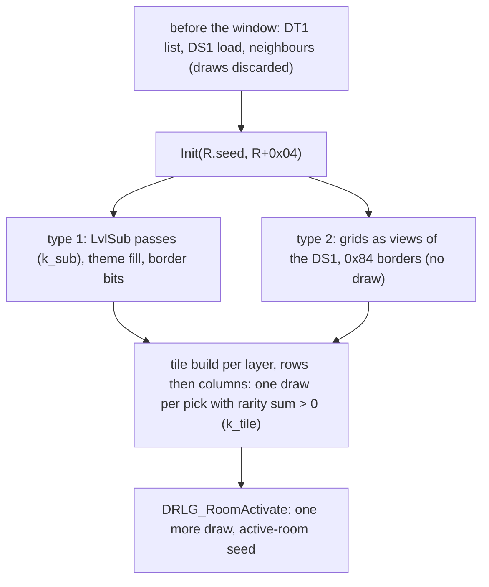

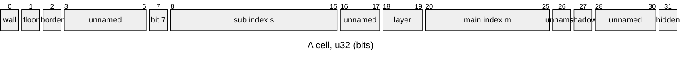

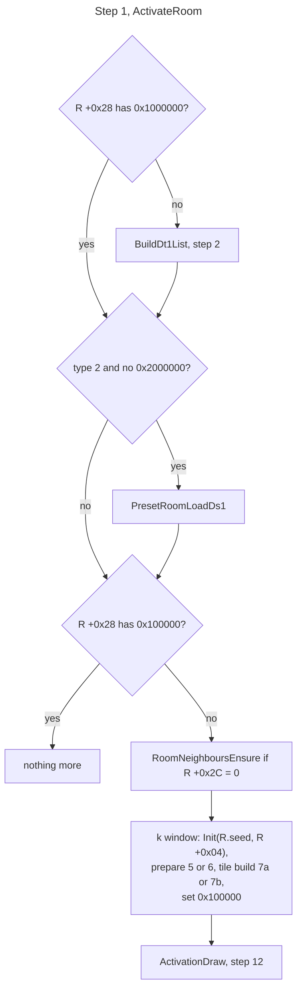

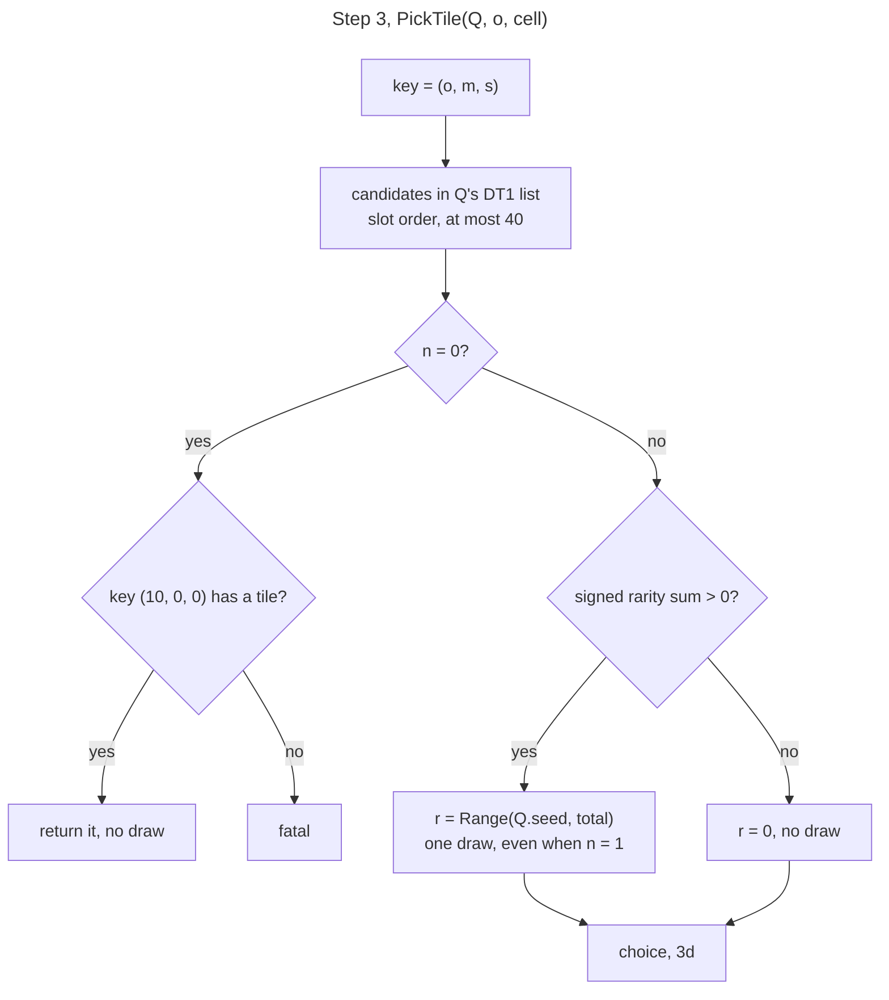

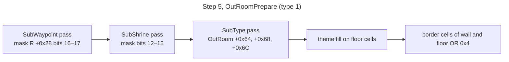

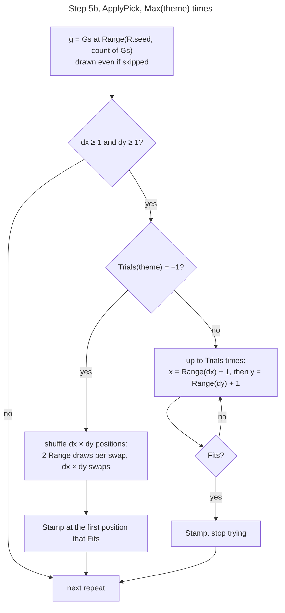

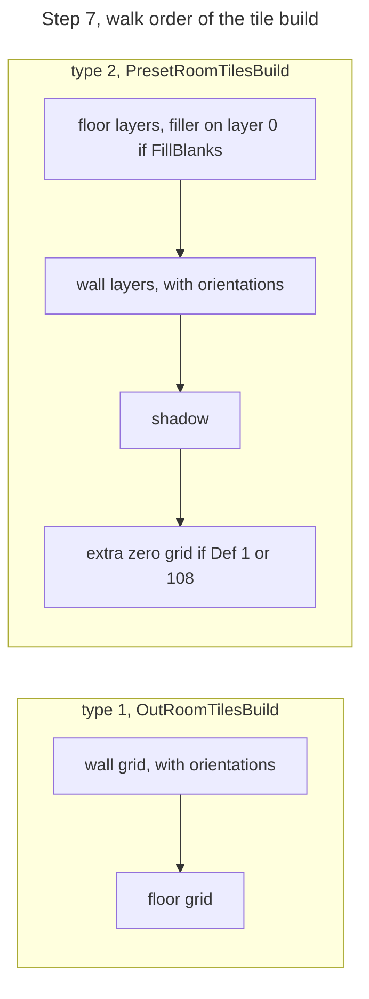

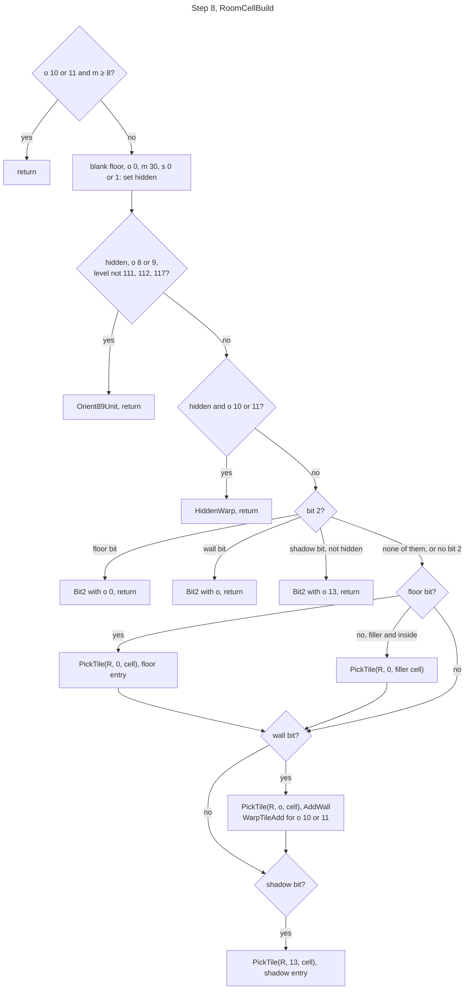

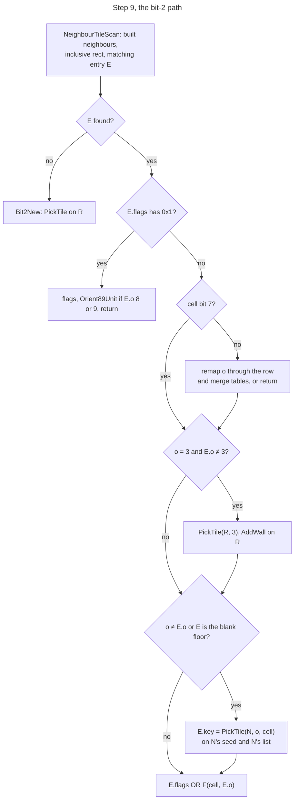

```
1. ActivateRoom(R):                                                   [I] (fn:sub_0061B730_RoomActivateB@0x0061B730, fn:sub_0061B190_RoomActivateA@0x0061B190)
     if not (R[+0x28] & 0x1000000): BuildDt1List(R)                   ; step 2
     if not (R[+0x28] & 0x2000000) and R.type = 2: PresetRoomLoadDs1(R)  ; see step note 1
     if not (R[+0x28] & 0x100000):
       if R[+0x2C] = 0: RoomNeighboursEnsure(R)                       ; may create neighbours and levels
       ── the k window ──                                             [C] (fn:sub_0066EE40_DrlgRoomReseed@0x0066EE40, fn:sub_0066EE70_DrlgRoomTypeInit@0x0066EE70, run:2026-10-11-drlg-roomk)
       Init(R.seed, R[+0x04])                                         ; rng/seeds 6a
       type 1: OutRoomPrepare(R) (5);   type 2: PresetRoomPrepare(R) (6)
       type 1: OutRoomTilesBuild(R) (7a); type 2: PresetRoomTilesBuild(R) (7b)
       R[+0x28] |= 0x100000
       ── end of window ──
       ActivationDraw(R)                                              ; step 12
     RoomActivateA runs only the last block (from the 0x100000 test).

2. BuildDt1List(R):                                                   [C] (fn:DRLG_LevelDt1ListBuild@0x0066F240, run:2026-10-11-drlg-roomk)
     T ← LvlTypes[L[+0x1C0]]                                          ; L = R[+0x58], the room's level
     for i in 0 ..< 32, while the remaining mask ≠ 0:                 ; bit order
       if R[+0x50] bit i: append name(T.File(i+1))
     name(c) = c longer than one character ? "DATA\GLOBAL\TILES\" + c with '/' → '\' : c   ; "0" stays "0"
     append the three fixed files (Constants)
     R[+0x28] |= 0x1000000
   The list holds 32 slots; adding to a full list is fatal.          [I] (fn:DT1_ListAdd@0x00604A40)
   The prefix is applied once, when LvlTypes is loaded, and only to cells longer than one
   character; the list build tests no name, so a mask bit on a "0" cell adds the string "0".
                                                                      [I] (fn:DRLG_LoadLvlTypes@0x0061E520, fn:sub_0061E4A0_TilePathPrefix@0x0061E4A0, fn:DRLG_LevelDt1ListBuild@0x0066F240)

3. PickTile(Q, o: i32, cell: u32) → key:                              ; Q = the room whose seed and list are used
   3a. candidates:                                                    [I] (fn:DRLG_PickTileByRarity@0x0066D820, fn:TILE_FindInList@0x00604AE0)
         key ← (o, (cell >> 20) & 0x3F, (cell >> 8) & 0xFF)          ; sub index: & 0xFF
         buf ← the tiles with that key in Q's DT1 list: files in slot order, within a file newest-indexed
               first, at most 40 in all;  n ← |buf|
   3b. if n = 0:                                                      [I] (fn:DRLG_PickTileByRarity@0x0066D820, 0x0066D868–0x0066D8A3)
         if key (10, 0, 0) has a tile: return it                      ; NO draw
         else fatal
   3c. total: i32 ← Σ rarity(buf[i]), wrapping                        [C] (fn:DRLG_PickTileByRarity@0x0066D820, run:2026-10-11-drlg-roomk)
       r: u32 ← 0
       if total > 0:                                                  ; signed
         r ← Range(Q.seed, total)                                     ; ONE draw on Q, even when n = 1
   3d. choice:                                                        [I] (fn:DRLG_PickTileByRarity@0x0066D820)
         i: u32 ← 0;  c: i32 ← r + 1
         if total ≠ 0:
           while n > 1 (unsigned) and c > 0 (signed): c ← c − rarity(buf[i]); i ← i + 1
         return buf[i ≠ 0 ? i − 1 : 0]

4. Range(Q.seed, n) in this spec is the rng spec's guarded range:     [C] (fn:sub_00670170_LvlSubApplyPick@0x00670170, fn:RNG_Range@0x0045C390, run:2026-10-11-drlg-roomk)
     n ≤ 0 (signed) → 0, no draw; otherwise one draw, low & (n − 1) for a power of two, else low mod n
     (unsigned). So Range(1) draws.

5. OutRoomPrepare(R)  (type 1; k_sub):                                [C] (fn:sub_0067D2D0_OutRoomGridPrepare@0x0067D2D0, fn:sub_006707A0_LvlSubApply@0x006707A0, run:2026-10-11-drlg-roomk)
     grids G ← the OutRoom orientation, wall and floor grids          ; made by drlg/outdoor
     allocate R's RoomTile (no draw)
     if (m ← (R[+0x28] >> 16) & 3) ≠ 0: LvlSubApply(Levels.SubWaypoint, theme 0, m)
     if (m ← (R[+0x28] >> 12) & 0xF) ≠ 0: LvlSubApply(Levels.SubShrine, theme 0, m)
     LvlSubApply(OutRoom[+0x64], OutRoom[+0x68], OutRoom[+0x6C])     ; the SubType pass rolled at creation
     v ← theme fill value (Constants)
     for every floor cell f of the (w+1) × (h+1) grid: if f & 0x3F0FF80 = 0: f |= v
     wall and floor grids: border cells (row 0, row h, column 0, column w) |= 0x4
   5a. LvlSubApply(type, theme, mask):
         if type = −1: return
         rec ← the first LvlSub record with Type = type
         for each bit i of mask, from bit 0:                          ; bit i = record rec + i
           if bit set: load rec+i's DS1 on first use (no draw)
                       rec+i.CheckAll ≠ 0 ? ApplyAll (5c) : ApplyPick (5b)
   5b. ApplyPick(rec, theme):                                         [C] (fn:sub_00670170_LvlSubApplyPick@0x00670170, run:2026-10-11-drlg-roomk)
         Gs ← the DS1's groups (x, y, w, h), in file order
         if |Gs| = 0 or Max[theme] ≤ 0: return                        ; signed
         repeat Max[theme] times:
           g ← Gs[Range(R.seed, |Gs|)]                                ; drawn even if g is then skipped
           dx: i32 ← R.w − g.w;  dy: i32 ← R.h − g.h
           if dx < 1 or dy < 1: continue
           if Trials[theme] = −1:
             nn: i32 ← dx × dy;  list[i] ← (i mod dx, i ÷ dx) for i in 0 ..< nn
             repeat nn times: a ← Range(R.seed, nn); b ← Range(R.seed, nn); swap list[a], list[b]   ; 2·nn draws
             the first i with Fits(g, list[i].x + 1, list[i].y + 1): Stamp(g, that position)
           else:
             repeat Trials[theme] times (none if ≤ 0):
               x ← Range(R.seed, dx) + 1;  y ← Range(R.seed, dy) + 1  ; x before y
               if Fits(g, x, y): Stamp(g, x, y); break
   5c. ApplyAll(rec, theme)  (CheckAll ≠ 0; no shipped record):       [I] (fn:sub_0066FF50_LvlSubApplyAll@0x0066FF50)
         for g in Gs:
           W ← R.w − g.w + 1;  H ← R.h − g.h + 1;  if W ≤ 0 or H ≤ 0: continue
           DS1 tag_type 1: for y in 1 ..< H: for x in 1 ..< W: if Fits(g, x, y): Stamp(g, x, y)   ; no draw
           DS1 tag_type 2: for y in 0 ..< H: for x in 0 ..< W:
             if Matches(g, x, y):
               Step(R.seed); r: u32 ← R.seed.low mod 100
               if Prob[theme] < (i32) r:  v ← Range(R.seed, g[+0x14]); Stamp(g, x, y, offset (g.w + 1)·(v + 1))
   5d. Fits(g, x, y) and Stamp(g, x, y), over the group's cells row-major, sub = the record's DS1 cell,
       room = G at (x + i, y + j):                                    [C] (fn:sub_0066FCF0_LvlSubFits@0x0066FCF0, fn:sub_0066FAD0_LvlSubStamp@0x0066FAD0, run:2026-10-11-drlg-roomk)
         Fits:  for each cell with sub.floor & 0x2, or (the DS1 has a wall layer and sub.wall0 & 0x1):
                  false if room.floor & 0x3F0FF00, or not room.floor & 0x2, or room.wall & 0x1
                true
         Stamp: for each cell:
                  f ← sub.floor (0 if the DS1 has no floor layer);  if f & 0x2: room.floor ← f | 0x80
                  if the DS1 has a wall layer:
                    w ← sub.wall0; if w & 0x1: room.wall ← w
                    q ← sub.orient0; if q ≠ 0: room.orient ← q
                  sh ← sub.shadow;  if sh & 0x8000000: PickTile(R, 13, sh)   ; draw site 0x0066E073
                then the record's preset units (no draw)

6. PresetRoomPrepare(R)  (type 2; no draw):                           [C] (fn:sub_006667D0_PresetRoomGridPrepare@0x006667D0, run:2026-10-11-drlg-roomk)
     ps ← R's preset instance;  D ← its DS1 (File(ps.idx + 1))
     view origin (R.x − ps.x, R.y − ps.y), size (R.w + 1) × (R.h + 1), row stride ps.w + 1
     wall[i], orient[i] ← views of D's wall and orientation layer i, for each wall layer
     if D has a wall layer: wall[0] border cells |= 0x84
     wall[i], i ≥ 1: every cell |= i << 18
     floor[i] ← view of floor layer i; every cell |= i << 18
     shadow ← view of the shadow layer
     every floor[i] border |= 0x84;  shadow border |= 0x84
     the preset's units inside the room move to the room (no draw)

7a. OutRoomTilesBuild(R):                                             [C] (fn:sub_0067D710_OutRoomTilesBuild@0x0067D710, run:2026-10-11-drlg-roomk)
     RoomCellsBuild(R, G.wall, orient = G.orient, filler false, kx false, ky false)
     RoomCellsBuild(R, G.floor, orient = 0,       filler false, kx false, ky false)
     T[+0x18], T[+0x20], T[+0x28] ← wall, floor, shadow entries used  ; no draw after the passes

7b. PresetRoomTilesBuild(R):  P = ps.rec                              [C] (fn:sub_00666AC0_PresetRoomTilesBuild@0x00666AC0, run:2026-10-11-drlg-roomk)
     kx ← P.KillEdge ≠ 0 and R.x + R.w = ps.x + ps.w
     ky ← P.KillEdge ≠ 0 and R.y + R.h = ps.y + ps.h
     for each floor layer f: RoomCellsBuild(R, floor[f], orient 0, filler = (f = 0 and P.FillBlanks ≠ 0), kx, ky)
     for each wall layer w:  RoomCellsBuild(R, wall[w], orient = orient[w], filler false, kx, ky)
     RoomCellsBuild(R, shadow, orient 0, filler false, kx, ky)
     if P.Def ∈ {1, 108}: RoomCellsBuild(R, an extra grid)            ; zero-filled: no pick [I] (fn:sub_0067CB80_GridAlloc@0x0067CB80)
     counts as in 7a; the animated-tile passes make no draw          [I] (fn:sub_00666AC0_PresetRoomTilesBuild@0x00666AC0)

7c. RoomCellsBuild(R, grid, orient, filler, kx, ky):                  [C] (fn:sub_0066EC10_RoomCellsBuild@0x0066EC10, run:2026-10-11-drlg-roomk)
     for j in 0 ..< R.h + (ky ? 0 : 1):                               ; rows outer
       for i in 0 ..< R.w + (kx ? 0 : 1):                             ; columns inner
         RoomCellBuild(R, grid[i, j], orient = (orient ? orient[i, j] : 0), R.x + i, R.y + j, filler)

8. RoomCellBuild(R, cell: u32, o: i32, x, y, filler):                 [C] (fn:sub_0066E9B0_RoomCellBuild@0x0066E9B0, run:2026-10-11-drlg-roomk)
     m ← (cell >> 20) & 0x3F;  s ← (cell >> 8) & 0xFF
     if o ∈ {10, 11} and m ≥ 8: return
     if o = 0 and m = 30 and s ∈ {0, 1}: cell |= 0x80000000          ; the blank floor is hidden
     hidden ← cell & 0x80000000 ≠ 0
     if hidden and o ∈ {8, 9} and L.id ∉ {111, 112, 117}:
       Orient89Unit(R, cell, tile none); return                       ; step 11
     if hidden and o ∈ {10, 11}: HiddenWarp(R, cell, o, x, y); return ; step 10
     if cell & 0x4:                                                   ; the bit-2 path, step 9
       if cell & 0x2:  Bit2(R, x, y, 0, (m = 30 and s ∈ {0, 1}) ? cell & ~0x80 : cell); return
       if cell & 0x1:  Bit2(R, x, y, o, cell); return
       if cell & 0x8000000 and not hidden: Bit2(R, x, y, 13, cell); return
       ; none of the three: fall through
     if cell & 0x2:  PickTile(R, 0, cell); add a floor entry
     else if filler and R.x ≤ x < R.x + R.w and R.y ≤ y < R.y + R.h:  ; exclusive
       PickTile(R, 0, filler floor cell (Constants)); add a floor entry
     if cell & 0x1:
       PickTile(R, o, cell); AddWall(R, x, y, cell, o)
       if o ∈ {10, 11} and L.id ≠ 133: WarpTileAdd(R, that entry, cell, o)   ; step 10
     if cell & 0x8000000: PickTile(R, 13, cell); add a shadow entry
   8a. AddWall(R, x, y, cell, o):                                     [C] (fn:sub_0066DC50_RoomTileAdd@0x0066DC50, run:2026-10-11-drlg-roomk)
         add a wall entry, flags F(cell, o) (step 9d)
         if o ∈ {8, 9}: Orient89Unit(R, cell, tile = the entry)       ; step 11
         if o = 3: PickTile(R, 4, cell); add the orientation-4 partner entry   ; draw site 0x0066DD02

9. The bit-2 path. Entries added here also go on a node list of R's RoomTile: one node for floors
   (kind 1) and one for walls and shadows (kind 0), created and prepended on first use; entries are
   prepended. Entries added by step 8 directly are on no list.       [C] (fn:sub_0066E940_Bit2CellBuild@0x0066E940, fn:sub_0066DEF0_RoomFloorAdd@0x0066DEF0, fn:sub_0066DF40_RoomShadowAdd@0x0066DF40, run:2026-10-11-drlg-roomk)
   Bit2(R, x, y, o, cell):
     (N, E) ← NeighbourTileScan(R, o = 0 ? kind 1 : kind 0, x, y, cell)
     E found ? Bit2Merge(R, N, E, o, cell, x, y) : Bit2New(R, o, cell, x, y)
   9a. NeighbourTileScan:                                             [C] (fn:sub_0066E580_NeighbourTileScan@0x0066E580, fn:sub_0066E4C0_NeighbourTileFind@0x0066E4C0, run:2026-10-11-drlg-roomk)
         for N in R's neighbour list (+0x08, count +0x2C), in order, skipping R:
           skip unless N has a RoomTile (+0x54 ≠ 0) and N.x ≤ x ≤ N.x + N.w and N.y ≤ y ≤ N.y + N.h   ; inclusive
           for each entry E of N's node of that kind, head first:
             if E is at (x, y) and E.o ≠ 4 and (E.o = 13 or not cell & 0x8000000)
                and (E.flags & 0x1C000 = 0 or ((E.flags >> 14) & 7) − 1 = (cell >> 18) & 3):
               return (N, E)
         return none
   9b. Bit2New(R, o, cell, x, y):                                     [C] (fn:sub_0066E620_Bit2TileNew@0x0066E620, run:2026-10-11-drlg-roomk)
         if o ∈ {10, 11} and not (R.x ≤ x < R.x + R.w and R.y ≤ y < R.y + R.h): return   ; no pick
         PickTile(R, o, cell)                                         ; draw site 0x0066E6B2
         o = 0: floor entry;  o = 13: shadow entry;  else AddWall (8a), its entries on the list
         if o ∈ {10, 11}: WarpTileAdd(R, the entry, cell, o)
   9c. Bit2Merge(R, N, E, o, cell, x, y):  E is N's entry             [C] (fn:sub_0066E740_Bit2TileMerge@0x0066E740, run:2026-10-11-drlg-roomk)
         if E.flags & 0x1:
           if E.o ∈ {8, 9}: E.flags |= F(cell, E.o); Orient89Unit(R, cell, tile = E)
           return
         if not cell & 0x80:                                          ; cell bit 7 skips this block [C] (fn:sub_0066E740_Bit2TileMerge@0x0066E740, run:2026-10-11-drlg-roomk)
           Tr: i32 ← g_Bit2OrientRow[o];  remap ← true                ; Constants; Tr = −1 keeps o [C] (data:g_Bit2OrientRow@0x006EF620, run:2026-10-11-drlg-roomk)
           if o ∈ {8, 9}:   if x = R.x or y = R.y: remap ← false      [I] (fn:sub_0066E740_Bit2TileMerge@0x0066E740)
           else if E.o ∈ {8, 9}: if x = N.x or y = N.y: return
           if remap:                                                  [I] (fn:sub_0066E740_Bit2TileMerge@0x0066E740, data:g_Bit2OrientRow@0x006EF620, data:g_Bit2OrientMerge@0x006EF574)
             if Tr ≥ 0 and E.o ≤ 7 (signed): o ← g_Bit2OrientMerge[Tr·7 + E.o]
             else if Tr ≠ −1: return                                  ; Tr = −2 (o 8, 9, 13), or E.o > 7: no merge
         if E.o ≠ 3 and o = 3:                                        [I] (fn:sub_0066E740_Bit2TileMerge@0x0066E740)
           E.flags |= 0xC008
           PickTile(R, 3, cell); AddWall(R, x, y, cell, 3) on R's kind-0 node   ; draw site 0x0066E87C, + the o-4 partner
         if o ≠ E.o or E's key is the blank floor (0, 30, 0):          [C] (fn:sub_0066E740_Bit2TileMerge@0x0066E740, run:2026-10-11-drlg-roomk)
           E.key ← PickTile(N, o, cell)                               ; draw site 0x0066E8F7: N's SEED and N's list
           E.o ← o
         E.flags |= F(cell, E.o)
         if E.o ∈ {8, 9}: Orient89Unit(R, cell, tile = E)
   9d. Entry flags, the bits steps 9a–9c read:                        [C] (fn:sub_0066DB20_RoomTileSetFlags@0x0066DB20, fn:sub_0066DDE0_TileEntryInit@0x0066DDE0, run:2026-10-11-drlg-roomk)
         F(cell, o) for a wall (and in Bit2Merge, OR-ed into E.flags):
           (o ≠ 13 ? (((cell >> 18) & 3) + 1) << 14 : 0) | (o = 14 ? 0x4 : 0) | (o ∈ 8..11 ? 0x2 : 0)
           | (cell & 0x80 ? 0x1 : 0), then bit 0x8 set if cell bit 31 is set, else cleared
         floor entry: ((((cell >> 18) & 3) + 1) << 14) | (cell & 0x80 ? 0x1 : 0) | (cell bit 31 ? 0x8 : 0)
         shadow entry: (cell & 0x80 ? 0x1 : 0) | (cell bit 31 ? 0x8 : 0)

10. Warps. The warp node of a cell: id ← the level's warp ids[m] (the act's override list at act
    +0x90, else Levels Warp0..7); the first node of R's list (+0x4C) whose LvlWarp row has that Id.
    Fit(node, o): if the row's Direction is neither 'b' nor d (d = 'r' for o = 11, 'l' for o = 10),
    replace it by the first row with that Id whose Direction is 'b' or d.   [C] (fn:sub_0066AF30_LevelWarpId@0x0066AF30, fn:sub_0066AEC0_LevelWarpIds@0x0066AEC0, fn:sub_0066E160_WarpRecFitDir@0x0066E160, fn:LVLWARP_FindByIdDir@0x0061F310, run:2026-10-11-drlg-roomk)
    UnitOk(cell, o, x, y): fatal if no LvlWarp row fits (id, d); true unless x − R.x = R.w or
    y − R.y = R.h (no draw).                                          [C] (fn:sub_0066E1C0_WarpUnitAdd@0x0066E1C0, run:2026-10-11-drlg-roomk)
    10a. WarpTileAdd(R, entry, cell, o)  (visible):                   [C] (fn:sub_0066E260_WarpTileAdd@0x0066E260, run:2026-10-11-drlg-roomk)
           node ← the warp node of cell (fatal if none)
           if s ∈ {0, 4} and not UnitOk(cell, o, x, y): return
           Fit(node, o)
           if row.LitVersion ≠ 0: PickTile(R, o, cell | (row.Tiles << 8)); add a wall entry   ; draw site 0x0066E31B
    10b. HiddenWarp(R, cell, o, x, y):                                [C] (fn:sub_0066E360_HiddenWarpTilesAdd@0x0066E360, run:2026-10-11-drlg-roomk)
           UnitOk(cell, o, x, y)                                      ; only its fatal test matters here
           node ← the warp node of cell; if none: return
           Fit(node, o)
           if row.LitVersion ≠ 0:
             for i in 0 ..< 4: PickTile(R, 0, ((s << 12) | i | 4) << 8)    ; key (0, s & 0x3F, 4 + i); draw site 0x0066E3FB

11. Orient89Unit(R, cell, tile)  — boundary oracle, row `objects`:    [C] entry seed, [I] draw (fn:sub_0066D9E0_Orient89Unit@0x0066D9E0, run:2026-10-11-drlg-roomk)
      looks up (L.id, m, s, o = 9) in a unit table at 0x006EEFD0 / 0x006EF18C; with a tile already
      marked 0x20 it does nothing. If the lookup hits and the unit lands inside the room's sub-tile area,
      the tile is marked 0x20, and if the unit is an object (type 2) with id 91 or 92:
        u ← Range(R.seed, 3)                                          ; 0 → no unit
      A miss or an out-of-bounds unit returns without marking. With tile none, nothing is skipped or marked.

12. ActivationDraw(R)  = DRLG_RoomActivate:                           [C] (fn:DRLG_RoomActivate@0x006422A0, run:2026-10-11-seed-tree-p1)
      if T[+0x18] = 0 and T[+0x20] = 0: return none                   ; no draw
      Step(R.seed);  activeRoom.seed ← Init(R.seed.low)               ; rng/seeds 6c
```

Step notes:

1. **What happens before the window doesn't count.** The DT1 list, the DS1 load and the neighbour
   creation run before the re-seed. The DS1 load (`sub_00667890_PresetRoomLoadDs1`) runs
   `sub_00667620_PresetUnitDropRolls` on the room seed the first time an instance's DS1 is loaded, and
   those draws are discarded by the re-seed; when the build-time map scan has loaded the DS1 already, it
   skips them. [I] (fn:sub_00667890_PresetRoomLoadDs1@0x00667890, fn:sub_00667620_PresetUnitDropRolls@0x00667620,
   fn:sub_00667970_PresetMapScan@0x00667970) The DS1 is `File(idx + 1)` of the instance; nothing is drawn
   to choose it here ([README.md](README.md) step 4). [I] (fn:sub_00667890_PresetRoomLoadDs1@0x00667890)
   The window holds exactly four RNG-bearing functions, all on room `+0x14`: `DRLG_PickTileByRarity`,
   `sub_0066D9E0_Orient89Unit`, `sub_0066FF50_LvlSubApplyAll` and `sub_00670170_LvlSubApplyPick` (657
   functions walked, none unclassified). [I] (fn:DRLG_PickTileByRarity@0x0066D820,
   [drlg/0002](../../findings/drlg/0002-room-build-draws.md#the-recorded-enumeration))
2. **The DT1 list equals the logged list in all 520 rooms of the run** (56 type 1, 464 type 2). No mask
   bit in the run selected a `"0"` file cell. [C] (fn:DRLG_LevelDt1ListBuild@0x0066F240,
   run:2026-10-11-drlg-roomk) The level type is `+0x1C0` of the room's level (room `+0x58`), which
   `DRLG_LevelCreate` writes once from leveldefs `+0x34` (`LevelType`); no other DRLG code stores to it. [I]
   (fn:DRLG_LevelDt1ListBuild@0x0066F240, 0x0066F257, fn:DRLG_LevelCreate@0x00642AE0, 0x00642B23,
   tbl:Levels.txt:LevelType) `LvlTypes` `Expansion` and `Act` are read only by two DT1 preloads outside the
   build (at start-up, which stops at the first `"0"` cell and skips `Expansion` types without the expansion
   archive, and per act); neither is on the level-build path, and the room's list has no such test. [I]
   (fn:sub_0061FAE0_LvlTypesDt1Preload@0x0061FAE0, fn:sub_0044DB60_ActDt1Preload@0x0044DB60,
   tbl:LvlTypes.txt:Expansion, tbl:LvlTypes.txt:Act) The mask comes from creation: `LvlPrest.Dt1Mask` for every preset room,
   maze rooms included (464 rooms), and for an outdoor room the level-type value OR the `Dt1Mask` of the
   SubType records its creation roll picked ([README.md](README.md) step 8a). [C]
   (fn:sub_00667ED0_PresetRoomsCreate@0x00667ED0, fn:sub_006706A0_LvlSubRoll@0x006706A0, run:2026-10-11-drlg-roomk)
3. **The draw rule.** A pick draws iff its primary key has at least one candidate and the signed sum of
   their rarities is > 0, even for a single candidate; a sum of 0 means no draw and the first candidate.
   The run made 39652 picks with a draw and 14154 with candidates but a zero sum. [C]
   (fn:DRLG_PickTileByRarity@0x0066D820, run:2026-10-11-drlg-roomk) The `(10, 0, 0)` fallback makes no draw.
   It never occurred in the run. [I] (fn:DRLG_PickTileByRarity@0x0066D820) Which candidate is returned
   (3d) does not change k; the run checked keys and seeds, not the chosen tile. [I]
   (fn:DRLG_PickTileByRarity@0x0066D820, fn:TILE_GetRarity@0x00604C20)
5. **Order of the substitution passes**: SubWaypoint, SubShrine, SubType, each over its records in
   mask-bit order. All shipped `LvlSub` records have `CheckAll = 0`, so 5c is never reached with stock
   data. 11 records have `Trials0 = −1`; records 6 and 9 took the shuffle in the run (5 passes). [C] for 5b
   (fn:sub_00670170_LvlSubApplyPick@0x00670170, run:2026-10-11-drlg-roomk), [I] for 5c
   (fn:sub_0066FF50_LvlSubApplyAll@0x0066FF50) The modelled stamping, theme fill and border bits equal the
   next pass's grids and the grids the tile build walks, in every type-1 room. [C]
   (fn:sub_0067C600_GridBorderOp@0x0067C600, run:2026-10-11-drlg-roomk) `Stamp` picks a tile for every
   stamped shadow cell **inside the prepare**, so those picks are part of k. [C]
   (fn:sub_0066E060_ShadowTileAdd@0x0066E060, run:2026-10-11-drlg-roomk) The group DS1's wall layers i ≥ 1
   get `i << 18` at load; only wall layer 0, orientation layer 0, floor layer 0 and the shadow are read. [C]
   (fn:sub_006704E0_LvlSubLoadDs1@0x006704E0, run:2026-10-11-drlg-roomk)
6. **The type-2 grids are views, not copies.** The prepare writes into the DS1 that `DS1_LoadCached` keeps
   once per path for the whole process, which every instance of the file and both act copies share. [I]
   (fn:DS1_LoadCached@0x00665F40, data:g_Ds1Cache@0x0096D60C) Every write is an OR that each room repeats on
   its own borders, and a shared buffer and a fresh buffer per room gave identical grids in all 464
   type-2 rooms of the run, so a reimplementation may apply the prepare to a private copy. [C]
   (fn:sub_006667D0_PresetRoomGridPrepare@0x006667D0, run:2026-10-11-drlg-roomk) The view's stride is the
   preset width + 1, which equalled the DS1 row length in every room. [I]
   (fn:sub_006667D0_PresetRoomGridPrepare@0x006667D0) The client-only `sub_006663C0_PresetClientObjects`,
   which runs before the window, reads floor layer 0 and adds object preset units; it writes no grid, and
   the client grids match the same prepare. [I] for the code, [C] for the grids
   (fn:sub_006663C0_PresetClientObjects@0x006663C0, run:2026-10-11-drlg-roomk)
7. **Type 1 walks the wall grid, then the floor grid; type 2 walks floors, walls, shadow.** The extra
   pass of preset defs 1 and 108 walks a zero-filled grid and picks nothing. [I]
   (fn:sub_00666AC0_PresetRoomTilesBuild@0x00666AC0, fn:sub_0067CB80_GridAlloc@0x0067CB80) `KillEdge` drops
   the last column or row only on the preset's own right or bottom edge. Without it, the walk covers the
   whole (w+1) × (h+1) grid, so each room also builds the cells it shares with its right and bottom
   neighbours. [C] (fn:sub_0066EC10_RoomCellsBuild@0x0066EC10, run:2026-10-11-drlg-roomk)
8. **Every room border carries bit 2**, so the bit-2 path is the common case: type 1 gets `0x4` in step 5,
   type 2 gets `0x84` in step 6. [C] (fn:sub_0067C600_GridBorderOp@0x0067C600,
   fn:sub_006667D0_PresetRoomGridPrepare@0x006667D0, run:2026-10-11-drlg-roomk) The level exceptions of
   step 8 (levels 111, 112, 117 for hidden orientation 8/9, level 74's filler, level 133's warps) are read
   from the code; none of those levels was in the run. [I] (fn:sub_0066E9B0_RoomCellBuild@0x0066E9B0)
9. **The bit-2 path reads the neighbours' state, so k depends on activation order.** Only neighbours
   already built in the same act copy count. The run made 11768 new and 6835 merge decisions. [C]
   (fn:sub_0066E580_NeighbourTileScan@0x0066E580, run:2026-10-11-drlg-roomk) The merge re-pick at
   `0x0066E8F7` steps the **neighbour's** seed with the neighbour's DT1 list, not R's: it is not in R's k.
   354 such re-picks in the run, each checked through the neighbour's seed at a later room's start. [C]
   (fn:sub_0066E740_Bit2TileMerge@0x0066E740, run:2026-10-11-drlg-roomk) The run reached three exits
   of 9c before the re-pick: an entry with flag `0x1` (6481 merges), a cell with bit 7 (44) and row −1 with
   orientation 0 kept (310). Those branches are `[C]`. [C] (fn:sub_0066E740_Bit2TileMerge@0x0066E740,
   run:2026-10-11-drlg-roomk) The remap through the merge table, the row −2 return, the orientation 8/9
   edge tests and the orientation-3 branch were not reached, so they are read from the code only. [I]
   (fn:sub_0066E740_Bit2TileMerge@0x0066E740, 0x0066E781–0x0066E8B9) By the row table, walls of orientation
   1, 2, 3, 5, 6, 7 remap through rows 0–5, orientations 0, 4, 10–12 and 14–19 keep theirs, and 8, 9 and 13
   return without a merge unless cell bit 7 or the 8/9 edge rule skips the lookup. [I]
   (data:g_Bit2OrientRow@0x006EF620, 0x0066E747) Type-2 borders carry bit 7 (step 6), so preset-to-preset
   wall merges end at flag `0x1`; wall merges between two outdoor rooms are where the remap can
   happen. [I] (fn:sub_006667D0_PresetRoomGridPrepare@0x006667D0, fn:sub_0066E740_Bit2TileMerge@0x0066E740)
10. 24 visible and 15 hidden warp cells in the run. Hidden-warp picks use orientation 0 (`EDX = 0`). [C]
    (fn:sub_0066E360_HiddenWarpTilesAdd@0x0066E360, run:2026-10-11-drlg-roomk)
11. `Orient89Unit` was called 526 times in the run and never reached its `Range(3)`, so its draw is
    code-read only. A reimplementation needs the unit table to know when the draw happens; until row
    `objects` dumps it, it is an oracle (seed in, seed out). [C] for the entry seed, [I] for the draw
    (fn:sub_0066D9E0_Orient89Unit@0x0066D9E0, run:2026-10-11-drlg-roomk)
12. `T[+0x18]` and `T[+0x20]` are the wall and floor entry counts after the build (the builder copies the
    used counters over the capacities). So the activation draw happens iff the room got at least one wall
    or floor entry, whether or not any pick drew. [I] (fn:sub_0067D710_OutRoomTilesBuild@0x0067D710,
    fn:sub_00666AC0_PresetRoomTilesBuild@0x00666AC0, fn:DRLG_RoomActivate@0x006422A0) No room without
    tiles occurred in the run. [C] (run:2026-10-11-drlg-roomk)

### k

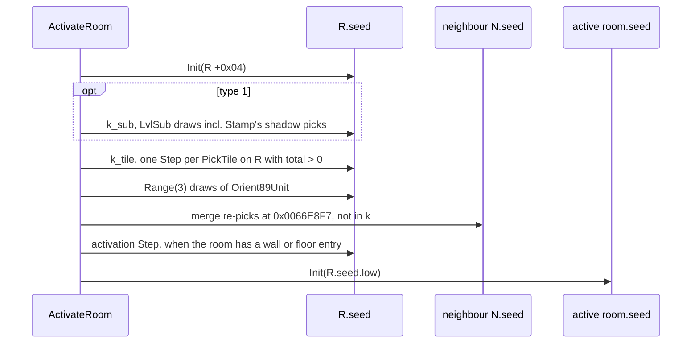

```
k(R) = number of Step(R.seed) between step 1's Init and step 12      [C] (fn:sub_0066EE40_DrlgRoomReseed@0x0066EE40, fn:DRLG_RoomActivate@0x006422A0, run:2026-10-11-drlg-roomk)
     = k_sub(R)                                                       ; type 1 only: the draws of 5b (and 5c), incl. Stamp's shadow picks
     + k_tile(R)                                                      ; 7–10: one per PickTile on R with total > 0
     + the Range(3) draws of Orient89Unit                             ; step 11
   not counted: picks at 0x0066E8F7, which draw on a neighbour
activeRoom.seed = Init(Step^(k+1)(Init(R[+0x04])).low)               ; when step 12 draws
```

- [C] **k is predicted bit-exact for every room activated in the run**: 520 activations, server and client
  copies, outdoor (type 1), preset and maze (type 2) rooms, k = 0..388, 0 mismatches over 11208 checks. The
  inputs the model takes from the run are run-time state made by other rows: the type-1 grids before the
  first `LvlSub` pass (`drlg/outdoor`), the neighbour lists and which neighbours are built (activation
  order), the warp nodes and the level's warp ids (`drlg/warps`), and a preset room's file index
  ([README.md](README.md) step 4). The type-2 grids and the DT1 list are rebuilt from data and checked.
  (fn:sub_0066EE70_DrlgRoomTypeInit@0x0066EE70, run:2026-10-11-drlg-roomk)
- [C] Only the bit-2 path and `LvlSub` read state that earlier draws change, so order matters only there.
  Every other pick's draw is a function of the cell and the DT1 list alone.
  (fn:sub_0066FCF0_LvlSubFits@0x0066FCF0, fn:sub_0066E4C0_NeighbourTileFind@0x0066E4C0, run:2026-10-11-drlg-roomk)
- [C] **A built room's seed keeps moving.** After R's own activation, a later neighbour whose bit-2 cell
  merges into one of R's entries may re-pick it on R's seed (`0x0066E8F7`). R's active-room seed is already
  taken by then, but R's `+0x14` is not the activation value any more, and any later re-pick on R starts
  from the moved value. (fn:sub_0066E740_Bit2TileMerge@0x0066E740, run:2026-10-11-drlg-roomk)
- [C] **Server and client copies can get different k** for the same DRLG room, because their activation
  orders differ and so do the built neighbours the bit-2 path sees. The same model predicts both; no
  client-only branch inside the window was needed. (fn:sub_0066E580_NeighbourTileScan@0x0066E580,
  run:2026-10-11-drlg-roomk)

### Release and re-activation

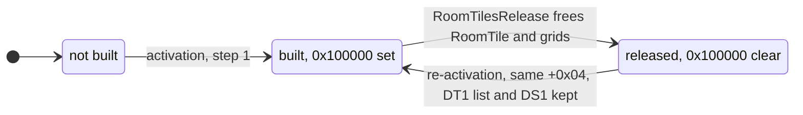

A built room can be released while its level stays loaded, and activated again later. No release was
logged in run:2026-10-11-drlg-roomk, so this section is read from the code only.

- [I] `sub_0066F1A0_RoomTilesRelease` is called through `0x0066B4C0` (from `0x0061A910`) for a built room.
  It frees the active-room object at `R[+0x30]` (unless its `EDX` argument is set) and zeroes `R[+0x30]`.
  If `R[+0x28] & 0x100000`: it clears that bit, frees the RoomTile (`sub_0066F0B0_RoomTileFree`: the three
  entry arrays, the node lists, `R[+0x54] ← 0`), frees the type's grids (type 1 the OutRoom grids, type 2
  the preset room's grid data), zeroes `+0x0C` and `+0x14` of every warp node of `R[+0x4C]`, and sets
  `0x200000` in `R[+0x28]` when its `EDX` argument is non-zero. (fn:sub_0066F1A0_RoomTilesRelease@0x0066F1A0,
  fn:sub_0066F0B0_RoomTileFree@0x0066F0B0, fn:sub_0067D680_OutRoomGridsFree@0x0067D680,
  fn:sub_00666610_PresetRoomGridsFree@0x00666610)
- [I] The release keeps `0x1000000` (DT1 list), `0x2000000` (DS1 loaded), the neighbour count `R[+0x2C]`
  and the seed base `R[+0x04]`. The next activation (step 1) therefore skips the DT1 list, the DS1 load and
  the neighbour step, re-seeds from the same `+0x04`, prepares the grids again, rebuilds the tiles and takes
  the activation draw. (fn:sub_0066F1A0_RoomTilesRelease@0x0066F1A0, fn:sub_0061B730_RoomActivateB@0x0061B730)
- [I] **k can differ on the rebuild.** The room's own draws restart from the same seed, but the bit-2 path
  (step 9) sees whichever neighbours are built at that moment, and the merges the first build made into
  neighbours' entries (their orientation, tile and seed steps) are not undone. While released, the room's
  own entries are gone from its neighbours' scans (`R[+0x54] = 0`, step 9a). (fn:sub_0066F1A0_RoomTilesRelease@0x0066F1A0,
  fn:sub_0066E580_NeighbourTileScan@0x0066E580, fn:sub_0066E740_Bit2TileMerge@0x0066E740)
- [I] The level unload frees RoomTiles through `sub_0066C100_RoomFree` instead; that path rebuilds the level
  ([README.md](README.md) step note 2). (fn:sub_0066C100_RoomFree@0x0066C100, fn:sub_0066F0B0_RoomTileFree@0x0066F0B0)

## Outputs

- The active-room seed (step 12), or no active room when the room has no wall and no floor entry. [C]
  (fn:DRLG_RoomActivate@0x006422A0, run:2026-10-11-drlg-roomk)
- The room's RoomTile: floor, wall and shadow entries (0x30 bytes each; position, tile, flags) and the
  bit-2 node lists that later neighbours scan. [I] (fn:sub_0066EEE0_RoomTileArraysAlloc@0x0066EEE0,
  [drlg/0002 § RoomTile record](../../findings/drlg/0002-room-build-draws.md#roomtile-record-r0x54-0x2c-bytes))
- Side effects on other rooms: re-picks on built neighbours' seeds and entries (step 9c). [C]
  (fn:sub_0066E740_Bit2TileMerge@0x0066E740, run:2026-10-11-drlg-roomk)

## Worked example

**A Den of Evil room, map seed 12345, client copy, k = 15.** Source: `run:2026-10-11-drlg-roomk`, log
`workspace/logs/roomk-12345-bloodmoor.log`, reproduced by

```
python3 -I tools/drlg.py roomk workspace/logs/roomk-12345-bloodmoor.log -v | grep 02d8f600
```

(`02d8f600` is the room's address in that log; the run prints `RACT … (k model 15)`, `AROOM`, the DT1 list
and mask checks, all `ok`). The room's creation is the worked example of [README.md](README.md#worked-example)
(map seed 12345; that run is a separate game entry of the same seed, and the room has the same
`+0x04 = 8E258975` in both logs): Den of Evil (level 8, level type 3), the first room of preset def 83,
whose file index `Range(level seed, 2) = 1` selects `Act1\Caves\CaveWPre2.ds1`; the room-tile run reproduces
that file's grids and no other. Seeds are `low:high`, hex; all values below were logged and are recomputed
by `tools/rng.py`.

| Item | Value |
|---|---|
| room rect, preset rect | (1524, 1000, 8 × 8) in (1524, 1000, 24 × 24): view origin (0, 0), stride 25 |
| `LvlPrest` 83 | `Files 2`, `KillEdge 1`, `FillBlanks 1`, `Dt1Mask 0x1`; one wall, one floor layer |
| kill edges | none: 1524 + 8 ≠ 1524 + 24, so all 9 × 9 cells of every layer are walked |
| DT1 list | `DATA\GLOBAL\TILES\Act1\Caves\Cave.dt1` (`LvlTypes` 3 `File 1`), then the three fixed files |
| `+0x04`, re-seed | `8E258975` → `8E258975:0000029A` (the type-2 prepare draws nothing) |
| neighbours built before it | one of its six neighbours; no bit-2 cell found an entry there (14 bit-2 decisions, all new) |

Picks, in call order. Pass 1 is floor layer 0 (with filler), pass 2 wall layer 0 with its orientations,
pass 3 the shadow (no pick).

| Pass | Cells | Key | n, rarity sum | Draws |
|---|---|---|---|---|
| 1 | (0, 0), cell `905200C6`, bit-2 new floor | (0, 5, 0) | 9, 13 | 1 |
| 1 | border cells `0x84` and empty interior cells inside the room: filler | (0, 30, 0) | 1, 0 | 0 |
| 1 | 26 floor cells of rows 4–8 with keys (0, 3, 8…17), (0, 21, 0…3), (0, 2, 12…23), (0, 0, 10…11) | one each | 1, 0 | 0 |
| 1 | (5..8, 6), (3..8, 7), (3..6, 8): floor cells `005000C2`/`005000C6` | (0, 5, 0) | 9, 13 | 14 |
| 2 | (3, 5), cell `80001581`, hidden warp (orientation 10/11, warp id 4, `LitVersion ≠ 0`) | (0, 21, 4…7) | 1, 0 each | 0 |
| 2 | (6, 8), cell `00000185`, bit-2 new wall | (12, 0, 1) | 1, 0 | 0 |

The 15 draws (the rarities of the nine `Cave.dt1` tiles of key (0, 5, 0) are 1, 2, 1, 2, 2, 1, 1, 2, 1, in file
order):

| Draw | Room seed after | Draw | Room seed after |
|---|---|---|---|
| 1 | `42B299A3:3B49CC55` | 9 | `42354902:02B0BF1C` |
| 2 | `5737B6C4:1BD1AF78` | 10 | `3A4F0DA6:1B9D6AE2` |
| 3 | `1417944C:2460B817` | 11 | `BC844BA0:1851F5C4` |
| 4 | `08B89693:08615901` | 12 | `526A27E4:4EA1003E` |
| 5 | `E6D1E820:03A3320B` | 13 | `B319F2B2:225FE13A` |
| 6 | `7E7CD2AB:6045F2FE` | 14 | `F787C434:4AB3A9D7` |
| 7 | `AB164095:34C1CB4D` | 15 | `6CC2E5DB:673E363A` = logged seed at the activation draw |
| 8 | `06734DF6:475BEAB4` | act. | `2FE647C1:2D5D0F6C`; active room `2FE647C1:0000029A`, flags 4 (client) |

So k = 15 and the active-room seed is `Init(2FE647C1)`. [C] (run:2026-10-11-drlg-roomk)

**Server and client k of one room.** In `workspace/logs/roomk-12345-town.log` the Act I town room with
`+0x04 = F923BEE2` (room 3 of level 1, the [rng/seeds](../rng/seeds.md#worked-example) example) gets k = 64 on
the server and k = 55 on the client: the client copy found more entries of built neighbours, so 25 of its bit-2
decisions were merges against 12 on the server, and the floor pass made 48 draws against 56. Same grids,
same DT1 list. [C] (run:2026-10-11-drlg-roomk)

## Reimplementation notes

- **Count the draw, not the choice.** A pick with one candidate of positive rarity still draws; a key whose
  candidates all have rarity 0 doesn't. Precompute `(n, Σ rarity)` per key per DT1 list. [C]
  (fn:DRLG_PickTileByRarity@0x0066D820, run:2026-10-11-drlg-roomk)
- **Sum at most 40 candidates**, in DT1-list slot order. [I] (fn:DRLG_PickTileByRarity@0x0066D820)
- **`Range(1)` draws** in the `LvlSub` group pick; `Range(n ≤ 0)` doesn't. A group draw is made even when the
  group is then too big for the room. [C] (fn:sub_00670170_LvlSubApplyPick@0x00670170, run:2026-10-11-drlg-roomk)
- **`Act1/Outdoors/Trees.ds1` is 12 bytes short.** `LvlSub` record 11 (`Type` 6) loads it, and
  `DS1_Parse` reads its last group's y, w and h past the end of the file buffer, which `FILE_LoadWhole`
  allocates at the exact size: the original reads uninitialised heap. [I] (fn:DS1_Parse@0x00665950,
  fn:FILE_LoadWhole@0x00517079) **A reimplementation reads the missing bytes as zeros.** Zeros reproduce every
  draw seen: of the 27 logged loads, 26 held `(0, 0, 0, 0)` for that group, and the group was drawn 4 times,
  always with w = h = 0 (`Fits` holds trivially, `Stamp` writes nothing, and the pass consumes the group draw
  plus one x and one y draw). The one load that held garbage, `(0, 229120, 245560, 1)`, made no draw of that
  group. [C] (fn:sub_00670170_LvlSubApplyPick@0x00670170, run:2026-10-11-drlg-roomk)
- **The neighbour re-pick moves another room's seed.** Keep every built room's seed and entries live after
  its activation; `0x0066E8F7` steps them. [C] (fn:sub_0066E740_Bit2TileMerge@0x0066E740, run:2026-10-11-drlg-roomk)
- **Activation order is an input.** Server and client copies, or two players' walks, give different k for
  the same room. Gameplay uses the server copy ([rng/seeds](../rng/seeds.md) step note 6). [C]
  (fn:sub_0066E580_NeighbourTileScan@0x0066E580, run:2026-10-11-drlg-roomk)
- **The walk includes the shared edge.** Without `KillEdge` a room walks (w+1) × (h+1) cells, so cells on its
  right and bottom edges are built by both rooms that share them; the bit-2 scan is what turns the second
  build into a merge. [C] (fn:sub_0066EC10_RoomCellsBuild@0x0066EC10, run:2026-10-11-drlg-roomk)
- **The filler test is exclusive** (`x < R.x + R.w`) and the neighbour test inclusive (`x ≤ N.x + N.w`). [C]
  (fn:sub_0066B980_RectContains@0x0066B980, fn:sub_0066B9D0_RectContainsIncl@0x0066B9D0, run:2026-10-11-drlg-roomk)
- **The merge table has stride 7 but 8 columns.** Index it as `row·7 + old orientation` with old orientation
  0–7, so column 7 of a row is column 0 of the next; a stride-8 array of six rows gives wrong values. Test
  `Tr ≥ 0` and `E.o ≤ 7` signed. [I] (data:g_Bit2OrientMerge@0x006EF574, fn:sub_0066E740_Bit2TileMerge@0x0066E740)
- **A released room is not a fresh room.** Keep its DT1 list, neighbour list and `+0x04`, but not its
  entries; neighbours keep what its first build merged into them. [I] (fn:sub_0066F1A0_RoomTilesRelease@0x0066F1A0)
- **Hidden-warp picks are floor picks** (orientation 0, key `(0, s & 0x3F, 4 + i)`), whatever the warp
  cell's orientation. [C] (fn:sub_0066E360_HiddenWarpTilesAdd@0x0066E360, run:2026-10-11-drlg-roomk)

## Evidence

- [findings/drlg/0002-room-build-draws.md](../../findings/drlg/0002-room-build-draws.md): the k window, the
  draw sites, both prepares, the tile build, the bit-2 path, warps, server and client.
- [findings/drlg/0001-ds1-dt1-readers.md](../../findings/drlg/0001-ds1-dt1-readers.md): the DT1 list, the pick
  and its candidate order, the per-cell decision, entry flags, `DS1_Parse`.
- [findings/drlg/experiments.md § run:2026-10-11-drlg-roomk](../../findings/drlg/experiments.md#run2026-10-11-drlg-roomk):
  six game entries, 520 activations, 11208 checks, 0 mismatches (with the 2026-10-12 checker addendum).
- [findings/drlg/0003-generator-dispatch.md](../../findings/drlg/0003-generator-dispatch.md): the file index
  and room creation behind the worked example.
- [rng/seeds](../rng/seeds.md) step 6, [rng](../rng/README.md), [README.md](README.md).
- Formats and tables: [dt1](../../formats/dt1.md), [ds1](../../formats/ds1.md), [LvlTypes](../../tables/LvlTypes.md),
  [LvlPrest](../../tables/LvlPrest.md), [LvlSub](../../tables/LvlSub.md), [LvlWarp](../../tables/LvlWarp.md),
  [Levels](../../tables/Levels.md).

## Open questions

- **The unreached merge branches.** The remap through `g_Bit2OrientMerge`, the row −2 return, the
  orientation 8/9 edge tests and the orientation-3 branch (`0x0066E87C`) of step 9c are read from the code
  only (the table values are settled). A run with wall merges between two outdoor rooms (o 1–3 or 5–7, no
  bit 7 on the newer cell, no flag `0x1` on the older entry) is the test; owner `drlg/outdoor`.
- `Orient89Unit`: the unit table at `0x006EEFD0`/`0x006EF18C` is not dumped, and objects 91 and 92 are not
  identified, so when its `Range(3)` happens is unknown outside the oracle (row `objects`).
- The `(10, 0, 0)` fallback, `ApplyAll` (`CheckAll ≠ 0`) and a room with no tiles were never exercised.
- A mask bit on a `"0"` cell of `LvlTypes` puts the string `"0"` in the room's DT1 list (step 2); what
  loading that name does is not read (no room in the run had one).
- Release and re-activation (§ Release and re-activation) is code-read only: no release was logged. A run
  that leaves a room's range and returns without changing level is the test, including a rebuild whose k
  differs from the first build. What `0x200000` means and when the caller passes `EDX ≠ 0` are not read.
- Whether any shipped preset has a cell that is a border of one room's view and interior to another view
  of the same DS1, which is the only case where the shared-cache writes could show (row `drlg/preset`).
- `Trees.ds1`: the zero-fill rule matches every observed draw, but the original's heap bytes make its result
  for that group undefined; no run has shown a load with garbage that drew the group.
