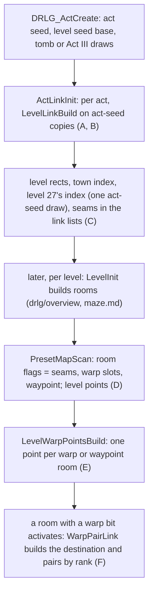
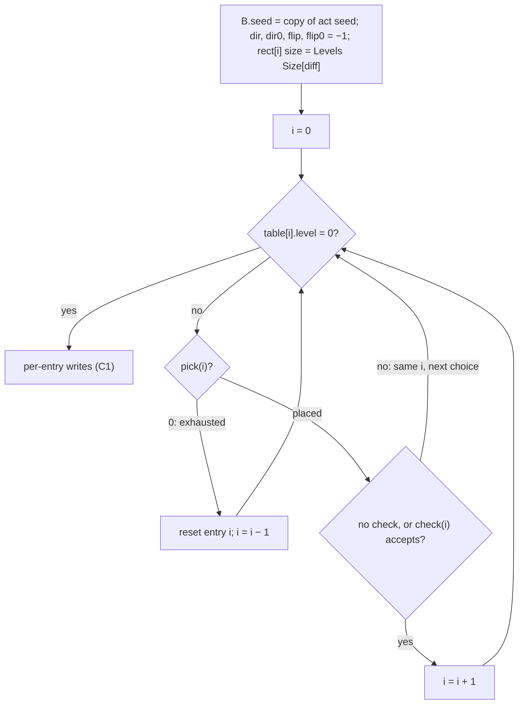
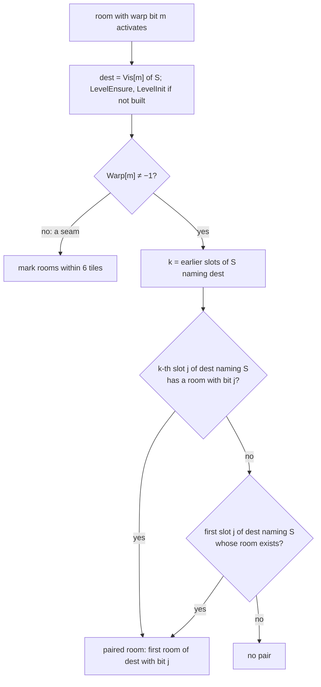

# Level links, warp slots and warp points

## Purpose

Levels connect in two ways: through a **warp** (stairs, a cave mouth, a portal tile) or through a **walkable seam**
(two outdoor levels that touch). This spec covers, in the order the game runs them:
- the **act link builder**: when an act is created, it lays out the act's outdoor chain on a copy of the act seed and
  writes each level's rectangle, the town orientation and level 27's file index;
- the per-level **link lists** that override `Levels` `Vis0..7`/`Warp0..7`;
- the **warp slots** a preset DS1 cell carries, which become room flags;
- the **warp points** list (`level+0x1E0`) that `LevelInit` builds after every level build, which
  [drlg/collision § I](collision.md#i-nearwarptestgame-room-x-y-and-its-side-effects) reads;
- the **pairing** that finds, when a room with a warp activates, the matching room of the destination level.

In maze levels the warp rooms are the specials of [maze.md](maze.md). Act III's link layout and the warp bits of
outdoor rooms are made by the outdoor generators, specified in [outdoor.md](outdoor.md) (§ J and § B). Primitives are
those of [rng](../rng/README.md); the act seed is that of [rng/seeds](../rng/seeds.md) step 3.

## Entry points

| When | Function | Tag |
|---|---|---|
| Act created: per-act link setup, before any level is built | fn:DRLG_ActCreate@0x00642DA0 → fn:sub_00678AD0_ActLinkInit@0x00678AD0 | [C] |
| One act link table laid out | fn:sub_006772C0_LevelLinkBuild@0x006772C0, run:2026-10-15-drlg-maze (196 calls) | [C] |
| A level's position when the builder does not place it | fn:sub_00642D10_LevelSetPosition@0x00642D10 | [C] |
| Room flags from a preset instance (seams, warp slots, waypoint) | fn:DRLG_PresetMapScan@0x00667970 | [C] |
| Warp points, at the end of every `LevelInit` | fn:sub_006423D0_LevelWarpPointsBuild@0x006423D0, from fn:sub_006424A0_LevelInit@0x006424A0 | [C] |
| Room-state restore, at the end of every `LevelInit`, before the points (no warp data, no draw) | fn:sub_00642390_LevelRoomStateRestore@0x00642390 | [I] |
| Warp pairing, when a room with a warp bit activates | fn:sub_0066C370_RoomNeighboursEnsure@0x0066C370 → fn:sub_0066C220_WarpPairLink@0x0066C220 | [C] |
| Warp tile and warp node at room activation | fn:sub_0066E260_WarpTileAdd@0x0066E260, see [room-tiles.md](room-tiles.md) step 10 | [C] |

- [I] `LevelRoomStateRestore` restores room `+0x60` bit 0 from the per-room array at level `+0x22C` that `LevelUnload`
  (keep mode) saves. It is not a warp pass, despite its place next to the point build.
  (fn:sub_00642390_LevelRoomStateRestore@0x00642390, fn:sub_00642010_LevelUnload@0x00642010)

## Inputs

### Tables

| Anchor | Used for |
|---|---|
| tbl:Levels.txt:Vis0 | `Vis0..7` (leveldefs `+0x48 + 4k`): the destination level of slot *k*, or a seam neighbour |
| tbl:Levels.txt:Warp0 | `Warp0..7` (leveldefs `+0x68 + 4k`): the LvlWarp `Id` of slot *k*; −1 = no warp (a seam) |
| tbl:Levels.txt:SizeX, tbl:Levels.txt:SizeY | `[difficulty]` (`+0x0C + 4·diff`, `+0x18 + 4·diff`): every level rect's size |
| tbl:Levels.txt:OffsetX, tbl:Levels.txt:OffsetY | `+0x24`/`+0x28`: anchor entries' and unplaced levels' positions |
| tbl:Levels.txt:Depend | the level whose position an unplaced level's offset is relative to |
| tbl:Levels.txt:DrlgType | the town-index write (preset levels 1 and 40), the border pass (outdoor levels) |
| tbl:LvlWarp.txt:Id | the warp record of a slot |
| tbl:LvlWarp.txt:OffsetX, tbl:LvlWarp.txt:OffsetY | `+0x1C`/`+0x20`: the warp unit's offset from its cell |
| tbl:LvlWarp.txt:ExitWalkX, tbl:LvlWarp.txt:ExitWalkY | `+0x14`/`+0x18`: where the server puts a unit that comes out of the paired warp |
| tbl:LvlWarp.txt:Direction | `+0x2C`: `'b'`, `'l'`, `'r'` record fitting ([room-tiles.md](room-tiles.md) step 10) |

- [C] Stock data: all 236 `Vis` cells resolve to levels. The links are symmetric except 133 → 17. 228 slots hold
  `Vis` + `Warp`, 8 hold `Vis` without `Warp` (26↔27, 27↔28, 32↔33, 107↔108), and none hold `Warp` without `Vis`.
  ([Levels § Links survey](../../tables/Levels.md#links-survey-plan-0022-phase-0), tbl:Levels.txt:Vis0, tbl:Levels.txt:Warp0)

### Runtime state

| State | Type | Owner offset | Source |
|---|---|---|---|
| act seed | `Seed` | act | [rng/seeds](../rng/seeds.md) steps 3a–3c |
| act index (0-based), difficulty | `u32` | act `+0x480`, `+0x450` | game |
| link lists | list of `LevelLinks` `{levelId, vis[8], warp[8], next}`, 0x48 bytes | act `+0x90` | § C (struct:LevelLinks+0x04, struct:LevelLinks+0x24) |
| link builder | `LinkBuild`, 500 bytes: seed copy `+0x000`, `rect[15]` `+0x008`, table `+0x0F8`, `dir[15]` `+0x0FC`, `dir0[15]` `+0x138`, `flip[15]` `+0x174` (`step` in `re/types/maze.h`), `flip0[15]` `+0x1B0`, `i` `+0x1EC` | stack | § B (struct:LinkBuild+0x0FC is `dir`; [drlg/0007 § 3](../../findings/drlg/0007-warps.md#3-the-act-link-builder)) |
| level rect | `{x, y, w, h}` `i32`, tiles | level `+0x1C`–`+0x28` | § C |
| DRLG room flags | `u32`: `0x10 << m` warp slot *m*, `0x30000` waypoint | DRLG room `+0x28` (struct:DrlgRoomMaze+0x28) | § D |
| level points | 12-byte entries `{x, y, type}`, count `+0x1D8` | level `+0x2C` | § D |
| warp points | `x[9]` `+0x1E0`, `y[9]` `+0x204`, count `+0x228`, `i32` subtiles | level | § E |
| Act III level rects and link lists | rects, `LevelLinks` | levels 75–83; act `+0x90` | [outdoor.md § J](outdoor.md#j-act-iii) (modelled since run:2026-10-15-drlg-outdoor) |
| outdoor rooms' warp-slot bits | `u32` | DRLG room `+0x28` of `DrlgType` 3 rooms | [outdoor.md § B](outdoor.md#b-the-cell-grid-and-its-bits): grid0 OR `0x80000` (modelled since run:2026-10-15-drlg-outdoor) |

### Constants

| Name | Value | Anchor | Tag |
|---|---|---|---|
| link tables | `LinkEntry` `{pick, levelId, anchor, anchor2}`, 16 bytes (`anchor2` −1 in every stock entry), zero-terminated, at most 15 entries: `0x006F0750`, `0x006F0840` (Act I), `0x006F0930`, `0x006F0A20` (II), `0x006F0C00`, `0x006F0CF0` (IV), `0x006F0DE0`, `0x006F0ED0`, `0x006F0B10` (V) | data:g_ActLinkTables@0x006F0750, fn:sub_006772C0_LevelLinkBuild@0x006772C0 | [C] |
| Rogue Encampment side-pair table `g_LinkRogueSideOk` | 64 `i32`, 0 or 1; nonzero at indices 0, 1, 9, 19, 21, 24, 30, 31, 33, 39, 41, 53, 54, 56, 62, 63 | data:g_LinkRogueSideOk@0x006F1158, fn:sub_00676DD0_LinkCheckAct1A@0x00676DD0 | [C] |
| Arreat Plateau offsets `g_LinkArreatOffsets` | 4 × `{dx, dy}` `i32`: `k` 0 `(0, −160)`, 1 `(−96, −64)`, 2 `(−64, −96)`, 3 `(−160, 0)` | data:g_LinkArreatOffsets@0x006F1F7C, fn:sub_0067D980_LinkPick@0x0067D980 | [C] |
| Act IV pick flag `g_LinkPickOutdoorFlag` | `u32`, written by the Outer Steppes pick, ORed into level 104's outdoor data | data:g_LinkPickOutdoorFlag@0x0096D66C, fn:sub_00678A20_ActLinkAct4@0x00678A20 | [C] |
| Act I outdoor-flag table | at `0x006F1258` (an input of [outdoor.md § H](outdoor.md#h-act-i)) | fn:sub_00677180_LinkOutdoorFlags@0x00677180, run:2026-10-15-drlg-outdoor | [C] |
| warp slot cell | wall cell of orientation 10 or 11; slot `m` = bits 20–25, sub = bits 8–15 | fn:DRLG_PresetMapScan@0x00667970, fmt:ds1#warp-slot-cells-orientation-1011 | [C] |

## Algorithm



### A. Per-act link setup

```
A1. ActLinkInit(act):                                                [C] (fn:sub_00678AD0_ActLinkInit@0x00678AD0, run:2026-10-15-drlg-maze, run:2026-10-15-drlg-outdoor)
      act 0 (I):  Build(0x006F0750, check Act1A, after LinkOutdoorFlags)
                  Build(0x006F0840, check Act1B, after LinkOutdoorFlags)
                  LevelBorderAdj(1 … 17)
      act 1 (II): Build(0x006F0930, check Act2A);  Build(0x006F0A20, check Act2B)
                  LevelBorderAdj(40 … 46)
      act 2 (III): level 75 at its Levels offset; jungle layout 0x00677880 / 0x00678910   ; outdoor.md § J
                  LevelSeamsByTouch(75, 83);  LevelBorderAdj(75 … 83)
      act 3 (IV): Build(0x006F0C00, check Act4A);  Build(0x006F0CF0, check Act4B)
                  level 104's outdoor data (+0x14) |= g_LinkPickOutdoorFlag   ; set by its pick (B2, 0x00676C00)
                  LevelBorderAdj(103 … 106)
      act 4 (V):  Build(0x006F0DE0, no check);  Build(0x006F0ED0, no check)
                  LevelSeamsByTouch(111, 112);  LevelBorderAdj(111 … 112)
                  LevelSeamsByTouch(110, 111);  LevelSeamsByTouch(109, 110)
                  Build(0x006F0B10, check Act5C)
```

- A1. [C] This runs inside `DRLG_ActCreate` after the act seed's own draws (rng/seeds steps 3a–3c) and before the town is
  built. The run predicted the act seed at every `LevelLinkBuild` entry and exit and the act's link lists after
  `ActLinkInit` for Acts I, II, IV and V (196 calls, 69 lists). The call order of each act function is read from its
  pushes ([drlg/0007 § 3 *The act functions*](../../findings/drlg/0007-warps.md#3-the-act-link-builder)). (fn:sub_00678AD0_ActLinkInit@0x00678AD0,
  fn:sub_00677750_ActLinkAct1@0x00677750, fn:sub_00677790_ActLinkAct2@0x00677790, fn:sub_00678A20_ActLinkAct4@0x00678A20,
  fn:sub_00678A70_ActLinkAct5@0x00678A70, run:2026-10-15-drlg-maze)
- A1. [C] **Act IV flag.** After its two builds, `ActLinkAct4` ORs `g_LinkPickOutdoorFlag` into dword 0 of level 104's
  outdoor data (`+0x14`, at `0x00678A50`); the Outer Steppes pick writes the flag (B2). Writer and reader agree.
  (data:g_LinkPickOutdoorFlag@0x0096D66C, fn:sub_00678A20_ActLinkAct4@0x00678A20, fn:sub_00676C00_LinkPick@0x00676C00,
  [drlg/0007 § 3 *The act functions*](../../findings/drlg/0007-warps.md#3-the-act-link-builder))
- A1. [C] Act III's layout is [outdoor.md § J](outdoor.md#j-act-iii): the jungle layout on the act seed itself, the Kurast
  stack, then `LevelSeamsByTouch(75, 83)` and `LevelBorderAdj(75 … 83)`. The 16 Act III link lists of run:2026-10-15-drlg-maze,
  taken from the log there, and the 18 of run:2026-10-15-drlg-outdoor match the model. (fn:sub_006789B0_ActLinkAct3@0x006789B0,
  fn:sub_00677880_JungleLayout@0x00677880, run:2026-10-15-drlg-maze, run:2026-10-15-drlg-outdoor)
- A1. [C] `LevelBorderAdj` gives each outdoor level (`DrlgType` 3) in the range one sorted level-adjacency node per
  `Vis` slot whose `Warp` is −1. The outdoor generators read those nodes for their borders
  ([outdoor.md § C](outdoor.md#c-the-level-outline)). `LinkOutdoorFlags` ORs outdoor-data flags into the Act I outdoor
  levels by the sides chosen (table `0x006F1258`); it makes no draw and is an input of [outdoor.md § H](outdoor.md#h-act-i).
  The adjacency lists and the outdoor flags of every window of run:2026-10-15-drlg-outdoor match the model.
  (fn:sub_00677680_LevelBorderAdj@0x00677680, fn:sub_0066B790_LevelAdjAdd@0x0066B790, fn:sub_00677180_LinkOutdoorFlags@0x00677180,
  run:2026-10-15-drlg-outdoor)

### B. The act link builder

Each table entry places one level's rectangle `rect[i]` against the rectangle of its **anchor** entry `rect[a]`
(`a` = `table[i].anchor`, an index into the same table, −1 for none).



```
B1. LevelLinkBuild(act, table, check, after):                       [C] (fn:sub_006772C0_LevelLinkBuild@0x006772C0, drlg/0007 § 3, run:2026-10-15-drlg-maze)
      B.seed ← copy of act.seed                                      ; all picks draw on the copy
      for every i: B.dir[i], B.dir0[i], B.flip[i], B.flip0[i] ← −1
                   B.rect[i].w, h ← Levels[table[i].level].SizeX[diff], SizeY[diff]
      i: i32 ← 0
      while table[i].level ≠ 0:
        if not table[i].pick(B, i):                                  ; exhausted
          B.dir[i], B.dir0[i], B.flip[i], B.flip0[i] ← −1
          i ← i − 1;  continue                                       ; back up one entry
        if check = none or check(B, i): i ← i + 1                    ; else the same entry tries its next choice
      for i in table order: C1(act, B, i, after)
      ; B.seed is discarded
```

- B1. [C] **The pick protocol.** A cycling pick tests `dir0[i] = −1`. If so, it draws on `B.seed`, stores the drawn
  choice in `dir0` and `dir` (and `flip0`/`flip`), and places the rect. Otherwise it computes the next choice and returns 0
  if that equals the first one (leaving `dir` as it was), else stores it and places. So an entry draws again only after a
  backtrack has reset it. Every `mod` is the compiler's signed `% n`. (fn:sub_006772C0_LevelLinkBuild@0x006772C0,
  fn:sub_00676150_LinkPick@0x00676150, [drlg/0007 § 3](../../findings/drlg/0007-warps.md#3-the-act-link-builder), run:2026-10-15-drlg-maze)
- B1. [I] **Five picks never return 0**: `LinkAnchor` and `LinkPickFixed` (no draw; a check that rejected them would retry
  the same rect forever), and `0x00676C00`, `0x0067D830`, `0x0067D8E0`, which draw again on every call. No stock case was
  seen to reject them. (fn:sub_006760F0_LinkAnchor@0x006760F0, fn:sub_006768C0_LinkPickFixed@0x006768C0, [drlg/0007 § 3](../../findings/drlg/0007-warps.md#3-the-act-link-builder))
- B1. [C] **No backtrack happened in the run**: each of the 51 rejects in the checked builds was followed by the same
  entry's next choice, which a later check accepted. (fn:sub_006772C0_LevelLinkBuild@0x006772C0, [drlg/0007 § 3](../../findings/drlg/0007-warps.md#3-the-act-link-builder),
  run:2026-10-15-drlg-maze)
- B1. [C] The entry's `anchor2` field (`+0xC`) would add a second seam pair in C1, but it is −1 in all nine stock tables.
  (fn:sub_006772C0_LevelLinkBuild@0x006772C0, data:g_ActLinkTables@0x006F0750, [drlg/0007 § 3](../../findings/drlg/0007-warps.md#3-the-act-link-builder))
- B1. [C] **Every `LevelLinkBuild` starts from the act seed as it is then.** The builder leaves the act seed alone except for
  level 27's draw (C1), which comes after the layout of Act I's last table. So all the tables of one act start from the
  same value, and their first draws repeat one another (§ Worked example). (fn:sub_006772C0_LevelLinkBuild@0x006772C0, run:2026-10-15-drlg-maze)

**B2. The pick callbacks.** `P` is the anchor's rect, `w`, `h` the entry's size, `÷` truncates toward zero. "Cycle *n*"
means: first call `d ← Step(B.seed) & (n − 1)`, then `d ← (d + 1) mod n` until back at `dir0`.

| Pick | Choice | Position by choice | Tag |
|---|---|---|---|
| fn:sub_006760F0_LinkAnchor@0x006760F0 | none, no draw | `(Levels OffsetX, Levels OffsetY)` | [C] |
| fn:sub_00676150_LinkPick@0x00676150 | cycle 4 | 0 `(P.x − 16, P.y + P.h)`; 1 `(P.x − w, P.y − 16)`; 2 `(P.x + P.w − w + 16, P.y − h)`; 3 `(P.x + P.w, P.y + P.h − h + 16)` | [C] sides 0, 2, 3 / [I] 1 |
| fn:sub_00676280_LinkPick@0x00676280 | cycle 8 | 0 `(P.x − 8 − w÷2, P.y + P.h)`; 1 `(P.x + w÷2 + 8, P.y + P.h)`; 2 `(P.x − w, P.y − h÷2 − 8)`; 3 `(P.x − w, P.y + h÷2 + 8)`; 4 `(P.x − 8 − w÷2, P.y − h)`; 5 `(P.x + w÷2 + 8, P.y − h)`; 6 `(P.x + P.w, P.y − h÷2 − 8)`; 7 `(P.x + P.w, P.y + h÷2 + 8)` | [C] 2, 5 / [I] others |
| fn:sub_00676450_LinkPick@0x00676450 | `d ← lo & 3`, then `f ← lo & 1` (two draws); next `(d, f) ← ((d + f) mod 4, (f + 1) mod 2)` until back at `(dir0, flip0)` | `f` 1: 0 `(P.x, P.y + P.h)`; 1 `(P.x − w, P.y + 8)`; 2 `(P.x + P.w − w, P.y − h)`; 3 `(P.x + P.w, P.y + P.h − h − 8)`. `f` 0: 0 `(P.x + P.w − w, P.y + P.h)`; 1 `(P.x − w, P.y + P.h − h − 8)`; 2 `(P.x, P.y − h)`; 3 `(P.x + P.w, P.y + 8)` | [C] (1, 0) / [I] others |
| fn:sub_00676650_LinkPick@0x00676650 (Blood Moor) | as `0x00676450`; size 96×56 for odd `d`, 56×96 for even | `f` 1: 0 `(P.x − 16, P.y + P.h)`; 1 `(P.x − w, P.y − 16)`; 2 `(P.x + P.w − w + 16, P.y − h)`; 3 `(P.x + P.w, P.y + P.h − h + 16)`. `f` 0: 0 `(P.x + P.w − w + 16, P.y + P.h)`; 1 `(P.x − w, P.y + P.h − h + 16)`; 2 `(P.x − 16, P.y − h)`; 3 `(P.x + P.w, P.y − 16)` | [C] (1, 1) / [I] others |
| fn:sub_006768C0_LinkPickFixed@0x006768C0 (Tamoe Highland) | `d` 0, no draw | `(P.x, P.y + P.h)` | [C] |
| fn:sub_006769A0_LinkPick@0x006769A0 (Rocky Waste) | first `d ← (lo & 1) + 1`, then the other of 1, 2 | 1 `(P.x − w, P.y)`; 2 `(P.x, P.y − h)` | [C] 1 / [I] 2 |
| fn:sub_00676AE0_LinkPick@0x00676AE0 (Valley of Snakes) | cycle 8 | 0, 1 `(P.x, P.y + P.h)`; 2, 3 `(P.x − w, P.y)`; 4, 5 `(P.x, P.y − h)`; 6, 7 `(P.x + P.w, P.y)` | [C] 2, 3 (one case label) / [I] others |
| fn:sub_00676C00_LinkPick@0x00676C00 (Outer Steppes) | `d` 3; a draw on every call | `lo & 1` = 1: `(P.x + P.w, P.y + P.h − h + 8)`, flag `0x800000`; `lo & 1` = 0: `(P.x + P.w, P.y − 8)`, flag `0x400000` | [C] `lo & 1` = 0 / [I] 1 |
| fn:sub_0067D830_LinkPick@0x0067D830 (Rigid Highlands) | `b ← lo & 1` on every call | size 64×160 (`b` 0) or 160×64; `(P.x − w, P.y + P.h − h − 16)` | [C] `b` 0 / [I] `b` 1 |
| fn:sub_0067D980_LinkPick@0x0067D980 (Arreat Plateau) | first `b ← lo & 1`, then the other value | size as above; `(P.x + T[k].dx, P.y + T[k].dy)`, `k = b + 2·dir[a]`, `T` = `g_LinkArreatOffsets` (Constants); the anchor is Rigid Highlands, so `dir[a]` is Rigid's `b` | [C] `k` 0 / [I] others |
| fn:sub_0067D8E0_LinkPick@0x0067D8E0 (Tundra Wastelands) | `b ← lo & 1` on every call | size as above; `(Levels OffsetX, Levels OffsetY)` | [C] `b` 0 / [I] `b` 1 |

- B2. [C] The positions and sizes of the placed rects, and every entry's final `dir`, `dir0` and `flip0`, were predicted
  for all 196 calls. A choice is `[C]` above only if a build checked line by line (`LNK1`, 159 checks of 73 builds, all from
  map seed 2027) ended on it; every entry ended on the same choice in all of them. A choice that shares a case label with a
  reached one runs the same code and takes its tag (Valley of Snakes 2 and 3). The other choices, tried and rejected or
  never tried, are read from the code and stay `[I]`. (fn:sub_006772C0_LevelLinkBuild@0x006772C0, [drlg/0007 § 3 *The picks*](../../findings/drlg/0007-warps.md#3-the-act-link-builder),
  run:2026-10-15-drlg-maze)
- B2. [C] Blood Moor, Rigid Highlands and Arreat Plateau overwrite the `Levels` size of their entry; see
  [Levels § Outdoor sizes from the link picks](../../tables/Levels.md#outdoor-sizes-from-the-link-picks-plan-0026-phase-1).
  Tundra Wastelands (117) ended on `b` 0 in 9 checked builds. (fn:sub_00676650_LinkPick@0x00676650,
  fn:sub_0067D830_LinkPick@0x0067D830, fn:sub_0067D980_LinkPick@0x0067D980, fn:sub_0067D8E0_LinkPick@0x0067D8E0,
  [drlg/0007 § 3 *The picks*](../../findings/drlg/0007-warps.md#3-the-act-link-builder), run:2026-10-12-drlg-gen, run:2026-10-15-drlg-maze)

**B3. The validators.** `overlap` is the test of [maze.md § B](maze.md#b-primitives) step B2.

```
B3. check(B, i) → bool:                                              [C] plain test, Rogue accept (drlg/0007 § 3, fn:sub_00676DD0_LinkCheckAct1A@0x00676DD0, fn:sub_00676EB0_LinkCheckAct1B@0x00676EB0, fn:sub_00676F50_LinkCheckAct2A@0x00676F50, fn:sub_00676FC0_LinkCheckAct2B@0x00676FC0, fn:sub_006770A0_LinkCheckAct4A@0x006770A0, fn:sub_00677110_LinkCheckAct4B@0x00677110, fn:sub_00677030_LinkCheckAct5C@0x00677030, run:2026-10-15-drlg-maze)
      a ← table[i].anchor
      plain (2A, 2B, 4A, 4B, 5C): reject if overlap(rect[i], rect[j]) for some j < i, j ≠ a
      Act1A: plain;  then
        level 1 (Rogue Encampment): accept iff g_LinkRogueSideOk[dir[i] + 4·flip[i] + 8·dir[a] + 32·flip[a]] ≠ 0
                                                                     ; the current flip, not flip0
        level 17 (Burial Grounds): reject if some j ≠ i in 0 ..< 15 has anchor[j] = a and dir[j] = dir[i]
                                                                     ; [I] never rejected (0x00676DD0)
      Act1B: plain;  then if i ≠ 0:                                  ; [I] the widening never decided a check (0x00676EB0)
        reject if overlap({rect[0].x, rect[0].y − 200, rect[0].w, rect[0].h + 200}, rect[i])   ; 200 tiles toward −y
```

- B3. [C] The plain test made every reject of the checked builds: 51, all by overlap (Blood Moor 21, Far Oasis 14, City
  of the Damned 9, Black Marsh 7). (fn:sub_00676DD0_LinkCheckAct1A@0x00676DD0, fn:sub_00676EB0_LinkCheckAct1B@0x00676EB0,
  [drlg/0007 § 3 *The validators*](../../findings/drlg/0007-warps.md#3-the-act-link-builder), run:2026-10-15-drlg-maze)
- B3. [C] The Rogue Encampment lookup reads `g_LinkRogueSideOk` with `a` = Blood Moor. The 7 lookups of the checked builds
  were accepts at index 41 (Rogue Encampment `(d, f)` = (1, 0), Blood Moor (1, 1); `0x00676E7B`–`0x00676EA1`).
  (data:g_LinkRogueSideOk@0x006F1158, fn:sub_00676DD0_LinkCheckAct1A@0x00676DD0, [drlg/0007 § 3 *The validators*](../../findings/drlg/0007-warps.md#3-the-act-link-builder),
  run:2026-10-15-drlg-maze)
- B3. [I] A reject by a 0 entry of `g_LinkRogueSideOk` was never read. (data:g_LinkRogueSideOk@0x006F1158,
  fn:sub_00676DD0_LinkCheckAct1A@0x00676DD0)
- B3. [I] The Burial Grounds test walks all 15 entry slots (`cmp eax, 0x006F0848` at `0x00676E5F`), past the table's
  terminator. In `0x006F0750` slot 5 has anchor −1 and slots 6–14 are zero with `dir` −1 after the reset, so slots 5–14
  cannot match. Burial Grounds was never rejected in the checked builds. (fn:sub_00676DD0_LinkCheckAct1A@0x00676DD0,
  [drlg/0007 § 3 *The validators*](../../findings/drlg/0007-warps.md#3-the-act-link-builder))
- B3. [I] **Act1B widens rect[0] 200 tiles toward −y**, not west: `y − 200` and `h + 200` (`add [esi+0x14], 200;
  add [esi+0xC], −200` at `0x00676F10`–`0x00676F1F`, rect[0] at `B + 8`), restored after the test. Rect[0] of `0x006F0840`
  is Moo Moo Farm (39). All 7 Act1B rejects of the run were plain overlaps, so the widening never decided a check.
  (fn:sub_00676EB0_LinkCheckAct1B@0x00676EB0, [drlg/0007 § 3 *The validators*](../../findings/drlg/0007-warps.md#3-the-act-link-builder))

**B4. The tables** (entry: level ← anchor index, pick), from [drlg/0007 § 3](../../findings/drlg/0007-warps.md#3-the-act-link-builder):

| Table | Entries | Tag |
|---|---|---|
| `0x006F0750` | Stony Field 4 (anchor), Cold Plains 3 ← 0 (`0x00676150`), Blood Moor 2 ← 1 (`0x00676650`), Rogue Encampment 1 ← 2 (`0x00676450`), Burial Grounds 17 ← 1 (`0x00676150`) | [C] |
| `0x006F0840` | Moo Moo Farm 39 (anchor), Monastery Gate 26 (anchor), Tamoe Highland 7 ← 1 (fixed), Black Marsh 6 ← 2, Dark Wood 5 ← 3 (`0x00676150`) | [C] |
| `0x006F0930` | Lut Gholein 40 (anchor), Rocky Waste 41 ← 0 (`0x006769A0`), Dry Hills 42, Far Oasis 43, Lost City 44 each ← the previous entry (`0x00676280`), Valley of Snakes 45 ← 4 (`0x00676AE0`) | [C] |
| `0x006F0A20` | Canyon of the Magi 46 (anchor) | [C] |
| `0x006F0C00` | Pandemonium Fortress 103 (anchor), Outer Steppes 104 ← 0 (`0x00676C00`), Plains of Despair 105 ← 1, City of the Damned 106 ← 2 (`0x00676150`) | [C] |
| `0x006F0CF0` | Chaos Sanctum 108 (anchor) | [C] |
| `0x006F0DE0` | Harrogath 109 (anchor), Bloody Foothills 110 ← 0 (anchor pick: `Levels` offsets), Rigid Highlands 111 ← 1 (`0x0067D830`), Arreat Plateau 112 ← 2 (`0x0067D980`) | [C] |
| `0x006F0ED0` | Tundra Wastelands 117 (`0x0067D8E0`, no anchor) | [C] |
| `0x006F0B10` | Pandemonium Run 2 134, Tristram 136 (anchors) | [C] |

(data:g_ActLinkTables@0x006F0750, the nine tables to `0x006F0FBF`; fn:sub_006772C0_LevelLinkBuild@0x006772C0,
[drlg/0007 § 3 *The tables*](../../findings/drlg/0007-warps.md#3-the-act-link-builder), run:2026-10-15-drlg-maze)

### C. Level rectangles and the links after the layout

```
C1. per entry i of the table, in order:                             [C] (fn:sub_006772C0_LevelLinkBuild@0x006772C0, fn:sub_00642BB0_LevelEnsure@0x00642BB0, drlg/0007 § 3, run:2026-10-15-drlg-maze)
      L ← LevelEnsure(act, table[i].level)                           ; creates the level if needed (no draw on the act seed)
      L.rect ← B.rect[i]
      if L is a preset level: if L.id = 1: L.presetIdx ← B.dir[i]                     ; the town orientation
                              if L.id = 40: L.presetIdx ← B.dir[i + 1]                 ; Rocky Waste's side
      if L.id = 6:                                                   ; level 27's file index, on the ACT seed
        if B.dir[i] = 1: idx27 ← 2 − (Step(act.seed) & 1)            ; [I] never reached (0x006774F9)
        if B.dir[i] = 3: idx27 ← (~Step(act.seed)) & 1
      if after: after(act, L, B, i)                                  ; Act I: LinkOutdoorFlags
      if act.index ≠ 4:
        if table[i].anchor ≠ −1:                                     ; a walkable seam both ways
          LevelLinkSet(L, anchor level, warp −1);  LevelLinkSet(anchor level, L, warp −1)
        if table[i].anchor2 ≠ −1: the same with anchor2's level      ; −1 in every stock entry

C2. LevelLinkSet(L, dest, warp):                                     [C] (fn:sub_00642920_LevelLinkSet@0x00642920, fn:sub_00642860_ActLevelLinksCopy@0x00642860, drlg/0007 § 3, run:2026-10-15-drlg-maze)
      N ← L's node in act[+0x90]; if none: create it as a copy of Levels[L.id].Vis0..7 and Warp0..7, prepended
      if N.vis[k] = dest for some k (the first): N.warp[k] ← warp
      else: the first k with N.vis[k] = 0 and N.warp[k] = −1: N.vis[k] ← dest;  N.warp[k] ← warp

C3. LevelSeamsByTouch(lo, hi):                                       [C] (fn:sub_006775C0_LevelSeamsByTouch@0x006775C0, fn:sub_0066B880_RectTouch@0x0066B880, drlg/0007 § 3, run:2026-10-15-drlg-maze)
      for a in lo … hi:
        ensure a's node (C2's copy)
        for b in lo … hi, b ≠ a: if Touch(rect[a], rect[b]): LevelLinkSet(a, b, warp −1)
      Touch(A, B) = RectTouch(A, B, t = −1):
                   gx ← (A.x ≤ B.x) ? B.x − A.w − A.x : A.x − B.w − B.x;  gy likewise
                   true iff (gx = 0 and gy ≤ −1) or (gy = 0 and gx ≤ −1)   ; a shared edge, not a corner

C4. LevelSetPosition(L):  ; the rect of a level the builder does not place   [C] (fn:sub_00642D10_LevelSetPosition@0x00642D10, tbl:Levels.txt:Depend, run:2026-10-15-drlg-maze)
      (bx, by) ← (0, 0);  if Levels[L.id].Depend ≠ 0: (bx, by) ← position of the Depend level (created first if needed)
      L.rect ← (Levels.OffsetX + bx, Levels.OffsetY + by, Levels.SizeX[diff], Levels.SizeY[diff])

C5. LevelVisIds(L) / LevelWarpIds(L) / LevelWarpId(L, m):             [C] (fn:sub_0066C040_LevelVisIds@0x0066C040, fn:sub_0066AEC0_LevelWarpIds@0x0066AEC0, fn:sub_0066AF30_LevelWarpId@0x0066AF30, run:2026-10-15-drlg-maze)
      vis[8] ← L's node in act[+0x90] (+0x04) if any, else leveldefs +0x48
      warp[8] ← that node (+0x24) if any, else leveldefs +0x68
      LevelWarpId(L, m) ← warp[m]
```

- C2. [C] The node copy (prepended to act `+0x90`), the first-match update and the first-free-slot add are what the 69
  logged link lists show. (fn:sub_00642860_ActLevelLinksCopy@0x00642860, fn:sub_00642920_LevelLinkSet@0x00642920,
  [drlg/0007 § 3 *The link list*](../../findings/drlg/0007-warps.md#3-the-act-link-builder), run:2026-10-15-drlg-maze)
- C2. [I] With no free slot the slot index stays −1, and the write lands on the node's level id and `vis[7]`. No stock
  level fills all 8 slots in the run. (fn:sub_00642920_LevelLinkSet@0x00642920, [drlg/0007 § 3 *The link list*](../../findings/drlg/0007-warps.md#3-the-act-link-builder))
- C3. [C] With `t` = −1, its only use here, `RectTouch` is true when the rects share an edge segment: one gap 0 and the
  other negative. Every pair test of the run was true (54: 36 with `gx` = 0, 18 with `gy` = 0), and the checked Act V link
  lists follow from them. (fn:sub_0066B880_RectTouch@0x0066B880, [drlg/0007 § 3 *Seams by touch*](../../findings/drlg/0007-warps.md#3-the-act-link-builder), run:2026-10-15-drlg-maze)
- C3. [I] The false branches of `RectTouch` (touching corners, separated rects) and its `t` = 0 mode (`gx ≤ 0 and gy ≤ 0`,
  touch or overlap) were not exercised. (fn:sub_0066B880_RectTouch@0x0066B880, [drlg/0007 § 3 *Seams by touch*](../../findings/drlg/0007-warps.md#3-the-act-link-builder))
- C1. [C] The level-27 draw is the builder's only act-seed draw, made while the per-entry loop handles level 6 (Black
  Marsh) in table `0x006F0840`, after that table's layout. It was predicted in all 16 cases. Black Marsh's side was 3 in
  every case, so the side-1 formula is `[I]`. The index written here is the one level 27's build uses
  ([preset.md](preset.md) step 7) and that the Barracks placement reads ([maze.md § G2](maze.md#g-placement)).
  (fn:sub_006772C0_LevelLinkBuild@0x006772C0, run:2026-10-15-drlg-maze, run:2026-10-13-drlg-preset)
- C1. [C] Levels 1 and 40 take the link value as their preset file index, which overrides the create-time index
  ([drlg/overview](README.md) step note 6): 30 town indices were predicted. (fn:sub_006772C0_LevelLinkBuild@0x006772C0,
  run:2026-10-15-drlg-maze)
- C1. [C] Act V (`act.index` 4) writes no seams in the builder; its seams come from `LevelSeamsByTouch`.
  (fn:sub_006772C0_LevelLinkBuild@0x006772C0, fn:sub_00678A70_ActLinkAct5@0x00678A70, run:2026-10-15-drlg-maze)
- C4. [C] Level 27 sits at level 26's builder position + (0, −40). The rects of 218 maze levels, and those of levels 27
  and 108 that the maze reads, matched. (fn:sub_00642D10_LevelSetPosition@0x00642D10, run:2026-10-15-drlg-maze)
- C5. [C] So `Warp`*k* pairs with `Vis`*k* by slot index. The lookup makes no draw. (fn:sub_0066AF30_LevelWarpId@0x0066AF30,
  fn:sub_0066C040_LevelVisIds@0x0066C040, run:2026-10-15-drlg-maze)
- [C] **`Vis` with `Warp` −1 is a walkable seam, not a warp.** The builder writes −1 between each entry and its anchor
  (Acts I–IV) and `LevelSeamsByTouch` between touching levels (Act III 75–83, Act V 109–112). Two of the four data pairs
  without `Warp` are joined by the maze code itself: 27↔28 (`MazeBarracksPlace`) and 107↔108 (`MazeRiverOfFlame`).
  (fn:sub_006772C0_LevelLinkBuild@0x006772C0, fn:sub_006775C0_LevelSeamsByTouch@0x006775C0,
  fn:sub_00673120_MazeBarracksPlace@0x00673120, fn:sub_00673320_MazeRiverOfFlame@0x00673320, run:2026-10-15-drlg-maze)

### D. Room flags and level points from a preset instance

```
D1. DRLG_PresetMapScan(L, ps, flags):  the flag part                 [C] (fn:DRLG_PresetMapScan@0x00667970, fn:sub_00666680_PresetRoomCreate@0x00666680, run:2026-10-15-drlg-maze)
      grid[cx, cy] ← flags | OR over k in 0 ..< 8 with LevelWarpId(L, k) = −1 of (0x10 << k)   ; every 8 × 8 room; even when Scan = Pops = 0
      if ps.rec.Scan:
        for each wall cell (x, y) of the DS1 with orientation o ∈ {10, 11}:
          c: u32 ← the cell;  m ← (c >> 20) & 0x3F;  sub ← (c >> 8) & 0xFF
          if m < 8 and (sub = 0 or sub = 4 or c & 0x80000000): grid[x ÷ 8, y ÷ 8] |= 0x10 << m
          if 8 ≤ m < 30: a pop cell (drlg/preset)
          if 30 ≤ m < 34: append {ps.x + x, ps.y + y, type} to L's points (+0x2C), type ← {30: sub, 31: sub + 5, 32: 10, 33: 11}[m]
        for each object unit with class < 0x23D and Objects SubClass bit 6 (a waypoint):
          grid[(unit.x ÷ 5) ÷ 8, (unit.y ÷ 5) ÷ 8] |= 0x30000
      ; a single-room instance (a maze room of at most 12 × 12) uses cell (0, 0) for all
      PresetRoomCreate ORs each room's grid cell into its flags (+0x28)
```

- D1. [C] 21728 preset rooms' warp and waypoint bits (`0x30FF0`) were predicted from the DS1s, 770 of them with DS1 slot or
  waypoint bits. (fn:DRLG_PresetMapScan@0x00667970, run:2026-10-15-drlg-maze)
- D1. [I] The rule holds for presets placed by any generator: preset levels, maze rooms and outdoor embedded presets.
  (fn:DRLG_PresetMapScan@0x00667970, fn:sub_00666680_PresetRoomCreate@0x00666680)
- D1. [C] The outdoor generators write the warp-slot and waypoint bits of their own out rooms into grid0 (for example
  `OutWaypointPlace` at `0x00674B70`, which marks level 3's waypoint next to its Blood Moor seam opening); an out room's
  flags are its grid0 cell `| 0x80000` ([outdoor.md § B](outdoor.md#b-the-cell-grid-and-its-bits)).
  (fn:sub_00675770_OutSeamMark@0x00675770, fn:sub_00674B70_OutWaypointPlace@0x00674B70, fn:sub_0067D540_OutRoomCreate@0x0067D540,
  run:2026-10-15-drlg-outdoor)
- D1. [I] The type-11 point is the waypoint point that `LevelPointFind` uses ([drlg/collision § I](collision.md#i-nearwarptestgame-room-x-y-and-its-side-effects)
  step I2); the level-seed draw it can make belongs to `LevelPointFind`, which runs during population, not to the
  build. (fn:DRLG_PresetMapScan@0x00667970, fn:sub_0066B2B0_LevelPointFind@0x0066B2B0)
- [C] **Which slot each stock record carries** is DS1 data, surveyed in
  [LvlPrest § Warp slots](../../tables/LvlPrest.md#warp-slots-plan-0022-phase-2). Each record the maze code places carries
  one slot or none, and no `base + mask` record carries one. In a maze level the warp rooms are therefore exactly the
  specials and fixed rooms of [maze.md](maze.md) whose records carry a slot. (tbl:LvlPrest.txt:Def,
  fmt:ds1#warp-slot-cells-orientation-1011, fn:sub_006724E0_MazeSpecialPlace@0x006724E0, run:2026-10-15-drlg-maze)
- [C] Basement 3 (54) has no slot-2/3 bit: its NW and SE rooms take `File4`, whose DS1s hold no warp-slot cell.
  (fn:sub_006709B0_MazeRoomDefFromExits@0x006709B0, run:2026-10-15-drlg-maze)

### E. Warp points

```
E1. LevelWarpPointsBuild(L):  ; at the end of every LevelInit         [C] (fn:sub_006423D0_LevelWarpPointsBuild@0x006423D0, fn:sub_00642010_LevelUnload@0x00642010, run:2026-10-15-drlg-maze)
      ; L[+0x1E0 … +0x22B] were cleared by LevelUnload: the list starts empty
      for R in L.rooms (newest first):
        if R.flags & 0x30000, or some m in 0 ..< 8 has R.flags & (0x10 << m) and LevelWarpId(L, m) ≠ −1:
          n: i32 ← L[+0x228];  L[+0x228] ← n + 1                     ; no bound check
          L.x[n] ← (R.x + R.w ÷ 2) × 5;  L.y[n] ← (R.y + R.h ÷ 2) × 5   ; the room centre, in subtiles
```

- E1. [C] 389 builds were predicted: the room list is the `LevelRoomLink` order reversed, and the points follow from the
  flags and the warp ids. The `0x30000` test is made and consumed per room; it does not carry to the next room
  (correction to drlg/0005 § 9). Seam bits (`Warp` −1) never make a point. (fn:sub_006423D0_LevelWarpPointsBuild@0x006423D0,
  run:2026-10-15-drlg-maze)
- E1. [I] The count is not bounded by the 9-entry arrays; no build had more than 9 points.
  (fn:sub_006423D0_LevelWarpPointsBuild@0x006423D0)
- E1. [C] In levels with outdoor rooms the bits of those rooms come from [outdoor.md § B](outdoor.md#b-the-cell-grid-and-its-bits).
  In run:2026-10-15-drlg-maze 38 lists used the logged flags of their outdoor rooms; in run:2026-10-15-drlg-outdoor
  the out rooms' flags are predicted, and so are the 292 point lists of levels with out rooms.
  (fn:sub_006423D0_LevelWarpPointsBuild@0x006423D0, run:2026-10-15-drlg-maze, run:2026-10-15-drlg-outdoor)

### F. Warp pairing



```
F1. WarpPairLink(srcRoom, m):                                        [C] (fn:sub_0066C220_WarpPairLink@0x0066C220, fn:sub_0066BE80_WarpPairRoomFind@0x0066BE80, run:2026-10-15-drlg-maze)
      if m > 7: fatal
      S ← srcRoom's level;  vis ← LevelVisIds(S);  dest ← vis[m]
      D ← LevelEnsure(act, dest);  if D has no rooms: LevelInit(D)   ; the neighbour is built lazily
      if LevelWarpId(S, m) ≠ −1:
        k: i32 ← number of j < m with vis[j] = dest
        j ← the k-th slot (0-based) of LevelVisIds(D) that names S.id
        if j exists and FindRoom(D, j): return                       ; rank pairing
      for j in 0 ..< 8 with LevelVisIds(D)[j] = S.id:                 ; the fallback walk
        if FindRoom(D, j): return
      FindRoom(D, j): the first room of D.rooms (newest first) whose flags have 0x10 << j;
                      it is marked and gets a warp node with the 'b' LvlWarp record
```

- F1. [C] 172 pairings were predicted: 162 by rank (32 at rank 1 on a repeated destination) and 10 by the fallback (the
  Durance 101 ↔ 100 and 101 ↔ 102, and caves). No draw is made. (fn:sub_0066C220_WarpPairLink@0x0066C220,
  run:2026-10-15-drlg-maze)
- F1. [C] **Rank pairing makes repeated destinations distinct.** A wilderness level that names the same cave in four
  slots gets four distinct stairs, matched in slot order. The fallback catches the levels whose stairs record faces one
  side only: the Durance Prev and Next records carry slot 2/3 or 0/1 by the side the finisher's rotation faced, so the
  slot a Durance level ends up with depends on that draw. In seed 2027 level 100's Prev took slot 2, and Travincal pairs
  with it by rank (83 slot 0 ↔ 100 slot 2). (fn:sub_0066C220_WarpPairLink@0x0066C220,
  fn:sub_00672F60_MazeSpecialsDurance@0x00672F60, run:2026-10-15-drlg-maze)
- F1. [I] The caller is `RoomNeighboursEnsure`, once per warp bit, when a room activates. So entering a room with stairs
  builds the next level. With `Warp` −1 the call only marks the destination's rooms within 6 tiles.
  (fn:sub_0066C370_RoomNeighboursEnsure@0x0066C370, fn:sub_0066BE80_WarpPairRoomFind@0x0066BE80,
  fn:sub_0066BE10_RoomWarpNodeAdd@0x0066BE10)
- F1. [I] **133 → 17.** Matron's Den's Prev stairs carry slot 0, so they name `Vis0` 17 with `Warp0` 8. Level 17 names
  no slot back, so both walks find nothing. What the game does when that warp is used is open.
  (fn:sub_0066C220_WarpPairLink@0x0066C220, tbl:Levels.txt:Vis0)

### G. The warp unit and the LvlWarp columns

- [C] At room activation the warp cell gets its tile and its warp node: `id ← LevelWarpId(L, m)`, the LvlWarp record
  refitted to `Direction` `'l'` (orientation 10) or `'r'` (11), and one extra tile pick when `LitVersion` ≠ 0. Level 133
  skips the tile. This is [room-tiles.md](room-tiles.md) step 10. (fn:sub_0066E260_WarpTileAdd@0x0066E260,
  fn:sub_0066E160_WarpRecFitDir@0x0066E160, run:2026-10-11-drlg-roomk)
- [I] The warp unit is a preset unit of type 5 whose class is the LvlWarp `Id`, placed at its cell plus
  `OffsetX/OffsetY`. (fn:sub_0066E1C0_WarpUnitAdd@0x0066E1C0, tbl:LvlWarp.txt:OffsetX)
- [I] A unit leaving through a warp comes out at the paired warp unit's position plus `ExitWalkX/ExitWalkY` (server).
  (fn:sub_005550B0_WarpExitPos@0x005550B0, tbl:LvlWarp.txt:ExitWalkX)
- [I] `SelectX/Y/DX/DY` are read only by the client, which draws the warp's selection box.
  (fn:sub_0045B1E0_WarpSelectBoxDraw@0x0045B1E0)

## Outputs

- Per act: every placed level's rect, the town indices of levels 1 and 40, level 27's index, the act seed after its one
  possible draw, and the link lists at act `+0x90`. [C] (fn:sub_00678AD0_ActLinkInit@0x00678AD0, run:2026-10-15-drlg-maze)
- Per build: each DRLG room's warp-slot and waypoint flags, the level points (`+0x2C`), and the warp points
  (`+0x1E0`/`+0x204`/`+0x228`) that [drlg/collision § I](collision.md#i-nearwarptestgame-room-x-y-and-its-side-effects)
  reads. [C] (fn:DRLG_PresetMapScan@0x00667970, fn:sub_006423D0_LevelWarpPointsBuild@0x006423D0, run:2026-10-15-drlg-maze)
- Per activated warp room: its paired room in the destination level, built on demand. [C]
  (fn:sub_0066C220_WarpPairLink@0x0066C220, run:2026-10-15-drlg-maze)

## Worked example

Seeds are `low:high`, hex. Map seed 2027, normal, Act I (index 0). Source: run:2026-10-15-drlg-maze,
`workspace/logs/maze/maze-s1-2027-normal.log` (the `LNK0`/`LNK1`/`LNKS` lines of Act I) and
`workspace/logs/maze/maze-s8-2027-normal.log` (level 9).

**1. Act I's link build.** The act seed after rng/seeds steps 3a–3b is `723C4A71:0000034D` (Act I has no 3c draw).
Table `0x006F0750` copies it:

| Entry | Draws on the copy (low word) | Choice | Rect `(x, y, w, h)` | Check |
|---|---|---|---|---|
| 0 Stony Field 4 | — | anchor | `(1000, 1000, 80, 80)` | accept |
| 1 Cold Plains 3 ← 0 | `2FAADC42` | `& 3` = 2 | `(1016, 920, 80, 80)` | accept |
| 2 Blood Moor 2 ← 1 | `A91230D8`, `A16ACE86` | `d` 0, `f` 0 | `(1056, 1000, 56, 96)` | overlap: reject |
| 2 | — | `(0, 1)` | `(1000, 1000, 56, 96)` | reject |
| 2 | — | `(1, 0)` | `(920, 960, 96, 56)` | reject |
| 2 | — | `(1, 1)` | `(920, 904, 96, 56)` | accept |
| 3 Rogue Encampment 1 ← 2 | `C984F905`, `CE97DE40` | `d` 1, `f` 0 | `(864, 912, 56, 40)` | side-pair table: accept |
| 4 Burial Grounds 17 ← 1 | `216F652A` | 2 | `(1072, 872, 40, 48)` | accept |

The copy ends at `216F652A:562B2051` and is discarded; level 1's index is Rogue's `dir` 1. Table `0x006F0840` copies the
**same** act seed:

| Entry | Draws on the copy | Choice | Rect | Check |
|---|---|---|---|---|
| 0 Moo Moo Farm 39 | — | anchor | `(5000, 1148, 80, 80)` | accept |
| 1 Monastery Gate 26 | — | anchor | `(3000, 1000, 64, 18)` | accept |
| 2 Tamoe Highland 7 ← 1 | — | fixed 0 | `(3000, 1018, 80, 80)` | accept |
| 3 Black Marsh 6 ← 2 | `2FAADC42` | 2 | `(3016, 938, 80, 80)` | overlaps 26: reject |
| 3 | — | 3 | `(3080, 1034, 80, 80)` | accept |
| 4 Dark Wood 5 ← 3 | `A91230D8` | 0 | `(3064, 1114, 80, 80)` | accept |

In the per-entry loop, level 6 has `dir` 3, so the act seed itself steps once: `2FAADC42:2FA5920E`, and level 27's index is
`(~0x2FAADC42) & 1` = 1. That is the value the Barracks placement of every seed-2027 log read. Each anchored entry writes a
seam both ways: level 3's list becomes `Vis` 4, 2, 17, 9, 9, 9, 9, 0 with `Warp` −1, −1, −1, 0, 1, 2, 3, −1 (slots 0–2 are
the new seams, 3–6 the four cave slots of the `Levels` row). The `LNKS` line logged after `ActLinkInit` holds exactly these
nine lists. [C] (fn:sub_006772C0_LevelLinkBuild@0x006772C0, fn:sub_00642920_LevelLinkSet@0x00642920, run:2026-10-15-drlg-maze)

The value `2FAADC42` appears three times (Cold Plains, Black Marsh and the level-27 draw), because all three draws are the
first step from the same act seed (B1). [C] (fn:sub_006772C0_LevelLinkBuild@0x006772C0, run:2026-10-15-drlg-maze)

**2. Level 9's warp points** (Cave Level 1, the maze of [maze.md § Worked example](maze.md#worked-example), example 2).
`Levels` row 9: `Vis0` 3 (`Warp0` 4), `Vis4` 13 (`Warp4` 5), the other slots 0 / −1. The maze rooms are 24 × 24 > 12 × 12, so
each becomes nine 8 × 8 preset rooms (54 rooms in all). Two carry a warp bit after the DS1 scan:

| Room (list position) | Record | Rect | Bit → slot | `Vis` / `Warp` | Point (subtiles) |
|---|---|---|---|---|---|
| #35 | 83 `Cave Prev W` | `(1572, 1300, 8, 8)` | `0x10` → 0 | 3 / 4 | `((1572 + 4) × 5, (1300 + 4) × 5)` = `(7880, 6520)` |
| #38 | 94 `Cave Down N` | `(1524, 1364, 8, 8)` | `0x100` → 4 | 13 / 5 | `(7640, 6840)` |

The Coldcrow room (`Scan` 0) carries nothing. `L[+0x228]` = 2. The Prev room's rooms come first because the maze converts
its rooms newest first and each conversion prepends its preset rooms. [C] (fn:sub_006423D0_LevelWarpPointsBuild@0x006423D0,
fn:DRLG_PresetMapScan@0x00667970, run:2026-10-15-drlg-maze)

**Pairing with Cold Plains (3).** Level 3's slots 3–6 all name 9, and its cave mouth (an outdoor room, input from the log)
carries slot 6 (`0x400`) in this seed.
- From 3, slot 6: `k` = 3 earlier slots naming 9. Level 9 has only one slot naming 3 (slot 0), so the rank search fails.
  The fallback takes slot 0, whose room is #35. [C] (fn:sub_0066C220_WarpPairLink@0x0066C220, run:2026-10-15-drlg-maze)
- From 9, slot 0: `k` = 0, so the rank slot is level 3's slot 3. No room of level 3 has `0x80`, so the fallback walks
  slots 3, 4, 5 (no room) and pairs with slot 6, the room at `(1072, 952)`. [C] (fn:sub_0066C220_WarpPairLink@0x0066C220,
  run:2026-10-15-drlg-maze)

## Reimplementation notes

- **Copy the act seed per table.** Each `LevelLinkBuild` steps a fresh copy, and only level 27's draw touches the act seed.
  A model that carries one stream through the tables is off from the second table on. [C]
  (fn:sub_006772C0_LevelLinkBuild@0x006772C0, run:2026-10-15-drlg-maze)
- **A pick draws only on its first try.** A rejected choice moves to the next one with no draw; a backtrack resets the
  entry, which then draws again. Three picks (`0x00676C00`, `0x0067D830`, `0x0067D8E0`) draw on every call. [C]
  (fn:sub_00676150_LinkPick@0x00676150, fn:sub_00676C00_LinkPick@0x00676C00, run:2026-10-15-drlg-maze)
- **Pre-fill the room flags with the seam bits** (`Warp` −1 slots), even for instances with `Scan` and `Pops` 0, and do not
  turn them into points. [C] (fn:DRLG_PresetMapScan@0x00667970, fn:sub_006423D0_LevelWarpPointsBuild@0x006423D0,
  run:2026-10-15-drlg-maze)
- **The waypoint flag does not carry** to the next room in the point build. [C]
  (fn:sub_006423D0_LevelWarpPointsBuild@0x006423D0, run:2026-10-15-drlg-maze)
- **Pairing needs the fallback.** Rank alone mispairs the Durance and some caves. [C] (fn:sub_0066C220_WarpPairLink@0x0066C220,
  run:2026-10-15-drlg-maze)
- **Reset the warp points at every build.** `LevelUnload` clears them, and each `LevelInit` rebuilds them. [C]
  (fn:sub_00642010_LevelUnload@0x00642010, fn:sub_006423D0_LevelWarpPointsBuild@0x006423D0, run:2026-10-15-drlg-maze)

## Evidence

- [findings/drlg/0007-warps.md](../../findings/drlg/0007-warps.md): links, slots, points, pairing; § 5 the Phase 2
  reproduction.
- [findings/drlg/0006-maze.md](../../findings/drlg/0006-maze.md): the specials that hold a maze level's warps; levels 28
  and 107.
- [findings/drlg/0008-outdoor.md](../../findings/drlg/0008-outdoor.md): the Act V and Blood Moor pick sizes, Act III's
  layout; [outdoor.md](outdoor.md); [run:2026-10-15-drlg-outdoor](../../findings/drlg/experiments.md#run2026-10-15-drlg-outdoor).
- [findings/drlg/experiments.md § run:2026-10-15-drlg-maze](../../findings/drlg/experiments.md#run2026-10-15-drlg-maze):
  196 link builds, 69 link lists, 389 point builds, 172 pairings, 0 mismatches.
- Reference model: `python3 -I tools/drlg.py gen` replays the link builds, the point builds and the pairings of the run
  (the worked examples included). It is a check of this spec, not a source: every statement above cites the code, the data
  or a run.
- Tables and formats: [Levels § Links survey](../../tables/Levels.md#links-survey-plan-0022-phase-0),
  [Levels § Code semantics of the links](../../tables/Levels.md#code-semantics-of-the-links-plan-0022-phase-1),
  [LvlWarp](../../tables/LvlWarp.md), [LvlPrest § Warp slots](../../tables/LvlPrest.md#warp-slots-plan-0022-phase-2),
  [ds1 § Warp-slot cells](../../formats/ds1.md#warp-slot-cells-orientation-1011). Types: `re/types/maze.h`
  (`LevelLinks`, `LinkEntry`, `LinkBuild`).
- [maze.md](maze.md), [drlg/overview](README.md), [preset.md](preset.md) step 7, [room-tiles.md](room-tiles.md) step 10,
  [rng/seeds](../rng/seeds.md).

## Open questions

- ~~Act III's link layout and link lists, and the warp-slot bits of outdoor rooms~~: specified in
  [outdoor.md](outdoor.md) § J and § B, and reproduced in run:2026-10-15-drlg-outdoor.
- [L] The pick choices no checked build ended on (B2), the validator paths never taken (a Rogue table 0 entry, a Burial
  Grounds reject, a reject decided by the Act1B widening, B3) and Black Marsh side 1 (level 27's `2 − (lo & 1)`): one map
  seed was logged. A second map seed would cover most of them.
- [L] What happens when a warp with no back-link (133 → 17) is used. Level 133 is an uber level; not run.
- [L] The second argument of `WarpPairLink` and the marking function `0x0066BDA0` are not read in full.
- [L] The units of `Select*`, `ExitWalk*` and `Offset*` (pixels or subtiles).
- [L] Whether the warp point count can pass 9 in a stock level (the arrays have 9 entries, the count is unbounded).
