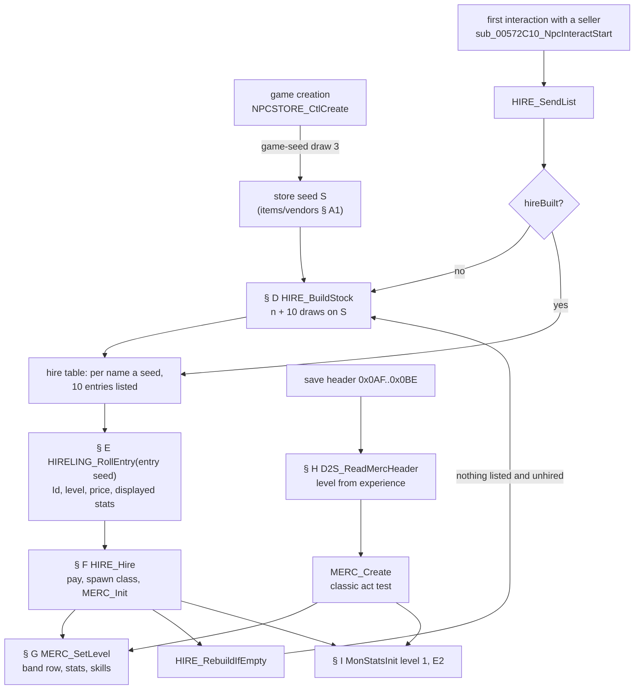
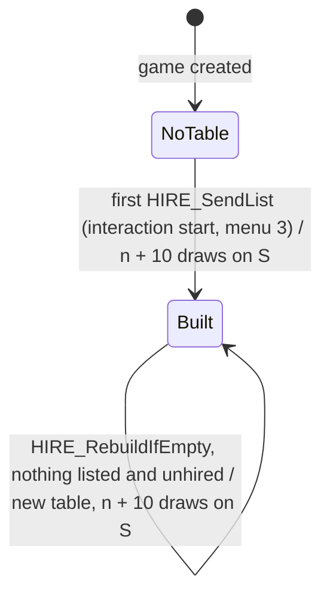
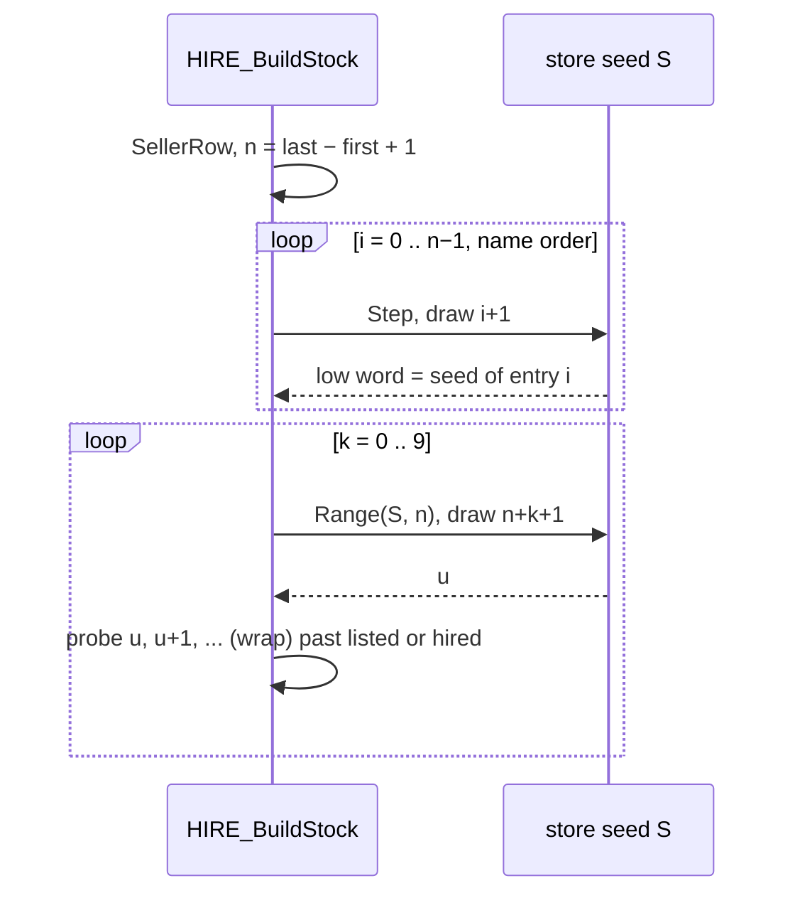
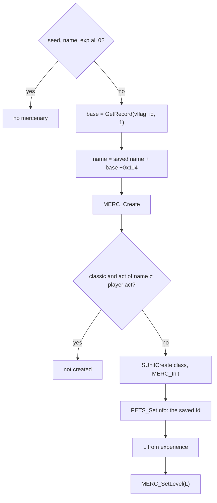

# Hirelings: the hire list, the hire, the mercenary's stats and its creation from a save

## Purpose

Four town NPCs hire out mercenaries: Kashya (Act I), Greiz (Act II), Asheara (Act III) and Qual-Kehk (Act V). The
first time a player talks to one of them in a game, the server builds that NPC's **hire table** from the store seed:
one seed per name of the seller's name range, then 10 names picked into the list. Each listed entry's seed decides
its type (a `Hireling.txt` `Id`) and its level offset; the player's level at that moment decides the rest. A hire
stores `{seed, name, Id}` with the player and creates the mercenary, whose level and stats then follow from
`Hireling.txt`, its level and its experience. A saved mercenary is recreated from the same three values plus its
experience. This spec gives the build and its draw order, the entry roll, the hire, the stats per level, the load
from a save, the monster class and level path, and the mercenary's magic find. Combat AI and skill use, item
restrictions, resurrection and death are named only (§ K).

Names of functions, structs and fields are ours ([hirelings/0001](../../findings/hirelings/0001-hirelings.md),
`re/types/hireling.h`). Column names are those of [Hireling](../../tables/Hireling.md) and
[HireDesc](../../tables/HireDesc.md).

Notation. `S` is the **store seed** of [items/vendors § A](../items/vendors.md#a-store-records-and-the-store-seed-game-creation),
`NpcControl+0x08`; the finding's "NPC seed" is the same object, and this spec defines no second seed. `Step`, `Init`
and `Range` are the primitives of [rng](../rng/README.md#algorithm): `Init(x)` makes `{x, 666}`; `Range(s, n)` is 0
with no draw when `n < 1` (signed), else one step and `low mod n` (unsigned). `vflag` is the game's expansion flag
(`Game+0x70`): rows with `Version` 100 are used when it is set, rows with `Version` 0 otherwise. `difficulty` is
`Game+0x6D` (0..2). `d = L − row.Level` for a mercenary of level `L` and a `Hireling` row. "÷" truncates toward zero,
`>>` on a signed value is arithmetic (a floor).



## Entry points

| When | Function | Tag |
|---|---|---|
| Game creation: the store seed `S` the hire tables draw from | fn:NPCSTORE_CtlCreate@0x00536070 ([items/vendors § A](../items/vendors.md#a-store-records-and-the-store-seed-game-creation)), run:2026-10-16-hirelings | [C] |
| A seller starts interacting with a player: the hire table is built if it has none | fn:sub_00572C10_NpcInteractStart@0x00572C10 → fn:HIRE_SendList@0x00576770 → fn:HIRE_BuildStock@0x00576070, run:2026-10-16-hirelings | [C] |
| NPC menu action 3 (open the hire list) | fn:NPC_MenuAction@0x00579D60 → fn:HIRE_SendList@0x00576770, run:2026-10-16-hirelings | [C] |
| Trade opened at a seller whose `trader` byte is set (Asheara), before any interaction built the table | fn:NPC_OpenStore@0x00578B30 → fn:HIRE_BuildStock@0x00576070 | [I] |
| Hire request | fn:HIRE_Hire@0x005770E0, run:2026-10-16-hirelings | [C] |
| After a hire, the list is empty: rebuild | fn:HIRE_RebuildIfEmpty@0x00577010, run:2026-10-16-hirelings | [C] |
| Quest gift (Act I and Act III quests) | fn:HIRE_GiveFreeMerc@0x00579180 | [I] |
| A save with a mercenary header is loaded | fn:D2S_ReadMercHeader@0x0056AA50 → fn:MERC_Create@0x005774F0, run:2026-10-16-hirelings | [C] |
| A save older than version 92 | fn:sub_00533C70_ReadMercOldSave@0x00533C70 | [I] |

## Inputs

### Tables

| Anchor | Used for |
|---|---|
| tbl:Hireling.txt:Version, tbl:Hireling.txt:Id, tbl:Hireling.txt:Level | row identity: `(Version, Id)` groups of 1–3 rows, one per level band, in `Level` order (§ A) |
| tbl:Hireling.txt:Act, tbl:Hireling.txt:Difficulty (both 1-based) | the type draw's rows (§ E) |
| tbl:Hireling.txt:Seller, tbl:Hireling.txt:Class | the seller's name range and the spawned MonStats class (§ D, § F, § I) |
| tbl:Hireling.txt:NameFirst, tbl:Hireling.txt:NameLast (string indices at `+0x114`/`+0x116`) | the name range (§ D) ([data/strings](../data/strings.md)) |
| tbl:Hireling.txt:Gold, tbl:Hireling.txt:Exp/Lvl | price and experience (§ E, § G) |
| tbl:Hireling.txt:HP, tbl:Hireling.txt:HP/Lvl, tbl:Hireling.txt:Def/Lvl, tbl:Hireling.txt:Str/Lvl, tbl:Hireling.txt:Dex/Lvl, tbl:Hireling.txt:AR/Lvl, tbl:Hireling.txt:Dmg/Lvl, tbl:Hireling.txt:Resist/Lvl and their base columns | the stats per level (§ E, § G) |
| tbl:Hireling.txt:Skill1, tbl:Hireling.txt:Mode1, tbl:Hireling.txt:Level1, tbl:Hireling.txt:LvlPerLvl1 (slots 1..6) | the skills per level (§ G) |
| tbl:Hireling.txt:HireDesc (a row of tbl:HireDesc.txt:Code) | copied into the list entry (§ E) |
| tbl:Skills.txt:reqlevel | a skill is given only from its required level (§ G) |
| `experience.txt` `MaxLvl`, Amazon column (99) | the load's level cap (§ H) |

### Runtime state

| State | Type | Source |
|---|---|---|
| store seed `S` | Seed ([rng](../rng/README.md#algorithm)) | struct:NpcControl+0x08, seeded once per game ([items/vendors § A1](../items/vendors.md#a-store-records-and-the-store-seed-game-creation)) |
| NPC record | 0x44 bytes per NPC class | `hireBuilt` (struct:NpcRecord+0x21), `pHireTable` (struct:NpcRecord+0x10), `act` (`+0x22`), `trader` (`+0x23`) |
| hire table | 69 × `HireEntry` (16 bytes) | struct:HireEntry+0x0 `nameIdx` u16, `+0x4` `seed` u32, `+0x8` `hired` u32, `+0xC` `listed` u32 |
| mercenary info | `MercInfo` (12 bytes) in the player's pet list, pet type 7 | struct:MercInfo+0x0 `seed` u32, `+0x4` `nameIdx` u16, `+0x8` `hirelingId` u32 |
| `playerLevel` | i32 | the player's stat 12, read at each entry roll |
| `vflag`, `difficulty` | bool, u8 | `Game+0x70`, `Game+0x6D` |

### Constants

| Name | Value | Anchor | Tag |
|---|---|---|---|
| sellers (MonStats rows) | Kashya 150, Greiz 198, Asheara 252, Qual-Kehk 515 | fn:HIRE_SendList@0x00576770, run:2026-10-16-hirelings | [C] |
| `LIST_SIZE` | 10 picks per build | fn:HIRE_BuildStock@0x00576070, run:2026-10-16-hirelings | [C] |
| hire table size | 0x450 bytes, 69 entries | fn:HIRE_BuildStock@0x00576070 | [I] |
| name ranges (string indices, English tables) | Rogue 3411..3451 (41), Act II 1019..1039 (21), Act III 1040..1059 (20), Barbarian 10835..10901 (67) | fn:STRTABLE_GetByKey@0x00524D30, tbl:Hireling.txt:NameFirst, run:2026-10-16-hirelings | [C] |
| pet type of a mercenary | 7 | fn:PETS_Add@0x00575E90, run:2026-10-16-hirelings | [C] |
| level floor of a list entry | 2 | fn:HIRELING_RollEntry@0x006637F0 | [I] |
| skill level cap | 32 | fn:MERC_SetLevel@0x00572840, run:2026-10-16-hirelings | [C] |
| level cap of a loaded mercenary | 99 (`sub_00611830_ExpMaxLevel(0)`) | fn:sub_00611830_ExpMaxLevel@0x00611830 | [I] |

- [C] The name ranges are those the run's tables hold: every logged table's `nameIdx` runs over the seller's range.
  They are string indices of the loaded string tables, so another language's tables could move them; the spec's
  algorithm uses `+0x114`/`+0x116` as loaded, never these numbers. (fn:HIRELING_LoadTable@0x00655720,
  fn:STRTABLE_GetByKey@0x00524D30, run:2026-10-16-hirelings)

## Algorithm

### A. Table lookups

```
GetRecord(vflag, id: i32, L: i32) → row | none:                          [C] (fn:HIRELING_GetRecord@0x006562F0, run:2026-10-16-hirelings)
A1. if id > 255: return none
A2. i ← g_HirelingFirstById[(vflag ≠ 0) × 256 + id];  if i < 0: return none
A3. prev ← none
    for each row r from i to the end of the table:
      if r.Id = id and r.Version = (vflag ≠ 0 ? 100 : 0):
        if prev ≠ none and L < r.Level: return prev
        prev ← r
      else if id < r.Id: return prev
    return prev

NextByActDiff(vflag, act, diff, prev) → row | none:                      [C] (fn:HIRELING_NextByActDiff@0x00656580, run:2026-10-16-hirelings)
A4. the next row after prev (from the first row when prev = none) with Version of vflag,
    Act = act + 1, Difficulty = diff + 1 and, when prev ≠ none, Level = prev.Level

TypeRows(vflag, act, diff) → list of rows:
A5. chain NextByActDiff from none: the rows of the first Level band only, one row per type   [C] (fn:HIRELING_NextByActDiff@0x00656580, run:2026-10-16-hirelings)

SellerRow(vflag, seller) → row:
A6. HIRELING_NextBySeller(vflag, seller, 0, none): the first row of that seller            [C] (fn:HIRE_GetNameRange@0x00575FF0, fn:HIRELING_NextBySeller@0x006564D0, run:2026-10-16-hirelings)
    with Difficulty 1 (its Normal row), whatever the game's difficulty

GetAct(vflag, 0, name) → i32:
A7. Act − 1 of the first row whose name range (+0x114 .. +0x116) holds name, else 0       [C] (fn:HIRELING_GetAct@0x00663750, fn:HIRE_Hire@0x005770E0, run:2026-10-16-hirelings)
```

Step notes:

- A3. [I] `GetRecord` returns the matching row with the greatest `Level` ≤ `L`, or the first row of the Id when `L` is
  below every band. That relies on the rows of one Id being in `Level` order, which the stock file is.
  (fn:HIRELING_GetRecord@0x006562F0, tbl:Hireling.txt:Level, [Hireling § Row identity](../../tables/Hireling.md#row-identity))
- A2. [I] The loader fills `g_HirelingFirstById[(Version > 99)·256 + Id]` with the first row of each (version, Id),
  −1 for none, and fills `+0x114`/`+0x116` from `NameFirst`/`NameLast` with `STRTABLE_GetByKey`; in an expansion
  install it stops with a fatal error when the first index is 0, when last ≤ first, or when `Id` > 255.
  (fn:HIRELING_LoadTable@0x00655720, data:g_HirelingFirstById@0x0096BDD8, fn:STRTABLE_GetByKey@0x00524D30)
- A5. [C] On stock data `TypeRows` has 2 or 3 rows: the two Rogue types (fire, cold), the three types of Act II and of
  Act III, the two Barbarian Ids (24/25, 26/27, 28/29, identical except for `Id`). (fn:HIRELING_NextByActDiff@0x00656580,
  run:2026-10-16-hirelings, [Hireling § Interpretation notes](../../tables/Hireling.md#interpretation-notes))

### B. The store seed

- [C] The hire table draws on `S`, the store seed of [items/vendors § A1](../items/vendors.md#a-store-records-and-the-store-seed-game-creation):
  `Init(low)` of game-seed draw 3, taken once per game by `NPCSTORE_CtlCreate`. `NPCSTORE_GetSeed` returns the same
  object to vendor and hire code. In run:2026-10-16-hirelings every game's `S` was `Init` of the low word of game-seed
  draw 3 (48 of 48). (fn:NPCSTORE_CtlCreate@0x00536070, fn:NPCSTORE_GetSeed@0x00536B40, 0x005360D2–0x005360FB,
  run:2026-10-16-hirelings)
- [C] Vendor stock builds, stock upgrades, gamble builds and hire builds all draw on `S` and interleave in game
  order: the `S` at the entry of every logged stock, gamble and `HIRE_BuildStock` call of run:2026-10-15-vendors is the
  chain of the vendor model plus the logged hire builds. A reimplementation keeps one `S` and runs each build at the
  moment the game does. (fn:NPCSTORE_GetSeed@0x00536B40, run:2026-10-15-vendors,
  [hirelings/0001 § 2](../../findings/hirelings/0001-hirelings.md#2-the-npc-records-and-the-npc-seed))
- [C] `HIRELING_RollEntry` draws on a seed object of its own (§ E), never on `S`. In run:2026-10-16-hirelings, where
  no trade or gamble window was opened, `S` chained from game creation through all 53 builds with no other draw
  between. (fn:HIRELING_RollEntry@0x006637F0, run:2026-10-16-hirelings)

### C. When the table is built and rebuilt



```
SendList(npc):                                                           [C] (fn:HIRE_SendList@0x00576770, run:2026-10-16-hirelings)
C1. if npc.class ∉ {150, 198, 515, 252}: return
C2. if rec(npc).hireBuilt = 0: BuildStock(rec(npc))                      ; § D
C3. send every entry with listed ≠ 0 and hired = 0

RebuildIfEmpty(npc):                                                     [C] (fn:HIRE_RebuildIfEmpty@0x00577010, run:2026-10-16-hirelings)
C4. if no entry has listed ≠ 0 and hired = 0:
      free the table; pHireTable ← none; hireBuilt ← 0
      BuildStock(rec(npc))                                               ; another n + 10 draws on S
```

Step notes:

- C2. [C] `SendList` is called from `sub_00572C10_NpcInteractStart` (an NPC begins interacting with a player), from
  `NPC_MenuAction` command 3 and after a hire. So the table is built at the first talk with each seller in a game:
  all 52 first builds of the run came from `HIRE_SendList` at the first interaction.
  (fn:sub_00572C10_NpcInteractStart@0x00572C10, fn:NPC_MenuAction@0x00579D60, run:2026-10-16-hirelings)
- C2. [I] `NPC_OpenStore` would also build the table, after the vendor stock, for an NPC whose `trader` byte is set
  (Asheara); the interaction start comes first, and the run never reached that path. (fn:NPC_OpenStore@0x00578B30)
- C4. [C] `RebuildIfEmpty` runs after each hire. The run's one rebuild came after the 10th hire at Qual-Kehk emptied
  the list, from the chained `S`, and the list opened after it showed the new table. Nothing else clears the table
  during a game. (fn:HIRE_RebuildIfEmpty@0x00577010, run:2026-10-16-hirelings)
- C4. [I] It also runs after a free mercenary (§ K), not exercised. (fn:HIRE_GiveFreeMerc@0x00579180)
- [I] The table lives in the game's NPC record, so all players of a game share it. (fn:HIRE_SendList@0x00576770,
  struct:NpcRecord+0x10)
- [C] **One list per game, with two players.** In plan 0044's two-client run Kashya's table was built once, at the
  host's first open, and the joiner's open received the listed entries of that table with no second build. Scope: one
  seller, two players. (fn:HIRE_SendList@0x00576770, run:2026-10-20-two-clients,
  [multiplayer/0001 § 6](../../findings/multiplayer/0001-cases.md#6-phase-2-results-run2026-10-20-two-clients))

### D. The stock build (`HIRE_BuildStock`)



```
BuildStock(rec):                                                         [C] (fn:HIRE_BuildStock@0x00576070, run:2026-10-16-hirelings)
D1. if rec.hireBuilt ≠ 0: return
    rec.hireBuilt ← 1
    if rec.pHireTable ≠ none: return
D2. t ← 69 entries of 16 bytes, all zero;  rec.pHireTable ← t
D3. row ← SellerRow(vflag, rec.class);  first: i32 ← row[+0x114];  last: i32 ← row[+0x116]
    n: i32 ← last − first + 1
D4. for i in 0 ..< n while first + i ≤ last:
      t[i].nameIdx ← first + i
      Step(S);  t[i].seed ← S.low                                        ; draw i+1 on S
      t[i].hired ← 0;  t[i].listed ← 0
D5. for k in 0 ..< 10:
      u: u32 ← Range(S, n)                                               ; draw n+k+1 on S
      v ← u
      while t[v].listed ≠ 0 or t[v].hired ≠ 0:                           ; the probe never draws
        v ← v + 1;  if v ≥ n: v ← 0
        if v = u: return
      t[v].listed ← 1
```

Step notes:

- D3. [C] The name range is that of the seller's **Normal** row in every difficulty, so a seller offers the same
  names in Nightmare and Hell. (fn:HIRE_GetNameRange@0x00575FF0, tbl:Hireling.txt:Seller, tbl:Hireling.txt:Difficulty,
  run:2026-10-16-hirelings)
- D3. [I] `HIRE_GetNameRange` treats a range whose `last − first + 1` is −1 as fatal; no stock row comes near it.
  (fn:HIRE_GetNameRange@0x00575FF0)
- D4. [C] Every name index gets a seed, picked or not, and all the seeds are drawn before any pick: one build is
  exactly `n + 10` draws on `S` (Kashya 51, Greiz 31, Asheara 30, Qual-Kehk 77 on the English tables). The run
  reproduced 53 builds and 2625 draws on `S`. (fn:HIRE_BuildStock@0x00576070, run:2026-10-16-hirelings)
- D5. [C] On a fresh table nothing is listed or hired, and every stock `n` is ≥ 20, so the 10 picks list 10 distinct
  names; a pick that lands on a listed entry steps +1 with wrap to the next free one, without a draw.
  (fn:HIRE_BuildStock@0x00576070, 0x00576120–0x005761B5, run:2026-10-16-hirelings)
- D1. [I] A build for a record that already holds a table (`pHireTable` set) only sets `hireBuilt` and draws nothing;
  `RebuildIfEmpty` clears both before it rebuilds, so on the paths read this does not happen. (fn:HIRE_BuildStock@0x00576070)

### E. An entry (`HIRELING_RollEntry`)

The entry's seed alone decides its type and its level offset. The player's level at the time of the roll decides
the level; the rest follows from the type's first-band row.

```
RollEntry(vflag, playerLevel: i32, seed: u32, act: i32, diff: i32) → out | 0:   [C] (fn:HIRELING_RollEntry@0x006637F0, run:2026-10-16-hirelings)
E1. s ← Init(seed)                                                       ; a seed of its own, not S
E2. rows ← TypeRows(vflag, act, diff);  k: i32 ← |rows|
    if k = 0: return 0                                                   ; no draw
E3. row ← rows[Range(s, k)]                                              ; entry draw 1
E4. Step(s);  L: i32 ← playerLevel + (i32)(s.low mod 5) − 5              ; entry draw 2; unsigned mod
    if L < 2: L ← 2
E5. d: i32 ← L − row.Level
    out.id       ← row.Id
    out.level    ← L
    out.life     ← max(40, row.HP + row.HP/Lvl × d)
    out.str      ← max(10, row.Str + ((row.Str/Lvl × d) >> 3))           ; floor
    out.dex      ← max(10, row.Dex + ((row.Dex/Lvl × d) >> 3))
    out.price    ← max(row.Gold, ((15 × d + 100) × row.Gold) ÷ 100)      ; signed, truncating
    out.exp      ← max(0, (L + 1) × row.Exp/Lvl × L × L)                 ; i32
    out.defense  ← max(0, row.Defense + row.Def/Lvl × d)
    out.dmgMin   ← max(0, row.Dmg-Min + ((row.Dmg/Lvl × d) >> 3))
    out.dmgMax   ← max(1, row.Dmg-Max + ((row.Dmg/Lvl × d) >> 3))
    out.share    ← max(0, row.Share);  out.resist ← max(0, row.Resist)
    out.hireDesc ← row.HireDesc;  out[+0x34] ← 1;  out[+0x38] (u16) ← 0
    return 1
```

Step notes:

- E1–E4. [C] Every one of the 723 logged calls (530 from the client's list window, 49 from `HIRE_Hire`, 72 from
  `MERC_Init`, 72 from the client's mercenary init) reproduces from its seed, act, difficulty and player level alone,
  expansion and classic rows. (fn:HIRELING_RollEntry@0x006637F0, fn:sub_004B5C60_ClientHireListDraw@0x004B5C60,
  fn:sub_004B1090_ClientMercInit@0x004B1090, run:2026-10-16-hirelings)
- E2. [C] The caller passes `act = GetAct(vflag, 0, entry.nameIdx)` (A7), so a list shows its own act's types, and
  `diff` = the game's difficulty. (fn:HIRE_Hire@0x005770E0, 0x0057725C–0x0057727A, run:2026-10-16-hirelings)
- E4. [C] A list entry is 1 to 5 levels **below** the player, never above: the 530 client list entries of the run lie
  at player level −5 .. −1 (−5: 109, −4: 92, −3: 112, −2: 107, −1: 110). (0x00663874–0x006638BB,
  run:2026-10-16-hirelings)
- E4. [I] The floor of 2 was not reached (players at level 30 and 75). (fn:HIRELING_RollEntry@0x006637F0)
- E4. [C] The level follows the player's **current** level at each roll; the client rolls the entry to draw the list
  and the server rolls it again at the hire. (fn:sub_004B5C60_ClientHireListDraw@0x004B5C60, fn:HIRE_Hire@0x005770E0,
  run:2026-10-16-hirelings)
- E4. [I] So a level-up between opening the list and the hire changes the mercenary bought; the run had none.
  (fn:HIRELING_RollEntry@0x006637F0)
- E5. [C] The price is `Gold` raised 15 % per level above the band start, never below `Gold`; the run's 49 hires paid
  exactly `out.price`. (0x0066391F–0x0066394C, tbl:Hireling.txt:Gold, run:2026-10-16-hirelings)
- E5. [C] The displayed stats use the **first band's row** with **floor** division for the eighths and no
  per-level resistance, while the stats in the world (§ G) use the row of the mercenary's own band with truncating
  division. The two agree only while `L` is inside the first band and `d ≥ 0`. (fn:HIRELING_RollEntry@0x006637F0,
  fn:MERC_SetLevel@0x00572840, run:2026-10-16-hirelings)
- E5. [I] The client list window draws up to 10 entries, and shows name index 1057 (`Lharhad`) as 11021 (`Jarulf`),
  as does the client's mercenary init; the run compared the window's `RollEntry` calls, not its text.
  (fn:sub_004B5C60_ClientHireListDraw@0x004B5C60, fn:sub_004B1090_ClientMercInit@0x004B1090)
- E5. [I] **`Share` has no effect.** `RollEntry` copies `max(0, Share)` into the entry at `+0x28`, but none of its four
  callers (`MERC_Init`, `HIRE_Hire`, the client's mercenary init and the list window) reads `+0x28`. The equipment
  columns `Head`, `Torso`, `Weapon` and `Shield` (record `+0x68`…`+0x74`) and `Share` (`+0x4C`) are read by none of
  the code that holds a `Hireling` record: the loader, `HIRELING_FreeTable`, the five getters and their 19 callers,
  none of which passes a record on. (0x006639C0–0x006639D1, fn:HIRELING_RollEntry@0x006637F0,
  data:g_pHirelingTxt@0x0096BDD0, fn:HIRELING_GetRecord@0x006562F0, tbl:Hireling.txt:Share, tbl:Hireling.txt:Head;
  [hirelings/0001 § Plan 0039 batch P1c](../../findings/hirelings/0001-hirelings.md#plan-0039-batch-p1c-2026-10-17))
- E5. [I] **The description text is a hard-coded string.** The list window takes the entry's `HireDesc` (`+0x30`) and
  calls `HIRELING_DescString(index)`, which for an index 0..8 with a non-zero word returns
  `STRTABLE_GetByIndex(g_HireDescStrIdx[index])`, and none otherwise; the window appends it to the row's line.
  `hiredesc.bin` plays no part in the text. (0x004B6262–0x004B6267, fn:HIRELING_DescString@0x00663720,
  data:g_HireDescStrIdx@0x006EE410, fn:sub_004B5C60_ClientHireListDraw@0x004B5C60)
- E5. [C] **The table matches every `HireDesc` row by data.** Its nine u16 are 0, 3371, 3372, 11090, 11088, 11089,
  3377, 3376 and 3375, which in the English tables read none, "Fire Arrow", "Cold Arrow", "Combat", "Defensive",
  "Offensive", "Fire", "Cold" and "Lightning": the rows `None`, `farw`, `carw`, `comb`, `def`, `off`, `fire`, `cold`
  and `ltng` in order. So row 0 (the Barbarians) shows no description. (data:g_HireDescStrIdx@0x006EE410,
  tbl:HireDesc.txt:Code)

### F. The hire (`HIRE_Hire`, `MERC_Init`)

```
Hire(player, npc, nameIdx):
F1. if npc = 515 and bit 0 of quest word 36 is clear for the game's difficulty: refuse          [I] (fn:HIRE_Hire@0x005770E0, fn:QUESTRECORD_GetState@0x0065C310)
    if npc = 150 and VENDOR_StockLevel(playerLevel) < 8 and bit 0 of quest word 2 is clear: refuse   [I] (fn:VENDOR_StockLevel@0x00576890)
F2. first ← SellerRow(vflag, npc)[+0x114]; e ← t[nameIdx − first]                                [I] (0x005771E8–0x00577258)
    refuse unless nameIdx is in the seller's range, e.nameIdx = nameIdx and e.hired = 0          ; listed is not tested
F3. out ← RollEntry(vflag, playerLevel, e.seed, GetAct(vflag, 0, nameIdx), difficulty)          [C] (fn:HIRE_Hire@0x005770E0, run:2026-10-16-hirelings)
    pay out.price: inventory gold (stat 14) first                                                 [C] (fn:sub_00576D90_PayGold@0x00576D90, run:2026-10-16-hirelings)
    the rest from the stash gold (stat 15); refuse if the two fall short                          [C] (fn:sub_00576D90_PayGold@0x00576D90, run:2026-10-17-economy)
F4. merc ← spawn MonStats class SellerRow(vflag, npc).Class near the player (tried twice)          [C] (fn:HIRE_Hire@0x005770E0, run:2026-10-16-hirelings)
    e.hired ← 1
F5. MERC_Init(merc, 0xFFFF, {nameIdx, e.seed})                                                    [C] (fn:MERC_Init@0x00573270, run:2026-10-16-hirelings)
F6. resend the list; send the hire message; RebuildIfEmpty(npc)                                   [C] (fn:HIRE_RebuildIfEmpty@0x00577010, run:2026-10-16-hirelings)

MERC_Init(merc, id, {name, seed}, dead):                                                          [C] (fn:MERC_Init@0x00573270, run:2026-10-16-hirelings)
F7. unit flags |= 0x4020200; alignment 2
    if the player already has a mercenary (pet type 7, dead or alive): release and remove it
F8. out ← RollEntry(vflag, playerLevel, seed, GetAct(vflag, 0, name), difficulty)
    PETS_Add(merc, 7, {seed, name, out.id})
F9. MonSetOwner(merc, player id, player type)                                                    ; § J
F10. if id = 0xFFFF (a fresh hire):
       stat 13 ← out.exp
       MERC_SetLevel(merc, out.level)                                                             ; § G
       send the stats
```

Step notes:

- F1. [I] The quest gates, a refused hire and the gold check were not exercised; Kashya's cap `VENDOR_StockLevel` is
  `min(level, {12, 20, 28, 36, 45}[act])` in Normal and the level otherwise, so her gate is "player level below 8".
  (fn:VENDOR_StockLevel@0x00576890, fn:HIRE_Hire@0x005770E0)
- F2. [I] A hire of an entry that is in the table but not listed would pass this test; the run never sent one.
  (fn:HIRE_Hire@0x005770E0)
- F3–F5. [C] In the 49 hires: the price paid is `RollEntry`'s, taken from inventory gold; `MERC_Init` gets the entry's
  `{name, seed}`; the spawned class is the `Class` of the seller's Normal row (271, 338, 359 or 561); the mercenary's
  level is `RollEntry`'s level. Hires at Kashya, Asheara and Qual-Kehk. (fn:HIRE_Hire@0x005770E0,
  fn:MERC_Init@0x00573270, tbl:Hireling.txt:Class, run:2026-10-16-hirelings)
- [I] A hire at Greiz takes the same code; Greiz lists were built in all three difficulties, but no Greiz hire was
  made. Classic hire lists and hires (the `Version` 0 rows) were not run either. (fn:HIRE_Hire@0x005770E0,
  fn:HIRE_BuildStock@0x00576070)
- F8. [C] Both `RollEntry` calls of a hire (F3 and F8) draw on their own seed object, so a hire costs no draw on `S`
  unless `RebuildIfEmpty` rebuilds. (fn:HIRELING_RollEntry@0x006637F0, run:2026-10-16-hirelings)
- F8. [I] The saved header (`D2S_WriteMercHeader`) copies this pet info: seed, name minus `+0x114`, Id, experience
  and the dead flag ([save/d2s § D](../save/d2s.md#d-header-fields)); no save was written in the run.
  (fn:D2S_WriteMercHeader@0x00568E60, fn:PETS_GetInfo@0x00574BD0)

### G. The stats per level (`MERC_SetLevel`)

`MERC_SetLevel(merc, L)` takes `row ← GetRecord(vflag, info.hirelingId, L)`, the row whose `Level` band holds `L`,
and `d: i32 ← L − row.Level`. All arithmetic is i32. [C] (fn:MERC_SetLevel@0x00572840, fn:HIRELING_GetRecord@0x006562F0,
run:2026-10-16-hirelings)

| Stat (id) | Value | Division | Clamp | Tag |
|---|---|---|---|---|
| `level` (12) | `L` | — | — | [C] (fn:MERC_SetLevel@0x00572840, run:2026-10-16-hirelings) |
| `nextexp` (30) | `ExpForLevel(L + 1, row.Exp/Lvl)` if `L < 98`, else 0 | — | — | [C] (fn:MERC_SetLevel@0x00572840, run:2026-10-16-hirelings) |
| `experience` (13) | `max(current, ExpForLevel(L, row.Exp/Lvl))` | — | — | [C] (fn:MERC_SetLevel@0x00572840, run:2026-10-16-hirelings) |
| `strength` (0) | `Str + (Str/Lvl × d) ÷ 8` | ÷ 8, truncating | min 10 | [C] (tbl:Hireling.txt:Str/Lvl, run:2026-10-16-hirelings) |
| `dexterity` (2) | `Dex + (Dex/Lvl × d) ÷ 8` | ÷ 8, truncating | min 10 | [C] (tbl:Hireling.txt:Dex/Lvl, run:2026-10-16-hirelings) |
| `maxhp` (7), `hitpoints` (6) | `(HP + HP/Lvl × d) × 256` (life in 1/256) | — | min 40 × 256 | [C] (tbl:Hireling.txt:HP/Lvl, run:2026-10-16-hirelings) |
| `armorclass` (31) | `Defense + Def/Lvl × d` | — | min 0 | [C] (tbl:Hireling.txt:Def/Lvl, run:2026-10-16-hirelings) |
| `tohit` (19) | `AR + AR/Lvl × d` | — | min 0 | [C] (tbl:Hireling.txt:AR/Lvl, run:2026-10-16-hirelings) |
| `secondary_mindamage` (23) | `Dmg-Min + (Dmg/Lvl × d) ÷ 8` | ÷ 8, truncating | min 0 | [C] (tbl:Hireling.txt:Dmg/Lvl, run:2026-10-16-hirelings) |
| `secondary_maxdamage` (24) | `Dmg-Max + (Dmg/Lvl × d) ÷ 8` | ÷ 8, truncating | min 1 | [C] (tbl:Hireling.txt:Dmg/Lvl, run:2026-10-16-hirelings) |
| fire, lightning, cold, poison resist (39, 41, 43, 45) | `Resist + (Resist/Lvl × d) ÷ 4`, one value for all four | ÷ 4, truncating | min 0 | [C] (tbl:Hireling.txt:Resist/Lvl, 0x00572A7D–0x00572A83, run:2026-10-16-hirelings) |
| `hpregen` (74) | `maxhp ÷ 2000`, `maxhp` in 1/256 | ÷ 2000, truncating | min 0 | [C] (fn:MERC_SetLevel@0x00572840, run:2026-10-16-hirelings) |

```
ExpForLevel(L: i32, e: i32) → i32 ← (L + 1) × L × L × e                 [C] (fn:HIRELING_ExpForLevel@0x00663790, 0x0066394F–0x00663968, run:2026-10-12-mon-pool-p2)

Skills(merc, row, L, d):                                                [C] (0x00572B3A–0x00572B7E, fn:sub_0056DEB0_UnitSkillAdd@0x0056DEB0, run:2026-10-16-hirelings)
G1. for i in 1 ... 6:
      if row.Skill_i < 1 or row.Skill_i ≥ skill count or row.Mode_i > 15 (signed): stop
      if Skills[row.Skill_i].reqlevel > L: continue
      slvl: i32 ← min(32, row.Level_i + ((row.LvlPerLvl_i × d) >> 5))  ; floor
      if slvl ≥ 1: add skill row.Skill_i at level slvl
```

Step notes:

- [C] The whole table, the band row included, holds for the 72 logged `MERC_SetLevel` calls (49 hires, 23 loads):
  rows of every band, `d` from −41 to 27, the clamps reached (life 40, AR and defence 0) and the stat list compared
  entry for entry. (fn:MERC_SetLevel@0x00572840, run:2026-10-16-hirelings)
- [C] **Negative `d` truncates.** Below the first band (a clvl 30 player hiring in Nightmare or Hell) the product
  `column × d` is negative, and `MERC_SetLevel` divides toward zero: 17 logged levels give a different strength,
  dexterity or damage under floor division, and every one matches truncation. `RollEntry` (§ E) floors the same
  product, so the list and the world differ there. (fn:MERC_SetLevel@0x00572840, fn:HIRELING_RollEntry@0x006637F0,
  run:2026-10-16-hirelings)
- [C] **Resistances are quarters.** 32 logged levels where `Resist/Lvl × d ÷ 4` and `÷ 8` differ all match `÷ 4`
  (for example a Normal Rogue, `Resist/Lvl` 8, band 3, at L 27: 48). (0x00572A77–0x00572ABD, run:2026-10-16-hirelings)
- [C] **A stat clamped to 0 leaves no entry.** AR and defence that clamp to 0 are absent from the mercenary's stat
  list rather than present with value 0 (16 such stats in the run). (fn:MERC_SetLevel@0x00572840, run:2026-10-16-hirelings)
- [C] For a non-negative product the strength, dexterity, life, defence and damage arithmetic and the skill level
  have a second code path: `HIRELING_RollEntry` reads the same offsets with the same operation and clamps, and the
  client's mercenary init computes `min(32, Level_i + (LvlPerLvl_i × d >> 5))` from the same bytes (with `d`
  clamped at 0 and no `reqlevel` test). (fn:HIRELING_RollEntry@0x006637F0, fn:sub_004B1090_ClientMercInit@0x004B1090,
  0x004B115A–0x004B1178)
- G1. [C] The skill loop stops at the first empty slot or `Mode_i > 15` but only skips a skill whose `reqlevel` is
  above `L`. On stock data slots 4–6 are always empty and slot 3 is used only by the Cold Eastern Sorcerors.
  (tbl:Skills.txt:reqlevel, tbl:Hireling.txt:Skill1, tbl:Hireling.txt:Mode1, tbl:Hireling.txt:Level1,
  tbl:Hireling.txt:LvlPerLvl1, run:2026-10-16-hirelings)
- [I] Levelling in play, named only: `MERC_AddExp` adds experience and calls `MERC_SetLevel` for each level reached,
  only while the mercenary's level is below its owner's; `MERC_CapExpGain` caps one gain at
  `(ExpForLevel(L+1) − ExpForLevel(L)) >> 6`. Not reached by the run. (fn:MERC_AddExp@0x0057E860,
  fn:MERC_CapExpGain@0x0057E3F0)

### H. The mercenary from a save (`D2S_ReadMercHeader`, `MERC_Create`)



```
ReadMercHeader(save):                                                    [C] (fn:D2S_ReadMercHeader@0x0056AA50, run:2026-10-16-hirelings)
H1. flags: u32 ← save[0x0AF]; seed: u32 ← save[0x0B3]; name: u16 ← save[0x0B7]; id: u16 ← save[0x0B9]; exp: u32 ← save[0x0BB]
H2. if seed = 0 and name = 0 and exp = 0: return none                                     [I] (fn:D2S_ReadMercHeader@0x0056AA50)
H3. base ← GetRecord(vflag, id, 1)
    name ← name + base[+0x114]
    if name > base[+0x116]: name ← base[+0x114]                                            [I] (fn:D2S_ReadMercHeader@0x0056AA50)
H4. dead ← flags & 0x10000                                                                 [I] (fn:D2S_ReadMercHeader@0x0056AA50)
H5. merc ← MERC_Create(name, seed, id, base.Class, dead);  if none: return none
H6. PETS_SetInfo(merc, {seed, name, id})                                                   ; the saved Id wins
H7. stat 13 ← max(stat 13, exp)
H8. L: i32 ← 1
    while L + 1 ≤ 99 and ExpForLevel(L + 1, GetRecord(vflag, id, L).Exp/Lvl) ≤ exp: L ← L + 1
H9. MERC_SetLevel(merc, L)                                                                 ; § G
H10. if dead: mark the pet dead, unit flag 0x10000, mode 12                                [I] (fn:PETS_OnDeath@0x005751A0)

MERC_Create(name, seed, id, class, dead):                                                  [C] (fn:MERC_Create@0x005774F0, run:2026-10-16-hirelings)
H11. a ← GetAct(vflag, 0, name)
     if vflag = 0 and (a < 0 or a ≠ the player's act): return none                        ; classic only
H12. if the seller's hire table exists and the entry of name is not listed: mark it hired  [I] (fn:MERC_Create@0x005774F0)
H13. row ← GetRecord(vflag, id, 1)
     if id = 0xFFFF: row ← the first NextByActDiff(vflag, act, difficulty) row          [I] (fn:MERC_Create@0x005774F0) ; not exercised
H14. merc ← SUnitCreate(type 1, row.Class, …, mode = dead ? 12 : 1)
     MERC_Init(merc, id, {name, seed}, dead)                                               ; § F, no SetLevel there (id ≠ 0xFFFF)
```

Step notes:

- H8. [C] The loaded level is the greatest `L` ≤ 99 whose threshold, with the row of band `L − 1`, is at most the
  experience. Two code paths compute the threshold, the `exphellmerc` save of run:2026-10-12-mon-pool-p2 gives 15
  (Id 4, `Exp/Lvl` 120, 500 000: `ExpForLevel(15)` = 432 000, `ExpForLevel(16)` = 522 240), and run:2026-10-16-hirelings
  adds 23 loads over every class and difficulty, L 3 to 80. (fn:HIRELING_ExpForLevel@0x00663790,
  fn:D2S_ReadMercHeader@0x0056AA50, run:2026-10-12-mon-pool-p2, run:2026-10-16-hirelings)
- H11. [C] **The classic act test.** In a classic game the mercenary is created only when the act of its name's row
  equals the player's act (`Client+0x1AC`); an expansion game creates it in any act. In the run, 10 classic loads in
  the Act IV town were not created, the 9 in the mercenary's own act were, and all 14 expansion loads (Act IV) were.
  (fn:MERC_Create@0x005774F0, fn:HIRELING_GetAct@0x00663750, run:2026-10-16-hirelings)
- H6. [C] The seed is carried in the pet info and rolled once more inside `MERC_Init` (F8), whose Id `PETS_SetInfo`
  then overwrites with the saved one. So the seed does not reach a loaded mercenary's stats: its level and stats come
  from the experience and the saved Id. (fn:MERC_Init@0x00573270, fn:PETS_SetInfo@0x005749B0, run:2026-10-16-hirelings)
- H2–H4, H10. [I] A name past `+0x116` and a dead mercenary were not loaded in the run. The run read 15 all-zero
  headers (saves without a mercenary) and none was followed by a `MERC_Create`, but the checker does not assert the
  empty-header test, so H2 stays inferred. (fn:D2S_ReadMercHeader@0x0056AA50, 0x0056AA5B–0x0056AA7A)
- [I] The mercenary's items are read after the header, into the unit `MERC_Create` returned
  ([save/d2s § H](../save/d2s.md#h-item-lists), `jf`). (fn:D2S_ReadMercItems@0x0056AC10)
- [I] Saves older than version 92 go through `sub_00533C70_ReadMercOldSave`, which does the same after converting
  the experience of versions below 90; version 71 saves carry no Id and are created with id `0xFFFF`.
  (fn:sub_00533C70_ReadMercOldSave@0x00533C70, fn:sub_00533BF0_MercExpFromOldSave@0x00533BF0)

### I. Monster class and the monster level

| Seller | `Class` | MonStats | `Level` / `Level(N)` / `Level(H)` | MonStatsInit level |
|---|---|---|---|---|
| Kashya | 271 | `roguehire` | 1 / 34 / 67 | 1 in every difficulty |
| Greiz | 338 | `act2hire` | 1 / 34 / 67 | 1 in every difficulty |
| Asheara | 359 | `act3hire` | 1 / 34 / 67 | 1 in every difficulty |
| Qual-Kehk | 561 | `act5hire2` | 1 / 1 / 1 | 1 |
| (none) | 560 | `act5hire1` | — | no `Hireling` row: no hire, gift or load creates it |

- [C] Every hire, free-mercenary and load path takes the class from a `Hireling` row (the seller's Normal row, or
  the saved Id's row), and the stock `Class` column holds only 271, 338, 359 and 561, in all 120 rows of both
  versions. So class 560, which `sub_0063EE90_HirelingType` also recognises, is never created as a mercenary on stock
  data; the 49 hires and 23 loads of the run all made the row's class. Whether any non-hireling path could create
  class 560 is outside this claim. (fn:MERC_Create@0x005774F0, fn:HIRE_Hire@0x005770E0, fn:HIRE_GiveFreeMerc@0x00579180,
  tbl:Hireling.txt:Class, run:2026-10-16-hirelings)
- [C] The four classes take step E2 of [monsters/pool](../monsters/pool.md#e-the-monster-level-sub_00573cb0_monstatsinit)
  (`d` ← 0): every mercenary creation of the run, the four classes in the three difficulties (expansion; 271, 338 and
  359 also classic), was made at MonStats `Level` 1 with `d` 0 (`tools/monpool.py check`, 10 788 of 10 788).
  (fn:sub_0063EE90_HirelingType@0x0063EE90, fn:sub_00573CB0_MonStatsInit@0x00573CB0, run:2026-10-16-hirelings)
- [C] Whatever level MonStatsInit gave, `MERC_SetLevel` overwrites stat 12 and the stats of § G right after the
  creation: in `MERC_Init` for a hire, in `D2S_ReadMercHeader` for a load. (fn:MERC_Init@0x00573270,
  fn:D2S_ReadMercHeader@0x0056AA50, run:2026-10-16-hirelings)
- [C] **The stats `MonStatsInit` leaves.** A mercenary is a type-1 unit, so `MonStatsInit` runs for it as for any
  monster ([monsters/stats § B](../monsters/stats.md#b-monstatsinit-in-order)). Its step B5 writes 68 `attackrate` = 100,
  67 `velocitypercent` = 75, 69 `other_animrate` = 100, 352 `last_sent_hp_pct` = 128 and 100 `monster_playercount` =
  `max(1, players)`; `MERC_SetLevel` writes none of them. All 72 logged `MERC_SetLevel` blocks hold exactly these
  values, with 100 = 1 (every session was single player). (0x00573F14, fn:sub_00574250_MonsterInit@0x00574250,
  fn:sub_00573CB0_MonStatsInit@0x00573CB0, fn:MERC_SetLevel@0x00572840, run:2026-10-16-hirelings; [hirelings/0001 § Plan 0039 batch P1c](../../findings/hirelings/0001-hirelings.md#plan-0039-batch-p1c-2026-10-17))
- [C] **The Rogues' skill 336 (`RogueMissile`) is the MonStats skill of `MonStatsInit` step B10**, from the `roguehire`
  row (`Skill1` `RogueMissile`, `Sk1lvl` 1). Its level is `Sk1lvl` + DifficultyLevels `MonsterSkillBonus` (0, 3, 7), so
  1 in Normal, 4 in Nightmare and 8 in Hell; the hireling's `d` = 0 does not touch this bonus. The logs agree in every
  Rogue block: 22 at level 1 (Normal), 6 at 4 (Nightmare), 2 at 8 (Hell). `act2hire` has `Skill1` `Jab` the same way;
  the Act III and Act V rows have no MonStats skill. (0x005740E0–0x00574135, fn:sub_0056DEB0_UnitSkillAdd@0x0056DEB0,
  tbl:MonStats.txt:Sk1lvl, tbl:DifficultyLevels.txt:MonsterSkillBonus, run:2026-10-16-hirelings)
- [I] Hirelings have `Align` 1, so the player-count bonus of [monsters/stats](../monsters/stats.md) does not apply
  to them. (0x0057396C, tbl:MonStats.txt:Align)

### J. Magic find on a mercenary's kill

- [C] `MERC_Init` sets the mercenary's owner to the hiring player (`sub_0058F030_MonSetOwner` writes `monsterData+0x28`
  → `+0x2C` id, `+0x30` type), which is what `MonsterOwner` reads in `ITEMS_DropMagicFind`. So a mercenary's kill
  counts its own stat 80 plus its owner's: three kills by the `MercMF` Rogue read 0 for the mercenary and 40 for the
  player (the full stat list, with the gloves' bonus), total 40. The roll itself is
  [items/quality § C](../items/quality.md#c-shared-terms-and-magic-find) (M3). (fn:sub_0058F030_MonSetOwner@0x0058F030,
  fn:sub_0058F0D0_MonsterOwner@0x0058F0D0, fn:ITEMS_DropMagicFind@0x005585D0, 0x005733A3–0x005733B2,
  run:2026-10-16-hirelings)

### K. Named only

- [I] **Free mercenary.** `HIRE_GiveFreeMerc(seller)` (Kashya from the Act I quest code, Asheara from the Act III quest
  code) gives one when the player has none (expansion: none at all; classic: no living one) and the seller's table
  exists: the first entry in name order with `listed = 1` and `hired ≠ 1` becomes hired, spawned and initialised as a
  hire, with no payment and no quest gate; then `RebuildIfEmpty`. Not reached by the run. (fn:HIRE_GiveFreeMerc@0x00579180)
- [C] **Resurrection** is specified in [items/economy § G](../items/economy.md#g-gold-payment-caps-piles-and-the-death-loss)
  (G13): `MERC_Resurrect` costs `MERC_ResurrectCost = min(50000, (L² ÷ 2) × 15)` with `L` the mercenary's level
  (unsigned compare), paid with `PayGold` like a hire; a refused payment pays nothing. The run resurrected at
  Qual-Kehk only; that Kashya, Greiz, Asheara and Tyrael (367) offer it too is read from the code (items/economy
  § Entry points). (fn:MERC_Resurrect@0x00579C00,
  fn:MERC_ResurrectCost@0x006637B0, run:2026-10-17-economy)
- [I] **Death.** `PETS_OnDeath` sets the pet's dead bit; a mercenary stays in the pet list. (fn:PETS_OnDeath@0x005751A0)
- [I] **Combat skill choice** (`DefaultChance`, `Chance_i`, `ChancePerLvl_i`, `Mode_i`) is `MERCAI_PickSkill`, out of
  scope (ADR-0002). What a mercenary may equip is an inventory rule, not specified here. (fn:MERCAI_PickSkill@0x005E4D30,
  tbl:Hireling.txt:DefaultChance)

## Outputs

- [C] Per seller and game, a hire table of `n` entries (`nameIdx`, `seed`, `hired`, `listed`), 10 of them listed, and
  `S` advanced by `n + 10` draws per build. (fn:HIRE_BuildStock@0x00576070, run:2026-10-16-hirelings)
- [C] Per list entry, `RollEntry`'s record: Id, level, life, strength, dexterity, price, experience, defence, damage,
  `Share`, `Resist`, `HireDesc`. (fn:HIRELING_RollEntry@0x006637F0, run:2026-10-16-hirelings)
- [C] Per hire or load, a monster unit of the row's class with pet info `{seed, name, Id}` (pet type 7), owner = the
  player, the stats and skills of § G, and the stats and skill `MonStatsInit` leaves (§ I). (fn:MERC_Init@0x00573270, fn:MERC_SetLevel@0x00572840, run:2026-10-16-hirelings)

## Worked example

Both examples come from run:2026-10-16-hirelings ([experiments](../../findings/hirelings/experiments.md#run2026-10-16-hirelings))
and are recomputed with `tools/hirelings.py` from the logs of `workspace/logs/hire-run.lst`; the model matches every
logged line.

### 1. A hire list (session 3302, expansion, Normal, player level 30)

The tour starts in the Act IV town and reaches Qual-Kehk first; his table is the game's first build, so `S` at entry
is the store seed as created: `9c65f9a3:0000029a`. Qual-Kehk's Normal row has `n` = 67 (names 10835..10901).

| Draws on `S` | What | Result |
|---|---|---|
| 1 .. 67 | one `Step` per name index, in order | entry seeds: 10835 `48f6cd09`, 10836 `8972609b`, 10837 `1fac5052`, …; `S` = `3f740843:4739f7fa` |
| 68 .. 77 | `Range(S, 67)` × 10 | 5, 48, 20, 1, 4, 55, 29, 19, 16, 57: no collision, no probe |
| — | listed names | 10840, 10883, 10855, 10836, 10839, 10890, 10864, 10854, 10851, 10892 |
| — | `S` after the build | `7514f408:4ba7d295` (the logged exit value) |

The list window then rolls each listed entry (act 4, difficulty 0; `TypeRows` = Ids 24 and 25, `Level` 28, `Gold`
9000, `Exp/Lvl` 120, `HP` 288 + 18/level, `Str` 101 + 15/8, `Dex` 63 + 10/8, `Defense` 180 + 10, `Dmg` 16–20 + 6/8,
`Resist` 56):

| Name | Seed | Draw 1 → Id | `low mod 5` → L | `d` | Price | Life | Str | Dex | Exp |
|---|---|---|---|---:|---:|---:|---:|---:|---:|
| 10836 | 2305974427 | 1 → 25 | 3 → 28 | 0 | 9000 | 288 | 101 | 63 | 2 728 320 |
| 10839 | 2531727144 | 0 → 24 | 4 → 29 | 1 | 10 350 | 306 | 102 | 64 | 3 027 600 |
| 10892 | 1450181092 | 0 → 24 | 0 → 25 | −3 | 9000 | 234 | 95 | 59 | 1 950 000 |

The other seven entries are at L 26, 27 (five) and 29. Entry 10892 shows the traps of § E and § G: its price
`(15·−3 + 100)·9000 ÷ 100` = 4950 is raised to `Gold`; its list strength floors `−45 >> 3` = −6 (95), while
`MERC_SetLevel` at the same L would truncate `−45 ÷ 8` = −5 (96), and likewise dexterity 59 against 60, minimum
damage 13 against 14, and resistances 56 (no per-level term in the list) against `56 + (7·−3) ÷ 4` = 51.

### 2. A mercenary loaded from a save (session 3330, `MercNova`, expansion, Normal)

Header bytes from `0x0AF`: flags 0, seed 12345, name 3, Id 0, experience 2 790 000.

1. `base` = `GetRecord(1, 0, 1)`: the Id 0 row of band 3 (`Fire - Normal`, `Exp/Lvl` 100); name = 3 + 3411 = 3414.
2. MonStatsInit creates class 271 at level 1 with `d` 0 (E2).
3. Level loop: `ExpForLevel(30)` = 31·900·100 = 2 790 000 ≤ 2 790 000; `ExpForLevel(31)` = 32·961·100 = 3 075 200 >
   2 790 000, so L = 30.
4. `MERC_SetLevel(30)`: `GetRecord(1, 0, 30)` is still the band-3 row (the next starts at 36), `d` = 27:

| Stat | Arithmetic | Value |
|---|---|---:|
| level, experience, nextexp | L; `max(2 790 000, ExpForLevel(30))`; `ExpForLevel(31)` | 30; 2 790 000; 3 075 200 |
| strength | 35 + 270 ÷ 8 | 68 |
| dexterity | 45 + 432 ÷ 8 | 99 |
| life | (45 + 9·27)·256 | 288 (73 728) |
| defence | 15 + 8·27 | 231 |
| AR | 10 + 12·27 | 334 |
| damage | 1 + 54 ÷ 8, 3 + 54 ÷ 8 | 7–9 |
| resistances | 0 + 216 ÷ 4 | 54 |
| hpregen | 73 728 ÷ 2000 | 36 |
| skills | Inner Sight, Fire Arrow: 1 + (10·27 >> 5) | 9, 9 |

The logged stat list after `MERC_SetLevel` holds exactly these values (plus the stats and the Rogue skill that
MonStatsInit leaves, § I). The same mercenary block in `MercMF` showed level 30, next level 3 075 200, life 288 and resistances 54
on the in-game screen.

## Reimplementation notes

- **One seed for vendors and hirelings.** The hire build draws on the store seed; opening a trade or gamble window
  before talking to a seller changes that seller's list, and the reverse. [C] (fn:NPCSTORE_GetSeed@0x00536B40,
  run:2026-10-15-vendors)
- **Seeds for every name, before any pick.** A build always costs `n + 10` draws, whatever is picked; drawing a seed
  only for the listed names shifts every later store-seed draw. [C] (fn:HIRE_BuildStock@0x00576070, run:2026-10-16-hirelings)
- **Two different rows.** `RollEntry` always uses the first band's row of the type (the list's price and stats);
  `MERC_SetLevel` uses the row whose `Level` band holds the mercenary's level. [C] (fn:HIRELING_RollEntry@0x006637F0,
  fn:MERC_SetLevel@0x00572840, run:2026-10-16-hirelings)
- **Two different divisions.** `RollEntry` floors (`>> 3`), `MERC_SetLevel` truncates (`÷ 8`, `÷ 4`); they differ for a
  negative product, which every stock row gives below its first band. The skill level uses `>> 5` (floor) in both.
  [C] (fn:HIRELING_RollEntry@0x006637F0, fn:MERC_SetLevel@0x00572840, run:2026-10-16-hirelings)
- **The name range is the Normal row's.** A Nightmare or Hell list uses the same names; only the type draw uses the
  game's difficulty. [C] (fn:HIRE_GetNameRange@0x00575FF0, run:2026-10-16-hirelings)
- **The list level is below the player.** `playerLevel − 5 + (low mod 5)`, floor 2: 1 to 5 levels below, never
  above. [C] (0x00663874–0x006638BB, run:2026-10-16-hirelings)
- **The experience curve is cubic.** `(L + 1)·L²·Exp/Lvl`, not quadratic. [C] (fn:HIRELING_ExpForLevel@0x00663790,
  run:2026-10-12-mon-pool-p2)
- **One resistance pair, in quarters.** 1.14d has a single `Resist`, `Resist/Lvl` pair applied to the four
  resistances, divided by 4. [C] (0x00572A77–0x00572ABD, run:2026-10-16-hirelings)
- **`HireDesc` is a row index**, a u8 into the `hiredesc` code list, not a string key. [C]
  (tbl:Hireling.txt:HireDesc, fn:HIRELING_LoadTable@0x00655720)
- **Clamped-to-zero stats vanish.** An AR or defence of 0 is not in the stat list at all. [C]
  (fn:MERC_SetLevel@0x00572840, run:2026-10-16-hirelings)
- **A loaded mercenary's Id is the saved one.** `MERC_Init` derives an Id from the seed and the current difficulty,
  and `PETS_SetInfo` overwrites it; reading `MERC_Init` alone suggests the Id follows the difficulty. [C]
  (fn:PETS_SetInfo@0x005749B0, run:2026-10-16-hirelings)
- **Classic mercenaries stay in their act.** A classic save's mercenary is not created outside its act; the header is
  kept in the save. [C] (fn:MERC_Create@0x005774F0, run:2026-10-16-hirelings)

## Evidence

- [findings/hirelings/0001-hirelings.md](../../findings/hirelings/0001-hirelings.md): § 1 table and lookups, § 2 the
  store seed, § 3 the build, § 4 the entry, § 5 the hire, § 6 stats per level, § 7 the load, § 8 class and E2, § 9 magic
  find, § 10 named only, § Phase 2.
- [findings/hirelings/experiments.md § run:2026-10-16-hirelings](../../findings/hirelings/experiments.md#run2026-10-16-hirelings):
  48 games, 53 hire tables (one rebuild), 2625 store-seed draws, 723 `RollEntry` calls, 49 hires, 33 headers, 72
  `MERC_SetLevel` blocks, 3 mercenary kills, 0 mismatches; `tools/monpool.py check` 10 788 / 10 788.
- [findings/items/experiments.md § run:2026-10-15-vendors](../../findings/items/experiments.md#run2026-10-15-vendors):
  the store seed and the interleaving of vendor and hire builds.
- [findings/monsters/experiments.md § run:2026-10-12-mon-pool-p2](../../findings/monsters/experiments.md#run2026-10-12-mon-pool-p2):
  the `exphellmerc` save.
- Tables: [Hireling](../../tables/Hireling.md), [HireDesc](../../tables/HireDesc.md), [Skills](../../tables/Skills.md),
  [MonStats](../../tables/MonStats.md).
- Tools: `tools/hirelings.py` (`check`, `list`, `merc`), `tools/monpool.py check`, `tools/hireling_survey.py`.
- Types: `re/types/hireling.h` (`HirelingRec`, `HireEntry`, `MercInfo`, `PetNode`, `NpcRecord`, `NpcControl`).
- Specs: upstream [rng](../rng/README.md), [items/vendors § A](../items/vendors.md#a-store-records-and-the-store-seed-game-creation),
  [monsters/pool § E](../monsters/pool.md#e-the-monster-level-sub_00573cb0_monstatsinit), [monsters/stats](../monsters/stats.md),
  [data/strings](../data/strings.md); downstream [items/quality § C](../items/quality.md#c-shared-terms-and-magic-find)
  (the owner's magic find), [save/d2s § D](../save/d2s.md#d-header-fields) (the header).

## Open questions

- [L] **Not reached by a run** (each one inferred above): classic hire lists and hires, a Greiz hire, the free mercenary,
  refused hires (quest gates, gold), a hire of an unlisted entry, the build through
  `NPC_OpenStore`, a level-up in play (`MERC_AddExp`, and the input share of the owner's experience, not read), a dead
  or empty header and a name past the range, the written header, a hire by a second player from the shared table, the list window's
  name 1057. Each needs a harness session; none changes the draw order of § D.
- ~~**MonStatsInit leftovers**~~ answered in [§ I](#i-monster-class-and-the-monster-level): MonStatsInit B5 constants and the
  B10 MonStats skill, whose level is 1/4/8 by difficulty, not 1 as this entry said ([hirelings/0001 § Plan 0039 batch P1c](../../findings/hirelings/0001-hirelings.md#plan-0039-batch-p1c-2026-10-17)).
- [L] Whether the client ever shows its own `RollEntry` values (first-band row, floor, `d` clamped at 0 for skills)
  instead of the server's stats is a display question, not read.
- ~~What `Share` and the equipment columns do, and where the description text comes from~~ answered in
  [§ E](#e-an-entry-hireling_rollentry) step notes E5: no reader, and a hard-coded string table indexed by the
  `HireDesc` row ([hirelings/0001 § Plan 0039 batch P1c](../../findings/hirelings/0001-hirelings.md#plan-0039-batch-p1c-2026-10-17)).

### Community sources: differences of 1.14d

The cross-check of [hirelings/0001 § Leads used](../../findings/hirelings/0001-hirelings.md#leads-used) found four
contradictions. Each was re-read in the code and the 1.14d behaviour above stands; they are listed so that a
reimplementer does not "correct" it.

- [L] src:rpgkdh-hireling-guide: `Resist/Lvl` in eighths. 1.14d divides by 4 (§ G), settled by
  run:2026-10-16-hirelings.
- [L] src:d2dfg-blizzard: a list entry's level is random within `HiringMaxLevelDifference` above or below the player.
  That guide describes a later build; 1.14d has no such column and lists 1 to 5 levels below (§ E), settled by
  run:2026-10-16-hirelings.
- [L] src:d2dfg-blizzard: experience for the next level `L + L·(L + 1)·Exp/Lvl`. 1.14d uses `(L + 1)·L²·Exp/Lvl`
  (§ G), settled by run:2026-10-12-mon-pool-p2.
- [L] src:d2dfg-blizzard: `HireDesc` a string key. In 1.14d it is a `hiredesc` row index (§ E), settled by data.
