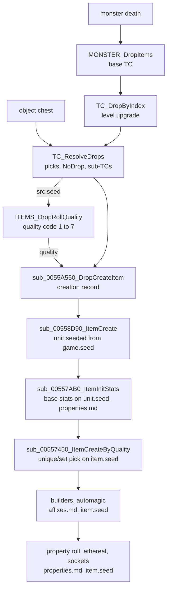

# Items: how a drop becomes items

## Purpose

This subsystem specifies item creation: from a drop source (a dying monster, an opened chest) to
finished item units. Treasure class resolution, the drop quality roll inside it, the unique and set selection at item
creation, the affix builders, and the base stats with the property roll are written. This page is the map: what runs in
which order, which seed each stage steps, and what each stage passes on.

## Files

| File | Covers | Status |
|---|---|---|
| [tc.md](tc.md) | monster TC choice, level upgrade, pick loop, NoDrop scaling, sub-TC recursion and ratios, auto item-type TCs, the hand-off to item creation | draft |
| [quality.md](quality.md) | the drop quality roll: early returns, `itemratio` row, unique/set/rare/magic tests, superior/normal/low, magic find; codes 0–7 | reviewed (plan 0010, 2026-10-14) |
| [uniques-sets.md](uniques-sets.md) | item creation by quality: pre-switch overrides, unique and set candidate filters, the weighted pick on the item seed, the made-uniques set, durability and the fallback chain | draft (plan 0019) |
| [affixes.md](affixes.md) | after the switch's builders: alvl, the magic-affix pick (filter, weighted draw), magic and rare builds with rare names, superior and low rows, staff mods, the automagic pick | draft (plan 0021) |
| [properties.md](properties.md) | base stats on the unit seed (quantity, durability, defense, picture), the property roll per `func`, stat storage, the ethereal and socket rolls | draft (plan 0024) |

## Data flow

- [C] **Two seeds.** The TC walk and the per-item quality roll draw from the **source unit's** seed
  (`unit+0x20` of the monster or object), interleaved in call order; creating the item does not touch
  that seed. (fn:TC_ResolveDrops@0x0055A6D0, fn:sub_0055A550_DropCreateItem@0x0055A550,
  run:2026-10-11-tc-drops; [tc.md § Draw order](tc.md#draw-order-on-srcseed))
- [I] The created item unit gets its seeds from the **game** seed `+0xD0`, two draws in the unit
  constructor, because drops pass no seed in the creation record. What item creation rolls after that is in
  [uniques-sets.md](uniques-sets.md), [affixes.md](affixes.md) and [properties.md](properties.md). (fn:sub_00558D90_ItemCreate@0x00558D90,
  fn:sub_00555230_SUnitCreate@0x00555230, [rng/seeds](../rng/seeds.md#algorithm) step 7a)
- [I] What the resolver hands to item creation, per item: the base item index, a quality (7 for a
  unique entry, 5 for a set entry, a caller's forced quality, or the quality roll's result), the
  unique/set record index + 1 (0 = none), and upgrade flags `0x04`/`0x10`. Item creation takes the
  item level from the source again (monster or player `level` stat, else the area level, minimum 1).
  (fn:sub_0055A550_DropCreateItem@0x0055A550, [tc.md § H](tc.md#h-item-pick-and-hand-off))
- [C] The quality roll reads the item, the resolver's `ilvl`, the first four ratio words of the TC
  frame it was picked in (Magic, Rare, Set, Unique), one `itemratio` row and the killer's magic find (plus a
  summon's owner's). It draws 0 to 6 times with `RNG_RangeB` on `src.seed` and returns a quality code 1–7,
  which the resolver passes to item creation; the model reproduces 1916 logged rolls with no oracle. Chain:
  TC ([tc.md](tc.md)) → quality ([quality.md](quality.md)) → creation ([uniques-sets.md](uniques-sets.md)). (fn:ITEMS_DropRollQuality@0x00558640,
  fn:RNG_RangeB@0x0045C3E0, run:2026-10-12-quality, run:2026-10-13-quality)

## Entry points

| When | Function | Tag |
|---|---|---|
| A monster dies | fn:MONSTER_DropItems@0x005A6600 ([tc.md § B](tc.md#b-monster-drop-which-tc--monster_dropitems)) | [I] |
| An object (chest) drops | fn:sub_00585B90_ObjectChestDrop@0x00585B90 ([tc.md § J](tc.md#j-object-drops-named-only)) | [I] |
| One item is created from a drop | fn:sub_0055A550_DropCreateItem@0x0055A550 → fn:sub_00558D90_ItemCreate@0x00558D90 | [I] |

- [I] Gambling and vendor stock do not reach the TC resolver; they are other callers of item creation
  and belong to `items/vendors`. (fn:TC_ResolveDrops@0x0055A6D0, [items/0001 §2](../../findings/items/0001-tc-resolution.md#2-entry-points))

## Downstream

- [quality.md](quality.md) consumes the resolver's item picks; the quality-roll oracle of `tools/tc.py` is
  replaced by its model (`--quality model`, ADR-0004).
- [uniques-sets.md](uniques-sets.md) (plan 0019) consumes the quality code at item creation: the creation-side
  roll, the overrides, the unique and set builders and the fallbacks named in
  [quality.md § F](quality.md#f-boundaries-named-only). [affixes.md](affixes.md) (plan 0021) specifies the rare, magic,
  superior, low and normal builders it falls back to, and the automagic pick after the switch.
- [properties.md](properties.md) (plan 0024) specifies the base stats before the switch, the property roll every
  builder calls, and the ethereal and socket rolls after it; [save/d2s](../save/d2s.md) stores its stat lists.
- `items/quest-drops` owns the quest TC tests of [tc.md B6](tc.md#b-monster-drop-which-tc--monster_dropitems).
- `objects` owns the callers of the chest drop and the forced quality they pass.

## Open questions

- ~~The property values and the post-switch ethereal and socket steps are not yet specified~~: drafted in
  [properties.md](properties.md) (plan 0024). Open points per stage are in the *Open questions* of
  [tc.md](tc.md#open-questions), [affixes.md](affixes.md#open-questions) and [properties.md](properties.md#open-questions).
