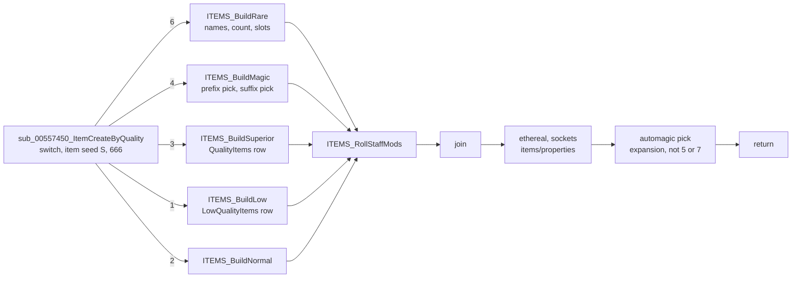
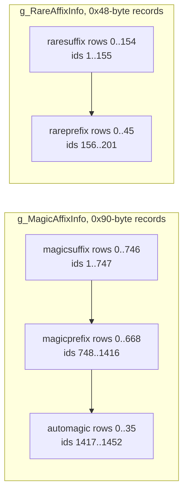
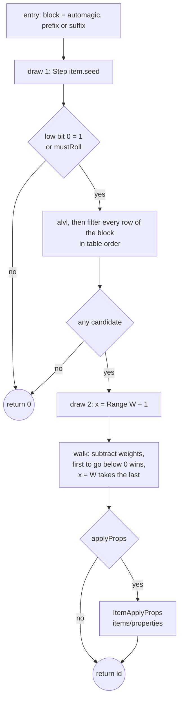
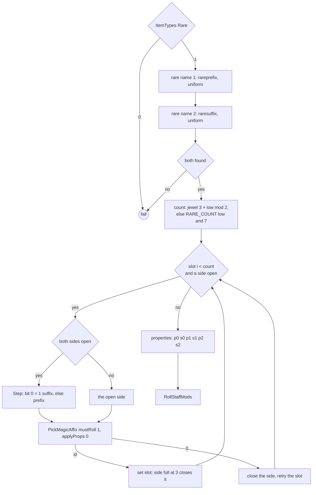
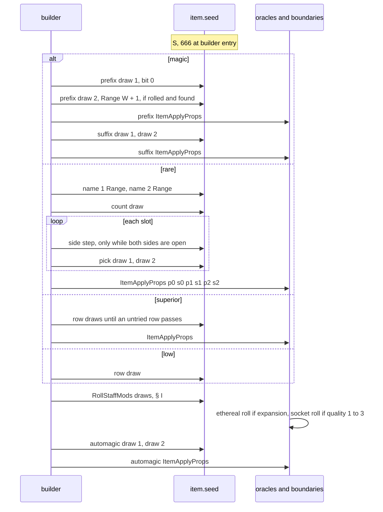

# Affixes: alvl, magic and rare picks, automagic, and the other builders

## Purpose

Once item creation has settled an item's quality (or a unique or set build has fallen back), this spec says what
the quality's builder draws on the **item seed** and which rows it chooses. Rows come from `MagicPrefix`,
`MagicSuffix`, `RarePrefix`, `RareSuffix`, `QualityItems` and `LowQualityItems`. After the switch it also gives the
`AutoMagic` row an expansion item gets. The builders are the magic (4), rare (6), superior (3), low (1) and normal (2)
cases of `sub_00557450_ItemCreateByQuality` and the fallback steps of
[items/uniques-sets § E](uniques-sets.md#e-failure-durability-and-the-fallback-chain). Each pick filters the rows
against the item's affix level (alvl), its type, its version and the affixes already on it, then makes one weighted
draw. The spec covers row selection only. The property values a chosen row gives (`mod1code`..`mod3code`) and the
post-switch ethereal and socket rolls belong to [items/properties](properties.md). This
spec starts where [items/uniques-sets](uniques-sets.md) ends. Primitives are those of [rng](../rng/README.md).



## Entry points

| When | Function | Tag |
|---|---|---|
| The switch of `ItemCreateByQuality` or a fallback step reaches quality 6 | fn:ITEMS_BuildRare@0x005C21A0 → fn:ITEMS_BuildRareAffixes@0x005C1BF0 | [C] |
| … quality 4 | fn:ITEMS_BuildMagic@0x005565E0 | [C] |
| … quality 3 | fn:ITEMS_BuildSuperior@0x005C2AD0 → fn:ITEMS_BuildSuperiorPick@0x005C2970 | [C] |
| … quality 1 | fn:ITEMS_BuildLow@0x005C2FB0 → fn:ITEMS_BuildLowPick@0x005C2D40 | [C] |
| … quality 2 | fn:sub_00556F30_ItemBuildNormalCase@0x00556F30 → fn:ITEMS_BuildNormal@0x00556E80 | [C] |
| After the join, expansion item, quality not 5 or 7 | the automagic step of fn:sub_00557450_ItemCreateByQuality@0x00557450 (0x005579A8–0x00557A0C) → fn:sub_005C1940_PickAutoAffixByVersion@0x005C1940 | [C] |

- [C] Every builder above was entered from a drop in run:2026-10-14-affixes, and the model of this spec reproduced
  all 3 102 logged creations (366 magic, 105 rare, 35 superior, 31 low and 2 472 normal builds, 36 automagic picks)
  with 0 mismatches, over classic Nightmare, expansion Nightmare and expansion Normal. The builder entry seed is
  `{S, 666}`, as [items/uniques-sets § A](uniques-sets.md#a-the-item-seed-at-entry) sets it.
  (fn:sub_00557450_ItemCreateByQuality@0x00557450, run:2026-10-14-affixes,
  [items/0005 § Phase 2 results](../../findings/items/0005-affixes.md#phase-2-results-run2026-10-14-affixes))
- [C] Qualities 8 (crafted) and 9 have builders in the same switch, and no drop reaches them. All 9 336 logged drop
  creations (5 017 stock, 4 319 from ItemRatio-only forced runs) reach the switch with a quality of 1 to 7 and none
  enters the crafted builder. `sub_005C21D0_ItemBuildCrafted` has one caller, case 8 of the switch (0x005577E0), and
  `sub_005C1BC0_PickRareNameByVersion` is called only by case 9 and by the cube's `sub_00565AB0_RecipeOutputCreate`
  (raw scan of the image and Ghidra's references). They belong to `items/cube`, which specifies the crafted builder in
  [items/cube § I](cube.md#i-the-crafted-builder--sub_005c21d0_itembuildcrafted) and the quality-9 names in
  [§ E](cube.md#e-building-one-output--sub_00565ab0_recipeoutputcreate). (fn:sub_005C21D0_ItemBuildCrafted@0x005C21D0,
  fn:sub_005C1BC0_PickRareNameByVersion@0x005C1BC0, run:2026-10-14-affixes, run:2026-10-16-quest-drops,
  [items/0005 § Plan 0038 batch S2b](../../findings/items/0005-affixes.md#plan-0038-batch-s2b-2026-10-16), aff 1)
- [I] That the drop quality roll can return no value outside 0..7 for any input, which is why no drop reaches them.
  (fn:ITEMS_DropRollQuality@0x00558640,
  [items/0005 § 11](../../findings/items/0005-affixes.md#11-qualities-8-and-9-not-on-the-drop-path))
- [C] Vendors, gambling, the cube and imbue reach the same builders by other paths, some with forced affixes: the
  affix model of this spec reproduces the vendors' 8 787 chained creations (run:2026-10-15-vendors), the cube's 140
  (12 picks with a forced id; run:2026-10-15-cube) and the 17 imbued rares (run:2026-10-16-quest-drops). This spec
  covers the builders as a drop reaches them; those callers belong to [items/vendors](vendors.md) and
  [items/cube](cube.md) (its forced `pre=`/`suf=` ids: [§ E](cube.md#e-building-one-output--sub_00565ab0_recipeoutputcreate)).
  (fn:ITEMS_PickMagicAffix@0x005C1560, struct:ItemCreateRec+0x68,
  [items/0005 § Plan 0038 batch S2c](../../findings/items/0005-affixes.md#plan-0038-batch-s2c-2026-10-16), aff 2)

## Inputs

### Tables

| Anchor | Used for |
|---|---|
| tbl:MagicPrefix.txt:spawnable (`+0x54` u8), tbl:MagicPrefix.txt:version (`+0x22` u16) | the first two filter tests |
| tbl:MagicPrefix.txt:level (`+0x58` i32), tbl:MagicPrefix.txt:maxlevel (`+0x60` i32) | the level window against alvl; also a weight factor on `magic lvl` bases |
| tbl:MagicPrefix.txt:rare (`+0x64` u8) | excludes the row on qualities 6, 8, 9 when 0 |
| tbl:MagicPrefix.txt:itype1..7 (`+0x6A` i16 each), tbl:MagicPrefix.txt:etype1..5 (`+0x78` i16 each), tbl:MagicPrefix.txt:mod1code (`+0x24` i32) | the type test |
| tbl:MagicPrefix.txt:frequency (`+0x82` u8) | the weight; 0 is never a candidate |
| tbl:MagicPrefix.txt:classspecific (`+0x66` u8, 0xFF blank) | the class test |
| tbl:MagicPrefix.txt:group (`+0x5C` i32) | group exclusion; for `automagic`, the base's group |
| the same columns of tbl:MagicSuffix.txt:level and tbl:AutoMagic.txt:group | the suffix and automagic blocks (one shared 0x90-byte record) |
| tbl:RarePrefix.txt:version (`+0x0E` u16), tbl:RarePrefix.txt:itype1 (`+0x10`, 7 × i16), tbl:RarePrefix.txt:etype1 (`+0x1E`, 4 × i16), and RareSuffix alike | the rare name test (0x48-byte record) |
| tbl:QualityItems.txt:armor … tbl:QualityItems.txt:belt (bytes `+0x000..+0x009`) | the superior type test |
| tbl:LowQualityItems.txt:Name (row count only) | the low-quality row range |
| tbl:Weapons.txt:level (`+0x0FD` u8, qlvl), tbl:Weapons.txt:magic lvl (`+0x140` u8), tbl:Weapons.txt:auto prefix (`+0x0F8` u16) | alvl, weights, automagic group (same offsets in [Armor](../../tables/Armor.md), [Misc](../../tables/Misc.md)) |
| tbl:Weapons.txt:stackable (`+0x132`), tbl:Weapons.txt:hasinv (`+0x137`), tbl:Weapons.txt:nodurability (`+0x113`), tbl:Weapons.txt:durability (`+0x112`) | type test, superior row range, low-quality durability |
| tbl:ItemTypes.txt:Throwable, tbl:ItemTypes.txt:Class (`+0x21`, 7 = none), tbl:ItemTypes.txt:StaffMods (`+0x1F`, 7 = none), tbl:ItemTypes.txt:Rare, tbl:ItemTypes.txt:MaxSock1, `Equiv1`/`Equiv2` | type tests, class test, staff mods, the rare gate |
| tbl:Skills.txt:charclass, tbl:Skills.txt:itypea1 (`+0x18`) | staff mods: the class's skill run and each skill's item-type requirement |

- [C] Not read by any pick: `levelreq`, `class`, `classlevelreq`, `transformcolor` and the price columns of the
  magic tables; the rare record's `+0x000..+0x00B`. A second read of the seven pick functions (an instruction scan
  that also covers the record cursor `ESI` = record + 0x60, and every non-stack memory operand with its width) finds
  no access to those bytes, and the candidate lists, built without these columns, reproduce: 1 458 stock and 62 from
  ItemRatio-only forced runs. (fn:ITEMS_PickMagicAffix@0x005C1560, fn:ITEMS_RareNameTypeOk@0x0065E710,
  tbl:MagicPrefix.txt:levelreq, [items/0005 § Data touched](../../findings/items/0005-affixes.md#data-touched),
  [items/0005 § Plan 0038 batch S2b](../../findings/items/0005-affixes.md#plan-0038-batch-s2b-2026-10-16), aff 3)
- [C] The `0xFFFF` (−1) that the `.bin` holds in absent `etype4`/`etype5` cells never refuses a row: 783 of the 1 452
  magic rows hold it, and the 1 520 logged candidate lists reproduce with every list ending at its first value < 1.
  (fn:ITEMS_MagicAffixTypeOk@0x0065E620, tbl:MagicSuffix.txt:etype4,
  [items/0005 § Plan 0038 batch S2b](../../findings/items/0005-affixes.md#plan-0038-batch-s2b-2026-10-16), aff 4)
- [I] Whether a type list *ends* at its first value < 1 or only skips it: no stock magic or rare row has a value ≥ 1
  after a value < 1, so no stock row tells them apart. The model ends it, like a blank.
  (fn:ITEMS_MagicAffixTypeOk@0x0065E620, [AutoMagic § Code semantics](../../tables/AutoMagic.md#code-semantics-items0005))

### Runtime state

| State | Type | Source |
|---|---|---|
| `item.seed` | `Seed` at struct:ItemData+0x04; `{S, 666}` at each builder entry | [items/uniques-sets § A, § E](uniques-sets.md#a-the-item-seed-at-entry) |
| `item.quality` | u32 at struct:ItemData+0x00 | the switch or the fallback step |
| `ilvl` | i32, from fn:ITEMS_GetItemLevel@0x006281E0 (raised to at least 1) | the resolver's item level |
| `itemVersion` | u16 at struct:ItemData+0x30 | ≥ 100 expansion game, 1..99 classic game, never 0 on a drop |
| `prefix[0..2]`, `suffix[0..2]` | u16 merged ids at struct:ItemData+0x38, `+0x3E`; 0 none | cleared before the switch; written by the picks |
| `rareName1`, `rareName2` | u16 merged rare ids at struct:ItemData+0x32, `+0x34` | the rare name picks |
| `autoAffix` | u16 merged id at `ItemData+0x36` | the automagic step |
| `item.fileIndex` | i32 at struct:ItemData+0x28 | the superior or low-quality row |
| `rec` | the creation record, `struct:ItemCreateRec` | `+0x68` forced prefixes, `+0x74` forced suffixes (0 on a drop), `+0x0C` ilvl, `+0x80` flags |

### Constants

| Name | Value | Anchor | Tag |
|---|---|---|---|
| `VERSION_EXP` | 100: a row with `version` ≥ 100 needs an item of version ≥ 100 | 0x005C16D3–0x005C16F0, fn:ITEMS_RareNameTypeOk@0x0065E710 | [C] |
| `ALVL_MAX` | 99, in the alvl formula and the clamp | 0x005C1671–0x005C16C2 | [C] |
| `RARE_COUNT` | `{3, 4, 4, 5, 5, 5, 6, 6}` (`int[8]`) | data:g_RareAffixCountTable@0x006E3014 | [C] |
| `RARE_SIDE_MAX` | 3 prefixes, 3 suffixes | 0x005C1CB1–0x005C1E16 | [C] |
| `TYPE_JEWEL` | 58 (`jewl`) | 0x005C1C6F–0x005C1C80, run:2026-10-20-sweep-items-chain | [C] |
| `CLASS_NONE` | 7, the "no class" value of `Class` and `StaffMods` | fn:sub_0062C0B0_ItemTypeClass@0x0062C0B0, fn:sub_0062BBD0_ItemTypeStaffMods@0x0062BBD0 | [C] |
| `CAND_CAP` | 511 stored candidates per pick | fn:sub_005C0D00_AffixCandAdd@0x005C0D00, run:2026-10-17-sweep-emu2 | [C] |
| `STAT_SOCKETS` | 194 (`item_numsockets`) | fn:ITEMS_MagicAffixTypeOk@0x0065E620 | [I] |

- [C] The model uses each `[C]` constant above and reproduces every logged pick, count and slot with it.
  (run:2026-10-14-affixes)
- [C] `TYPE_JEWEL`: after `ITEMS_GetBaseType` the count branch compares with `0x3A` and on equal draws the jewel
  count (E3); 21 rare jewels (17 cube rerolls of run:2026-10-20-sweep-items-chain, 4 of run:2026-10-15-cube) reproduce
  through that branch, and 10 non-jewel rares through the general table. `CAND_CAP`: under emulation
  `sub_005C0D00_AffixCandAdd` stores a candidate and returns `count + 1` exactly when the signed count is below 0x1FF,
  and from 511 up returns the count unchanged and writes nothing (3 000 calls; a cap of 512 differs in 65).
  (fn:ITEMS_GetBaseType@0x0062B400, fn:sub_005C0D00_AffixCandAdd@0x005C0D00, run:2026-10-20-sweep-items-chain,
  run:2026-10-17-sweep-emu2, [items/0005 § Plan 0038 batch H2b](../../findings/items/0005-affixes.md#plan-0038-batch-h2b-2026-10-20)
  aff 5, [§ Plan 0038 batch S1f](../../findings/items/0005-affixes.md#plan-0038-batch-s1f-2026-10-17) row 6)

### Inputs and oracles

The Phase 2 model of plan 0021 (`tools/affixes.py check`, chained after `tools/uniques.py`) covers every selection
from the builder's entry to its return, and the automagic pick. It treats the callees below as ADR-0004 boundaries:
it asserts the item seed on entry to each, then takes the logged exit seed and result. Every confirmed statement
of this spec holds under them. [C] (run:2026-10-14-affixes,
[items/0005 § Boundary](../../findings/items/0005-affixes.md#boundary-for-phase-2-recommendation-the-architect-rules))
Chained with the [items/properties](properties.md) model (re-analysis 2026-10-15), the property roll is no longer
an oracle: all 3 102 creations of the run still reproduce and its 1 034 exit seeds are predicted. Run without log lines
over run:2026-10-14-props and run:2026-10-14-props-forced, this spec's picks predict every affix and `QualityItems`
call (754, row and entry seed), 2 114 join seeds and the 18 automagic picks from the ethereal and socket exit to the
return seed. `ITEMS_RollStaffMods` was an oracle in those checks; it is now modelled (§ I). [C] (fn:sub_0065FEC0_ItemApplyProps@0x0065FEC0,
fn:ITEMS_PickMagicAffix@0x005C1560, run:2026-10-14-affixes, run:2026-10-14-props-forced,
[items/0005 Phase 2 results](../../findings/items/0005-affixes.md#phase-2-results-run2026-10-14-affixes))
With both item loggers in one session (`tools/gdb/items-chain.gdb`), `tools/items_chain.py both` reproduces 889
creations from both sides. 219 of them have an affix or `QualityItems` pick whose `ItemApplyProps` call is checked from
the pick lines (candidates, weights, draws) through the property slot, roll and write lines, with no seed from the log in
between: 66 `ITEMS_PickMagicAffix` picks (33 stock, 33 forced) and 153 superior `QualityItems` picks. The stock sessions
alone give 186 creations, 36 of them end to end; the rest come from ItemRatio-edited sessions (ADR-0010), which change
only which quality is rolled. [C] (fn:ITEMS_PickMagicAffix@0x005C1560, fn:sub_0065FEC0_ItemApplyProps@0x0065FEC0,
run:2026-10-15-items-chain, run:2026-10-15-items-chain-forced,
[items/0005 Phase 2 results](../../findings/items/0005-affixes.md#phase-2-results-run2026-10-14-affixes))

| Input | Kind | What this spec needs | Owner | Tag |
|---|---|---|---|---|
| `sub_0065FEC0_ItemApplyProps` | seed oracle in `check`; modelled in the chained check | entry seed: after each magic pick's draw, after all rare picks, after the superior row, after the automagic pick; it draws a row's property values on the item seed | [items/properties § B](properties.md#b-itemapplyprops-modes-and-blocks) | [C] (fn:sub_0065FEC0_ItemApplyProps@0x0065FEC0, run:2026-10-14-affixes) |
| `ITEMS_RollStaffMods` | modelled (plan 0038 S2b); the checkers' default since plan 0048 Phase 1, `--staff oracle` restores the oracle | entry seed: the builder's last draw; § I gives its draws | this spec (§ I) | [C] (fn:ITEMS_RollStaffMods@0x005C1260, run:2026-10-14-affixes, [items/0005 § Plan 0038 batch S2b](../../findings/items/0005-affixes.md#plan-0038-batch-s2b-2026-10-16), [items/0005 § Plan 0048 Phase 1](../../findings/items/0005-affixes.md#plan-0048-phase-1-the-staff-mods-model-is-the-default-2026-10-20)) |
| the ethereal roll `sub_00556CA0_ItemRollEthereal` and the socket roll `sub_00556B60_ItemRollSockets` | logged boundary | entry seed: the join seed; exit seed: the automagic pick's entry seed | [items/properties § F](properties.md#f-ethereal-and-sockets) | [C] (fn:sub_00556CA0_ItemRollEthereal@0x00556CA0, fn:sub_00556B60_ItemRollSockets@0x00556B60, run:2026-10-14-affixes) |
| the builder entry seed `{S, 666}` and the quality | value input | the switch or the fallback step | [items/uniques-sets](uniques-sets.md#e-failure-durability-and-the-fallback-chain) | [C] (fn:sub_00557450_ItemCreateByQuality@0x00557450, run:2026-10-14-affixes) |

## Algorithm

All arithmetic is signed 32-bit unless a step says otherwise. "Low" is `item.seed.low` after the step just made.
Section A fixes the id spaces, B the affix level, C one magic-affix pick, D to H the builders, I the staff mods,
J the automagic step after the switch, K classic games.
[C] Signed 32-bit arithmetic on the low word after the step reproduces every logged creation (5 144 stock, 703 from
ItemRatio-only forced runs); a draw from the high word breaks 680 stock creations, an unsigned subtract walk 671.
(fn:sub_00557450_ItemCreateByQuality@0x00557450, 0x005C1828–0x005C189E,
[items/0005 § Walkthrough](../../findings/items/0005-affixes.md#walkthrough),
[§ Plan 0038 batch S2b](../../findings/items/0005-affixes.md#plan-0038-batch-s2b-2026-10-16), aff 8)

### A. Merged affix ids



```
A1. magic ← magicsuffix ++ magicprefix ++ automagic             [C] (fn:sub_00633730_LoadMagicAffixes@0x00633730, data:g_MagicAffixInfo@0x0096CA7C, run:2026-10-14-affixes)
    id(block, row) = blockStart + row + 1                       ; 0 means "none"
A2. rare ← raresuffix ++ rareprefix                             [C] (fn:sub_00633F40_LoadRareAffixes@0x00633F40, data:g_RareAffixInfo@0x0096CAA0, run:2026-10-14-affixes)
    id(block, row) = blockStart + row + 1
A3. record(id) = base + (id − 1) × stride, for 1 ≤ id ≤ count  [C] (fn:MAGICAFFIX_GetRecord@0x00633EE0, run:2026-10-14-affixes)
```

Step notes:

- A1–A2. With stock data (747 suffix, 669 prefix, 36 automagic rows; 155 rare suffix, 46 rare prefix rows) suffix
  row r is id r + 1, prefix row r id 748 + r, automagic row r id 1417 + r; rare suffix row r id r + 1, rare prefix row
  r id 156 + r. Every logged candidate, chosen id and rare name matched this numbering. [C]
  (fn:sub_00633730_LoadMagicAffixes@0x00633730, fn:sub_00633F40_LoadRareAffixes@0x00633F40, run:2026-10-14-affixes)
- A1. The item data holds these merged ids unchanged (`ITEMS_SetPrefix` → `+0x38 + 2i`, `ITEMS_SetSuffix` →
  `+0x3E + 2i`, `ITEMS_SetRareName1` → `+0x32`, `ITEMS_SetRareName2` → `+0x34`, `ITEMS_SetAutoAffix` → `+0x36`). A
  save stores block-relative ids instead (`save/d2s`). [C] (fn:ITEMS_SetPrefix@0x00627EF0,
  fn:ITEMS_SetSuffix@0x00627FB0, fn:ITEMS_SetAutoAffix@0x00627F50, struct:ItemData+0x32, run:2026-10-14-affixes)
- A1. `magicsuffix` row 0 is a real row with id 1 (`of Health`, `frequency` 0); `magicprefix` row 0 is blank and never
  a candidate (no name, `frequency` 0, no `itype`). Read from the full tables, row identity pinned by `excel_bin.py
  diff`. [C] (tbl:MagicPrefix.txt:frequency, tbl:MagicSuffix.txt:frequency,
  [items/0005 § 1](../../findings/items/0005-affixes.md#1-the-merged-affix-arrays-and-the-ids-0x00633730-0x00633f40),
  [items/0005 § Plan 0038 batch S2b](../../findings/items/0005-affixes.md#plan-0038-batch-s2b-2026-10-16), aff 9)

### B. The affix level (alvl)

```
B1. qlvl: i32 ← base.level                                     ; u8, ITEMS_GetQLvl          [C] (fn:ITEMS_PickMagicAffix@0x005C1560, 0x005C1664–0x005C16C2, run:2026-10-14-affixes, all of B1–B4)
    i: i32 ← ITEMS_GetItemLevel(item)                          ; ilvl, at least 1
    if i ≤ qlvl: i ← qlvl                                      ; i = max(ilvl, qlvl), signed
B2. m: i32 ← base.magicLvl                                     ; u8 `magic lvl`
    if m ≠ 0:
      alvl ← i + m
B3. else:
      h: i32 ← qlvl ÷ 2                                        ; qlvl ≥ 0, so floor
      if i < 99 − h: alvl ← i − h
      else:          alvl ← 2 × i − 99
B4. if alvl ≤ 1: alvl ← 1
    else if alvl ≥ 99: alvl ← 99
```

Step notes:

- B1–B4. Every comparison is signed 32-bit. `magic lvl` replaces the `qlvl/2` rule entirely: such a base gets
  `max(ilvl, qlvl) + m` with no subtraction. [C] (0x005C1671–0x005C16C2, fn:ITEMS_GetQLvl@0x00628740,
  tbl:Weapons.txt:level, tbl:Weapons.txt:magic lvl, run:2026-10-14-affixes)
- B1. alvl is recomputed in every pick, never stored. For one item all picks see the same value: prefixes,
  suffixes, the rare slots and the automagic pick. [C] (0x005C1664, run:2026-10-14-affixes)
- B1. The same formula holds in a classic game: the picks branch on item version 0, which no drop creates, not on
  100 (§ K). [C] (fn:sub_005C18E0_PickMagicAffixByVersion@0x005C18E0, run:2026-10-14-affixes)
- B2. Stock bases with `magic lvl`: the 15 staves, 8 wands and 15 orbs with 1, the circlets `ci0`..`ci3` with 3, 8,
  13, 18; no other base of Weapons, Armor or Misc has one (full tables). [C] (tbl:Weapons.txt:magic lvl,
  tbl:Armor.txt:magic lvl, [items/0005 § 2](../../findings/items/0005-affixes.md#2-alvl-0x005c16340x005c16c2),
  [items/0005 § Plan 0038 batch S2b](../../findings/items/0005-affixes.md#plan-0038-batch-s2b-2026-10-16), aff 10)

### C. One magic-affix pick — `ITEMS_PickMagicAffix`

`PickMagicAffix(item, needSpawnable, mustRoll, applyProps, isPrefix, forcedId, autoGroup) → id` is called through
`sub_005C18E0_PickMagicAffixByVersion` (autoGroup 0) or `sub_005C1940_PickAutoAffixByVersion`. [C]
(fn:ITEMS_PickMagicAffix@0x005C1560, fn:sub_005C18E0_PickMagicAffixByVersion@0x005C18E0,
fn:sub_005C1940_PickAutoAffixByVersion@0x005C1940, run:2026-10-14-affixes)



```
C1. block ← automagic if autoGroup ≠ 0                                    [C] (0x005C1560–0x005C15FD, run:2026-10-14-affixes)
            else magicprefix if isPrefix else magicsuffix
C2. Step(item.seed)                                                       [C] draw#1, always (0x005C15FD–0x005C1645, run:2026-10-14-affixes)
    if (low & 1) = 0 and not mustRoll: return 0                           ; no affix
C3. alvl ← § B; m ← base.magicLvl                                         [C] (0x005C1664, run:2026-10-14-affixes)
C4. n: i32 ← 0; W: i32 ← 0                                                [C] (0x005C16D3–0x005C17AD, run:2026-10-14-affixes, all of C4a–C4i)
    for row in 0 ..< len(block):  r ← block[row]
C4a.  if needSpawnable and r.spawnable = 0: continue                      ; u8
C4b.  if r.version ≥ 100 and itemVersion < 100: continue                  ; u16 against u16
C4c.  forced ← forcedId > 0 and row = forcedId − 1
      if not forced:
        if r.level > alvl: continue                                       ; i32
        if r.maxlevel ≠ 0 and r.maxlevel < alvl: continue
C4d.  if r.rare = 0 and item.quality ∈ {6, 8, 9}: continue                ; u8
C4e.  if not MagicAffixTypeOk(item, r): continue                          ; C5
C4f.  if autoGroup ≠ 0 and r.group ≠ autoGroup: continue
C4g.  if r.frequency = 0: continue                                        ; u8
C4h.  if r.classspecific ≠ 0xFF and typeClass(item) ≠ 7                   ; u8; 7 = no class
         and r.classspecific ≠ typeClass(item): continue
C4i.  if GroupTaken(item, r.group): continue                              ; C6
      if forced: id ← blockStart + row; go to C8                          ; [C] no weighted draw (0x005C180B–0x005C181B, run:2026-10-15-cube)
      w: i32 ← r.frequency × r.level if m ≠ 0 else r.frequency
      if n < 511: cand[n] ← (blockStart + row, r); n ← n + 1             ; [C] weight added even past the cap (0x005C0D00, 0x005C17E1, run:2026-10-17-sweep-emu2)
      W ← W + w
C7. if n ≤ 0: return 0                                                    [C] (0x005C1821, run:2026-10-14-affixes)
    x: i32 ← Range(item.seed, W + 1)                                      [C] draw#2 (fn:RNG_RangeOffset@0x00472280, 0x005C1828–0x005C1839, run:2026-10-14-affixes)
    for k in 0 ..< n:                                                     [C] (0x005C185A–0x005C189E, run:2026-10-14-affixes)
      x ← x − weight(cand[k])                                             ; same rule as w
      if x < 0: break
    if k = n: k ← n − 1                                                   ; x = W: the last candidate
    id ← cand[k].id
C8. if applyProps: ItemApplyProps(item, record(id + 1))                   [C] ORACLE, items/properties (fn:sub_0065FEC0_ItemApplyProps@0x0065FEC0, run:2026-10-14-affixes)
    return id + 1
```

**C5. The type test `MagicAffixTypeOk(item, r)`**, in order:

```
C5a. if itemVersion < 100 and (base.stackable or ItemTypes[type].Throwable): return false      [C] (fn:ITEMS_MagicAffixTypeOk@0x0065E620, 0x0065E62D–0x0065E645, run:2026-10-20-sweep-items-chain; each half alone: C5a notes)
C5b. if not base.hasinv or ItemMaxSockets(item) = 0:                                            [I] (fn:ITEMS_MagicAffixTypeOk@0x0065E620, 0x0065E64E)
       if r.mod1code ≥ 0 and (mod1code out of range, or no Properties record,
                              or the property's first stat = 194): return false
C5c. for t in r.etype1..5 while t ≥ 1: if ITEMS_UnitIsType(item, t): return false                [C] (fn:ITEMS_MagicAffixTypeOk@0x0065E620, fn:ITEMS_UnitIsType@0x00629BB0, run:2026-10-14-affixes, all of C5c–C5d)
C5d. for t in r.itype1..7 while t ≥ 1: if ITEMS_UnitIsType(item, t): return true
     return false                                                                               ; an empty itype list refuses
```

**C6. `GroupTaken(item, g)`**: walk `prefix[0..2]` up to the first empty slot, then `suffix[0..2]` likewise; true if
any record there has `group` = g. [C] (fn:sub_005C1500_AffixGroupTaken@0x005C1500, run:2026-10-14-affixes)

Step notes:

- C2. **Draw 1 happens on every pick**, also when `mustRoll` is set (its bit is then ignored), and before the scan, so
  a pick that finds no candidate still costs one step. A pick costs exactly 1 step (no roll, or no candidate) or 2,
  plus whatever the property oracle draws. [C] (0x005C15FD, 0x005C1839, 0x005C18A3, run:2026-10-14-affixes)
- C4. The tests run in the order written, each a `continue`. `spawnable`, `rare`, `frequency` and `classspecific`
  are read as bytes, `version` as u16, `level`, `maxlevel` and `group` as signed 32-bit. [C]
  (0x005C16D3–0x005C17AD, run:2026-10-14-affixes)
- C4c. `maxlevel` 0 means no upper bound. The level window compares with alvl, not ilvl. In 962 of 999 logged picks the
  candidate set differs from the rows with `level` ≤ ilvl + 2, and each reproduces with alvl. [C]
  (0x005C16FE–0x005C1713, run:2026-10-14-affixes)
- C4d. A rare item never gets a row whose `rare` is 0. The automagic pick runs this test too, so a rare item cannot
  get one of the 7 `automagic` rows whose `rare` is 0. [C] (0x005C173F, tbl:AutoMagic.txt:rare,
  run:2026-10-14-affixes)
- C4h. **A class-specific row is not refused on a classless type.** The test refuses only an item whose type has a
  class other than the row's. The row's `itype` list keeps it off other items. 22 of the 26 logged class-specific
  picks sat on a classless type (for example the prefix *Raging* on a `hal`). [C] (0x005C1781–0x005C179E,
  fn:sub_0062C0B0_ItemTypeClass@0x0062C0B0, tbl:MagicPrefix.txt:classspecific, tbl:ItemTypes.txt:Class,
  run:2026-10-14-affixes)
- C4i. **Group exclusion spans both tables** and sees every affix already set on the item, so a picked row also
  excludes itself. Stock prefix groups (101–142), suffix groups (1–45) and automagic groups (300–305) do not overlap,
  so the cross-table comparisons never bite with stock data. [C] (fn:sub_005C1500_AffixGroupTaken@0x005C1500,
  tbl:MagicPrefix.txt:group, tbl:AutoMagic.txt:group, run:2026-10-14-affixes)
- C4i. **The forced row** (`forcedId` > 0, block-relative): a forced row that passes every other test is returned
  with no draw 2: the 12 forced picks of run:2026-10-15-cube (rows 6–10, 17, 18, 19) leave the item seed
  as the model has it with no weighted draw. On the drop path `forcedId` is always 0, because
  `sub_0055A550_DropCreateItem` zeroes the record and nothing on the path writes `+0x68..+0x7C`. [C]
  (0x005C180B–0x005C181B, struct:ItemCreateRec+0x68, fn:ITEMS_PickMagicAffix@0x005C1560, run:2026-10-15-cube,
  [items/0005 § Plan 0038 batch S2c](../../findings/items/0005-affixes.md#plan-0038-batch-s2c-2026-10-16), aff 11 and 14)
- C4i. The forced row skips only the level window, and a forced row that fails another test leaves the pick to
  continue as an ordinary one. All 12 logged forced picks lay inside their rows' windows, so no run decides the
  window skip. [I] (0x005C16FE–0x005C1713, [items/0005 § Plan 0038 batch S2c](../../findings/items/0005-affixes.md#plan-0038-batch-s2c-2026-10-16), aff 14)
- C4i. Every logged pick on the drop path had `forcedId` 0. [C] (fn:ITEMS_PickMagicAffix@0x005C1560,
  run:2026-10-14-affixes)
- C4. **Weights.** `frequency` alone, or `frequency × level` when the base has `magic lvl`, the same rule in the sum
  and in the walk. 989 logged picks drew over unequal weights, 51 of them with `frequency × level`. [C]
  (0x005C17CE–0x005C17EA, 0x005C185A–0x005C187C, tbl:MagicPrefix.txt:frequency, run:2026-10-14-affixes)
- C4. **Candidate cap.** Only the first 511 candidates are stored, while every weight is summed: the caller adds the
  weight with no test of the count (0x005C17E1, 0x005C17EA). Under emulation, in the 207 picks with more than 511
  eligible rows the total passed to the draw sums every eligible row while the list holds 511, and in 22 of them the
  walk ended on the 511th candidate; a model that sums only the stored weights differs in 125 calls.
  [C] (fn:sub_005C0D00_AffixCandAdd@0x005C0D00, fn:RNG_RangeOffset@0x00472280, run:2026-10-17-sweep-emu2, [items/0005 § Plan 0038 batch S1f](../../findings/items/0005-affixes.md#plan-0038-batch-s1f-2026-10-17),
  row 12)
- C4. With stock data the cap is unreachable: over every base, both game versions and the three socket bands, the most
  rows of one block that pass the version and type tests are 188 (`ci0`, suffixes, expansion), and 135 of those also
  have `spawnable` and a non-zero `frequency`, which every candidate of a drop pick needs. [C]
  (fn:sub_005C0D00_AffixCandAdd@0x005C0D00, tbl:MagicSuffix.txt:frequency, [items/0005 § Plan 0038 batch S2b](../../findings/items/0005-affixes.md#plan-0038-batch-s2b-2026-10-16), aff 15)
- C5a. A classic item refuses stackable bases and `Throwable` types before any row test. In the 9 magic fallbacks of
  nine classic rare throwing weapons rebuilt by the cube (5 `tkf`, 4 `tax`, ilvl 45), the 11 candidate lists logged
  were all empty, the other 7 picks declined on their attempt bit, and all 9 magic builds ended with no affix. With
  C5a removed, the same bases at item version 1 have 30 to 35 candidates per side, so the refusal is what empties
  them. [C] (0x0065E62D–0x0065E645, fn:sub_006289F0_ItemBaseStackable@0x006289F0,
  fn:sub_0062BA80_ItemTypeThrowable@0x0062BA80, tbl:Weapons.txt:stackable, run:2026-10-20-sweep-items-chain,
  [items/0005 § Plan 0038 batch H2b](../../findings/items/0005-affixes.md#plan-0038-batch-h2b-2026-10-20), aff 13)
- C5a, R1. Each half of the test alone is read from the code: the logged `tkf` and `tax`, like all 18 classic
  throwing weapons, are both `stackable` and of a `Throwable` type, so no run tells the two-part test from a test on
  one half (a stackable base whose type is not `Throwable`, or the reverse). [I] (0x0065E62D–0x0065E645,
  0x0065E71D–0x0065E737, tbl:Weapons.txt:stackable, tbl:ItemTypes.txt:Throwable)
- C5a. With stock data only classic throwing weapons then have no affix and no rare name at all: the survey of every
  base at item version 1 lists, among the weapons, exactly the 18 classic throwing weapons (types `tkni`, `taxe`,
  `jave`), each with no prefix, no suffix and no name candidate; its other entries are expansion records, which no
  classic game creates, and misc records whose type has no `Rare` flag. [C] (tbl:Weapons.txt:stackable, run:2026-10-20-sweep-items-chain,
  [items/0005 § Plan 0038 batch H2b](../../findings/items/0005-affixes.md#plan-0038-batch-h2b-2026-10-20), aff 13)
- C5b. **The socket test.** On a base that cannot hold sockets (`hasinv` = 0, or the type's max sockets = 0), a row
  whose first property is the `sock` property (first stat 194, `item_numsockets`) is refused. With stock data, inside
  the level window, the test alone refuses a row (`Jeweler's`, `Artificer's`, `Mechanist's`) only on the five quest
  bases `d33`, `g33`, `hdm`, `hst` and `msf`, which no drop builds as magic, so no stock drop reaches it; no logged pick
  was refused by it. [I] (0x0065E64E, fn:sub_00629900_ItemBaseHasInv@0x00629900,
  fn:sub_0062BC20_ItemMaxSockets@0x0062BC20, tbl:MagicPrefix.txt:mod1code, tbl:Weapons.txt:hasinv,
  [items/0005 § Plan 0038 batch S2b](../../findings/items/0005-affixes.md#plan-0038-batch-s2b-2026-10-16), aff 7 and 16)
- C5c–C5d. `ITEMS_UnitIsType` tests the `Equiv1`/`Equiv2` closure of the base's `type` and `type2`. Any `etype`
  match refuses before the `itype` list is read. The 27 `magicsuffix` rows with no `itype` can never be picked. [C]
  (fn:ITEMS_UnitIsType@0x00629BB0, tbl:MagicPrefix.txt:itype1, tbl:MagicPrefix.txt:etype1, run:2026-10-14-affixes)
- C7. **The last candidate wins a draw of exactly W.** `Range(W + 1)` returns 0..W. When x = W no subtraction goes
  below 0, and the walk leaves with the last candidate, so the last candidate's effective weight is its weight + 1.
  12 logged picks drew x = W. [C] (0x005C188B, run:2026-10-14-affixes)

### D. The magic builder — `ITEMS_BuildMagic`

```
D1. p ← 0; s ← 0; sufMust ← false                                       [C] (fn:ITEMS_BuildMagic@0x005565E0, 0x005565E0–0x005566A7, run:2026-10-14-affixes, all of D1–D4)
    if rec.forcedPrefix[0] < 0: sufMust ← true                          ; never on a drop
    else:
      p ← PickMagicAffix(item, needSpawnable 1, mustRoll (rec.forcedPrefix[0] > 0),
                         applyProps 1, prefix, rec.forcedPrefix[0], 0)
      prefix[0] ← p
      if p = 0: sufMust ← true
      else if rec.forcedSuffix[0] < 0: go to D3                         ; never on a drop
D2. if rec.forcedSuffix[0] > 0: sufMust ← true
    s ← PickMagicAffix(item, 1, sufMust, 1, suffix, rec.forcedSuffix[0], 0)
    suffix[0] ← s
D3. if p = 0 and s = 0: return false                                    ; → superior fallback
D4. set item flag 0x10; RollStaffMods(item, rec)                        ; § I (modelled)
    return true
```

Step notes:

- D1–D2. On a drop both forced values are 0: the prefix pick's draw 1 decides (bit 0) whether a prefix is tried, and
  the suffix pick must roll when no prefix was set (no roll, or no candidate). So a magic item has a prefix only, a
  suffix only, or both. When both blocks have candidates the shares are 1/4 both, 1/4 prefix only, 1/2 suffix
  only; an empty prefix block shifts every item to suffix only. [C] (0x005565E0–0x005566A7,
  run:2026-10-14-affixes)
- D1–D2. **The prefix's properties come before the suffix pick**, because each pick applies its row's properties
  itself (`applyProps` 1). Order on the item seed: prefix draw 1, prefix draw 2, prefix properties, suffix draw 1,
  suffix draw 2, suffix properties, staff mods. [C] (fn:ITEMS_BuildMagic@0x005565E0, run:2026-10-14-affixes)
- D3. The builder fails exactly when both slots are 0 (`test di, di` / `test bx, bx`, return 0 at 0x0055667D), which
  on a drop needs an empty suffix block for the item (the suffix pick must roll). In run:2026-10-20-sweep-items-chain
  the 9 magic builds with both slots 0 (the classic throwing weapons of C5a) each failed, and none of the 71 with a
  slot set did. [C] (0x00556673–0x00556684, 0x0055667D, fn:ITEMS_BuildMagic@0x005565E0,
  run:2026-10-20-sweep-items-chain, [items/0005 § Plan 0038 batch H2b](../../findings/items/0005-affixes.md#plan-0038-batch-h2b-2026-10-20), aff 17)

### E. The rare builder — `ITEMS_BuildRare` → `ITEMS_BuildRareAffixes`



```
E1. if not ItemTypes[type].Rare: return false                                     [I] (fn:ITEMS_BuildRare@0x005C21A0, fn:sub_0062E990_ItemTypeRare@0x0062E990)
E2. n1 ← PickRareName(prefix, item); n2 ← PickRareName(suffix, item)                [C] (fn:ITEMS_BuildRareAffixes@0x005C1BF0, 0x005C1BF0–0x005C1C59, run:2026-10-14-affixes)
    if n1 = 0 or n2 = 0: return false                                             ; → magic fallback
    rareName1 ← n1; rareName2 ← n2
E3. if base type = 58:                                                            [C] (0x005C1C6F–0x005C1C80, fn:ITEMS_GetBaseType@0x0062B400, run:2026-10-20-sweep-items-chain)
      count: i32 ← 3 + Range(item.seed, 2)                                        ; draw (RNG_RangeOffset)
    else:                                                                         [C] (0x005C1C77–0x005C1CAE, data:g_RareAffixCountTable@0x006E3014, run:2026-10-14-affixes)
      Step(item.seed); count ← RARE_COUNT[low & 7]                                ; draw
E4. np ← 0; ns ← 0; preDone ← false; sufDone ← false; i ← 0                        [C] (0x005C1CB1–0x005C1E16, run:2026-10-14-affixes, all of E4–E5)
    while i < count:
      if preDone and sufDone: break
      if preDone: side ← suffix
      else if sufDone: side ← prefix
      else: Step(item.seed); side ← suffix if (low & 1) = 1 else prefix          ; draw, only while both sides are open
      a ← PickMagicAffix(item, needSpawnable 1, mustRoll 1, applyProps 0, side,
                         rec.forced<side>[n<side>], 0)                            ; § C: 2 draws when it finds a row
      if a = 0: close side; continue                                              ; the slot is retried, i unchanged
      store a in the side's next slot; n<side> ← n<side> + 1
      if n<side> > 2: close side
      i ← i + 1
E5. if np = 0 and ns = 0: return false                                            ; [I] no stock case (0x005C1E71)
E6. set item flag 0x10                                                            [C] (0x005C1E16–0x005C1E70, run:2026-10-14-affixes)
    for k in 0 ..< 3:
      if prefix[k] ≠ 0: ItemApplyProps(item, record(prefix[k]))                   ; ORACLE, items/properties
      if suffix[k] ≠ 0: ItemApplyProps(item, record(suffix[k]))
E7. RollStaffMods(item, rec); return true                                         ; § I (modelled)
```

**E2. `PickRareName(isPrefix, item)`**:

```
R1. if itemVersion < 100 and (base.stackable or ItemTypes[type].Throwable): no row passes    [C] (0x0065E71D–0x0065E737, run:2026-10-20-sweep-items-chain; each half alone: C5a notes)
R2. cand ← every row r of the block, in table order, with                                  [C] (fn:ITEMS_PickRareName@0x005C1AB0, fn:ITEMS_RareNameTypeOk@0x0065E710, run:2026-10-14-affixes)
      not (r.version ≥ 100 and itemVersion < 100),
      no etype1..4 (while ≥ 1) that the item is,
      one itype1..7 (while ≥ 1) that the item is
R3. if cand is empty: return 0                                                             [C] no draw (0x005C1B7E, run:2026-10-20-sweep-items-chain)
R4. k ← Range(item.seed, len(cand)); return cand[k].id                                     [C] draw (fn:RNG_RangeOffset@0x00472280, run:2026-10-14-affixes)
```

Step notes:

- E2. **The names come first**: `name1` from `rareprefix`, then `name2` from `raresuffix`, both before the count and
  every affix. They depend on the item's type and version only, never on its affixes. All 105 logged rares drew both
  names before the count. [C] (0x005C1C06, 0x005C1C26, fn:ITEMS_PickRareName@0x005C1AB0, run:2026-10-14-affixes)
- E2. This spec stops at the merged name ids. Which string a name id is shown as is not traced in any finding; the
  string lookups themselves are specified in [data/strings](../data/strings.md), whose Open questions carry this gap.
- R2–R4. A name pick has no level and no weight: one uniform draw over the type-eligible rows (cap 511). `rareprefix`
  `Warp` and `Rift` name no `itype`, so they are never picked. [C] (fn:ITEMS_PickRareName@0x005C1AB0,
  tbl:RarePrefix.txt:itype1, tbl:RareSuffix.txt:etype1, run:2026-10-14-affixes)
- R2. The rare `version` cell is 0 in every stock row (all 201 rows of both tables), so its test always passes. [C]
  (fn:ITEMS_RareNameTypeOk@0x0065E710, tbl:RarePrefix.txt:version, [items/0005 § Plan 0038 batch S2b](../../findings/items/0005-affixes.md#plan-0038-batch-s2b-2026-10-16), aff 22)
- R1, R3. Only classic throwing weapons have no name candidate with stock data (C5a note). In the 9 rare builds of
  classic `tkf` and `tax` in run:2026-10-20-sweep-items-chain both name scans found 0 candidates, the second scan
  started from the first's item seed (the empty scan drew nothing), and the build returned at 0x005C1E71. R1 is the
  same refusal as C5a; with it removed, those bases at item version 1 have 18 to 37 name candidates per side. [C]
  (0x0065E71D–0x0065E737, 0x005C1B7E, fn:ITEMS_PickRareName@0x005C1AB0, fn:ITEMS_RareNameTypeOk@0x0065E710,
  run:2026-10-20-sweep-items-chain, [items/0005 § Plan 0038 batch H2b](../../findings/items/0005-affixes.md#plan-0038-batch-h2b-2026-10-20), aff 21)
- E3. The count is 3 with probability 1/8, 4 with 2/8, 5 with 3/8, 6 with 2/8. Counts 3, 4, 5 and 6 were drawn 14,
  16, 41 and 34 times over the 105 logged rares. [C] (data:g_RareAffixCountTable@0x006E3014, run:2026-10-14-affixes)
- E3. Jewels get 3 or 4, after one step. 21 rare jewels were logged (17 cube rerolls of one jewel in
  run:2026-10-20-sweep-items-chain, 4 in run:2026-10-15-cube): 13 got 3 and 8 got 4, each with that many affixes and the
  join seed predicted. The general table would give each logged count with odds of at most 3/8. [C] (0x005C1C77,
  fn:ITEMS_BuildRareAffixes@0x005C1BF0, run:2026-10-20-sweep-items-chain, run:2026-10-15-cube, [items/0005 § Plan 0038 batch H2b](../../findings/items/0005-affixes.md#plan-0038-batch-h2b-2026-10-20), aff 19)
- E4. **A side runs out, the slot is retried.** A pick that returns 0 closes its side without consuming the slot; a
  side also closes after its third affix. With one side closed no side step is drawn. The loop ends after `count`
  filled slots or when both sides are closed, so a rare has at most 3 prefixes and 3 suffixes. Two logged rares ran a
  side out: a `buc` at ilvl 1 (count 6) whose third suffix pick found no row, with the prefix side full, ended at 5
  affixes; an `lgl` at ilvl 2 (count 5) whose suffix side closed at slot 3 retried the slot as a prefix and reached 5.
  [C] (0x005C1DA6–0x005C1DB8, run:2026-10-14-affixes)
- E4. A rare has fewer affixes than its count only when both sides run out; no logged rare had fewer than 3. [C]
  (0x005C1CB1–0x005C1E16, run:2026-10-14-affixes)
- E4. Each slot pick has `mustRoll` 1, so its draw 1 is spent with the bit ignored. With a side step, a filled slot
  costs 3 draws; a slot on the only open side costs 2. [C] (0x005C1CB1–0x005C1E16, run:2026-10-14-affixes)
- E4. The two fatal checks for a fourth prefix or suffix (error lines 0x31D and 0x32E) are unreachable. [I]
  (0x005C1CB1–0x005C1E16)
- E6. **All picks come before all properties.** The properties are applied in the order prefix 0, suffix 0, prefix
  1, suffix 1, prefix 2, suffix 2, skipping empty slots. [C] (0x005C1E16–0x005C1E70, run:2026-10-14-affixes)
- E2. A rare build that fails for want of a name falls back to magic with the item seed reset to `{S, 666}`
  ([items/uniques-sets § E](uniques-sets.md#e-failure-durability-and-the-fallback-chain)): in the 9 cases of
  run:2026-10-20-sweep-items-chain the magic builder entered with `{S, 666}`, `S` the item's start, and the file index
  reset to −1. [C] (0x005C1E71, fn:sub_00557380_ItemFallbackMagic@0x00557380, run:2026-10-20-sweep-items-chain,
  [items/0005 § Plan 0038 batch H2b](../../findings/items/0005-affixes.md#plan-0038-batch-h2b-2026-10-20), aff 24)
- E5. A rare build that fails for want of an affix takes the same fallback, discarding the rare builder's draws. No
  stock path reaches E5: over every rare-able base, item versions 1 and 101 and ilvl 1–99, both affix sides are empty
  while both name blocks have a row only for `jew` at item version 1, a jewel in a classic game, which no stock path
  makes. A name failure draws nothing, so the 9 cases above cannot show a discard. [I] (0x005C1E71,
  fn:ITEMS_BuildRareAffixes@0x005C1BF0, [items/0005 § Plan 0038 batch H2b](../../findings/items/0005-affixes.md#plan-0038-batch-h2b-2026-10-20), aff 20 and 24)

### F. The superior builder — `ITEMS_BuildSuperior` → `ITEMS_BuildSuperiorPick`

```
F1. n: i32 ← count(QualityItems)                                          ; 8 rows with stock data   [C] (fn:ITEMS_BuildSuperiorPick@0x005C2970, run:2026-10-14-affixes, all of F1–F4)
    if ItemTypes[type].Throwable or base.nodurability: n ← 4
    tried[0..9] ← false
F2. loop:
      repeat:
        if n < 1: row ← 0                                                 ; no draw
        else: row ← Range(item.seed, n)                                   ; draw (RNG_Range inlined)
      until not tried[row]
F3.   if QualityItemTypeOk(item, QualityItems[row]):
        item.fileIndex ← row
        ItemApplyProps(item, QualityItems[row])                           ; ORACLE, items/properties
        RollStaffMods(item, rec)                                          ; § I (modelled)
        return true
F4.   tried[row] ← true
      if every row < n is tried: return false                             ; → normal fallback
```

**`QualityItemTypeOk(item, q)`** reads the record's ten flag bytes: byte 1 (`weapon`) for an item that is type 45
(`weap`, with `Equiv`) whose base type is none of 24, 25, 26, 27, 35; byte 0 (`armor`) for a type-50 (`armo`) item
whose base type is none of 2, 15, 16, 19; else the byte of the exact base type: 2 → 2 (`shield`), 24 → 3 (`scepter`),
25 → 4 (`wand`), 26 → 5 (`staff`), 27 and 35 → 6 (`bow`), 15 → 7 (`boots`), 16 → 8 (`gloves`), 19 → 9 (`belt`).
[C] (fn:sub_0065E7D0_QualityItemTypeOk@0x0065E7D0, tbl:QualityItems.txt:weapon, tbl:QualityItems.txt:armor,
run:2026-10-14-affixes)

Step notes:

- F2. Each draw is one step; a tried row is redrawn, so the number of steps is not fixed. The run logged 40 rows
  refused by the type test and 22 redraws of a tried row. [C] (fn:ITEMS_BuildSuperiorPick@0x005C2970,
  run:2026-10-14-affixes)
- F1. A throwable or `nodurability` base draws from the first 4 rows only, which hold no `dur%` property with stock
  data. [C] (fn:ITEMS_BuildSuperiorPick@0x005C2970, tbl:Weapons.txt:nodurability, run:2026-10-14-affixes)
- F1. `tried` is a 10-byte buffer; a `QualityItems` table of more than 10 rows would overflow it. Stock has 8. [I]
  (fn:ITEMS_BuildSuperiorPick@0x005C2970, [QualityItems](../../tables/QualityItems.md#interpretation-notes))
- F. `ITEMS_BuildSuperior` reads the item version and discards it, then calls the pick. [I]
  (fn:ITEMS_BuildSuperior@0x005C2AD0)

### G. The low-quality builder — `ITEMS_BuildLow` → `ITEMS_BuildLowPick`

```
G1. row ← Range(item.seed, count(LowQualityItems)); item.fileIndex ← row    [C] draw (fn:ITEMS_BuildLowPick@0x005C2D40, 0x005C2D80, run:2026-10-14-affixes)
G2. if the item has durability:                                             [C] (fn:ITEMS_BuildLowPick@0x005C2D40, run:2026-10-14-props-forced, G2 to maxdurability)
      M: i32 ← max(1, base.durability × 33 ÷ 100)                           ; u8 column, unsigned
      maxdurability ← M
      durability ← max(1, Range(unit.seed, M ÷ 2) + M ÷ 2)                  ; [I] UNIT seed, not item seed (fn:RNG_RangeB@0x0045C3E0)
G3. if item is type 45 (weapon): each damage stat ← stat × 75 ÷ 100         ; [C] signed; floors 2/1/2/1 (run:2026-10-14-props-forced)
      if the type is throwable: the throw damage alike                      ; [I] (fn:ITEMS_BuildLowPick@0x005C2D40, also the armour line)
    else if item is type 50 (armour): defense ← max(1, defense × 75 ÷ 100)
G4. RollStaffMods(item, rec)                                                ; [C] § I, always called (run:2026-10-14-affixes, run:2026-10-15-cube, the call and the return)
    return true for a weapon or an armour, else false                       ; false → normal fallback
```

Step notes:

- G1. The row draw is the low builder's only draw on the item seed; the durability draw of G2 is not on it (G2 note).
  [C] (fn:ITEMS_BuildLowPick@0x005C2D40, 0x005C2F93, run:2026-10-14-affixes) The code passes the unit seed at
  `Unit+0x20` to that draw, which the item-seed model never sees; no run decides the seed (G2 note). [I]
  (fn:ITEMS_BuildLowPick@0x005C2D40)
- G2–G4. One low build carries the property lines (a `9b7` at ilvl 31, in a session whose only edit is to ItemRatio,
  which the low builder does not read): its `maxdurability` is `max(1, 50 × 33 ÷ 100)` = 16 and its four damage stats
  are `max(floor, x × 75 ÷ 100)`, two of them at their floors; stock data has no such case. Every logged low build
  enters the staff mods (52 stock). A base that is neither weapon nor armour fails: a Token of Absolution whose cube
  roll gave quality 1 (run:2026-10-15-cube) failed the low builder and took the normal fallback, reproduced. [C]
  (fn:ITEMS_BuildLowPick@0x005C2D40, run:2026-10-14-props-forced, run:2026-10-15-cube, [items/0005 § Plan 0038 batch S2b](../../findings/items/0005-affixes.md#plan-0038-batch-s2b-2026-10-16), aff 27,
  [items/0005 § Plan 0038 batch S2c](../../findings/items/0005-affixes.md#plan-0038-batch-s2c-2026-10-16))
- G3. The armour and throw-damage branches were not logged. [I] (fn:ITEMS_BuildLowPick@0x005C2D40)
- G2. The durability draw is not on the item seed: the item-seed model, with no durability draw, reproduces the item
  seed after every low build, 55 asserted at the staff-mods entry or the join (52 stock). [C]
  (fn:ITEMS_BuildLowPick@0x005C2D40, run:2026-10-14-affixes, run:2026-10-16-quest-drops, run:2026-10-14-props-forced,
  [items/0005 § Plan 0038 batch S2b](../../findings/items/0005-affixes.md#plan-0038-batch-s2b-2026-10-16), aff 28)
- G2. That `durability` goes through `RNG_RangeB` on the unit seed: one value (15 for `M` 16, logged after
  `ItemInitStats`) matches it, and a wrong seed or range form would match it about one time in eight. [I]
  (fn:RNG_RangeB@0x0045C3E0, tbl:Weapons.txt:durability, [items/0005 § Plan 0038 batch S2b](../../findings/items/0005-affixes.md#plan-0038-batch-s2b-2026-10-16), aff 28)

### H. The normal builder — `ITEMS_BuildNormal`

```
H1. if base type = 13 (charm): CharmForcedAffixes(item, rec)                 [I] (fn:ITEMS_BuildNormal@0x00556E80, fn:sub_00556A60_CharmForcedAffixes@0x00556A60)
    else if type 40 or 7 (body parts): item.fileIndex ← (from the base)
    else if type 22 (scroll) or 18 (book): suffix[0] ← a fixed id by base code   ; table at 0x0096CC60
H2. tail jump to RollStaffMods(item, rec)                                    [C] § I (0x00556F24, fn:ITEMS_RollStaffMods@0x005C1260, run:2026-10-14-affixes)
```

Step notes:

- H1. For any other base the normal builder draws nothing of its own on the item seed. [C]
  (fn:ITEMS_BuildNormal@0x00556E80, run:2026-10-14-affixes)
- H1. `CharmForcedAffixes` picks a prefix and then a suffix through § C with the record's forced ids (on a drop both
  0, so as in D1–D2), and raises a fatal error (line 0x372) if both are 0. A charm reaches the normal builder only at
  the end of a failed magic → superior chain, which was not logged. [I] (fn:sub_00556A60_CharmForcedAffixes@0x00556A60)
- H2. The tail jump returns from the staff-mods roll straight into `sub_00556F30_ItemBuildNormalCase`. [C]
  (0x00556F24, fn:sub_00556F30_ItemBuildNormalCase@0x00556F30, run:2026-10-14-affixes)

### I. Staff mods — `ITEMS_RollStaffMods`

Called last by every builder above: magic, rare and superior on success only, low always, normal through the tail
jump. [C] (fn:ITEMS_RollStaffMods@0x005C1260, 0x0055669D, 0x005C1E3E, 0x005C2AAA, 0x005C2F98, 0x00556F24,
run:2026-10-14-affixes)

The roll is modelled (`affixes.staff_mods`, plan 0038 S2b; the checkers' default since plan 0048 Phase 1), so the
draws below are reproduced except where a line says otherwise ([items/0005 § Plan 0038 batch S2b](../../findings/items/0005-affixes.md#plan-0038-batch-s2b-2026-10-16), [items/0005 § Plan 0048 Phase 1](../../findings/items/0005-affixes.md#plan-0048-phase-1-the-staff-mods-model-is-the-default-2026-10-20)).

```
I1. c ← ItemTypes[type].StaffMods                                           [C] (fn:ITEMS_RollStaffMods@0x005C1260, fn:sub_0062BBD0_ItemTypeStaffMods@0x0062BBD0, run:2026-10-14-affixes, all of I1 but the remainder of the I1–I6 note)
    if c ≥ 7 or class c has no skills: return                              ; no draw
    first ← firstSkill(c); ilvl ← rec.ilvl (rec+0x0C)
    bonus ← ilvl if rec.flags (rec+0x80) & 0x20 else 0                     ; 0 on a drop
I2. t ← low % 100 + bonus after one Step                                   [C] (fn:sub_005C0F90_StaffModsRoll@0x005C0F90, run:2026-10-14-affixes, all of I2–I6 but the remainder of the I1–I6 note)
    mods ← 3 if t ≥ 91, 2 if t ≥ 71, 1 if t ≥ 31, else (1 if bonus ≠ 0 else 0)
I3. tier ← 5 if ilvl ≥ 37 and expansion, else 4 if ilvl ≥ 25, 3 if ≥ 19, 2 if ≥ 12, else 1
    for each mod:
I4.   u ← low % 100 after one Step
      t' ← tier + 1 if u ≥ 81, tier if u ≥ 31, tier − 1 if u ≥ 11, else tier − 2
      t' ← max(t', 1); on a low-quality item t' ← min(t', 4)
I5.   up to 6 tries, one Step each:
        skill ← low % 5 + (t' − 1) × 5 + first
        if skill < 0 or skill ≥ the skill count or skill has no record:
          skip the type test                                                ; straight to the repeat test
        else if Skills[skill].itypea1 ≥ 1 and the item is not of that type:
          reject
        accept if skill differs from the three stored skills
      if all 6 fail: write the last skill drawn, and do not store it for the repeat test
I6.   unless the item is a low-quality expansion item:
        v ← low % 100 + bonus ÷ 2 after one Step; level ← 3 if v ≥ 90, 2 if v ≥ 60, else 1
      set stat 107 (item_singleskill), layer skill, to that level
```

Step notes:

- I1. `firstSkill(c)` is the first id of the class's 30-id `Skills` run: logged on all 74 staff-mods rolls for
  classes 1 to 6 (36, 66, 96, 126, 221, 251). Class 0 (`ama`, 6) was not logged. [C] (0x005C1285–0x005C128A,
  tbl:Skills.txt:charclass, run:2026-10-14-affixes, [Skills § Class blocks](../../tables/Skills.md#class-blocks))
- I2–I6. Every `low % k` uses the unsigned low word; all draws are on the item seed. The 105 stock exit seeds are
  predicted on the item seed, and a signed `low` breaks 9 stock creations. [C] (0x005C0FCC, 0x005C1101, 0x005C11B6,
  fn:sub_005C0F90_StaffModsRoll@0x005C0F90, run:2026-10-14-affixes, [items/0005 § Plan 0038 batch S2b](../../findings/items/0005-affixes.md#plan-0038-batch-s2b-2026-10-16), aff 30)
- I1. `StaffMods` decides the roll: a class below 7 rolls with `firstSkill(c)` (logged 104 times, classes 1 to 6, the
  exit seed predicted 105 times), 7 draws nothing (4 457 stock calls). The bonus is 0 on every drop. In stock data
  classes 0 to 6 have 30 skills each. [C] (fn:ITEMS_RollStaffMods@0x005C1260, tbl:Skills.txt:charclass,
  run:2026-10-14-affixes, [items/0005 § Plan 0038 batch S2b](../../findings/items/0005-affixes.md#plan-0038-batch-s2b-2026-10-16), aff 30)
- I2–I6. Reproduced on 105 stock rolls (and 21 from ItemRatio-only forced runs): every mod count 0 to 3 occurs, the
  exit seeds and the stat-107 entries match (4 stock items, 39 forced), the classic tier stops at 4 (tier 5 breaks a
  classic creation), the item-type requirement refuses drawn skills (10 stock refusals; no type test breaks 4
  creations), and a low-quality expansion item draws no level (2 stock; a level draw breaks both). [C]
  (fn:sub_005C0F90_StaffModsRoll@0x005C0F90, run:2026-10-14-affixes, run:2026-10-16-quest-drops,
  run:2026-10-15-items-chain, [items/0005 § Plan 0038 batch S2b](../../findings/items/0005-affixes.md#plan-0038-batch-s2b-2026-10-16), aff 30)
- I1–I6. Not decided by any run: the `bonus` branch (`rec+0x80 & 0x20`, no drop sets it) and the `bonus` and `bonus ÷ 2`
  terms; a class with no skills (none in stock data); class 0; the 6-try fallback; the tier cap at 4 on low quality
  (never above 4 in the logs); and whether each threshold is `>` or `≥` at its boundary value (the 90/70/30 count,
  80/30/10 tier offset, 90/60 level and ilvl 36/24/18/11 thresholds), except the classic tier stop. [I]
  (fn:sub_005C0F90_StaffModsRoll@0x005C0F90, [items/0005 § Plan 0038 batch S2b](../../findings/items/0005-affixes.md#plan-0038-batch-s2b-2026-10-16), aff 30)
- I5. The acceptance test is re-read in the disassembly: a skill index below 0 (`js`), at or past the skill count, or
  with no record skips the type test and goes to the repeat test, so the decompile's grouping was right. `itypea1` is
  the s16 at `+0x18`; a value below 1 accepts any item. The 6-try fallback was not reached. [I] (0x005C1121–0x005C1165,
  fn:sub_005C0F90_StaffModsRoll@0x005C0F90, tbl:Skills.txt:itypea1,
  [items/0005 § Plan 0038 batch S2b](../../findings/items/0005-affixes.md#plan-0038-batch-s2b-2026-10-16))
- I1. The classic body `sub_005C0D70_StaffModsRollV0` (item version 0 only) has no bonus, tier 4 at most, a try loop
  that runs until a non-repeat other than 0x49, and an unconditional level draw. [I]
  (fn:sub_005C0D70_StaffModsRollV0@0x005C0D70)

### J. After the switch: ethereal, sockets, automagic

```
J1. q ← item.quality; if q < 1 or q > 9: return false                                 [I] (0x00557943–0x005579A2)
J2. if itemVersion ≥ 100: EtherealRoll(item, rec)                                       [C] BOUNDARY, items/properties (fn:sub_00556CA0_ItemRollEthereal@0x00556CA0, run:2026-10-14-affixes)
J3. if q ∈ 1..3: SocketRoll(item, rec)                                                  [C] BOUNDARY, items/properties (fn:sub_00556B60_ItemRollSockets@0x00556B60, run:2026-10-14-affixes)
J4. g ← base.autoPrefix                                                                 [C] (0x005579A8–0x00557A0C, fn:sub_005C1940_PickAutoAffixByVersion@0x005C1940, run:2026-10-14-affixes)
    if itemVersion ≥ 100 and q ∉ {5, 7} and g ≠ 0:
      id ← PickMagicAffix(item, needSpawnable 0, mustRoll 1, applyProps 0, prefix, 0, autoGroup g)
      if id > 0:
        autoAffix ← id
        ItemApplyProps(item, record(id))                                                 ; ORACLE, items/properties
J5. return true
```

Step notes:

- J2–J3. What the ethereal and socket rolls draw is specified in [items/properties § F](properties.md#f-ethereal-and-sockets). This spec needs only their
  place: after the builder and its staff mods, before the automagic pick. [C] (0x00557943–0x005579A3,
  run:2026-10-14-affixes, [items/0005 § 12](../../findings/items/0005-affixes.md#12-where-the-draws-sit-on-the-item-seed))
- J4. The automagic pick is a § C pick over the `automagic` block with `autoGroup` = the base's `auto prefix`. It
  makes draw 1 with the bit ignored and, with candidates, draw 2. It runs the level window on the same alvl, the
  `rare` test, the type test, `frequency`, the class test and group exclusion. The 36 logged automagic rows were all
  on class items, on qualities 2 (10), 3 (1), 4 (22) and 6 (3). [C] (fn:sub_005C1940_PickAutoAffixByVersion@0x005C1940,
  tbl:Weapons.txt:auto prefix, tbl:AutoMagic.txt:group, run:2026-10-14-affixes)
- J4. **The automagic pick does not test `spawnable`** (`needSpawnable` 0). Every stock `automagic` row has
  `spawnable` 1, so no run can show the difference. [I] (0x005579DF, tbl:AutoMagic.txt:spawnable)
- J4. Quality 5 skips the step, and qualities 2, 3, 4 and 6 take it. One set item on an automagic base (`oba`, set
  row 78, `auto prefix` 303, in a session whose only edit is to ItemRatio) made no automagic pick, the item seed at the
  return equal to the socket roll's exit; stock data has no such case. The taking qualities are those of the logged
  automagic picks. [C] (0x005579B3–0x005579BF, run:2026-10-14-props-forced, run:2026-10-14-affixes, [items/0005 § Plan 0038 batch S2b](../../findings/items/0005-affixes.md#plan-0038-batch-s2b-2026-10-16),
  aff 34)
- J4. Quality 7 skips the step too, and 1, 8 and 9 take it (jump table at 0x00557A58); no unique on an automagic base
  and no automagic pick at quality 1, 8 or 9 was logged. [I] (0x005579B3–0x005579BF)
- J4. A classic item never reaches the pick. [C] (0x005579A2, run:2026-10-14-affixes)
- J4. A base whose group has no eligible row gets no automagic and still spends draw 1 (§ C2). With stock data no
  base and ilvl has such a group: every base with an `auto prefix`, at every quality that reaches the step and every
  ilvl from 1 to 99, has at least one eligible row (41 580 cases, the `rare` and class tests included). The groups are
  300–305, and group 301 is named by no base, so its rows never drop. [C] (0x005579A2, tbl:AutoMagic.txt:group,
  tbl:Weapons.txt:auto prefix, [items/0005 § Plan 0038 batch S2b](../../findings/items/0005-affixes.md#plan-0038-batch-s2b-2026-10-16), aff 35)

### K. Classic games and item version 0

- [C] A classic game's items have a version of 1..99, never 0, so they take the same pick, rare and low bodies as
  expansion items; only the `version` ≥ 100 tests and the classic stackable/throwable refusal (C5a, R1) differ. The
  version dispatchers branch on 0. 120 magic and 18 rare classic builds reproduce with § B to § E.
  (fn:sub_005C18E0_PickMagicAffixByVersion@0x005C18E0, fn:sub_0062A670_ItemGetVersion@0x0062A670,
  run:2026-10-14-affixes)
- [I] The version-0 bodies use other rules: `sub_005C12F0_PickMagicAffixV0` (alvl = ilvl + 2, a uniform draw, no
  `frequency`), `sub_005C1E80_ItemBuildRareV0` (count `4 + low % 3`, up to 252 redraws per slot),
  `sub_005C19A0_PickRareNameV0` and `sub_005C2AF0_ItemBuildLowV0` (`durability/3`, no staff mods). No drop reaches
  them. (fn:sub_005C12F0_PickMagicAffixV0@0x005C12F0, fn:sub_005C1E80_ItemBuildRareV0@0x005C1E80,
  fn:sub_005C19A0_PickRareNameV0@0x005C19A0, fn:sub_005C2AF0_ItemBuildLowV0@0x005C2AF0)
- [C] So the 232 `frequency` 0, `version` 0 rows of both magic tables are never candidates on the drop path, in either
  game type: the § C filter refuses `frequency` 0, none of them is in any of the 1 520 logged candidate lists, and no
  version-0 body was entered. (tbl:MagicPrefix.txt:version, tbl:MagicPrefix.txt:frequency, run:2026-10-14-affixes,
  [items/0005 § Plan 0038 batch S2b](../../findings/items/0005-affixes.md#plan-0038-batch-s2b-2026-10-16), aff 37)

### Draw order on the item seed



- [C] From the builder entry `{S, 666}` the item seed sees, in order: the builder's draws with its property calls (the
  magic builder interleaved per pick, the rare builder all picks first), the staff mods, the ethereal roll, the socket
  roll, then the automagic pick and its properties. Every oracle entry seed and every join and return seed matched
  this order. (fn:ITEMS_BuildMagic@0x005565E0, fn:ITEMS_BuildRareAffixes@0x005C1BF0,
  fn:ITEMS_BuildSuperiorPick@0x005C2970, fn:ITEMS_BuildLowPick@0x005C2D40, run:2026-10-14-affixes)
- [C] A failed builder's draws are discarded: the next fallback step resets the item seed to `{S, 666}`
  ([items/uniques-sets § E](uniques-sets.md#e-failure-durability-and-the-fallback-chain)). 24 magic builds after a
  failed set started from that reset. (fn:sub_00557380_ItemFallbackMagic@0x00557380, run:2026-10-14-affixes)

## Outputs

At the return of `ItemCreateByQuality`:

| Quality | Written by this spec | Tag |
|---|---|---|
| 4 magic | `prefix[0]` and/or `suffix[0]` (merged ids), flag 0x10, their properties | [C] (fn:ITEMS_BuildMagic@0x005565E0, run:2026-10-14-affixes) |
| 6 rare | `rareName1`, `rareName2` (merged rare ids), up to 3 prefixes and 3 suffixes, flag 0x10, their properties | [C] (fn:ITEMS_BuildRareAffixes@0x005C1BF0, run:2026-10-14-affixes) |
| 3 superior | `fileIndex` = the `QualityItems` row, its properties | [C] (fn:ITEMS_BuildSuperiorPick@0x005C2970, run:2026-10-14-affixes) |
| 1 low | `fileIndex` = the `LowQualityItems` row; durability and damage or defense lowered | [C] row (fn:ITEMS_BuildLowPick@0x005C2D40, run:2026-10-14-affixes) |
| every builder | the staff-mods skills (stat 107) of a class item | [C] placement (fn:ITEMS_RollStaffMods@0x005C1260, run:2026-10-14-affixes) |
| expansion, not 5 or 7 | `autoAffix` (merged id in the automagic block) and its properties | [C] (fn:sub_005C1940_PickAutoAffixByVersion@0x005C1940, run:2026-10-14-affixes) |

- [C] Every logged chosen id, rare name, rare count, superior and low row, and the item seed at the join and at the
  return matched the model. (0x00557943, run:2026-10-14-affixes)

## Worked example

Seeds are `low:high` in hex. Each example was checked by `python3 -I tools/affixes.py check -v <log>` (0
mismatches); the draws were recomputed with `Step` of [rng](../rng/README.md#algorithm), the weights from the stock
tables with `tools/affixes.py`'s loader. Log lines are records of `tools/gdb/affixes.py`; the logs are in
`workspace/logs/` (not in git, sha256 in the run's manifest). In a log, `AFC` carries the seed after draw 1 and
`AFX` the seed after draw 2.

### Example 1: a magic item with a prefix and a suffix

`affixesn-2303-normal.log` lines 3298–3318, [run:2026-10-14-affixes](../../findings/items/experiments.md#run2026-10-14-affixes).
Expansion Normal, item 276 `ob1` (a sorceress orb: qlvl 1, `magic lvl` 1, `auto prefix` 303), ilvl 1, item version
101, quality 4, entry seed `9087d8f7:0000029a`. [C] (run:2026-10-14-affixes)

alvl: `i = max(1, 1) = 1`; `m = 1`, so `alvl = 2` (§ B2; `AFC … "alvl":2,"m":1`). Weights are `frequency × level`,
and every candidate here has `level` 1.

| Step | Draw | Seed after | Value |
|---|---|---|---|
| D1 prefix, C2 | 1 | `b79ee8ad:3c485aa3` | bit 0 = 1 → roll |
| C4 | — | — | 7 candidates, W = 20 (below) |
| C7 | 2 | `8440b7c4:4c963916` | `0x8440b7c4 mod 21 = 5` → id 1410 |
| C8 | oracle | `c359e2ea:372960ef` | prefix properties |
| D2 suffix, C2 | 3 | `7ff49f01:517abdf3` | bit 0 = 1 → roll (mustRoll 0: a prefix is set) |
| C4 | — | — | 2 candidates, W = 8 |
| C7 | 4 | `c6efa9b8:355e8965` | `0xc6efa9b8 mod 9 = 4` → id 740 |
| C8 | oracle | `c6efa9b8:355e8965` | suffix properties (no draw here) |
| D4 | § I | `1fed7c74:51e5808f` | staff mods, class 1, `firstSkill` 36 (`STFC`); an oracle in the run's check, predicted by the model since |

Prefix walk, x = 5 (`AFC … "ids":[1013,1302,1410,1411,1412,1413,1414]`):

| Candidate | Id (prefix row) | Weight | x after | Outcome |
|---|---|---|---|---|
| 0 | 1013 (265) *Glimmering* | 1 | 4 | |
| 1 | 1302 (554) *Septic* | 3 | 1 | |
| 2 | 1410 (662) *Lizard's* | 4 | −3 | **chosen** |

Suffix walk, x = 4: candidates 293 (suffix row 292) and 740 (row 739), both *of Energy*, group 23, weight 4 each;
`4 − 4 = 0` is not below 0, `0 − 4 = −4` → **740**. Row 740 has `maxlevel` 4, row 293 none: two rows of one group
can both be candidates until one is on the item. The join seed is `1fed7c74:51e5808f` (`ICJ`). [C] (run:2026-10-14-affixes)

### Example 2: a rare item

`affixesn-2301-normal.log` lines 5721–5754, [run:2026-10-14-affixes](../../findings/items/experiments.md#run2026-10-14-affixes).
Expansion Normal, item 68 `sbw` (qlvl 1, no `magic lvl`, `auto prefix` 0), ilvl 5, item version 101, quality 6, entry
seed `2734d95a:0000029a`. alvl: `i = 5`, `h = 0`, `5 < 99` → 5. [C] (run:2026-10-14-affixes)

| Step | Draw | Seed after | Value |
|---|---|---|---|
| E2 name 1 | 1 | `4589e4dc:105a4b0b` | 36 rare prefix candidates, `0x4589e4dc mod 36 = 0` → id 156 (rareprefix row 0, *Beast*) |
| E2 name 2 | 2 | `3e5b2857:1d0108bd` | 14 rare suffix candidates, `0x3e5b2857 mod 14 = 1` → id 41 (raresuffix row 40, *dart*) |
| E3 count | 3 | `992203b0:1a021c78` | `low & 7 = 0` → `RARE_COUNT[0]` = 3 |
| E4 slot 0 side | 4 | `cd61f2e8:3fdedc6e` | bit 0 = 0 → prefix |
| C2 | 5 | `545148f6:55a9dc7b` | mustRoll: the bit is ignored |
| C7 | 6 | `3b8561c9:232b0ec3` | 13 candidates, W = 70, `mod 71 = 28` → id 986 *Iron* |
| E4 slot 1 side | 7 | `d3465e70:18d3654f` | prefix |
| C2, C7 | 8, 9 | `3f9ae9bc:487560a0` | 11 candidates, W = 54, `mod 55 = 3` → id 933 *Jagged* |
| E4 slot 2 side | 10 | `fd8cfe4c:1a877a90` | prefix |
| C2, C7 | 11, 12 | `89f1abf6:4883142f` | 9 candidates, W = 36, `mod 37 = 16` → id 1156 *Beryl* |
| E6 | oracle × 3 | `8bf26748:45da467f` | properties of 986, 933, 1156, in that order |
| E7 | § I | `8bf26748:45da467f` | staff mods (no `StaffMods` class: nothing drawn) |

Slot 0 walk, x = 28: *Jagged* 9 → 19, *Deadly* 9 → 10, *Bronze* 8 → 2, *Iron* 8 → −6, so **986**. Slot 1 drops
*Bronze* (group 110, taken by *Iron*); x = 3 < 9 → *Jagged*. Slot 2 drops *Deadly* (group 105, taken by *Jagged*); x =
16 runs through *Sharp* 9, *Azure* 2, *Tangerine* 4 and ends on *Beryl* (4). The third prefix closes the prefix side,
and with i = 3 = count the loop ends: 3 prefixes, no suffix. The names were drawn before the count and every
affix. [C] (run:2026-10-14-affixes)

### Example 3: an automagic pick

The item of Example 1, lines 3319–3325. The join seed `1fed7c74:51e5808f` goes through the ethereal roll (a logged
boundary; quality 4 takes no socket roll), which hands the automagic pick `c35f85d3:0d511944`. [C] (run:2026-10-14-affixes)

| Step | Draw | Seed after | Value |
|---|---|---|---|
| J4, C2 | 1 | `004bc4a3:517d17c7` | mustRoll: the bit is ignored |
| C4 | — | — | block `automagic`, group 303, alvl 2: one candidate, id 1426 (automagic row 9, *of the Jackal*), weight `6 × 1` |
| C7 | 2 | `be791936:001f9a30` | W = 6, `0xbe791936 mod 7 = 5` → 5 − 6 < 0 → **1426** |
| J4 | oracle | `8d4260be:4f71e1d0` | automagic properties; the return seed (`ICX`) |

A single candidate still costs both draws. [C] (run:2026-10-14-affixes)

## Reimplementation notes

- **Draw 1 of every pick is spent**, even when `mustRoll` makes its bit irrelevant (every rare slot, the automagic
  pick) and even when no candidate exists. [C] (0x005C15FD–0x005C1645, run:2026-10-14-affixes)
- **`Range(W + 1)`, not `Range(W)`.** The last candidate in table order gets one extra unit of weight. [C]
  (0x005C1828–0x005C189E, run:2026-10-14-affixes)
- **alvl, not ilvl.** The level window and the weights use alvl (§ B); the community rule "qlvl ≤ ilvl + 2, uniform"
  describes only the version-0 body. Do not port it. [C] (0x005C1664–0x005C16C2, run:2026-10-14-affixes)
- **`magic lvl` bases weight by `frequency × level`**, not `frequency`. [C] (0x005C17CE–0x005C17EA, run:2026-10-14-affixes)
- **Rares have 3 to 6 affixes, not 2 to 6**, and the names do not depend on the affixes: both names are drawn first.
  [C] (data:g_RareAffixCountTable@0x006E3014, run:2026-10-14-affixes)
- **A failed rare pick does not use up the slot.** Close the side and retry on the other one; draw no side step once
  a side is closed. [C] (0x005C1DA6–0x005C1DB8, run:2026-10-14-affixes)
- **Magic properties come inside each pick, rare properties after all picks.** Swapping the two orders changes every
  later draw. [C] (fn:ITEMS_BuildMagic@0x005565E0, fn:ITEMS_BuildRareAffixes@0x005C1BF0, run:2026-10-14-affixes)
- **`classspecific` does not keep a row off classless items.** Only the row's `itype` list does. [C]
  (0x005C1781–0x005C179E, run:2026-10-14-affixes)
- **The automagic pick runs after the ethereal and socket rolls,** on the same item seed, and uses the same alvl as
  the builder's picks. [C] (0x005579A8–0x00557A0C, run:2026-10-14-affixes)
- **The low-quality durability draw is not on the item seed.** Putting it there shifts the staff mods and everything
  after. [C] (fn:ITEMS_BuildLowPick@0x005C2D40, run:2026-10-14-affixes, [items/0005 § Plan 0038 batch S2b](../../findings/items/0005-affixes.md#plan-0038-batch-s2b-2026-10-16), aff 28) The draw itself is a
  `RangeB` on the unit seed. [I] (fn:RNG_RangeB@0x0045C3E0)
- **Superior draws are not a fixed count.** Redraw a tried row; stop when every row of the range is tried. [C]
  (fn:ITEMS_BuildSuperiorPick@0x005C2970, run:2026-10-14-affixes)
- **Ids are merged indices + 1.** A prefix id is not a `magicprefix` row number; subtract the block start and 1. [C]
  (fn:MAGICAFFIX_GetRecord@0x00633EE0, run:2026-10-14-affixes)
- **Ghidra's decompile of the weighted walk shows a draw of W as "no affix".** The disassembly takes the last
  candidate; follow the disassembly. [C] (0x005C188B, run:2026-10-14-affixes)

## Evidence

- [findings/items/0005-affixes.md](../../findings/items/0005-affixes.md): the builders, the picks and the automagic step
  read from the code (Phase 1), the community cross-check (Phase 1b, *Leads used*), and the reproduction
  (*Phase 2 results*).
- [findings/items/experiments.md § run:2026-10-14-affixes](../../findings/items/experiments.md#run2026-10-14-affixes):
  51 stock sessions (41 with creations), 3 102 creations, 0 mismatches.
- Plan 0038 second sources and re-runs, each a section of items/0005:
  [S2b](../../findings/items/0005-affixes.md#plan-0038-batch-s2b-2026-10-16) (full-table reads, the instruction scan,
  the staff-mods model), [S2c](../../findings/items/0005-affixes.md#plan-0038-batch-s2c-2026-10-16) (the vendors, cube
  and imbue paths), [S1f](../../findings/items/0005-affixes.md#plan-0038-batch-s1f-2026-10-17) (the candidate cap under
  emulation, [run:2026-10-17-sweep-emu2](../../findings/data/experiments.md#run2026-10-17-sweep-emu2)) and
  [H2b](../../findings/items/0005-affixes.md#plan-0038-batch-h2b-2026-10-20) (cube rerolls of a rare jewel and of
  classic throwing weapons,
  [run:2026-10-20-sweep-items-chain](../../findings/items/experiments.md#run2026-10-20-sweep-items-chain)).
- [findings/items/0004-uniques-sets.md](../../findings/items/0004-uniques-sets.md): the switch, the fallback chain and
  the post-switch steps named (§ 8).
- [findings/items/0006-properties.md](../../findings/items/0006-properties.md): the property roll and the ethereal and
  socket rolls this spec treats as oracles and boundaries (plan 0024).
- Tables: [MagicPrefix](../../tables/MagicPrefix.md) (and [MagicSuffix](../../tables/MagicSuffix.md)),
  [RarePrefix](../../tables/RarePrefix.md) (and [RareSuffix](../../tables/RareSuffix.md)),
  [AutoMagic](../../tables/AutoMagic.md), [QualityItems](../../tables/QualityItems.md),
  [LowQualityItems](../../tables/LowQualityItems.md), [Skills](../../tables/Skills.md),
  [ItemTypes](../../tables/ItemTypes.md), [Weapons](../../tables/Weapons.md), [Armor](../../tables/Armor.md),
  [Misc](../../tables/Misc.md), [Properties](../../tables/Properties.md).
- Specs: [rng](../rng/README.md) (`Step`, `Range`), [items/uniques-sets](uniques-sets.md) (the switch, the entry seed,
  the fallbacks), [items/quality](quality.md) (the quality code). [items/properties](properties.md)
  (plan 0024): the property values, ethereal and sockets.
- `tools/affixes.py` (`check`, `survey`), the reference model; `tools/affix_survey.py`, the candidates per base;
  `tools/items_chain.py`, the check chained with the property model (re-analysis 2026-10-15,
  [items/experiments.md](../../findings/items/experiments.md), *Re-analysis 2026-10-15: the affix and property models chained*).
- [findings/items/experiments.md § run:2026-10-15-items-chain](../../findings/items/experiments.md#run2026-10-15-items-chain)
  (stock) and [§ run:2026-10-15-items-chain-forced](../../findings/items/experiments.md#run2026-10-15-items-chain-forced)
  (ItemRatio variants Q and H): both item loggers in one session, `tools/items_chain.py both`, 889 creations, 0 failed
  in both passes, 219 end to end.

## Open questions

- [L] **Not reached in a run**, so still code-read: the socket test (C5b; no stock drop reaches it), a rare build
  failing for want of an affix (E5; no stock case), the charm path of the normal builder, automagic skipped on quality
  7, the low builder's armour and throw-damage branches (G3), and the version-0 bodies. The rare jewel, the classic
  stackable/throwable refusal (C5a, R1), the empty rare name list and the failed magic builder were reached by plan 0038
  batch H2b's cube rerolls ([items/0005 § Plan 0038 batch H2b](../../findings/items/0005-affixes.md#plan-0038-batch-h2b-2026-10-20)),
  and the quality-5 skip once in a session with an edited ItemRatio. The forced row (C4i) was reached on the cube path:
  12 forced picks, block-relative and with no weighted draw
  ([items/0005 § 3](../../findings/items/0005-affixes.md#3-items_pickmagicaffixitem-needspawnable-mustroll-applyprops-isprefix-forcedid-autogroup-0x005c1560),
  [items/cube § E](cube.md#e-building-one-output--sub_00565ab0_recipeoutputcreate)); that it skips the level window
  of a row outside its window is still untested, and plan 0038 batch H6a carries the one stock case (cube row 17 on a
  magic tower shield, *of Spikes*). A forced-path run (ADR-0010) or the [items/vendors](vendors.md) path could reach
  the charm.
- [L] **Automagic and `spawnable`.** The pick passes `needSpawnable` 0, but every stock `automagic` row has
  `spawnable` 1; ruled unreachable with stock data (plan 0021 Phase 1 review). Only modded data would show it.
- ~~**The staff-mods skill test** (§ I5) was read from a decompile whose condition grouping is awkward.~~ Re-read in
  the disassembly at 0x005C1121–0x005C1165 and modelled ([items/0005 § Plan 0038 batch S2b](../../findings/items/0005-affixes.md#plan-0038-batch-s2b-2026-10-16));
  § I5 now gives it (plan 0039 Phase 2). [L] Class 0 (`ama`) `firstSkill` was not logged.
- [L] **The automagic `class_affix` in a save** (record + 1) was not checked: no session wrote a save. `save/d2s`.
- ~~The stitch with [items/properties](properties.md)~~ closed on the existing runs (*Inputs and oracles*): the
  join-to-automagic gap is covered on run:2026-10-14-props and run:2026-10-14-props-forced, and ~~one creation checked
  end to end with both line sets~~ closed by run:2026-10-15-items-chain: 219 creations end to end (*Inputs and oracles*).
