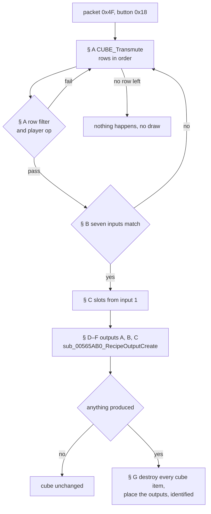
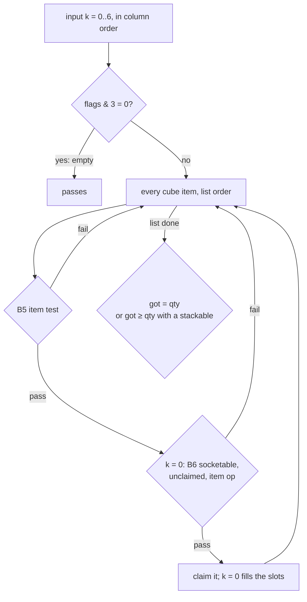
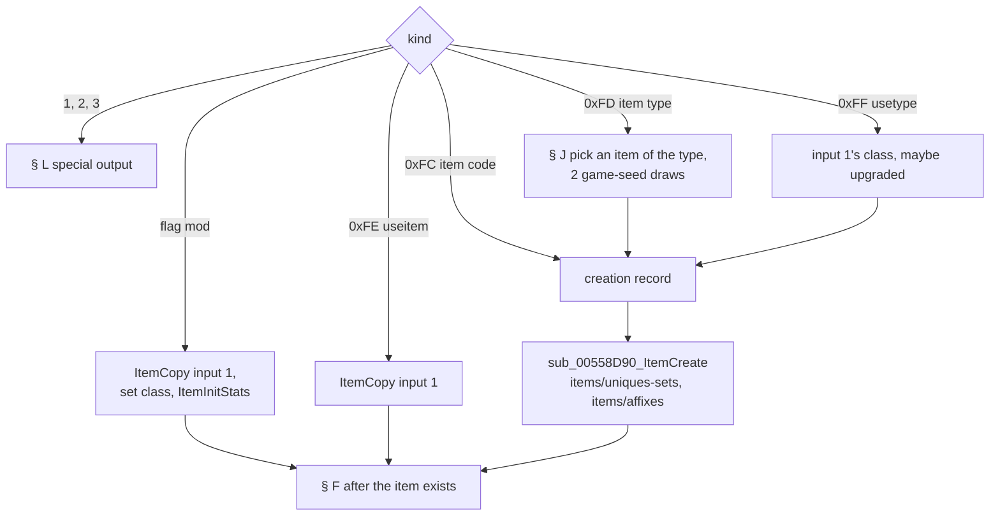
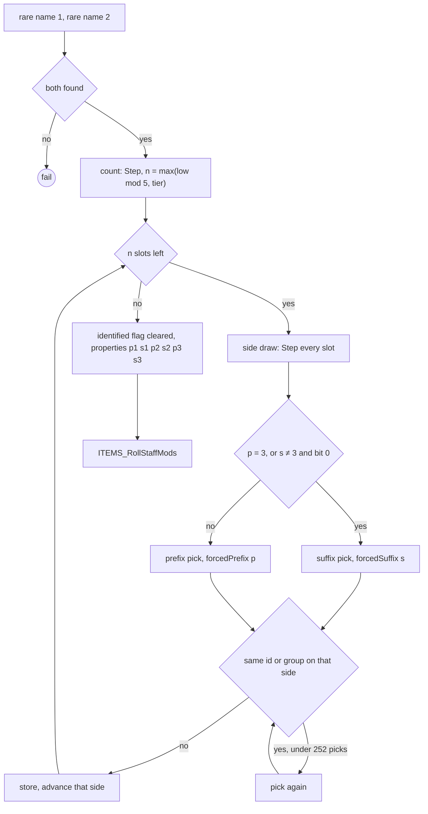
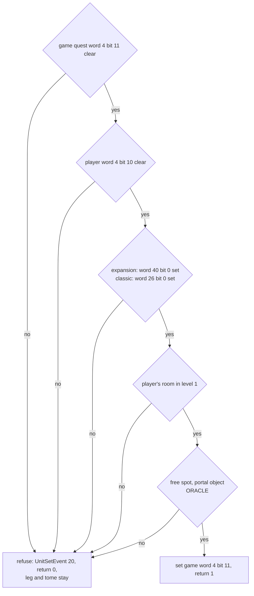
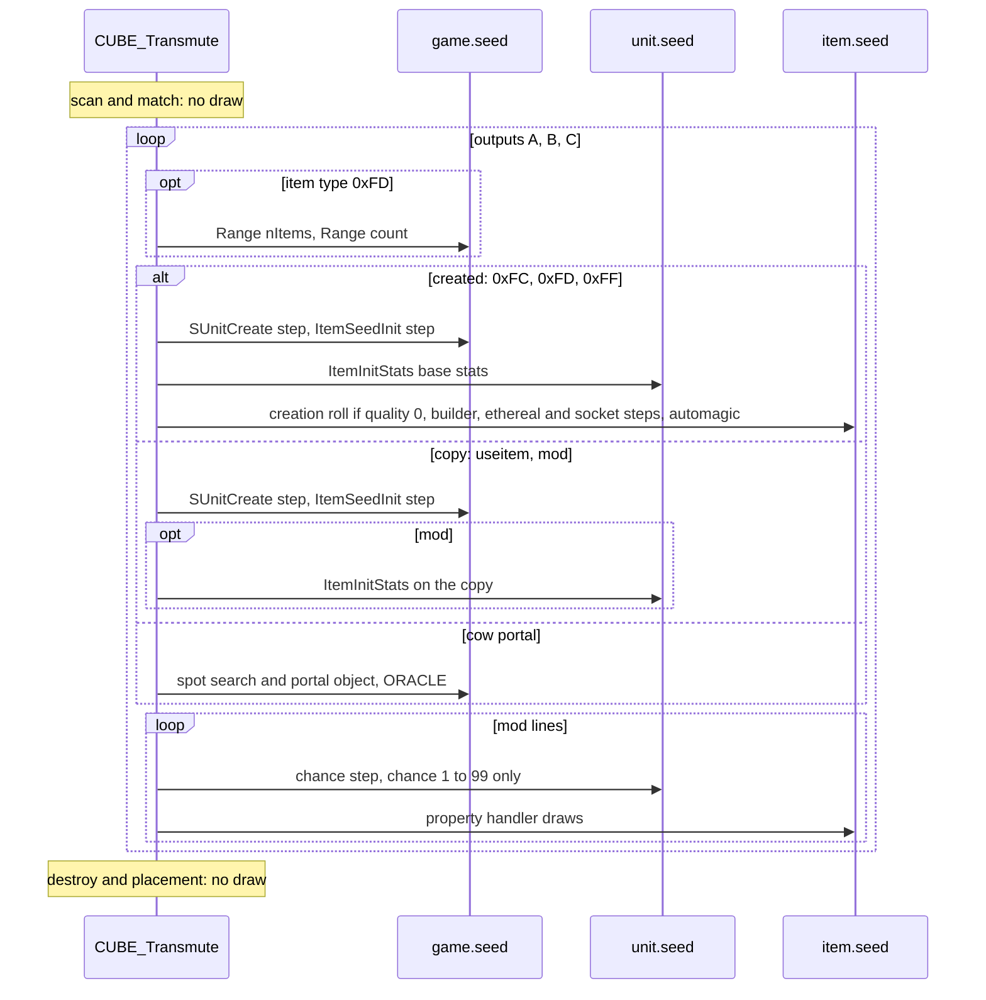

# The Horadric Cube: recipe match and outputs

## Purpose

When the player presses Transmute, the server scans the `CubeMain` table in row order for the first recipe whose
header conditions and seven inputs fit the items in the cube. It then builds that row's outputs (A, B, C in order):
new items made through the ordinary item creation of [items/uniques-sets](uniques-sets.md) and
[items/affixes](affixes.md) with a forced quality, forced affixes and an ilvl computed from the player and input 1;
copies of input 1, possibly re-based; or a special output (the cow portal, two Pandemonium stubs). If anything was
produced, every item in the cube is destroyed and the outputs are placed in the cube, identified. This spec gives
the match, the output construction per kind, the crafted builder (quality 8), the creation-side quality roll that
the cube's quality-0 records reach, and the order of every draw on the game seed, the unit seeds and the item seeds.

Names of functions and fields are ours (`re/types/cube.h`). "Game seed" is `Game+0xD0`, "unit seed" an item unit's
`Unit+0x20`, "item seed" the item data's `ItemData+0x04` ([glossary](../../glossary.md)); the primitives `Step` and
`Range` are those of [rng](../rng/README.md#algorithm). The cube is the player's inventory page 3. "Creation record"
is the 0x84-byte `struct:ItemCreateRec` that `sub_00558D90_ItemCreate` takes.



## Entry points

| When | Function | Tag |
|---|---|---|
| Client packet `0x4F` with button `0x18`, player interaction type 4 | fn:sub_0054C7C0_Pkt4FButton@0x0054C7C0 → fn:sub_00568060_PktInteractButton@0x00568060 → fn:sub_00566AE0_CubeButton@0x00566AE0 | [I] |
| The transmute: row scan, filter, player ops, match | fn:CUBE_Transmute@0x005665F0, run:2026-10-15-cube | [C] |
| The outputs of the matched row | fn:sub_00565AB0_RecipeOutputCreate@0x00565AB0, run:2026-10-15-cube | [C] |
| A created output of quality 8 | fn:sub_00557450_ItemCreateByQuality@0x00557450 case 8 → fn:sub_005C21D0_ItemBuildCrafted@0x005C21D0, run:2026-10-15-cube | [C] |
| Output kinds 1, 2, 3 | data:g_CubePortalFns@0x006E11C8 → fn:CUBE_CowPortalOpen@0x00594140, fn:CUBE_PandemoniumPortalStub@0x00594270, fn:CUBE_PandemoniumFinalePortalStub@0x00594280, run:2026-10-15-cube | [C] |

- [I] The packet `0x4F` (7 bytes: opcode, u16 button, u16, u16) is dispatched through `g_SrvPacketTable` (8-byte
  entries). Buttons `0x17` and `0x18` need the player's interaction type (`Unit+0x68`) to be 4; `0x17` ends the
  interaction and `0x18` calls `CUBE_Transmute(game)` with the player. (data:g_SrvPacketTable@0x006E0D18,
  fn:sub_0054D750_SrvPacketDispatch@0x0054D750, fn:sub_00554100_PlayerGetInteract@0x00554100,
  [items/0008 § Answer](../../findings/items/0008-cube.md#answer-summary))
- [C] Every one of the 182 transmutes of run:2026-10-15-cube is reproduced from two inputs only: the cube's contents
  and the game seed at `CUBE_Transmute`. The rows that reach the matcher, the matched row, the slots, each creation
  record, every game-seed, unit-seed and item-seed draw, every builder pick and property roll, the mod lines, the
  destroy and the placed items match, 0 mismatches. (fn:CUBE_Transmute@0x005665F0, run:2026-10-15-cube,
  [items/0008 § 8](../../findings/items/0008-cube.md#8-phase-2-the-reproduction-run2026-10-15-cube))

## Inputs

### Tables

| Anchor | Used for |
|---|---|
| tbl:CubeMain.txt:enabled, tbl:CubeMain.txt:ladder, tbl:CubeMain.txt:min diff, tbl:CubeMain.txt:class, tbl:CubeMain.txt:version, tbl:CubeMain.txt:numinputs | the row filter (§ A) |
| tbl:CubeMain.txt:op, tbl:CubeMain.txt:param, tbl:CubeMain.txt:value | the player ops 1–14 (§ A), the item ops 15–27 and op 28 (§ B) |
| tbl:CubeMain.txt:input 1 … `input 7` | the compiled inputs (§ B) |
| tbl:CubeMain.txt:output, `output b`, `output c` | the compiled outputs (§ E) |
| tbl:CubeMain.txt:lvl, tbl:CubeMain.txt:plvl, tbl:CubeMain.txt:ilvl | the output ilvl (§ D) |
| tbl:CubeMain.txt:mod 1 … `mod 5` with `param`, `min`, `max`, `chance` | the property lines (§ F) |
| tbl:ItemStatCost.txt:ValShift | `value >> ValShift` in the stat ops |
| tbl:Weapons.txt:normcode, tbl:Weapons.txt:ubercode, tbl:Weapons.txt:ultracode | `upg`, `bas`/`exc`/`eli` inputs; the `exc`/`eli` output class |
| tbl:Weapons.txt:quest, tbl:Misc.txt:questdiffcheck | op 28 |
| tbl:Weapons.txt:level, tbl:Weapons.txt:spawnable, tbl:Weapons.txt:version | the random item of a type (§ J) |
| tbl:ItemTypes.txt:Equiv1 | type inputs and type outputs (`ITEMS_UnitIsType`, `ITEMS_IsType`) |
| tbl:Experience.txt:Amazon | record 0 (`MaxLvl`), the ilvl cap (§ D) |
| tbl:ItemRatio.txt:Unique | the creation-side roll of a quality-0 record (§ H) |
| tbl:MagicPrefix.txt:Name, tbl:MagicSuffix.txt:Name | the forced `pre=`/`suf=` rows |
| tbl:Properties.txt:func1 | the handler of each `mod` line ([items/properties § E](properties.md#e-the-handlers-per-func)) |

The record layout, the cell grammar and the survey of the stock rows are in [CubeMain](../../tables/CubeMain.md).
What a reimplementation needs from them:

- [C] `cubemain` is the only cube table the game reads: 151 records of 328 bytes, one per `.txt` row in order, no
  `Expansion` marker; a record holds a 20-byte header, seven 8-byte inputs and three 84-byte outputs with five
  12-byte mod lines each. `cubemod` and `cubetype` are not loaded. ([CubeMain § Row identity](../../tables/CubeMain.md#row-identity),
  [CubeMain § Record layout](../../tables/CubeMain.md#record-layout), struct:CubeMainRec+0x14, struct:CubeOutput+0x00)
- [C] **Compiled input** (`struct:CubeInput+0x0`): `flags` u16, `item` u16, `id` u16 (unique or set record index
  + 1), `quality` u8 (1 `low` … 9 `tmp`, 0 any), `qty` u8. Flags: `0x001` item code, `any` (item `0xFFFF`) or
  named unique/set; `0x002` item type; `0x004` `nos`; `0x008` `sock`; `0x010` `eth`; `0x020` `noe`; `0x040` named
  unique/set; `0x080` `upg`; `0x100` `bas`; `0x200` `exc`; `0x400` `eli`; `0x800` `nru`.
  ([CubeMain § Input record](../../tables/CubeMain.md#input-record-input-17-at-0x014--8k1-8-bytes), tbl:CubeMain.txt:input 1)
- [C] **Compiled output** (`struct:CubeOutput+0x00`): `flags` u16, `item` u16, `id` u16, `quality` u8, `qty` u8
  (`qty=N` and `sock=N` share it, the later keyword wins), `kind` u8 (`0xFC` item code or named unique/set, `0xFD`
  item type, `0xFE` `useitem`, `0xFF` `usetype`, 1 `Cow Portal`, 2 `Pandemonium Portal`, 3 `Pandemonium Finale
  Portal`), `lvl`/`plvl`/`ilvl` u8, `pre1..3` and `suf1..3` u16, five mod lines {s32 Properties row (−1 none), u16
  param, s16 min, s16 max, u8 chance}. Flags: `0x001` `mod`, `0x002` `sock=N`, `0x004` `eth`, `0x008` named
  unique/set, `0x010` `uns`, `0x020` `rem`, `0x040` `reg`, `0x080` `exc`, `0x100` `eli`, `0x200` `rep`, `0x400`
  `rch`. ([CubeMain § Output record](../../tables/CubeMain.md#output-record-output-at-0x04c-output-b-at-0x0a0-output-c-at-0x0f4-84-bytes-each), tbl:CubeMain.txt:output)
- [C] **Cell heads.** An input head is tried as an item type first, then an item code, `any`, a unique or set name;
  an output head as `useitem`, `usetype`, an item code, an item type, a unique or set name, a portal name. So `axe`
  and `key` are types as inputs and items as outputs. ([CubeMain § Cell grammar](../../tables/CubeMain.md#cell-grammar-input-and-output-cells),
  fn:sub_00668600_CubeParseInput@0x00668600, fn:CUBEMAIN_OutputTypeParse@0x00668A90)
- [C] **A named unique or set output keeps the `ilvl` column**: the column is compiled after the output cell and
  overwrites the item's `lvl` that the output parser puts in the same byte. No stock row has such an output.
  ([CubeMain § Output record](../../tables/CubeMain.md#output-record-output-at-0x04c-output-b-at-0x0a0-output-c-at-0x0f4-84-bytes-each),
  run:2026-10-15-cube-saves)
- [C] **Stock survey.** `min diff`, `class`, `param`, `value`, every mod `chance`, `output b` and `output c` are blank
  in every stock row; `op` is 28 on rows 0, 1, 2, 148, 149 only; `ladder` is set on rows 104–122, 131, 132; rows
  142–146 have `enabled` blank; `numinputs` equals the inputs' summed `qty` (1 when absent) in all 151 rows.
  ([CubeMain § Survey of the stock rows](../../tables/CubeMain.md#survey-of-the-stock-rows), tbl:CubeMain.txt:numinputs)

### Runtime state

| State | Type | Source |
|---|---|---|
| cube items | the player's inventory items with page (`ItemData+0x45`) = 3, in inventory-list order | fn:sub_00628250_ItemGetPage@0x00628250 |
| `game.expansion` | `Game+0x70` (non-zero: expansion game) | struct:Game+0x70 |
| `game.gameType`, `game.ladder` | `Game+0x6A` (3 in single player), `Game+0x74` | struct:Game+0x6A, struct:Game+0x74 |
| `game.difficulty` | u8 `Game+0x6D` | struct:Game+0x6D |
| `game.itemVersion` | the version the game gives a new item (≥ 100 expansion) | struct:Game+0x78 |
| `game.seed` | Seed at `Game+0xD0` | [rng/seeds](../rng/seeds.md) |
| `game.uniqueMade` | the made-uniques set at `Game+0x1B24` | struct:Game+0x1B24, [items/uniques-sets](uniques-sets.md) |
| game quest record | `Game+0x10F4` → `+0x0C` (the game's own quest words) | fn:sub_00544760_GameQuestGet@0x00544760 |
| player | class (`Unit+0x04`), stat 12 (level), quest record of the current difficulty, room | fn:sub_00451F60_UnitGetClassId@0x00451F60 |
| local time | day of month, day of week (ops 1 and 2 only) | fn:CUBE_Transmute@0x005665F0 |
| `slots[0..2]` | three `{unit, classId, ilvl}` words filled by input 1 | § C |

### Constants

| Name | Value | Anchor | Tag |
|---|---|---|---|
| `CUBE_PAGE` | 3, the inventory page of the cube | fn:sub_00564FD0_CubeCountItems@0x00564FD0, run:2026-10-15-cube | [C] |
| `CLAIM_SLOTS` | 48 entries in the claimed array; an item past the 48th is never marked claimed | fn:sub_005658C0_CubeMatchInputs@0x005658C0 | [I] |
| `MAX_TYPE_CANDIDATES` | 256, the random-item-of-a-type list | fn:sub_00565930_CubePickItemOfType@0x00565930 | [I] |
| `CRAFT_TIERS` | ilvl > 70 → 4, > 50 → 3, > 30 → 2, else 1 | fn:sub_005C21D0_ItemBuildCrafted@0x005C21D0, run:2026-10-15-cube | [C] |
| `CRAFT_REDRAWS` | 252 picks per slot against a duplicate id or group | fn:sub_005C21D0_ItemBuildCrafted@0x005C21D0 | [I] |
| `ILVL_CAP` | `experience` record 0, class-0 column: 99 on stock data | fn:sub_00611830_ExpMaxLevel@0x00611830, tbl:Experience.txt:Amazon | [I] |
| `STAT_SOCKETS`, `STAT_QUESTDIFF` | 194 `item_numsockets`, 356 `questitemdifficulty` | fn:ITEMS_GetSockets@0x006299B0, 0x005652C9 | [C] |
| `COW_LEVEL`, `COW_PORTAL_CLASS` | level 39, object class 60 | fn:CUBE_CowPortalOpen@0x00594140, tbl:Objects.txt:Name, tbl:Levels.txt:Name | [I] |
| event codes | 4 after a produced transmute, 20 after a refused cow portal | fn:sub_00553380_UnitSetEvent@0x00553380 | [I] |

### Inputs and oracles

- [C] The reproduction has no seed oracle between the match and any output: every created item, every copy and
  every mod line is predicted from the game seed at `CUBE_Transmute`. Its only boundary oracles (ADR-0004) are the
  cow portal's free-spot search `0x00545340` and portal object `sub_0056D130_PortalObjectCreate`, whose return
  values and the game seed after each are taken from the log; no item is created after them in a transmute.
  `sub_00560200_InvPlaceItem` is used for its success or failure only. (run:2026-10-15-cube,
  fn:sub_0056D130_PortalObjectCreate@0x0056D130, fn:sub_00560200_InvPlaceItem@0x00560200,
  [items/0008 § 8](../../findings/items/0008-cube.md#8-phase-2-the-reproduction-run2026-10-15-cube))
- [C] The run's inputs were builder-made items (rares with names and no affixes, magic items with one suffix, uniques
  at their maximal properties). They limit no statement here: the match reads class, type, quality, socket and
  ethereal state and stat 356; a created output reads only input 1's class and ilvl; a copy is compared with its
  input list by list. (run:2026-10-15-cube, plan 0030 Phase 2 review ruling 2)
- [I] Every chained callee is specified elsewhere and used here as specified: item creation
  ([items/uniques-sets](uniques-sets.md), [items/affixes](affixes.md)), base stats and the property handlers
  ([items/properties](properties.md)), the socket setter ([items/sockets-runewords § F](sockets-runewords.md#f-socket-counts-the-two-setters)).
  (fn:sub_00558D90_ItemCreate@0x00558D90, fn:PROP_ApplyBlockByVersion@0x0065FE10, fn:ITEMS_SetSockets@0x0062BCB0)

## Algorithm

All arithmetic is signed 32-bit unless a step says otherwise; `÷` truncates toward zero. `Range(s, n)` is one
`Step(s)` and `s.low mod n`, or 0 with no step when `n < 1` (signed); `RNG_RangeB` is this primitive
([rng § Algorithm](../rng/README.md#algorithm)).

### A. The transmute and the row scan — `CUBE_Transmute`

```
A1. n: i32 ← number of cube items (page 3); a stack counts 1               [C] (fn:sub_00564FD0_CubeCountItems@0x00564FD0, run:2026-10-15-cube)
    if n ≤ 0: return
A2. t ← local time; dow: i32 ← t.dayOfWeek + 1                              [I] (fn:CUBE_Transmute@0x005665F0)  ; read for ops 1, 2 only
A3. for i in 0 ..< CUBEMAIN_GetCount():                                      [C] first fit (fn:CUBE_Transmute@0x005665F0, fn:CUBEMAIN_GetRecord@0x0066A1B0, run:2026-10-15-cube, all of A3a–A3h)
A3a.  r ← CubeMain[i]                                                         ; record index = .txt row
      if r.enabled = 0 and g_CubeAllRows = 0: continue
A3b.  if game.expansion = 0 and r.version ≥ 100: continue                    ; u16
A3c.  if game.gameType = 0 and game.ladder = 0 and r.ladder ≠ 0: continue
A3d.  if r.minDiff > game.difficulty: continue                                ; unsigned bytes
A3e.  if r.class ≠ 0xFF and r.class ≠ classId(player): continue
A3f.  if r.numinputs ≠ n: continue                                            ; compared as a byte
A3g.  if not PlayerOp(r, player, t, dow): continue                            ; A4
A3h.  slots[0..2] ← {0, 0, 0}
      if MatchInputs(game, r, slots):                                          ; § B
        RecipeOutputCreate(game, player, r, slots)                             ; § E–G
        return
A4. PlayerOp(r, …): by r.op, table below; op 0 and ops 15–28 pass here       [I] (0x005666C1–0x00566A39, tbl:CubeMain.txt:op)
A5. return                                                                    ; no row matched
```

| `op` | the row passes when | Tag |
|---|---|---|
| 1 | `param` ≤ day of month ≤ `value` | [I] (0x005666D8–0x005666E8) |
| 2 | `value` = `dow` (Sunday = 1) | [I] (0x005666F3) |
| 3 / 4 / 5 / 6 | `STATS_GetUnitStat(player, param)` ≥ v / ≤ v / ≠ v / = v | [I] (0x00566739, fn:STATS_GetUnitStat@0x00625480) |
| 7 / 8 / 9 / 10 | the same on the player's base stat | [I] (0x005666C1–0x00566A39) |
| 11 / 12 / 13 / 14 | the same on `sub_00625560_UnitStatDelta(player, param)` | [I] (fn:sub_00625560_UnitStatDelta@0x00625560) |
| 0, 15–28, any other | no test here | [I] (0x005666C1) |

Step notes:

- A3. **First fit.** The first row whose filter, player op and seven inputs pass is transmuted and the scan stops;
  rows after it are never tested. 166 transmutes matched a row and 16 matched none, and the model predicts every
  row that reached the matcher and its result. [C] (fn:CUBE_Transmute@0x005665F0, run:2026-10-15-cube)
- A3a. **The five disabled rows (142–146) are unreachable.** `g_CubeAllRows` is read once and never written, and the
  image holds 0 there. [I] (data:g_CubeAllRows@0x0088CAC0, 0x00566658)
- A3b. **A classic game refuses the `version` 100 rows.** In the classic session row 60 (`version` 100) reached no
  matcher. [C] (0x00566653, run:2026-10-15-cube)
- A3c. **Ladder rows match in single player.** A `ladder` row is skipped only when `Game+0x6A` = 0 and the game is not
  a ladder game; single player has `Game+0x6A` = 3, so the 21 stock ladder rows (the rune upgrades 104–122 and the
  elite unique upgrades 131, 132) are matchable offline. Rows 104, 107, 111 and 122 matched and made their runes with
  the ladder word 0. [C] (0x00566679–0x00566689, struct:Game+0x6A, struct:Game+0x74, run:2026-10-15-cube)
- A3d–A3e. No stock row sets `min diff` or `class`, so with stock data these tests always pass. [C]
  ([CubeMain § Survey of the stock rows](../../tables/CubeMain.md#survey-of-the-stock-rows), tbl:CubeMain.txt:class)
- A3f. **The count is an exact count of cube items.** With stock data `numinputs` is the inputs' summed `qty`, so an
  extra item in the cube refuses every row. [C] (0x005666B4–0x005666BB, run:2026-10-15-cube)
- A4. **The stat ops.** `v ← value >> ItemStatCost[param].ValShift` (arithmetic shift). For ops 3–14 the test runs
  only when 0 ≤ `param` ≤ the stat count (`DataTables+0xBD4`); outside that range the row passes; a missing
  `ItemStatCost` record refuses the row. No stock row has ops 1–27; only op 28 is used (§ B). [I] (0x005666C1,
  fn:ITEMSTATCOST_GetRecord@0x0045C4F0, tbl:ItemStatCost.txt:ValShift)
- A4. **Do not port the community readings of ops 1–4.** The code passes op 1 inside the range and op 2 on equality
  (a guide states the refusal conditions), and ops 3/4 (7/8, 11/12, 15/16, 19/20, 23/24) on ≥ / ≤, not on > / <.
  [I] (0x005666D8–0x0056673B, [items/0008 § Leads used](../../findings/items/0008-cube.md#leads-used))
- A5. **No match, no effect.** Nothing in the scan or the matcher draws from any seed. In the 16 transmutes that
  matched no row (a count off by one, an extra item, a wrong quality, a missing gem, a `version` 100 row in a
  classic game) the game seed and the cube's items were unchanged. [C] (0x00566A73–0x00566A8A, run:2026-10-15-cube)

### B. The inputs — `sub_005658C0_CubeMatchInputs` and `CUBE_MatchInput`



```
B1. claimed[0..47] ← 0                                                         [C] (fn:sub_005658C0_CubeMatchInputs@0x005658C0, run:2026-10-15-cube)
    for k in 0 ..< 7: if not MatchInput(k): return false                       ; stop at the first failing input
    return true
MatchInput(k):                                                                 [C] (fn:CUBE_MatchInput@0x00565010, run:2026-10-15-cube, all of B2–B4)
B2. in ← r.input[k]
    if (in.flags & 3) = 0: return true                                         ; empty input
    need: i32 ← in.qty if in.qty ≠ 0 else 1;  got: i32 ← 0;  exact ← true;  ord: i32 ← 0
B3. for each cube item it, in inventory-list order:
      ord ← ord + 1
      if not ItemTest(in, it): continue                                         ; B5
      if k = 0 and not FirstInputSocketable(r, it): continue                    ; B6
      if ord ≤ 48 and claimed[ord − 1]: continue
      if k = 0:
        if not ItemOp(r, it): continue                                          ; B7
        FillSlots(r, it, slots)                                                 ; § C
      if ord ≤ 48: claimed[ord − 1] ← 1
      got ← got + 1
      if ItemBaseStackable(it): exact ← false
B4. return (got = need) if exact else (got ≥ need)
```

**B5. `ItemTest(in, it)`**, in the code's order; the first failing test refuses the item:

| # | Test | Tag |
|---|---|---|
| a | **Base.** Flag `0x001` with item `0xFFFF`: any item. Flag `0x001` without `upg`: the item's class = `item`. Flag `0x002`: `ITEMS_UnitIsType(it, item)` (type equivalences count) | [C] (0x005650A0–0x005651AD, fn:ITEMS_UnitIsType@0x00629BB0, run:2026-10-15-cube) |
| a′ | **`upg`** (`0x001` with `0x080`): let `c` be the item's own code and `i` the input's code; it passes when `c` = `normcode` and `i` = `normcode`; `c` = `ubercode` and `i` ∈ {`normcode`, `ubercode`}; `c` = `ultracode` and `i` is any of the three. So `upg` accepts the named base or a higher tier of it | [C] for an item of the named tier (rows 66, 73, 74, 85, 91); [I] for a higher tier (0x00565330–0x00565847, tbl:Weapons.txt:normcode, run:2026-10-15-cube) |
| b | **Quality.** When `in.quality` ≠ 0 the item's quality equals it | [C] (0x005651B0–0x005651D8, run:2026-10-15-cube) |
| c | **Named unique or set** (`0x040`): `ITEMS_GetFileIndex(it)` = `in.id` − 1 | [C] (fn:ITEMS_GetFileIndex@0x00629DA0, run:2026-10-15-cube) |
| d | **Sockets.** `nos`: stat 194 = 0. `sock`: stat 194 ≠ 0 (the socket count, not the number filled) | [C] (fn:ITEMS_GetSockets@0x006299B0, run:2026-10-15-cube) |
| e | **Ethereal.** `noe`: not ethereal | [C] (fn:ITEMS_IsEthereal@0x0062A8D0, run:2026-10-15-cube) |
| e′ | `eth`: ethereal | [I] (fn:ITEMS_IsEthereal@0x0062A8D0) |
| f | **Tier.** `bas`: the item's code = its `normcode` | [C] (0x0056526D–0x005652A8, run:2026-10-15-cube) |
| f′ | else `exc`: = `ubercode`; else `eli`: = `ultracode` (one of the three is tested, in that priority) | [I] (0x0056526D–0x005652A8, tbl:Weapons.txt:ubercode, tbl:Weapons.txt:ultracode) |
| g | **`nru`**: the item's runeword flag (bit 26) is clear. No stock input has `nru` | [I] (fn:sub_00628110_ItemGetFlags@0x00628110, tbl:CubeMain.txt:input 1) |
| h | **Op 28, on every input.** When `r.op` = 28 and the item's base has both `quest` and `questdiffcheck` set, stat 356 ≥ `game.difficulty` | [C] (0x005652C9–0x005652FF, tbl:Weapons.txt:quest, tbl:Misc.txt:questdiffcheck, run:2026-10-15-cube) |

**B6. `FirstInputSocketable(r, it)`** (input 1 only): when output A is `useitem` or `usetype` and has the `sock`
flag, `sub_0062BC20_ItemMaxSockets(it)` ≠ 0. [C] (0x00565307–0x00565330, fn:sub_0062BC20_ItemMaxSockets@0x0062BC20,
run:2026-10-15-cube)

**B7. `ItemOp(r, it)`** (input 1 only), with the `v`, range rule and missing-record refusal of A4: ops 15 / 16 / 17 /
18 item stat ≥ v / ≤ v / ≠ v / = v; 19–22 the same on the item's base stat; 23–26 the same with
`sub_00625560_UnitStatDelta`; 27 `ITEMS_GetFileIndex(it)` ≠ `value`; any other op passes. No stock row has ops 15–27.
[I] (0x00565347–0x005656E8, fn:sub_00625560_UnitStatDelta@0x00625560)

Step notes:

- B3. **An input claims every matching item, not `qty` of them**, and the test is `got = qty`. Inputs are taken in
  column order, so an item that could match two inputs goes to the first. Each cube item counts 1 whatever its stack
  quantity. [C] (0x0056504A, 0x0056581C–0x0056587C, run:2026-10-15-cube)
- B4. **A stackable base relaxes the count** to `got ≥ qty`, once any claimed item has a stackable base. [I]
  (fn:sub_006289F0_ItemBaseStackable@0x006289F0)
- B3. Because the row filter already requires the cube count to equal `numinputs` (A3f), and `numinputs` is the summed
  `qty` on every stock row, an unmatched item always refuses the row with stock data. A row whose `numinputs` exceeded
  the inputs' sum would let an unmatched item through; none exists. [I] (0x005666B4–0x005666BB, tbl:CubeMain.txt:numinputs)
- B5h. **Op 28 is ≥, not >.** Wirt's Leg with stat 356 = 1 matched row 2 in Nightmare and 356 = 2 in Hell; 356 = 0 in
  Nightmare and 356 = 1 in Hell matched no row. In Normal every leg passes. The Pandemonium keys and organs have
  `quest` blank, so op 28 does not test them. [C] (0x005652FD, run:2026-10-15-cube)
- B5. Op 28 binds, of the five op-28 rows, Wirt's Leg, the Staff of Kings and the Viper Amulet, the Khalim Flail and
  Khalim's organs. [I] (tbl:Misc.txt:questdiffcheck, [CubeMain § Header](../../tables/CubeMain.md#header-0x000-20-bytes))
- B5b. On a quality mismatch with quality 9 the code makes a call (`0x00625290`) whose result is unused; it has no
  effect. [I] (0x005651B0–0x005651D8)
- B6. **Row 63 refuses a ring or an amulet.** Its output is `useitem,sock=1`, so input 1 must be able to hold sockets;
  a rare amulet (`ItemMaxSockets` 0) stayed out of input 1 and no row matched. A rare short sword, cap and kite shield
  matched. [C] (0x00565307, run:2026-10-15-cube)
- B7. Input `sock=N` is **not** an input keyword: the parser knows `sock` alone and stops at the unknown token `N`, so
  the count is never stored or tested. [I] (fn:sub_00668600_CubeParseInput@0x00668600, [CubeMain § Input record](../../tables/CubeMain.md#input-record-input-17-at-0x014--8k1-8-bytes))

### C. What input 1 hands to the outputs — `FillSlots`

```
C1. for each item it that input 1 claims, in claim order:                      [C] (0x005656EE–0x00565816, run:2026-10-15-cube, all of C1–C2)
      for s in 0 ..< 3:                                                         ; outputs A, B, C
        slots[s].ilvl ← ITEMS_GetItemLevel(it)
        a ← r.output[0]                                                         ; output A's kind and flags, for all three
        if (a.flags & 0x001) or a.kind ∈ {0xFE, 0xFF}: slots[s].unit ← it
        if a.kind = 0xFF: slots[s].classId ← classId(it)
        if a.kind = 0xFE: slots[s].classId ← −1
C2.     if a.kind ∈ {0xFE, 0xFF}:
          if a.flags & 0x080: code ← base(it).ubercode
          else if a.flags & 0x100: code ← base(it).ultracode                   ; [I] (0x005656EE–0x00565816) no stock row reaches it
          else: code ← none
          if code ≠ blank and EXCEL_FindCode(code) = j
             and (game.expansion or Items[j].version < 100):
            slots[s].classId ← j
```

Step notes:

- C1. **The last claimed item wins**, and every slot is filled from **output A's** kind and flags, so outputs B and C
  see the same class and ilvl as A. The nine slot words of every match were predicted. [C] (0x0056533F,
  run:2026-10-15-cube)
- C1. Outputs B and C use these slots exactly as A does; no stock row has `output b` or `output c`, so a `b ilvl` or
  `c ilvl` is a percentage of **input 1's** ilvl, not of input 2's or 3's. [I] (0x0056533F,
  [items/0008 § 2.4](../../findings/items/0008-cube.md#24-what-input-1-hands-to-the-outputs))
- C2. The `exc` upgrade gave the three `mod` outputs of the run (rows 129, 130, 133) the base's `ubercode` record.
  [C] (fn:EXCEL_FindCode@0x006BD130, run:2026-10-15-cube)
- C2. The `eli` branch and the version gate (a classic game with an expansion-only upgraded base) were not reached.
  [I] (0x005656EE–0x00565816, tbl:Weapons.txt:version)

### D. The output ilvl

```
D1. o ← r.output[s]                                                             [C] (0x00565B66–0x00565D12, run:2026-10-15-cube, all of D1–D2)
    if o.lvl ≠ 0: v: i32 ← o.lvl
    else:
      v ← 0
      if o.plvl ≠ 0: v ← (STATS_GetUnitStat(player, 12) × o.plvl) ÷ 100
      if o.ilvl ≠ 0: v ← v + (slots[s].ilvl × o.ilvl) ÷ 100
D2. v ← max(v, 1)
D3. if v ≥ ILVL_CAP: v ← ILVL_CAP                                              [I] (fn:sub_00611830_ExpMaxLevel@0x00611830)
```

Step notes:

- D1. Two truncating divisions, each term only when its column is non-zero; `lvl` overrides both. The crafted rows
  (`plvl` 50, `ilvl` 50), with players of level 20 to 99 and inputs of ilvl 1 to 99, reached all four crafted tiers.
  [C] (0x00565B9B–0x00565CDB,
  run:2026-10-15-cube)
- D1. The code takes a 64-bit path or divides first above 0x100000 or 0x10000, which a player level and a byte
  percentage never reach; for every value a stock game produces the products are exact 32-bit signed divisions. [I]
  (0x00565B9B–0x00565CDB)
- D1. Stock values: `lvl` 25, 30, 50 (the old magic recipes); `plvl` 75 (rings ↔ amulets); `plvl`/`ilvl` 40/40
  (row 61) and 66/66 (row 62, the rare rerolls), 50/50 (crafted); `ilvl` 100 (magic reroll, row 60); `ilvl` 60 with
  `lvl` 30, where `lvl` wins. [C] (tbl:CubeMain.txt:plvl, [CubeMain § Survey of the stock rows](../../tables/CubeMain.md#survey-of-the-stock-rows))
- D3. The cap was not reached in the run. [I] (fn:sub_00611830_ExpMaxLevel@0x00611830)
- D. **Only created items use `v`.** A `useitem` or `mod` output keeps the input's ilvl. The cube does not raise the
  record's ilvl to the base's `level`. [C] (0x00565B66, run:2026-10-15-cube)

### E. Building one output — `sub_00565AB0_RecipeOutputCreate`



Outputs A, B and C (`row + 0x4C + 0x54·s`) are built in that order, each to the end of § F before the next.

```
E1. strip ← (o.flags & 0x030) ≠ 0                                               [C] (fn:sub_00565AB0_RecipeOutputCreate@0x00565AB0, run:2026-10-15-cube, all of E1–E6)
    v ← § D
E2. if o.kind ∈ 1..3 and g_CubePortalFns[o.kind] ≠ 0:
      produced ← produced or (g_CubePortalFns[o.kind](game, player) ≠ 0)       ; § L
E3. if o.flags & 0x001:                                                         ; `mod`: re-base a copy of input 1
      it ← ItemCopy(game, slots[s].unit, children: not strip)                  ; § K
      cls ← max(slots[s].classId, 0)       if o.kind = 0xFE
            slots[s].classId               if o.kind = 0xFF
            o.item                         if o.kind = 0xFC
            PickItemOfType(game, v, o.item) if o.kind = 0xFD                    ; § J
      it.classId ← cls;  ItemInitStats(game, it, 0, 0)                          ; base stats on the copy's unit seed
E4. else if o.kind = 0xFE:                                                      ; `useitem`
      it ← ItemCopy(game, slots[s].unit, children: not strip)                  ; § K
      if o.quality = 9: TmpNames(it)                                            ; E8
E5. else if o.kind ∈ {0xFC, 0xFD, 0xFF}:
      q ← o.quality;  rowP1 ← o.id
      if o.kind = 0xFC: cls ← o.item
      if o.kind = 0xFD: cls ← PickItemOfType(game, v, o.item)                   ; § J, 2 game-seed draws
      if o.kind = 0xFF: cls ← slots[s].classId;  if o.flags & 0x040: Reg(…)     ; E7
      rec ← CreationRecord(cls, v, q, rowP1, o)                                 ; table below
      it ← ItemCreate(game, rec)                                                ; items/uniques-sets § A onward
E6. else: no item                                                               ; kinds 0..3
```

The creation record of E5 (every other field 0):

| Field | Value | Tag |
|---|---|---|
| source, game | the player, the game | [C] (0x00565FEE–0x005660C5, run:2026-10-15-cube) |
| ilvl (`+0x0C`) | `v` of § D | [C] (struct:ItemCreateRec+0x0C, run:2026-10-15-cube) |
| item index | `cls` | [C] (run:2026-10-15-cube) |
| `+0x18` | 4 (3 on a drop; meaning not read) | [I] (0x00565FEE–0x005660C5) |
| `+0x28`, `+0x2A` | 1, `game.itemVersion` | [I] (0x00565FEE–0x005660C5) |
| quality (`+0x30`) | `o.quality`: `mag` 4, `rar` 6, `crf` 8, `nor` 2, …; 0 when the cell names none | [C] (struct:ItemCreateRec+0x30, run:2026-10-15-cube) |
| unique/set row + 1 | `o.id` (0 on every stock output) | [C] (run:2026-10-15-cube) |
| forced prefixes, suffixes (`+0x68`, `+0x74`) | `o.pre[0..2]`, `o.suf[0..2]`, u16 widened to i32 | [C] (struct:ItemCreateRec+0x68, run:2026-10-15-cube) |
| flags (`+0x80`) | `0x08` (no socket roll), or `0x10` when `sock` is given with `qty` 0; ORed with `0x02` (no ethereal roll), or `0x04` (forced ethereal) when `eth` | [C] for `0x08` with `0x02` (every stock created output); [I] for `0x10` and `0x04`, which no stock output has (struct:ItemCreateRec+0x80) |

Step notes:

- E5. **A created output is an ordinary item creation.** The game-seed draws, the base stats, the creation-side roll
  or the forced quality, the overrides, the builders, the ethereal and socket steps and the automagic pick are those
  of [items/uniques-sets](uniques-sets.md#a-the-item-seed-at-entry) and [items/affixes](affixes.md), entered with the
  record above. 140 created items reproduce, with these builders run: crafted 51, magic 44, rare 15, normal 30, low 1
  (the failed low build of § H). [C]
  (fn:sub_00558D90_ItemCreate@0x00558D90, fn:sub_00557450_ItemCreateByQuality@0x00557450, run:2026-10-15-cube)
- E5. **Forced affix ids are block-relative.** `pre=N` and `suf=N` reach `ITEMS_PickMagicAffix` as `forcedId` and
  select row `N − 1` of the prefix (suffix) block with no weighted draw ([items/affixes § C](affixes.md#c-one-magic-affix-pick--items_pickmagicaffix),
  C4i): `pre=331` *Prismatic*, 372 *Garnet*, 353 *Cobalt*, 392 *Coral*, 412 *Jade*, 191 *Savage*; `suf=162`
  *of Spikes*, 352 *of the Leech*. The magic builder then picks the prefix with `mustRoll` 1 and the suffix with
  `mustRoll` 0 (rows 6–10: 6 of 9 items also got a suffix). 12 forced picks. [C] (fn:ITEMS_PickMagicAffix@0x005C1560,
  fn:ITEMS_BuildMagic@0x005565E0, tbl:MagicPrefix.txt:Name, run:2026-10-15-cube)
- E5. **A quality-0 record** (runes, gems, potions, the Token of Absolution, `hst`, `qf2`) leaves the quality to the
  creation-side roll, which **draws on the item seed** (§ H); the `Normal` type override then sets 2 for runes and
  gems, after the draws. [C] (fn:sub_00556F60_ItemRollQualityCreate@0x00556F60, run:2026-10-15-cube)
- E3. **`mod` re-bases a copy.** The copy gets the slot's class (the `ubercode` record for the stock upgrade rows) and
  `ItemInitStats(game, copy, 0, 0)` re-runs the base stats on the copy's unit seed: durability, defense or damage,
  speed and the picture are rewritten; sockets, prefixes, suffixes, the unique's or set's row and their lists stay;
  the quality builders do not run. Rows 129, 130, 133. [C] (0x00565DC4–0x00565E3F,
  fn:sub_00557AB0_ItemInitStats@0x00557AB0, run:2026-10-15-cube)
- E3. A class of −1 left by the slot (a `useitem,mod` row whose input base has no next-tier code) becomes **0**, item
  record 0. The stock upgrade rows require `bas` or `exc` bases, so it is not reachable. [I] (0x00565DC4–0x00565E3F)
- E4. **`useitem` is a copy of input 1**: class, quality, affixes, rare names, ilvl, flags and every stat list come
  back from the copy stream; 15 `useitem` copies. [C] (fn:sub_0055A2A0_ItemCopy@0x0055A2A0, run:2026-10-15-cube)
- E3–E4. The copy takes the input's socketed children with it unless `uns` or `rem` is given. [I] (0x00565D76–0x00565DA2,
  0x00565E66–0x00565E8C)
- E7. **`Reg`** (`usetype` with `reg`, no stock row): when input 1 exists, `q` ← its quality, `rowP1` ← its file index
  + 1 and `v` ← its unclamped `ITEMS_GetItemLevel`. If `q` = 7 and the row's made bit is clear before the build,
  the bit is cleared again after `ItemCreate`, so the made set is unchanged; a bit already set stays set and the
  unique build may fail and fall back ([items/uniques-sets § E](uniques-sets.md#e-failure-durability-and-the-fallback-chain)).
  This is the cube's only write to the made-uniques set. [I] (0x00565F49–0x00565FA9, 0x005660DC–0x005660F2,
  struct:Game+0x1B24, [items/0008 § 3.3](../../findings/items/0008-cube.md#33-building-one-output))
- E8. **`TmpNames`** (`useitem` with quality 9, the disabled rows only): `a ← PickRareNameByVersion(it, 1)`,
  `b ← PickRareNameByVersion(it, 0)`; with both non-zero the copy gets quality 9 and the two names; otherwise the
  mod lines of § F are skipped. [I] (fn:sub_005C1BC0_PickRareNameByVersion@0x005C1BC0, fn:sub_00565AB0_RecipeOutputCreate@0x00565AB0)
- E5. **A named unique or set output** (kind `0xFC` with quality 7 or 5 and `id`): no stock row has one; its ilvl
  byte is the `ilvl` column (§ Inputs). [I] (fn:CUBEMAIN_OutputTypeParse@0x00668A90)

### F. After the item exists, in this order

```
F1. if strip: RemoveRuneword(it)                                                [I] (fn:sub_00558C50_ItemRemoveRuneword@0x00558C50, 0x00566105–0x005661C6)
    if o.flags & 0x020: copy each socketed child of the ORIGINAL input aside   ; `rem`, placed after the outputs (§ G)
F2. for m in 1 ..< 6 (skipped when TmpNames failed):                            [C] (0x005661C8–0x00566283, fn:sub_00660240_CubeModApply@0x00660240, run:2026-10-15-cube)
      line ← o.mod[m]; if line.prop < 0: continue
      if 1 ≤ line.chance ≤ 99:                                                  [I] (0x00566204–0x00566239)
        Step(it.unitSeed)                                                       ; draw on the UNIT seed
        if low mod 100 > line.chance: continue                                  ; u32
      PROP_ApplyBlockByVersion(7, it, line, state 0, flags 0x40)                ; handlers draw on the ITEM seed
      if IsEthereal(it): ITEMS_MakeEthereal(it)                                 ; [I] (fn:ITEMS_MakeEthereal@0x0065E4D0)
F3. if o.flags & 0x200:                                                         [I] (0x00566289–0x0056630C)  ; `rep`
      if stackable base and o.qty ≠ 0: stat 70 ← min(o.qty, maxStack)
      if it.flags & 0x100: ItemRepairBroken(it)
      else if base stat 72 < stat 73: base stat 72 ← stat 73
F4. if o.flags & 0x400: ItemRefillCharges(it)                                   [I] (0x00566311–0x00566325)  ; `rch`
F5. if (o.flags & 0x002) = 0:                                                   [I] (0x0056632A–0x005663E3)  ; `qty=N`
      if stackable base and o.qty ≠ 0: stat 70 ← min(o.qty, maxStack)
    else if o.qty ≠ 0 and stat 194 = 0 and (it.flags & 0x800) = 0:             [C] (fn:ITEMS_SetSockets@0x0062BCB0, run:2026-10-15-cube)  ; `sock=N`, no draw
      k ← min(ItemMaxSockets(it), o.qty)
      if quality ∈ {4, 9}: k ← min(k, 3)
      if quality ∈ {5, 6, 7, 8}: k ← min(k, 1)
      if k ≠ 0: it.flags ← it.flags | 0x800;  ITEMS_SetSockets(it, k)
```

Step notes:

- F2. **The mod lines come after `ItemCreate` returns**, so for a created output they draw on the item seed after the
  builder, the ethereal and socket steps and the automagic pick. Each line is one property block through the
  handlers of [items/properties § E](properties.md#e-the-handlers-per-func); 170 lines (funcs 1, 2, 8, 11, 14)
  reproduce slot by slot. [C] (fn:sub_00660240_CubeModApply@0x00660240, fn:PROP_ApplyBlockByVersion@0x0065FE10,
  run:2026-10-15-cube)
- F2. **The chance gate** applies the line with probability (`chance` + 1)/100 for `chance` 1..99, and always for 0 or
  ≥ 100. Every stock `chance` cell is blank, so stock data makes no chance draw. [I] (0x00566204–0x00566239,
  tbl:CubeMain.txt:mod 1 chance)
- F2. **The rune socket rows (123–126) roll `sock` 1..6 on every class.** Their `mod 1` is `sock` 1..6 for body
  armour, helm, shield and weapon alike; the count is then capped by the `sock` handler (`ItemMaxSockets` and the
  inventory size, no quality clamp): rolls of 6 on a gothic plate gave 4 sockets, 5 on a great helm and a kite shield
  3 each, 5 on a quilted armour 2. 10 transmutes. [C] (fn:PROP_Func14_Sockets@0x0065F590, run:2026-10-15-cube)
- F2. The ethereal base bonus is re-applied after each line when the item is ethereal; no ethereal item was upgraded
  in the run. [I] (fn:sub_00660240_CubeModApply@0x00660240)
- F3–F4. `rep` and `rch` ran only on items already at full durability and with no charges, where they change
  nothing; that much is reproduced. [C] (0x00566289–0x00566325, run:2026-10-15-cube)
- F3–F4. The repair of a damaged or broken item and the refill of charges (every stat-204 count raised to its
  maximum) were not reached. [I] (fn:sub_0055F900_ItemRepairBroken@0x0055F900, fn:sub_0055FE80_ItemRefillCharges@0x0055FE80,
  fn:ITEMS_GetMaxStack@0x006295B0)
- F5. **`qty` and `sock` share a byte; the flag decides.** The builder reads it as a socket count when the `sock` flag
  is set and as a stack quantity otherwise. So the repair rows' `qty=255` refills a stackable base to
  `min(255, max stack)` and never adds sockets. No stackable output with `qty=` was reached. [I] (0x0056632A–0x005663E3)
- F5. **`sock=N`** (row 63, `useitem,sock=1`): a rare short sword, cap and kite shield got one socket through
  `ITEMS_SetSockets`. [C] (fn:ITEMS_SetSockets@0x0062BCB0, run:2026-10-15-cube)
- F5. The quality clamps (magic and 9 at most 3; set, rare, unique and crafted at most 1) are read only; with N = 1 on
  the only stock `sock=N` row none of them binds, and no stock row can make a crafted item reach the setter's crafted
  cap (row 63 takes a `rar` input; the rune socket rows use a `sock` mod line on `nor` inputs). [I]
  (0x0056632A–0x005663E3, tbl:CubeMain.txt:output, plan 0030 Phase 2 review)

### G. Finishing the transmute

```
G1. if not produced (no output made an item and no special output returned non-zero):   [C] (0x00566400–0x00566407, run:2026-10-15-cube)
      return                                                                     ; nothing destroyed, nothing placed
G2. CubeDestroyContents(player)                                                  [C] (fn:sub_00564F30_CubeDestroyContents@0x00564F30, run:2026-10-15-cube)
    ; every page-3 item, the originals of useitem/mod copies included
G3. UnitSetEvent(player, 4, …)                                                   [I] (fn:sub_00553380_UnitSetEvent@0x00553380)
G4. for each output item, in order A, B, C:                                      [C] (0x00566400–0x00566563, run:2026-10-15-cube)
      set page 3; InvPlaceItem(game, player, it, …)                              ; ORACLE: success or failure only
      if it failed: UnitFree(it)                                                 ; [I] (fn:sub_00555600_UnitFree@0x00555600)
      else: ITEMS_SetFlag(it, 0x10)                                              ; identified
            if code(it) = hst: QuestStaffMade(player)                            ; [I] (fn:sub_0059E5C0_QuestStaffMade@0x0059E5C0)
            if code(it) = qf2: QuestKhalimWillMade(player)                       ; [I] (fn:sub_005B86E0_QuestKhalimWillMade@0x005B86E0)
G5. place the `rem` children the same way                                         [I] (0x00566400–0x00566563)
```

Step notes:

- G2. **The whole cube is destroyed**, not only the claimed inputs; with stock data the two are the same set (A3f). The
  placement draws nothing; the game seed at the end of each produced transmute was predicted. [C]
  (fn:sub_00564F30_CubeDestroyContents@0x00564F30, run:2026-10-15-cube)
- G4. **Every cube output is identified**, crafted items included (their builder creates them unidentified). [C]
  (0x00566495–0x0056649A, fn:ITEMS_SetFlag@0x006280D0, run:2026-10-15-cube)
- G4. Observed, not modelled: a 1 × 1 output landed at cube cell (2, 3) (70 times), a 2 × 1 at (1, 3), every larger one
  at (0, 0). [I] (fn:sub_00560200_InvPlaceItem@0x00560200, run:2026-10-15-cube)
- G4. A placed `hst` sets the player's quest word 10 bit 11; neither `hst` nor `qf2` was made in the run. [I]
  (fn:sub_0059E5C0_QuestStaffMade@0x0059E5C0)

### H. The creation-side quality roll of a quality-0 record

`ItemCreateByQuality` calls `sub_00556F60_ItemRollQualityCreate` first; on a drop it returns the record's quality
with no draw ([items/uniques-sets § B](uniques-sets.md#b-itemcreatebyquality-the-creation-roll-the-overrides-and-the-switch)).
A cube record of quality 0 reaches its drawing body:

```
H1. if itemVersion ≥ 1 and rec.quality ≠ 0: return rec.quality                [C] (fn:sub_00556F60_ItemRollQualityCreate@0x00556F60, 0x00556F60–0x0055714C, run:2026-10-15-cube, all of H1–H4)
H2. ratio ← ITEMRATIO_Select(classId, game.difficulty, 100 if itemVersion ≥ 1 else 0)
    if base.quest: return 2                                                     ; no draw
H3. d: i32 ← 1 if ITEMS_IsType(it, 52 misc) else max(rec.ilvl − base.level, 1)
    for code in 7, 6, 5, 4, 3, 2:                                               ; table 0x006E1138
      c: i32 ← ratio[code].base − d ÷ ratio[code].divisor                       ; no ×128, no magic find
      if c ≤ 0: return code                                                     ; no draw
      if Range(item.seed, c) = 0: return code                                   ; draw
H4. return 3 if rec.flags & 0x40 else 1
```

Step notes:

- H2. The ratio columns are `ItemRatio`'s Unique, Rare, Set, Magic, HiQuality and Normal with their divisors; the row
  is chosen as in [items/quality § B](quality.md#b-the-itemratio-row--itemratio_select). [C]
  (fn:ITEMRATIO_Select@0x00637910, tbl:ItemRatio.txt:Unique, run:2026-10-15-cube)
- H3. **The draws count even when the result is overridden.** `ItemCreateByQuality` keeps the record's quality when
  it is non-zero, else the roll's, then applies the type overrides; a rune or gem (`Normal` type) ends at 2 whatever
  the roll gave, after its draws. Results over 29 creations: 2 (14), 1 (9), 3 (4), 6 (2). [C] (0x005574CC–0x005574DE,
  run:2026-10-15-cube)
- H. **The fallback helpers call it again.** `sub_005572A0_ItemFallbackNormal` (and the magic helper, same shape)
  clears the item, sets the start seed to S and the item seed to `{S, 666}`, calls the roll, and only then writes the
  step's quality. On a drop that call draws nothing; on a quality-0 cube record the first fallback step draws as
  above and discards the result. Seen once: a Token of Absolution rolled quality 1, `ITEMS_BuildLow` failed (not a
  weapon or armour), and the normal fallback drew its roll from `{S, 666}`. [C] (0x005572A9–0x005572DB,
  0x005573B1–0x005573C0, fn:sub_005572A0_ItemFallbackNormal@0x005572A0, fn:ITEMS_SetStartSeed@0x00627E20,
  run:2026-10-15-cube)
- H1. The version-0 body (only the codes 4..2 divide, and c ≤ 0 is raised to 1) was not reached. [I]
  (0x00556F60–0x0055714C)

### I. The crafted builder — `sub_005C21D0_ItemBuildCrafted`

Case 8 of `ItemCreateByQuality` clears both rare names, reads the item seed's low word for the fallback, calls the
builder, and on failure calls `sub_005572A0_ItemFallbackNormal` with that value. [I] (0x005577B7–0x005577FC,
fn:sub_00557450_ItemCreateByQuality@0x00557450, fn:sub_005572A0_ItemFallbackNormal@0x005572A0)



```
I1. a ← RareName(prefix);  b ← RareName(suffix)                                 [C] (fn:sub_005C21D0_ItemBuildCrafted@0x005C21D0, fn:ITEMS_PickRareName@0x005C1AB0, run:2026-10-15-cube, all of I1–I6)
    ; ITEMS_PickRareName for an item of version ≥ 1 (items/affixes E2, R1–R4): one Range draw each
    if a = 0 or b = 0: return false
    rareName1 ← a;  rareName2 ← b
I2. tier: i32 ← 4 if rec.ilvl > 70 else 3 if rec.ilvl > 50 else 2 if rec.ilvl > 30 else 1
I3. Step(item.seed);  n: u32 ← low mod 5;  if n < tier: n ← tier               ; draw
I4. p ← 0;  s ← 0
    repeat n times:
      Step(item.seed);  lo ← low                                                ; the side draw, every slot
      side ← suffix if p = 3 or (s ≠ 3 and (lo & 1) = 1) else prefix
      t ← 0
      loop:
        id ← PickMagicAffix(it, needSpawnable 1, mustRoll 1, applyProps 0, side,
                            rec.forced<side>[side's counter], 0)                ; items/affixes § C: 2 draws
        if id's row and group differ from every filled slot of that side:
          store id in that side's slot; advance that side's counter; break
        if t > 250: store 0 in that side's slot; break                          ; [I] (0x005C2252–0x005C251F) the 252-pick bound
        t ← t + 1
I5. ITEMS_SetFlag(it, 0x10, 0)                                                  ; clear: created unidentified
    for k in 0 ..< 3: ItemApplyProps(0, prefix[k]); ItemApplyProps(0, suffix[k])   ; empty slots skipped
I6. ITEMS_RollStaffMods(it, rec);  return true
```

Step notes:

- I2–I3. **The count is `max(low mod 5, tier)`.** So tier 1 gives 1 affix with probability 2/5 and 2, 3, 4 with 1/5
  each; tier 2 gives 2 (3/5), 3, 4 (1/5 each); tier 3 gives 3 (4/5), 4 (1/5); tier 4 always 4. 51 crafted items, counts
  by tier: tier 1: 2, 3, 4 (1, 2, 2 items); tier 2: 2, 3, 4 (8, 2, 4); tier 3: 3, 4 (11, 4); tier 4: 4 (17). [C]
  (fn:sub_005C21D0_ItemBuildCrafted@0x005C21D0, run:2026-10-15-cube)
- I4. **One side draw per slot, always**, unlike the rare builder, which draws a side only while both sides are open
  ([items/affixes § E](affixes.md#e-the-rare-builder--items_buildrare--items_buildrareaffixes), E4). A full side
  (3 affixes) forces the other. [C] (0x005C2252–0x005C251F, run:2026-10-15-cube)
- I4. **The picks roll no properties** (`applyProps` 0); every property comes after all picks, in the order prefix 1,
  suffix 1, prefix 2, suffix 2, prefix 3, suffix 3, then the staff mods. The forced ids are the record's `pre=`/`suf=`
  per slot, 0 on every stock crafted row. [C] (0x005C2300–0x005C2508, fn:sub_0065FEC0_ItemApplyProps@0x0065FEC0, run:2026-10-15-cube)
- I4. **The duplicate test** compares the picked id and its `group` with the filled slots of the same side. No redraw
  occurred in the run. [C] (fn:MAGICAFFIX_GetRecord@0x00633EE0, run:2026-10-15-cube)
- I4. A redraw cannot be reached with stock data through a non-forced pick, because the pick's own group test already
  excludes every group on the item ([items/affixes § C](affixes.md#c-one-magic-affix-pick--items_pickmagicaffix), C4i). After 252
  colliding picks the slot is written 0 and its side's counter is not advanced, so the next slot of that side reuses
  it. [I] (0x005C2252–0x005C251F)
- I5. **The recipe's own lines come later.** A crafted row's `mod 1..5` lines (three per crafted row: two for the family
  and one for the base) are applied by § F2 after `ItemCreate` returns, so they draw on the item seed after the builder,
  the ethereal and socket steps (both disabled by the record: § E, quality 8 has no socket roll) and the automagic pick
  ([items/affixes § J](affixes.md#j-after-the-switch-ethereal-sockets-automagic)). [C] (0x005661C8,
  fn:sub_00557450_ItemCreateByQuality@0x00557450, run:2026-10-15-cube)
- I1. An item of version 0 takes `sub_005C19A0_PickRareNameV0` instead; not reached. [I] (fn:sub_005C19A0_PickRareNameV0@0x005C19A0)

### J. A random item of a type — `sub_00565930_CubePickItemOfType`

```
J1. start: u32 ← Range(game.seed, nItems)                                       [C] draw (fn:sub_00565930_CubePickItemOfType@0x00565930, fn:RNG_RangeB@0x0045C3E0, run:2026-10-15-cube, all of J1–J3)
J2. cand ← []
    for j from start upward, wrapping at nItems, stopping BEFORE start − 1:     ; start − 1 is never examined
      if ITEMS_IsType(Items[j], type) and Items[j].spawnable
         and (Items[j].version < 100 or game.itemVersion ≥ 100)
         and Items[j].level ≤ ilvl                                              ; signed
         and len(cand) < 256:
        append j
J3. if cand is empty: return 0                                                  ; item record 0, no second draw
    return cand[Range(game.seed, len(cand))]                                    ; draw
```

Step notes:

- J1–J3. Both draws come before `ItemCreate`, on the game seed. Row 19 (`pole,mag,pre=191`, ilvl from `lvl` 50) picked a
  scythe (`scy`, record 59) from ten candidates, with the prefix *Savage* forced; one transmute. [C] (0x00565930–0x00565A71,
  fn:ITEMS_IsType@0x00629A90, tbl:Weapons.txt:level, tbl:Weapons.txt:spawnable, run:2026-10-15-cube)
- J2–J3. One transmute cannot distinguish the skipped record `start − 1` (the last record when `start` is 0), the
  256-candidate cap or the empty case. [I] (0x005659B7, 0x00565A54)

### K. The copy's seeds — `sub_0055A2A0_ItemCopy`

```
K1. Step(game.seed)                                       ; SUnitCreate                 [C] (fn:sub_0055A2A0_ItemCopy@0x0055A2A0, fn:sub_00558CB0_ItemCreateFromSave@0x00558CB0, fn:sub_00555230_SUnitCreate@0x00555230, 0x00558D01, run:2026-10-15-cube, all of K1–K3)
K2. Step(game.seed); copy.start ← low; Init(copy.itemSeed, copy.start)          ; ItemSeedInit (0x0055532A): item seed {start, 666}
K3. restore from the copy stream: Init(copy.unitSeed, source Unit+0x28), class, quality,
    file index, ilvl, affixes, rare names, flags, every stat list
```

Step notes:

- K. **A copy rolls on a fresh item seed.** Its later draws (the `mod` lines, `levelreq` on the upgrade rows, `sock`)
  start from `{start, 666}` of the second game-seed step, while its unit seed restarts from the source's saved
  `Unit+0x28`. 18 copies (15 `useitem`, 3 `mod`) had their start, item and unit seeds predicted. [C]
  (fn:sub_00552E90_ItemSeedInit@0x00552E90, 0x006302CF, run:2026-10-15-cube)
- K3. The serialise path of the copy follows [save/d2s](../save/d2s.md); that path itself is not what the run tested.
  [I] (fn:sub_0055A2A0_ItemCopy@0x0055A2A0)

### L. The special outputs (kinds 1, 2, 3)

`g_CubePortalFns` holds {0, three `jmp` thunks} for kinds 1, 2, 3. [C] (data:g_CubePortalFns@0x006E11C8,
fn:thunk_CUBE_CowPortalOpen@0x00565A80, run:2026-10-15-cube)



```
L1. CowPortalOpen(game, player):                                                [C] (fn:CUBE_CowPortalOpen@0x00594140, 0x00594149–0x00594260, run:2026-10-15-cube, all of L1)
      if GameQuestGet(4, 11): refuse                                            ; the game's own quest record
      q ← the player's quest record of game.difficulty
      if q.bit(4, 10): refuse
      if game.expansion and not q.bit(40, 0): refuse                            ; word 26 not tested here
L1a.  if RoomGetLevelId(room(player)) ≠ 1: refuse                               [I] (fn:sub_0061A1B0_RoomGetLevelId@0x0061A1B0)
L2.   spot ← FreeSpotNear(player)                                               [C] ORACLE (0x00545340, fn:sub_0056D130_PortalObjectCreate@0x0056D130, run:2026-10-15-cube)
      portal ← PortalObjectCreate(game, player, …, level 39, 0, class 60, 0)    ; ORACLE
      if either fails: refuse
      GameQuestSet(4, 11);  return 1                                            [C] (fn:sub_00544720_GameQuestSet@0x00544720, run:2026-10-15-cube)
    refuse: UnitSetEvent(player, 20, …); return 0                               [I] (fn:sub_00553380_UnitSetEvent@0x00553380)
L3. if not game.expansion and not q.bit(26, 0): refuse                          [I] (0x00594149–0x00594260)
L4. PandemoniumPortalStub, PandemoniumFinalePortalStub: return 0                [C] (fn:CUBE_PandemoniumPortalStub@0x00594270, fn:CUBE_PandemoniumFinalePortalStub@0x00594280, run:2026-10-15-cube, run:2026-10-15-drlg-outdoor)
```

Step notes:

- L1. Quest bits are `QUESTRECORD_GetState(rec, q, s)` = bit 16q + s ([save/0002](../../findings/save/0002-quest-words.md)).
  In expansion games the portal opened in level 1 in Normal, Nightmare and Hell, and was refused with the game's word
  4 bit 11 set (a second transmute in the same game), with the player's word 4 bit 10 set, and with word 40 bit 0
  clear; refused, the leg and the tome stayed in the cube. **One cow portal per game.** [C]
  (fn:QUESTRECORD_GetState@0x0065C310, fn:sub_00544760_GameQuestGet@0x00544760, fn:sub_00544720_GameQuestSet@0x00544720,
  run:2026-10-15-cube)
- L1. The run's quest bits and stat 356 were forced save states (ADR-0010): they test the gates, not which quest
  events set those bits in a game. [C] (run:2026-10-15-cube, plan 0030 Phase 2 review ruling 3)
- L1a. Every opening was in level 1; a refusal for being outside level 1 was not tried. [I]
  (fn:sub_0061A1B0_RoomGetLevelId@0x0061A1B0)
- L2. **The spot search and the portal object are oracles.** Both draw from the game seed (it moved across each in
  the three openings); how many draws and on what is not read. The arguments (level 39, object class 60) are read
  from the call. [I] (0x00545340, fn:sub_0056D130_PortalObjectCreate@0x0056D130)
- L. The cow portal row also has op 28, so the leg must be of the current difficulty (B5h). [C] (0x005652C9,
  run:2026-10-15-cube)
- L4. **The Pandemonium portals open nothing in this executable.** Both handlers are `xor eax, eax; ret`, so rows 148
  (`pk1`, `pk2`, `pk3`) and 149 (`dhn`, `bey`, `mbr`) match, produce nothing, and § G leaves the cube untouched, in
  any game the executable hosts. Rows 148 and 149 were matched, their handlers entered and returned 0, nothing was
  destroyed; the earlier session k1 of run:2026-10-15-drlg-outdoor saw the same with Transmute pressed three times. [C]
  (0x00594270, 0x00594280, 0x00566400, run:2026-10-15-cube, run:2026-10-15-drlg-outdoor,
  [save/0002 § 6](../../findings/save/0002-quest-words.md#6-the-pandemonium-key-transmute-level-134-plan-0027-phase-2-2026-10-15))
- L4. No caller in this binary passes the Pandemonium levels 133–136 to the portal creator. [I]
  (fn:sub_0056D130_PortalObjectCreate@0x0056D130)

### M. Draws per output kind



| Output | Draws, in order | Tag |
|---|---|---|
| no row matched | none | [C] (run:2026-10-15-cube) |
| fixed code (`0xFC`) | game seed: `SUnitCreate` step, `ItemSeedInit` step; unit seed: base stats ([items/properties § A](properties.md#a-base-stats-on-the-unit-seed)); item seed from `{S, 666}`: the creation-side roll (§ H) when the record's quality is 0, else none, then the builder of the (overridden) quality, the ethereal and socket steps ([items/properties § F](properties.md#f-ethereal-and-sockets)), the automagic pick; then the mod lines | [C] (fn:sub_00558D90_ItemCreate@0x00558D90, run:2026-10-15-cube) |
| item type (`0xFD`) | game seed: `Range(nItems)`, then `Range(count)` when there is a candidate (§ J); then as a fixed code | [C] (fn:sub_00565930_CubePickItemOfType@0x00565930, run:2026-10-15-cube) |
| `usetype` (`0xFF`) | as a fixed code, with input 1's class (upgraded by `exc`/`eli`) | [C] (run:2026-10-15-cube) |
| `useitem` (`0xFE`) | game seed: two steps (§ K); then the mod lines on the copy's fresh item seed, and `sock=N` (no draw) | [C] (fn:sub_0055A2A0_ItemCopy@0x0055A2A0, run:2026-10-15-cube) |
| `mod` | game seed: two steps (§ K); unit seed: `ItemInitStats` on the copy; then the mod lines | [C] (fn:sub_00557AB0_ItemInitStats@0x00557AB0, run:2026-10-15-cube) |
| Cow Portal | whatever the spot search and the portal object draw from the game seed (oracles) | [I] (0x00545340, fn:sub_0056D130_PortalObjectCreate@0x0056D130) |
| Pandemonium portals | none | [C] (fn:CUBE_PandemoniumPortalStub@0x00594270, run:2026-10-15-cube) |
| each mod line | unit seed: one step only when `chance` is 1..99 (never on stock data); item seed: the property handler's draws | [C] for the item-seed draws (fn:sub_00660240_CubeModApply@0x00660240, run:2026-10-15-cube); [I] for the chance step (0x00566204) |

- [C] Within a transmute the outputs run A, B, C, each through § F before the next, and the destroy and the
  placement draw nothing; the game seed at the end was predicted for every transmute. The game seed's state at the
  packet is the only input outside the cube's contents. (fn:sub_00565AB0_RecipeOutputCreate@0x00565AB0,
  run:2026-10-15-cube, [items/0008 § 6](../../findings/items/0008-cube.md#6-seeds-per-output-kind-the-order-of-draws))

## Outputs

- [C] A matched row with at least one produced output leaves the cube holding exactly the placed outputs, in order
  A, B, C, each identified; every earlier cube item is gone. Created outputs are full items as
  [items/uniques-sets](uniques-sets.md), [items/affixes](affixes.md) and [items/properties](properties.md) build them,
  with the record of § E and the after-steps of § F; copies keep input 1's identity with the § F changes.
  (fn:sub_00565AB0_RecipeOutputCreate@0x00565AB0, run:2026-10-15-cube)
- [C] A transmute that matches no row leaves the cube and the game seed as they were; one whose row produces nothing
  (the Pandemonium rows, a refused cow portal) leaves the cube as it was. (0x00566400, 0x00566A73–0x00566A8A,
  run:2026-10-15-cube)
- [C] The cow portal output, when it opens, sets the game's quest word 4 bit 11, so a second one in the same game is
  refused. (fn:CUBE_CowPortalOpen@0x00594140, run:2026-10-15-cube)
- [I] Cube outputs are created into an inventory, so they are in no room's unit list.
  ([save/0001](../../findings/save/0001-d2s-io.md), fn:sub_00560200_InvPlaceItem@0x00560200)

## Worked example

The run record gives each transmute's row and the aggregate counts, but neither it nor the finding publishes one
transmute's seeds, so the two examples below give every value that the tables, the record and the rules fix, and the
draws as an ordered list without their values. A seed-level vector of one crafted and one reroll transmute is
requested from the reverser (*Open questions*). Source: run:2026-10-15-cube and the stock `cubemain` rows.

### Example 1: a crafted Hit Power amulet (row 70)

Row 70: `input 1` `"amul,mag"`, `input 2` `jew`, `input 3` `r10`, `input 4` `gpb`, `numinputs` 4, `version` 100;
`output` `"usetype,crf"`, `plvl` 50, `ilvl` 50, mod lines `gethit-skill` (param 44) 5..4, `thorns` 3..10, `howl`
5..15. It matched 6 times in the run; the craft sessions used players of level 80, 80, 20, 99 and 50.

1. **Match.** An expansion game; four cube items, so rows with `numinputs` ≠ 4 are skipped; the scan reaches row 70
   first with a magic amulet, a jewel (`jew`), the rune `r10` and a perfect sapphire (`gpb`). Input 1 claims the amulet and fills the three
   slots: `classId` = the amulet's class (the output is `usetype`), `ilvl` = its ilvl. [C]
   (fn:CUBE_Transmute@0x005665F0, fn:CUBE_MatchInput@0x00565010, run:2026-10-15-cube)
2. **ilvl** (§ D), for illustrative input ilvls (the record does not list them per transmute): a level-99 player gives
   `99 × 50 ÷ 100` = 49; an input amulet of ilvl 90 gives `90 × 50 ÷ 100` = 45; `v` = 94, tier 4 (> 70), so the count is
   4 whatever `low mod 5` is. A level-20 player with an amulet of ilvl 30 gives 10 + 15 = 25, tier 1. These are the
   rules of § D and § I applied to the stated values; the run reached all four tiers. [C]
   (0x00565B66–0x00565D12, fn:sub_005C21D0_ItemBuildCrafted@0x005C21D0, run:2026-10-15-cube)
3. **Draws, in order**, for the `v` = 94 case: game seed: `SUnitCreate` step, `ItemSeedInit` step (item seed `{S,
   666}`); unit seed: the amulet's base stats; item seed: no creation-roll draw (the record's quality is 8); rare name
   1 (`Range`), rare name 2 (`Range`); the count step; then four times: the side step, the pick's draw 1 and draw 2;
   then the properties of prefix 1, suffix 1, prefix 2, suffix 2, prefix 3, suffix 3 that exist (their rows' own
   draws); no ethereal draw (record flag `0x02`); no socket roll (quality 8); the automagic step only if the base
   names a group; then the three mod lines through their handlers (no chance step: `chance` blank). [C]
   (fn:sub_00557450_ItemCreateByQuality@0x00557450, fn:sub_00660240_CubeModApply@0x00660240, run:2026-10-15-cube)
4. **Finish.** The four inputs are destroyed and the amulet (1 × 1) is placed in the cube, identified; the run saw
   1 × 1 outputs land at cell (2, 3). [C] (fn:sub_00564F30_CubeDestroyContents@0x00564F30, run:2026-10-15-cube)

### Example 2: a magic reroll (row 60)

Row 60: `input 1` `"any,mag"`, `input 2` `"gem4,qty=3"`, `numinputs` 4, `version` 100; `output` `"usetype,mag"`,
`ilvl` 100, no mod line. It matched 28 times (sessions cal, reroll1–reroll3: magic rings, amulets, jewels and small
charms of ilvl 1–99).

1. **Match.** Four cube items: one magic item and three perfect gems. Input 1 (`any`, `mag`) claims the magic item;
   input 2 (type `gem4`, `qty=3`) claims the three gems and passes with `got` = 3. Input 1's slot holds its class and
   ilvl. In the classic session the same contents reach no matcher (`version` 100). [C] (fn:CUBE_MatchInput@0x00565010,
   run:2026-10-15-cube)
2. **ilvl**: `lvl` and `plvl` are 0, `ilvl` is 100, so `v` = `input ilvl × 100 ÷ 100` = the input's ilvl. The
   player's level does not enter. [C] (0x00565B66–0x00565D12, run:2026-10-15-cube)
3. **Draws, in order**: game seed: `SUnitCreate` step, `ItemSeedInit` step; unit seed: the base stats of the same
   class; item seed: no creation-roll draw (quality 4), then the magic builder ([items/affixes § D](affixes.md#d-the-magic-builder--items_buildmagic)):
   prefix draw 1 (bit 0 decides), prefix draw 2 and its properties when a prefix is tried and found, suffix draw 1,
   draw 2 and its properties, the staff mods of a class item; then no ethereal draw (`0x02`), no socket roll
   (quality 4), the automagic step if the base names a group. No mod line. [C] (fn:ITEMS_BuildMagic@0x005565E0,
   run:2026-10-15-cube)
4. **Output.** A new magic item of input 1's class and ilvl, with new affixes from a new item seed; nothing of the
   old item's affixes survives. [C] (fn:sub_00565AB0_RecipeOutputCreate@0x00565AB0, run:2026-10-15-cube)

### Example 3: the Savage polearm (row 19), one recorded output

- [C] Row 19 (`kri`, type `gemd`, type `staf`, type `belt`; `output` `"pole,mag,pre=191"`, `lvl` 50, `ilvl` 60): `lvl`
  wins, so `v` = 50; `CubePickItemOfType` drew a start, found ten `pole` items with `level` ≤ 50 that are spawnable,
  drew one of them, and gave a scythe (`scy`, record 59); the magic builder took prefix *Savage* (block row 190) with no
  weighted draw. (fn:sub_00565930_CubePickItemOfType@0x00565930, fn:ITEMS_PickMagicAffix@0x005C1560,
  run:2026-10-15-cube)

## Reimplementation notes

- **First fit, and the cube count is exact.** Rows are tried in table order; an extra item refuses every stock row; a
  stack counts as one item. [C] (fn:CUBE_Transmute@0x005665F0, run:2026-10-15-cube)
- **An input takes every matching item.** Do not stop at `qty`: claim them all, then compare. [C]
  (fn:CUBE_MatchInput@0x00565010, run:2026-10-15-cube)
- **Input 1 drives all three outputs, with output A's flags.** Do not take input 2's or 3's ilvl for `b ilvl` or
  `c ilvl`. [I] (0x0056533F)
- **Ladder rows work offline**; op 28 is ≥ the difficulty; the rune socket rows roll 1..6 for every class; the
  Pandemonium portals do nothing. Each contradicts a community description; keep the 1.14d behaviour. [C]
  (0x00566679, 0x005652FD, fn:CUBE_PandemoniumPortalStub@0x00594270, run:2026-10-15-cube)
- **A quality-0 output still draws its quality roll**, and its first fallback step draws it again from `{S, 666}`. A
  rune that ends at quality 2 has consumed those draws. [C] (fn:sub_00556F60_ItemRollQualityCreate@0x00556F60,
  run:2026-10-15-cube)
- **Copies are not clones of the seed.** `useitem` and `mod` take two game-seed steps and roll their mod lines on a
  new item seed; the unit seed comes back from the source's `Unit+0x28`. [C] (fn:sub_0055A2A0_ItemCopy@0x0055A2A0,
  run:2026-10-15-cube)
- **Crafted: a side draw every slot**, and the count is raised to the tier, never lowered. [C]
  (fn:sub_005C21D0_ItemBuildCrafted@0x005C21D0, run:2026-10-15-cube)
- **Forced affix ids are block rows + 1**, and a forced row skips only the level window. [C]
  (fn:ITEMS_PickMagicAffix@0x005C1560, run:2026-10-15-cube)
- **Nothing produced, nothing consumed.** A row that matches but produces nothing (the Pandemonium rows, a refused
  cow portal) leaves the inputs in the cube. [C] (0x00566400, run:2026-10-15-cube)
- **`qty=` and `sock=` share one byte**: test the `sock` flag to know which it is. [I] (0x0056632A)

## Evidence

- [items/0008](../../findings/items/0008-cube.md): the packet path, the row filter and ops (§ 1), the inputs (§ 2),
  the outputs (§ 3), the crafted builder (§ 4), the special outputs (§ 5), the draws per kind (§ 6), the Phase 2
  readings (§ 8: the creation-side roll, `ItemCopy`, `CubePickItemOfType`, other results), and *Leads used*
  (29 verdicts, Phase 1b).
- [run:2026-10-15-cube](../../findings/items/experiments.md#run2026-10-15-cube): 29 sessions, 182 transmutes,
  0 mismatches (`tools/cube.py check`).
- [run:2026-10-15-drlg-outdoor](../../findings/drlg/experiments.md#run2026-10-15-drlg-outdoor): the Pandemonium
  key transmute that opened nothing.
- [items/0002 § 8](../../findings/items/0002-quality-roll.md#8-the-other-quality-roll-and-the-creation-fallbacks-named-only):
  the creation-side roll, cross-referenced to items/0008 § 8.1.
- [items/0005 § 3 and § 11](../../findings/items/0005-affixes.md#11-qualities-8-and-9-not-on-the-drop-path): the forced
  row on the cube path, qualities 8 and 9.
- Tables: [CubeMain](../../tables/CubeMain.md) (layout, cell grammar, survey, compile probe), [Weapons](../../tables/Weapons.md),
  [Misc](../../tables/Misc.md), [ItemTypes](../../tables/ItemTypes.md), [ItemStatCost](../../tables/ItemStatCost.md),
  [ItemRatio](../../tables/ItemRatio.md), [Experience](../../tables/Experience.md), [MagicPrefix](../../tables/MagicPrefix.md),
  [MagicSuffix](../../tables/MagicSuffix.md), [Properties](../../tables/Properties.md).
- Upstream specs: [rng](../rng/README.md), [rng/seeds](../rng/seeds.md), [items/quality](quality.md),
  [items/uniques-sets](uniques-sets.md), [items/affixes](affixes.md), [items/properties](properties.md),
  [items/sockets-runewords](sockets-runewords.md). Downstream: [drlg/outdoor](../drlg/outdoor.md) (level 39 needs the
  cow portal; level 134 cannot be reached), [save/d2s](../save/d2s.md) (the cube page).
- Plan: [0030](../../plans/0030-items-cube.md), with the Phase 2 review rulings.

## Open questions

- [L] **A seed-level worked example.** Neither the finding nor the run record gives one transmute's game seed at
  `CUBE_Transmute`, start seed and draw values; Examples 1 and 2 list the draws without values. A crafted and a reroll
  transmute from run:2026-10-15-cube, published in the record, would make them test vectors (backlog, spec-writer →
  reverser).
- [L] **A crafted pick that finds no row.** The builder stores the picked id when it differs from the side's filled
  slots; what it does when `ITEMS_PickMagicAffix` returns 0 (no candidate, `mustRoll` 1) is not stated in the finding.
  With stock data every crafted base had candidates (backlog, spec-writer → reverser).
- [L] **The ethereal upgrade.** Whether `ItemInitStats`, re-run on an upgraded ethereal copy, applies the ethereal base
  bonus itself, or only the following mod line's `ITEMS_MakeEthereal` does; the run upgraded no ethereal item
  ([items/0008 § Open questions](../../findings/items/0008-cube.md#open-questions)).
- [L] **The cow portal's oracles.** How many draws the free-spot search and the portal object take from the game seed,
  and on what; and the classic word-26 gate, not exercised.
- [L] **The output cell.** The search order of `sub_00560200_InvPlaceItem` in the cube grid.
- [L] **The stat-delta ops.** `sub_00625560_UnitStatDelta`'s two stat-list reads are not identified; no stock row uses
  ops 11–14 or 23–26.
- [L] **Interaction type 4** (what sets it) and the client's view of a refused transmute: not read; no effect on the
  server outcome.
- [L] **Not reached in the run**, so the statements above about them stay inferred: outputs B and C, `uns`, `rem`, `reg`, `tmp`, the
  mod `chance`, ops 1–27, `eth`, `exc`, `eli` and `nru` inputs, `upg` across a tier, `rep` on a damaged or broken
  item, `rch` with charges, `qty=` on a stackable output, `hst` and `qf2` outputs, the `MaxLvl` cap, the
  `CubePickItemOfType` edge cases and the 252-redraw bound.
