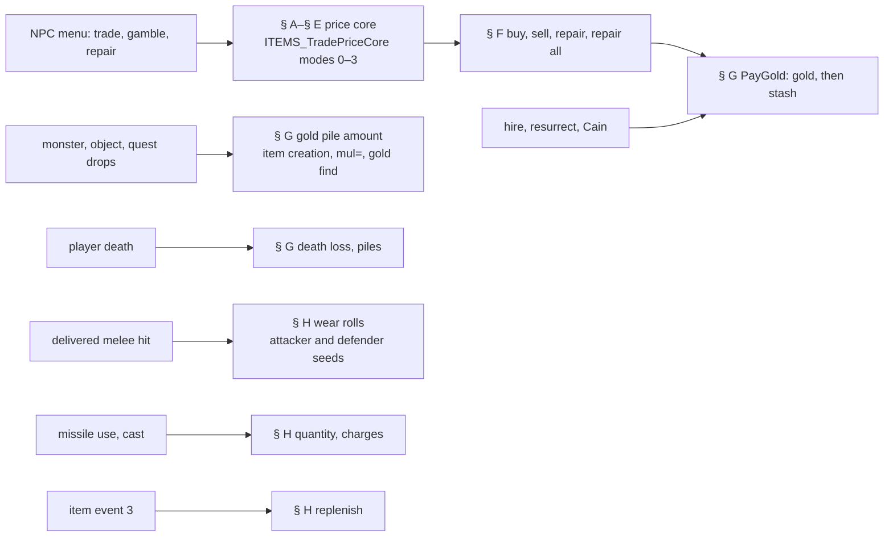
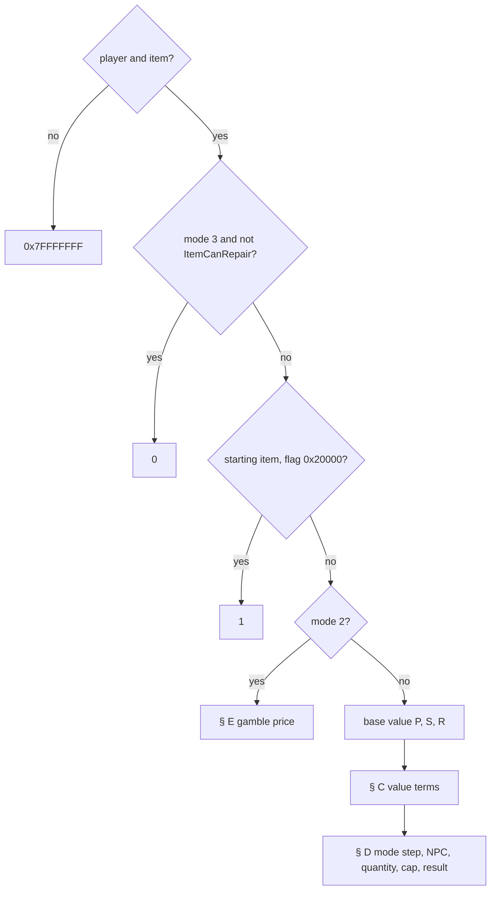
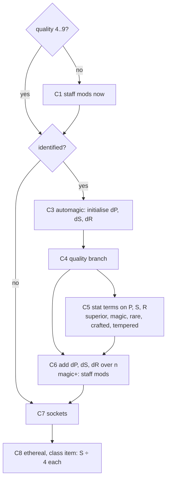
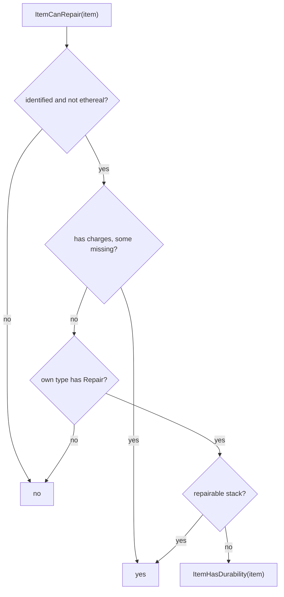
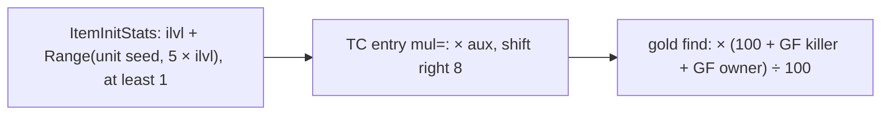
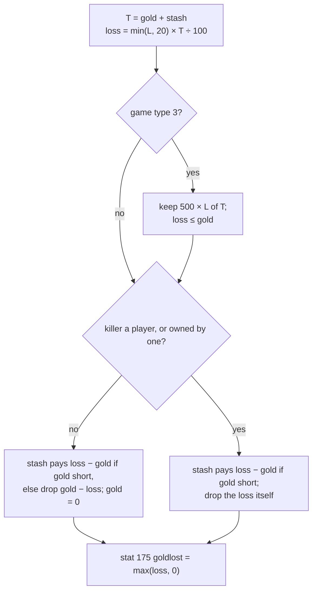
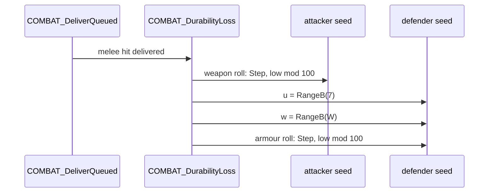

# Item economy: prices, repair, gold, costs and wear

## Purpose

This spec gives what an item costs to buy, sell, gamble and repair; what hiring, resurrecting and identifying cost;
how much gold a pile holds, what caps hold gold and what a player loses on death; and how items lose durability,
quantity and charges in use and get them back. One function prices everything an NPC trades. The gold, cost and
price paths draw nothing of their own: only the wear rolls draw, and gold piles draw through the item creation that
makes them. Names of functions, structs and fields are ours ([items/0011](../../findings/items/0011-economy.md)).

Notation. All arithmetic is signed 32-bit (`i32`) with wrap-around on multiplication, and `÷` truncates toward zero,
unless a step says otherwise. `Range` and `Step` are the primitives of [rng](../rng/README.md#algorithm); `RangeB` is
the second compile of `Range`, with the same result. `MulDiv(a, b, c)` is the helper of
[monsters/stats § A](../monsters/stats.md#a-muldiv-and-monlvlstats). "Stat *n*" is an ItemStatCost row id; `full(n)`
is the value in the unit's full-stat cache ([stats/aggregate](../stats/aggregate.md)), `own(n)` the item's own entry.
`base` is the item's Weapons, Armor or Misc row. `IsType(item, t)` walks the ItemTypes `Equiv` closure
(`ITEMS_UnitIsType`); "own type" is the item's own ItemTypes row with no walk. `L` is the player's stat 12 (character
level) unless a section names another unit. `D`, `M` and `q` are an item's durability (stat 72), maximum durability
(`sub_00625E00_ItemMaxDurability`) and quantity (stat 70).



## Entry points

| When | Function | Tag |
|---|---|---|
| A price is needed (trade window, purchase, sale, repair, corpse choice) | fn:sub_0062FDC0_ItemTradePrice@0x0062FDC0 → fn:ITEMS_TradePriceCore@0x0062EFB0, run:2026-10-17-economy | [C] |
| The player buys or gambles (packet) | fn:NPC_BuyItem@0x00577830, run:2026-10-17-economy | [C] |
| The player sells (packet) | fn:NPC_SellItem@0x00579510, run:2026-10-17-economy | [C] |
| The player repairs one item or all (packet bit 31) | fn:sub_00578050_NpcRepair@0x00578050 → fn:sub_0062FE60_RepairCost@0x0062FE60, run:2026-10-17-economy | [C] |
| Hire, resurrect, identify at Cain | fn:HIRE_Hire@0x005770E0, fn:MERC_Resurrect@0x00579C00, fn:NPC_CainIdentify@0x00578460, run:2026-10-17-economy | [C] |
| A gold item is created; a monster's gold drop is scaled | fn:sub_00557AB0_ItemInitStats@0x00557AB0, fn:sub_005589A0_DropGoldFind@0x005589A0, run:2026-10-17-economy | [C] |
| An amount is dropped as piles (Baal, overflow, death) | fn:sub_0055A090_DropGoldAmount@0x0055A090, run:2026-10-17-economy | [C] |
| A player dies | fn:PLAYER_DeathGoldLoss@0x005357D0, run:2026-10-17-economy | [C] |
| A melee hit is delivered | fn:COMBAT_DeliverQueued@0x0057D4F0 → fn:COMBAT_DurabilityLoss@0x0057D3D0, run:2026-10-17-economy | [C] |
| A missile weapon or throwing stack is used | fn:PLAYER_UseAmmo@0x0056C3F0 → fn:sub_0056C310_ItemConsumeOne@0x0056C310, run:2026-10-17-economy | [C] |
| A charged skill is cast | fn:sub_0056BEC0_UseCharge@0x0056BEC0 | [I] |
| Item event 3 fires (replenish) | data:g_ItemEventFuncs@0x006E117C → fn:ITEMEVENT_Replenish@0x00562D30, run:2026-10-17-economy | [C] |

- [I] **NPC classes.** Repair is accepted for MonStats classes 154, 178, 253, 257 and 511; resurrection at 150, 198,
  252, 367 and 515; Cain's identify at 244–246, 265 and 520. (fn:sub_00578050_NpcRepair@0x00578050,
  fn:MERC_Resurrect@0x00579C00, fn:NPC_CainIdentify@0x00578460)
- [I] **The client copy.** The client calls the same price and repair-cost functions (six call sites of the price
  wrapper, two of `RepairCost`) with its own difficulty and quest record, so the displayed prices are the same
  arithmetic on the client's copies of the units; the server's call decides what is paid. (0x0049024C, 0x004887F0,
  0x004B38FA, [items/0011 § 5](../../findings/items/0011-economy.md#5-callers-buy-sell-repair-the-client-copy))

## Inputs

### Tables

| Anchor | Used for |
|---|---|
| tbl:Weapons.txt:cost (`+0xE0`, i32), the same in tbl:Armor.txt:cost and tbl:Misc.txt:cost | the base value (§ B), the socket term (§ C7), the gamble average (§ E) ([Weapons § Economy](../../tables/Weapons.md#economy-plan-0043-phase-0)) |
| tbl:Weapons.txt:gamble cost (`+0xD4`) | the gamble price of `rin`, `amu` and version-0 items only (§ E) |
| tbl:Armor.txt:maxac (`+0xD0`), tbl:Armor.txt:minac (`+0xCC`) | the armour scaling (§ B) |
| tbl:Weapons.txt:minstack (`+0xE4`), `maxstack` (`+0xE8`), `stackable` | the stack divisor `n` (§ B), the quantity step (§ D), the gamble average stack (§ E) |
| tbl:Weapons.txt:ubercode (`+0x88`), `ultracode` (`+0x8C`), `normcode` (`+0x84`), `level` (`+0xFD`, u8) | the gamble price (§ E) |
| tbl:Weapons.txt:nodurability, tbl:Weapons.txt:durability | `ItemHasDurability` (§ D, § F, § H) |
| tbl:ItemTypes.txt:Repair (`+0x08`), `StaffMods` (`+0x1F`), `Class` (`+0x21`), `Throwable`, `Quiver` | the repair test (§ F), the staff-mod skip (§ C), the class-item quarter (§ C8), the throwing and quiver branches ([ItemTypes § Repair and throwing columns](../../tables/ItemTypes.md#repair-and-throwing-columns-plan-0043-phase-0)) |
| tbl:ItemStatCost.txt:Multiply (`+0x10`), `Add` (`+0x14`), `ValShift` (`+0x18`), `Encode` (`+0x30`, u8) | the per-stat terms (§ C5) ([ItemStatCost § Price](../../tables/ItemStatCost.md#price-plan-0043-phase-0)) |
| tbl:MagicPrefix.txt:multiply (`+0x88`), `add` (`+0x8C`), the same in MagicSuffix and AutoMagic | the affix terms (§ C3, § C4) ([MagicPrefix § Price](../../tables/MagicPrefix.md#price-plan-0043-phase-0)) |
| tbl:SetItems.txt:cost mult (`+0x38`), `cost add` (`+0x3C`) | the set term (§ C4) ([SetItems § Price](../../tables/SetItems.md#price-plan-0043-phase-0)) |
| tbl:UniqueItems.txt:cost mult (`+0x7C`), tbl:UniqueItems.txt:cost add (`+0x80`) | the unique term (§ C4) ([UniqueItems § Price](../../tables/UniqueItems.md#price-plan-0043-phase-0)) |
| tbl:Skills.txt:cost mult (`+0x234`), `cost add` (`+0x238`), tbl:Skills.txt:reqlevel (`+0x174`, i16) | the skill-based stat terms, the staff-mod term, the recharge cost ([Skills § Charge cost columns](../../tables/Skills.md#charge-cost-columns-plan-0043-phase-0)) |
| tbl:Npc.txt:sell mult, `buy mult`, `rep mult`, tbl:Npc.txt:questflag A..C, tbl:Npc.txt:questsellmult A..C, `questbuymult`, `questrepmult`, `max buy` (`+0x40 + 4·d`) | the NPC scaling and the cap (§ D) ([Npc § Multipliers](../../tables/Npc.md#multipliers-plan-0043-phase-0)) |
| tbl:Books.txt:CostPerCharge (`+0x14`) | the tome base (§ B) ([Books](../../tables/Books.md)) |
| tbl:MonStats.txt:Level (`+0xAA + 2·d`, i16) | the body-part base (§ B) |
| tbl:Hireling.txt:Gold | the hire price, [hirelings § E](../hirelings/README.md#e-an-entry-hireling_rollentry) |

- [C] **Not read by the price path:** ItemStatCost `Divide` (`+0x0C`), the affix `divide` (`+0x84`) and Books
  `BaseCost` (`+0x10`); every divisor is the constant 1024, or 4096 for the sell value in the skill-based terms. The
  claim is scoped to the functions of § A–§ E (no image-wide reader scan); the run's 26 525 price results reproduce
  without those cells. (0x0062F1AB–0x0062F213, 0x00628E70–0x006292D7, run:2026-10-17-economy)
- [C] QualityItems and RarePrefix/RareSuffix carry no price cell the code reads: quality enters only through the
  branches of § C4 (the uncompiled cells are listed in [MagicPrefix § Price](../../tables/MagicPrefix.md#price-plan-0043-phase-0)).
  (jump table 0x0062FD9C, run:2026-10-17-economy)

### Runtime state

| State | Type | Source |
|---|---|---|
| `mode` | i32 | 0 buy (what the player pays), 1 sell (what the NPC pays), 2 gamble, 3 repair; any other value returns the buy value |
| `d` | i32 | the difficulty argument: server callers pass struct:Game+0x6D (0 Normal, 1 Nightmare, 2 Hell) |
| quest record | bytes | the player's quest record of that difficulty; word *w* bit *b* tested by `QUESTRECORD_GetState` (fn:QUESTRECORD_GetState@0x0065C310) |
| `npcClass` | i32 | the NPC unit's MonStats class, looked up with `sub_00656900_NpcGetByClass` |
| item flags | u32 | struct:ItemData+0x18: `0x10` identified, `0x100` broken, `0x10000` ear, `0x20000` starting item, `0x400000` ethereal |
| item version | u16 | `ItemData+0x30`: 0 for an old-format item |
| automagic id | u16 | `ItemData+0x36` |
| `q`, `r`, `L` | i32 | `max(1, own stat 70)`; `min(99, player stat 87 item_reducedprices)`; player stat 12 |
| full-stat cache | `{key, value}` list | the item's extended list `+0x48`, at most 511 entries ([stats/aggregate](../stats/aggregate.md)) |
| gold, stash | i32 | the player's stat 14 and stat 15 |
| game type | u8 | struct:Game+0x6A (3 in single player, § G) |
| expansion | u32 | struct:Game+0x70 |
| unit seed | Seed | struct:Unit+0x20 of the attacker or defender (wear, § H) |

### Constants

| Name | Value | Anchor | Tag |
|---|---|---|---|
| `FIXED` | 1024: every multiplier is over 1024 | 0x0062FAAC–0x0062FAE2, run:2026-10-17-economy | [C] |
| `FIXED_SKILL_S` | 4096: the sell value's divisor in the skill-based terms | 0x00628E9F–0x006292D7, run:2026-10-17-economy | [C] |
| `LARGE` | 0xFFFF: above it a scaling divides first (`Scale`, § A) | 0x0062FAAC–0x0062FAE2, run:2026-10-17-economy | [C] |
| `NO_PRICE` | 0x7FFFFFFF (no player, no item, not an item) | 0x0062EFBA–0x0062F01F | [I] |
| `R_CAP` | 99 (`item_reducedprices` cap) | 0x0062F02C–0x0062F062 | [I] |
| `GOLD_PER_LEVEL` | 10 000: carried gold cap = `L × 10 000` | fn:PLAYER_GoldCap@0x00622E70 | [I] |
| `STASH_CAP` | 2 500 000, not by level | fn:PLAYER_StashGoldCap@0x00623460 | [I] |
| `PILE_MAX`, `PILES_MAX` | 2 000 000 000 per pile, 32 piles | fn:sub_0055A090_DropGoldAmount@0x0055A090 | [I] |
| `DEATH_PCT_CAP`, `SP_KEEP` | 20 %; 500 per level kept in single player | fn:PLAYER_DeathGoldLoss@0x005357D0, run:2026-10-17-economy | [C] |
| `RES_FACTOR`, `RES_CAP` | 15; 50 000 (unsigned compare) | fn:MERC_ResurrectCost@0x006637B0, run:2026-10-17-economy | [C] |
| `CAIN_COST` | 100 per unidentified item | fn:NPC_CainIdentify@0x00578460 | [I] |
| `CORPSE_MAX` | 16 corpses (`cmp eax, 0xF; jbe`) | 0x0057F72D | [I] |
| wear chances | armour 10, weapon 4, expansion throwing weapon 10 (percent) | fn:ITEMS_DurabilityLossRoll@0x00559E30, run:2026-10-17-economy | [C] |
| `g_ArmorWearSlots` | 7 pairs {bodyloc, weight}: (1, 3) head, (3, 5) torso, (4, 4), (5, 4) the two hands, (8, 2) belt, (9, 2) feet, (10, 2) gloves; count 7 at 0x00732BC8 | data:g_ArmorWearSlots@0x00732B90, run:2026-10-17-economy | [C] |
| `REPLENISH_BASE`, `REPLENISH_MIN` | 2500 frames; requeue floor 125 frames | fn:ITEMEVENT_Replenish@0x00562D30 | [I] |

## Algorithm

### A. The scaling primitive

Every multiplier step of the price core uses one form. The test value `t` is usually `m` itself; § C and § D name
the steps where it is not.

```
Scale(v: i32, m: i32, t: i32) → i32:                                  [C] (0x0062FAAC–0x0062FAE2, run:2026-10-17-economy)
  if v > 0xFFFF and t ≠ 0: return (v ÷ 1024) × m                      ; "large form": divide first
  return (m × v) ÷ 1024                                               ; i32 product, then signed ÷
```

- [C] `÷ 1024` is `cdq; and edx, 0x3FF; add; sar 10`, a signed division truncating toward zero, in every term of
  § B–§ D. (0x0062F0BE–0x0062FD8B, run:2026-10-17-economy)
- [C] The run separates the large form at the NPC step and in the stat terms: with it the 26 525 price calls
  reproduce, and with the small form alone `tools/economy.py check` reports 1 846 mismatch lines (NPC step) and
  2 737 (stat terms) on the same logs (architect review, 2026-10-19). (0x0062FAAC–0x0062FAE2, 0x00628E9F–0x006292D7,
  run:2026-10-17-economy)
- [I] At the other steps that have it (the affix, set and unique terms of `AddTerm`, the staff-mod term, the
  recharge cost) the large form is read from the code only: removing it from `AddTerm` changes no logged result, and
  the other two have no separating case. (0x0062F1AB–0x0062F213, fn:sub_0062EDD0_PriceStaffModTerm@0x0062EDD0,
  fn:sub_00628D30_RechargeCost@0x00628D30)

### B. The price core: early returns and the base



`ITEMS_TradePriceCore(player, item, d, questRecord, npcClass, mode)` keeps three running values to the end: `P` (the
buy value), `S` (the sell value) and `R` (the repair value), and returns one of them.

```
B1. if player = none or item = none or item is not an item: return 0x7FFFFFFF      [I] (0x0062EFBA–0x0062F01F)
B2. if mode = 3 and not ItemCanRepair(item): return 0                              [I] (0x0062EFBA–0x0062F01F, fn:sub_0062E660_ItemCanRepair@0x0062E660)
B3. if item.flags & 0x20000: return 1                    ; every mode                [I] (0x0062EFBA–0x0062F01F)
B4. q: i32 ← max(1, own stat 70);  r: i32 ← min(99, player stat 87);  L: i32 ← player stat 12   [C] (0x0062F02C–0x0062F062, run:2026-10-17-economy)
B5. if mode = 2: return GamblePath(item, L, r)            ; § E                      [C] (0x0062F062, run:2026-10-17-economy)
B6. R ← 0;  n: i32 ← 1                                                              [C] (0x0062F0BE–0x0062F339, run:2026-10-17-economy)
    if item.flags & 0x10000:            P ← S ← ItemData.earLevel × base.cost         ; ear
    else if IsType(item, 40 body):       P ← S ← base.cost + 8 × MonStats[fileIndex].Level[d]   ; no record: base.cost
    else if IsType(item, 18 book):       P ← S ← Books[suffix 0].CostPerCharge × q + base.cost
    else if ItemTypeQuiver(item):        P ← S ← (base.cost × q) ÷ 1024;  R ← (MaxStack(item) × base.cost) ÷ 1024
    else:                                P ← S ← R ← base.cost
                                         if base.stackable and MaxStack(item) ≥ 2: n ← MaxStack(item)
B7. if IsType(item, 50 armo) and base.maxac − base.minac ≠ −1 and base.maxac ≠ 0:   [C] (0x0062F0BE–0x0062F339, run:2026-10-17-economy)
      P ← S ← R ← (base.cost × base stat 31 armorclass) ÷ base.maxac                ; imul, cdq, idiv
```

Step notes:

- B1–B3. None of the three early returns occurred in the run (every logged mode-3 item was repairable, and no
  starting item was priced). [I] (0x0062EFBA–0x0062F01F, run:2026-10-17-economy)
- B6. [C] The run reproduces the `cost` base, the stack divisor `n = MaxStack`, the quiver base and the tome base.
  `MaxStack(item)` is `min(511, base.maxstack + stat 254)`. (0x0062F0BE–0x0062F339, run:2026-10-17-economy)
- B6. [I] The ear (`earLevel` at `ItemData+0x48`) and body-part bases were not priced in the run. A missing Books row
  is a fatal error. (fn:sub_006283A0_ItemEarLevel@0x006283A0, fn:BOOKS_GetRecord@0x006374B0)
- B6–B7. [I] The ear, body-part and tome bases leave `R` at 0, and the armour step overwrites all three values, so it
  would replace an ear, body-part or tome base on an item that is also armour (none on stock data).
  (0x0062F0BE–0x0062F339)
- B6. [I] The tome base is `CostPerCharge × q + cost`, with `cost` the Misc row's; Books `BaseCost` has no reader.
  On stock data `BaseCost` equals the tomes' `cost`, so no stock case separates the two. (0x0062F2A2–0x0062F2A9,
  [Books](../../tables/Books.md))

### C. The value terms (modes 0, 1, 3)



```
C1. if not ItemQualityMagicPlus(item):            ; quality not 4..9              [C] (0x0062F161–0x0062F17A, run:2026-10-17-economy)
      (P, S, R) ← StaffModTerm(item, P, S, R, n)   ; C9
C2. if not (item.flags & 0x10): goto C7            ; unidentified                  [C] (0x0062F182, run:2026-10-17-economy)
C3. dP, dS, dR: i32 ← 0, 0, 0                                                       [C] (0x0062F18A–0x0062F38E, run:2026-10-17-economy)
    if automagic id ≠ 0: AddTerm(a.multiply, a.add)      ; a = its affix record
C4. by quality (jump table 0x0062FD9C, quality − 1):                                 [C] (0x0062F391–0x0062F994, run:2026-10-17-economy)
      1 low:                (dP, dS, dR) ← (−(P ÷ 2), −(S ÷ 2), −(R ÷ 2))   ; replaces C3
      2 normal:             nothing
      3 superior, 9 tempered: terms ← true
      4 magic:              AddTerm for prefix 0, then suffix 0;  terms ← true
      6 rare, 8 crafted:    for i in 0 ..< 3: AddTerm for prefix i, then suffix i;  terms ← true
      5 set:                AddTerm(SetItems[fileIndex].cost mult, .cost add)
      7 unique:             AddTerm(UniqueItems[fileIndex].cost mult, .cost add)   ; no record: as 4 magic
C5. if terms: (P, S, R) ← StatTerms(item, P, S, R, n)    ; table below          [C] (fn:sub_00628E70_PriceStatTerms@0x00628E70, run:2026-10-17-economy)
C6. P ← P + dP ÷ n;  S ← S + dS ÷ n;  R ← R + dR ÷ n     ; signed idiv           [C] (0x0062F822–0x0062F856, run:2026-10-17-economy)
    if ItemQualityMagicPlus(item): (P, S, R) ← StaffModTerm(item, P, S, R, n)
C7. for each child in the item's own inventory (socketed gems, runes, jewels):     [C] (fn:sub_006292F0_PriceSocketTerm@0x006292F0, run:2026-10-17-economy)
      h ← child.base.cost ÷ 2;  P ← P + h;  S ← S + h;  R ← R + h
C8. if item.flags & 0x400000: S ← S ÷ 4                  ; ethereal               [C] (0x0062F871–0x0062F9B3, run:2026-10-17-economy)
    if ItemTypes[own type].Class < 7: S ← S ÷ 4          ; class item, again

AddTerm(m, a):                                     ; the test is on P for all three  [C] (0x0062F1AB–0x0062F213, run:2026-10-17-economy)
  if P > 0xFFFF and m ≠ 0: dP += (P ÷ 1024) × m + a;  dS += (S ÷ 1024) × m + a;  dR += (R ÷ 1024) × m + a
  else:                    dP += (m × P) ÷ 1024 + a;  dS += (m × S) ÷ 1024 + a;  dR += (m × R) ÷ 1024 + a
```

Step notes:

- C3–C4. [C] The run reproduces qualities 1–7 (the low halving, the set row's terms in 66 inputs, the rare item's
  six affixes in 18), the automagic, magic and unique terms over 1024, and unidentified items (no terms).
  (0x0062F391–0x0062F994, run:2026-10-17-economy)
- C4. [I] Quality 8 (crafted) and a unique with no file index or no record (the magic branch) were not priced in the
  run. (0x0062F391–0x0062F994)
- C4. [I] Unique and set items get no per-stat terms; superior and tempered items do. (jump table 0x0062FD9C)
- C5–C6. [C] The stat terms are computed on `P`, `S` and `R` as they stand **before** the affix sums enter, and are
  added first, with an **unsigned** division by `n`; the affix sums follow with a signed division.
  (0x00628E9F–0x006292D7, 0x0062F822–0x0062F856, run:2026-10-17-economy)
- C7. [C] Each socketed child adds half its base `cost`, whatever its own quality (10 socketed inputs in the run).
  (fn:sub_006292F0_PriceSocketTerm@0x006292F0, run:2026-10-17-economy)
- C8. [C] An ethereal item sells for a quarter of its value, and a class item (own type `Class` < 7) for a quarter
  again; neither touches `P` or `R` (68 distinct ethereal sale inputs). (0x0062F88E, 0x0062F99C, run:2026-10-17-economy)

**The per-stat terms (`StatTerms`).** For each entry of the item's full-stat cache (at most 511), in cache order:

```
StatTerms(item, P, S, R, n):                                                         [C] (fn:sub_00628E70_PriceStatTerms@0x00628E70, run:2026-10-17-economy)
  sP, sS, sR: i32 ← 0
  for each cache entry (stat id, param, full) while index < 511:
    v: i32 ← full − own value of the same stat and param      ; sub_00625560_UnitStatDelta
    if v = 0: continue
    v ← v >> ISC[stat].ValShift                                 ; arithmetic shift
    choose (m, a, x, divS) by ISC[stat].Encode (table below)
    if P × x > 0xFFFF and m ≠ 0:
      sP += ((P × x) ÷ 1024) × m + a;  sS += ((S × x) ÷ divS) × m + a;  sR += ((R × x) ÷ 1024) × m + a
    else:
      sP += (m × P × x) ÷ 1024 + a;    sS += (m × S × x) ÷ divS + a;    sR += (m × R × x) ÷ 1024 + a
  return (P + (u32) sP ÷ (u32) n, S + (u32) sS ÷ (u32) n, R + (u32) sR ÷ (u32) n)   ; unsigned div
```

| `Encode` | `m`, `a` | `x` | `divS` | Tag |
|---|---|---|---|---|
| 0, and 5 or more | ISC `Multiply`, `Add` | `v` | 1024 | [C] (0x00628F15–0x00628F1C, run:2026-10-17-economy) |
| 1 (param is a skill) | the skill's Skills `cost mult`, `cost add` | `v` | 4096 | [C] (0x00628F35, run:2026-10-17-economy) |
| 2, 3 (skill on event, charged; skill = param `>>` the data tables' `+0xC6C`, level = param & their `+0xC70`, read at 0x00629044 and 0x0062904E, 6 and 63 in all 8 logged games) | the skill's Skills `cost mult`, `cost add` | the **level** from the param; the charge count does not enter | 4096 | [C] (0x00628E9F–0x006292D7, run:2026-10-17-economy) |
| 4 (by time) | ISC `Multiply`, `Add` | `(min + max) ÷ 2` of `STAT_ByTimeValue` | 1024 | [I] (jump table 0x006292DC, fn:STAT_ByTimeValue@0x0065CA30) |

- [C] `a` is added once per entry. A stat whose `Multiply` and `Add` are both 0 adds 0. A `ValShift` 8 stat (7, 9,
  11: life, mana, stamina) is priced in whole points. (0x00628F15–0x00628F1C, run:2026-10-17-economy)
- [I] No stock item with an Encode 4 stat was priced in the run. (jump table 0x006292DC)

**The staff-mod term (`StaffModTerm`).** Skipped when the item's own type has `StaffMods` = 7 (no stock type has it:
the bytes are 1..6 or 255). For each stat 107 (`item_singleskill`) entry with skill row `k` and value `v`:

```
StaffModTerm(item, P, S, R, n):                                                      [C] (fn:sub_0062EDD0_PriceStaffModTerm@0x0062EDD0, run:2026-10-17-economy)
  tP, tS, tR: i32 ← 0;  c: i32 ← 2 × v − 1;  m ← k.cost mult;  a ← k.cost add
  if P > 0xFFFF and m ≠ 0:                      ; the large form divides the multiplier
    tP += ((m ÷ 1024) × P + a) × c;  tS += ((m ÷ 4096) × S + a) × c;  tR += ((m ÷ 1024) × R + a) × c
  else:
    tP += ((m × P) ÷ 1024 + a) × c;  tS += ((S × m) ÷ 4096 + a) × c;  tR += ((R × m) ÷ 1024 + a) × c
  return (P + (u32) tP ÷ (u32) n, S + (u32) tS ÷ (u32) n, R + (u32) tR ÷ (u32) n)
```

- [I] For every stock skill `cost mult` ≤ 896, so the large form reduces to `cost add × (2v − 1)`.
  (0x0062EE24–0x0062EFAD, tbl:ItemTypes.txt:StaffMods)

### D. Mode steps, the NPC row, quantity and the result

```
D1. if mode = 1 and item.flags & 0x400000 and ItemHasDurability(item) and M ≠ 0 and D ≤ 0:   [I] (0x0062F9B6–0x0062FA8E)
      S ← 0                                              ; a broken ethereal item
D2. if mode = 3 and not ItemTypeQuiver(item) and not Throwable(item) and ItemHasDurability(item):   [C] (0x0062F9B6–0x0062FA8E, run:2026-10-17-economy)
      if M = 0 or D ≥ M:     R ← 0
      else if own stat 252 ≠ 0: R ← (D < M − 1) ? ((M − 1) × R) ÷ M : 0     ; item_replenish_durability
      else:                  R ← ((M − D) × R) ÷ M
D3. rec ← NpcGetByClass(npcClass);  if rec = none: fatal error 0xCDC               [C] (fn:sub_00656900_NpcGetByClass@0x00656900, 0x0062FAAC–0x0062FAF2, run:2026-10-17-economy)
    P ← Scale(P, rec.sell mult, rec.sell mult)
    S ← Scale(S, rec.buy mult,  rec.sell mult)            ; the test is sell mult
    R ← Scale(R, rec.rep mult,  rec.rep mult)
    for k in A, B, C:
      if rec.questflag k ≠ 0 and (QuestBit(word rec.questflag k, bit 0) or QuestBit(word rec.questflag k, bit 1)):
        P ← Scale(P, rec.questsellmult k, same);  S ← Scale(S, rec.questbuymult k, same);  R ← Scale(R, rec.questrepmult k, same)
D4. if not IsType(item, 18 book) and not ItemTypeQuiver(item):                       [C] (0x0062FC59–0x0062FCD3, run:2026-10-17-economy)
      P ← P × q
      if base.stackable and ItemCanRepair(item):
        Ms: i32 ← MaxStack(item)
        if q < Ms and own stat 253 = 0: R ← R × (Ms − q);  S ← Ms × S − R
        else:                          S ← S × Ms;  R ← 0
      else: S ← S × q
D5. if mode = 3 and not (item.flags & 0x400000): R ← R + RechargeCost(item)          [I] (0x0062FCD6–0x0062FCF2, fn:sub_00628D30_RechargeCost@0x00628D30)
D6. S′ ← min(S, rec.max buy[d])                                                       [C] (0x0062FCF4–0x0062FD07, run:2026-10-17-economy)
D7. if mode = 1: return max(S′, 1)                       ; "S′ < 1 → 1"             [C] (0x0062FD07–0x0062FD8B, run:2026-10-17-economy)
    if mode = 3: if r ≠ 0: R ← R − MulDiv(R, r, 100);  return R < 1 ? 1 : R
    if r ≠ 0: P ← P − MulDiv(P, r, 100);  return P < 1 ? 1 : P       ; mode 0 and any other mode

RechargeCost(item):                                                                   [I] (fn:sub_00628D30_RechargeCost@0x00628D30)
  total: i32 ← 0
  for each stat 204 (item_charged_skill) entry with current c = value & 0xFF < max x = value >> 8:
    k ← Skills[param >> 6];  lvl ← param & 0x3F             ; the same two globals as Encode 2, 3 (0x00628D6A)
    K: i32 ← lvl + 2 × (k.reqlevel ÷ 6) + 2;  T: i32 ← K × 10000
    t: i32 ← (T > 0xFFFF and k.cost mult ≠ 0) ? (T ÷ 1024) × k.cost mult : (k.cost mult × T) ÷ 1024
    total ← total + ((x − c) × (t + k.cost add)) ÷ x
  return total
```

Step notes:

- D1. [I] No broken ethereal item was sold in the run. (0x0062FA60–0x0062FA8E)
- D2. [C] The plain durability fraction `((M − D) × R) ÷ M` is reproduced (107 distinct inputs); the run met no
  repair input at full durability or with stat 252, so those two branches stay [I] (read from the code).
  (0x0062F9B6–0x0062FA8E, run:2026-10-17-economy)
- D2. [I] The repair price in Hell (mode 3 with `d` = 2) was not met; the code has no difficulty term on this path.
  (0x0062F9B6–0x0062FA8E)
- D3. [C] The NPC multipliers of 15 classes and quest groups A and B, each both on and off, reproduce. Quest group C
  is set by no stock Npc row, so it is unreachable on stock data. (0x0062FAAC–0x0062FAE2, tbl:Npc.txt:questflag A,
  run:2026-10-17-economy)
- D3. [I] `S`'s large form tests `sell mult ≠ 0`, not `buy mult` (0x0062FAEE–0x0062FAF2); every stock row has both
  non-zero, so the quirk has no stock effect. (0x0062FAEE–0x0062FAF2)
- D4. [C] A repairable stack below its maximum sells for the full stack less the cost of refilling it:
  `S = Ms × S − R × (Ms − q)` (53 distinct inputs). (0x0062FC59–0x0062FCD3, run:2026-10-17-economy)
- D5. [I] The recharge cost is added **after** the NPC step, so `rep mult` and the quest groups do not scale it. No
  recharge case was met in the run. (0x0062FCD6–0x0062FCF2)
- D6. [C] `max buy` caps the sell value only, per difficulty, after the NPC, quest and quantity steps and before the
  floor. (0x0062FCF4–0x0062FD07, run:2026-10-17-economy)
- D7. [C] `item_reducedprices` lowers the buy and gamble prices (Gheed's Fortune, 376 inputs). (0x0062FD07–0x0062FD8B,
  run:2026-10-17-economy)
- D7. [I] It lowers the repair price too; no repair input with `r ≠ 0` was met. (0x0062FD07–0x0062FD8B)

### E. The gamble price (mode 2)

```
E1. GamblePath(item, L, r):                                                          [C] (0x0062F062–0x0062F0BB, run:2026-10-17-economy)
      if item version = 0: return Items[NormBase(item)].gamble cost        ; no reduction
      G: i32 ← GamblePrice(item, L)
      if r ≠ 0: G ← G − MulDiv(G, r, 100)
      return G                                             ; no NPC, no quest multiplier, no floor
E2. GamblePrice(item, L):                  b ← NormBase(item) = the normcode base, else the code base   [C] (fn:sub_00629370_GamblePrice@0x00629370, run:2026-10-17-economy)
      if b.code = 'rin ' or b.code = 'amu ': return b.gamble cost
      avgStack: i32 ← max(1, (b.minstack + b.maxstack) ÷ 2)
      x, e, xc, ec: i32 ← 0
      if b.ubercode ∉ {0, '0   '} and u ← ByCode(b.ubercode) exists:  x ← max(0, ((L − u.level) × 100) ÷ 2 + 1);  xc ← u.cost
      if b.ultracode ∉ {0, '0   '} and t ← ByCode(b.ultracode) exists: e ← max(0, ((L − t.level) × 100) ÷ 4 + 1);  ec ← t.cost
      avgCost: i32 ← ((10000 − e − x) × b.cost × avgStack + ec × e + xc × x) ÷ 10000
      L2: i32 ← max(L, 5)                              ; the upgrade weights above use L, not L2
      lv: i32 ← (b.level ≥ 45 ? b.level − 45 : 0) − b.level ÷ 2 + L2
      return ((lv × 250) ÷ 3 + avgCost) × ((2 × L2 + 1) ÷ 3 + 20) ÷ 15
```

- E2. [C] The run reproduces 272 distinct gamble inputs in all three difficulties, with and without
  `item_reducedprices`, rings and amulets included. `gamble cost` is read only for `rin`, `amu` and version-0 items;
  every other gamble price is computed. (fn:sub_00629370_GamblePrice@0x00629370, run:2026-10-17-economy)
- E2. [I] The `+1` and the floor at 0 apply after the division (`sar 1`, `sar 2`, then `add 1`, `jns`); the
  dividend is a multiple of 100, so the shift and a truncating division agree. `x + e` is not capped, so
  `10000 − e − x` goes negative at high `L` (an elite base reached). `÷ 10000` and `÷ 15` are magic-number divisions
  (`0x68DB8BAD` `sar 12`, `0x88888889` `sar 3`). (0x006293B2–0x00629552)
- E2. [I] The floor `L2 = max(L, 5)` (a character below level 5) was not met in the run. (0x006293B2–0x00629552)
- E1. [I] No version-0 item was gambled; none is expected on stock data. (0x0062F062–0x0062F0BB)

### F. Callers: buy, sell, repair



```
F1. ItemCanRepair(item):                                                             [I] (fn:sub_0062E660_ItemCanRepair@0x0062E660, 0x0062E660–0x0062E6E5)
      if not identified or ethereal: return false
      if ItemHasCharges(item) and some charge is missing: return true
      if ItemTypes[own type].Repair = 0: return false             ; ITEMS_GetBaseType → ITEMTYPES_GetRecord, no Equiv walk
      if RepairableStack(item): return true                       ; throwable, stackable, not ethereal, own type Repair
      return ItemHasDurability(item)
F2. ItemHasDurability(item) = base.nodurability = 0 and base.durability ≠ 0 and M ≠ 0 and full(152) < 1   [I] (fn:sub_00629930_ItemHasDurability@0x00629930)
F3. Buy (mode 0) and gamble purchase (mode 2):                                       [C] (fn:NPC_BuyItem@0x00577830, run:2026-10-17-economy)
      price ← ItemTradePrice(…, mode);  refuse if gold + stash < price
      a permanent stackable store item: priced at quantity 1, bought min((gold + stash) ÷ unit price, room) at a time
      PayGold(price × count)
F4. Sell (mode 1):                                                                   [C] (fn:NPC_SellItem@0x00579510, run:2026-10-17-economy)
      price ← ItemTradePrice(…, 1)
      if the item is copied into the store: the copy is repaired (durability and quantity to maximum) and priced
        again; price ← min(price, copy price)
      PlayerGiveGold(price)                          ; clipped to the carried cap, the rest dropped (§ G)
F5. Repair all (packet bit 31):                                                      [C] (fn:sub_0062FE60_RepairCost@0x0062FE60, run:2026-10-17-economy)
      cost ← Σ over the 13 body slots of ItemTradePrice(…, 3) for each item that has durability below a non-zero
             maximum and ItemCanRepair, or is a repairable stack below MaxStack, or has a charged skill with missing charges
      PayGold(cost);  then walk the slots again with the one-item repair (F7)
F6. Repair one item:                                                                 [I] (fn:sub_00578050_NpcRepair@0x00578050, 0x0057822C–0x00578325)
      refuse unless ItemCanRepair and one of: a throwable, stackable, non-ethereal item below MaxStack; missing
        charges; M ≠ 0 and D < M
      cost ← ItemTradePrice(…, 3);  if PayGold(cost): repair (F7)
      else if D < M:                                         ; partial repair
        k: u32 ← (cost << 10) ÷ (M − D)
        if gold > 0 and 0 < k < gold × 1024 and not broken:
          pay all carried gold;  D ← min(M, D + (gold × 1024) ÷ k)
F7. ItemRepairAll(game, item, player)  ; repairs ONE item despite the name          [I] (fn:sub_005761C0_ItemRepairAll@0x005761C0)
      if not ItemCanRepair(item): return
      if throwable and stackable: quantity ← MaxStack(item)
      refill every charged skill (ItemRefillCharges)
      if broken: ItemRepairBroken (clears 0x100, D ← M, re-links the stats)
      else if M > 0: D ← M
```

Step notes:

- F1. [I] The test reads the item's **own** ItemTypes row. On stock data the `Equiv` closure gives the same set of
  repairable bases ([plan 0043](../../plans/0043-items-economy.md) Phase 0 review), so the choice has no stock effect;
  the 13 `nodurability` crossbows of a `Repair` type are refused unless charged, and so are bows and `tpot`.
  (0x0062E6B2–0x0062E6D7, tbl:ItemTypes.txt:Repair, tbl:Weapons.txt:nodurability)
- F3. [C] In 14 purchases checked, `PayGold`'s amount is a multiple of the purchase price. The permanent-stack count
  rule is read from the code only. (fn:NPC_BuyItem@0x00577830, 0x00577944, 0x00577B03, run:2026-10-17-economy)
- F4. [C] In 43 sales checked, the gold given equals the lower of the two sale prices computed inside `NPC_SellItem`.
  (fn:NPC_SellItem@0x00579510, 0x005798CD, run:2026-10-17-economy)
- F5. [C] 138 repair-all sums equal the sum of the mode-3 price calls made inside them.
  (fn:sub_0062FE60_RepairCost@0x0062FE60, run:2026-10-17-economy)
- F6. [I] The partial repair reads `gold` as stat 14 alone, although `PayGold` takes gold first. A partial repair, an
  ethereal item and a broken item at a repairer were not met in the run; the single-item clicks reached
  `NpcRepair` twice. (0x0057822C–0x00578325)
- F7. [C] `ItemRepairAll` leaves the game and player seeds unchanged (3 115 calls). What it restores is read from
  the code. (fn:sub_005761C0_ItemRepairAll@0x005761C0, run:2026-10-17-economy)
- F7. [I] `ItemRepairBroken` reaches drawing code through its callees (0x0055C5C0, six calls deep); no broken item
  was repaired in the run. (fn:sub_0055F900_ItemRepairBroken@0x0055F900)
- [I] `D2S_WriteCorpses` sums mode-0 prices with difficulty **3** and class 513 (Malah) to choose the most valuable
  corpse; difficulty 3 indexes past `Level(H)` and `max buy (H)`, neither of which mode 0 reads for an ordinary
  item. (0x005698B4)

### G. Gold: payment, caps, piles and the death loss

```
G1. PayGold(player, n):                                                              [C] (fn:sub_00576D90_PayGold@0x00576D90, run:2026-10-17-economy)
      if gold + stash < n: return 0                      ; signed; both unchanged
      take min(gold, n) from gold, the rest from the stash;  return non-zero
G2. caps: carried ≤ L × 10 000 (PLAYER_GoldCap);  stash ≤ 2 500 000 (PLAYER_StashGoldCap)   [I] (fn:PLAYER_GoldCap@0x00622E70, fn:PLAYER_StashGoldCap@0x00623460)
G3. UnitAddGoldStat(player, stat 14 or 15, delta):                                    [I] (fn:sub_0053FF00_UnitAddGoldStat@0x0053FF00)
      v ← stat + delta;  if v > cap or v < 0: v ← 0       ; writes 0, not the cap
G4. PlayerGiveGold(n): add min(n, cap − gold); drop the rest as piles (DropGoldAmount)  [I] (fn:sub_0055B060_PlayerGiveGold@0x0055B060)
    GoldPickup(pile): take min(pile, cap − gold); re-drop the remainder (DropGold)       [I] (fn:sub_0055C850_GoldPickup@0x0055C850)
    StashGoldMove: deposit at most cap − stash; a withdrawal needs the room            [I] (fn:sub_00564D50_StashGoldMove@0x00564D50)
```

- G1. [C] 54 calls (hires, purchases, resurrections) reproduce, including 4 refusals with gold and stash unchanged.
  (fn:sub_00576D90_PayGold@0x00576D90, run:2026-10-17-economy)
- G3. [C] 97 adds below the caps reproduce. No add went over a cap in the run, so the zero-on-overflow write is read
  from the code only. (fn:sub_0053FF00_UnitAddGoldStat@0x0053FF00, run:2026-10-17-economy)
- G4. [I] In a party with another member in the level, a pickup goes through `PartyGoldShare` (a split by the party
  count). (fn:sub_00540900_PartyGoldShare@0x00540900)

**The pile amount.** A gold pile's amount is fixed when the gold item is created, then a monster drop is scaled:



```
G5. amount: i32 ← ilvl + Range(item unit seed, 5 × ilvl);  if amount < 1: amount ← 1    [C] (0x00557AC1–0x00557B4C, run:2026-10-17-economy)
      ; one draw, none when 5 × ilvl < 1; a creation record quantity > 0 overrides (items/properties A1)
G6. monster drop: amount ← (amount × aux) >> 8 when the TC entry has mul=               [I] (items/tc H8, fn:ITEMS_UnitIsType@0x00629BB0)
G7. monster drop, own type exactly 4 gold: amount ← amount × (100 + full(79, killer) + full(79, killer's owner)) ÷ 100   [C] (fn:sub_005589A0_DropGoldFind@0x005589A0, run:2026-10-17-economy)
G8. ilvl of other gold creators:                                                       [C] (fn:sub_00559300_DropGoldPile@0x00559300, run:2026-10-17-economy)
      DropGoldPile (OBJINIT_GoldPiles): the level's monster level − 1 when that is above 1
        (LevelMonLvl: MonLvl or MonLvlEx by the expansion flag)
      DropItemAtUnit (Wirt's 10–19 piles): the level's monster level                    ; code only, note G8
      DropItemCodeAt (the quest chests' piles): UnitDropLevel of the source              ; code only, note G8
```

- G5. [C] 545 amounts at creation reproduce with the seed after the draw; this is the A1 step of
  [items/properties § A](properties.md#a-base-stats-on-the-unit-seed). (fn:sub_00557AB0_ItemInitStats@0x00557AB0,
  run:2026-10-17-economy)
- G6–G7. The `mul=` and gold-find steps are [items/tc § H](tc.md#h-item-pick-and-hand-off) H8–H9. [C] 433 gold-find
  scalings reproduce (gold find 0 in 207, above 0 in 226; Normal 228, Nightmare 140, Hell 65); the scaling has no
  difficulty term. (fn:sub_005589A0_DropGoldFind@0x005589A0, run:2026-10-17-economy)
- G8. [C] 102 object piles take the level's monster level minus 1 as ilvl, all in levels whose monster level is
  above 1. (fn:sub_00559300_DropGoldPile@0x00559300, fn:OBJINIT_GoldPiles@0x0054F8C0, run:2026-10-17-economy)
- G8. [I] The case "monster level 1 or less" and the ilvl of Wirt's piles and the quest chests' piles were not met.
  (fn:sub_00559A30_DropItemAtUnit@0x00559A30, fn:sub_0061DCA0_LevelMonLvl@0x0061DCA0,
  fn:sub_00585970_DropItemCodeAt@0x00585970, fn:sub_00558200_UnitDropLevel@0x00558200,
  fn:sub_00594630_A1Q4_WirtGold@0x00594630)

**Dropping an amount (`DropGoldAmount`).**

```
G9. DropGoldAmount(unit, amount, out, maxPiles = 32):                                 [I] (fn:sub_0055A090_DropGoldAmount@0x0055A090)
      split amount into piles of at most 2 000 000 000, at most maxPiles
      for each pile: create a gold item at the unit       ; an item creation: its draws (G5)
                     set its stat 14 to the pile's share  ; the created amount is overwritten
```

- G9. [C] Each call in the run moved the game seed by 2 steps (10 of 10), the unit constructor's two draws for one
  created pile. The split rule above 2 000 000 000 is read from the code only. (fn:sub_0055A090_DropGoldAmount@0x0055A090,
  run:2026-10-17-economy)
- G9. [I] Baal's quest gold ([items/quest-drops D6](quest-drops.md#d6-baals-first-kill)) and every overflow drop use
  this function. (fn:sub_0055B030_DropGold@0x0055B030, fn:sub_0058DF20_A5Q6_BaalDeath@0x0058DF20)

**The death loss.** `PLAYER_DeathGoldLoss` runs for every player death, before the experience loss.



```
G10. PLAYER_DeathGoldLoss(player, killer):                                           [C] (fn:PLAYER_DeathGoldLoss@0x005357D0, run:2026-10-17-economy)
       T: i32 ← gold + stash;  loss: i32 ← (min(L, 20) × T) ÷ 100
       if game type = 3:                                       ; single player
         if T − loss < 500 × L: loss ← max(0, T − 500 × L)
         loss ← min(loss, gold)
       pvp ← killer is a player, or a monster owned by a player
       if not pvp:
         if gold < loss: stash ← max(0, stash − (loss − gold))
         else: PlayerDropGold(gold − loss)
         gold ← 0
       else:
         if gold < loss: stash ← max(0, stash − (loss − gold));  gold ← loss
         PlayerDropGold(loss)                                   ; the rest stays carried
       stat 175 goldlost ← max(loss, 0)
G11. PlayerDropGold(amount):                                                          [I] (fn:sub_00535510_PlayerDropGold@0x00535510, 0x00535538–0x005355F8)
       if amount > gold or amount > the carried cap: return 0  ; drops nothing
       DropGoldAmount(player, min(amount, 2 000 000 000), 32); take each pile's stat 14 from the carried gold
```

- G10. [C] 20 softcore single-player deaths reproduce gold, stash and stat 175 after the call (12 with the total above
  `500 × L` after the loss, 8 below, levels 5 to 99). A death moved the game seed by 2 steps exactly when it dropped a
  pile (7 of 20), so it draws only through that item creation. (fn:PLAYER_DeathGoldLoss@0x005357D0,
  run:2026-10-17-economy)
- G10. [I] PvP deaths, game types other than 3 and hardcore were not met. Hardcore is not tested by the function.
  Every stat write in the path goes through the cap test of G3, so the PvP `gold ← loss` writes 0 when the loss is
  above `L × 10 000`, and that loss then drops nothing (G11). In type 3 the loss never exceeds gold, so the stash
  branches are reachable only in the other game types. (0x005357D8–0x005359E7)
- G10. [I] **The game type** is written once, at game creation: `GameCreate` stores the byte from the creating
  client's create message (type 0x67), which the client builds from `g_ClientGameMode`: 0 → 3, 6 → 1, 8 → 2, any
  other value → 0. The single-player client runs with `g_ClientGameMode` = 0, so every logged single-player game has
  type 3. (0x00530CFF, fn:sub_00530BF0_GameCreate@0x00530BF0, fn:sub_00477CA0_ClientGameCreateMsg@0x00477CA0,
  data:g_ClientGameMode@0x007A0610, [items/0011 § The writer of `game+0x6A`](../../findings/items/0011-economy.md#the-writer-of-game0x6a-2026-10-17-lanerbs2))
- [I] **The corpse.** When the corpse is made, the remaining carried gold (0 after a non-PvP death) is dropped as
  piles by `CorpseDropGold`; with 16 corpses the items and gold are dropped instead (`CorpseOverflowDrop`).
  (fn:PLAYER_CorpseCreate@0x0057F700, fn:sub_0057F390_CorpseDropGold@0x0057F390,
  fn:sub_0057F540_CorpseOverflowDrop@0x0057F540)

**Costs.**

```
G12. hire: PayGold(the listed entry's price)              ; price: hirelings § E      [C] (fn:HIRE_Hire@0x005770E0, fn:sub_00576D90_PayGold@0x00576D90, run:2026-10-17-economy)
G13. resurrect (MERC_Resurrect, mercenary level L_m = its stat 12):                   [C] (fn:MERC_Resurrect@0x00579C00, fn:MERC_ResurrectCost@0x006637B0, run:2026-10-17-economy)
       c: i32 ← ((L_m × L_m) ÷ 2) × 15;  if (u32) c > 50 000: c ← 50 000
       if PayGold(c) = 0: return                          ; pays nothing (0x00579CAE)
       revive the mercenary
G14. Cain's identify: cost ← 100 × CountUnidentified(player)                          [I] (fn:NPC_CainIdentify@0x00578460, fn:sub_0062A530_CountUnidentified@0x0062A530)
       unless quest word 4 has bit 0 or bit 1 in the player's record of the difficulty (then free);
       then every unidentified item on page 0 or 3 is identified
```

- G12. [C] The 22 hires' payments reproduce, and the price is `HIRELING_RollEntry`'s
  ([hirelings § E](../hirelings/README.md#e-an-entry-hireling_rollentry)). (fn:HIRELING_RollEntry@0x006637F0,
  run:2026-10-17-economy)
- G13. [C] 34 resurrect-cost calls at mercenary levels 1 to 99 reproduce, the cap reached at 82, 85 and 99; 10
  resurrections paid it, and in the 4 where `PayGold` refused, gold and stash are unchanged at the exit.
  (fn:MERC_ResurrectCost@0x006637B0, fn:MERC_Resurrect@0x00579C00, run:2026-10-17-economy)
- G13. [I] A refused resurrection also revives nothing: the test at 0x00579CAE jumps to the common exit 0x00579D44,
  and the revive (the `+0xC4` bit `0x10000` cleared at 0x00579CC8, then 0x00624690, 0x00627260, 0x00579AA0) lies only
  on the paid path. The run did not log the mercenary after the call. (0x00579CAE)
- G13. [I] The same cost is sent to the client when the mercenary dies. (fn:PETS_OnDeath@0x005751A0)
- G14. [I] One paid identify was met in the run (100 for one item, quest word 4 cleared); one case decides nothing.
  (fn:NPC_CainIdentify@0x00578460)
- [I] `sub_00578ED0_NpcHealDead` would charge `L × ((ΔHP >> 8) + (Δmana >> 8)) >> 2` for a heal, but no call, jump
  or 4-byte pointer reaches it: 1.14d heals for free. (fn:sub_00578ED0_NpcHealDead@0x00578ED0,
  fn:sub_00622DE0_HealCost@0x00622DE0)

### H. Wear: durability, quantity, charges, replenish



```
H1. COMBAT_DurabilityLoss(att, def), on a delivered melee hit:                         [C] (0x0057D3D7–0x0057D4DF, run:2026-10-17-economy)
      if att is a player: DurabilityLossRoll(game, att, att's weapon)       ; attacker's seed
      if def is a player with an inventory:
        W: i32 ← Σ weight over the 7 g_ArmorWearSlots pairs whose slot holds an armo item
        if W > 0:
          u ← RangeB(def.seed, 7)                       ; draw on the defender's seed
          w ← RangeB(def.seed, W)                       ; draw
          k ← u;  loop: if slot k holds armo: (if w < weight k: break; w ← w − weight k);  k ← (k + 1) mod 7
          DurabilityLossRoll(game, def, item in slot k)  ; defender's seed
H2. DurabilityLossRoll(game, owner, item):                                              [C] (fn:ITEMS_DurabilityLossRoll@0x00559E30, run:2026-10-17-economy)
      if not (IsType(item, armo) or IsType(item, weap)) or not ItemHasDurability(item): return   ; no draw
      chance ← armo ? 10 : (Throwable(item) ? 10 : 4)
      if weap and Throwable(item) and game.expansion = 0: return             ; classic: no draw
      Step(owner.seed);  roll: u32 ← owner.seed.low mod 100                  ; draw, inline LCG
      if roll ≥ chance: return
      D′ ← D − 1
      if D′ ≥ 1: D ← min(D′, M);  arm the replenish timer
      else if not IsType(item, weap) and not broken: ItemBreak               ; an armo item
      else if version ≠ 0 and q ≥ 2: q ← q − 1;  D ← M;  timer if MaxStack(item) > 0   ; a throwing stack refills
      else if version ≠ 0: D ← 0;  q ← 0;  refresh the hands;  timer if MaxStack(item) > 0
      else: D ← 0                                                         ; version 0
```

Step notes:

- H1. [C] In all 975 events with the slot list logged, `W` is the sum of the weights 3/5/4/4/2/2/2 over the slots
  holding an `armo` item (`W` 18 in 802, `W` 10 in 162; 11 with `W = 0` and no draw); `u` and `w` reproduce, and the
  cyclic pick names the slot whose item is then rolled in 964 of 964 picks, the roll drawing next on the same seed.
  (data:g_ArmorWearSlots@0x00732B90, 0x0057D41A–0x0057D4B4, run:2026-10-17-economy)
- H1. [I] Only a melee delivery reaches this function (one call site, from `COMBAT_DeliverQueued`); a missile or a
  spell causes no wear here. (fn:COMBAT_DeliverQueued@0x0057D4F0, [combat/delivery § A](../combat/delivery.md#a-queue-and-delivery))
- H2. [C] 1 061 rolls reproduce: no draw without durability (50, see the next note), one step of the owner's seed with
  `roll = low mod 100` (unsigned), a loss when below 10 (armour, 914 rolls), 4 (weapon, 90) or 10 (an expansion
  throwing weapon, 7), and `D′ = D − 1` kept when ≥ 1 (81 losses). (fn:ITEMS_DurabilityLossRoll@0x00559E30,
  run:2026-10-17-economy)
- H2. [C] **An indestructible item makes no draw.** All 50 rolls without a draw were on two items with stat 152 = 1
  in their full-stat cache (a set `xtb`, 12 rolls, and a unique `uit`, 38, session 4381), whose bases have
  `nodurability` 0, `durability` 18 and 86 and whose maximum is not 0, so only stat 152 makes `ItemHasDurability`
  false; every roll on an item without stat 152 drew (architect review, 2026-10-19). (0x00559E63,
  fn:sub_00629930_ItemHasDurability@0x00629930, run:2026-10-17-economy)
- H2. [I] The classic throwing weapon, the stack refill and version-0 items are read from the code; the broken armour
  and the weapon taken to 0 are single cases in the run. Ethereal items take the same path (no ethereal test). The
  break tests "not a weapon" (0x00559F15), so an armour item that is already broken falls through to the version
  branches, and the two version branches arm the replenish timer when `MaxStack` is above 0 (0x0055A031–0x0055A040),
  in the code's order (architect review, 2026-10-19). (0x00559E38–0x0055A07A)
- H2. [I] A melee weapon whose durability reaches 0 gets `D = 0` and quantity 0 but no `ItemBreak`; `HandsRefresh`
  calls `ItemBreak` only for a stackable or throwable `weap` of quantity ≤ 0, magic or better, without stat 125. The
  one weapon taken to 0 in the run had no broken flag at the roll's exit. (fn:sub_00580310_HandsRefresh@0x00580310,
  fn:sub_0055F850_ItemBreak@0x0055F850)

```
H3. PLAYER_UseAmmo(player), from the missile-launch functions:                          [I] (fn:PLAYER_UseAmmo@0x0056C3F0)
      bow or crossbow: the stackable or throwable item in the right hand, else the left (the quiver)
      any other weapon: the weapon itself when stackable, throwable or with stat 125 item_throwable
      ItemConsumeOne(that item)
H4. ItemConsumeOne(item): q ← max(q − 1, 0);  arm the quantity timer;  D ← M;  refresh the hands   [C] (fn:sub_0056C310_ItemConsumeOne@0x0056C310, run:2026-10-17-economy)
H5. UseCharge(caster, skill, level): the item carrying that charged skill and level:    [I] (fn:sub_0056BEC0_UseCharge@0x0056BEC0)
      current ← min(max(current − 1, 0), max)             ; no draw
H6. SkillWeaponWear (from 0x005DAB40), with the skill's calcs +0x13C chance and +0x140 amount:   [I] (fn:sub_005DAA40_SkillWeaponWear@0x005DAA40)
      Step(caster.seed);  if low mod 100 < chance:
        a non-stackable weapon with durability loses amount (breaks when nothing is left)
        a stackable one with q > 0: PLAYER_UseAmmo
```

- H4. [C] 130 thrown uses (a throwing axe, through 142 `PLAYER_UseAmmo` calls) write `q − 1` with no draw.
  (fn:sub_0056C310_ItemConsumeOne@0x0056C310, fn:PLAYER_UseAmmo@0x0056C3F0, run:2026-10-17-economy)
- H3. [I] Bows, crossbows and quivers were not met. The gates of `PLAYER_UseAmmo`'s missile call sites (0x0056ECB0,
  0x0056F7F0) are not followed. (fn:PLAYER_UseAmmo@0x0056C3F0)
- H5–H6. [I] No charge was used and no skill wear was met in the run; which skill reaches `SkillWeaponWear` is not
  read. (fn:sub_0056BEC0_UseCharge@0x0056BEC0, fn:sub_005DAA40_SkillWeaponWear@0x005DAA40)

```
H7. timer: when none is queued, queue item event 3 at frame + 2500 ÷ r + 1   ; 64-bit signed ÷   [I] (fn:sub_00558530_ItemReplenishDurTimer@0x00558530, fn:sub_00558580_ItemReplenishQtyTimer@0x00558580)
      armed by a durability loss, a quantity use, socketing and an item copy
H8. ITEMEVENT_Replenish(item):                                                          [C] (fn:ITEMEVENT_Replenish@0x00562D30, run:2026-10-17-economy)
      r ← own stat 252 item_replenish_durability
      if not broken and ItemHasDurability(item) and r ≠ 0:
        if D < M: D ← D + 1;  requeue at frame + max(125, 2500 ÷ r + 1)      ; at maximum: no requeue
      else if base.stackable and stat 253 item_replenish_quantity ≠ 0:   ; only when the first path does nothing
        q ← q + 1 up to MaxStack;  requeue as above
        if broken and the owner's client is found: ItemRepairBroken
```

- H8. [C] 287 ticks leave the game and player seeds unchanged, and consecutive ticks on one item are `2500 ÷ r + 1`
  frames apart (501 at `r = 5`, 131 pairs; 834 at `r = 3`, 76 pairs). (fn:ITEMEVENT_Replenish@0x00562D30,
  fn:sub_00562C40_ReplenishStep@0x00562C40, run:2026-10-17-economy)
- H8. [I] The value written per tick, the floor of 125 frames (it binds only above `r = 20`) and the quantity path's
  repair of a broken item are read from the code only. An item with both stats gains durability only.
  (0x00562D30, fn:sub_00562C40_ReplenishStep@0x00562C40)

### I. Draws and seeds per event kind

| Event kind | Draws | Tag |
|---|---|---|
| price (modes 0–3), gamble price, `RepairCost`, `ItemRepairAll`, `NpcRepair`, `PayGold`, `UnitAddGoldStat`, resurrect cost and `MERC_Resurrect`, Cain, replenish tick, `ItemConsumeOne`, `PLAYER_UseAmmo` | none: game and player seed unchanged from entry to exit | [C] (run:2026-10-17-economy) |
| buy (`NPC_BuyItem`) | the store copy's creation only: game seed +2 (15 of 15) | [C] (fn:NPC_BuyItem@0x00577830, run:2026-10-17-economy) |
| sell (`NPC_SellItem`) | game seed +2 in 41, +4 in 3 (one extra gold re-drop each), unchanged in 2 (not explained) | [I] (fn:NPC_SellItem@0x00579510, run:2026-10-17-economy) |
| `PlayerGiveGold` | +2 in 3 of 46 (a re-drop over the cap) | [I] (fn:sub_0055B060_PlayerGiveGold@0x0055B060, run:2026-10-17-economy) |
| `DropGoldAmount`, death loss | one item creation per pile (+2 each); a death draws only when it drops a pile | [C] (fn:sub_0055A090_DropGoldAmount@0x0055A090, fn:PLAYER_DeathGoldLoss@0x005357D0, run:2026-10-17-economy) |
| gold pile created | `Range(item unit seed, 5 × ilvl)` (G5) | [C] (0x00557AC1–0x00557B4C, run:2026-10-17-economy) |
| hire | from the hireling entry seed ([hirelings § E](../hirelings/README.md#e-an-entry-hireling_rollentry)), not the game seed | [C] (fn:HIRELING_RollEntry@0x006637F0, run:2026-10-17-economy) |
| weapon wear | one step of the attacker's seed (none without durability or for a classic throwing weapon) | [C] (fn:ITEMS_DurabilityLossRoll@0x00559E30, run:2026-10-17-economy) |
| armour wear | `RangeB(7)`, `RangeB(W)` on the defender's seed, then one step when the item has durability; none when `W = 0` | [C] (fn:COMBAT_DurabilityLoss@0x0057D3D0, run:2026-10-17-economy) |
| skill wear | one step of the caster's seed | [I] (fn:sub_005DAA40_SkillWeaponWear@0x005DAA40) |
| charge use | none (no drawing callee within depth 6) | [I] (fn:sub_0056BEC0_UseCharge@0x0056BEC0) |

- [C] The wear kinds draw on the player's seed only; the melee event's step count on the player is 3 (two picks and
  a roll), 2 (picks and an item without durability) or 1 (the weapon roll), as the code reads. The wear draws share
  the unit seed with combat, so two deliveries on one defender put the armour-wear draws between the to-hit and
  get-hit draws ([combat/delivery § F](../combat/delivery.md#f-the-boundary-at-delivery)). (0x0057D3D7–0x0057D4DF,
  run:2026-10-17-economy)

## Outputs

- A price: one `i32`, at least 1 for modes 1 and 3 and for mode 0 (except the early returns 0x7FFFFFFF, 0 and 1);
  the gamble price has no floor. [C] (fn:ITEMS_TradePriceCore@0x0062EFB0, run:2026-10-17-economy)
- Gold and stash after a payment, a sale, a death or a pickup; stat 175 after a death; gold items (piles) on the
  ground, each a created item whose stat 14 holds its share. [C] (fn:sub_00576D90_PayGold@0x00576D90,
  fn:PLAYER_DeathGoldLoss@0x005357D0, run:2026-10-17-economy)
- An item's durability, quantity, charges and broken flag after a repair, a wear event, a use or a replenish tick.
  [I] (fn:sub_005761C0_ItemRepairAll@0x005761C0, fn:ITEMS_DurabilityLossRoll@0x00559E30)

## Worked example

Every example is a logged event of [run:2026-10-17-economy](../../findings/items/experiments.md#run2026-10-17-economy),
reproduced by `python3 -I tools/economy.py price <excel-dir> <log> <k>` (prices) or `tools/economy.py check` (the
rest). Seeds are `low:high` in hex. Halbu is class 257 (`sell` / `buy` / `rep mult` 1024 / 512 / 128, `max buy`
Normal 20 000).

### 1. A magic amulet with an all-resistance prefix, sold to Halbu (session 4311, Normal, `k` = `b3e5b26e3c7cb331`)

The amulet (`amu`, `cost` 2400, quality 4, identified) has one prefix with `multiply` 1280 and `add` 16000 and four
stats in its cache with no own entry: 39, 41, 43, 45 (the resistances), each 7. ItemStatCost gives each `Multiply`
20, `Add` 43, `ValShift` 0, `Encode` 0.

| Step | Computation | `P` = `S` |
|---|---|---|
| B6 base | `cost` | 2400 |
| C4 prefix | `dS = (1280 × 2400) ÷ 1024 + 16000 = 3000 + 16000` | (accumulator 19 000) |
| C5 stat terms | per stat `(20 × 2400 × 7) ÷ 1024 + 43 = 328 + 43 = 371`; four stats 1484; `÷ 1` | 3884 |
| C6 accumulators | `3884 + 19000 ÷ 1` | 22 884 |
| D3 NPC | `S = (512 × 22884) ÷ 1024` | `S` = 11 442 |
| D4 quantity | not stackable: `S × 1` | 11 442 |
| D6, D7 | `min(11442, 20000)` | **11 442** (logged 11 442) |

The stat terms were computed on 2400, not on the value after the prefix (step note C5–C6).

### 2. An ethereal war javelin stack, sold to Halbu (session 4311, Normal, `k` = `a583ed2bdcdff789`)

`7ja`, `cost` 211, `maxstack` 100 (so `n` = 100), quality 2, ethereal, quantity 40, durability 10. B6: 211. C8:
`S = 211 ÷ 4 = 52`. D1: durability above 0, `S` kept. D3: `S = (512 × 52) ÷ 1024 = 26`. D4: the item is stackable
but `ItemCanRepair` fails (ethereal), so `S = 26 × 40 = 1040`. D6–D7: **1040** (logged 1040). The community lead
"an ethereal throwing weapon is always worth 1 gold" does not hold in 1.14d (*Open questions*).

### 3. Two repair prices at Halbu (session 4311, Normal)

- A Shako (`uap`, `cost` 56 307, `maxac` 141, defence 141), `D` 3 of `M` 12 (`k` = `a1850f5b5900b344`). B7:
  `(56307 × 141) ÷ 141 = 56307`. D2: `((12 − 3) × 56307) ÷ 12 = 506763 ÷ 12 = 42230`. D3:
  `(128 × 42230) ÷ 1024 = 5278`. D5: no charges. Result **5278** (logged 5278).
- Throwing axes (`tax`, `cost` 11, `maxstack` 130), quantity 50 (`k` = `cf3242f5828f1ed1`). D2 is skipped
  (throwable). D3: `R = (128 × 11) ÷ 1024 = 1`, `S = (512 × 11) ÷ 1024 = 5`. D4: a repairable stack below its maximum,
  stat 253 absent: `R = 1 × (130 − 50) = 80`, `S = 130 × 5 − 80 = 570`. Result **80** (logged 80).

### 4. A gambled small shield, Jamella, Hell, clvl 75 (session 4332, `k` = `b1bcddf538b8ce5a`)

`sml`: `cost` 410, `level` 5, no stack (`avgStack` 1), `gamble cost` 5512 (unread). Exceptional `xml`: `level` 37,
`cost` 15 451. Elite `uml`: `level` 61, `cost` 57 189.

```
x = ((75 − 37) × 100) ÷ 2 + 1 = 1901;   e = ((75 − 61) × 100) ÷ 4 + 1 = 351
avgCost = ((10000 − 351 − 1901) × 410 × 1 + 57189 × 351 + 15451 × 1901) ÷ 10000 = 52622370 ÷ 10000 = 5262
L2 = 75;  lv = 0 − 5 ÷ 2 + 75 = 73;  (73 × 250) ÷ 3 = 6083;  (2 × 75 + 1) ÷ 3 + 20 = 70
price = ((6083 + 5262) × 70) ÷ 15 = 52943            ; logged 52943; r = 0
```

### 5. Death losses (sessions 4351 and 4359, Hell, single player, game type 3)

| Save | `L` | gold | stash | `T` | loss before / after the type-3 rule | Dropped (computed) | Logged after: gold, stash, stat 175 |
|---|---:|---:|---:|---:|---|---:|---|
| EconK1 | 30 | 199 250 | 500 000 | 699 250 | 139 850 / 139 850 (`T − loss` = 559 400 ≥ 15 000) | 59 400 | 0, 500 000, 139 850 |
| EconK9 | 30 | 14 000 | 1000 | 15 000 | 3000 / 0 (`T − loss` = 12 000 < 15 000, so `max(0, 15000 − 15000)`) | 14 000 | 0, 1000, 0 |

In both the stash is untouched: in type 3 the loss is at most the carried gold.

### 6. A resurrection (session 4353, Hell)

A level-50 mercenary: `(50 × 50) ÷ 2 × 15 = 1250 × 15 = 18 750` (logged 18 750). At level 82 the product is
`3362 × 15 = 50 430`, above 50 000, so the cap applies.

### 7. A gold pile from a monster (session 4391, Normal, gold find 440)

`ilvl` 5, the pile's unit seed `9665208e:0000029a`. G5: one `Step` gives `97f5efe0:3eba86be`; `0x97f5efe0 mod 25 = 19`,
so the amount is `5 + 19 = 24`, unchanged by `mul=`. G7: the killer's stat 79 is 440 and it has no owner:
`(24 × (100 + 440)) ÷ 100 = 12960 ÷ 100 = 129` (logged 129).

### 8. One melee hit taken and one given (session 4381, Normal, a Barbarian)

- **Armour (frame 1161).** The defender wears `armo` items in bodylocs 1, 3, 5, 8, 9 and 10 (bodyloc 4 holds none):
  `W = 3 + 5 + 4 + 2 + 2 + 2 = 18`. Defender seed `61fb426e:125a8087`: `Step` → `bb267f2d`, `u = 0xbb267f2d mod 7 = 4`
  (index 4, bodyloc 8, the belt); `Step` → `d3d536e0:4e0f1a44`, `w = 0xd3d536e0 mod 18 = 0`. From index 4 the belt
  holds `armo` and `0 < 2`, so the belt is rolled. `Step` → `714054a4:585a976c`, `roll = 0x714054a4 mod 100 = 80`,
  not below 10: no loss (durability stays 4). Three steps of the defender's seed.
- **Weapon (frame 859).** The Barbarian's axe (`D` 3 of 24): attacker seed `d1712f2d:0b0beb6e`, `Step` →
  `007c890f:575b5184`, `roll = 51`, not below 4: no loss. One step of the attacker's seed.

## Reimplementation notes

- **Three running values, one result.** `P`, `S` and `R` are carried through every step, including the ones whose
  value the mode discards; a wrong order of terms changes the result through the later truncations. [C]
  (fn:ITEMS_TradePriceCore@0x0062EFB0, run:2026-10-17-economy)
- **"Sell mult" is the buy price.** Npc `sell mult` (and `questsellmult`) scales `P`, what the player pays; `buy mult`
  scales `S`, what the NPC pays. [C] (0x0062FAAC–0x0062FAE2, run:2026-10-17-economy)
- **Two divisors for `S`.** The skill-based terms (Encode 1–3, staff mods) divide `S` by 4096 and `P`, `R` by 1024;
  everything else divides all three by 1024. Do not read the table `Divide`/`divide` columns. [C] (0x00628F35,
  run:2026-10-17-economy)
- **Signed and unsigned divisions by `n`.** The stat and staff-mod sums are divided by `n` unsigned, the affix
  accumulators signed. With `n` > 1 a negative stat sum is divided as a large unsigned value, not as a negative
  one. [C] (0x00628E9F–0x006292D7, 0x0062F822–0x0062F856, run:2026-10-17-economy)
- **The low quality replaces, it does not add.** Quality 1 overwrites the automagic accumulators with the halves.
  [C] (0x0062F391–0x0062F994, run:2026-10-17-economy)
- **The sale takes the lower of two prices** when the item enters the store, so a damaged item does not sell for
  more than its repaired copy. [C] (fn:NPC_SellItem@0x00579510, run:2026-10-17-economy)
- **A gold add over a cap writes 0**, not the cap; the callers clip first. A reimplementation that clamps instead
  differs only on paths that skip the clip (the PvP death write). [I] (fn:sub_0053FF00_UnitAddGoldStat@0x0053FF00)
- **The armour pick is cyclic from a random start**, not a plain weighted pick: `u` chooses the start slot, `w` the
  offset, and empty slots are skipped without consuming weight. Both draws happen whenever `W > 0`, even if the
  chosen item then has no durability. [C] (0x0057D41A–0x0057D4B4, run:2026-10-17-economy)
- **`sub_005761C0_ItemRepairAll` repairs one item**; the repair-all is `RepairCost` with a callback. [I]
  (fn:sub_005761C0_ItemRepairAll@0x005761C0)

## Evidence

- Finding: [items/0011](../../findings/items/0011-economy.md) (§ 1–§ 8, § The writer of `game+0x6A`, § Phase 2).
- Run: [run:2026-10-17-economy](../../findings/items/experiments.md#run2026-10-17-economy): 33 claim logs, 0
  mismatches; `tools/economy.py check` (manifest `workspace/logs/economy-run-manifest.txt`).
- Tables: [Weapons § Economy](../../tables/Weapons.md#economy-plan-0043-phase-0),
  [Armor § Economy](../../tables/Armor.md#economy-plan-0043-phase-0), [Misc § Economy](../../tables/Misc.md#economy-plan-0043-phase-0),
  [ItemTypes](../../tables/ItemTypes.md#repair-and-throwing-columns-plan-0043-phase-0),
  [ItemStatCost § Price](../../tables/ItemStatCost.md#price-plan-0043-phase-0),
  [MagicPrefix § Price](../../tables/MagicPrefix.md#price-plan-0043-phase-0),
  [UniqueItems § Price](../../tables/UniqueItems.md#price-plan-0043-phase-0), [SetItems § Price](../../tables/SetItems.md#price-plan-0043-phase-0),
  [Npc § Multipliers](../../tables/Npc.md#multipliers-plan-0043-phase-0), [Books](../../tables/Books.md),
  [Skills § Charge cost columns](../../tables/Skills.md#charge-cost-columns-plan-0043-phase-0),
  [Hireling § Costs](../../tables/Hireling.md#costs-plan-0043-phase-0).
- Specs: upstream [rng](../rng/README.md), [items/properties § A](properties.md#a-base-stats-on-the-unit-seed),
  [items/tc § H](tc.md#h-item-pick-and-hand-off), [stats/aggregate](../stats/aggregate.md),
  [monsters/stats § A](../monsters/stats.md#a-muldiv-and-monlvlstats), [hirelings § E](../hirelings/README.md#e-an-entry-hireling_rollentry);
  downstream [items/vendors § I](vendors.md#i-prices-and-repair), [hirelings § K](../hirelings/README.md#k-named-only),
  [items/quest-drops D6](quest-drops.md#d6-baals-first-kill), [combat/delivery § F](../combat/delivery.md#f-the-boundary-at-delivery).
- Plan: [0043](../../plans/0043-items-economy.md).

## Open questions

- [L] **Phase 2b, in flight** ([backlog](../../backlog/2026-10-19-architect-reverser-plan-0043-p2b-economy-remainder.md);
  each item is inferred above and is raised when it lands): crafted prices (C4); the repair price in Hell (D2); the
  gamble at clvl 3, `L2 = 5` (E2); the partial, ethereal and broken repairs (F6, F7); whether 1.14d has a quest
  repair at all (none is named in items/0011); Wirt's gold (G8); the reader of `NpcStoreRec` `+0x24..+0x26`; the two
  sales that left the game seed unchanged (§ I).
- [L] **Accepted shortfalls of Phase 2** (inferred above, no run planned): ears and body parts, Encode 4,
  version-0 items, the recharge cost, charges used, skill wear, Baal's gold, the caps, pickup and the stash move,
  PvP and non-single-player deaths, the classic throwing weapon, the stack refill, Cain's
  free path, the broken ethereal sale, the stat-252 repair branch, `item_reducedprices` on a repair.
- [L] Which network modes `g_ClientGameMode` 6 and 8 are (game types 1 and 2). A multiplayer log of `Game+0x6A`
  (plan 0044) settles it.
- [L] The party gold split (`PartyGoldShare`) and trading gold between players: plan 0044, two clients.
- [L] Which code sets the broken flag of a melee weapon at durability 0, if any (H2), and what the client shows.
- [L] The missile gates of `PLAYER_UseAmmo` and which skill reaches `SkillWeaponWear` (H3, H6).

### Community sources: differences of 1.14d

[items/0011 § Leads used](../../findings/items/0011-economy.md#leads-used) compared 22 claims: 10 held, 5 held with
refinement, 6 contradicted, 1 not covered. Each contradicted one was re-read and the 1.14d behaviour above stands; the first five
were also reproduced by the run.

- [L] src:maxroll-d2r-items: armour slot weights head 2, body 3, shield 2, waist 1, feet 1, hands 1. 1.14d uses
  3/5/4/4/2/2/2 over seven slots, only `armo` items counting (H1).
- [L] src:maxroll-d2r-items: an ethereal item sells for 25 % less. 1.14d sells it for a quarter (C8).
- [L] src:maxroll-d2r-items: an ethereal throwing weapon is always worth 1 gold. 1.14d prices it on the ordinary path
  (worked example 2).
- [L] src:d2dfg-blizzard: an affix `multiply` is in 1024ths for buy and 4096ths for sell. 1.14d divides all three
  values by 1024 in the affix terms (C3–C4).
- [L] src:d2dfg-blizzard: `gamble cost` is the gambling price. 1.14d reads it only for rings, amulets and version-0
  items (E2).
- [L] src:d2dfg-blizzard: Books `BaseCost` is a tome's starting cost. 1.14d uses the Misc `cost`; the two are equal on
  stock data (B6).
