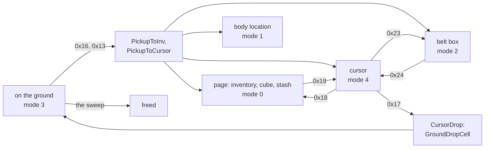
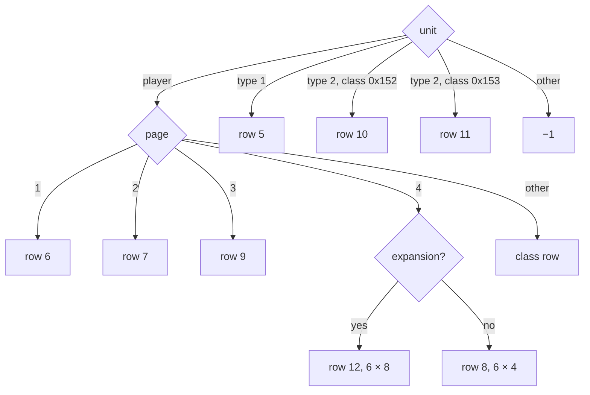
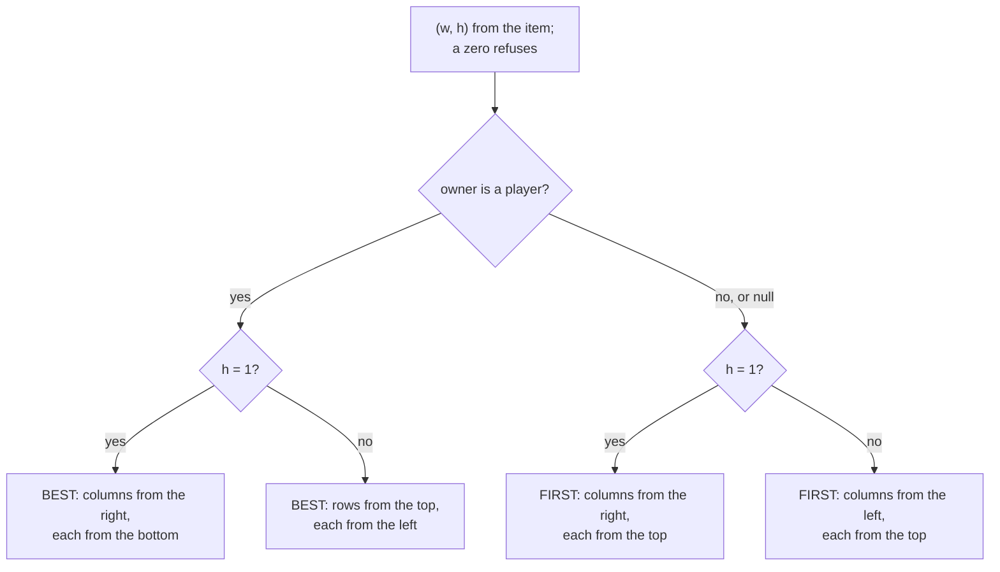
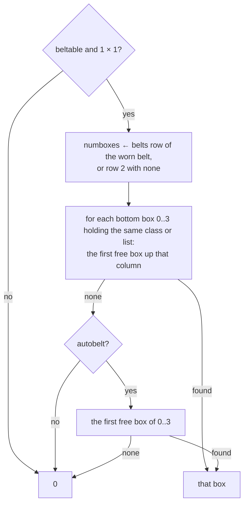
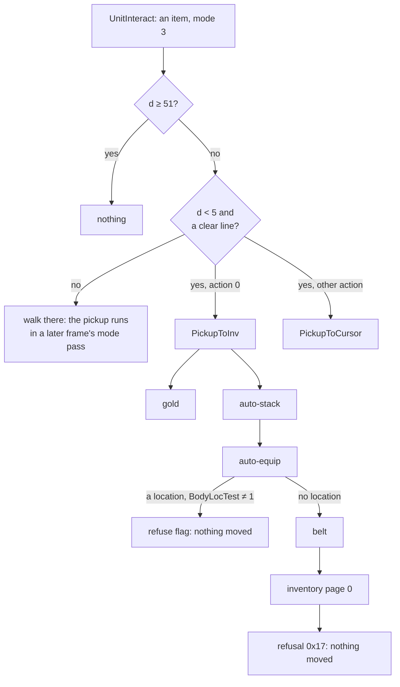
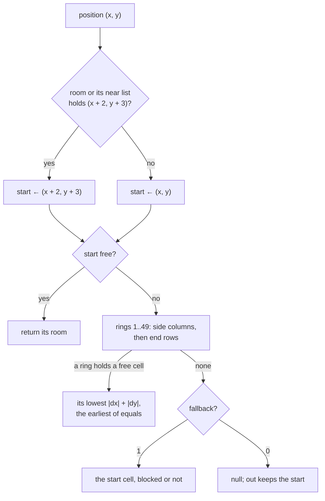
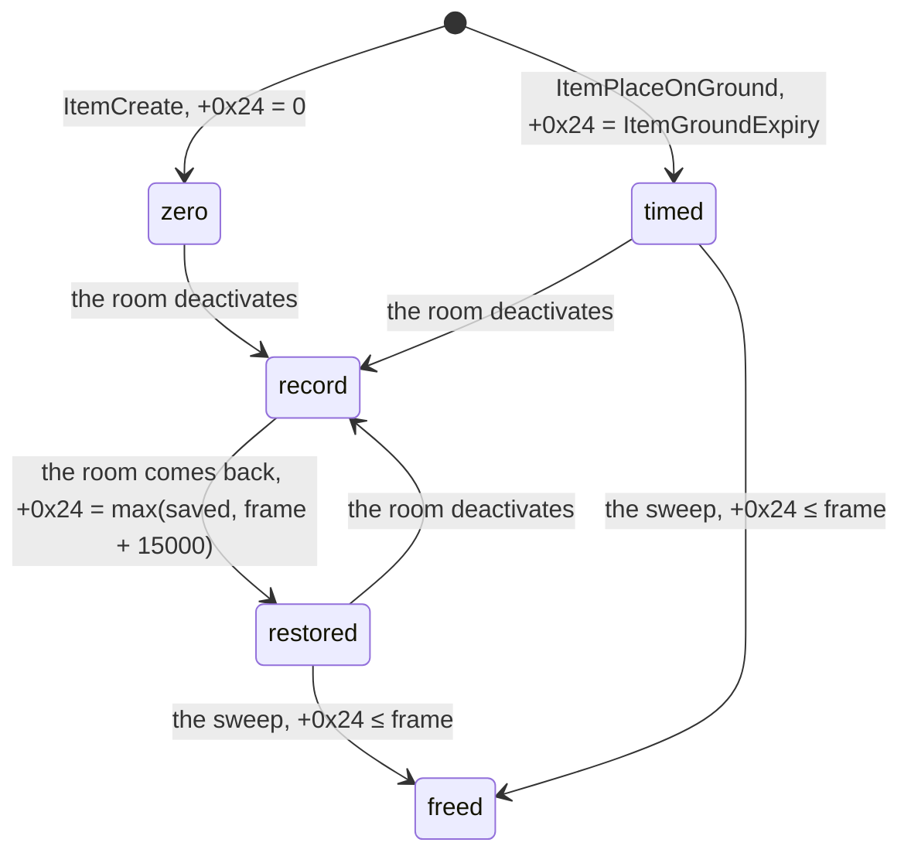

# Inventory: grids, placement, belts, stacks, pickup, the ground drop and a ground item's life

## Purpose

Where an item can go and how it gets there, on the server. Which grid a unit and page use, in which order the placement
search walks it, the belt's boxes, stacks and merges, the cursor, the stash, pickup with its reach and its refusals, the
cell a dropped item lands on, and how long the item then lives. Scope is [ADR-0025](../../adrs/0025-scope-item-use-inventory.md):
the server's outcomes in game frames; the cube's grid is a page here and its transmute is [items/cube](cube.md); trading is
out. Using an item, the request gate and the drain's order are [items/use](use.md).



## Entry points

| When | Function | Tag |
|---|---|---|
| Client packets `0x13`, `0x16`: interact with a unit, an item on the ground among them | fn:sub_0054AAD0_Pkt16UnitAction@0x0054AAD0, 0x0054AA90 → fn:sub_00548B00_UnitInteract@0x00548B00 | [I] |
| Client packets `0x17`..`0x1F`, `0x21`..`0x25`, `0x63`: the moves (§ D) | data:g_SrvPacketTable@0x006E0D18 | [I] |
| A monster or chest drops | fn:sub_0055A550_DropCreateItem@0x0055A550 ([items/tc § H](tc.md#h-item-pick-and-hand-off)) | [I] |
| Other callers of the ground drop (§ J4) | fn:sub_00555DA0_GroundDropCell@0x00555DA0 | [I] |
| Every 1 500 frames: the sweep of active rooms ([drlg/lifecycle § A](../drlg/lifecycle.md#a-the-frame)) | fn:sub_00558B90_ActExpiredItemsFree@0x00558B90, K3 | [C] (ADR-0021) (fn:sub_0052D310_ExpirySweepTick@0x0052D310, run:2026-10-30-frame-emu-3) |

## Inputs

### Tables

| Anchor | Used for |
|---|---|
| tbl:Inventory.txt:gridX, tbl:Inventory.txt:gridY | a page's width and height, as bytes ([Inventory](../../tables/Inventory.md)) |
| tbl:Belts.txt:numboxes | a worn belt's box count ([Belts](../../tables/Belts.md)) |
| tbl:Armor.txt:belt | the worn belt's `belts` row, Items `+0x130` |
| tbl:Misc.txt:invwidth, tbl:Misc.txt:invheight | the item's size, Items `+0x10F`, `+0x110` |
| tbl:Misc.txt:autobelt, tbl:ItemTypes.txt:Beltable | the belt search |
| tbl:Misc.txt:stackable, tbl:ItemTypes.txt:AutoStack | stacks; Items `+0xE8` is the row's maximum |
| tbl:ItemTypes.txt:Quiver, tbl:ItemTypes.txt:Shoots, tbl:ItemTypes.txt:BodyLoc1, tbl:ItemTypes.txt:BodyLoc2, tbl:ItemTypes.txt:Body | auto-equip |
| fmt:expfield#header | the walk's direction field, file `expfield.d2` ([formats/expfield](../../formats/expfield.md)) |

### Runtime state

| State | Type | Source |
|---|---|---|
| inventory | `0x40` bytes, magic `0x01020304`: `+0x08` owner, `+0x0C`/`+0x10` the item list, `+0x14` the pages, `+0x18` their count, `+0x20` the cursor item, `+0x28` the item count | fn:INV_Create@0x0063ABD0 |
| page table | index `page + 2`, entries of 16 bytes: `+8` width, `+9` height, `+0xC` the cells, u32 unit pointers at `row × width + col` | fn:sub_0063ADD0_InvPageGet@0x0063ADD0 |
| item data `+0x24` | i32, the ground expiry | fn:sub_00558AA0_ItemPlaceOnGround@0x00558AA0 |
| game frame | i32, `Game+0xA8` | a drop handled while it is `N` uses `N`; the sweep tests at the frame's own `N` |

### Constants

| Name | Value | Anchor | Tag |
|---|---|---|---|
| body page | index 0, 13 × 1, in the image | data:0x0074479C, data:0x007447B4 | [I] |
| belt page | index 1, 16 × 1, in the image | data:0x0074479C, data:0x007447B4 | [I] |
| page bytes | 0 inventory, 1 and 2 trade, 3 cube, 4 stash; `0xFF` while on the cursor or the belt | 0x00628280, 0x0054AC7E | [I] |
| item modes | 0 on a page, 1 on the body, 2 in the belt, 3 on the ground, 4 on the cursor | fn:sub_00549150_PktInvItemBad@0x00549150, fn:sub_005492F0_PktBeltItemBad@0x005492F0, fn:sub_005606B0_ItemEquip@0x005606B0, fn:sub_00558AA0_ItemPlaceOnGround@0x00558AA0, fn:sub_00560420_InvItemToCursor@0x00560420 | [I] |
| start offset | `(x + 2, y + 3)` | 0x00555DAE, 0x00555DB1 | [C] (ADR-0015, ADR-0029 (a)) |
| walk mask | `0x801` | 0x00555DDF, run:2026-11-04-ground-emu | [C] (ADR-0015, ADR-0029 (a)) |
| radius, step | 50, 1 | 0x0064E81E, 0x0064E81C, run:2026-11-04-ground-emu | [C] (ADR-0015, ADR-0029 (a)) |
| pickup reach | `d < 5`; nothing at `d ≥ 51` | 0x00548C60, fn:sub_00641530_UnitInteractDistance@0x00641530 | [I] |
| pickup line mask | `0x804` | 0x00548C7E | [I] |

The cell mask's constant is J1's note: its value is `[I]` in two bits. (0x00555DE4)

## Algorithm

### How to read the tags

- **`[C]` (ADR-0015)**, run:2026-11-04-inventory-emu, run:2026-11-04-ground-emu: the named function to its return over declared scratch
  memory, the code's map from the bytes it reads. **`[C]` (ADR-0021)**: the same up to a named callee's entry; the callee and all code after it are not covered, "after, `[I]`".
  None of these is a run of the game, and none says what the game stores at those offsets or when the code runs. [C] (fn:sub_0063B850_InvSpotFindBySize@0x0063B850, run:2026-11-04-inventory-emu)
- **`[C]` (ADR-0015, ADR-0029 (a))**, family `drop`: § J only, with its stated hole. (fn:sub_00555DA0_GroundDropCell@0x00555DA0, run:2026-11-04-lock-scan)
- **`[C]` live**: run:2026-11-04-inventory (one fresh process) and run:2026-11-04-inventory-2 (a fresh process per session, no forced state), seed 6001. Their
  ground differs by claim, per the `lane/p60b` check: the **expiry deltas** rest on the a-priori table committed before the kept sessions; the **ground searches and their controls** on a model older than the logs, evaluated per case on the logged collision window; the **restore's write and the save's word** on a predictor written before the kept sessions, on those lines' inputs; the **restored copy's sweep** on a predictor written after a development log. All but the first check the code against its reading on inputs the log gives, and say nothing of which inputs occur. [C] (run:2026-11-04-inventory-2, 0x00558B2B)
- **A forced request stays `[I]`.** Two outcomes in § E and § F rest on a packet field written at the handler's entry in run:2026-11-04-inventory. [I] (fn:sub_0054ABB0_Pkt18CursorToPage@0x0054ABB0, fn:sub_0054B3E0_Pkt23CursorToBelt@0x0054B3E0)
- **`[I]`**: a code reading no case reaches, with the addresses read. (fn:sub_00563560_PickupToInv@0x00563560)

### A. Pages and rows



```
A1. InvRowForUnit(unit, page: i32, expansion: i32) → i32:            [C] (ADR-0015) (family rowfor, fn:sub_00621050_InvRowForUnit@0x00621050, data:0x00744544, run:2026-11-04-inventory-emu)
      player: page 1 → 6;  2 → 7;  3 → 9;  4 → 12 if expansion ≠ 0 else 8;  any other page → the class row (0..4, 14, 15)
      type 1 (a monster, so a hireling too): 5
      type 2, class 0x152: 10;  class 0x153: 11
      otherwise: −1

A2. InvRecordGrid(row, set, out):                                    [C] (ADR-0015) (family invrec, fn:sub_0065C1F0_InvRecordGrid@0x0065C1F0, run:2026-11-04-inventory-emu)
      copies 24 bytes, gridX to gridBoxHeight, from base + (16 × set + row) × 0xF0 + 0x10
      an index above the count (0x0096D4F0) reaches 0x00408090;  the count itself (32) is accepted and past the table
A3. BeltsRecord(row, set, out):                                      [C] (ADR-0015) (family beltrec, fn:sub_00660CB0_BeltsRecord@0x00660CB0, run:2026-11-04-inventory-emu)
      copies 264 bytes from base + (7 × set + row) × 0x108, no upper bound on the row
A4. InvPageGet(inv, page, row):                                      [I] (fn:sub_0063ADD0_InvPageGet@0x0063ADD0, 0x0063AE53, 0x0063AE5A)
      a page is made on first use from the row given then
      a later request with another size returns 0, so nothing is placed
```

- A1. [C] (ADR-0015) **The stash is 6 × 8 in an expansion game and 6 × 4 in a classic one**, by that row (control `stashsmall` fails 20 of 400). (fn:sub_00621050_InvRowForUnit@0x00621050, run:2026-11-04-inventory-emu)
- A1. [I] Each server caller of the page's row that was read passes `game+0x70` as `expansion` where the page can be 4; callers not listed were not followed. (0x00560297, 0x00560598, 0x0054D658)
- A1. [I] Rows 13 and 29 (Hireling) are never returned. Types `0x152`, `0x153` are object classes, and no path reaching them was read. (0x00483705, fn:sub_00621050_InvRowForUnit@0x00621050)
- A2. [C] (ADR-0015) **`gridX` and `gridY` are read as bytes**: with `+0x12`, `+0x13` declared `0x7F`, a wider reading fails 2 465 of 4 000 `search` cases. [C] (ADR-0021) So does the bound test, 397 of 800 `put` cases. (fn:sub_0063ADD0_InvPageGet@0x0063ADD0, fn:sub_0063AFD0_InvGridPut@0x0063AFD0, run:2026-11-04-inventory-emu)
- A2, A3. [I] **The second sets are the client's.** All 10 calls of the inventory reader at `0x0063xxxx` and the 3 belts calls outside `0x4xxxxx` pass a literal set of 0; the other 11 and 4 calls, all in `0x4xxxxx`, take it from a register or a global. By direct calls the server reads `gridX`, `gridY` of `inventory` and `numboxes` of `belts`, and no rectangle. (fn:sub_0065C1F0_InvRecordGrid@0x0065C1F0, fn:sub_00660CB0_BeltsRecord@0x00660CB0, 0x0063C6B3, 0x00560939, 0x00560918)
- A4. [I] In a save moved between game types this would be the stash's refusal; no run reaches it. (0x0063AE5A)

### B. The placement search



```
B1. InvSpotFindBySize(inv, item, invrow, &col, &row, page) → bool:   [C] (ADR-0015) (all of B1–B4; fn:sub_0063B850_InvSpotFindBySize@0x0063B850, fn:sub_0063B490_InvSpotFindRow@0x0063B490, fn:sub_0063B620_InvSpotFind@0x0063B620, fn:sub_0063B540_InvSpotFirstRow@0x0063B540, fn:sub_0063B6E0_InvSpotFirst@0x0063B6E0, run:2026-11-04-inventory-emu)
      (w: u8, h: u8) ← Items[+0x10F], Items[+0x110];  a zero refuses
      grid ← page(page + 2);  W: u8 ← gridX;  H: u8 ← gridY
      player: bool ← inv.owner ≠ null and inv.owner.type = 0
      if h = 1:
        player: BEST(columns W−1 … 0, in each rows H−1 … 0)
        else:   FIRST(columns W−1 … 0, in each rows 0 … H−1)
      else:
        player: BEST(rows 0 … H−1, in each columns 0 … W−1)
        else:   FIRST(columns 0 … W−1, in each rows 0 … H−1)
B2. BEST(order): best: i32 ← 0
      for each spot in order that fits:
        s: i32 ← Score(spot)
        if s > best: keep the spot;  best ← s                        ; a tie keeps the earlier
        if s = 255: return true
      return best ≠ 0
    FIRST(order): the first spot that fits
B3. Fits(col, row): cell(col, row) = 0 and col + w ≤ W and row + h ≤ H and every cell of the rectangle is 0
B4. Score(col, row) → i32:
      n: i32 ← 0
      left:    n ← n + (h if col < 1 else the occupied cells in column col − 1, rows of the rectangle)
      right:   n ← n + (h if col + w ≥ W else the occupied cells in column col + w, rows of the rectangle)
      top:     n ← n + (w if row < 1 else the occupied cells in row row − 1, columns of the rectangle)
      bottom:  n ← n + (w if row + h ≥ H else the occupied cells in row row + h, columns of the rectangle)
      return 255 if n ≥ 2 × (w + h) else n

B5. InvGridPut(col, row, index, invrow):                             [C] (ADR-0021) to InvItemRemove (family put, fn:sub_0063AFD0_InvGridPut@0x0063AFD0, run:2026-11-04-inventory-emu)
      a zero size refuses
      index 0 or 1: the size is forced to 1 × 1, no bound test
      index ≥ 2: refuse col < 0, col + w > gridX, row < 0, row + h > gridY
      refuse an occupied cell
      ends at InvItemRemove
    After:                                                           [I] (0x0063B1BF, 0x0063B1D2, 0x0063B1E9)
      the page fill, the page byte, the location byte +0x69: body (col > 10) + 3, belt 2, a page 1
```

**What the run separates** (each control fails that many of `search`'s 4 000 cases, of `place`'s 500 where named; 112 distinct outcomes):

| Control | Wrong reading | Fails |
|---|---|---|
| `geq` | a later spot wins a tie | 707 (`place` 113) |
| `noedge` | outside sides do not count | 898 |
| `h1general` | one cell high takes the general order | 723 |
| `colright` | the general order, columns from the right | 362 |
| `rowfirst` | one cell high, rows as the outer loop | 74 |
| `firstall` | a player gets the first fit | 543 (`place` 76) |
| `bestall` | every owner gets the score | 575 (`place` 47) |
| `no255` | no early stop | 0: not separable (below) |

- B1. [C] (ADR-0015) On an empty page, one cell high for a player lands at `(W − 1, H − 1)`, taller at `(0, 0)`; for any other owner one cell high lands at `(W − 1, 0)`, taller at `(0, 0)`. (fn:sub_0063B5E0_InvSpotOneHigh@0x0063B5E0, fn:sub_0063B810_InvSpotOther@0x0063B810, run:2026-11-04-inventory-emu)
- B1. [I] The branches for `h = 3` and `w ≤ 2`, for 2 × 2 and for the rest call three bodies equal byte for byte with their call displacements masked, so the size only tells the height-1 case from the others. (0x0063B790, 0x0063B7D0, 0x0063B810)
- B2. [C] (ADR-0015) The stop at 255 is not separable from no stop: 255 is the highest score and only a strictly higher one replaces, control `no255` fails 0 of 4 000, and a reimplementation may leave it out. (fn:sub_0063B620_InvSpotFind@0x0063B620, run:2026-11-04-inventory-emu)
- B2. [I] A player's search fails only where no spot fits: a best of 0 needs a free rectangle touching nothing and no slide to one that touches, and sliding finds a higher score. A reading of the loop; the `search` family holds no counter-case. (fn:sub_0063B490_InvSpotFindRow@0x0063B490, run:2026-11-04-inventory-emu)
- B5. [I] `InvGridFree` tests no bound itself; `InvPlaceItem`'s direct branch clamps a negative `x`, `y` to 0 and relies on `InvGridPut`. (0x005602BE, fn:sub_00560200_InvPlaceItem@0x00560200)
- B. [C] (ADR-0021) `place` to `InvGridPut`, 500 cases with 275 distinct outcomes: the search as the caller uses it. After, `[I]`. (0x0063B950, run:2026-11-04-inventory-emu)

### C. Placing on a page

```
C1. InvPlaceItem(…, x, y, 0, 1, 0):                                  [I] (fn:sub_00560200_InvPlaceItem@0x00560200, 0x00560327, 0x0056032F)
      place at the cell by InvGridPut, or by the search
      a failed put returns 0, the handler 3
      page ≠ 4: 0x0055C270, for a player ItemSkillQtyAdjust(1)       ; a scroll's or tome's skill quantity
      an active charm then attaches                                  ; ITEMS_IsActiveCharm
C2. ItemSkillQtyAdjust(add) (0x0055C110):                            [I] (fn:sub_0055C110_ItemSkillQtyAdjust@0x0055C110, fn:sub_0055BFF0_ItemBookSkill@0x0055BFF0, fn:sub_0055C270_ItemSkillQtyAdd@0x0055C270)
      skill ← Books[+8] for type 22, Books[+0xC] for type 18, else −1, which returns 0
      add ≠ 0: quantity ← the skill's + max(stat 70, 1 for a non-tome), granting the skill if missing
      add = 0: less, floored at 0;  an empty left or right skill choice is reset
      sends the quantity to the client
```

- C1. [I] So a scroll or tome placed in the stash adds nothing to the skill. `0x0055C110` holds no test of a page or a stash: it is not a stash-open test. When a charm counts is [stats/aggregate § H](../stats/aggregate.md#h-items-equip-requirements-the-refresh-broken-per-level-values). (fn:ITEMS_IsActiveCharm@0x0062FF70, 0x00560327)

### D. The requests

A handler's "refuse" is a return of 3 or 2, discarded at the drain ([items/use A1](use.md#a-the-drain-and-the-gate)). Every row passed the gate first.

| Packet | Handler | Body | Tag and anchor |
|---|---|---|---|
| `0x13`, `0x16` | `0x0054AA90`, `0x0054AAD0` | `UnitInteract(type ≤ 5, guid, action)`; `0x13`'s action is 0 (§ I) | [I] (fn:sub_00548B00_UnitInteract@0x00548B00) |
| `0x17` | `0x0054AB40` | a cursor item; `InteractIsPlayer(0)` non-zero returns 3; `CursorDrop` | [I] (fn:sub_00563C00_CursorDrop@0x00563C00) |
| `0x18` | `0x0054ABB0` | § E; `ItemSetPage(item, page)`, then `InvPlaceItem(…, x, y, 0, 1, 0)` | [I] (fn:sub_00560200_InvPlaceItem@0x00560200) |
| `0x19` | `0x0054ACD0` | an owned item, empty cursor, not page 1; trade test `0x00535610`; `InvItemToCursor` | [I] (fn:sub_00560420_InvItemToCursor@0x00560420) |
| `0x1A`..`0x1E` | | equip and swap with a body location (`0x1B`'s slot 1..10) | [I] (fn:sub_005606B0_ItemEquip@0x005606B0, fn:sub_00563D20_EquipCursorAtSlot@0x00563D20, fn:sub_00560CD0_BodyToCursor@0x00560CD0, fn:sub_00560F00_BodySwapCursor@0x00560F00, fn:sub_00561220_BodySwapCursor2@0x00561220) |
| `0x1F` | `0x0054B0F0` | the cursor against a page item, not an item on page 1 or 2 | [I] (fn:sub_00561B00_PageSwapCursor@0x00561B00) |
| `0x21` | `0x0054B300` | two owned items, unequal guids; `StackRequest` (§ G) | [I] (fn:sub_0055E7C0_StackRequest@0x0055E7C0) |
| `0x22` | `0x0054B380` | an owned item; the stub (§ G) | [I] (0x0055E9A0) |
| `0x23` | `0x0054B3E0` | a cursor item; `ItemToBelt(guid, box, 0)` | [I] (fn:sub_0055E9B0_ItemToBelt@0x0055E9B0) |
| `0x24` | `0x0054B450` | a belt item, trade test, empty cursor; `BeltToCursor` | [I] (fn:sub_00562250_BeltToCursor@0x00562250) |
| `0x25` | `0x0054B4E0` | a cursor item and a belt item; `BeltSwapCursor` | [I] (fn:sub_0055EB30_BeltSwapCursor@0x0055EB30) |
| `0x63` | `0x0054D520` | an inventory-page beltable item, empty cursor: `BeltFreeSlot`, then to that box | [I] (fn:sub_0054D520_SrvPacket63Handler@0x0054D520) |

- D. [I] **Lengths, tested first by each handler:** 5 bytes `0x17`, `0x19`, `0x22`, `0x24`, `0x63`; 9 bytes `0x1A`, `0x1B`, `0x1D`, `0x1E`, `0x21`, `0x23`, `0x25`; 17 bytes `0x18`, `0x1F`. Fields, as `u32`: `0x18` guid `+1`, x `+5`, y `+9`, page `+0xD`; `0x23` guid `+1`, box `+5`. (0x0054AB43, 0x0054ABB4, 0x0054ABCF, 0x0054ABD7, fn:sub_0054B3E0_Pkt23CursorToBelt@0x0054B3E0)

### E. Pages and the stash: `0x18`, `0x19`

```
E1. Packet 0x18 for a player, in order:                              [I] (0x0054ABE5..0x0054AC7E, 0x0054AC3E, 0x0054AC68, 0x00535099)
      the cursor test
      not busy and page ≠ 0: return 2                                ; the item is on the cursor, so PlayerIsBusy is 1
      page 4: a room in town, else 3
      page 2: InteractIsPlayer(1), else 3
      page 3, 0: nothing further
      any other page, 1 and 5 up among them: return 2                ; a player cannot place on page 1 by this request
      ItemSetPage(item, page)                                        ; BEFORE the placement
      InvPlaceItem
    A non-player user has only a test of page ≥ 5, unsigned.

E2. Packet 0x19: InvItemToCursor(…, 1, 0, 0, 0):                     [I] (fn:sub_00560420_InvItemToCursor@0x00560420, 0x005604D2, 0x005604DC)
      the cursor empty
      a player not busy (no interaction, empty cursor, PlayerData +0x4C 0) refuses any page but 0
      the item in mode 0
      remove;  the page byte saved;  page 0xFF;  the cursor word;  mode 4;  event flag 4
```

- E1. [I] **A placed item needs no open stash, on this reading.** The packet's item is on the cursor, so `PlayerIsBusy` is 1 and the "page ≠ 0 needs busy" test always passes. Page 4 needs a town room, page 2 an interaction with a player, page 3 nothing. (fn:sub_00535060_PlayerIsBusy@0x00535060, 0x0054ABFC, 0x00535099, 0x0054AC1D, 0x0054AC4E)
- E1. [I] **Forced, one case: `0x18` to page 4 with no stash open, in town (level 103), was accepted**: handler return 0, the item on page 4 at the cell sent. The page dword was written in the packet at the handler's entry (a breakpoint wrote game memory; the client UI cannot send it). A result resting on a write stays `[I]`, and the stock route is open. (run:2026-11-04-inventory, fn:sub_0054ABB0_Pkt18CursorToPage@0x0054ABB0)
- E1. [I] A refused item keeps the new page byte on the cursor, since the page is set first. (0x0054AC68)
- E2. [I] Taking an item off a non-zero page, with an empty cursor, does need an interaction. (fn:sub_00560420_InvItemToCursor@0x00560420)
- E2. [C] **Live: `0x19` moves neither the player's nor the game's seed**, 80 of 80 request pairs, and `0x17` likewise (§ J5). Scope: those two seeds around the handler. By § D it takes an item off a page to the cursor; no ground pickup's seed was logged. (run:2026-11-04-inventory-2, 0x0054ACD0)

### F. Belts



```
F1. BeltFreeSlot(player, item) → box or 0:                           [C] (ADR-0015) (family belt, fn:sub_0063C600_BeltFreeSlot@0x0063C600, fn:sub_00628A40_PotionSameGroup@0x00628A40, fn:sub_00660CB0_BeltsRecord@0x00660CB0, fn:sub_00621ED0_ItemBeltByte@0x00621ED0, run:2026-11-04-inventory-emu)
      only a beltable 1 × 1 item
      numboxes: u32 ← BeltsRecord(the worn belt's Items[+0x130], or 2 with no belt worn; set 0)[+0x004]
      for b in 0 ..< 4, when box b holds an item of the same class or the same list (hp1..5, mp1..5, rvl/rvs):
        for box in b, b + 4, b + 8, … while box < numboxes:
          if box is free: return box
      if the item's row has autobelt:
        the first free box of 0..3
      return 0
F2. BeltPlace(item):                                                 [C] (ADR-0021) to InvGridPut (family beltplace, fn:sub_0063C790_BeltPlace@0x0063C790, run:2026-11-04-inventory-emu)
      BeltFreeSlot; no box returns 0;  ends at InvGridPut(box, 0, 1, 0)
F3. ItemAutoBeltTest(item) → 1:                                      [I] (0x00628BFD, 0x00563716, fn:sub_00628BA0_ItemAutoBeltTest@0x00628BA0)
      an autobelt row returns 1;  any other compares BeltHoldsSameGroup (0 or 1) with −1
F4. ItemToBelt(guid, box, 0) (packet 0x23):                          [I] (0x0063C4C0, fn:sub_0063C4F0_BeltPutItem@0x0063C4F0, fn:sub_0055E9B0_ItemToBelt@0x0055E9B0)
      BeltPutItem: 1 × 1, beltable, box < 16;  InvGridPut refuses an occupied box
      numboxes is not tested
F5. Packet 0x24: BeltToCursor;  the box's column shifts down (BeltColumnShift)   [I] (fn:sub_00562250_BeltToCursor@0x00562250, fn:sub_0055EDC0_BeltColumnShift@0x0055EDC0)
    Packet 0x25: BeltSwapCursor, in place, no shift                  [I] (fn:sub_0055EB30_BeltSwapCursor@0x0055EB30)
    Packet 0x63: page 0 and an empty cursor;  returns 0 with no room [I] (fn:sub_0054D520_SrvPacket63Handler@0x0054D520)
F6. BeltOverflow(new belt or null):                                  [I] (fn:sub_005608C0_BeltOverflow@0x005608C0, 0x0056091B, 0x0056093D, 0x00560C45, 0x00560E18, 0x00561058, 0x00563EE4, 0x0057F47A)
      numboxes ← BeltsRecord(the new belt's +0x130, or row 2)        ; set 0
      for box in 0 ..< 16:
        each item at or above numboxes: removed, page 0, placed by the search
        if that fails: dropped by the ground search (§ J)
      ; its 4 direct calls: the body moves' belt-type branches (3), and a corpse's move of a worn belt (1, null)
```

- F6. [I] **At a corpse's making:** `PLAYER_CorpseCreate`'s loop over the slots (0x0057F90E) and `CorpseOverflowDrop` (0x0057F5D8) both move a slot's item through the function at `0x0057F410`, which calls `BeltOverflow(null)` when the item's base type is 19 (`belt`), so row 2's `numboxes` 4 applies: boxes 4 and up go to page 0 by the search, then to the ground. Unrun. (0x0057F47A, 0x0057F90E, 0x0057F5D8, fn:PLAYER_CorpseCreate@0x0057F700, fn:sub_0057F540_CorpseOverflowDrop@0x0057F540)
- F1. [C] (ADR-0015) Each of 2 000 cases to its return; boxes reached 0..12 and 15. Control `walk1` (a column walk by 1) fails 192, `nogroup` 126, `noauto` 337, `defaultbelt` 160, `secondset` 237. (fn:sub_0063C600_BeltFreeSlot@0x0063C600, run:2026-11-04-inventory-emu)
- F1. [I] A row with `autobelt` 0 (stock `isc`, `tsc`, `yps`, `vps`, `wms` among them) is in no list, so it joins only a column whose bottom box holds its own class. (0x0063C731, tbl:Misc.txt:autobelt)
- F3. [I] So the pickup's belt branch always calls `BeltPlace`, and the column search in it decides. (0x00563716)
- F4. [I] **Forced, one case: `0x23` with box 12 on a 12-box belt (a Heavy Belt) stays in box 12**. The box dword was written at the handler's entry; the client UI cannot send it. A result resting on a write stays `[I]`, and the stock route, and whether a smaller belt's overflow later takes the item, were not run. (run:2026-11-04-inventory, fn:sub_0054B3E0_Pkt23CursorToBelt@0x0054B3E0)
- F1. [C] The starting kits' placement ran this search: [player/creation E6](../player/creation.md). (fn:sub_0063C600_BeltFreeSlot@0x0063C600, run:2026-10-16-player)

### G. Stacks

```
G1. ItemsCanStack(a, b) → bool:                                      [C] (ADR-0015) (family stackok, fn:sub_0062C850_ItemsCanStack@0x0062C850, 0x0062A2F0, run:2026-11-04-inventory-emu)
      all of:
        class equal, quality equal, file index equal
        the row is stackable (+0x132)
        ethereal status equal
        quality is not 0 and not 4..9
        stats 21, 22, 23, 24, 159, 160 equal
        the low byte of stat 194 is 0 on both

G2. ITEMS_GetMaxStack(item) → i32:                                   [C] (ADR-0021) (family merge, fn:ITEMS_GetMaxStack@0x006295B0, run:2026-11-04-inventory-emu)
      m: i32 ← Items[+0xE8] + stat 254;  if m > 510: m ← 511

G3. StackMerge(source, target):                                      [C] (ADR-0021) to the first UnitSetStat (family merge, fn:sub_0055E590_StackMerge@0x0055E590, run:2026-11-04-inventory-emu)
      sum: i32 ← source.qty + target.qty
      if sum > max: ends at UnitSetStat(target, 70, max, 0)
      else if the source is durable and below the target's stat 72: first lowers the target's stat 72
      else: the target takes the sum
    After the first set:                                             [I] (0x0055E623, 0x0055E66A, 0x0055C070)
      sum > max: the source keeps sum − max and stays on the cursor;  the target gets flag 8;
        a tome adds max − target to the skill's quantity (0x0055C070)
      otherwise: stat 70 is the sum;  a tome adds the source's quantity;  the cursor is cleared and the source freed

G4. StackRequest (packet 0x21):                                      [I] (fn:sub_0055E7C0_StackRequest@0x0055E7C0, 0x0054B33E, 0x0054B356)
      a missing unit or a target on page 2: the refuse flag; the handler returns 3, as for equal guids
      an unstackable pair: return 0 with the flag clear; the handler returns 0 with nothing done
```

- G1. [C] (ADR-0015) 660 cases hold each test broken alone, with both returns met. Quality 3 and 10 stack, 0, 4 and 9 do not; stat 194 of `0x100` on both passes. (fn:sub_0062C850_ItemsCanStack@0x0062C850, run:2026-11-04-inventory-emu)
- G3. [C] (ADR-0021) 500 cases: 246 above the maximum, 87 exactly at it (the sum, not the over-branch), 167 below; 40 lower stat 72. (fn:sub_0055E590_StackMerge@0x0055E590, run:2026-11-04-inventory-emu)
- G3. [I] A negative source, target or maximum ends at the fatal path. The sum is `i32`: two stacks at the 511 ceiling give 1 022; past `2³¹ − 1` the add wraps negative, the `jle` takes the not-above branch, and its `≥ 0` test ends at the fatal path too, so no wrapped value is stored. (0x0055E5C2, 0x0055E5F2, 0x0055E606, 0x0055E617)
- G. [I] **There is no split on the server.** Packet `0x22` reaches `UnstackStub`, `xor eax, eax; ret 8`, and the handler returns 0. Scope: the handler `0x0054B380` and the 12 request rows of § D only; the rest of the packet table was not read for a request that divides a stack (gold's withdraw and drop, for one, are other requests). (0x0054B380, 0x0055E9A0, fn:sub_0055E9A0_UnstackStub@0x0055E9A0)

### H. The cursor to the ground

```
H1. CursorDrop(user):                                                [I] (fn:sub_00563C00_CursorDrop@0x00563C00, 0x00563C87)
      InvClearUseMarks;  the item, mode 4
      room ← GroundDropCell(user's room, user's position, &out, 1, fallback 1)     ; § J
      room = null: nothing moves; the item stays on the cursor
      ItemPlaceOnGround(…, room, out)                                ; § K
      the cursor cleared;  flag 1 for an item holding items;  flag 0x4000 cleared
      CubeDropEmptied(item)
H2. CubeDropEmptied(item):                                           [I] (fn:sub_00563840_CubeDropEmptied@0x00563840, 0x00563BAF, 0x00563BC7)
      for code box: each item on page 3 moves to the cursor word, to page 0 and into the search
      if none fits: it takes the ground search and ItemPlaceOnGround
```

- H1. [I] With `fallback` 1 a full surround does not give null: the item lands on the blocked start cell (J2). Null needs a moved base that cannot see the start, or a null first room. (fn:sub_00563C00_CursorDrop@0x00563C00, 0x00563C87)

### I. Pickup



```
I1. UnitInteract, the item case:                                     [I] (fn:sub_00548B00_UnitInteract@0x00548B00, 0x00548C60..0x00548CC5, 0x00548C7E)
      the unit's mode 3
      d: i32 ← UnitInteractDistance(user, item)
      if d ≥ 51: nothing
      if d < 5 and UnitsLineBlocked(user, item, 0x804) = 0:
        action 0: PickupToInv;  else: PickupToCursor
      else: PLAYER_ModeCmdUnit(0, 3, …): the walk                    ; the reach and line tests run again at its end, in PlrModeMoveFrame

I2. UnitInteractDistance(a, b) → i32:                                [C] (ADR-0015) (family dist, to the return, fn:sub_00641530_UnitInteractDistance@0x00641530, data:0x006EB180, run:2026-11-04-ground-emu)
      dx, dy ← |dx|, |dy|;  sa, sb ← the units' sizes
      if dx < 8 and dy < 8 and sa < 4 and sb < 4:
        v: i32 ← table[dx + 8 × dy]
        if v < 0: return 0
        if sa = 3 or sb = 3: v ← max(v − 1, 0)                       ; a size of 3 takes 1 off, floored at 0
        return v + 1 if sa < 2 or sb < 2 else v
      dx ← max(dx − ((sb >> 1) + (sa >> 1)), 0);  dy likewise
      return 2 × max(dx, dy) + min(dx, dy)

I3. UnitsLineBlocked(a, b, mask) → i32:                              [C] (ADR-0021) to COLL_LineTest or UNIT_CollUnmark (family los, fn:sub_00622B50_UnitsLineBlocked@0x00622B50, fn:sub_00622920_LineTestShortened@0x00622920, run:2026-11-04-ground-emu)
      both units' masks are tested against mask;  a unit overlapping it ends at UNIT_CollUnmark     ; after it: marked again after the test, a reading
      touching (|dx| + |dy| < min(sa, 2) + min(sb, 2)): return 0
      else ends at COLL_LineTest(first unit's room, a', b', mask)    ; each end moved toward the other by its unit's clamped size

I4. PickupToInv, in order:                                           [I] (all of I4; fn:sub_00563560_PickupToInv@0x00563560, fn:sub_0055CC90_ItemQuestGate@0x0055CC90, fn:sub_0055C850_GoldPickup@0x0055C850, fn:sub_0055C9A0_PickupRefused@0x0055C9A0, fn:sub_0063DE60_BodyLocTest@0x0063DE60)
      a. cursor empty and not busy, else return 0
      b. the unit's mode 3, else the refuse flag
      c. InvClearUseMarks;  ItemQuestGate;  a refusal calls PickupRefused(0x13)
      d. UnitSetEvent
      e. gold → GoldPickup
      f. PickupAutoStack (I5)
      g. ItemAutoEquipSlot (I6) names a location:
           BodyLocTest(user, loc, item, 0) = 1 → the body
           else the refuse flag, return 0                            ; no belt, no inventory, no PickupRefused
      h. no location: beltable and BeltPlace
      i. InvAutoPlace on page 0
      j. PickupRefused(0x17)                                         ; back to mode 3, event; nothing moved

I5. PickupAutoStack:                                                 [I] (fn:sub_00560020_PickupAutoStack@0x00560020, fn:sub_0055FFA0_PickupScrollToTome@0x0055FFA0, fn:sub_0055D370_PickupTomeMerge@0x0055D370, fn:sub_0055D0D0_PickupStackMerge@0x0055D0D0, fn:sub_0063C3B0_InvTomeWithRoom@0x0063C3B0, fn:sub_0063C200_InvStackWithRoom@0x0063C200)
      type 22: into the first tome of its kind with room             ; type 18, the same ITEMS_GetSuffix, quantity below the maximum
      type 18: the same finder and a merge
      a stackable row whose item type's byte +0x13 is set: PickupStackMerge
      otherwise 0, and I4 goes on
    PickupStackMerge: while the source's stat 70 > 0:
      the next stack with room, after the last target                ; a quiver type looks at the body first
      none: return 0
      sum > max: the target takes the maximum, the source the rest, a tome's skill adjusts;  loop
      else: the source is unlinked and freed;  return 1

I6. ItemAutoEquipSlot(user, item, &loc, skipReq):                    [I] (fn:sub_0055D710_ItemAutoEquipSlot@0x0055D710, fn:sub_0055D560_EquipPairFlags@0x0055D560, fn:sub_0055D670_EquipPairCompatible@0x0055D670, fn:sub_0062EA80_ItemBodyLocs@0x0062EA80)
      needs ItemReqCheck, flag 0x10, not disabled, not type 38
      Quiver of the item's type set (+0xE): a hand (locations 4, 5) must hold a weapon whose Shoots (+0xC) the item is, else 0
      BodyLoc1 = BodyLoc2 (+0xA, +0xB): that location if empty
      BodyLoc1 ≠ BodyLoc2:
        both empty: BodyLoc1
        one empty: it, when EquipPairCompatible(item, the other)
        else 0
    EquipPairCompatible, by tbl:ItemTypes.txt rows:
      bow and bow quiver, crossbow and crossbow quiver (types 27, 5 and 35, 6)
      a one-handed weapon and a shield (45 without the two-handed test, 51)
      two one-handed weapons when both have flag 7 (a class-4 user, or class 6 and type 67)
      two of type 10

I7. PickupToCursor:                                                  [I] (fn:sub_0055CF50_PickupToCursor@0x0055CF50)
      I4's a, b, c;  gold
      else: remove from the room;  the cursor word;  mode 4;  page 0xFF;  event flag 0x40;
            clear flag bit 25;  QUESTS_RaiseItemPlaced;  UnitSetEvent last
```

The distance table (row `|dy|`, column `|dx|`), 64 `i32` at `0x006EB180`, indexed `× 4` at `0x0064162B`, as family `dist`'s kept output prints it. Given as values under [ADR-0031](../../adrs/0031-constants-of-the-code-image.md), no exact rule being known; [PathDirTables](../../tables/PathDirTables.md) holds the same 64 as `g_PathDistNear`, in gate survey `path` as `dirtab_distnear_eq_6eb180=1`. [C] (ADR-0015) (data:0x006EB180, 0x0064162B, `static.txt` of run:2026-11-04-ground-emu)

```
 -1 -1 -1  0  2  4  6  8
 -1 -1  0  1  2  4  6  8
 -1  0  0  2  3  5  7  8
  0  1  2  2  4  5  7  8
  2  2  3  4  5  6  7  9
  4  4  5  5  6  7  8  9
  6  6  7  7  7  8 10 10
  8  8  8  8  9  9 10 11
```

- I2. [C] (ADR-0015) 1 500 cases, 145 distinct outcomes: `plainmanh` fails 1 419, `sizeless` 682. Player to item, `d < 5` reaches 22 of the 64 `|dx|, |dy|` pairs under 8: `|dx|` 0 to 2 with `|dy|` 0 to 4, `|dx|` 3 with `|dy|` 0 to 3, `|dx|` 4 with `|dy|` 0 to 2; among them `(4, 2)`, and not `(3, 4)` or `(5, 0)`. Sizes: `UNIT_GetSizeX` is 2 for a player, 1 for an item, the record's `+0xD0` for an object; a monster and a missile were not run. (fn:sub_00641530_UnitInteractDistance@0x00641530, fn:UNIT_GetSizeX@0x00620510, run:2026-11-04-ground-emu)
- I3. [C] (ADR-0021) `swapsizes` fails 129, `noshorten` 262 of 600. `COLL_LineTest`'s own result is [drlg/collision](../drlg/collision.md)'s `[I]`, not this run's. Pickup's mask `0x804` does not overlap an item's `0x200`; a player's mask at `path+0x4C` was declared, not read from a game. (fn:sub_00622B50_UnitsLineBlocked@0x00622B50, fn:UNIT_GetCollMask@0x006209D0, run:2026-11-04-ground-emu)
- I1. [I] **The one item request that leaves the drain**: `d ≥ 5`, or `d < 5` and a blocked line, with `d ≤ 50`, starts the walk. A later request in the same drain sees the item still on the ground. (fn:sub_00548A50_InteractWalkTo@0x00548A50, 0x00580E73, fn:PLAYER_ModeCmdUnit@0x00580A70)
- I4. [I] **Ownership (who dropped it) is not among any test read in the two pickups, and `nopickup` was not found read there.** Scope: these two functions and their direct callees' first level, not the gate's whole body, which [items/quest-drops](quest-drops.md) holds. (fn:sub_00563560_PickupToInv@0x00563560, fn:sub_0055CF50_PickupToCursor@0x0055CF50)
- I4. [I] Gold and the party share are [items/economy G](economy.md#g-gold-payment-caps-piles-and-the-death-loss). (fn:sub_0055C850_GoldPickup@0x0055C850)
- I5. [I] **A pickup-merge's remainder** stays the same item, its quantity reduced, and goes on down I4 (equip, belt, inventory). With no room there, `PickupRefused(0x17)` puts it back in mode 3 on the ground with its reduced count, and the merged stacks keep what they took. The fatal line after the loop (`0x606`) needs a source reaching 0 outside the return, which no branch read does. (fn:sub_0055D0D0_PickupStackMerge@0x0055D0D0, fn:sub_0055C9A0_PickupRefused@0x0055C9A0)

### J. The ground drop's cell



**What this section's `[C]` is.** Every `drop` `[C]` below is `[C] (ADR-0015, ADR-0029 (a))` **given that the allocation returned a writable block**, at size 1 and step 1: the code's map on declared rooms and one declared pool page. It is not a live run, and not how often a game's rooms make a statement matter. [C] (ADR-0015, ADR-0029 (a)) (fn:sub_00555DA0_GroundDropCell@0x00555DA0, run:2026-11-04-ground-emu, run:2026-11-04-lock-scan)

```
J1. GroundDropCell(room, pos, out, size: i32 = 1, fallback: i32) → room:    [C] (ADR-0015, ADR-0029 (a)) (family drop, 4 000 cases, to the return, given the block; all of J1–J2 but the cell mask's bits 0x1 and 0x800; fn:sub_00555DA0_GroundDropCell@0x00555DA0, fn:COLL_FindFreeNear@0x0064DEA0, run:2026-11-04-ground-emu, run:2026-11-04-lock-scan)
      start ← (pos.x + 2, pos.y + 3) if RoomAt(room, that) ≠ none else pos
      out ← start
      return FreeNear(room, out, origin: pos, A: 0x3E01, B: 0x801, fallback)

J2. FreeNear(base, out, origin, A, B, fallback) → room:
      (sx, sy) ← out
      r ← RoomAt(base, out);  base ← r                               ; kept even when null
      if r and Cell(r, out, A) = 0 and Walk(r, out, origin, B) = 0: return r
      for ring: i32 in 1 ..< 50:                                     ; ring 50 is never looked at
        best ← none
        for y in sy − ring ... sy + ring:  Try(sx − ring, y);  Try(sx + ring, y)      ; side columns
        for x in sx − ring + 1 ... sx + ring − 1:  Try(x, sy − ring);  Try(x, sy + ring)   ; end rows
        if best: out ← best's cell;  return RoomAt(base, out)
      return RoomAt(base, out) if fallback ≠ 0 else null             ; out keeps the start

    Try(x, y):
      r ← RoomAt(base, x, y);  if r = none: skip
      base ← r                                                       ; moved before the tests
      if Cell(r, (x, y), A) ≠ 0 or Walk(r, (x, y), origin, B) ≠ 0: skip
      d: i32 ← |x − sx| + |y − sy|
      if no best or d < best.d: best ← (x, y), d                     ; the earliest of equals stays

    RoomAt(base, x, y): null base: null;  base holds it: base;
                        else the first of base's near list, in list order, that holds it;  else null
    Cell(base, (x, y), mask): r ← RoomAt(base, x, y);  no r, no map or no cells: 0x27;  else r's cell & mask

J3. Walk(r, (x, y), origin, mask) → 0 or 1:                          [C] (ADR-0015) (family line, 800 cases, to the return; fn:sub_0066A670_FieldWalkBlocked@0x0066A670, fn:sub_0066A5D0_FieldStep@0x0066A5D0, fn:COLL_CellTestAt@0x0064CB30, run:2026-11-04-ground-emu)
      loop:
        if Cell(r, (x, y), mask) ≠ 0: return 1                       ; a step with no room, map or cells: 0x27, blocked
        d: u8 ← field[row 128 + y − origin.y, column 128 + x − origin.x]
        (x, y) ← (x + dx[d], y + dy[d])
        if the new cell's byte is 8: return 0                        ; the origin is tested only when the walk starts on it
```

**Each line's evidence.** The emulated column is `drop`'s 4 000 cases, 0 mismatches, 55 distinct outcomes; "fails" is the count a wrong reading fails. The live column is 118 searches over the three kept logs (37 in run:2026-11-04-inventory, 41 and 40 in run:2026-11-04-inventory-2), 0 mismatches. **They are not 118 independent cases:** a player's drops are chains in place, each drop's mark an input of the next, at six spots (6 and 4 in the first run; 24 at the start, 12 at the parapet, 4 in the City, 40 at the crowd spot in the second), and the other 28 are `DropCreateItem` drops at 24 positions. The walk mask rests on one of those chains. The live counts are a second route where the row says so; each row's `[C]` is the emulated one until a reverser raise, which the `lane/p60b` check allows for the rows it names and which is not done. [C] (run:2026-11-04-inventory, run:2026-11-04-inventory-2, fn:sub_00555DA0_GroundDropCell@0x00555DA0)

| Statement | Emulated | Live |
|---|---|---|
| The start `(x + 2, y + 3)` when the room or its near list holds it | `nooffset` 2 474, `offset32` 2 232 | `nooffset` 37, 38, 39; `offset32` 37, 32, 33 of 37, 41, 40 |
| The start `pos` otherwise | 617 accepted and 24 by the fallback | not reached |
| The item bit `0x200` in the cell mask, not the walk mask | `noitembit` 647 | `noitembit` 12, 37, 39 |
| The walk is tested at all, with `0x801` | `noline` 567, `linecellmask` 1 041 | `noline` 0 of 37, 0 of 41, **31 of 40** (one crowd spot); `linecellmask` 4, 15, 24 |
| A ring's lowest distance, the earliest of equals | `first` 717, `leq` 559 | `first` 13, 28, 30; `leq` 11, 24, 31 |
| Side columns before end rows | `capsfirst` 476 | `capsfirst` 8, 12, 13 |
| Rings reached | ring 1: 981 cases; 2..5: 376; 6..20: 58; 21..46: 1; 47..49: 18 | start 27, ring 1 31, ring 2 32, ring 3 21, ring 4 or beyond 7 |
| Ring 49 is the last | `r48` 6, `r50` 6, on 36 far cases with one free cell at ring 47 to 51 or none | not reached |
| The walk's path and room | `linediag` 220, `lineorigin` 296, `lineroom0` 43 | not separated |
| The base room moves | `fixedbase` 95 | **`fixedbase` 0 of 37, 0 of 81** |
| `fallback` 1 on the blocked start; `fallback` 0's null | 119 on the blocked start; `alwaysfallback` 47 | not reached |
| A null return with `fallback` 1, a moved or null base | 374 | not reached |

Step notes:

- J1. [I] **The cell mask's bits `0x1` and `0x800` are not decided.** Removing either fails 0, since the cell test is followed at once by the walk, whose first test is the same cell in the same room with those two bits, so no output separates them at this caller. No output changes here, since either test refuses the cell; a reimplementation must not carry the cell test's two bits to a caller with another walk mask. The value `0x3E01` is the immediate. (0x00555DE4, run:2026-11-04-lock-scan)
- J1. [C] (ADR-0015, ADR-0029 (a)) The cell mask's bits `0x200`, `0x400`, `0x1000`, `0x2000` and its ten absent bits are each decided, and all 16 of the walk mask: one bit changed, 99 to 647 cases fail. So a cell holding another ground item (bit `0x200`) is refused and does not stop a walk over it. (0x00555DE4, 0x00555DDF, run:2026-11-04-ground-emu, run:2026-11-04-lock-scan)
- J1. [I] The bits' names are [drlg/collision](../drlg/collision.md)'s: `0x3E01` has bits 0, 9, 10, 11, 12, 13; `0x801` bits 0 and 11. (0x00555DE4, 0x00555DDF)
- J2. [C] (ADR-0015, ADR-0029 (a)) **Rings**: ring 50 is never looked at. The pair form pushes radius 50 and step 1, and after ring `r` the loop goes on only while `r + 1 < 50`. (0x0064E81E, 0x0064E81C, 0x0064E1EC, 0x0064E1F8, run:2026-11-04-ground-emu)
- J2. [C] (ADR-0015, ADR-0029 (a)) **The base room moves.** The lookup that finds a candidate's room starts from the last non-null room a lookup returned, not from `room`, and the first lookup's result is kept even when null. A cell is reachable only through that room's near list, and the walk is tested from the candidate's room. The result's lookup uses the moved base too, so with no free cell and `fallback` 1 the return can be null though the start cell lies in the first room, and a found cell's return can be null too when the last room tried does not list it. **By emulation only: no live search has separated it** (`fixedbase` fails 95 of 4 000 cases on declared rooms, 0 of 81 live, run:2026-11-04-inventory-2). (fn:COLL_FindFreeNear@0x0064DEA0, 0x0064E043, 0x0064E13C, 0x0064E21F, 0x0064E23F, run:2026-11-04-ground-emu)
- J2. [C] (ADR-0015, ADR-0029 (a)) **No free cell:** `fallback` 1 takes the start cell, blocked or not, in the room the last lookup gives; `fallback` 0 returns null and `out` keeps the start. (fn:COLL_FindFreeNear@0x0064DEA0, run:2026-11-04-ground-emu)
- J2. [I] **The search makes no draw:** it is given no seed, and the 567 functions of its closure hold no step, 54 indirect calls unfollowed. The live pairs of J5 bound only the player's and the game's seeds around `0x17`. (fn:sub_00555DA0_GroundDropCell@0x00555DA0, `rcg-summary.txt` of run:2026-11-04-ground-emu)
- J2. [I] A refused allocation is the fatal line `0x730`, and gives no output. (0x0064DEF4)
- J3. [C] (ADR-0015) `line`: `linediag` 69, `lineorigin` 18, `lineall` 281 of 800. The field is `expfield.d2`: row `128 + y − oy`, column `128 + x − ox` of the 256 × 256 bytes after the file's 10-byte header; byte `d` steps `dx[d]`, `dy[d]`, with `dx` = 0, 1, 1, 1, 0, −1, −1, −1, 0 and `dy` = −1, −1, 0, 1, 1, 1, 0, −1, 0; 8 is the centre. Over the whole file every one of the 65 536 cells walks to the one byte 8 at `(128, 128)`, longest in 128 steps, none leaving the table, each walk as long as the Chebyshev distance. (fn:sub_0066A5D0_FieldStep@0x0066A5D0, data:0x00749780, data:0x007497A4, run:2026-11-04-ground-emu)
- J3. [I] The 128 is declared to the run; by the reading the loader stores half the file's 256 rows and columns. The candidates stay within 52 of the origin, inside the ±127 the table covers. (0x0066A344, 0x0066A3E0, 0x0066A61C)

**Imports and what is not evidenced** (ADR-0029 (d)). `drop` runs with two lock slots holding a pop-only stand-in, `0x0066A250`, bytes `C2 04 00`, `ret 4`: `0x006CC218` `KERNEL32!EnterCriticalSection` and `0x006CC214` `KERNEL32!LeaveCriticalSection`, rule (a); nothing is patched. The kept scan: 24 functions the 4 000 cases execute, 8 lock calls, 6 executed, 0 read `EAX`, `ECX` or `EDX` before writing them, the flags too. **Not evidenced:** what the locks do (mutual exclusion, another thread's order, a wait, a fault), a lock guarding memory the search reads, the allocator's code on any state but the declared pool page, the block's address. The block only holds the origin's two words, and the walks read them back; the checker compares no address the allocator chose. [C] (ADR-0029 (a)) (0x0066A250, 0x00555DEA, 0x0064DEE8, run:2026-11-04-lock-scan, [items/0014 head](../../findings/items/0014-ground-items.md))

#### J4. Who drops, and with what

- [I] Direct calls: 20 of the search, all with `size` 1 and `fallback` 1. Its callers: monster and chest drops through `DropCreateItem` and `DropItemAtUnit`, `CursorDrop`, the belt overflow, the cube's contents, the corpse overflow, NPC menus, shrines. (fn:sub_0055A550_DropCreateItem@0x0055A550, fn:sub_00559A30_DropItemAtUnit@0x00559A30, fn:sub_00563C00_CursorDrop@0x00563C00, fn:sub_005608C0_BeltOverflow@0x005608C0, fn:sub_0057F540_CorpseOverflowDrop@0x0057F540)
- [I] Of the pair form's 7 direct calls: the search; four item-drop bodies that inline the same start and masks with `size` 1 and `fallback` 1 (`0x0055923B`, `DropGoldPile`'s `0x005593F7`, `0x00559770`, `0x00559969`); `DropGoldAmount`'s `0x0055A15C` with `fallback` 0, so its pile with no free cell is not dropped; `PortalObjectCreate`'s `0x0056D213` with `size` 3, masks `0x3E01`, `0xC01`, `fallback` 0 ([quests/travel B1](../quests/travel.md#b-the-free-cell-search)). (0x0055923B, 0x005593F7, 0x0055A15C, 0x0056D213, fn:sub_0055A090_DropGoldAmount@0x0055A090, fn:sub_00559300_DropGoldPile@0x00559300)
- [I] **A null room from the search:** `CursorDrop` and `DropCreateItem` test it and do nothing (the item stays on the cursor; no item). `NPC_MenuAction` and `CorpseOverflowDrop` pass it to `ItemPlaceOnGround`, whose null-room branch returns having done nothing. (0x0057A19A, 0x0057F61B, fn:sub_00558AA0_ItemPlaceOnGround@0x00558AA0)
- [I] **Draws beside the search.** `MissDo18ChestSpawner` draws twice on its unit's seed for an offset (`RNG_RangeB(2n + 1) − n`, x then y) and then calls the search from there. `SHRINE_Exploding` and `SHRINE_Poison` step a unit's seed for a range before it, unread further. `TargetBeltItemToGround` (a target player's belt item, not a monster's drop) steps its unit's seed once, inline, and returns unless `low mod 100 ≥ 30` before anything else. An inline step search of the 20 callers' bodies finds these and no other; calls to the `RNG_` functions in them were not scanned. (fn:sub_005AF300_MissDo18ChestSpawner@0x005AF300, fn:SHRINE_Exploding@0x005830E0, fn:SHRINE_Poison@0x00583410, fn:sub_005A30E0_TargetBeltItemToGround@0x005A30E0, 0x0058311D, 0x0058344D, 0x005A30F9)

#### J5. Seeds around a cursor drop

- [C] **Live: a cursor drop (`0x17`) moves neither the player's nor the game's seed**, 80 of 80 request pairs, beside `0x19`'s 80 (§ E). Scope: those two seeds around the handler, not the whole drain or other units' seeds. (run:2026-11-04-inventory-2, fn:sub_00563C00_CursorDrop@0x00563C00, 0x0054AB40)
- [I] **A monster's drop inside a death:** a seed trace through the drain was not built. The item creation's draws are [items](README.md#data-flow). (fn:sub_0055A550_DropCreateItem@0x0055A550)

### K. A ground item's life



```
K1. ItemPlaceOnGround(game, flag, item, room, x, y):                 [C] (ADR-0015) (family ground, to the return, the room's flag 4 declared; fn:sub_00558AA0_ItemPlaceOnGround@0x00558AA0, fn:UNIT_CollMarkRect@0x00620A70, run:2026-11-04-ground-emu)
      room = null: writes nothing
      the path's room and cell;  cell |= 0x200
      unit +0xC4 |= 0x2001002;  mode 3 from mode 3 or 4;  page 0xFF
      item data +0x24 ← ItemGroundExpiry(item, frame)
      if flag ≠ 0: QUESTS_RaiseItemDropped, last                     [I] (0x00558B1C, 0x00558B26, fn:QUESTS_RaiseItemDropped@0x00543DB0)

K2. ItemGroundExpiry(item, frame: i32) → i32:                        [C] (ADR-0015) (family expiry, to the return, fn:sub_00558A10_ItemGroundExpiry@0x00558A10, 0x00558A3F, run:2026-11-04-ground-emu)
      a quest base:                    0
      quality 4:                       frame + 30000
      qualities 5..9:                  frame + 45000
      base type 4 (gold):              frame + 45000 if stat 14 > 10000 else frame + 15000
      a socket filler:                 frame + 30000
      otherwise:                       frame + 15000

K3. Every frame with frame mod 1500 = 0, for acts 0..4: ActExpiredItemsFree, then the records' expiry    [C] (ADR-0021) (the sweep's period and order: family sweep of run:2026-10-30-frame-emu-3, to the first unit reached or record freed, fn:sub_0052D310_ExpirySweepTick@0x0052D310)
    ActExpiredItemsFree(game, act):                                  [C] (ADR-0021) to UnitGetRoom, in room order and each room's list order, up to the first reached (family sweep, fn:sub_00558B90_ActExpiredItemsFree@0x00558B90, 0x00620BB0, run:2026-11-04-ground-emu)
      for each type-4 unit with +0x24 ≠ 0 and (i32) +0x24 ≤ (i32) frame:
        ends at UnitGetRoom
    After:                                                           [I] (0x00558B90, fn:sub_00558B40_ItemTakeFromGround@0x00558B40)
        unlink;  sent to every player;  freed
```

**Three lives.** [I] holds for each row until its own note lifts part of it. (fn:sub_00558D90_ItemCreate@0x00558D90, fn:sub_00558AA0_ItemPlaceOnGround@0x00558AA0, fn:sub_00541990_InactiveItemRestoreOne@0x00541990, fn:sub_00541B10_InactiveItemSave@0x00541B10, 0x00541B6C)

| How it got to the ground | Item data `+0x24` | In a room that stays active |
|---|---|---|
| `ItemCreate`: a monster's or chest's drop, `DropGoldPile` | 0 (zeroed, no writer on the path) | never swept |
| `ItemPlaceOnGround`: a player's drop, an overflow, `DropGoldAmount`, NPC menus, the cube's | `ItemGroundExpiry` | freed at the first multiple of 1 500 at or past it |
| Restored from a record ([drlg/lifecycle §§ G, H](../drlg/lifecycle.md#h-the-restore)): `saved` is `ItemGroundExpiry` at the save's frame, not the old `+0x24`, for any of the above | `max(saved, frame + 15000)`, 0 stays 0 | as above |

Step notes:

- K1. [C] **Live: `ItemPlaceOnGround`'s expiry by quality and base, 80 of 80 drops, 21 (base, quality) groups, each delta in the a-priori table**: `+15000` for qualities 1, 2, 3 (potions, rings), `+30000` for quality 4 and for the filler (gems, runes, a jewel), `+45000` for qualities 5, 6, 7, 8. Run:2026-11-04-inventory's 10 of 10 quality-2 `+15000` agree. Qualities 1, 3, 8 and the jewel and runes are built states of the recipe, each drop a real click. **Not run:** gold, a quest item, quality 9, a socketed item. (run:2026-11-04-inventory-2, run:2026-11-04-inventory, 0x00558B2B, 0x00558A10..0x00558A94)
- K2. [C] (ADR-0015) Family `expiry`, 600 cases, 4 distinct outcomes: `goldgeq` fails 6, `q4eq45` 50, `fillerplain` 67. Gold's two branches and the quest base's 0 rest here. [drlg/lifecycle G1](../drlg/lifecycle.md#g-the-records) counts the logged branches. (fn:sub_00558A10_ItemGroundExpiry@0x00558A10, run:2026-11-04-ground-emu)
- K2. [C] (ADR-0015) The add wraps as `i32`: for `+45000`, frame 2 147 438 647 still fits and 2 147 438 648 wraps negative, and a negative expiry is `≤ frame` at the next sweep. No game reaches that frame: about 2.7 years at 25 frames a second. (0x00558A3F, run:2026-11-04-ground-emu)
- K2. [I] **Quality 9** is in the code's `5..9`; no stock path makes one (the cube's tempered rows are disabled, [items/cube](cube.md)). (fn:sub_00558A10_ItemGroundExpiry@0x00558A10)
- K3. [C] (ADR-0021) `sweep`, 600 cases with 9 distinct outcomes: `ltframe` (`<`) fails 92, `zerofrees` (0 expires) 69. (fn:sub_00558B90_ActExpiredItemsFree@0x00558B90, run:2026-11-04-ground-emu)
- K3. [C] **Live: a player's drop of quality 2 is swept at the first multiple of 1 500 at or past `frame + 15000`**: 4 of 4 (frames 3 659..3 863, `+0x24` 18 659..18 863), freed at the sweep of frame 19 500, with the control, five monster drops lying beside them, still there at 21 000 and 22 500. Scope: quality 2, one sweep, an active room; no message or seed was logged. Six more predictions, for drops whose room had gone inactive, are excluded on the player's logged level at every later sweep, and the room's own activity was not logged. (run:2026-11-04-inventory, 0x00558BEC)
- K3. [I] So 15 000 frames is 10 minutes at 25 a second, and the free falls up to 1 499 frames later. A held item keeps its old `+0x24`, unread: only a room's list is swept, and a new drop overwrites it. (fn:sub_00558B90_ActExpiredItemsFree@0x00558B90, 0x00558B19)
- Row 1. [C] **Live: a drop made through `DropCreateItem` has `+0x24 = 0` at creation, 27 of 27**, after `ItemCreate` (`0x0055A6B4`), and five of them (ids 58, 64, 65, 66, 67, frames 2 698..5 013) were listed in every sweep dump from the first after their creation to the last (frame 22 500), 12 to 14 dumps each, `+0x24 = 0` every time, none freed: 79 sightings. Scope: this path, the 27 creations and the 5 items followed. The log does not tell a monster's drop from a chest's, and the session's source was kills. (run:2026-11-04-inventory, 0x0055A6B4, 0x00558BB7, fn:sub_0055A550_DropCreateItem@0x0055A550)
- Row 1. [I] **"Never swept" stays the reading**: a longer life than that session, `DropGoldPile`, and any writer the scan's form misses (`ItemCopy`, a block copy; `ItemCreate`'s deeper chains) were not followed. `ItemCreate` goes through `SUnitCreate`, whose item data is zeroed, and neither calls `ItemGroundExpiry`. (fn:sub_00558D90_ItemCreate@0x00558D90, fn:sub_00555230_SUnitCreate@0x00555230, fn:sub_00627C90_ItemDataAlloc@0x00627C90)
- Row 2. [C] (ADR-0015) The placement and the expiry's write, K1. Its callers, beyond `CursorDrop`, are a reading: 12 direct calls. [I] (fn:sub_00558AA0_ItemPlaceOnGround@0x00558AA0, `static.txt` of run:2026-11-04-ground-emu)
- Row 3. [C] **Live: the restore's write, 40 of 40**: the item's `+0x24` is `frame + 15000` in 26 (qualities 1, 2, 3: `saved` below the limit) and the saved word in 14 (the items of `+30000` or `+45000`). Scope: restores in the town (36 at frame 4 678) and the City of the Damned (4 at frame 4 131). (run:2026-11-04-inventory-2, 0x005419F5, 0x005419E2, 0x00541A04, fn:sub_00541990_InactiveItemRestoreOne@0x00541990)
- Row 3. [I] **Not observed: a saved word of 0 ("0 stays 0") and `saved` equal to the limit.** No quest base or zero-expiry item was saved. (0x005419FC, fn:sub_00541990_InactiveItemRestoreOne@0x00541990)
- Row 3. [C] **Live: `InactiveItemSave`'s saved word is `ItemGroundExpiry(item, frame)` computed afresh, 45 of 45**, not the old `+0x24`: monster drops with `+0x24` 0 (a City monster drop, 1 case) and player drops with `+0x24` set (44) alike. So a player's drop is lengthened too. (run:2026-11-04-inventory-2, 0x00541B71, 0x00541B6C, fn:sub_00541B10_InactiveItemSave@0x00541B10)
- Row 3. [C] **Live: a restored copy is swept at the first multiple of 1 500 at or past its restored `+0x24`, 22 of 22 resolved.** 14 more restored copies have their expiry past the session's last dump (frame 24 000) and are unresolved; 4 were saved again before their predicted sweep and are excluded on that game call's logged line, as are the 40 town drops of that session. The 40 `crowd` sweeps are unresolved. (run:2026-11-04-inventory-2, 0x00558BEC, fn:sub_00558B90_ActExpiredItemsFree@0x00558B90)
- Row 3. [C] **Met in run:2026-11-04-inventory, not predicted:** three monster drops whose room went inactive came back at the same class and cell with `+0x24 = 17 766`. The reading `max(saved, frame + 15000)` is `[I]` for that run, which did not log its inputs; run:2026-11-04-inventory-2 logged them. (0x005419F5, run:2026-11-04-inventory)

### L. Draws per seed

| Path | Draws | Tag |
|---|---|---|
| The search, `InvGridFree`, the score, `InvRowForUnit`, the table readers, `BeltFreeSlot`, `ItemsCanStack`, each to its return | 0: no traced access to a unit's seed (`unit+0x20`) | [C] (ADR-0015) (fn:sub_0063B850_InvSpotFindBySize@0x0063B850, fn:sub_0063C600_BeltFreeSlot@0x0063C600, run:2026-11-04-inventory-emu) |
| Closures under `0x0063C600`, `0x0063B950`: 560 and 632 functions, 0 with a step, 54 and 57 indirect unfollowed | 0 in direct calls | [I] (0x0063C600, 0x0063B950, `rcg-summary.txt`) |
| `GroundDropCell`, `FieldWalkBlocked`, `ItemGroundExpiry`, the distance | no seed is given; closures of 567, 551, 556, 551 functions, 0 with a step, 54 indirect unfollowed each | [I] (fn:sub_00555DA0_GroundDropCell@0x00555DA0, `rcg-summary.txt`) |
| `ItemPlaceOnGround`: closure 711 functions, 1 with a step: `RNG_RangeB` at `0x00624563` on `unit+0x20`, in `UNIT_AnimInit`'s type-2 branch; family `ground` takes the item branch `0x0062459D` | 0 for an item | [I] (0x00624563, 0x0062459D) |
| `0x17`, `0x19`: the player's and the game's seeds around the handler | unchanged, 160 of 160 | [C] (run:2026-11-04-inventory-2, 0x0054AB40, 0x0054ACD0) |
| The moves `0x0055CF50`, `0x00563560`, `0x0055E7C0`, `0x00560200`, `0x0055E9B0`, `0x00562250`, `0x0055EB30`, `0x00561B00`, `0x005608C0`, and `0x00558B90`, `0x00563840`, `0x0055D0D0`, `0x0055C110`: 2 096..2 122 functions, 118 with a step, 112 indirect | not bounded | [I] (0x00563560, `rcg-summary.txt`) |

- [I] No move's own body holds a draw; a whole move's bound past the two logged requests is open. (0x00563560, `rcg-summary.txt`)

## Outputs

An item's page, cell, mode and location byte; a belt box; a body location; the cursor word; a stack's quantity; a ground cell with its `0x200` mark, room and `+0x24`.

## Worked example

**A chain of drops in place**, session `crowd` of run:2026-11-04-inventory-2: a player standing at `(5032, 5027)` drops item after item in the Act IV town, each with its logged cell, frame and search (`GDI`, `GDO`, `IPX`; the first six `ground` rows of `docs/findings/items/0016-predictions-crowd.pred` give the cells). The start is `(5034, 5030)`; each drop blocks its cell for the next by bit `0x200`, so the rule gives ring 1's distance-1 cells in try order, then its corners. [C] (run:2026-11-04-inventory-2, fn:sub_00555DA0_GroundDropCell@0x00555DA0)

| Drop | Frame | Cell | Offset from the start | Why |
|---|---|---|---|---|
| 1 | 264 | `(5034, 5030)` | 0, 0 | the start, free; `+0x24` 15 264 |
| 2 | 327 | `(5033, 5030)` | −1, 0 | ring 1, side column, row `sy`, `d` 1, the earliest of equals |
| 3 | 391 | `(5035, 5030)` | +1, 0 | ring 1, side column, row `sy`, `d` 1 |
| 4 | 454 | `(5034, 5029)` | 0, −1 | ring 1, end row, `d` 1 |
| 5 | 517 | `(5034, 5031)` | 0, +1 | ring 1, end row, `d` 1 |
| 6 | 580 | `(5033, 5029)` | −1, −1 | ring 1, `d` 2: the earliest corner in try order |

**The placement search on an empty 10 × 4 page, for a player** (`tools/item_inventory.py`'s `spot_find`, a model of the emulated search; the sequences are not logged in a game, items/0013 § 10 cases 1 and 2). [I] (fn:sub_0063B850_InvSpotFindBySize@0x0063B850)

- Five 1 × 1 items in turn: `(9, 3)`, `(9, 2)`, `(9, 1)`, `(9, 0)`, `(8, 3)`.
- 2 × 3, then 1 × 4, then 2 × 2, then 1 × 1: `(0, 0)`, `(9, 0)`, `(2, 0)`, `(0, 3)`.

## Reimplementation notes

- **The drop's base room moves between lookups.** A fixed-room search agrees with all 118 live searches and still fails on declared rooms, so a test on open ground cannot catch it. [C] (ADR-0015, ADR-0029 (a)) (0x0064E043, run:2026-11-04-ground-emu)
- **A monster's drop has `+0x24` 0 and a player's does not**, so "items last 10 minutes" holds for one of them only, on the path run. [C] (run:2026-11-04-inventory, 0x0055A6B4)
- **The save recomputes the expiry**, so leaving a room can lengthen any item's life, a player's drop too. [C] (run:2026-11-04-inventory-2, 0x00541B6C)
- **A player's search and any other owner's differ** in score against first fit and in the one-cell-high order. [C] (ADR-0015) (fn:sub_0063B850_InvSpotFindBySize@0x0063B850, run:2026-11-04-inventory-emu)
- **`0x18` sets the page before the placement**: a refused item carries the new page byte. [I] (0x0054AC68)
- **`DropGoldAmount` passes `fallback` 0**; every other direct drop passes 1. [I] (0x0055A15C)
- **Store `gridX`, `gridY` as bytes**: the Hireling second-set rows hold 255 from blank cells. [C] (data) ([Inventory](../../tables/Inventory.md), 0x0065C1F0)
- **Trading is not specified here.** Pages 1 and 2 and the trade test are named only. [I] (0x00535610, [ADR-0025](../../adrs/0025-scope-item-use-inventory.md))

## Evidence

- [items/0013](../../findings/items/0013-grids-belts-stacks.md): requests, grids, the search, belts, stacks, the cursor, pickup, the stash.
- [items/0014](../../findings/items/0014-ground-items.md): the ground search with its imports and the ruling on "can reach", lifetime, pickup's reach and line, the remainder, auto-equip, draws.
- [items/0015](../../findings/items/0015-harness-inventory.md): the monster drop's `+0x24`, the first sweep, the two forced requests, ground searches on open ground.
- [items/0016](../../findings/items/0016-harness-inventory-run2.md): the restore and the save, the expiry by quality, a wall and a crowd, seeds around `0x17`, `0x19`.
- [Inventory](../../tables/Inventory.md), [Belts](../../tables/Belts.md), [Misc § Belt and stack columns](../../tables/Misc.md#belt-and-stack-columns), [formats/expfield](../../formats/expfield.md).
- [ADR-0025](../../adrs/0025-scope-item-use-inventory.md), [ADR-0015](../../adrs/0015-emulated-reproduction.md), [ADR-0021](../../adrs/0021-observed-boundaries-in-emulation.md), [ADR-0029](../../adrs/0029-import-slots-and-import-boundaries-in-emulation.md).
- run:2026-11-04-inventory-emu, run:2026-11-04-ground-emu, run:2026-11-04-lock-scan, run:2026-11-04-inventory, run:2026-11-04-inventory-2.
- No `timers` statement of frame/0003 is imported; K3's period is its family `sweep`, not `timers`.

## Open questions

- [L] **`fixedbase`** (J2): a drop at a seam between two rooms in a crowd would separate the moving base live. ([items/0016 § Short](../../findings/items/0016-harness-inventory-run2.md#short))
- [L] **A full surround's blocked start and a moved base's null return in a stock game**: emulated only (items/0014 case 6).
- [L] **Drops at a room's edge** (items/0014 case 4): the `else pos` start live.
- [L] **Unrun ground cases** (items/0014 § 8 cases 11 to 20): two requests in one drain, requests from a dead player, pickup at each `|dx|, |dy|` around 5, 50, 51 and behind a wall, a stack remainder on the ground, a scroll to a tome and page 4, auto-equip, a dropped cube, the chest spawner's two draws.
- [L] **Unrun expiry and sweep cases:** gold's 10 000 boundary, a quest item, a socketed item in a game; a sweep's removal message and its seed; a sweep of qualities above 2 on a first drop. The 14 restored copies and 40 `crowd` sweeps left unresolved.
- [L] **Every grid and belt case** (items/0013 § 10 cases 1 to 25, all but the grid effect of drops): sequential pickups, a full inventory's message, the cube, the stash's size by game type, `0x18` and `0x19` refusals, belts by type, `0x63`, a belt taken off, stack merges, a tome's skill quantity, the moves' seeds.
- [L] **`0x18` to page 4 and `0x23` past `numboxes` by a stock route** (§ E, § F): each ran only with a written packet field; whether a smaller belt's overflow takes such an item.
- [L] A player's stock mask at `path+0x4C` against `0x804`, and so whether pickup's line test ever takes the unmark branch (items/0014 case 14).
- [L] **A monster's drop in a longer life**, and whether a chest's drop was among the 27: a session that logs the source.
- [L] The object classes `0x152`, `0x153` behind rows 10 and 11: no path was read.
- [L] Who writes `0x007A5218`, the client's set: UI, out of scope (ADR-0025).
- [L] **A death with a belt holding boxes above 3** (F6): src:maxroll-death, of D2R, says the extra rows empty to the inventory, then the ground, which F6's reading gives; not run in 1.14d. ([items/0017 B8](../../findings/items/0017-community-cross-check.md#belts))
- [L] src:d2dfg-blizzard: `belts.txt`'s box rectangles are "for Server verification purposes". That is a D2R text: in 1.14d, by direct calls, no server code reads them (A2, A3), so add no server test. ([items/0017 B3](../../findings/items/0017-community-cross-check.md#belts))
