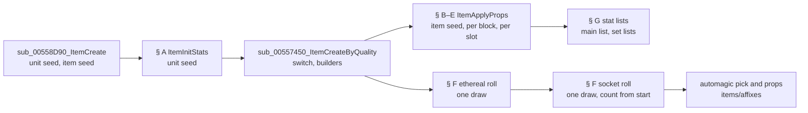
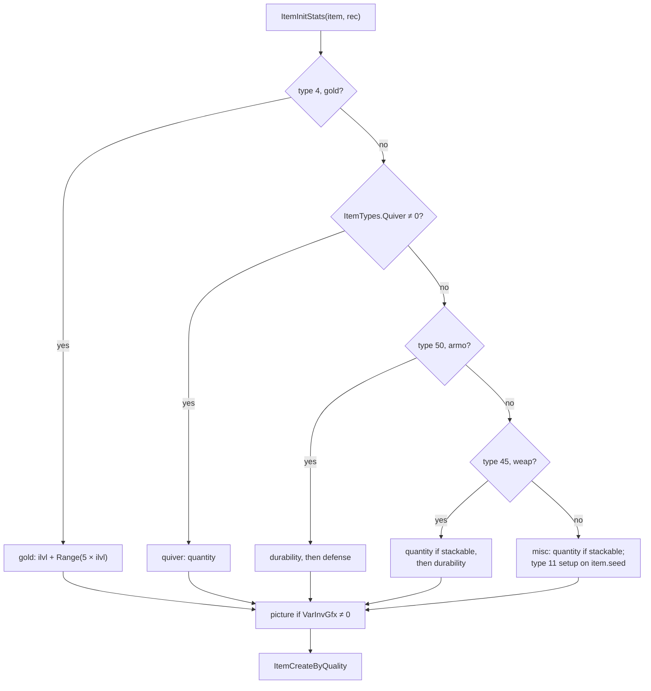
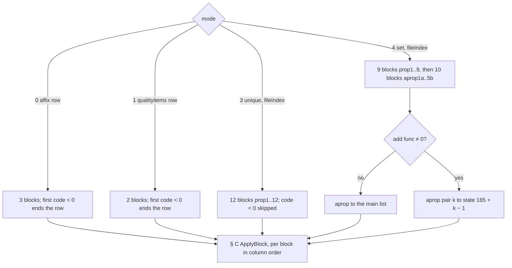
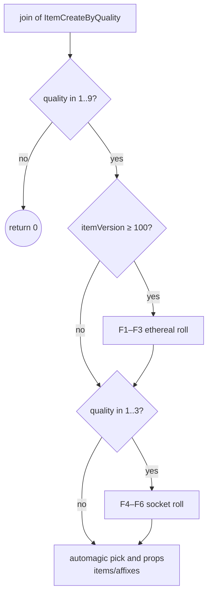
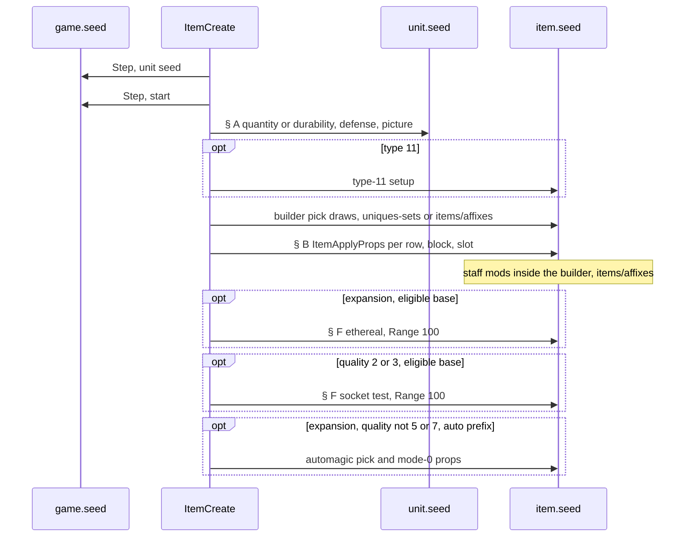

# Base stats and the property roll

## Purpose

Once item creation has a base, this spec says which values the item ends up with and which draws produce them. It
has two halves. **Base stats** (`sub_00557AB0_ItemInitStats`) run before the quality switch and draw on the item
unit's own seed: quantity, durability, defense and the picture. The **property roll**
(`sub_0065FEC0_ItemApplyProps`) runs inside the quality builders and draws on the item seed: it turns a row's
`(code, par, min, max)` blocks into stat-list entries through `Properties` and `ItemStatCost`. After the builder, the
**ethereal** and **socket** rolls take one item-seed draw each. The spec starts where
[items/uniques-sets § A](uniques-sets.md#a-the-item-seed-at-entry) seeds the item and ends with the socket roll.
Which affix, unique or set row is applied is decided upstream: [items/uniques-sets](uniques-sets.md) for uniques
and sets, and [items/affixes](affixes.md) for the magic, rare, superior and automagic rows and the staff mods. Primitives are those of [rng](../rng/README.md).



## Entry points

| When | Function | Tag |
|---|---|---|
| Every created item, before the quality switch | fn:sub_00558D90_ItemCreate@0x00558D90 → fn:sub_00557AB0_ItemInitStats@0x00557AB0 | [C] |
| A builder applies a row: affix (mode 0), `qualityitems` (mode 1), unique (mode 3), set (mode 4) | fn:sub_0065FEC0_ItemApplyProps@0x0065FEC0 | [C] |
| After the builder, expansion items | fn:sub_00556CA0_ItemRollEthereal@0x00556CA0 | [C] |
| After the builder, qualities 1..3 | fn:sub_00556B60_ItemRollSockets@0x00556B60 | [C] |

- [C] On the drop path these callers reach `ItemApplyProps`, with `a2`, `a5` and `a6` 0 in every call: mode 0 from
  `ITEMS_PickMagicAffix` and `ITEMS_BuildRareAffixes` (the affix row) and from `ItemCreateByQuality` for the
  automagic row; mode 1 from `ITEMS_BuildSuperiorPick` (the `qualityitems` row); mode 3 from `ITEMS_BuildUnique` and
  mode 4 from `ITEMS_BuildSetPick` (row from the item's file index). The model reproduced 727 mode-0, 27 mode-1, 60
  mode-3 and 65 mode-4 calls. (fn:ITEMS_PickMagicAffix@0x005C1560, fn:ITEMS_BuildRareAffixes@0x005C1BF0,
  fn:ITEMS_BuildSuperiorPick@0x005C2970, fn:ITEMS_BuildUnique@0x005566B0, fn:ITEMS_BuildSetPick@0x005C25C0,
  run:2026-10-14-props, run:2026-10-14-props-forced,
  [items/0006 § 2](../../findings/items/0006-properties.md#2-sub_0065fec0_itemapplypropsmode-a2-item-row-a5-a6-0x0065fec0))
- [I] Four more callers of `ItemApplyProps` (0x004C0D20, 0x004E6720, 0x004E67D0, 0x0055C2C0) lie outside the
  creation chain, and so does mode 6 (set bonuses, `sub_00660120_SetBonusApply`). Vendors and gambling reach the
  roll through other callers of item creation ([items/vendors](vendors.md)). (fn:sub_00660120_SetBonusApply@0x00660120,
  [items/0006 § 2](../../findings/items/0006-properties.md#2-sub_0065fec0_itemapplypropsmode-a2-item-row-a5-a6-0x0065fec0))

## Inputs

### Tables

| Anchor | Used for |
|---|---|
| tbl:Weapons.txt:durability, tbl:Armor.txt:durability (u8 `+0x112`) | max durability; the current durability draw |
| tbl:Weapons.txt:nodurability | not tested by § A; read through `ItemHasDurability` in § F |
| tbl:Armor.txt:minac, tbl:Armor.txt:maxac | the defense draw; the `ac%` base reset |
| tbl:Armor.txt:block, tbl:Armor.txt:speed | stats 20 and 67 |
| tbl:Weapons.txt:mindam, tbl:Weapons.txt:maxdam, tbl:Weapons.txt:2handmindam, tbl:Weapons.txt:2handmaxdam, tbl:Weapons.txt:minmisdam, tbl:Weapons.txt:maxmisdam | base damage stats; funcs 5, 6, 7 |
| tbl:Weapons.txt:stackable, tbl:Weapons.txt:minstack, tbl:Weapons.txt:maxstack, tbl:Misc.txt:spawnstack | the quantity draw |
| tbl:Weapons.txt:gemsockets, tbl:Weapons.txt:invwidth, tbl:Weapons.txt:invheight, tbl:Misc.txt:hasinv | socket caps (same offsets in [Armor](../../tables/Armor.md) and [Misc](../../tables/Misc.md)) |
| tbl:ItemTypes.txt:VarInvGfx, tbl:ItemTypes.txt:Quiver | the picture draw; the quiver branch |
| tbl:ItemTypes.txt:MaxSock1, tbl:ItemTypes.txt:MaxSock25, tbl:ItemTypes.txt:MaxSock40 | `ItemMaxSockets` by ilvl |
| tbl:UniqueItems.txt:prop1 (12 blocks), tbl:SetItems.txt:prop1 (9), tbl:SetItems.txt:aprop1a (10), tbl:SetItems.txt:add func | the row blocks of modes 3 and 4 |
| tbl:MagicPrefix.txt:mod1code (3 blocks, also MagicSuffix and AutoMagic), tbl:QualityItems.txt:mod1code (2 blocks) | the row blocks of modes 0 and 1 |
| tbl:Properties.txt:func1, tbl:Properties.txt:stat1, tbl:Properties.txt:set1, tbl:Properties.txt:val1 (slots 1..7) | the slot walk |
| tbl:ItemStatCost.txt:ValShift | the stored value's shift |
| tbl:Skills.txt:reqlevel, tbl:Skills.txt:maxlvl | the skill level of funcs 11 and 19 |

- [C] A row's property cells are compiled into 16-byte blocks `{code: i32, par: i32, min: i32, max: i32}`. `code` is
  the `Properties` record index, looked up case-insensitively (`setitems` row 122 `Light` stores 73, the row of
  `light`); a blank code is −1, and so are the 13 commented-out `*code` cells of `uniqueitems`. (struct:PropBlock+0x08,
  fn:EXCEL_FindName@0x006BD3C0, fn:STR_ToLowerN@0x004113C0,
  [items/0006 § 8](../../findings/items/0006-properties.md#8-the-property-code-lookup-is-case-insensitive),
  [Properties § Row identity](../../tables/Properties.md#row-identity))
- [C] The `setitems` blocks are `prop1..9` at `+0x088` and `aprop1a, aprop1b, …, aprop5b` at `+0x118`, pinned
  against `setitems.bin`. (tbl:SetItems.txt:aprop1a, [SetItems § Property block](../../tables/SetItems.md#property-block-plan-0024-phase-1),
  [items/0006 § 2](../../findings/items/0006-properties.md#2-sub_0065fec0_itemapplypropsmode-a2-item-row-a5-a6-0x0065fec0))
- [I] Not read on this path: `ItemStatCost` `op`, `op param`, `op base`, `op stat1..3` and every `Encode`/save column
  (those belong to the save, [save/d2s § J](../save/d2s.md#j-property-list-framing)); `Sets` partial and full
  blocks, `gems` and `runes` (applied when worn or socketed). (fn:PROP_WriteStat@0x0065EA50,
  fn:sub_00660120_SetBonusApply@0x00660120, [items/0006 § 7](../../findings/items/0006-properties.md#7-stat-storage-as-far-as-the-save-needs-it))

### Runtime state

| State | Type | Source |
|---|---|---|
| `unit.seed` | `Seed` at `Unit+0x20` of the item unit | the unit constructor's game-seed draw ([rng/seeds](../rng/seeds.md#algorithm) step 7a) |
| `item.seed` | `Seed` at struct:ItemData+0x04, `{start, 666}` at entry | [uniques-sets § A](uniques-sets.md#a-the-item-seed-at-entry) |
| `item.start` | u32 at struct:ItemData+0x10 | the low word the item seed was initialised from; the socket count reads it |
| `item.quality` | u32 at `ItemData+0x00`; **0** while § A runs on a drop | written by `ItemCreateByQuality` |
| `item.fileIndex` | i32 at `ItemData+0x28` | the unique or set row for modes 3 and 4 |
| `ilvl` | i32 at `ItemData+0x2C`, through `ITEMS_GetItemLevel` (raised to 1) | funcs 11 and 19, the socket bands |
| `itemVersion` | u16 at `ItemData+0x30` | ≥ 100 expansion, 1..99 classic, never 0 on a drop |
| `item.flags` | u32 at `ItemData+0x18` | `0x400000` ethereal, `0x800` socketed |
| `item.gfx` | u8 at `ItemData+0x49` | the picture variant |
| `rec` | the creation record, struct:ItemCreateRec+0x54 (`quantity` override), `+0x44` and `+0x80` (flag bits, § F) | [items/tc § H](tc.md#h-item-pick-and-hand-off) |
| `game.difficulty` | at `Game+0x6D` | the socket difficulty cap |
| `EVD` | i32, the **evaluated** max durability (stat 73 through the stat lists) | read by func 13 and by the ethereal roll; see § G |
| `PACK_SHIFT`, `PACK_MASK` | i32 at `DataTables+0xC6C`, `+0xC70` | func 19's param packing, logged as 6 and 63 |

### Constants

| Name | Value | Anchor | Tag |
|---|---|---|---|
| `N_FUNCS` | 37 handler slots; slots 0 and 25..35 are NULL | data:g_nPropFuncs@0x00745B54, data:g_PropFuncTable@0x007462F8 | [C] |
| `SLOTS` | 7 slots per `Properties` row | fn:PROP_ApplyBlock@0x0065FD70 | [C] |
| `ETH_CHANCE` | `r < 5` of `Range(100)` | fn:sub_00556CA0_ItemRollEthereal@0x00556CA0 | [C] |
| `SOCK_CHANCE` | `r < 33` of `Range(100)` (`cmp 0x21; jl`) | fn:sub_00556B60_ItemRollSockets@0x00556B60 | [C] |
| `SOCK_DIFF_CAP` | 3 / 4 / 6 for Normal / Nightmare / Hell | fn:sub_00556B60_ItemRollSockets@0x00556B60 | [C] |
| `MAX_SOCKETS` | 6 | fn:ITEMS_SetSockets@0x0062BCB0 | [C] |
| `MAIN_LIST` | state 0, flags `0x40` | fn:sub_0065CBF0_PropTargetList@0x0065CBF0 | [C] |
| `SET_LISTS` | states 165..169 (`itemset1..5`), flags `0x2040` | data:g_SetAPropStates@0x006EDB40, data:g_SetAPropListFlags@0x006EDB5C | [C] |
| `STACK_CAP` | 511 for `maxstack` + stat 254 | fn:ITEMS_GetMaxStack@0x006295B0 | [I] |
| `PACK_SHIFT`, `PACK_MASK` | 6, 63 in all 37 logged games (`DataTables+0xC6C`, `+0xC70`) | 0x0065F7E2–0x0065F853, run:2026-10-14-props-forced | [C] |

- [C] Each constant is what `tools/props.py` uses, and the model reproduces 2 281 creations with it, 0 mismatches.
  (run:2026-10-14-props, run:2026-10-14-props-forced, [items/0006 § 9](../../findings/items/0006-properties.md#9-phase-2-reproduction-run2026-10-14-props-run2026-10-14-props-forced))

### Inputs and boundaries

| Input | Kind | Owner | Tag |
|---|---|---|---|
| `EVD`, the evaluated max durability | computed, not an input: own stat 73 + `MulDiv(base 73, dur%, 100)` (§ G); the logged value checks it | this spec, § G | [C] (fn:sub_00626200_StatEvaluate@0x00626200, run:2026-10-14-props-forced) |
| `DataTables+0xC6C`, `+0xC70` | logged once per game: 6 and 63 | data/excel | [C] (fn:PROP_Func19_Charged@0x0065F6A0, run:2026-10-14-props-forced) |
| the `skills` rows funcs 11 and 19 read (`reqlevel`, `maxlvl`) | table values | [Skills](../../tables/Skills.md) | [C] (fn:SKILLS_GetReqLevel@0x00644710, fn:SKILLS_GetMaxLevel@0x004AA8B0, run:2026-10-14-props-forced) |
| the affix, rare-name, automagic and `qualityitems` picks | predicted (row and entry seed) by the items/affixes model chained with this one over the two runs, re-analysis 2026-10-15 ([items/0006 § 9](../../findings/items/0006-properties.md#9-phase-2-reproduction-run2026-10-14-props-run2026-10-14-props-forced)) | [items/affixes § C](affixes.md#c-one-magic-affix-pick--items_pickmagicaffix), [§ F](affixes.md#f-the-superior-builder--items_buildsuperior--items_buildsuperiorpick), [§ J](affixes.md#j-after-the-switch-ethereal-sockets-automagic) | [C] (fn:ITEMS_PickMagicAffix@0x005C1560, run:2026-10-14-props-forced) |
| `ITEMS_RollStaffMods` | seed oracle inside the builders; its `item_singleskill` (107) entries are taken from the log | [items/affixes § I](affixes.md#i-staff-mods--items_rollstaffmods) | [I] (fn:ITEMS_RollStaffMods@0x005C1260, run:2026-10-14-props-forced) |

- [C] Inside `ItemInitStats` and inside every `ItemApplyProps` call, the ethereal roll and the socket roll, the run
  needed **no** ADR-0004 oracle: every draw site is a plain range draw on the unit seed or the item seed, and no
  handler or callee evaluates a `*code.bin` formula ([data/calc](../data/calc.md)). (fn:PROP_RollValue@0x0065E9E0, run:2026-10-14-props,
  run:2026-10-14-props-forced, [items/0006 § Boundary](../../findings/items/0006-properties.md#boundary-for-phase-2-recommendation-the-architect-rules))
- [C] **Both line sets in one log.** With both item loggers in one session, the chained model reproduces 889 creations
  of run:2026-10-15-items-chain from the property lines with every builder modelled, 219 of them end to end from the pick
  (66 `ITEMS_PickMagicAffix` picks, 153 superior `QualityItems` picks), no seed from the log between the pick and the
  property roll. Stock sessions alone: 186 creations, 36 end to end; the rest are ItemRatio-edited sessions (ADR-0010).
  (fn:sub_0065FEC0_ItemApplyProps@0x0065FEC0, run:2026-10-15-items-chain, run:2026-10-15-items-chain-forced,
  [items/0006 § 9](../../findings/items/0006-properties.md#9-phase-2-reproduction-run2026-10-14-props-run2026-10-14-props-forced))
- [I] No func reaches the calc VM: the roll, the writer, the base resets, the skill getters, `ITEMS_GetItemLevel`,
  `sub_00483360_MulDiv` and the stat-list add and set were all read. (0x0065EB30–0x0065FD20,
  fn:sub_00483360_MulDiv@0x00483360, fn:ITEMS_GetItemLevel@0x006281E0)

## Algorithm

All arithmetic is signed 32-bit unless a step says otherwise. Division `÷` truncates toward zero. `Range(s, n)` is
the rng spec's `Range`: one `Step` and `low mod n`, or 0 with **no step** when `n < 1` (signed). `RangeOffset(s, b,
n)` is `b + Range(s, n)`, so it returns `b` with no step when `n < 1`. [I] (fn:RNG_Range@0x0045C390,
fn:RNG_RangeB@0x0045C3E0, fn:RNG_RangeOffset@0x00472280, [rng § Algorithm](../rng/README.md#algorithm))

### A. Base stats on the unit seed



```
us ← unit.seed                                  ; every draw of § A, except A5's type-11 setup
A1. if item.type = 4 (gold):                                                     [C] (0x00557AC1–0x00557B4C, run:2026-10-14-props-forced)
      n: i32 ← rec.ilvl + Range(us, 5 × rec.ilvl)  ; draw (none when 5 × ilvl < 1)
      if n < 1: n ← 1
      if rec.quantity > 0: n ← rec.quantity         ; record +0x54
      base stat 14 ← n
A2. else if ItemTypes[item.type].Quiver ≠ 0:                                     [C] (0x00557D65–0x00557DDA, run:2026-10-14-props-forced)
      lo: i32 ← minstack;  hi: i32 ← min(maxstack + stat254, 511)
      q: i32 ← lo + Range(us, hi − lo)              ; draw (none when hi ≤ lo); spawnstack NOT read
      if q < 1: q ← 1
      if rec.quantity > 0: q ← rec.quantity
      base stat 70 ← q
A3. else if IsType(item, 50 armo):                                                [C] (0x00557C06–0x00557C67, fn:sub_00556360_ItemRollDefense@0x00556360, run:2026-10-14-props, run:2026-10-14-props-forced)
      base stat 20 ← block;  base stat 67 ← −speed
      Durability(us)                                ; draw, see A6
      base stat 31 ← RangeOffset(us, minac, maxac − minac + 1)   ; draw (none when maxac < minac)
A4. else if IsType(item, 45 weap):                                                [C] (0x00557C8D–0x00557D3F, fn:sub_005563D0_ItemSetBaseDamage@0x005563D0, run:2026-10-14-props, run:2026-10-14-props-forced)
      if stackable:
        lo ← minstack;  hi ← min(maxstack + stat254, 511)
        q ← lo + Range(us, hi − lo)                 ; draw (none when hi ≤ lo)
        if rec.quantity > 0: q ← rec.quantity
        if q = 0 or item.quality ∈ 4..9: q ← 1      ; item.quality is 0 here on a drop
        base stat 70 ← q
      Durability(us)                                ; draw, see A6
      base stats 21, 22 ← mindam, maxdam;  23, 24 ← 2handmindam, 2handmaxdam
      base stats 159, 160 ← minmisdam, maxmisdam when maxmisdam ≠ 0
      base stat 68 ← −speed
A5. else (misc):                                                                  [C] (0x00557D65–0x00557DDA, fn:ITEMS_GetSpawnStack@0x00629660, run:2026-10-14-props-forced)
      if stackable:
        lo ← minstack;  hi ← min(maxstack + stat254, 511);  sp ← spawnstack
        top: i32 ← (sp ≥ lo and sp ≠ 0) ? sp : (lo ≤ hi ? hi : lo)
        q ← lo + Range(us, top − lo)                ; draw (none when top ≤ lo)
        if rec.quantity > 0: q ← rec.quantity
        if item.quality ∈ 4..9 or q = 0: q ← 1
        base stat 70 ← q
      if item.type = 11: ItemType11Setup(item)      ; draws on item.seed, not us     [I] (fn:sub_0065E8E0_ItemType11Setup@0x0065E8E0)
A6. Durability(us):                                                               [C] (0x00557C27–0x00557C67, 0x00557CFD–0x00557D3F, run:2026-10-14-props, run:2026-10-14-props-forced)
      d: u8 ← base.durability;  h: u32 ← d >> 1     ; unsigned shift
      cur ← h + Range(us, h)                        ; draw (none when d < 2)
      base stat 72 ← min(cur, 255);  base stat 73 ← d
A7. n ← ItemTypes[item.type].VarInvGfx                                            [C] (0x00557DF7–0x00557E1C, fn:sub_00628420_ItemSetInvGfxVariant@0x00628420, run:2026-10-14-props, run:2026-10-14-props-forced)
    if n ≠ 0: item.gfx ← RangeOffset(us, 0, n) & 0xFF                             ; draw, last of § A
A8. ItemCreateByQuality(game, item, rec)                                          ; uniques-sets § B, then § F here
```

Step notes:

- A1–A7. **The base stats use the unit seed only.** The item seed is untouched by § A, except by the type-11 setup:
  the item seed at the entry of `ItemCreateByQuality` was `{ItemData+0x10, 666}` in every logged creation, and the
  model reproduced all 2 281 base-stat blocks (unit seed, values and picture) over armour 167, weapons 414, misc
  1 106, quivers 115 and gold 478. [C] (fn:sub_00557AB0_ItemInitStats@0x00557AB0, run:2026-10-14-uniques,
  run:2026-10-14-props, run:2026-10-14-props-forced)
- A1–A7. The order per category is fixed: armour draws durability then defense; a weapon draws quantity (stackable
  only) then durability; misc and quivers draw quantity; every category then draws the picture. A range of width
  < 1 draws nothing (`d < 2`, `hi = lo`, `maxac < minac`, `VarInvGfx = 0`). [C] (0x00557AB0–0x00557E21,
  run:2026-10-14-props-forced)
- A2. **Quivers ignore `spawnstack`.** `aqv` spawned with 103..348 and `cqv` with 60..246 arrows or bolts, each
  `minstack + Range(maxstack − minstack)`. [C] (fn:sub_0062E740_ItemTypeQuiver@0x0062E740, tbl:ItemTypes.txt:Quiver,
  run:2026-10-14-props-forced)
- A2, A4, A5. **The quantity draw never reaches its top.** `lo + Range(top − lo)` lies in `[lo, top − 1]`. A misc base
  uses `spawnstack` as the top when it is non-zero and ≥ `minstack`: 29 keys (`minstack` 1, `spawnstack` 6) spawned
  with 1..5. [C] (fn:ITEMS_GetMinStack@0x006296F0, fn:ITEMS_GetMaxStack@0x006295B0, tbl:Misc.txt:spawnstack,
  run:2026-10-14-props-forced)
- A4. The quantity-1 rule for qualities 4..9 never fires on a drop, because the quality is still 0 when § A runs
  (`ItemData` is zeroed at allocation). A rare or magic throwing weapon keeps its drawn quantity. [I]
  (fn:sub_0062A0F0_ItemQualityMagicPlus@0x0062A0F0, [items/0006 § Dead ends](../../findings/items/0006-properties.md#dead-ends))
- A6. **Durability** lies in `[⌊d/2⌋, 2⌊d/2⌋ − 1]` and is never `d` for `d ≥ 2`; max durability is `d`. [C]
  (tbl:Weapons.txt:durability, tbl:Armor.txt:durability, run:2026-10-14-props-forced)
- A6. **`nodurability` is not tested here.** 80 bows, crossbows and throwing potions drew their durability on the unit
  seed (`6hb` 32 → current 26). [C] (tbl:Weapons.txt:nodurability, run:2026-10-14-props-forced)
- A3. **Defense** is inclusive, `[minac, maxac]`, drawn after durability. [C] (fn:sub_00556360_ItemRollDefense@0x00556360,
  tbl:Armor.txt:minac, run:2026-10-14-props-forced)
- A3–A6. Defense, damage, block, speed, quantity and durability are written as the unit's **base stats**
  (`sub_00627260_UnitSetStat`), not into the property list. [C] (0x00557C06, 0x005563D0, run:2026-10-14-props-forced)
- A5. The type-11 setup was not reached in any run. [I] (fn:sub_0065E8E0_ItemType11Setup@0x0065E8E0)

### B. ItemApplyProps: modes and blocks



```
B1. ItemApplyProps(mode, item, row):          ; a2 = a5 = a6 = 0 on the drop path                    [C] (fn:sub_0065FEC0_ItemApplyProps@0x0065FEC0, run:2026-10-14-props, run:2026-10-14-props-forced, all of B1–B4)
B2. mode 3:
      if item.fileIndex < 0 or UniqueItems[item.fileIndex] = none: return
      for k in 0 ..< 12: ApplyBlock(3, item, u.prop[k], state 0, flags 0x40)
      return
B3. mode 4:
      s ← SetItems[item.fileIndex];  if s = none: return
      for k in 0 ..< 9: ApplyBlock(4, item, s.prop[k], 0, 0x40)
      for k in 0 ..< 10:                      ; aprop1a, aprop1b, aprop2a, …, aprop5b
        pair: i32 ← k ÷ 2                     ; 0..4
        if s.addFunc ≠ 0: ApplyBlock(4, item, s.aprop[k], 165 + pair, 0x2040)
        else:             ApplyBlock(4, item, s.aprop[k], 0, 0x40)
      return
B4. modes 0 and 1:
      n ← 3 (mode 0) or 2 (mode 1)
      for i in 0 ..< n:
        b ← row.block[i]                     ; affix record +0x24 + 16i; qualityitems +0x0C + 16i
        if b = none or b.code < 0: return    ; the first blank block ends the row
        ApplyBlock(mode, item, b, 0, 0x40)
```

Step notes:

- B2–B4. **Skip versus stop.** In modes 3 and 4 a block with `code < 0` is skipped (§ C tests it); in modes 0 and 1
  it ends the row. The affix tables, `qualityitems` and `uniqueitems` have no used block after a blank one, so on stock
  data the two differ only for the −1 blocks of the commented-out unique codes. [C] (0x0065FF17, 0x0065FF72,
  fn:sub_0065C660_AffixPropBlock@0x0065C660, fn:sub_0065C730_PropBlockGet@0x0065C730, run:2026-10-14-props-forced)
- B3. **`aprop` blocks are rolled at creation**, with the same handlers and item-seed draws as the `prop` blocks.
  Three *Civerb's Cudgel* (`add func` blank) put `aprop1a` `dmg/lvl` in the main list (Worked example 6); rows with
  `add func` 1 or 2 put theirs in the lists of state 165 and up (103 slots). [C] (0x0065FFD2–0x00660027,
  data:g_SetAPropStates@0x006EDB40, tbl:SetItems.txt:add func, run:2026-10-14-props-forced)
- B3. On stock data, 82 set rows with `add func` 1 or 2 carry `aprop`s, and two rows with it blank carry one
  (`Civerb's Cudgel` `dmg/lvl`, `Trang-Oul's Claws` `extra-pois`). The code distinguishes only 0 from non-zero; what 1
  and 2 change happens when the item is worn. [I] (0x0065FFE3, tbl:SetItems.txt:add func)
- B3. **When worn** ([stats/aggregate § J](../stats/aggregate.md#j-set-bonuses)): `add func` 1 switches the list of
  pair *k* on while the member it names is worn, `add func` 2 while *k* other members are worn; the wearer also gets
  one list per set from the `Sets` partial and full blocks. 19 525 toggles and 5 569 wearer lists were predicted.
  [C] (fn:SETS_ToggleItemAProps@0x00663A20, fn:sub_00660120_SetBonusApply@0x00660120, run:2026-10-17-stats)
- B3. The save writer marks a set item's lists by the same five states, which is the second code path for the
  state numbers. [C] (0x006E90B8, data:g_SetAPropStates@0x006EDB40, [save/d2s § J](../save/d2s.md#j-property-list-framing))
- B1. **Version 0** sends each block to `g_PropFuncTableV0[code]` and applies only 2 set blocks. No drop creates an
  item of version 0. [I] (fn:PROP_ApplyBlockByVersion@0x0065FE10, data:g_PropFuncTableV0@0x00745B58)

### C. One block: the slot walk

```
C1. ApplyBlock(mode, item, b, state, flags):                                      [C] (fn:PROP_ApplyBlock@0x0065FD70, run:2026-10-14-props, run:2026-10-14-props-forced, all of C1–C3)
      if b.code < 0: return
      p ← Properties[b.code]                 ; g_pProperties, 0x2E-byte records
C2.   prev: i32 ← 0
      for k in 0 ..< 7:
        f ← p.func[k]
        if f ≥ 37 or Handler[f] = none: return          ; func 0 (blank) ends the walk
        r: i32 ← Handler[f](mode, item, b, p.set[k], p.stat[k], p.val[k], prev, state, flags)
C3.     if k = 0: prev ← r                   ; slot 1's return value, handed to slots 2..7 unchanged
```

Step notes:

- C2. Every `Properties` row fills its slots from slot 1 without a gap, so on stock data the walk covers exactly the
  used slots. [C] (tbl:Properties.txt:func1, [Properties § Interpretation notes](../../tables/Properties.md#interpretation-notes),
  run:2026-10-14-props-forced)
- C3. **prev** is slot 1's return value, 0 for slot 1 itself. A handler that writes nothing returns 0, so a later
  "reuse" slot then rolls its own value. For `res-all`, `all-stats`, `dmg-elem-min` and `dmg-elem-max`, slot 1
  (func 1) draws once and slots 2..4 (func 3) reuse the value unless slot 1 rolled 0. [C] (0x0065FDF7–0x0065FDFB,
  run:2026-10-14-props-forced)
- C2. The table pointer and count are `DataTables+0xA4` and `+0xAC`; the loader stores them at `0x0096BCD4` and
  `0x0096BCDC`. [C] (data:g_pProperties@0x0096BCD4, data:g_nProperties@0x0096BCDC,
  fn:sub_00638630_LoadProperties@0x00638630)

### D. The value roll and the stat writer

```
D1. Roll(item, b) → i32:                      ; PROP_RollValue(min, max)                        [C] (fn:PROP_RollValue@0x0065E9E0, run:2026-10-14-props, run:2026-10-14-props-forced)
      if b.max = b.min: return b.min          ; NO draw
      lo ← min(b.min, b.max);  hi ← max(b.min, b.max)        ; signed compare
      return lo + Range(item.seed, hi − lo + 1)               ; draw
D2. Write(item, stat, param, v, set, state, flags) → i32:   ; PROP_WriteStat                    [C] (fn:PROP_WriteStat@0x0065EA50, run:2026-10-14-props-forced)
      if v = 0 or stat invalid: return 0      ; nothing written
      list ← TargetList(item, state, flags)   ; found or created and attached
      x: i32 ← v << ItemStatCost[stat].ValShift
      if set ≠ 0: SetStat(list, stat, param, x) else AddStat(list, stat, param, x)
      if stat = 58:                           ; poisonmaxdam
        if set ≠ 0: SetStat(list, 326, 0, 1) only if 326 is absent
        else:        AddStat(list, 326, 0, 1)
      return v
D3. Reset(item, stat):                        ; PropBaseReset, on the unit's base stats          [C] (fn:sub_0065CCC0_PropBaseReset@0x0065CCC0, 0x0065CCDF–0x0065CD42, run:2026-10-14-props-forced)
      stat 16 or 31, armour with maxac ≠ 0: base stat 31 ← max(base 31 + 1, maxac + 1)
      stat 17 or 22, weapon: base 22, 24 (and 160 if throwable) ← maxdam, 2handmaxdam, maxmisdam
      stat 18 or 21, weapon: base 21, 23 (and 159 if throwable) ← mindam, 2handmindam, minmisdam
      any other stat: nothing
```

Step notes:

- D1. Every per-func draw except func 19's is this roll, on the item seed for every drop-path call. A reversed pair is
  swapped, so the draw range is `|max − min| + 1`. [C] (fn:PROP_RollValue@0x0065E9E0, run:2026-10-14-props-forced)
- D2. `AddStat` adds to the existing `(stat, param)` entry and removes an entry that reaches 0; `SetStat` replaces
  it. The only `Properties` row with `set` = 1 is `color`. [C] (fn:STATLIST_AddStat@0x00627030,
  fn:STATLIST_SetStat@0x00627150, tbl:Properties.txt:set1, run:2026-10-14-props-forced)
- D2. `ValShift` is 8 for the `hitpoints`/`mana`-type stats and 0 elsewhere: a rare `maxmana` roll of 14 is stored
  as 3 584 (Worked example 5). [C] (tbl:ItemStatCost.txt:ValShift, 0x0065EAB7–0x0065EB05, run:2026-10-14-props-forced)
- D3. **The `ac%` reset accumulates.** Each func-2 block on armour sets the base defense to `max(defense + 1, maxac +
  1)`: `maxac + 1` after one `ac%` block, `maxac + 2` after a second (a set item with `ac%` in a `prop` and an
  `aprop`). [C] (0x0065CCC0, run:2026-10-14-props-forced)

### E. The handlers per func

Notation: `Roll` is D1 on the block; `W(stat, param, v)` is D2 with the slot's `set`, `state` and `flags`;
`Reset` is D3 on the slot's stat; `v ← prev or Roll` means `v ← prev` when `prev ≠ 0`, else `Roll` (the draw happens
only then).

| func | handler | draws on the item seed | writes | Tag |
|---:|---|---|---|---|
| 1 | fn:PROP_Func01_Roll@0x0065EB30 | `Roll` | `Reset` when mode = 1; `W(stat, 0, v)` | [C] |
| 2 | fn:PROP_Func02_RollAcPercent@0x0065EBA0 | `Roll` | `Reset` in every mode; `W(stat, 0, v)` | [C] |
| 3 | fn:PROP_Func03_Reuse@0x0065EC10 | `v ← prev or Roll` | `Reset` when mode = 1; `W(stat, 0, v)` | [C] |
| 4 | fn:PROP_Func04_ReuseReset@0x0065EC80 | as 3 | `Reset` in every mode; as 3. No row uses it | [I] |
| 5 | fn:PROP_Func05_DmgMin@0x0065ECF0 | `v ← prev or Roll` | E1 (min damage) | [C] |
| 6 | fn:PROP_Func06_DmgMax@0x0065EE80 | `v ← prev or Roll` | E1 (max damage) | [C] |
| 7 | fn:PROP_Func07_DmgPercent@0x0065F010 | `v ← prev or Roll` | E2 | [C] |
| 8 | fn:PROP_Func08_Reuse@0x0065F2B0 | `v ← prev or Roll` | `W(stat, 0, v)` | [C] |
| 9 | fn:PROP_Func09_SkillParam@0x0065F310 | as 8 | `W(stat, par, v)` when `par` is a skill id. No row uses it | [I] |
| 10 | fn:PROP_Func10_SkillTab@0x0065F3F0 | `v ← prev or Roll` | `W(stat, par mod 3 + (par ÷ 3) × 8, v)` | [C] |
| 11 | fn:PROP_Func11_SkillOnEvent@0x0065F470 | **none** | E3: `W(stat, par × 64 + (L & 63), chance)` | [C] |
| 12 | fn:PROP_Func12_SkillRand@0x0065FC40 | `Roll` | `W(stat, param = v, value = par)` | [I] |
| 13 | fn:PROP_Func13_DurPercent@0x0065FC90 | `Roll` | `Reset` when mode = 1; `W(stat, 0, v)`; if written, base stat 72 ← `EVD` | [C] |
| 14 | fn:PROP_Func14_Sockets@0x0065F590 | E5 | E5 | [C] |
| 15 | fn:PROP_Func15_Min@0x0065F960 | none | `v ← min`; stat 21 → E1 as func 5 with prev = v, else `W(stat, 0, v)` | [C] |
| 16 | fn:PROP_Func16_Max@0x0065F9D0 | none | `v ← max`; stat 22 → E1 as func 6, else `W(stat, 0, v)` | [C] |
| 17 | fn:PROP_Func17_Par@0x0065FA40 | `Roll` only when `par` = 0 | `v ← par`; stat 22 → E1 as func 6, else `W(stat, 0, v)` | [C] |
| 18 | fn:PROP_Func18_ByTime@0x0065F870 | none | E6. Not reached on the drop path | [I] |
| 19 | fn:PROP_Func19_Charged@0x0065F6A0 | **one** `Range(c − c ÷ 8)` | E4 | [C] |
| 20 | fn:PROP_Func20_Indestructible@0x0065FAE0 | none | `AddStat(list, 152, 0, 1)` | [C] |
| 21 | fn:PROP_Func21_ValParam@0x0065FB50 | `Roll` | `W(stat, val, v)` (the class or element in `val1`) | [C] |
| 22 | fn:PROP_Func22_SkillParam@0x0065FBF0 | `Roll` | `W(stat, (u16) par, v)` | [C] |
| 23 | fn:PROP_Func23_Ethereal@0x0065FD20 | none | if not ethereal and `ItemHasDurability`: `ITEMS_MakeEthereal` (§ F) | [I] |
| 24 | fn:PROP_Func24_ParParam@0x0065F390 | `v ← prev or Roll` | `W(stat, par, v)` | [I] |
| 36 | fn:PROP_Func36_RandClassSkill@0x0065FBA0 | `Roll` | `W(stat, param = v, value = val)` | [I] |

- [C] The handler of func *f* is the word at `0x007462F8 + 4f`; slots 0 and 25..35 are NULL. The run reached funcs 1,
  2, 3, 5, 6, 7, 8, 10, 11, 13, 14, 15, 16, 17, 19, 20, 21 and 22 (2 279 slots), every one reproduced. Funcs 12, 18,
  23, 24 and 36 were not reached, and no drop-path row uses 4 or 9; their rows stay inferred. (data:g_PropFuncTable@0x007462F8,
  run:2026-10-14-props-forced, [Properties § Survey](../../tables/Properties.md#survey-the-codes-the-item-tables-use))
- [C] **Funcs 1 and 13 roll in mode 1 too.** Superior `att` rolled 1..3 over 11 items and superior `dur%` 10..15 over
  15 items, never their maximum; the mode-1 `Reset` has no case for stats 19 and 75. (fn:PROP_Func01_Roll@0x0065EB30,
  fn:PROP_Func13_DurPercent@0x0065FC90, run:2026-10-14-props-forced)
- [C] **Func 2 rolls `ac%` in every mode** (0, 1, 3 and 4 logged); what goes to its maximum is the base defense
  (`maxac + 1`, D3), not the stat. (fn:PROP_Func02_RollAcPercent@0x0065EBA0, run:2026-10-14-props-forced)
- [C] Funcs 15, 16 and 17 (the damage pairs and `…/lvl` codes) never draw, except func 17 with `par` 0. A `dmg-norm`
  block whose `min` is 0 hands prev 0 to func 5, which then rolls. (0x0065FD70, run:2026-10-14-props-forced)
- [I] **Funcs 12 and 36 put the roll in the param.** `skill-rand` (*Ormus' Robes*, `36..60`, `par` 3) writes
  `item_singleskill` with a random skill id as param and value `par`; `randclassskill` (*Hellfire Torch*, `0..6`,
  `val1` 3) writes `item_addclassskills` with a random class as param and value `val`.
  (fn:PROP_Func12_SkillRand@0x0065FC40, fn:PROP_Func36_RandClassSkill@0x0065FBA0, tbl:Properties.txt:val1)
- [I] Func 10's param packs the class in bits 3 and up and the tab in bits 0–1. (fn:PROP_Func10_SkillTab@0x0065F3F0)

**E1. Funcs 5 and 6, damage by base column.**

```
E1. b1 ← base 1-hand column, b2 ← 2-hand column, bt ← throw column    ; mindam/2handmindam/minmisdam (5), max… (6)   [C] (fn:PROP_Func05_DmgMin@0x0065ECF0, fn:PROP_Func06_DmgMax@0x0065EE80, run:2026-10-14-props-forced)
    s1, s2, st ← 21, 23, 159 (func 5) or 22, 24, 160 (func 6)
    write s1 unless the item is a weapon with b1 = 0 and b2 ≠ 0
    write s2 unless the item is a weapon with b2 = 0 and b1 ≠ 0
    write st unless the item is a non-throwable weapon
    each write: x ← v; if the column c ≠ 0 and c + v ≤ 0: x ← 1 − c (func 5) or −c (func 6)
                W(s, 0, x)
    return v                                                         ; unclamped
```

- [C] A non-weapon writes all three stats; a one-hand weapon writes only the one-hand and (if throwable) the throw
  stat. *Civerb's Cudgel* `dmg-max` wrote stat 22 only (Worked example 6), the rare `bal` `dmg-min` wrote 21 and 159
  (Worked example 3). (fn:PROP_Func06_DmgMax@0x0065EE80, run:2026-10-14-props, run:2026-10-14-props-forced)
- [I] The clamp is not reached on stock data: no drop-path `dmg-min` or `dmg-max` block is negative in
  `uniqueitems`, `setitems`, the three affix tables or `qualityitems` (data check of the run). (0x0065EE80,
  run:2026-10-14-props-forced)

**E2. Func 7, `dmg%`.**

```
E2. v ← prev or Roll                                                                   [C] (fn:PROP_Func07_DmgPercent@0x0065F010, 0x0065F200–0x0065F296, run:2026-10-14-props, run:2026-10-14-props-forced)
    if the item is a weapon:
      base 21..24, 159, 160 ← their base columns (as D3, all six)
      m ← max(maxdam, 2handmaxdam)
      t ← MulDiv(m, v, 100)
      if t ≤ 0: E1 as func 6 with v = 1; return                 ; +1 max damage, no percent stat     [I] (fn:sub_00483360_MulDiv@0x00483360)
    W(18, 0, v); W(17, 0, v)                                     ; 18 first, then 17
```

- [I] The reset of the damage columns matters only when something changed them before in the same item, for example a
  block placed after `ethereal`; every stock `ethereal` unique has `dmg%` first. The +1 fallback was not reached in the
  runs. (0x0065F010, run:2026-10-14-props-forced)
- [C] `MulDiv` is signed and truncates toward zero, so for the positive operands here `t = ⌊m · v / 100⌋` and the
  fallback fires exactly when `m · v < 100`. (fn:sub_00483360_MulDiv@0x00483360, run:2026-10-15-mon-stats,
  [monsters/stats § A](../monsters/stats.md#a-muldiv-and-monlvlstats))

**E3. The skill level `L` of funcs 11 and 19.**

```
E3. sk ← SKILLS_GetRecord(par); if none: write nothing, draw nothing, return 0          [C] (0x0065F4B9–0x0065F54F, fn:SKILLS_GetReqLevel@0x00644710, fn:SKILLS_GetMaxLevel@0x004AA8B0, run:2026-10-14-props-forced)
    req ← sk.reqlevel;  cap ← sk.maxlvl, or 20 when < 1
    if b.max > 0:  L ← b.max
    if b.max = 0:  t ← (ilvl − req) ÷ 4 + 1;  L ← min(max(t, 1), cap)
    if b.max < 0:  step ← max(1, −(max(99 − req, 1) ÷ b.max))
                   L ← (ilvl − req) ÷ step;  if L ≤ 0: L ← 1          ; no cap
    func 11: chance ← b.min, or 5 when ≤ 0;  W(stat, par × 64 + (L & 63), chance)
```

- [C] The divisions are signed and truncate toward zero (the `÷ 4` is `cdq; and edx,3; add; sar 2`). All 25 func-11
  slots and 15 func-19 slots reproduced. (0x0065F4B9–0x0065F54F, fn:SKILLS_GetRecord@0x0045C4B0,
  run:2026-10-14-props-forced)

**E4. Func 19, `charged`.**

```
E4. L as E3
    c: i32 ← b.min;  if c = 0: c ← 5                                                    [C] (0x0065F7E2–0x0065F853, fn:PROP_Func19_Charged@0x0065F6A0, run:2026-10-14-props-forced)
    if b.min < 0: c ← −b.min + (−b.min × L) ÷ 8
    c ← clamp(c, 1, 255)
    r ← Range(item.seed, c − c ÷ 8)                             ; the width is ≥ 1 for c ≥ 1: always one draw
    value ← ((r + 1 + c ÷ 8) & 0xFF) + c × 256                  ; current charges low, maximum high
    param ← (par << PACK_SHIFT) + (L & PACK_MASK)
    SetStat(list, stat, param, value)                           ; set directly, no ValShift, not through D2
```

- [C] **The multiplier is the skill level, not the item level.** All 204 `charged` rows of `magicsuffix` have `min`
  < 0 and `max` < 0, so `L` comes from the ilvl through E3; the current charges lie in `[c ÷ 8 + 1, c]`. 13 magic
  suffixes and 2 uniques reproduced (Worked example 5). (fn:PROP_Func19_Charged@0x0065F6A0, tbl:MagicSuffix.txt:mod1code,
  run:2026-10-14-props-forced)

**E5. Func 14, `sock`.**

```
E5. cap ← min(6, invwidth × invheight);  if cap = 0: return 0                  ; before any draw   [C] (fn:PROP_Func14_Sockets@0x0065F590, fn:sub_0062BC20_ItemMaxSockets@0x0062BC20, run:2026-10-14-props-forced)
    cap ← min(cap, ItemMaxSockets(item))                                       ; § F, F5
    n ← prev if prev ≥ 1, else Roll                                            ; draw unless prev ≥ 1
    if n < 1: n ← par
    if cap < 1: return                                                         ; AFTER the draw, nothing written
    set item.flags 0x800;  base stat 194 ← min(max(n, 1), cap)
```

- [C] Unlike the socket roll of § F, no quality clamp applies; 6 `sock` slots reproduced. A `sock` block on a base whose
  `ItemMaxSockets` is 0 (the draw with nothing written) was not reached. (fn:PROP_Func14_Sockets@0x0065F590,
  run:2026-10-14-props-forced)

**E6. Func 18, `ac/time`.**

- [I] No draw. The value is `((max + 256) × 1024 + (min + 256)) × 4 + par`, with each `+ 256` term clamped to
  `[0, 1023]` and `par` to `[0, 3]`, set directly with param 0. Only two `spawnable` 0 `magicsuffix` rows name it, so no
  drop reaches it. (fn:PROP_Func18_ByTime@0x0065F870, [Properties § Survey](../../tables/Properties.md#survey-the-codes-the-item-tables-use))

### F. Ethereal and sockets



```
F1. if itemVersion ≥ 100: EtherealRoll(item, rec)                                    [C] (0x00557943–0x005579A3, run:2026-10-14-props, run:2026-10-14-props-forced)
    if quality ∈ 1..3: SocketRoll(game, item, rec)
EtherealRoll:                                                                       (fn:sub_00556CA0_ItemRollEthereal@0x00556CA0)
F2. if rec+0x80 & 0x02: return                                                       [I] (0x00556CA0)
    if not (IsType(item, 45) or IsType(item, 50)): return                            [C] (fn:sub_00629930_ItemHasDurability@0x00629930, run:2026-10-14-props-forced, all of F2–F3)
    if not ItemHasDurability(item) or quality ∈ {1, 5} or base.quest: return
    r ← Range(item.seed, 100)                                                        ; draw
F3. if (rec+0x80 & 0x04) or (rec+0x44 & 0x400000) or r < 5:
      ITEMS_MakeEthereal(item)          ; flag 0x400000; weapon: base 21..24, 159, 160 ← (x × 3) ÷ 2; else base 31 ← (x × 3) ÷ 2
      if ItemHasDurability(item):
        base stat 73 ← base73 ÷ 2 + 1;  base stat 72 ← EVD
SocketRoll:                                                                         (fn:sub_00556B60_ItemRollSockets@0x00556B60)
F4. if quality < 2 or not base.hasinv or base.stackable: return                      [C] (0x00556B60, fn:ITEMS_GetStartSeed@0x00627DF0, run:2026-10-14-props, run:2026-10-14-props-forced, all of F4–F6)
    cap ← ItemMaxSockets(item);  if cap = 0: return
    cap ← min(cap, 3 / 4 / 6 by game.difficulty)
    if itemVersion < 100 and IsType(item, 3 tors): return                            ; [I] no draw (0x00556C0F)
    r ← Range(item.seed, 100)                                                        ; draw
    if rec+0x80 & 0x08: return                                                       ; [I] tested after the draw (0x00556C0F)
    if rec+0x80 & 0x10: r ← 0
F5. ItemMaxSockets(item) = min(gemsockets, MaxSock1 if ilvl ≤ 25, MaxSock25 if ilvl ≤ 40, else MaxSock40)
F6. if (rec+0x44 & 0x800) or r < 33:
      set item.flags 0x800
      ITEMS_SetSockets(item, item.start mod cap + 1)       ; u32 mod, NOT a draw
      ; SetSockets: n ← min(n, 6, invwidth × invheight, ItemMaxSockets); base stat 194 ← n
```

Step notes:

- F1. **Order.** The ethereal roll runs only in an expansion game and before the socket roll; the socket roll runs for
  qualities 1..3, and low quality (1) fails its first test. The automagic pick
  ([items/affixes § J](affixes.md#j-after-the-switch-ethereal-sockets-automagic)) follows both. [C]
  (0x00557943–0x00557A0C, fn:sub_00557450_ItemCreateByQuality@0x00557450, run:2026-10-14-props-forced)
- F2. **Who can be ethereal.** Weapons and armour with durability, not low (1) or set (5), not a quest base. Uniques
  can; set items never are; bows and indestructible bases are excluded by `ItemHasDurability` (`nodurability`, stat
  152). 375 eligible drops drew: 15 with `r < 5` became ethereal, 360 did not. [C] (fn:sub_00629930_ItemHasDurability@0x00629930,
  run:2026-10-14-props-forced)
- F3. The ×3/2 applies to the base stats as the builder left them, so an `ac%` armour is multiplied from `maxac + 1`.
  The durability becomes `⌊max/2⌋ + 1` and the current durability the evaluated max. [C]
  (fn:ITEMS_MakeEthereal@0x0065E4D0, run:2026-10-14-props-forced)
- F2–F3. The ethereal roll tests the record's skip bit before its draw and its forced bits after it; the socket roll
  draws before testing its skip bit. The forced bits `rec+0x80 & 0x04` / `& 0x10` are the resolver's upgrade bits,
  never set with stock data. [I] (0x00556C0F, 0x00556D07, struct:ItemCreateRec+0x80,
  [items/tc § H](tc.md#h-item-pick-and-hand-off))
- F3. **An `ethereal` unique can be made ethereal twice.** Func 23 makes the item ethereal without touching durability;
  the roll then tests the record bits, not the item flag. A unique whose `indestruct` follows its `ethereal` has no
  durability and does not draw (*Ethereal Edge*, *Ghostflame*, *Shadowkiller*); *Wraithflight* (`7gl`, durability 16,
  no `indestruct`) draws, and with `r < 5` gets a second ×3/2 and halved durability. Not reached in the runs. [I]
  (fn:PROP_Func23_Ethereal@0x0065FD20, fn:sub_00556CA0_ItemRollEthereal@0x00556CA0)
- F6. **The socket count is not drawn.** It is `item.start mod cap + 1`, where `item.start` is the low word the item
  seed was initialised from. All 29 socketed drops had that count; the difficulty cap clamped `ItemMaxSockets` in
  expansion Normal (3) and classic Nightmare (4), and Hell drops reached 6. 88 draws: 29 socketed, 59 not. [C]
  (fn:ITEMS_GetStartSeed@0x00627DF0, fn:ITEMS_SetSockets@0x0062BCB0, run:2026-10-14-props-forced)
- F5. **ilvl 40 uses `MaxSock25`** (`cmp 0x28; jg`). [C] (0x0062BC8C, fn:sub_0062BC20_ItemMaxSockets@0x0062BC20,
  tbl:ItemTypes.txt:MaxSock25, run:2026-10-14-props-forced)
- F6. `ITEMS_SetSockets` also has quality clamps (magic ≤ 4, rare ≤ 2, crafted ≤ 3, set and unique special); they do
  not apply to qualities 2 and 3, the only ones that reach it from here. [I] (0x0062BC61–0x0062BCA6) The setter is
  read in full, with the load setter that keeps a count above these clamps, in
  [items/sockets-runewords § F](sockets-runewords.md#f-socket-counts-the-two-setters); filling the sockets and the
  runeword are [items/sockets-runewords](sockets-runewords.md).
- F4. Classic body armour (`tors`, item version < 100) makes no socket draw; not reached in the runs. [I] (0x00556C0F)

### G. Stat storage

- [C] **Two kinds of destination.** § A, the resets of D3, ethereal and the socket count write the unit's base stats.
  Every property write goes through D2 to the **main list** (state 0, flags `0x40`), except the `aprop` blocks of a
  set row with `add func` ≠ 0, which go to the lists of state 165..169 (flags `0x2040`). These are the lists the save
  writes. The final lists of 2 264 items matched at the return of `ItemCreateByQuality`. (fn:sub_0065CBF0_PropTargetList@0x0065CBF0,
  fn:sub_00625790_UnitFindStatList@0x00625790, run:2026-10-14-props-forced, [save/d2s § J](../save/d2s.md#j-property-list-framing))
- [C] **`op` is not applied at creation.** No handler and not the writer read `op`, `op param`, `op base` or
  `op stat1..3`; the lists reproduce with no `op` applied. A `…/lvl` property stores its raw `par` (Civerb's `dmg/lvl`
  8, stat 218); the per-level value is an evaluation-time view. (fn:PROP_WriteStat@0x0065EA50, run:2026-10-14-props-forced)
- [C] `op` reaches creation only through `EVD`, which func 13 and the ethereal roll read through
  `sub_00625E00_ItemMaxDurability`: the item's cached value of stat 73, re-evaluated whenever stat 73 or a stat that
  feeds it changes. The evaluation adds to the own value one term per `op` input of the stat; for stat 73 the only one
  is op 13 from stat 75 (`dur%`), so on an item `EVD = own 73 + MulDiv(base 73, dur%, 100)`, which is
  `max + ⌊max × dur% / 100⌋` for the positive values of a drop. The model predicts all 15 func-13 values and all 15
  ethereal halvings of the run (re-analysis 2026-10-15). (fn:sub_00626200_StatEvaluate@0x00626200, 0x00626626–0x00626662,
  fn:sub_00625E00_ItemMaxDurability@0x00625E00, tbl:ItemStatCost.txt:op, run:2026-10-14-props-forced)
- [C] Funcs 18, 19 and 20 bypass `ValShift`; their stats have `ValShift` 0. (0x0065EAB7–0x0065EB05,
  tbl:ItemStatCost.txt:ValShift, run:2026-10-14-props-forced)
- [C] **The saved stats.** Three drops saved by *Save and Exit* in the run (`7cm` rare, `brs` unique, `cqv`) hold their
  logged main lists (value `>> ValShift`), defense, durability, quantity and flags when read back by `tools/d2s.py`.
  (fn:PROP_WriteStat@0x0065EA50, run:2026-10-14-props-forced, [save/d2s § J](../save/d2s.md#j-property-list-framing))

### H. RNG call sequence



```
H1. game.seed: unit seed, then item.start; item.seed ← {start, 666}            [C] (fn:sub_00552E90_ItemSeedInit@0x00552E90, run:2026-10-14-props-forced)
H2. unit.seed: § A, per category (A1–A7); nothing else in creation steps it     [C] (fn:sub_00557AB0_ItemInitStats@0x00557AB0, run:2026-10-14-props-forced)
H3. item.seed: type-11 setup (type 11 only)                                     [I] (fn:sub_0065E8E0_ItemType11Setup@0x0065E8E0)
H4. item.seed: the builder's pick draws and its ItemApplyProps calls, in the order its spec gives   [C] (fn:sub_00557450_ItemCreateByQuality@0x00557450, run:2026-10-14-props-forced)
      unique / set: one pick draw, then mode 3 / 4         (uniques-sets C5, D3)
      magic, rare: affix picks and mode-0 calls; on a rare all pick draws precede all property draws
      superior: qualityitems row draws, then mode 1
      then the staff mods, inside the builder after its last ItemApplyProps (items/affixes § I)
      a failed builder: reseed {S, 666}, then the fallback builder (uniques-sets E)
    within one call: blocks in § B order, slots in § C order, draws per § E
H5. item.seed: ethereal Range(100)        (F2: expansion, eligible base)
H6. item.seed: socket Range(100)          (F4: quality 2 or 3, eligible base); the count draws nothing
H7. item.seed: the automagic pick and its mode-0 ItemApplyProps (items/affixes § J)
```

Step notes:

- H4–H7. The item seed is drawn in this order in every logged creation: the item seed after each `ItemApplyProps`
  call, after the ethereal roll and after the socket roll matched the model, 2 281 creations, 0 mismatches. [C]
  (0x00557943–0x00557A0C, run:2026-10-14-props, run:2026-10-14-props-forced)
- H4. Magic: each pick applies its own row, so prefix draws, prefix properties, suffix draws, suffix properties
  ([items/affixes § D](affixes.md#d-the-magic-builder--items_buildmagic)). Rare: all picks first, then the property
  calls interleaved prefix *k*, suffix *k* for *k* = 0..2 ([items/affixes § E](affixes.md#e-the-rare-builder--items_buildrare--items_buildrareaffixes), items/0005 § 6). [C] (fn:ITEMS_BuildRareAffixes@0x005C1BF0, run:2026-10-14-affixes,
  [items/0005](../../findings/items/0005-affixes.md))
- H4. The staff mods advance the item seed after the builder's last `ItemApplyProps` and add an `item_singleskill`
  (107) entry to the main list; they are specified in [items/affixes § I](affixes.md#i-staff-mods--items_rollstaffmods),
  and `tools/props.py` takes that span from the log. [I] (fn:ITEMS_RollStaffMods@0x005C1260,
  run:2026-10-14-props-forced)
- H1–H7. The plan 0019 logs, rerun with the property oracle replaced by this model, still reproduce: 304 + 1 519
  creations, the item seed after 77 unique and 28 set rolls predicted from the tables alone. [C]
  (fn:sub_0065FEC0_ItemApplyProps@0x0065FEC0, run:2026-10-14-uniques, run:2026-10-14-uniques-forced,
  run:2026-10-14-props-forced)

## Outputs

| Output | Where | Written by | Tag |
|---|---|---|---|
| gold, quantity, durability, max durability | base stats 14, 70, 72, 73 | § A, § F (ethereal), func 13 (72) | [C] (fn:sub_00557AB0_ItemInitStats@0x00557AB0, run:2026-10-14-props-forced) |
| defense, block, speed | base stats 31, 20, 67 / 68 | § A, D3, § F | [C] (fn:sub_00556360_ItemRollDefense@0x00556360, run:2026-10-14-props-forced) |
| weapon damage | base stats 21–24, 159, 160 | § A, D3, E2, § F | [C] (fn:sub_005563D0_ItemSetBaseDamage@0x005563D0, run:2026-10-14-props-forced) |
| picture variant | `ItemData+0x49` | A7 | [C] (fn:sub_00628420_ItemSetInvGfxVariant@0x00628420, run:2026-10-14-props-forced) |
| ethereal, socketed | `ItemData+0x18` bits `0x400000`, `0x800`; socket count base stat 194 | § F, E5 | [C] (fn:ITEMS_MakeEthereal@0x0065E4D0, fn:ITEMS_SetSockets@0x0062BCB0, run:2026-10-14-props-forced) |
| property stats | main list (state 0, `0x40`), set lists (165..169, `0x2040`); `(stat, param) → value << ValShift` | D2, E4, func 20 | [C] (fn:PROP_WriteStat@0x0065EA50, run:2026-10-14-props-forced) |
| item seed | advanced by every draw of § B–F | — | [C] (fn:PROP_RollValue@0x0065E9E0, run:2026-10-14-props-forced) |

## Worked example

Seeds are `low:high` in hex. Every example reproduces under `python3 -I tools/props.py check -v <log>`, 0
mismatches; the draws were recomputed with `Step` and `Range` of [rng](../rng/README.md#algorithm). Log lines are
records of `tools/gdb/props.py` (`IIS0`/`IIS1` base stats, `APE` a call, `SLOT`/`ROLLR`/`WR` a slot, `ETHR`/`SOKR` the
rolls, `LX` the final lists as `[stat, param, value]`); the logs are in `workspace/logs/` (not in git, sha256 in each
run's manifest).

### Example 1: a normal weapon, socketed (stock)

`props-5107-hell.log` lines 1679–1693, [run:2026-10-14-props](../../findings/items/experiments.md#run2026-10-14-props).
Expansion Hell, `flb` (record 37), ilvl 81, quality 2. [C] (run:2026-10-14-props)

| Step | Log | Value |
|---|---|---|
| A4 entry | `IIS0 … "useed":"5acc52e2:0000029a","iseed":"9778ef05:0000029a","start":2541285125` | not stackable: no quantity draw |
| A6 | `IIS1 … "useed":"7ca6ea84:25df07b2"` | durability 50: `h` = 25, `0x7ca6ea84 mod 25 = 21`, current 46, max 50 |
| A7 | `"gfx":0`, no further step | `VarInvGfx` 0: no draw |
| builder | `ICJ {"seed":"9778ef05:0000029a",…}` | the normal builder drew nothing |
| F2 | `ETHR {"r":23,"seed":"8660c173:3f2d9029"}` | `23 ≥ 5`: not ethereal |
| F4 | `SOKM {"ms":5}`, `SOKR {"r":24,"seed":"51651da8:380c4aed"}` | cap `min(5, 6)` = 5; `24 < 33`: socketed |
| F6 | `SSET {"n":1,"start":2541285125}` | `2541285125 mod 5 + 1 = 1` socket |

### Example 2: magic gloves, `ac%` and its reset (stock)

`props-5105-hell.log` lines 3930–3954, [run:2026-10-14-props](../../findings/items/experiments.md#run2026-10-14-props).
Expansion Hell, `mgl` (`minac` 8, `maxac` 9, durability 16), ilvl 81, magic *Sturdy … of Wealth*. [C] (run:2026-10-14-props)

| Step | Log | Value |
|---|---|---|
| A6 | `IIS0 … "useed":"30ab68b5:0000029a"` | draw 1: `0xcccb65e3 mod 8 = 3`, current 8 + 3 = 11 |
| A3 | `IIS1 … "useed":"e1b3d122:556b1150", "b":[[31,0,8],[72,0,11],[73,0,16]]` | draw 2: `RangeOffset(8, 2)` = 8 + 0 = 8 |
| E func 2 | `SLOT {… "func":2,"stat":16,"blk":[5,0,10,20],"seed":"ffe702b3:0b133afb"}`, `ROLLR {"v":20,"seed":"1dcefeba:6abc2481"}` | `0x1dcefeba mod 11 = 10` → 20; D3: defense `max(8 + 1, 9 + 1)` = 10 |
| E func 1 | `SLOT {… "func":1,"stat":79,"blk":[58,0,41,80]}`, `ROLLR {"v":44,"seed":"b9b00abb:1f383118"}` | `0xb9b00abb mod 40 = 3` → 44 |
| F2 | `ETHR {"r":39,"seed":"c45ba2ff:4d72eb9b"}` | not ethereal; quality 4: no socket roll |
| out | `LX … "b":[[31,0,10],…], "sub":[[0,64,[[16,0,20],[79,0,44]]]]` | main list `{16: 20, 79: 44}`, defense 10 |

The item seed between the builder entry (`1b20a375:0000029a`) and each `SLOT` is the affix picks'
([items/affixes § C](affixes.md#c-one-magic-affix-pick--items_pickmagicaffix)).

### Example 3: an ethereal rare throwing weapon (stock)

`props-5107-hell.log` lines 2041–2093, [run:2026-10-14-props](../../findings/items/experiments.md#run2026-10-14-props).
Expansion Hell, `bal` (record 46: damage 5–10, throw 12–15, durability 10, stack 16..130), ilvl 84, rare. [C]
(run:2026-10-14-props)

| Step | Log | Value |
|---|---|---|
| A4 quantity | `IIS0 … "useed":"5d38edc4:0000029a"` | draw 1: `0xd0253a6e mod 114 = 50` → 16 + 50 = 66; quality still 0, kept |
| A6 | `IIS1 … "useed":"0179b7d8:56d0dcb2"` | draw 2: `0x0179b7d8 mod 5 = 1` → current 6, max 10 |
| E2 `dmg%` | `ROLLR {"v":40,"seed":"169c8107:0e9b2e57"}`, `WR` 18 then 17 | `0x169c8107 mod 10 = 9` → 40; `MulDiv(10, 40, 100)` > 0, no fallback |
| E1 `dmg-min` | `ROLLR {"v":3,"seed":"2f0868ba:096e5742"}`, `WR` 21 and 159 | one-hand and throw; no 23 (`b2` = 0) |
| F2–F3 | `ETHR {"r":2,"seed":"3e12c96a:6822b0d6"}`, `EVD {"at":"eth","v":6}` | `2 < 5`: ethereal |
| out | `LX … "b":[[21,0,7],[22,0,15],…,[72,0,6],[73,0,6],[159,0,18],[160,0,22]]` | ×3/2: 5→7, 10→15, 12→18, 15→22; max durability `10 ÷ 2 + 1` = 6, current = `EVD` 6 |

### Example 4: a unique, fixed blocks and one roll (forced path, saved)

`propsf-5602-hell.log` lines 1837–1879,
[run:2026-10-14-props-forced](../../findings/items/experiments.md#run2026-10-14-props-forced) (ItemRatio edited,
every other table stock; quoted for the roll only). Expansion Hell, `brs` (`minac` 65, `maxac` 68, durability 50),
ilvl 84, unique row 86. This is the `brs` that the run saved and read back. [C] (run:2026-10-14-props-forced)

| Step | Log | Value |
|---|---|---|
| A6, A3 | `IIS0 … "useed":"d9273692:0000029a"` → `IIS1 … "useed":"5824477d:57eb9bf5"` | durability `25 + 4` = 29; defense `RangeOffset(65, 4)` = 65 + 1 = 66 |
| pick | `UPK {"row":86,"n":1,…}`, item seed `6776eac4:16ed416f` | one candidate, one draw (uniques-sets C5) |
| B2 blocks 1–4 | `ROLLR {"v":15,…}`, `{"v":50,…}`, `{"v":90,…}`, `{"v":2,…}`, seed unchanged | `min = max`: four writes, no draw |
| B2 block 5, func 2 | `SLOT {…"blk":[5,0,60,100]}`, `ROLLR {"v":89,"seed":"55162a43:2b277db1"}` | `0x55162a43 mod 41 = 29` → 89; defense `max(67, 69)` = 69 |
| F2 | `ETHR {"r":76,"seed":"8acdb340:237d2cc2"}` | not ethereal; quality 7: no socket roll |
| out | `LX … "b":[[31,0,69],[72,0,29],[73,0,50]], "sub":[[0,64,[[16,0,89],[45,0,90],[46,0,15],[89,0,2],[110,0,50]]]]` | matches the saved item |

### Example 5: charges from the skill level, and `ValShift` (forced path)

`propsf-5211-hell.log` lines 3393 and 3424–3428,
[run:2026-10-14-props-forced](../../findings/items/experiments.md#run2026-10-14-props-forced), quoted for the
handlers only. Expansion Hell, `7ss`, ilvl 84, a rare after a failed unique. [C] (run:2026-10-14-props-forced)

| Step | Log | Value |
|---|---|---|
| D2 `ValShift` | `WR {"stat":9,"param":0,"v":14,…}` → list entry `[9,0,3584]` | `maxmana` 14 stored as `14 << 8` |
| E3 | `SLOT {…"func":19,"stat":204,"blk":[243,106,-20,-4],"seed":"4be9c52f:53b58398","req":12,"maxlvl":20}` | `step = max(1, −(87 ÷ −4))` = 21; `L = (84 − 12) ÷ 21` = 3 |
| E4 | `SLOTR {"r":27,"seed":"35deb0c3:1fa9ad62"}` | `c = 20 + (20 × 3) ÷ 8` = 27; `Range(27 − 3)`: `0x35deb0c3 mod 24 = 19` |
| out | list entry `[204,6787,6935]` | param `106 << 6 + 3` = 6787; value `(19 + 1 + 3) + 27 × 256` = 6935: 23 of 27 charges |

### Example 6: a set item's `aprop` in the main list (forced path)

`propss-5303-nightmare.log` lines 4234–4263,
[run:2026-10-14-props-forced](../../findings/items/experiments.md#run2026-10-14-props-forced) (ItemRatio variant S),
quoted for the roll only. Expansion Nightmare, `gsc` (damage 8–18), ilvl 61, set row 2 *Civerb's Cudgel* (`add func`
blank). [C] (run:2026-10-14-props-forced)

| Step | Log | Value |
|---|---|---|
| pick | `SPK {"n":1,"total":7,…}`, item seed `141337f7:2336e5ac` | uniques-sets D3 |
| `prop1` func 1 | `SLOT {…"stat":19,"blk":[15,0,75,75]}`, `ROLLR {"v":75,…}` | no draw |
| `prop2` func 6 | `SLOT {…"func":6,"blk":[28,0,17,23]}`, `ROLLR {"v":21,"seed":"f485e6bf:085f8763"}`, `WR {"stat":22,…}` | `0xf485e6bf mod 7 = 4` → 21; stat 22 only (E1) |
| `aprop1a` func 17 | `SLOT {…"func":17,"stat":218,"blk":[145,8,0,0],"st":0,"fl":64}`, `WR {"stat":218,…,"v":8}` | `par` 8, no draw, main list |
| F | `ETH0`, `ETHX`, no `ETHR`; no `SOK0` | quality 5: no ethereal draw, no socket roll |
| out | `LX … "sub":[[0,64,[[19,0,75],[22,0,21],[218,0,8]]]]` | one main list |

## Reimplementation notes

- **Two seeds.** Base stats step the item unit's seed (`Unit+0x20`), the property roll, ethereal and sockets step the
  item seed (`ItemData+0x04`). Drawing a base stat from the item seed shifts the unique or set pick and everything
  after it. [C] (fn:sub_00557AB0_ItemInitStats@0x00557AB0, run:2026-10-14-props-forced)
- **`min = max` draws nothing.** Most unique blocks are fixed values and leave the seed alone (Worked example 4).
  [C] (fn:PROP_RollValue@0x0065E9E0, run:2026-10-14-props-forced)
- **Charges always draw**, even when `c ÷ 8` leaves a width of 1. [C] (fn:PROP_Func19_Charged@0x0065F6A0,
  run:2026-10-14-props-forced)
- **The socket count is `start mod cap + 1`**, not a draw; keep `ItemData+0x10` (which a fallback rewrites) around.
  [C] (fn:ITEMS_SetSockets@0x0062BCB0, run:2026-10-14-props-forced)
- **`sock` draws even when it then writes nothing** (cap < 1 after `ItemMaxSockets`), but not when the inventory size
  is 0. [I] (fn:PROP_Func14_Sockets@0x0065F590)
- **Superior is not "max".** Funcs 1, 2 and 13 roll in mode 1; a D2R-era description that says otherwise does not
  describe 1.14d. [C] (fn:PROP_Func01_Roll@0x0065EB30, run:2026-10-14-props-forced)
- **`ac%` raises the base defense to `maxac + 1` per block**, before ethereal ×3/2. [C] (0x0065CCC0,
  run:2026-10-14-props-forced)
- **Durability and quantity draws never hit the top value.** `[⌊d/2⌋, 2⌊d/2⌋ − 1]` and `[lo, top − 1]`. [C]
  (0x00557C27, 0x00557C8D, run:2026-10-14-props-forced)
- **Quivers ignore `spawnstack`; misc honours it.** [C] (fn:sub_0062E740_ItemTypeQuiver@0x0062E740,
  run:2026-10-14-props-forced)
- **A value of 0 writes nothing**, and slot 1 then hands prev 0 on, so a later reuse slot draws its own value. [C]
  (fn:PROP_WriteStat@0x0065EA50, run:2026-10-14-props-forced)
- **Do not apply `op` at creation.** The lists hold raw values (`<< ValShift`); `…/lvl` stats hold `par`. [C]
  (fn:PROP_WriteStat@0x0065EA50, run:2026-10-14-props-forced)
- **Property codes resolve case-insensitively** when the tables are compiled. [C] (fn:EXCEL_FindName@0x006BD3C0)
- **A superior ethereal `dur%` item: func 13 first, then the halving of the base.** Func 13 runs in the builder; the
  ethereal roll then halves the *base* stat 73 to `h = ⌊max/2⌋ + 1` (not the evaluated max), and stat 72 takes the
  re-evaluated stat 73. Three forced-path items show it: `xrs` max 50, `dur%` 11 → base 73 = 26, 72 = 28; `7ba` 35, 12 →
  18, 20; `7ha` 28, 15 → 15, 17, each predicted. [C] (fn:sub_00556CA0_ItemRollEthereal@0x00556CA0, 0x00556D41–0x00556D6E,
  run:2026-10-15-items-chain-forced, [items/0006 § 4](../../findings/items/0006-properties.md#4-the-handlers-per-func))
- **So the `+1` comes before the percentage:** max = current = `h + ⌊h · dur%/100⌋`, not
  `⌊⌊max/2⌋ · (100 + dur%)/100⌋ + 1`. The two differ by one for some values (`max` 38, `dur%` 15: 23, not 22); none of
  the three run items is such a case, so this order rests on the code reading. [I] (0x00556D41–0x00556D6E,
  fn:sub_00626200_StatEvaluate@0x00626200)

## Evidence

- [findings/items/0006-properties.md](../../findings/items/0006-properties.md): the base stats, the modes and block
  walks, the per-func handlers, ethereal and sockets, stat storage (Phase 1), the community cross-check (Phase 1b,
  *Leads used*: five contradictions with `src:d2dfg-blizzard`, all settled as the code reads) and the reproduction
  (§ 9).
- [findings/items/experiments.md § run:2026-10-14-props](../../findings/items/experiments.md#run2026-10-14-props):
  stock data, 168 creations.
- [findings/items/experiments.md § run:2026-10-14-props-forced](../../findings/items/experiments.md#run2026-10-14-props-forced):
  ItemRatio variants A and S (ADR-0010), 2 113 creations and the saved sample. Cited for the paths, values and seeds
  only, never for how often a quality, an ethereal item or a socket comes up
  ([ADR-0010](../../adrs/0010-forced-path-runs.md)).
- [findings/items/experiments.md § run:2026-10-15-items-chain](../../findings/items/experiments.md#run2026-10-15-items-chain)
  (stock) and [§ run:2026-10-15-items-chain-forced](../../findings/items/experiments.md#run2026-10-15-items-chain-forced)
  (ItemRatio variants Q and H, ADR-0010): both item loggers in one session, 889 creations, 219 end to end, and the three
  superior ethereal `dur%` items. The forced run is cited for paths and values only.
- [findings/items/0005-affixes.md](../../findings/items/0005-affixes.md) (where the builders call the roll, the staff
  mods, automagic) and [findings/items/0004-uniques-sets.md](../../findings/items/0004-uniques-sets.md) (the item
  seed at entry).
- Tables: [Properties](../../tables/Properties.md), [ItemStatCost](../../tables/ItemStatCost.md),
  [Weapons](../../tables/Weapons.md), [Armor](../../tables/Armor.md), [Misc](../../tables/Misc.md),
  [ItemTypes](../../tables/ItemTypes.md), [UniqueItems](../../tables/UniqueItems.md),
  [SetItems](../../tables/SetItems.md), [MagicPrefix](../../tables/MagicPrefix.md),
  [MagicSuffix](../../tables/MagicSuffix.md), [AutoMagic](../../tables/AutoMagic.md),
  [QualityItems](../../tables/QualityItems.md), [Skills](../../tables/Skills.md).
- Specs: [rng](../rng/README.md), [rng/seeds](../rng/seeds.md), [items/uniques-sets](uniques-sets.md),
  [items/affixes](affixes.md) (the picks, staff mods, automagic and their draw order),
  [save/d2s § J](../save/d2s.md#j-property-list-framing).
- `tools/props.py` (`check`, `rerun`, `saved`), the reference model; `tools/items_chain.py props`, the check chained
  with the affix model (re-analysis 2026-10-15 of run:2026-10-14-props and run:2026-10-14-props-forced).

## Open questions

- ~~`EVD`, the evaluated max durability~~ answered in § G (`sub_00626200_StatEvaluate` op 13), and ~~a run case for a
  superior ethereal item with `dur%`~~ met in run:2026-10-15-items-chain-forced (three items, *Reimplementation notes*).
  [L] Still open: the **contradicted** verdict on src:arreat-summit-item-pages, which gives
  `⌊⌊max/2⌋ · (100 + dur%)/100⌋ + 1` where the code reads `h + ⌊h · dur%/100⌋`. It rests on the code alone: no logged item
  had `⌊(m+1)·dur%/100⌋ > ⌊m·dur%/100⌋` (`m = ⌊max/2⌋`). A superior ethereal item where the two differ (e.g. `max` 38,
  `dur%` 15) would settle it on a run ([items/0006 *Open questions*](../../findings/items/0006-properties.md#open-questions),
  architect review 2026-10-15).
- ~~`MulDiv` rounding in E2~~ answered in § E2: signed, truncating toward zero. The fallback itself was not reached.
- [L] **Not reached in the runs:** funcs 12, 23, 24 and 36 (one or four unique rows each), the func 7 fallback, a `sock`
  block on a base with `ItemMaxSockets` 0, the `dmg-min`/`dmg-max` clamp (no stock row), the type-11 setup, classic body
  armour at the socket roll, *Wraithflight*'s second ethereal. Each stays inferred.
- ~~The affix stitch~~ closed on the two runs: the chained check predicts the builders' picks and the automagic pick
  (*Inputs and boundaries*); `ITEMS_RollStaffMods` stays an oracle. ~~One creation checked end to end with both line
  sets~~ closed by run:2026-10-15-items-chain: 219 creations end to end (*Inputs and boundaries*).
- ~~**What `add func` 1 and 2 change when the item is worn** (`sub_00660120_SetBonusApply`), and the `Sets` bonus
  blocks.~~ Specified in [stats/aggregate § J](../stats/aggregate.md#j-set-bonuses) (plan 0041, draft; B3 above).
- ~~**The four other callers** of `ItemApplyProps` (0x004C0D20, 0x004E6720, 0x004E67D0, 0x0055C2C0)~~: the socket
  transfer and its client copies, in [items/sockets-runewords § C](sockets-runewords.md#c-what-a-gem-rune-or-jewel-brings).
