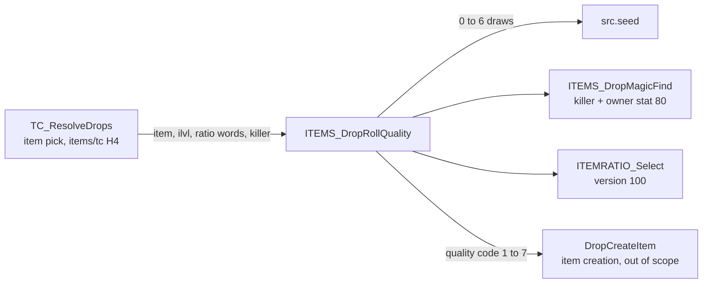
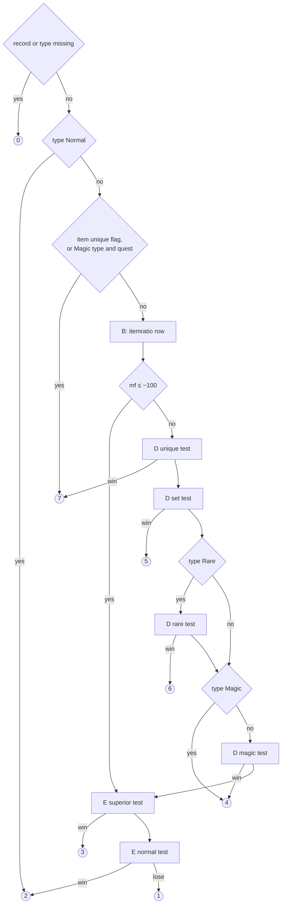
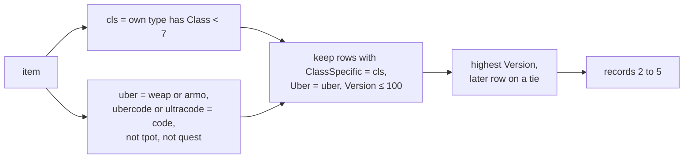
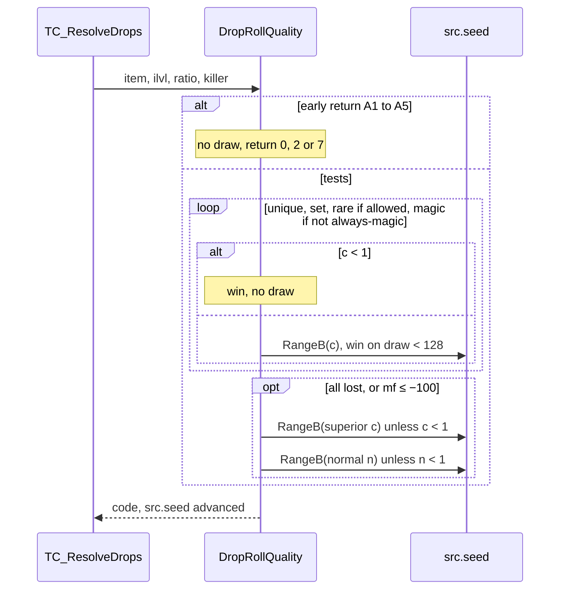

# The drop quality roll: from a picked item to a quality code

## Purpose

When the treasure-class resolver lands on an item that is not a unique or set entry and has no forced
quality, it calls the drop quality roll. The roll reads the item's base record and type, one `itemratio`
row, the item level the resolver passes, four ratio words of the TC frame and the killer's magic find, and
returns a quality code from 1 (low) to 7 (unique). It draws 0 to 6 times on the **source unit's seed**,
interleaved with the TC picks of [items/tc](tc.md). What item creation then does with the code (building
the unique, set, rare or magic item, or falling back when it cannot) is not part of this spec. Primitives
are those of [rng](../rng/README.md).



## Entry points

| When | Function | Tag |
|---|---|---|
| The resolver picks an item with no forced quality that is not a unique or set entry ([items/tc § H](tc.md#h-item-pick-and-hand-off), H4) | fn:TC_ResolveDrops@0x0055A6D0 → fn:ITEMS_DropRollQuality@0x00558640 (call at 0x0055ADBA) | [C] |

- [C] The hand-off arguments are the item index, the resolver's `ilvl`, the source unit, the killer and the
  frame's ratio words; on every logged call the model consumed them as logged and returned the logged code
  and exit seed. (fn:ITEMS_DropRollQuality@0x00558640, run:2026-10-11-tc-drops, run:2026-10-12-quality,
  run:2026-10-13-quality, [items/0002 § Answer](../../findings/items/0002-quality-roll.md#answer-summary))
- [I] `TC_ResolveDrops` at 0x0055ADBA is the only call site of the drop roll. Item creation has a separate
  roll on the **item** seed, which returns a drop's code without drawing and is not specified here (see
  *Boundaries*). (fn:ITEMS_DropRollQuality@0x00558640,
  fn:sub_00556F60_ItemRollQualityCreate@0x00556F60, [items/0002 §8](../../findings/items/0002-quality-roll.md#8-the-other-quality-roll-and-the-creation-fallbacks-named-only))

## Inputs

### Tables

| Anchor | Used for |
|---|---|
| tbl:ItemTypes.txt:Normal (`+0x16`), tbl:ItemTypes.txt:Magic (`+0x14`), tbl:ItemTypes.txt:Rare (`+0x15`) of the item's own `type` | the early return to normal, the always-magic return, the rare-test gate ([ItemTypes](../../tables/ItemTypes.md#fields-the-quality-roll-reads-plan-0010-phase-0)) |
| tbl:ItemTypes.txt:Class (`+0x21`, blank stored as `0xFF`) | the class-specific row key |
| tbl:Weapons.txt:level (`+0xFD`, u8) | the item's `qlvl` |
| tbl:Weapons.txt:unique (`+0x129`), tbl:Misc.txt:quest (`+0x12A`) | the two early returns to unique |
| tbl:Weapons.txt:type (`+0x11E`, signed), tbl:Weapons.txt:code (`+0x80`), tbl:Weapons.txt:ubercode (`+0x88`), tbl:Armor.txt:ultracode (`+0x8C`) | the item's type and the uber row key (same offsets in [Weapons](../../tables/Weapons.md), [Armor](../../tables/Armor.md), [Misc](../../tables/Misc.md)) |
| tbl:ItemRatio.txt:Unique … tbl:ItemRatio.txt:NormalDivisor (sixteen u32 at `+0x00`–`+0x3C`), tbl:ItemRatio.txt:Version (`+0x40`, u16), tbl:ItemRatio.txt:Uber (`+0x42`, u8), `Class Specific` (`+0x43`, u8) | the six chance terms and the row key ([ItemRatio](../../tables/ItemRatio.md)) |
| `TreasureClassEx` `Magic`, `Rare`, `Set`, `Unique` (as the frame's ratio words) | the ratio reduction ([items/tc § G](tc.md#g-recursion-into-a-sub-tc)) |

The items index is the concatenation of `weapons`, `armor` and `misc` records in that order, as in
[items/tc](tc.md). The six stock `itemratio` records, keyed (`Version`, `Uber`, `Class Specific`), with the
values the drop roll can reach (`*Min` columns: `UniqueMin` 6400, `RareMin` 3200, `SetMin` 5600,
`MagicMin` 192 in every row):

| Record | Key | `Unique`/div | `Set`/div | `Rare`/div | `Magic`/div | `HiQuality`/div | `Normal`/div |
|---|---|---|---|---|---|---|---|
| 0 | (0,0,0) | 400/2 | 125/6 | 160/3 | 30/16 | 12/16 | 4/8 |
| 1 | (0,1,0) | 240/2 | 96/6 | 96/3 | 3/100 | 4/16 | 1/8 |
| 2 | (1,0,0) | 400/1 | 160/2 | 100/2 | 34/3 | 12/8 | 2/2 |
| 3 | (1,1,0) | 400/1 | 160/2 | 100/2 | 34/3 | 12/8 | **1/1** |
| 4 | (1,0,1) | 240/3 | 120/3 | 80/3 | 17/6 | 9/8 | 2/2 |
| 5 | (1,1,1) | 240/3 | 120/3 | 80/3 | 17/6 | 9/8 | **1/1** |

- [C] The values are the decoded `.bin` records, which match the `.txt` cell for cell. (tbl:ItemRatio.txt:Normal,
  tbl:ItemRatio.txt:UniqueMin, `python3 -I tools/excel_bin.py dump <excel-dir> itemratio 0 1 2 3 4 5`)
- [C] The drop roll reaches records 2–5 only, the `Version` 1 rows, in expansion and classic games alike:
  every logged row is one of them (records 2 ×324, 3 ×86, 4 ×32, 5 ×11 over the 453 rolls of the three runs
  that reach a test).
  (fn:ITEMRATIO_Select@0x00637910, run:2026-10-12-quality, run:2026-10-13-quality)

### Runtime state

| State | Type | Source |
|---|---|---|
| `item` | i32, index into the items index | EAX at entry (fn:ITEMS_DropRollQuality@0x00558640) |
| `ilvl` | i32, signed | ECX at entry: the resolver's item level ([items/tc § H](tc.md#h-item-pick-and-hand-off)) |
| `src.seed` | `Seed` at struct:Unit+0x20 of the source unit; **every draw of the roll steps it** | stack argument `src` |
| `killer` | the unit credited with the kill, or none | stack argument |
| `ratio[0..3]` | u16 each: `[0]` Magic, `[1]` Rare, `[2]` Set, `[3]` Unique (the frame's first four words) | stack argument, a pointer into the TC frame |
| `game.difficulty` | u8 at struct:Game+0x6D | passed to `ITEMRATIO_Select`, which does not read it |
| killer type | u32 at struct:Unit+0x00 (`0` player, `1` monster) | |
| stat 80 (`item_magicbonus`), layer 0 | i32, the unit's stat value including equipped items | read with fn:sub_00625500_UnitGetStat@0x00625500 |
| itemratio array | `g_pItemRatio`, `g_nItemRatio` records of 0x44 bytes | data:g_pItemRatio@0x0096CC4C, data:g_nItemRatio@0x0096CC48 |

### Constants

| Name | Value | Anchor | Tag |
|---|---|---|---|
| `RATIO_VERSION` | 100, pushed as a constant whatever the game's expansion flag | 0x005586D7 | [C] |
| `WIN` | a draw `< 128` wins a test | 0x00558740–0x0055878C, 0x00558974 | [C] |
| `RATIO_SCALE` | 1024 (the ratio word is out of 1024) | 0x00558770–0x0055878C | [C] |
| `K_UNIQUE`, `K_SET`, `K_RARE` | 250, 500, 600 (magic-find diminishing factors) | fn:ITEMS_MagicFindDiminish@0x00558610, run:2026-10-12-quality | [C] |
| `MF_LINEAR_MAX` | `mf + 100 ≤ 110`, i.e. `mf ≤ 10`, is applied linearly | 0x00558613–0x0055861B, run:2026-10-13-quality | [C] |
| `MF_BYPASS` | `mf ≤ −100` skips the unique, set, rare and magic tests | 0x0055871F–0x00558722 | [I] |
| `ERR_NO_RATIO_ROW` | fatal error `0xE8D` when no `itemratio` row matches | 0x005586E6 | [I] |
| `ERR_BAD_VERSION` | fatal error `0x61D` in `ITEMRATIO_Select` for a version argument other than 0 or 100 | fn:ITEMRATIO_Select@0x00637910 | [I] |
| `MAGIC_STAT` | stat 80, `item_magicbonus`, layer 0 | fn:ITEMS_DropMagicFind@0x005585D0 | [C] |

## Algorithm

The roll is one function with three helpers. Section A is the early exit ladder, B the row, C the magic
find, D the four affix-quality tests, E the superior/normal/low split. All arithmetic is signed 32-bit
(`i32`, `imul`) unless a step says otherwise, `÷` truncates toward zero (`cdq; idiv`), and `<< 7` is the ×128.
[I] (fn:ITEMS_DropRollQuality@0x00558640, 0x0055872F–0x0055873D, [items/0002 §3](../../findings/items/0002-quality-roll.md#3-shared-terms-0x005587050x0055873d))

### Test order



### A. Early returns (no draw, no row)

```
A1. rec ← Items[item]; if rec = none: return 0                              [I] (0x00558660–0x00558668)
A2. t: i32 ← rec.type                                                       [I] (0x0055866B–0x00558696)
    if t < 0 or t ≥ nItemTypes: return 0
    ty ← ItemTypes[t]
A3. if ty.Normal ≠ 0: return 2                                              [C] (0x00558696, run:2026-10-11-tc-drops, run:2026-10-12-quality)
A4. if rec.unique ≠ 0: return 7                                             [I] (0x005586AA–0x005586BE)
A5. if ty.Magic ≠ 0 and rec.quest ≠ 0: return 7                             [I] (0x005586B3–0x005586CE)
```

Step notes:

- A2–A5. Each test reads the item's own `type` only: not `type2`, not the `Equiv` chain. [I]
  (0x0055866B–0x005586CE, tbl:ItemTypes.txt:Normal)
- A3. 853 logged rolls of `Normal`-type items (gold, potions, gems, runes, keys, scrolls, books, quivers and
  others; 31 stock types) returned 2 with `src.seed` unchanged and no row selected. [C] (0x00558696,
  run:2026-10-11-tc-drops, run:2026-10-12-quality)
- A4–A5. With stock data, `unique` is set on 18 base items (quest items such as `hst`, `msf`, `bks`, `bkd`,
  `ass`, `std`), and the `Magic`-type-plus-`quest` rule hits only `vip` (an `amul`).
  Neither return was taken in any logged roll. [I] (tbl:Weapons.txt:unique, tbl:Misc.txt:quest,
  [items/0002 §1](../../findings/items/0002-quality-roll.md#1-arguments-and-early-returns-0x005586400x005586ce))

### B. The itemratio row — `ITEMRATIO_Select`



```
B1. row ← ITEMRATIO_Select(item, game.difficulty, 100)                      [C] (0x005586D7, fn:ITEMRATIO_Select@0x00637910, run:2026-10-13-quality)
B2. if row = none: fatal error 0xE8D                                        [I] (0x005586E6)

ITEMRATIO_Select(item, diff, version: u16):                                 [I] (fn:ITEMRATIO_Select@0x00637910, all of S1–S4)
S1. cls: u8 ← 1 if ItemTypes[rec.type].Class < 7 else 0                     ; signed type, bounds-checked, else 0 (fn:ITEMS_IsClassSpecific@0x00629F70)
S2. uber: u8 ← 1 if (IsType(item, weap) or IsType(item, armo))
                   and (rec.ubercode = rec.code or rec.ultracode = rec.code)  ; 4-byte words
                   and rec.type ≠ tpot and rec.quest = 0
              else 0                                                         ; (fn:sub_0062B4D0_ItemRatioUber@0x0062B4D0)
S3. if version ∉ {0, 100}: fatal error 0x61D
    best ← none; bestVer: i32 ← −1
    for i in 0 ..< nItemRatio:
      r ← ItemRatio[i]
      if r.ClassSpecific = cls and r.Uber = uber and r.Version ≤ version and r.Version ≥ bestVer:
        best ← i; bestVer ← r.Version
S4. return best                                                              ; diff is never read
```

Step notes:

- B1. **Classic drops use the `Version` 1 rows too.** The roll pushes 100 with no read of the game's
  expansion flag, so a classic drop takes the same row as an expansion drop. In a classic Normal game every
  logged row was record 2 or 3, all 229 rolls reproduce with them, and the `Version` 0 rows break 29 of the 52
  rolls that reach a test. [C] (0x005586D7, fn:ITEMRATIO_Select@0x00637910, run:2026-10-13-quality)
- B1. **Both keys decide rows.** Over 1113 rolls, forcing the uber key to 0 breaks 7 and to 1 breaks 13, and
  forcing the class key to 0 breaks 10. [C] (fn:ITEMRATIO_Select@0x00637910, run:2026-10-12-quality)
- S2. `IsType` is the type-equivalence test of [items/tc](tc.md) (`weap` is itemtypes record 45, `armo` 50,
  `tpot` 38), so "uber" means an exceptional or elite base. [I] (fn:sub_0062B4D0_ItemRatioUber@0x0062B4D0,
  fn:ITEMS_IsType@0x00629A90, tbl:Weapons.txt:ubercode, tbl:Armor.txt:ultracode)
- S3. `≥` on the version makes the later row win a tie; stock data has one row per key and version, so no
  tie occurs. No match cannot happen with stock data: every (uber, class) pair has a `Version` 1 row. [I]
  (0x0063798F–0x00637995, 0x005586E6)
- S3. The `Version` 0 rows (records 0 and 1) are reachable only with the argument 0, which only the
  creation-side roll passes. [I] (0x00556FD9, fn:sub_00556F60_ItemRollQualityCreate@0x00556F60)

### C. Shared terms and magic find

```
C1. d: i32 ← ilvl − rec.level                                               [C] (0x0055872F–0x00558733, run:2026-10-12-quality)
C2. mf: i32 ← DropMagicFind(killer)                                         [C] (fn:ITEMS_DropMagicFind@0x005585D0, run:2026-10-12-quality, run:2026-10-13-quality)
C3. useMF: bool ← false
    if mf ≠ 0:
      if mf ≤ −100: go to E1                                                 [I] (0x0055871F–0x00558722)
      useMF ← true
    m100: i32 ← mf + 100

DropMagicFind(killer) → i32:
M1. if killer = none or (u32) killer.type > 1: return 0                     [I] (fn:ITEMS_DropMagicFind@0x005585D0)
M2. mf ← GetStat(killer, 80, layer 0)                                       [C] (fn:ITEMS_DropMagicFind@0x005585D0, run:2026-10-12-quality)
M3. owner ← MonsterOwner(killer)                                            [C] (fn:sub_0058F0D0_MonsterOwner@0x0058F0D0, run:2026-10-13-quality)
    if owner ≠ none: mf ← mf + GetStat(owner, 80, layer 0)
M4. return mf

Diminish(m100: i32, k: i32) → i32:                                          [C] (fn:ITEMS_MagicFindDiminish@0x00558610, run:2026-10-12-quality, run:2026-10-13-quality)
K1. if m100 ≤ 110: return m100                                              ; mf ≤ 10: linear
K2. return (m100 − 100) × k ÷ (m100 − 100 + k) + 100                        ; i32 imul, cdq/idiv
```

Step notes:

- C1. `d` is signed and may be negative (an item whose `qlvl` is above `ilvl`). `rec.level` is a u8. [I]
  (0x0055872F–0x00558733, tbl:Weapons.txt:level)
- C1. **A chest drop rolls at `ilvl` 0–2.** `ObjectChestDrop` passes its chest tier (0, 1 or 2) as the resolver's
  `ilvl` ([items/tc § J](tc.md#j-object-drops-named-only)), so for every chest, urn, barrel or casket drop `d` is the
  tier minus the base's `level`: strongly negative for most bases, which makes the `− d ÷ div` term of D4 non-negative and every
  `c` at least as large (odds no better) as for a monster drop of the same base at the area's level. The created item's own level
  is still taken from the source. [I] (0x00585CD2, fn:sub_00585B90_ObjectChestDrop@0x00585B90,
  [items/0001 § 2](../../findings/items/0001-tc-resolution.md#2-entry-points))
- M2. For a player killer, stat 80 is the sum of its equipped items' `item_magicbonus` (MF 100 from two items
  in run:2026-10-12-quality, 10 from one item in run:2026-10-13-quality, 0 for the earlier characters), and
  nothing else is added for a player. Each session reproduces at its save's MF and at no other value of the
  scanned range (−150…400 and −20…100). [C] (fn:ITEMS_DropMagicFind@0x005585D0, run:2026-10-12-quality,
  run:2026-10-13-quality)
- M3. **A summon kill counts its owner's magic find.** For 85 kills by Raise Skeleton skeletons (monster class
  363, stat 80 = 0) `MonsterOwner` returned the Necromancer and the roll used 0 + 10; dropping the owner's 10
  breaks 27 of them. [C] (fn:sub_0058F0D0_MonsterOwner@0x0058F0D0, run:2026-10-13-quality)
- M3. **A mercenary's kill counts its own plus its owner's magic find.** `MERC_Init` sets a hired or loaded
  mercenary's owner to its player (`sub_0058F030_MonSetOwner`, the `monsterData+0x28` block `MonsterOwner` reads).
  Three kills by a mercenary read its stat 80 (0) and its owner's (40, the player's full stat list with an item's
  bonus): total 40 ([hirelings § J](../hirelings/README.md#j-magic-find-on-a-mercenarys-kill)). [C]
  (fn:sub_0058F030_MonSetOwner@0x0058F030, fn:sub_0058F0D0_MonsterOwner@0x0058F0D0, fn:ITEMS_DropMagicFind@0x005585D0,
  run:2026-10-16-hirelings)
- M3. For a player, `MonsterOwner` returns none. For a monster killer the owner is the unit that its AI block
  (`monsterData+0x28`) names by game, id and type (`+0x28`, `+0x2C`, `+0x30`); a block with no game, or a unit no
  longer in the game, gives none. A killer that is neither a player nor a monster (an object, a missile) gives 0. [I]
  (0x0058F0E5–0x0058F0FA, fn:sub_0058F0D0_MonsterOwner@0x0058F0D0, fn:sub_0058F030_MonSetOwner@0x0058F030,
  fn:ITEMS_DropMagicFind@0x005585D0)
- M3. **Monster minions have an owner: their leader.** `UniqueMinions` sets each minion's owner to its unique boss
  and adds it to the boss's member list; a superunique's minions take the same path (`SuperUniqueSpawn` →
  `SpecialModsApply` → `UniqueMinions`); MonStats party minions of a `SetBoss` leader are linked to it through the same
  pair ([monsters/0002](../../findings/monsters/0002-room-population.md) § MonStats minions). `SpecialMonPlace` sets a
  placed boss as its own owner, and a monster spawned for another unit (`SpawnOwnedMonster`) gets that unit. So a
  minion's kill adds its leader's stat 80, and a placed boss's kill its own stat 80 a second time, while the leader is
  still in the game. Whether any stock monster carries stat 80 is not checked. [I] (0x005A0C94–0x005A0CB0, 0x005A4B6C–0x005A4B8E,
  0x005A2135, 0x005A0B9B, 0x0056DA15, fn:sub_005A0C00_UniqueMinions@0x005A0C00,
  fn:sub_005A2120_SpecialModsApply@0x005A2120, fn:sub_005A09E0_SpecialMonPlace@0x005A09E0,
  fn:sub_0056D940_SpawnOwnedMonster@0x0056D940, fn:sub_0058F100_MonGroupAddMember@0x0058F100,
  [items/0002 § Plan 0039 batch P1b](../../findings/items/0002-quality-roll.md#plan-0039-batch-p1b-2026-10-17))
- M3. **The other monster owners.** `MonSetOwner` has 26 call sites; the other 17 give these kinds an owner, so a
  kill by one of them also adds its owner's stat 80 while the owner is in the game. [I]
  (fn:sub_0058F030_MonSetOwner@0x0058F030, fn:sub_0058F0D0_MonsterOwner@0x0058F0D0,
  fn:sub_005B24E0_EscortSpawn@0x005B24E0, fn:sub_005B2570_TentacleMinionsSpawn@0x005B2570,
  fn:sub_005B3270_FormationSpawn@0x005B3270, fn:sub_005FC860_BaalCloneSpawn@0x005FC860,
  fn:sub_005C58B0_SkillBoneWallDo@0x005C58B0, fn:sub_005C5D00_SkillBonePrisonDo@0x005C5D00,
  fn:sub_005C55C0_SummonFinish@0x005C55C0, fn:sub_005C07A0_SkillReviveDo@0x005C07A0,
  fn:sub_005AEDA0_MissileSpawnOwnedMonster@0x005AEDA0, fn:sub_0058F4D0_MonSetOwnerRestore@0x0058F4D0; [items/0002 § Plan 0039 batch P1c](../../findings/items/0002-quality-roll.md#plan-0039-batch-p1c-2026-10-17))
  - a boss's escorts (the boss), and tentacles (the monster that spawns them);
  - formation members (their leader; a formation leader owns itself, as a placed boss does), and the unit
    `FormationSpawn`'s case 5 makes (the unit passed to it);
  - Baal's clone, class 570 (Baal);
  - the Bone Wall and Bone Prison pieces (the caster; the later prison pieces the first one), a monster revived with
    `Revive` or raised from a corpse (the caster), and a monster a missile spawns (the missile's owner);
  - a restored inactive monster (its saved owner).

  Three more sites only clear the link (owner id −1): an old mercenary replaced at resurrection, and the members and
  the dying monster of a `partydead` group.
- K1–K2. At MF 100 the factors are 171 (unique), 183 (set) and 185 (rare); a linear factor of 200 in those three
  tests gets 34 of 847 rolls wrong. At MF 10 the factor is 110 in every test; the diminishing form there (109)
  breaks 24 of 574 rolls. [C] (0x0055861E–0x0055862C, 0x00558613–0x0055861B, run:2026-10-12-quality,
  run:2026-10-13-quality)
- C3. Negative magic find from −99 to −1 makes the factor below 100, which raises every chance (worse odds).
  `mf = 0` skips the division (the same result as a factor of 100). [I] (0x0055871F–0x00558722)

### D. Unique, set, rare and magic tests

| Order | Test | `base`, `div`, `min` (row) | MF factor `F` | Ratio word | Win → code | Runs when |
|---|---|---|---|---|---|---|
| 1 | unique | `Unique`, `UniqueDivisor`, `UniqueMin` | `Diminish(m100, 250)` | `ratio[3]` | 7 | always |
| 2 | set | `Set`, `SetDivisor`, `SetMin` | `Diminish(m100, 500)` | `ratio[2]` | 5 | always |
| 3 | rare | `Rare`, `RareDivisor`, `RareMin` | `Diminish(m100, 600)` | `ratio[1]` | 6 | `ty.Rare ≠ 0` |
| 4 | magic | `Magic`, `MagicDivisor`, `MagicMin` | `m100` (no diminishing) | `ratio[0]` | 4 | `ty.Magic = 0` (else 4 with no test) |

- [C] The order, the columns, the factors and the ratio words above are those of every reproduced roll. (fn:ITEMS_DropRollQuality@0x00558640
  0x0055872F–0x0055891F, run:2026-10-12-quality, run:2026-10-13-quality)

```
D1. for (test, base, div, min, F, w, code) in the table above, in order:   [C] (0x0055872F–0x0055891F, run:2026-10-12-quality, run:2026-10-13-quality, all of D1–D11 unless tagged)
D2.   if test = rare and ty.Rare = 0: skip this test                        [C] (0x00558829–0x00558830, run:2026-10-12-quality)
D3.   if test = magic and ty.Magic ≠ 0: return 4                            [C] (0x005588B1–0x005588C5, run:2026-10-12-quality)
D4.   c: i32 ← (row.base − d ÷ row.div) << 7
D5.   if useMF:
        f: i32 ← F
        if f ≠ 0: c ← c × 100 ÷ f                                           ; magic: no zero test (m100 ≥ 1 here)
D6.   if c ≤ row.min: c ← row.min                                           [I] (0x00558767–0x0055876E)
D7.   c ← c − ((i32)(u32) ratio[w] × c) ÷ 1024                              [C] (0x00558770–0x0055878C, run:2026-10-12-quality)
D8.   if c < 1: return code                                                  ; win, NO draw
D9.   x: u32 ← RNG.RangeB(seed: src.seed, n: c)                              ; draw#k
D10.  if x < 128: return code                                                ; unsigned compare
D11. go to E1
```

Step notes:

- D4–D7. The order is base term, magic find, minimum, ratio, then the draw: the minimum is applied **after**
  magic find and **before** the ratio, so a ratio word can still take `c` below the minimum. [I]
  (0x00558740–0x0055878C)
- D5. `c × 100` and `÷ f` are i32 (`imul`, `cdq; idiv`), so the result truncates toward zero. [C]
  (0x0055875F–0x00558763, 0x005588DD–0x005588E3, run:2026-10-12-quality)
- D6. The clamp is a signed compare, `c ← max(c, min)`. It never acted in the runs: every pre-clamp chance
  stayed above the minimum (6400, 5600, 3200, 192), so this step is code-read only. [I] (0x00558767–0x0055876E)
- D7. The ratio word is zero-extended, the product is i32, and `÷ 1024` is a signed division done as
  `cdq; and 0x3FF; add; sar 10` (truncation toward zero). With `c ≥ min > 0` it is a floor. A ratio word of
  1024 makes `c = 0`: a win with no draw, observed on 61 rolls of magic and rare tests under
  `Act N Uitem`-style ratios in the first two runs. [C] (0x00558770–0x0055878C, run:2026-10-12-quality, run:2026-10-11-tc-drops)
- D4, E1, E3. Every `d ÷ div` is a signed `cdq; idiv`: the divisor column is a u32 read as a signed i32, and
  `d` is signed, so the quotient truncates toward zero. A zero divisor faults (integer division by zero); no
  stock row has one. [I] (0x0055872F–0x00558733, 0x00558921–0x00558986, tbl:ItemRatio.txt:UniqueDivisor,
  [items/0002 §3](../../findings/items/0002-quality-roll.md#3-shared-terms-0x005587050x0055873d))
- D9. `RangeB` is `Range` of [rng](../rng/README.md#algorithm) (one `Step`, then the new `low mod n`; the
  binary uses `low & (n − 1)` for a power of two, with the same result). Any `c ≤ 128` therefore wins with a
  draw. Every draw of the 1916 logged rolls reproduces. [C] (fn:RNG_RangeB@0x0045C3E0, run:2026-10-12-quality,
  run:2026-10-13-quality)
- D2. Three charm rolls (`scha`, `lcha`) skipped the rare test and went from the set test to the always-magic
  return with two draws. [C] (0x00558829–0x00558830, run:2026-10-12-quality)
- D3. An always-magic type (`ring`, `amul`, `jewl`, charms and others) returns 4 after losing the unique, set
  and, if allowed, rare tests; it never reaches E. 14 + 7 + 2 logged rolls. [C] (0x005588B1–0x005588C5,
  run:2026-10-12-quality, run:2026-10-13-quality)

### E. Superior, normal, low

```
E1. c: i32 ← (row.HiQuality − d ÷ row.HiQualityDivisor) << 7               [C] (0x00558921–0x00558986, run:2026-10-12-quality, all of E1–E4)
E2. if c < 1: return 3                                                      ; NO draw
    x ← RNG.RangeB(seed: src.seed, n: c)                                    ; draw#k
    if x < 128: return 3
E3. n: i32 ← (row.Normal − d ÷ row.NormalDivisor) << 7
    if n < 1: return 2                                                      ; NO draw
E4. x ← RNG.RangeB(seed: src.seed, n: n)                                    ; draw#k+1
    return 2 if x < 128 else 1
```

Step notes:

- E1–E4. No magic find, no minimum and no ratio word enter these two tests: at MF 100 the 13 superior and 2 low
  results of run:2026-10-12-quality reproduce with the unscaled terms. Two draws at most decide among the
  three. E1 is also where `mf ≤ −100` lands (C3). [C] (0x00558921–0x00558986, run:2026-10-12-quality)
- E3. The `n < 1` win without a draw is observed on 70, 55 and 12 rolls of the three sessions. [C] (0x00558965,
  run:2026-10-12-quality, run:2026-10-13-quality)
- E2. The superior `c < 1` win without a draw never happened in the runs (it needs `d ≥ 72` with records 4–5, `d ≥ 96` with 2–3). [I]
  (0x00558930)
- E4. Code 1 (low) comes only from losing this draw (`cmp eax, 0x80; sbb; neg; add 1`); all logged 1s come
  through it. [C] (0x00558974, run:2026-10-11-tc-drops, run:2026-10-12-quality)
- E3–E4. With records 2 and 4 (`Normal` 2, `NormalDivisor` 2) low quality needs `d ≤ 1`: `d` 2–3 gives
  `n = 128` (one draw, always a win) and `d ≥ 4` gives `n ≤ 0` (normal with no draw). With records 3 and 5
  (`Normal` 1, `NormalDivisor` 1), an uber base needs `d ≤ −1` for low quality. [I] (0x00558921–0x00558986,
  tbl:ItemRatio.txt:Normal, tbl:ItemRatio.txt:NormalDivisor)

### F. Boundaries (named only)

What item creation does with the code is owned by `items/uniques-sets` (plan 0019, [uniques-sets.md](uniques-sets.md)),
and by `items/affixes`. The statements below fix only where this spec's output goes and what can still change it.
They come from [items/0004](../../findings/items/0004-uniques-sets.md).

- [I] **The creation-side quality roll runs on every drop but draws nothing there.**
  `sub_00556F60_ItemRollQualityCreate` is called first in `sub_00557450_ItemCreateByQuality` (0x005574CC) and
  again at the start of every fallback step. On a drop the item version is non-zero and the creation record's
  quality (`rec+0x30`, this spec's code or a TC entry's 5 or 7) is set, so it returns that quality at once, with
  no draw and no row. Its drawing body (the **item** seed, `ITEMRATIO_Select` with version 0 or 100 by the item's
  version, a formula with no ×128, no magic find and no ratio words) runs only for an item of version 0 or a
  record of quality 0, which no drop produces; it belongs to the item-creation rows.
  (fn:sub_00556F60_ItemRollQualityCreate@0x00556F60, fn:sub_0062A670_ItemGetVersion@0x0062A670, 0x005574CC,
  [items/0004 § Answer](../../findings/items/0004-uniques-sets.md#answer-summary),
  [items/0002 §8](../../findings/items/0002-quality-roll.md#8-the-other-quality-roll-and-the-creation-fallbacks-named-only))
- [C] **Vendor stock and gambling never reach this roll.** Their builders choose the quality on the store seed
  (normal or superior stock, 4 for magic stock, 4–7 for a gamble slot) and pass it in the creation record; the
  creation-side roll above returns it with no draw. See [vendors.md](vendors.md#f-the-creation-record-items_createforstore-and-the-item-seeds).
  (fn:ITEMS_CreateForStore@0x00559CE0, fn:sub_00556F60_ItemRollQualityCreate@0x00556F60, run:2026-10-15-vendors)
- [I] **Pre-switch overrides.** Before its switch, `sub_00557450_ItemCreateByQuality` rewrites the item's
  quality by four rules, in this order, a later one overwriting an earlier: an `ItemTypes.Magic` type gets 7 for a
  quest base, else 4 unless the quality is already 4..9; an `ItemTypes.Rare` = 0 type turns 6 into 4; a base
  with the `unique` flag gets 7; an `ItemTypes.Normal` type (or a type with no record) gets 2. They apply to
  this spec's code and to a TC entry's 5 or 7 alike, and they do not write `rec+0x30`. So the code returned here
  is not always the quality the item is built with.
  (fn:sub_0062E9E0_ItemTypeMagic@0x0062E9E0, fn:sub_00628CD0_ItemBaseIsQuest@0x00628CD0,
  fn:sub_0062A0F0_ItemQualityMagicPlus@0x0062A0F0, fn:sub_0062E990_ItemTypeRare@0x0062E990,
  fn:sub_00628C70_ItemBaseIsUnique@0x00628C70, fn:sub_0062EA30_ItemTypeNormal@0x0062EA30, 0x005574E3–0x00557567,
  tbl:ItemTypes.txt:Magic, tbl:ItemTypes.txt:Rare, tbl:ItemTypes.txt:Normal, tbl:Weapons.txt:unique,
  [items/0004 § 2](../../findings/items/0004-uniques-sets.md#2-pre-switch-overrides-0x005574e30x00557567))
- [C] **Which stock bases the overrides change** (a survey of the 659 Weapons, Armor and Misc rows against ItemTypes;
  the tests read the base's own type record, with no `Equiv` walk): `Magic` = 1, 7 bases (`rin`, `amu`, `vip`, `jew`,
  `cm1`–`cm3`; `vip` is a quest base and gets 7); the `Magic` types `char`, `mboq` and `mxbq` have no base of their own,
  so no quiver is forced magic. `Rare` = 0: 153 bases of 30 types (potions, gems, runes, scrolls, books, keys, gold,
  quivers, body parts, charms, quest items). `unique` flag: 18 bases, 17 quest items and `std`. `Normal` = 1: 121 bases of
  24 types; no base has a type without a record. (tbl:ItemTypes.txt:Magic, tbl:ItemTypes.txt:Rare,
  tbl:ItemTypes.txt:Normal, tbl:Weapons.txt:unique, tbl:Misc.txt:quest, data survey,
  [items/0002 § Plan 0039 batch P1b](../../findings/items/0002-quality-roll.md#q19-b-which-stock-bases-the-pre-switch-overrides-change-survey);
  the overrides on drops are reproduced in [items/0004 § 10](../../findings/items/0004-uniques-sets.md#10-phase-2-reproduction-plan-0019))
- [I] **Builders and fallbacks.** `sub_00557450_ItemCreateByQuality` has one case per code (and 8, 9, which
  this roll never returns). A unique or set that cannot be built falls back 7 → 6 → 4 → 3 → 2 or 5 → 4 → 3 → 2,
  after a durability step (`sub_005573F0_ItemFallbackRare`, `sub_00557380_ItemFallbackMagic`,
  `sub_00557320_ItemFallbackSuperior`, `sub_005572A0_ItemFallbackNormal`). Each step writes its quality to the
  item and to `rec+0x30`, and restores the item seed to `{S, 666}`, S being the seed's low word saved just before
  the failed builder, so a failed builder's draws are discarded.
  (fn:sub_00557450_ItemCreateByQuality@0x00557450, fn:sub_005573F0_ItemFallbackRare@0x005573F0,
  fn:sub_00557380_ItemFallbackMagic@0x00557380, fn:sub_00557320_ItemFallbackSuperior@0x00557320,
  fn:sub_005572A0_ItemFallbackNormal@0x005572A0, fn:ITEMS_SetStartSeed@0x00627E20, fn:RNG_SeedInit@0x00650E40,
  [items/0004 § 5](../../findings/items/0004-uniques-sets.md#5-failure-durability-and-the-fallback-chain))
- [I] **Creation draws on other seeds.** After this roll, the creation steps read in items/0004 draw on the game
  seed (the unit seed and the item seed init), on the item's unit seed (`sub_00557AB0_ItemInitStats`) and on the
  item seed (the builders), never on `src.seed`.
  (fn:sub_00552E90_ItemSeedInit@0x00552E90, fn:sub_00557AB0_ItemInitStats@0x00557AB0,
  [items/0004 § Answer](../../findings/items/0004-uniques-sets.md#answer-summary))

## Draw order on `src.seed`



- [C] One roll steps `src.seed` once for each test it reaches whose chance is at least 1, in the order of
  the table in D, then E: between 0 and 6 times. All seven counts appear in the logs, and the exit seed of every
  logged roll reproduces with no resync. (fn:ITEMS_DropRollQuality@0x00558640, run:2026-10-12-quality,
  run:2026-10-13-quality)
- [C] No other seed is touched by the roll, and the resolver's next draw continues on the same `src.seed`
  ([items/tc § Draw order](tc.md#draw-order-on-srcseed)). `tools/tc.py replay --quality model` reproduces whole
  resolver calls with the roll modelled and no oracle: 328 + 124 + 1269 + 944 expansion calls and 485 classic
  calls. (fn:TC_ResolveDrops@0x0055A6D0, run:2026-10-11-tc-drops, run:2026-10-12-quality, run:2026-10-13-quality)

## Outputs

| Code | Quality | Produced by | Tag |
|---|---|---|---|
| 0 | none (no item record, or its type out of range) | A1–A2 (0x00558660–0x00558668) | [I] |
| 1 | low quality | E4, lost (0x00558974, run:2026-10-12-quality) | [C] |
| 2 | normal | A3, E3 (no draw), E4 won (0x00558696, 0x00558974, run:2026-10-12-quality) | [C] |
| 3 | superior | E2 (0x00558921–0x00558986, run:2026-10-12-quality) | [C] |
| 4 | magic | D3, magic test won (0x005588B1–0x0055891F, run:2026-10-12-quality) | [C] |
| 5 | set | set test won (fn:ITEMS_DropRollQuality@0x00558640, run:2026-10-12-quality) | [C] |
| 6 | rare | rare test won (fn:ITEMS_DropRollQuality@0x00558640, run:2026-10-12-quality) | [C] |
| 7 | unique | A4, A5, unique test won (fn:ITEMS_DropRollQuality@0x00558640, run:2026-10-12-quality, run:2026-10-13-quality) | [C] |

- [C] Codes 1–7 each appear in the logs (all three runs together: 1 ×24, 2 ×1660, 3 ×29, 4 ×144, 5 ×13,
  6 ×38, 7 ×8, rolled) and reproduce. Codes 5 and 7 from the tests are the same numbers the resolver passes for
  a set or unique TC entry. (fn:ITEMS_DropRollQuality@0x00558640, run:2026-10-11-tc-drops,
  run:2026-10-12-quality, run:2026-10-13-quality, [items/tc § H](tc.md#h-item-pick-and-hand-off))
- [I] The function returns no value outside 0–7; 0 and the two early 7s (A4, A5) are code-read only.
  (0x00558660–0x00558668, 0x005586B3–0x005586BE, 0x00558807–0x00558812)
- [C] Side effect: `src.seed` advanced by the draws above, nothing else. (run:2026-10-12-quality,
  run:2026-10-13-quality)

## Worked example

Seeds are `low:high` in hex; `x` is the draw. Each line was checked against the log's `QOUT` by
`python3 -I tools/quality.py check <log> -v`; the per-draw seeds were printed by stepping the same model.

**1. A classic unique on one draw** (`tc-quality-3.log` QIN#91, [run:2026-10-13-quality](../../findings/items/experiments.md#run2026-10-13-quality)).
Classic Normal game, player killer with MF 0. Item 350 `bsh` (qlvl 19), `ilvl` 22, ratio words
`0,0,0,0`, `src.seed` on entry `98477aee:5019bac8`. [C] (run:2026-10-13-quality)

| Step | Value |
|---|---|
| A3–A5 | type not `Normal`, no unique flag, no quest: no early return |
| B1 | not class-specific, not uber → record 2 (`Version` 1), logged `QROW row=2` |
| C1–C3 | `d = 22 − 19 = 3`; `mf = 0`, so no magic-find division |
| D unique | `c = (400 − 3 ÷ 1) << 7 = 50816`; above 6400; ratio 0 → `c = 50816` |
| draw#1 | `RangeB(50816)` → seed `545533ee:3f83b64d`, `x = 1414869998 mod 50816 = 110` |
| result | `110 < 128` → **7 (unique)**; exit seed `545533ee:3f83b64d` = the logged `QOUT` |

With record 0 (what a "classic games use the `Version` 0 rows" reading would take) the chance is
`(400 − 3 ÷ 2) << 7 = 51072`, the draw is 22382, the test is lost and the item ends normal: the run's
counterfactual that settles B1. [C] (0x005586D7, run:2026-10-13-quality)

**2. All six draws** (`tc-quality-3.log` QIN#0, same run). Item 46 `bal` (qlvl 16), `ilvl` 19, `d = 3`,
record 2, MF 0, `src.seed` on entry `53c85fa4:60bc0e4c`. [C] (run:2026-10-13-quality)

| Draw | Test | `c` | `src.seed` after | `x` | Outcome |
|---|---|---|---|---|---|
| 1 | unique | `(400 − 3) << 7 = 50816` | `7091e780:22f1f3f5` | 33536 | lose |
| 2 | set | `(160 − 1) << 7 = 20352` | `e2711975:2ef3ba5c` | 16117 | lose |
| 3 | rare | `(100 − 1) << 7 = 12672` | `30cc2165:5e727812` | 9701 | lose |
| 4 | magic | `(34 − 1) << 7 = 4224` | `646efacb:145a5f4e` | 3147 | lose |
| 5 | superior | `(12 − 0) << 7 = 1536` | `d1d58d85:29e3da79` | 1413 | lose |
| 6 | normal | `(2 − 1) << 7 = 128` | `49b291d2:57852e6e` | 82 | win → **2 (normal)** |

The sixth draw cannot lose (`n = 128`) but is still made. `bal` is a throwable, so in this classic game the
resolver then refunds the pick ([items/tc § H](tc.md#h-item-pick-and-hand-off), H6): the six draws stay
consumed. [C] (run:2026-10-13-quality)

**3. Magic find 100 with diminishing returns** (`tc-quality-1.log` QIN#216,
[run:2026-10-12-quality](../../findings/items/experiments.md#run2026-10-12-quality)). Expansion Nightmare,
player killer with MF 100 (`m100 = 200`). Item 48 `pil` (qlvl 10), `ilvl` 49, `d = 39`, record 2, ratio words
0, `src.seed` on entry `3290d0cf:3bce9d01`. [C] (run:2026-10-12-quality)

| Draw | Test | Base term | `F` | `c` | `src.seed` after | `x` | Outcome |
|---|---|---|---|---|---|---|---|
| 1 | unique | `(400 − 39) << 7 = 46208` | `100 + 100·250 ÷ 350 = 171` | 27022 | `d0cdbc4c:15172f0f` | 11932 | lose |
| 2 | set | `(160 − 19) << 7 = 18048` | `100 + 100·500 ÷ 600 = 183` | 9862 | `981bd58b:5717252b` | 817 | lose |
| 3 | rare | `(100 − 19) << 7 = 10368` | `100 + 100·600 ÷ 700 = 185` | 5604 | `c422a922:3f7181f7` | 4306 | lose |
| 4 | magic | `(34 − 13) << 7 = 2688` | `200` | 1344 | `918cc921:51ce7bc1` | 1185 | lose |
| 5 | superior | `(12 − 4) << 7 = 1024` | — | 1024 | `bdcdd226:3cb5307a` | 550 | lose |
| — | normal | `(2 − 19) << 7 = −2176` | — | −2176 | unchanged | none | `n < 1` → **2 (normal)** |

Exit seed `bdcdd226:3cb5307a`, as logged. With a linear factor of 200 in the unique test the chance is 23104,
the same first draw gives 12, and the roll would return a unique the game did not make: one of the 34 rolls
that tell the two models apart. [C] (run:2026-10-12-quality)

## Reimplementation notes

- **Same seed as the TC walk.** Every draw is on the source unit's seed, interleaved with the picks; skipping
  or adding one draw shifts every later pick of the drop. [C] (fn:ITEMS_DropRollQuality@0x00558640,
  run:2026-10-11-tc-drops, [items/tc § Draw order](tc.md#draw-order-on-srcseed))
- **A chance below 1 wins without a draw; a chance of 1 to 128 wins with one.** Both happen in practice
  (ratio word 1024 on the magic and rare tests; `n = 128` in the normal test). [C] (0x00558770–0x0055878C,
  run:2026-10-12-quality, run:2026-10-13-quality)
- **Magic find is linear up to 10.** 1.14d applies `F = mf + 100` for `mf ≤ 10` in all four tests and the
  `mf·k/(mf + k)` form only above that; the 1.10/1.11 community formula has no linear branch. Do not
  "correct" it. [C] (0x00558613–0x0055861B, run:2026-10-13-quality)
- **Classic drops use the `Version` 1 rows.** The community description of 1.10 says classic games use the
  two `Version` 0 rows; the 1.14d drop roll does not. Do not "correct" it. [C] (0x005586D7,
  run:2026-10-13-quality)
- **The uber key matters for drops**, through `Normal`/`NormalDivisor` only: records 3 and 5 differ from 2 and
  4 in those two columns and nowhere else. [C] (tbl:ItemRatio.txt:Normal, run:2026-10-12-quality)
- **Superior and normal/low ignore magic find and the TC ratio words.** [C] (0x00558921–0x00558986,
  run:2026-10-12-quality)
- **Always-magic types still run the unique, set and rare tests** (with their draws) before returning 4.
  [C] (0x005588B1–0x005588C5, run:2026-10-12-quality)
- **Truncation, not floor, everywhere.** `d` can be negative, and `d ÷ div` then rounds toward zero (−3 ÷ 2 =
  −1). [I] (0x0055872F–0x00558733)
- **A zero divisor is fatal in the binary.** Every `*Divisor` is used in a signed `idiv` with no zero test, so
  a zero faults. A reimplementation must reject a zero divisor when it loads the data, or treat it as a fatal
  error at the roll; it must not substitute a value. [I] (0x0055872F–0x00558733, 0x00558921–0x00558986,
  tbl:ItemRatio.txt:NormalDivisor)
- **The difficulty passed to `ITEMRATIO_Select` is unused.** Do not key rows by difficulty. [I]
  (fn:ITEMRATIO_Select@0x00637910)

## Evidence

- [findings/items/0002-quality-roll.md](../../findings/items/0002-quality-roll.md): the roll read to the
  instruction (Phase 1), the community cross-check (Phase 1b, *Leads used*) and the reproduction (Phase 2).
- [findings/items/experiments.md § run:2026-10-11-tc-drops](../../findings/items/experiments.md#run2026-10-11-tc-drops):
  266 rolls at MF 0, first replayed with the roll as an oracle, then modelled.
- [findings/items/experiments.md § run:2026-10-12-quality](../../findings/items/experiments.md#run2026-10-12-quality):
  847 rolls at MF 100 (Nightmare, expansion), the diminishing-returns counterfactual, row-key sensitivity.
- [findings/items/experiments.md § run:2026-10-13-quality](../../findings/items/experiments.md#run2026-10-13-quality):
  574 rolls at MF 10 with a summon killer, 229 rolls in a classic Normal game, the logger's `QROW`/`QMF` lines.
- [findings/items/0001-tc-resolution.md](../../findings/items/0001-tc-resolution.md): the caller and the
  hand-off.
- Tables: [ItemRatio](../../tables/ItemRatio.md), [ItemTypes](../../tables/ItemTypes.md),
  [Weapons](../../tables/Weapons.md), [Armor](../../tables/Armor.md), [Misc](../../tables/Misc.md).
- Specs: [rng](../rng/README.md) (`Range`, `Step`), [items/tc](tc.md) (caller, ratio words, seed contract).
- `tools/quality.py` (`check`), the reference model; `tools/tc.py replay --quality model`.

## Open questions

- ~~**Other monster killers' owners**~~ answered (M3): every `MonSetOwner` site is followed ([items/0002 § Plan 0039 batch P1c](../../findings/items/0002-quality-roll.md#plan-0039-batch-p1c-2026-10-17)).
  Which callers reach `FormationSpawn` and which skill owns the corpse-raise callback are reverser residues (backlog,
  P1c residues (a) and (b)); they name the paths, not the owner rule.
- [L] **The `*Min` clamp (D6) and its place after magic find.** No logged chance came near a minimum; it needs
  a very large `ilvl − qlvl`, a very high MF or edited data. It may stay code-read.
- [L] **Not exercised:** Hell, negative magic find (including the `mf ≤ −100` bypass), multiplayer, the early
  returns A4–A5 (unique flag, `Magic` type with `quest`), code 0 and the fatal errors.
- Note, not an open behaviour question (bookkeeping; this bullet is removed when the two backlog corrections
  land). **Doc inconsistencies found while writing** (backlog entries 2026-10-14): [ItemRatio](../../tables/ItemRatio.md)
  says the `Version` 1 `Uber` pairs hold identical values and that the uber key changes no drop, but the
  records differ in `Normal`/`NormalDivisor` (2/2 against 1/1) and the finding's key-forcing check breaks 7
  and 13 rolls (spec-writer → archivist); [items/0002](../../findings/items/0002-quality-roll.md) § Answer and
  § Reproduction name the minima as `SetMin` 3200 and `RareMin` 5600, while the table has `RareMin` 3200 and
  `SetMin` 5600 (spec-writer → reverser). This spec follows the decoded records.
- ~~**Which stock rows the overrides of F change.**~~ Answered in § F by the survey of
  [items/0002 § Plan 0039 batch P1b](../../findings/items/0002-quality-roll.md#plan-0039-batch-p1b-2026-10-17); the
  "two quivers" of the earlier scratch read are the base-less types `mboq`/`mxbq`.
