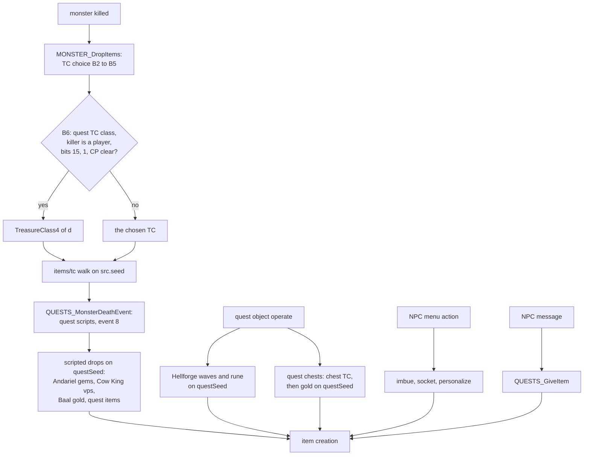
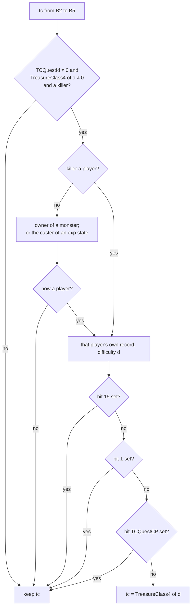
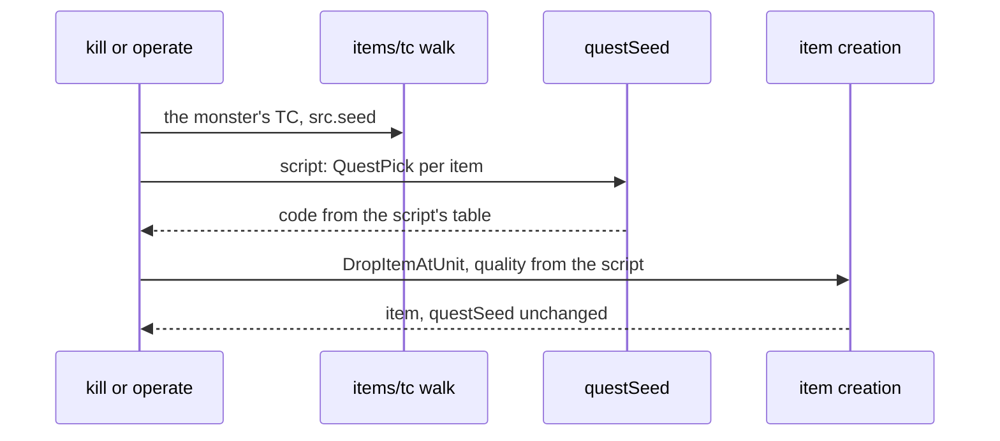
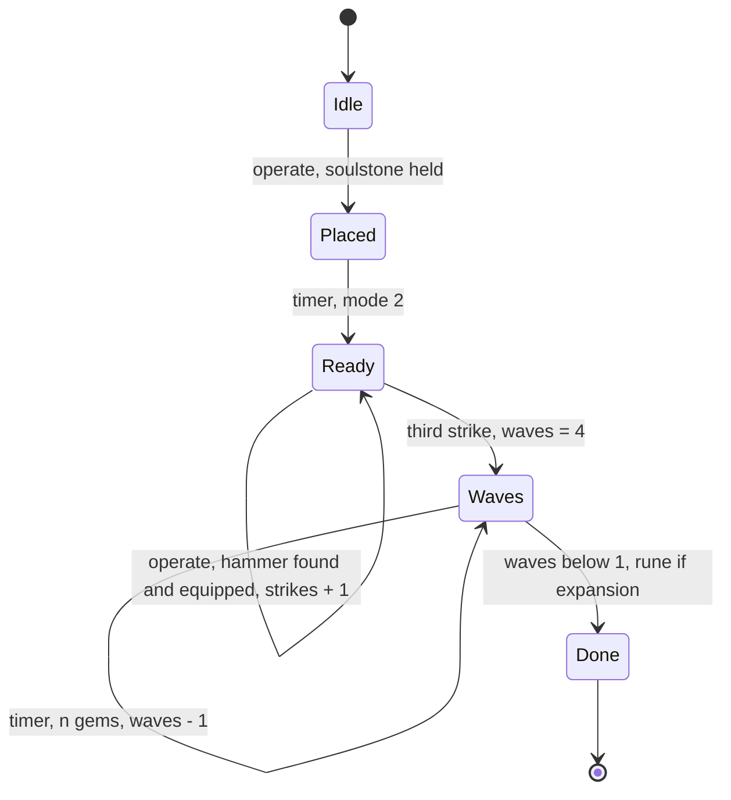
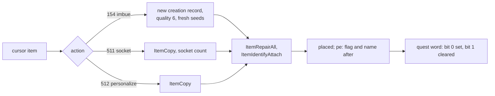
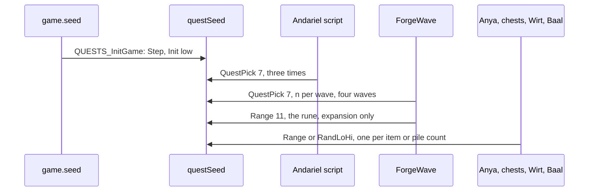

# Quest drops, quest rewards and special drops

## Purpose

Quest state changes item creation in three places. (1) A kill of one of five act bosses drops from the boss's
`TreasureClass4` column instead of its usual TC while the killer's quest record says the quest is not done (step B6 of
[items/tc](tc.md#b-monster-drop-which-tc--monster_dropitems)). (2) Quest scripts create items outside the TC path:
special drops (Andariel's gems, the Hellforge's gems and rune, the Cow King's potions, Baal's gold), quest items (the
Horadric parts, Wirt's Leg, the scrolls) and gold from quest chests. Their draws are on a game-wide **quest seed**. (3)
Three NPC services rebuild an item the player hands over: Charsi's imbue, Larzuk's socket and Anya's personalization.
Other NPCs give fixed items. This spec covers what each path reads, which seed it draws, and what it hands to item
creation. When a quest bit gets set (dialogue, timers, who stands where) is game simulation (ADR-0002) and an input
here; which event sets each bit is [quests/progression](../quests/progression.md).

## Entry points

| When | Function | Tag |
|---|---|---|
| A monster dies: TC choice, then the quest TC switch | fn:sub_0057CCB0_UnitKilled@0x0057CCB0 → fn:sub_005A7C20_MonSetMode@0x005A7C20 → fn:sub_005A6FF0_MonDeathEvent@0x005A6FF0 → fn:MONSTER_DropItems@0x005A6600 | [C] (run:2026-10-16-quest-drops) |
| The same death, after the drop: the quest scripts' death event (event 8) | fn:QUESTS_MonsterDeathEvent@0x00543A30 → `Quest+0xC0` of each quest the monster is hooked to | [C] (run:2026-10-16-quest-drops, 0x0057CDD9) |
| Game creation: the quest objects and the quest seed | fn:QUESTS_InitGame@0x00545D80 | [C] (run:2026-10-16-quest-drops) |
| A quest object is operated (the Hellforge, quest chests, the altar, item objects): the quest script is the object's `OperateFn` slot itself | fn:OBJ_OperateDispatch@0x00584420 → data:g_ObjOperateFns@0x00732D18`[OperateFn]` (slots in § E and § D4) | [I] (items/0010 § 9); the Hellforge's slot 49 [C] (run:2026-10-16-quest-drops, the only reference to `ForgeOperate`) |
| Object event 7, a timer some operate slots and scripts queue on a quest object (the forge's waves, Wirt's gold piles): dispatch by object class | fn:OBJ_EventDispatch@0x00586AD0 → data:g_ObjEventFns@0x006E19B0 entry 7 → fn:sub_00581A10_ObjEvent7Thunk@0x00581A10 → fn:QUESTS_ObjectEvent@0x005449E0 | [I] (items/0010 § 9) |
| The Hellforge's timer, after the third strike | fn:QUESTS_ObjectEvent@0x005449E0 → fn:sub_005B6710_A4Q3_ForgeWave@0x005B6710 | [C] (run:2026-10-16-quest-drops; the only references in the image force the event-7 route, items/0010 § 9) |
| An NPC menu action: imbue (Charsi), socket (Larzuk), personalize (Anya) | fn:NPC_MenuAction@0x00579D60 | [C] (run:2026-10-16-quest-drops) |
| An NPC message that gives an item (Akara, Ormus, Alkor, Qual-Kehk, Malah, Anya) | the act scripts' NPC message callbacks → fn:QUESTS_GiveItem@0x005466B0 | [I] |

## Inputs

### Tables

| Anchor | Used for |
|---|---|
| tbl:MonStats.txt:TCQuestId (`+0x9E` u8), tbl:MonStats.txt:TCQuestCP (`+0x9F` u8) | the quest word and the checkpoint bit B6 tests ([MonStats § Quest TCs](../../tables/MonStats.md#quest-tcs-plan-0032-phase-0)) |
| tbl:MonStats.txt:TreasureClass4 (`+0x8C + 8·d`, u16) | the quest TC of difficulty `d` |
| tbl:MonStats.txt:boss, tbl:MonStats.txt:noRatio (`+0x00C` bits 6 and 2) | the monster-level exception of [monsters/pool § E](../monsters/pool.md#e-the-monster-level-sub_00573cb0_monstatsinit) (§ G) |
| `states.txt` column `exp` (flag bit 30 → bit-set `DataTables+0x144`; [States](../../tables/States.md)) | the states whose caster takes the kill (§ B) |
| tbl:Misc.txt:quest (`+0x12A`), tbl:Misc.txt:questdiffcheck (`+0x12B`), and the same columns of [Weapons](../../tables/Weapons.md) and [Armor](../../tables/Armor.md) | quest item identity and the difficulty check (§ E) |
| tbl:Weapons.txt:bitfield1 (`+0xDC` bit 0), tbl:Weapons.txt:compactsave (`+0x143`), tbl:Armor.txt:nameable (`+0x145`) | the imbue and personalize tests (§ F) |
| tbl:SuperUniques.txt:TC | the Countess's and the Cow King's own drops (ordinary superunique TCs) |
| tbl:Levels.txt:MonLvl2Ex, tbl:Levels.txt:MonLvl3Ex | the area level a `boss` class does **not** take (§ G), and the ilvl of an object's scripted drop |

### Runtime state

| State | Type | Source |
|---|---|---|
| quest record of a player | 768 bits for the game's difficulty: `PlayerData+0x10 + 4·Game+0x6D`; "word *q*, bit *s*" is bit `16q + s` | [save/0002](../../findings/save/0002-quest-words.md), fn:QUESTS_PlayerRecord@0x00543520 |
| `questSeed` | `Seed` at `QuestControl+0x18`, `QuestControl` = `Game+0x10F4` | struct:Game+0x10F4, fn:QUESTS_GetSeed@0x005438B0 |
| `game.seed` | `Seed` at struct:Game+0xD0 | [rng/seeds](../rng/seeds.md) |
| `d` | difficulty, u8 at struct:Game+0x6D | |
| `game.expansion` | struct:Game+0x70 | |
| `game.type` | struct:Game+0x6A (3 in every logged single-player game) | [items/tc](tc.md#inputs) |
| kill context | `ctx`, its killer at `ctx+8` | fn:MONSTER_DropItems@0x005A6600 |
| `clvl` | the player's base stat 12 (`level`) | |
| `unit+0xB8` | the item code a scripted drop creates at a source unit (0 = a random base) | struct:Unit+0xB8 |
| per-player counts | how many players a script credits (the forge's `n`, Baal's and the chests' loops) | the quest scripts; an input (§ Inputs and oracles) |

### Constants

| Name | Value | Anchor | Tag |
|---|---|---|---|
| `ANDARIEL_CHIPPED` | `gcv gcr gcb gcy gcg gcw skc` | data:g_AndarielChippedGems@0x007361DC | [C] (run:2026-10-16-quest-drops) |
| `STANDARD_GEMS` | `gsv gsr gsb gsy gsg gsw sku` (Andariel's third gem and the forge's last wave) | data:g_AndarielStdGems@0x00736444, data:g_ForgeGemsStandard@0x0073E5A4 | [C] (run:2026-10-16-quest-drops) |
| `FORGE_PERFECT` | `gpv gpr gpb gpy gpg gpw skz` | data:g_ForgeGemsPerfect@0x0073E56C | [C] (run:2026-10-16-quest-drops) |
| `FORGE_FLAWLESS` | `gzv glr glb gly glg glw skl` | data:g_ForgeGemsFlawless@0x0073E588 | [C] (run:2026-10-16-quest-drops) |
| `FORGE_RUNES[0]`, `[1]` | `r01`…`r11` (Normal), `r12`…`r22` (Nightmare) | data:g_ForgeRunesNormal@0x0073E114, data:g_ForgeRunesNightmare@0x0073E514 | [C] (run:2026-10-16-quest-drops) |
| `FORGE_RUNES[2]` | `r15`…`r25` (Hell) | data:g_ForgeRunesHell@0x0073E540 | [C] (run:2026-10-16-quest-drops, owner-played session 3507: entry 4 → `r19`) |
| `QUAL_KEHK_RUNES` | `r07 r08 r09` | data:g_QualKehkRunes@0x00732FEC | [I] |
| `ANYA_REWARDS[d]` | per class row (§ F5) | data:g_AnyaRewardsNormal@0x00735F6C, data:g_AnyaRewardsNightmare@0x00735EFC, data:g_AnyaRewardsHell@0x00735F34 | [I] |
| `INIT_HIGH` | 666 (`0x29A`), the high word of every `Init` | [rng](../rng/README.md) step 5 | [C] (run:2026-10-16-quest-drops) |

### Inputs and oracles

The boundary ruled for plan 0032 Phase 2 (items/0010 § 8 and the plan's log):

| Thing | Kind | Detail | Tag |
|---|---|---|---|
| the quest bits a test reads | input | when a script, an NPC or the save loader sets them is game simulation; the tests on them are modelled | [C] (run:2026-10-16-quest-drops: 1431 quest-bit writes, each "old" word as the earlier writes left it) |
| the per-player counts of a script | input | the forge's `n`, the players a death or chest loop credits | [I] (fn:sub_005537D0_GameForEachUnit@0x005537D0, fn:sub_00540510_PartyForEach@0x00540510) |
| the quest seed on entry to a scripted drop | boundary oracle (ADR-0004) | quest code that creates no item also draws it (0x0058E830, 0x00592E90, 0x0059B1C0, 0x0059EDC0, 0x005BD390), so a reimplementation asserts the seed at each drop; its start value is modelled (A1) | [C] (run:2026-10-16-quest-drops: 28 fetches, every entry seed the one the model held, no oracle value taken) |
| the item created | modelled | through the ordinary item creation of [uniques-sets](uniques-sets.md), [affixes](affixes.md) and [properties](properties.md) | [C] (run:2026-10-16-quest-drops: 1856 creations through `tools/items_chain.py affixes`) |

## Algorithm



### A. The quest record and the quest seed

```
A1. QUESTS_InitGame(game):                                         [C] (fn:QUESTS_InitGame@0x00545D80 0x00545F10–0x00545F5F, run:2026-10-16-quest-drops)
      for each g_QuestDescs row: a 0xF8-byte quest object (id at +0x00, callbacks at +0xA0 + 4·event)
      Step(game.seed)                                              ; one game-seed draw
      Init(questSeed, game.seed.low)                               ; questSeed ← {low, 666}
A2. QuestPick(n: u32) → u32:                                       [C] (fn:QUESTS_GetSeed@0x005438B0, run:2026-10-16-quest-drops)
      Step(questSeed)                                              ; draw; the LCG step inlined in the scripts
      return questSeed.low mod n                                   ; unsigned
A3. GetState(rec, q, s) = bit 16q + s of rec                        [I] (fn:QUESTRECORD_GetState@0x0065C310)
```

Step notes:

- A1. [C] In every logged game the quest seed's start was `{low, 666}` of one game-seed step taken at
  `QUESTS_InitGame`, and every scripted drop of the run found the quest seed where the model's previous draw left it.
  (fn:QUESTS_InitGame@0x00545D80, run:2026-10-16-quest-drops: 53 starts, 28 fetches)
- A1. [C] **The step is game-seed draw 4.** Game creation steps the game seed in `sub_00547D20_MonRegionsInit` (draw
  1), `OBJRGN_Create` (draw 2), `NPCSTORE_CtlCreate` (draw 3, the store seed of [items/vendors](vendors.md)) and then
  `QUESTS_InitGame`: in all 53 sessions of the run, and in the 7 owner-played ones, the game seed at `QUESTS_InitGame`'s
  entry was exactly three steps past `Init(N)` of the session's seed ([rng/seeds](../rng/seeds.md) step 7a).
  (fn:sub_00547D20_MonRegionsInit@0x00547D20, fn:OBJRGN_Create@0x00546C60, fn:NPCSTORE_CtlCreate@0x00536070,
  fn:QUESTS_InitGame@0x00545D80, run:2026-10-16-quest-drops, [items/0010 § 1](../../findings/items/0010-quest-drops.md#1-quest-objects-events-and-the-quest-seed))
- A1. [I] `g_QuestDescs` also gives each quest object its record word; object id and word are equal for Act I
  (objects 0–6) and differ after (7 → 8 … 13 → 14, 14 → 16 … 20 → 22, 21 → 24 … 24 → 27, 25 → 29, 26 → 30, 27 → 31,
  28 → 32, 29 → 33, 30 → 41, 31 → 35 … 36 → 40). (data:g_QuestDescs@0x00731510)
- A2. [I] The scripts write the step inline (`s ← lo·0x6AC690C5 + hi`, the compiler's multiply-shift for `mod 7` and
  `mod 5`) or call `RNG_Range`/`RNG_RandLoHi` on the quest seed; all are `Step` then `low mod n` of
  [rng](../rng/README.md) step 2, and `RandLoHi(s, lo, hi)` is `lo + Range(s, hi − lo)`
  ([objects § E](../objects/README.md#e-the-populatefn-handlers)). (fn:RNG_Range@0x0045C390, fn:RNG_RandLoHi@0x004BC500)
- A3. [C] On a player's record bit 15 of a word is set by the save loader alone, from a saved bit 1 (words 0–41), and
  only word 9's script clears it (0x00599293); the one record-function set of bit 15 is the join's, on the game record.
  So bit 15 means "this character saved the game while bit 1 was set". The loaded quest saves of the run came back
  with exactly that bit 15 added, and the 1 626 logged writes set bit 15 only on the game record. The "only" is a
  closure over every call of the five record functions (the 378 sites, the 45 register operands read one by one, the
  12 steps clears, which stop at bit 11). Its limits: a store to a record outside those functions (the loader aside)
  is not covered, and the A3Q4 party bit is bounded by the stores in its quest's code window (bits 2, 4 and 1).
  (fn:QUESTRECORD_LoadBytes@0x0065C4D0, fn:QUESTRECORD_SetState@0x0065C360, fn:QUESTRECORD_ClearState@0x0065C3A0,
  fn:QUESTRECORD_ClearSteps@0x0065C3E0, 0x00599293, run:2026-10-16-quest-drops,
  [items/0010 § Plan 0049 Phase 1](../../findings/items/0010-quest-drops.md#plan-0049-phase-1-2026-10-20-static-the-s2c-static-leftovers))

### B. The quest TC switch (items/tc B6)



```
B6. QuestTcSwitch(game, mon, ctx, tc: u16) → u16:                  [C] (fn:MONSTER_DropItems@0x005A6600 0x005A6705–0x005A67F1, run:2026-10-16-quest-drops)
      d: u8 ← game.difficulty
      row ← MonStats[mon.classId]
      q: u8 ← row.TCQuestId
      if q = 0 or row.TreasureClass4[d] = 0 or ctx = none or ctx.killer = none: return tc
      k ← ctx.killer
B6a.  if k.type ≠ 0:                                                [I] (fn:sub_0058F0D0_MonsterOwner@0x0058F0D0, fn:sub_0063A690_UnitHasExpState@0x0063A690, fn:sub_00625760_StatListFindFlag@0x00625760, all of B6a)
        p ← MonsterOwner(k)                                         ; unit type 1 only; else none
        if UnitHasExpState(k):
          sl ← StatListFindFlag(k, 0x800)
          if sl ≠ none: p ← GameFindUnit(game, sl.ownerType (+0x08), sl.ownerGuid (+0x0C))
        if p ≠ none: k ← p
B6b.  if k.type ≠ 0: return tc                                      [I] (fn:MONSTER_DropItems@0x005A6600)
      r ← QuestRecord(game, k)                                      ; k's own record for difficulty d
      if r = none: return tc
B6c.  if GetState(r, q, 15) = 1: return tc                          [C] (fn:QUESTRECORD_GetState@0x0065C310, run:2026-10-16-quest-drops, all of B6c)
      if GetState(r, q, 1) = 1: return tc                           ; the tests stop at the first set bit
      if GetState(r, q, row.TCQuestCP) = 1: return tc
      return row.TreasureClass4[d]
B7.   TC_DropByIndex(game, mon, ctx.killer, tc, …)                  [I] (fn:MONSTER_DropItems@0x005A6600 0x005A6817) ; the unresolved killer
```

Step notes:

- B6. [C] The three `GetState` calls are made in the order 15, 1, `TCQuestCP` and stop at the first bit that is set;
  the TC passed on is the model's in all 8 logged boss kills and is the `DROP` base that `tools/tc.py replay`
  resolves. Scope: single player, a player killer. (fn:MONSTER_DropItems@0x005A6600, run:2026-10-16-quest-drops)
- B6. [C] **`TCQuestId` is the record word.** Andariel's `TCQuestId` 6 read record word 6 in every B6 group, so the
  value is used as the word number with no offset. (tbl:MonStats.txt:TCQuestId, run:2026-10-16-quest-drops)
- B6. [C] **The drop runs before the quest scripts see the death.** `sub_0057CCB0_UnitKilled` sets the death mode
  first (0x0057CDC4); the mode's start function drops the items at once (0x005A7D67); only then does it dispatch the
  quest death event (0x0057CDD9). In every boss kill the B6 and drop lines came before the death script's bit writes
  (Andariel's `SetKilled` at 0x0059621D, Duriel's bit 5 at 0x0059D0F5). So the bits a boss's own script sets for a
  kill never hide the quest TC of that kill. (fn:sub_0057CCB0_UnitKilled@0x0057CCB0, fn:sub_005A7C20_MonSetMode@0x005A7C20,
  fn:QUESTS_MonsterDeathEvent@0x00543A30, run:2026-10-16-quest-drops)
- B6a. [I] The pet, hireling and `exp`-state paths: a monster killer is replaced by its owner unit; a killer carrying
  a state of the `exp` bit-set (`states.txt` rows 53 `conversion`, 57 `attract`, 59 `confuse` in the shipped data) is
  replaced by the owner of its first stat list with flag `0x800`, found by stored type and GUID. A missile is never
  resolved here (`MonsterOwner` answers for type 1 only). None of these ran: in every logged kill (Nova) the killer was
  the player unit. (fn:sub_0063A130_UnitHasStateInMask@0x0063A130, fn:sub_00611D60_StatesMaskBuild@0x00611D60,
  fn:sub_00552F60_GameFindUnit@0x00552F60, run:2026-10-16-quest-drops)
- B6b. [I] Only the resolved player's own record is read; no other party member's record enters. No party was run.
  (fn:QUESTS_PlayerRecord@0x00543520, fn:UNIT_GetPlayerData@0x006221A0)
- B6. [I] The death mode's function record is chosen by `sub_005A78A0_MonModeRecord`, which also reads
  `MonStats+0x1A5`; for Andariel, Duriel and Mephisto the drop came first in every kill, and Diablo and Baal were
  not killed. (fn:sub_005A78A0_MonModeRecord@0x005A78A0, run:2026-10-16-quest-drops)

**The quest-dependent TCs.** Exactly five classes have a `TCQuestId`, and each has all three `TreasureClass4` cells.
[C] (tbl:MonStats.txt:TCQuestId, tbl:MonStats.txt:TreasureClass4, [MonStats § Quest TCs](../../tables/MonStats.md#quest-tcs-plan-0032-phase-0))

| class (`hcIdx`) | word | `TCQuestCP` | quest TC: Normal / Nightmare / Hell | bits the kill sets (script) | B6 tests | Tag |
|---|---|---|---|---|---|---|
| `andariel` (156) | 6 | 1 | `Andarielq` / `Andarielq (N)` / `Andarielq (H)` | 13, 1 on the killer when bits 0 and 1 are clear (`sub_00596210_A1Q6_SetKilled`) | 15, 1, 1 | [C] (fn:sub_00596210_A1Q6_SetKilled@0x00596210, run:2026-10-16-quest-drops) |
| `duriel` (211) | 14 | 5 | `Durielq` … | 5 on the killer when bits 0, 3, 4, 5 are clear | 15, 1, 5 | [C] (fn:sub_0059D050_A2Q6_DurielDeath@0x0059D050, run:2026-10-16-quest-drops) |
| `mephisto` (242) | 22 | 0 | `Mephistoq` … | 13, 0, 11 (`sub_005BC140_A3Q6_SetDone`) | 15, 1, 0 | [I] (fn:sub_005BC140_A3Q6_SetDone@0x005BC140) |
| `diablo` (243) | 26 | 0 | `Diabloq` … | 13, 0, 6, 7 (through 0x005B4D20) | 15, 1, 0 | [I] (fn:sub_005B52E0_A4Q2_DiabloDeath@0x005B52E0) |
| `baalcrab` (544) | 40 | 0 | `Baalq` … | 0, 13 (through 0x0058DC60 / 0x0058DD30) | 15, 1, 0 | [I] (fn:sub_0058DF20_A5Q6_BaalDeath@0x0058DF20) |

**What each state of the word gives.**

| class | killer's word | TC | Tag |
|---|---|---|---|
| Andariel | clear (fresh) | quest TC | [C] (run:2026-10-16-quest-drops: Normal) |
| Andariel | bit 0 only, bit 1 clear (reported to Warriv) | quest TC, in every later game | [C] (run:2026-10-16-quest-drops: Normal and Hell) |
| Andariel | bit 1 (killed in this game, not yet reported) | normal TC | [I] (fn:sub_00595C60_A1Q6_NpcMessage@0x00595C60) |
| Andariel | bits 1 and 15 (saved before the report) | normal TC for good | [C] (run:2026-10-16-quest-drops: the test stops at bit 15) |
| Duriel | clear, or bit 0 only | quest TC | [C] (run:2026-10-16-quest-drops) |
| Duriel | bit 5 (after the first kill) | normal TC | [C] (run:2026-10-16-quest-drops) |
| Mephisto | clear | quest TC | [C] (run:2026-10-16-quest-drops) |
| Mephisto | bit 0 (after the first kill) | normal TC (`Mephisto` 848, not `Mephistoq` 851), and no `mss` | [C] (run:2026-10-16-quest-drops, owner-played: word 22 = `0x0001`; fn:sub_005BC8B0_A3Q6_MephistoDeath@0x005BC8B0) |
| Diablo, Baal | clear / bit 0 | quest TC / normal TC | [I] (fn:sub_005B52E0_A4Q2_DiabloDeath@0x005B52E0, fn:sub_0058DF20_A5Q6_BaalDeath@0x0058DF20) |

- [I] **Andariel's quest TC comes back.** Warriv's message (npc 155, `0xB7`) with bit 1 set clears bit 1 and sets bit
  0, and nothing else writes bits 0, 1 or 15 of word 6. With `TCQuestCP` 1 the test is "bits 15 and 1 clear", so after
  the report every later game gives the quest TC again; a save between the kill and the report sets bit 15 at the next
  load and ends it. (fn:sub_00595C60_A1Q6_NpcMessage@0x00595C60 0x00595D92, 0x00595D9C, fn:QUESTRECORD_LoadBytes@0x0065C4D0)
- [C] **Duriel's bits stay.** Duriel's bit 5 is never cleared and his bit 1 is never set through the record functions:
  no constant site clears word 14 bit 5 or sets bit 1, no register site writes word 14 and no steps clear is on it, by
  the closure of A3; the only route outside those functions is the save loader. A whole-record reset outside the five
  functions is not covered. (fn:sub_0059D050_A2Q6_DurielDeath@0x0059D050 0x0059CD2F–0x0059CEA5, 0x0059D0F0,
  fn:QUESTRECORD_ClearSteps@0x0065C3E0, [items/0010 § Plan 0049 Phase 1](../../findings/items/0010-quest-drops.md#plan-0049-phase-1-2026-10-20-static-the-s2c-static-leftovers))
- [I] **The others do not.** Mephisto's, Diablo's and Baal's scripts set bit 0, which `TCQuestCP` 0 tests. So for
  these four (Duriel included) the quest TC is used until the killer's first kill in that difficulty.
  (fn:sub_0059D050_A2Q6_DurielDeath@0x0059D050, fn:sub_005BC8B0_A3Q6_MephistoDeath@0x005BC8B0)
- [I] **No quest TC.** The Countess (`corruptrogue3`), the Cow King, Nihlathak (`nihlathakboss`) and every other
  class have `TCQuestId` 0: B6 never applies and their drop is their ordinary (superunique) TC. (tbl:MonStats.txt:TCQuestId,
  tbl:SuperUniques.txt:TC, fn:MONSTER_DropItems@0x005A6600)

### C. The two creators of scripted items

```
C1. DropItemAtUnit(game, source, quality, …):                      [I] (fn:sub_00559A30_DropItemAtUnit@0x00559A30, all of C1)
      ilvl ← source is a monster ? its stat 12
           : source is a player  ? its base stat 12
           : the area level of the object's level (Levels monster level of d and the game type), min 1
      index ← source+0xB8 ≠ 0 ? ITEMS_GetByCode(source+0xB8) : a random base
      rec ← {ilvl (+0x0C), index (+0x14), quality (+0x30)}, at a free cell near the source
      ItemCreate(rec)                                              ; no quest-seed draw
C2. QUESTS_GiveItem(game, player, code, ilvl, quality, dropIfFull): [I] (fn:QUESTS_GiveItem@0x005466B0, fn:ITEMS_CreateForStore@0x00559CE0, all of C2)
      if ilvl = 0: ilvl ← clvl
      item ← ITEMS_CreateForStore(index of code, quality, ilvl); durability ← maximum
      into the inventory; if it does not fit and dropIfFull: dropped at the player
```

Step notes:

- C1. [C] A creation through `DropItemAtUnit` leaves the quest seed as it found it: every scripted creation of the run
  had the same quest seed on entry and on exit; the item's own seeds come from the game seed as for any creation
  ([items README](README.md)). (run:2026-10-16-quest-drops, fn:sub_00558D90_ItemCreate@0x00558D90)
- C1. [C] The object case: the Hellforge's gems and rune took the area level of the forge's level (27 in Normal), and
  a monster's drop took the monster's level (Andariel 12, Hephasto 28 in Normal). In Hell the forge's drops took ilvl
  85, `MonLvl3Ex` of level 107, and the Cow King's potions his level 31. (run:2026-10-16-quest-drops, tbl:Levels.txt:MonLvl3Ex)
- C1. [I] **An object with no level record.** For a source that is neither monster nor player, the level is
  `LevelMonLvl(level of the source's room, difficulty, expansion)`: it returns 1 for a difficulty ≥ 3, a level id ≤ 0
  or past the `Levels` count, or no record, else `MonLvl` or `MonLvlEx` of the difficulty; a unit with no room gives
  level id 0, and any value below 2 becomes 1. So an object in a level with no `Levels` record, or with a monster level
  of 0 or 1 (the towns), drops at ilvl 1. (0x00559A6F–0x00559AEF, 0x0061DCA0–0x0061DCF4,
  fn:sub_00559A30_DropItemAtUnit@0x00559A30, fn:sub_0061DCA0_LevelMonLvl@0x0061DCA0, tbl:Levels.txt:MonLvl1,
  [items/0010 § Plan 0039 batch P1b](../../findings/items/0010-quest-drops.md#q20-the-open-questions-of--open-questions))
- C2. [I] Every `QUESTS_GiveItem` creation is a fresh store-path creation (`ITEMS_CreateForStore`), as
  [items/vendors](vendors.md) uses. (fn:ITEMS_CreateForStore@0x00559CE0)

### D. Special drops

Every special drop below is made by a quest script after the TC drop of B6/B7 (§ B, order note); each draw is one
`QuestPick` (A2) on the quest seed.



#### D1. Andariel's gems

```
D1. AndarielDeath (event 8, quest active, killer present):          [C] (fn:sub_005965A0_A1Q6_AndarielDeath@0x005965A0 0x00596639–0x00596730, run:2026-10-16-quest-drops, all of D1)
      if killer word 6 bit 0 or bit 1 is set: no gems
      SetKilled(killer)                                            ; word 6 bits 13, 1
      repeat 2:
        i ← QuestPick(7)                                           ; draw
        Andariel+0xB8 ← ANDARIEL_CHIPPED[i]; DropItemAtUnit(quality 2, source Andariel)
      i ← QuestPick(7)                                             ; draw
      Andariel+0xB8 ← STANDARD_GEMS[i]; DropItemAtUnit(quality 2); Andariel+0xB8 ← 0
```

- D1. [C] One kill with bits 0 and 1 clear drew two chipped picks and one standard pick (`gcy`, `skc`, `gsg`); the
  kills with bit 0 or bit 1 set drew nothing. The gems' ilvl is Andariel's level. (run:2026-10-16-quest-drops)
- D1. [I] The same in every difficulty and game type: the script has no difficulty or expansion test, and later
  per-player callbacks set bits 13 and 1 for players in level 37 and the killer's Act I party without drawing.
  (fn:sub_005965A0_A1Q6_AndarielDeath@0x005965A0, fn:sub_00596210_A1Q6_SetKilled@0x00596210)

#### D2. The Countess

- [C] Her death script (`sub_00595710_A1Q5_CountessDeath`, quest hook 5) creates no item and makes no quest-seed draw.
  Her drop is her superunique TC, whose tree holds the rune picks, and no quest state enters it: one owner-played kill
  in each of the four states (word 5 clear or bit 0 set, Normal and Nightmare) dropped from `Countess` (1004) in both
  Normal games and `Countess (N)` (1005) in both Nightmare games, with no B6 test reached (class 45 has `TCQuestId` 0),
  no quest-seed fetch and no scripted creation, every drop reproduced by `tools/tc.py`.
  (fn:sub_00595710_A1Q5_CountessDeath@0x00595710, tbl:SuperUniques.txt:TC, tbl:MonStats.txt:TCQuestId,
  [TreasureClassEx](../../tables/TreasureClassEx.md), run:2026-10-16-quest-drops)
- [C] In the not-done games word 5 got bits 13 and 0 and a clear of bit 1 **after** the drop, from the per-player code
  at 0x00594F2A–0x00594F6B, which tests word 5 bit 0 and the player's level (25); in the done games word 5 was not
  written. (run:2026-10-16-quest-drops, fn:sub_00595710_A1Q5_CountessDeath@0x00595710)
- [I] Hell (`Countess (H)`) is the same by the code (her class's `TCQuestId` 0 holds in every difficulty); not run.
  (fn:sub_00595710_A1Q5_CountessDeath@0x00595710, fn:MONSTER_DropItems@0x005A6600, tbl:SuperUniques.txt:TC)

#### D3. The Cow King and the cows

```
D3. CowKingDeath (quest hook 4):                                   [C] (fn:sub_00593E70_A1Q4_CowKingDeath@0x00593E70, run:2026-10-16-quest-drops, all of D3 for a qualifying killer; the two refusal lines are inferred)
      if killer:
        if killer word 4 bit 10: return                            ; already credited: no potions     [I] (0x00593E70)
        done ← game.expansion ? killer word 40 bit 0 : killer word 26 bit 0                           [I] (0x00593E70, the classic test and the refusal)
        if not done: return
        set killer word 4 bit 10                                   ; 0x00593EFB
      for each player: 0x00593E30                                  ; sets bit 10 again (0x00593E63)
      CowKing+0xB8 ← 'vps '; repeat 8: DropItemAtUnit(quality 0, source Cow King)   ; no draw
```

- D3. [C] One owner-played kill by a qualifying player (word 40 bit 0 set, word 4 bit 10 clear): the Cow King's own
  superunique TC (`Cow King`) dropped first, as for any kill; then killer word 4 bit 10 was set (0x00593EFB), the
  per-player code set it again (0x00593E63), and eight `DropItemAtUnit` calls with code `vps ` and quality 0 ran on an
  unchanged quest seed. The potions came out with **quality 2** and ilvl 31, the Cow King's level: the quality-0
  request yields a quality-2 item. (fn:sub_00593E70_A1Q4_CowKingDeath@0x00593E70, fn:sub_00559A30_DropItemAtUnit@0x00559A30,
  run:2026-10-16-quest-drops)
- D3. [I] **Why quality 2.** Quality 0 in the record makes `ItemRollQualityCreate` run its drawing body (its early return
  needs a non-zero `+0x30`): it draws on the item seed, reads `ITEMRATIO_Select`, and writes its result first. Then the
  pre-switch overrides run ([items/quality § F](quality.md#f-boundaries-named-only)): `vps` is of type `spot`, whose
  `Normal` is 1, so the last override writes 2 whatever the roll gave, and the switch takes case 2, the normal builder.
  The roll's draws are checked by no log. (0x00556F76–0x00556F7E, 0x005574CC–0x005574DE, 0x005574E3–0x00557567,
  fn:sub_00556F60_ItemRollQualityCreate@0x00556F60, fn:sub_00557450_ItemCreateByQuality@0x00557450,
  tbl:ItemTypes.txt:Normal, tbl:Misc.txt:type, [items/0010 § Plan 0039 batch P1b](../../findings/items/0010-quest-drops.md#q20-the-open-questions-of--open-questions))
- D3. [I] `done` is bit 0 of the word: the bit Diablo's death script sets in word 26 and Baal's in word 40 (§ B), so a
  killer qualifies once Diablo (classic) or Baal (expansion) is killed in that difficulty. The two refusals (bit 10
  already set; Baal not done), the no-killer case and the classic word 26 test were not run. Word 4 bit 10 is the bit `CUBE_CowPortalOpen` refuses on ([items/cube § L](cube.md#l-the-special-outputs-kinds-1-2-3)).
  (fn:sub_00593E70_A1Q4_CowKingDeath@0x00593E70, fn:CUBE_CowPortalOpen@0x00594140)
- D3. [C] The cow level itself: the cube opened the portal and 565 hell bovines were killed, every drop reproduced by
  `tools/tc.py` as ordinary TC drops; the bovines' set-29 flag is [items/uniques-sets](uniques-sets.md)'s.
  (fn:CUBE_CowPortalOpen@0x00594140, run:2026-10-16-quest-drops)

#### D4. The Hellforge



```
D4. ForgeOperate(forge, player), word 27 bits 0 and 1 clear:       [C] (fn:sub_005B5C10_A4Q3_ForgeOperate@0x005B5C10, run:2026-10-16-quest-drops, all of D4)
      if forge mode 0 and PlayerFindItemByCode(player, 'mss '): remove it; forge → mode 1 (a timer brings mode 2)
      else if forge mode 2 and PlayerFindItemByCode(player, 'hfh ') and the right-hand weapon is 'hfh':   ; 0x0063BEF0
        strikes += 1
        if strikes = 3:
          remove 'hfh'; player word 27 bits 13, 1; waves ← 4; n ← 1
          for each other player in Act IV with word 27 bits 0 and 1 clear: bits 13, 1; n += 1     ; input count
          timer 7 after Objects+0xE4 >> 8 frames
D5. ForgeWave (timer), forge active:                               [C] (fn:sub_005B6710_A4Q3_ForgeWave@0x005B6710, run:2026-10-16-quest-drops, all of D5)
      table ← waves = 4 ? FORGE_PERFECT : waves ≥ 2 ? FORGE_FLAWLESS : STANDARD_GEMS
      repeat n:
        i ← QuestPick(7)                                           ; draw
        forge+0xB8 ← table[i]; DropItemAtUnit(quality 2, source forge)
      if any item was created:
        waves ← waves − 1
        if waves < 1:
          forge inactive
          if game.expansion:
            r ← Range(questSeed, 11)                               ; draw
            forge+0xB8 ← FORGE_RUNES[d][r]; DropItemAtUnit(quality 2)
        else: timer 7 after 20 frames
```

- D4. [C] The strike test needs both: `PlayerFindItemByCode('hfh ')` finds a hammer, and the equipped right-hand weapon
  is `hfh`. `hfh` has `questdiffcheck` 1, so a hammer whose stat 356 is below the difficulty is not found: in Nightmare
  a stat-356-0 hammer counted no strike and a stat-356-2 hammer did. (fn:sub_00558110_PlayerFindItemByCode@0x00558110,
  tbl:Weapons.txt:questdiffcheck, run:2026-10-16-quest-drops)
- D4. [C] **The boundary is `≥`.** In the owner-played Hell session (difficulty 2) a soulstone and a hammer with stat
  356 = 2 were both found: the soulstone was placed and three strikes counted. That equality rules out `>`; the
  Nightmare cases (356 = 2 found, 356 = 0 refused) rule out `=` and no test. It is the code's signed
  `difficulty ≤ stat` jump at 0x005581D6 on the inventory walk; the cursor branch has the same compare at 0x0055816D.
  (fn:sub_00558110_PlayerFindItemByCode@0x00558110, tbl:Weapons.txt:questdiffcheck, tbl:Misc.txt:questdiffcheck,
  run:2026-10-16-quest-drops)
- D4. [I] **The two branches test different flags.** The cursor item, when its code matches, is returned unless its
  record has `quest` ≠ 0 **and** its stat 356 is below the difficulty; `questdiffcheck` is not tested there. A cursor
  item that fails falls through to the inventory walk, which skips page 1 and returns a match when `quest` = 0, or
  `questdiffcheck` = 0, or stat 356 ≥ the difficulty. A missing stat reads as 0 (no stat list, a stat out of range or
  with no record, no entry). So a quest item with neither `questdiffcheck` nor stat 356 counts on the cursor only in
  Normal: the cube (`box`, the only stock `quest` row with `questdiffcheck` blank) held on the cursor is found in Normal
  and not in Nightmare or Hell, while in the inventory it counts in every difficulty. An item with `questdiffcheck`
  carries stat 356 = its difficulty, so both branches agree for it. (0x0055814F, 0x0055815C–0x0055816F,
  0x005581B3–0x005581D8, 0x00625496, 0x00624F8C, fn:sub_00558110_PlayerFindItemByCode@0x00558110,
  fn:INV_GetCursorItem@0x0063C1E0, fn:STATS_GetUnitStat@0x00625480, tbl:Misc.txt:quest, tbl:Misc.txt:questdiffcheck,
  [items/0010 § Plan 0039 batch P1b](../../findings/items/0010-quest-drops.md#b12-the-cursor-branch-of-playerfinditembycode))
- D5. [C] Six operations (three Normal, two Nightmare, one Hell, one player each, so `n` = 1) made 24 waves in the
  order perfect, flawless, flawless, standard and six runes from the difficulty's table (`r03 r07 r10` Normal, `r13
  r19` Nightmare, `r19` Hell: `Range(11)` = 4, the fifth entry of `r15`…`r25`), all quality 2. So the rune table is
  chosen by the difficulty in all three. (fn:sub_005B6710_A4Q3_ForgeWave@0x005B6710, data:g_ForgeRunesNormal@0x0073E114,
  data:g_ForgeRunesNightmare@0x0073E514, data:g_ForgeRunesHell@0x0073E540, run:2026-10-16-quest-drops)
- D5. [I] A classic game gets no rune; with more than one credited player each wave makes `n` gems, one draw each.
  Neither was run. (fn:sub_005B6710_A4Q3_ForgeWave@0x005B6710)
- D4. [C] **The hammer.** Hephasto's death callback (`sub_005B65D0_A4Q3_HammerDrop`, quest active) drops `hfh` with
  quality 7 and makes no quest-seed draw: 11 hammers in the scripted sessions, one in the owner-played Hell session. (fn:sub_005B65D0_A4Q3_HammerDrop@0x005B65D0,
  run:2026-10-16-quest-drops)

#### D6. Baal's first kill

```
D6. BaalDeath, killer present, killer word 40 bit 0 clear:          [I] (fn:sub_0058DF20_A5Q6_BaalDeath@0x0058DF20 0x0058E002–0x0058E079, all of D6)
      for each qualifying player counted by the per-player callbacks (+0x88):      ; input count
        amount ← RandLoHi(questSeed, 6000·d + 1500, min(6000·d + 3000, 0xFFFF))   ; draw: 6000d + 1500 … 6000d + 2999
        DropGold(amount) at Baal                                   ; up to 32 piles
```

- D6. [I] Not run (Baal was not killed). `DropGold` is `sub_0055A090_DropGoldAmount(amount, 32)`: piles of at most
  2 000 000 000, at most 32, each a created gold item whose stat 14 is set to its share, so each pile draws as an item
  creation ([items/economy § G](economy.md#g-gold-payment-caps-piles-and-the-death-loss), G9).
  (fn:sub_0055B030_DropGold@0x0055B030, fn:sub_0055A090_DropGoldAmount@0x0055A090)

#### D7. Scripts that create nothing, and Uber Tristram

- [I] Diablo's death script and the Nihlathak and Ancients scripts (a5q4, a5q5) call none of the item creators; their
  drops are their TCs (Diablo through B6). (fn:sub_005B52E0_A4Q2_DiabloDeath@0x005B52E0)
- [I] `sub_005E0070_UberTristramDrop` (death handlers of 704, 705, 709) drops, once all three have died, `cm2` with
  quality 7 (charges refilled) and `Game+0x8C` copies of `std` with quality 2. The portals to those levels cannot open
  in this `Game.exe` ([save/0002 § 6](../../findings/save/0002-quest-words.md)), so stock play never reaches it.
  (fn:sub_005E0070_UberTristramDrop@0x005E0070)

### E. Quest items

| item | source | the script's gate | count | quality | draws | Tag |
|---|---|---|---|---|---|---|
| `leg` | its object's operate | object not yet used | 1 | 2 | — | [I] (fn:sub_00583E70_WirtLegDrop@0x00583E70) |
| gold | Wirt's body (object 268) | first operate | `RandLoHi(questSeed, 10, 20)` piles (10–19), one per timer ([items/economy](economy.md#g-gold-payment-caps-piles-and-the-death-loss) G8a) | 2 | 1 | [C] (fn:sub_00594630_A1Q4_WirtGold@0x00594630, run:2026-10-19-economy2) |
| `bks` | the Inifuss tree | word 4 bits 0, 1 clear, no `bks`/`bkd` held | 1 | 2 | — | [I] (fn:sub_00593AF0_A1Q4_InifussDrop@0x00593AF0) |
| `bkd` | Akara (npc 148), for `bks` | — | 1 (`GiveItem`) | 2 | — | [I] (fn:sub_00592250_A1Q4_NpcMessage@0x00592250 0x00592313) |
| `hdm` | the Malus object | word 3 bits 0, 1 clear, clvl ≥ 8 | 1 | 2 | — | [I] (fn:sub_00591AC0_A1Q3_MalusDrop@0x00591AC0) |
| `ass` | Radament's death | per player with word 9 bit 5, no `ass` held | per player | 2 | — | [I] (fn:sub_00599020_A2Q1_RadamentDeath@0x00599020) |
| `tr1` | its chest | per player with word 10 bits 0, 3 clear | per player (identified) | 7 | chest § E1 | [I] (fn:sub_00599C10_A2Q2_ScrollChest@0x00599C10) |
| `msf` | its chest | per player with word 10 bit 0 clear, no `msf`/`hst` | per player (identified) | 7 | chest § E1 | [I] (fn:sub_00599CF0_A2Q2_StaffChest@0x00599CF0) |
| `box` | its chest | per player without `box` | per player | 2 | chest § E1 | [I] (fn:sub_00599DF0_A2Q2_CubeChest@0x00599DF0) |
| `vip` | the altar (object 149 `taintedsunaltar`, operate slot 24) | not (word 11 done and (word 10 done or `vip`/`hst` held)) | per player (identified) | 7 | chest § E1 | [I] (fn:sub_0059A7E0_A2Q3_ViperChest@0x0059A7E0) |
| `bbb` | its object | word 17 bit 0 clear | 1 | 2 | — | [I] (fn:sub_005B7A60_A3Q1_TomeDrop@0x005B7A60) |
| `qhr`, `qey`, `qbr` | their chests | per player | per player | 2 | chest § E1 | [I] (fn:sub_005B8860_A3Q2_HeartChest@0x005B8860, fn:sub_005B8940_A3Q2_EyeChest@0x005B8940, fn:sub_005B8A20_A3Q2_BrainChest@0x005B8A20) |
| `g33` | a dying monster (unique or flagged) | quest flag armed | 1 | 2 | — | [I] (fn:sub_005B9980_A3Q3_GidbinnDrop@0x005B9980) |
| `j34` | a dying monster | killer word 19 bit 0 clear | 1 | 2 | — | [I] (fn:sub_005BAB60_A3Q4_FigurineDrop@0x005BAB60) |
| `g34`, `xyz` | npc 264 for `j34`; Alkor (npc 254) for `g34` | word 20 states | 1 each (`GiveItem`, clvl) | 2 | — | [I] (fn:sub_005BA320_A3Q4_NpcMessage@0x005BA320 0x005BA661, 0x005BA587) |
| `qf1`, then `box` | the council's deaths | counted players | per player | 7, 2 | — | [I] (fn:sub_005BBC00_A3Q5_CouncilDeath@0x005BBC00) |
| `mss` | Mephisto's death | killer word 22 bit 0 clear (+ counted players) | per player | 2 | — | [I] (fn:sub_005BC8B0_A3Q6_MephistoDeath@0x005BC8B0) |
| `hfh` | Hephasto's death callback | quest active | 1 | 7 | — | [C] (fn:sub_005B65D0_A4Q3_HammerDrop@0x005B65D0, run:2026-10-16-quest-drops) |
| `ice`, `tr2` | Malah (messages) | word 37 states; no `ice` held | 1 each (`GiveItem`, clvl) | 2 | — | [I] (fn:sub_00589580_A5Q3_NpcMessage@0x00589580 0x0058964F, 0x005896DF) |

```
E1. A quest chest's or the altar's operate (tr1, msf, box, vip, qhr, qey, qbr):    [I] (fn:sub_00585B90_ObjectChestDrop@0x00585B90, fn:sub_00585970_DropItemCodeAt@0x00585970, all of E1)
      the quest item(s) of the table row
      ObjectChestDrop(…)                                           ; the chest's ordinary TC drop, objects § J3
      k ← 5 + QuestPick(5)                                         ; draw: 5 … 9
      repeat k: DropItemCodeAt('gld ', quality 2)
```

Step notes:

- [I] **Duplicates** are refused only by each script's own test: its quest bits, or "the player already has the item".
  That test is `sub_00558110_PlayerFindItemByCode`, over the cursor item and the inventory (not page 1). A quest item
  (`quest` ≠ 0) whose base has `questdiffcheck` counts only when its stat 356 is ≥ the game's difficulty, and
  `sub_00557AB0_ItemInitStats` gives every created item with `quest` ≠ 0 and `questdiffcheck` ≠ 0 stat 356 = the
  difficulty. So a Normal staff does not stop a Nightmare chest from making a new one; the cube (`box`,
  `questdiffcheck` blank) does. (fn:sub_00558110_PlayerFindItemByCode@0x00558110 0x005581D6,
  fn:sub_00557AB0_ItemInitStats@0x00557AB0 0x00557E61–0x00557EC3, tbl:Misc.txt:questdiffcheck)
- [C] **`quest` − 1 is a quest object id, not a record word.** Every reader subtracts 1 and looks the object up by id
  (`sub_00543BD0_QuestsInvItemEvent` sends event 9 to it; `sub_00555D20_ItemQuestHook` hooks the item to it), and the
  pair table `{word, quest}` of `sub_0055CC90_ItemQuestGate` matches `g_QuestDescs` for all four pairs. So `hfh`
  (`quest` 25) names object 24, word 27; `mss` (23) names object 22, word 25, not Mephisto's word 22. (data:g_QuestDescs@0x00731510,
  data:g_QuestItemWordGate@0x00731FEC, fn:QUESTS_FindById@0x00543640, tbl:Misc.txt:quest, tbl:Weapons.txt:quest)
- [I] **The item-move gate** `sub_0055CC90_ItemQuestGate` refuses, for the player's record of the game's difficulty: a
  unique quest item whose unique row has `+0x2C` bit 2 when `0x0055CA40` returns non-zero; `ass` while word 9 bit 5
  is clear; `j34` once word 20 bit 0 is set; `xyz` while word 20 bit 5 is clear; `g33` once word 19 bit 7 or 8 is set;
  `tr2` while word 37 bit 8 is clear or once bit 7 is set; then by object `quest − 1`: object 9 when word 10 bit 0 is
  set (not `box`), object 4 when word 4 bit 0 is set, otherwise the pair table's word bit 0; finally when `0x0055CA40`
  is non-zero for this or any other player. Its four callers are item-move paths. (fn:sub_0055CC90_ItemQuestGate@0x0055CC90,
  fn:QUESTRECORD_GetState@0x0065C310)
- [I] **`0x0055CA40` is "the inventory already holds this quest item or this carry-one unique".** It walks the
  inventory, skipping the item X itself, and returns 1 for: when X is a unique whose `UniqueItems` row has `carry1`, an
  item of quality 7 with the same row (not on page 1); or an item not on page 1 whose `quest` equals X's (non-zero) and
  whose code is X's, or pairs with it: `j34`/`g34`, `bks`/`bkd`, `d33`/`g33`, `hst`/`msf`, `hst`/`vip` (either way), or
  `qf2` with `qf1`, `qhr`, `qey` or `qbr`. So the gate refuses a second copy, and a quest item whose finished form (the
  Horadric Staff, Khalim's Will) is held. (0x0055CA40–0x0055CC80, fn:sub_0055CA40_InvHoldsQuestDup@0x0055CA40,
  fn:sub_0055CA00_QuestCodePairTest@0x0055CA00, tbl:UniqueItems.txt:carry1, tbl:Misc.txt:quest,
  [items/0010 § Plan 0039 batch P1b](../../findings/items/0010-quest-drops.md#q20-the-open-questions-of--open-questions))
- [I] Per-player loops (`sub_005537D0_GameForEachUnit`) visit every player unit of the game except one in state 7
  (`playerbody`), wherever it stands; party loops (`sub_00540510_PartyForEach`) visit one party. (fn:sub_005537D0_GameForEachUnit@0x005537D0,
  fn:sub_00540510_PartyForEach@0x00540510)
- [I] Placing the Horadric Staff: the orifice operate opens the one-item box when the player holds `hst`, and
  `sub_0059DD80_A2Q6_StaffPlaced` sets word 10 bits 0 and 13 (and credits the party); it worked in a game whose word
  14 bit 0 was already set. (fn:sub_0059DC70_A2Q6_OrificeOperate@0x0059DC70, fn:sub_0059DD80_A2Q6_StaffPlaced@0x0059DD80,
  fn:sub_0059DBD0_A2Q6_StaffPartyCredit@0x0059DBD0, run:2026-10-16-quest-drops)

### F. NPC item services and given items

`NPC_MenuAction(game, action, npcGuid, itemGuid)`, player in EDX; the item is the player's cursor item, consumed by
`sub_0055EEA0_CursorItemConsume`. [I] (fn:NPC_MenuAction@0x00579D60, fn:sub_0055EEA0_CursorItemConsume@0x0055EEA0)



#### F1. Charsi's imbue (action 154, word 3 bit 1 set)

```
F1. Imbue(player, item):                                          [C] (fn:NPC_MenuAction@0x00579D60 0x0057A020–0x0057A0CB, run:2026-10-16-quest-drops, all of F1)
      if not ItemCanImbue(item): refuse (message 7), the item goes back
      rec ← ItemCreateRecFromItem(item)                            ; same base index, quality, flags +0x44, durability, …
      rec.flags80 |= 0x20 | (item is ethereal ? 0x04 : 0x02)       ; staff-mod bonus; force ethereal / no ethereal roll
      keep the personalized name if item flag 0x1000000
      CursorItemConsume(item)
      rec.quality ← 6
      ilvl: i32 ← max(clvl, 1)
      if ilvl > 5: ilvl ← ilvl + 4
      rec.ilvl ← ilvl
      new ← ItemCreate(rec)                                        ; restore 0: unit and item seeds from game.seed
      repair, identify (F0); place in the inventory or drop      ; the repair finds the item unidentified: no-op (F0)
      ImbueDone: word 3 bit 0 set, bit 1 cleared
```

- F1. [C] 17 imbues (Normal 8, Nightmare 6, Hell 3) of a normal `cap` at clvl 80: the record had the same item index,
  quality 6, ilvl 84 and flags `0x22`; the new item took two fresh game-seed steps (unit seed, then start seed) and its
  rare build reproduced in `tools/items_chain.py affixes` as the ordinary rare build of
  [affixes § E](affixes.md#e-the-rare-builder--items_buildrare--items_buildrareaffixes) at that ilvl. The seeds copied
  from the old item into the record (`+0x48`, `+0x4C`) are not used. (fn:sub_00558270_ItemCreateRecFromItem@0x00558270,
  fn:sub_00558D90_ItemCreate@0x00558D90, fn:sub_00555230_SUnitCreate@0x00555230, run:2026-10-16-quest-drops)
- F1. [I] The `clvl ≤ 5` branch (ilvl = clvl) was not run; on stock data the Malus needs clvl ≥ 8 (§ E), so it is
  reached only by an imbue state made otherwise. Flag `0x04` (an ethereal item stays ethereal) was not run either.
  Flag `0x02` skips the ethereal roll and `0x04` forces it ([properties § F](properties.md#f-ethereal-and-sockets));
  `0x20` gives staff mods a bonus of the ilvl ([affixes § I](affixes.md#i-staff-mods--items_rollstaffmods)).
  (fn:NPC_MenuAction@0x00579D60, struct:ItemCreateRec+0x80)
- F1. [I] `sub_0062C590_ItemCanImbue` refuses: `ITEMS_GetType` 4, item flag `0x1000`, a base without `bitfield1` bit 0,
  a throwable (unless unit flag bit 25 at `Unit+0xC8`), a quest item other than `leg`, an item holding socketed
  items, a socketed item (`0x800`), and qualities 4–9. So only low, normal and superior bases (1–3) are imbued.
  (fn:sub_0062C590_ItemCanImbue@0x0062C590, fn:sub_00629C80_ItemMagicStockable@0x00629C80, tbl:Weapons.txt:bitfield1)
- F1. [I] **`ITEMS_GetType` = 4 is `gold`**: it returns the record's own `type` (`+0x11E`), and ItemTypes row 4 is
  `gold` (rows 5–7, `bowq`, `xboq`, `play`, are the types the personalize test refuses). **Item flag `0x1000` marks a
  monster's own equipment**: `ItemCreate` copies it from the creation record, and `MonEquipItemCreate` sets it on each
  item it makes and equips on a monster; besides the three service tests, the trade test refuses a non-quest item with
  it. (0x00558EE6–0x00558EFB, 0x00573B8D–0x00573B95, 0x0056777D, fn:ITEMS_GetType@0x00628700,
  fn:sub_00573B20_MonEquipItemCreate@0x00573B20, fn:sub_00567620_TradeItemTest@0x00567620, tbl:ItemTypes.txt:Code,
  [items/0010 § Plan 0039 batch P1b](../../findings/items/0010-quest-drops.md#q20-the-open-questions-of--open-questions))
- F1. [I] **The imbue record's `+0x40` reaches no builder.** In the creation path only the set pick and the unique
  builder read record `+0x40`; `ITEMS_BuildRare` reads the record for its staff mods and forced affixes but not `+0x40`
  (an operand scan of the creation, fallback, staff-mods, affix and rare-name code finds no other reader). The imbue
  writes quality 6, which an override can change only to 4 or 7. (0x005C2664, fn:ITEMS_BuildRare@0x005C21A0,
  fn:ITEMS_BuildSetPick@0x005C25C0) [C] No imbued item takes the unique path: every stock base with the `unique` flag is a
  `quest` item other than `leg` or has `bitfield1` bit 0 clear (`std`), so `ItemCanImbue` refuses it. (data check,
  tbl:Weapons.txt:unique, tbl:Misc.txt:bitfield1, fn:sub_0062C590_ItemCanImbue@0x0062C590)
- F1. [I] The service tests word 3 bit 1 only: the run's reward saves had bit 15 beside bit 1 (the loader's copy) and
  the imbue was served in every session. (fn:sub_00591790_A1Q3_ImbueDone@0x00591790, run:2026-10-16-quest-drops)

#### F2. Larzuk's socket (action 511, word 35 bit 1 set)

```
F2. QuestSocket(player, item):                                    [I] (fn:NPC_MenuAction@0x00579D60 0x0057A3A0–0x0057A3E0, all of F2)
      if not ItemCanQuestSocket(item): refuse
      copy ← ItemCopy(item)                                        ; two game-seed steps, items/cube § K
      CursorItemConsume(item); copy.flags |= 0x800
      max: i32 ← ItemMaxSockets(copy)
      q ← copy.quality
      if q = 4:      n ← 1 + RangeB(copy.itemSeed, min(max, 2))     ; one draw, made even when the bound is 1
      else if 5 ≤ q ≤ 9: n ← 1                                     ; set, rare, unique, crafted, 9 (max ≥ 1)
      else:          n ← max                                       ; low, normal, superior
      ITEMS_SetSockets(copy, n)                                    ; sockets-runewords § F1 caps
      repair, identify (F0); place
      SocketDone: word 35 bit 0 set, bit 1 cleared
```

- F2. [C] The magic branch: 15 sockets of magic caps (`max` 2), one `RNG_RangeB(item seed, 2)` each on the copy's
  item seed `{start, 666}`, `n = 1 + r` (1 eight times, 2 seven times), and stat 194 after `ITEMS_SetSockets` equal
  to `n`. (fn:RNG_RangeB@0x0045C3E0, fn:ITEMS_SetSockets@0x0062BCB0, fn:sub_0055A2A0_ItemCopy@0x0055A2A0,
  run:2026-10-16-quest-drops)
- F2. [I] The other branches (low, normal, superior: `max`; 5–9: 1) were not run. A crafted item asks for 1, so
  Larzuk never reaches the crafted cap of [sockets-runewords § F](sockets-runewords.md#f-socket-counts-the-two-setters)
  above 1. `sub_0062C770_ItemCanQuestSocket` needs no item flag `0x1000` or `0x100` (broken), a non-quest item (or
  `leg`), nothing socketed in it, flag `0x800` clear, `ItemMaxSockets` ≠ 0 and 0 sockets now.
  (fn:sub_0062C770_ItemCanQuestSocket@0x0062C770, fn:sub_0062BC20_ItemMaxSockets@0x0062BC20, fn:sub_005877C0_A5Q1_SocketDone@0x005877C0)

#### F3. Anya's personalization (action 512, word 38 bit 1 set)

```
F3. Personalize(player, item):                                    [C] (fn:NPC_MenuAction@0x00579D60 0x0057A610–0x0057A625, run:2026-10-16-quest-drops, all of F3)
      if not ItemCanPersonalize(item): refuse
      copy ← ItemCopy(item); CursorItemConsume(item)
      repair, identify (F0); place the copy
      copy.flags |= 0x1000000; copy.name (ItemData+0x4A) ← the player's name   ; after the placement
      PersonalizeDone: word 38 bit 0 set, bit 1 cleared
```

- F3. [C] 15 personalizations: each copy got flag `0x1000000` and the player's name, written after the copy was placed;
  no affix or seed is touched by the service itself. (fn:sub_00628370_ItemSetPersonalName@0x00628370, run:2026-10-16-quest-drops)
- F3. [I] `sub_0062C6A0_ItemCanPersonalize` needs: no flag `0x1000`; base type not 5, 6 or 7; flag `0x100` clear; not
  already personalized; `compactsave` 0 and `Nameable` ≠ 0. (fn:sub_0062C6A0_ItemCanPersonalize@0x0062C6A0,
  tbl:Weapons.txt:compactsave, tbl:Armor.txt:nameable, fn:sub_0058BC00_A5Q4_PersonalizeDone@0x0058BC00)

#### F0. The shared tail

- [I] Before the result is placed, each of the three services calls `sub_005761C0_ItemRepairAll` (a throwable stack to
  its maximum, charges refilled, the broken flag cleared, durability to its maximum), then
  `sub_0055FE00_ItemIdentifyAttach` (identified; socketed children attached). (fn:sub_005761C0_ItemRepairAll@0x005761C0,
  fn:sub_0055FE00_ItemIdentifyAttach@0x0055FE00, 0x0057A0F9, 0x0057A3ED, 0x0057A581)
- [C] A socketed or personalized item comes back repaired: a damaged magic cap went from durability 1 to 12 of 12 at
  each service, one case each. An imbued item does not: `ItemRepairAll` refuses an unidentified item, and the new rare
  is identified only after the call (0x0057A103), so the imbued cap kept durability 10 of 12
  ([items/economy § F](economy.md#f-callers-buy-sell-repair) F7). (fn:NPC_MenuAction@0x00579D60,
  fn:sub_0062E660_ItemCanRepair@0x0062E660, run:2026-10-19-economy2)

#### F4. Given items (`QUESTS_GiveItem`)

| NPC (quest word) | item | ilvl | quality | draws | Tag |
|---|---|---|---|---|---|
| Akara (npc 148, word 4) | `rin` | 7 / 30 / 60 (Normal / Nightmare / Hell) | 4 / 6 / 6 | — | [I] (fn:sub_00592250_A1Q4_NpcMessage@0x00592250 0x005923E5–0x00592412) |
| Ormus (npc 255, word 19) | `rin` | 21 / 35 / 75 | 6 | — | [I] (fn:sub_005B9240_A3Q3_NpcMessage@0x005B9240 0x005B93F3–0x005B941F) |
| Qual-Kehk (npc 515, word 36) | the first *n* of `r07 r08 r09` | clvl | 2 | — | [I] (fn:sub_00587B00_A5Q2_NpcMessage@0x00587B00 0x00587C30–0x00587C83, data:g_QualKehkRunes@0x00732FEC) |
| Malah (npc 513, word 37) | `ice`, `tr2` | clvl | 2 | — | [I] (fn:sub_00589580_A5Q3_NpcMessage@0x00589580 0x0058964F, 0x005896DF) |
| Anya (npc 512, word 37) | a class item (F5) | clvl | 6 | one `Range(questSeed, count)` | [I] (fn:sub_00589580_A5Q3_NpcMessage@0x00589580) |

- F4. [I] Qual-Kehk: `n` = 2 when word 36 bit 6 is set, else 1 when bit 7 is set, else 3; given once word 36 bit 1 is
  set (then bit 0 set, bit 1 cleared). (fn:sub_00587B00_A5Q2_NpcMessage@0x00587B00)
- F4. [I] Akara's and Ormus's rings take a fixed ilvl per difficulty, not the player's level. The Ancients and
  Nihlathak give no item. (fn:sub_00592250_A1Q4_NpcMessage@0x00592250, fn:sub_005B9240_A3Q3_NpcMessage@0x005B9240)

```
F5. Anya's Prison-of-Ice item: word 37 bit 1 set, bits 0 and 10 clear:   [I] (fn:sub_00589580_A5Q3_NpcMessage@0x00589580, all of F5)
      t ← Normal
      if d = 1 and (game.type = 3 or clvl > 45): t ← Nightmare
      if d = 2 and (game.type = 3 or clvl > 65): t ← Hell
      row ← ANYA_REWARDS[t][player class 0..6]
      code ← row[Range(questSeed, count of row)]                  ; draw
      QUESTS_GiveItem(code, ilvl clvl, quality 6)
```

- F5. [I] Rows: Normal `am1`–`am5`, `ob1`–`ob5`, `ne1`–`ne5`, `pa1`–`pa5`, `ba1`–`ba5`, `dr1`–`dr5`, and `ktr wrb axf
  ces clw btl skr`; Nightmare the `…6`–`…a` codes and the `9…` katars; Hell `…b`–`…f` and the `7…` katars. `game.type`
  is 3 in every logged single-player game, so single player always takes the difficulty's table. (data:g_AnyaRewardsNormal@0x00735F6C,
  data:g_AnyaRewardsNightmare@0x00735EFC, data:g_AnyaRewardsHell@0x00735F34)

### G. The `boss` level exception (monsters/pool E4)

- [C] A class with MonStats `boss` keeps `Level(N)`/`Level(H)` in an expansion Nightmare or Hell game, by the byte
  test `MonStats+0x00C & 0x40` next to the `noRatio` test `& 0x04` at 0x00573E2E–0x00573E40: Andariel was created at
  level 49 in Nightmare (`MonLvl2Ex` of level 37 is 43) and 75 in Hell (`MonLvl3Ex` 73), and `tools/monpool.py`
  reproduced both with every other monster level of those games. The rest of the level step is
  [monsters/pool § E](../monsters/pool.md#e-the-monster-level-sub_00573cb0_monstatsinit). (fn:sub_00573CB0_MonStatsInit@0x00573CB0,
  tbl:MonStats.txt:boss, run:2026-10-16-quest-drops)
- [I] The other 24 `boss` classes take the same test; the levels they would show (expansion, `Level(N)`/`(H)` vs
  `MonLvl2Ex`/`MonLvl3Ex`): `duriel` in 73 55/88 vs 49/80, `mephisto` in 102 59/87 vs 55/83, `diablo` in 108 62/94 vs
  58/85, `bloodraven` in 17 43/88 vs 36/80, `griswold` in 38 39/84 vs 39/76. (fn:sub_00573CB0_MonStatsInit@0x00573CB0,
  tbl:Levels.txt:MonLvl2Ex, tbl:Levels.txt:MonLvl3Ex)

### Draw order on the quest seed



- [C] The quest seed is drawn only by quest code, one step per pick, in the order the scripts run; in the run no
  non-item quest code drew between `QUESTS_InitGame` and a scripted drop. (fn:QUESTS_GetSeed@0x005438B0,
  run:2026-10-16-quest-drops)
- [I] Non-item quest code also draws it (0x0058E830, 0x00592E90, 0x0059B1C0, 0x0059EDC0, 0x005BD390), so in general
  its state at a drop depends on the game's quest history and is asserted, not derived (§ Inputs and oracles).
  (fn:QUESTS_GetSeed@0x005438B0)
- [C] No scripted drop's item creation steps the quest seed; the created items draw the game seed and their own seeds
  like every item. (run:2026-10-16-quest-drops, fn:sub_00559A30_DropItemAtUnit@0x00559A30)

## Outputs

- A TC index for the monster drop: the class's `TreasureClass4` of the difficulty or the TC chosen before B6, handed to
  [items/tc § C](tc.md#c-level-upgrade--tc_dropbyindex-and-tc_getbyindex). [C] (fn:MONSTER_DropItems@0x005A6600,
  run:2026-10-16-quest-drops)
- Creation records for scripted items: an item code (`source+0xB8`), a quality (0, 2 or 7 from the script) and the
  source's ilvl; for given items a code, an ilvl (fixed, or clvl) and a quality. [I] (fn:sub_00559A30_DropItemAtUnit@0x00559A30,
  fn:QUESTS_GiveItem@0x005466B0)
- For the services: a new rare of the same base (imbue), a copy with `n` sockets (Larzuk) or a copy with flag
  `0x1000000` and a name (Anya), each identified, and the service's quest word moved from bit 1 to bit 0.
  [C] (fn:NPC_MenuAction@0x00579D60, run:2026-10-16-quest-drops) The socketed and personalized copies are also
  repaired; the imbued item is not (F0). [C] (fn:NPC_MenuAction@0x00579D60, run:2026-10-19-economy2)
- The quest seed, advanced by one step per pick. [C] (fn:QUESTS_GetSeed@0x005438B0, run:2026-10-16-quest-drops)

## Worked example

Seeds are `low:high` in hex. A `Step` row's result is the low word after the step. Every value below is from the
logs of run:2026-10-16-quest-drops (`workspace/logs/quests-s3-<seed>-….log`, pinned by the run's manifest), checked by `tools/questdrops.py check`,
`tools/tc.py replay` and `tools/items_chain.py affixes` with 0 mismatches.

### Example 1: Andariel's first kill, quest TC (session 3344)

- [C] **Inputs.** Expansion, Normal, single player, a level-80 Sorceress (`QuestFresh` save) kills Andariel (class 156,
  type flags `0x08`, level 12) with Nova; the kill context's killer is the player unit (type 0). The killer's word 6
  is `0x0018` (bits 3 and 4; bits 0, 1 and 15 clear). B2–B5 chose `TreasureClass3` 830 `Andariel` (unique column).
  Quest seed at `QUESTS_InitGame`: game seed `42d5289c:02eff907` → `Step` → low `5877f913`, quest seed
  `5877f913:0000029a`. (fn:QUESTS_InitGame@0x00545D80, fn:MONSTER_DropItems@0x005A6600, run:2026-10-16-quest-drops)
- [C] **B6.** `TCQuestId` 6, `TCQuestCP` 1, `TreasureClass4` 833 `Andarielq` ≠ 0; killer a player; `GetState(word 6,
  15)` = 0, `(…, 1)` = 0, `(…, 1)` = 0 → tc = 833. (fn:QUESTRECORD_GetState@0x0065C310, run:2026-10-16-quest-drops)
- [C] **The walk** ([items/tc](tc.md#d-the-resolver--tc_resolvedrops)) on Andariel's seed `15f0aaf7:5ff70efe`:
  `Andarielq` has 7 picks, `NoDrop` 19 (one player) and 22 in entries, so each pick is `Range(41)`. Pick 1: roll 27 →
  `Act 2 Equip A` (221), roll 38 of 66 → `Act 1 Equip C` (220), roll 34 of 36 → `weap12` (36), roll 7 of 26 → `crs`;
  the quality roll gives 6 (rare, [items/quality](quality.md)). Picks 2–7: rolls 8, 17, 2, 8, 15, 16, all below 19,
  so NoDrop. One item. (fn:TC_ResolveDrops@0x0055A6D0, run:2026-10-16-quest-drops)
- [C] **The death script, after the drop.** `SetKilled` writes word 6 bit 13 (0x0059621D) then bit 1 (0x00596227);
  word 6 becomes `0x201A`. Then the gems on the quest seed (D1), which no other quest code had drawn yet:

| # | seed | before | draw | range | result |
|---|---|---|---|---|---|
| 1 | quest | `5877f913:0000029a` | chipped gem | `mod 7` | `131f5e39` mod 7 = 3 → `gcy`, quality 2, ilvl 12 |
| 2 | quest | `131f5e39:24e64bf4` | chipped gem | `mod 7` | `fb1fddd1` mod 7 = 6 → `skc` |
| 3 | quest | `fb1fddd1:07f9d216` | standard gem | `mod 7` | `4deb13eb` mod 7 = 4 → `gsg` |

- [C] Quest seed at the end `4deb13eb:68bdfa81`. Each gem's creation left it unchanged; the gems' unit and item seeds
  came from the game seed. (fn:sub_005965A0_A1Q6_AndarielDeath@0x005965A0, run:2026-10-16-quest-drops)

### Example 2: Charsi's imbue of a normal cap (session 3311, Normal)

- [C] **Inputs.** The cursor item: `cap` (item index 306), quality 2, ilvl 30, flags `0x00880010`, item seed start
  `7103e9b3`; the player's clvl 80; word 3 has bits 1 and 15. The created record: index 306, quality 6, ilvl
  80 + 4 = 84, flags80 `0x22`. Game seed at the call `c4763324:169bee5b`. (fn:NPC_MenuAction@0x00579D60,
  run:2026-10-16-quest-drops)

| # | seed | before | draw | result |
|---|---|---|---|---|
| 1 | game | `c4763324:169bee5b` | `SUnitCreate` step | low `382d890f`: unit seed `382d890f:0000029a` |
| 2 | game | `382d890f:51f153b2` | `ItemSeedInit` step | low `61ae3c3d`: start seed; item seed `61ae3c3d:0000029a`; game seed now `61ae3c3d:176e6dbd` |
| 3 | item | `61ae3c3d:0000029a` | rare name, prefix side, 38 candidates | 37 → rare id 194 |
| 4 | item | `0624ad8b:28bde8f1` | rare name, suffix side, 12 candidates | 0 → rare id 47 |
| – | item | `4c17a4e8:028ff3b3` … | affix count, then five picks at alvl 84 ([affixes § E](affixes.md#e-the-rare-builder--items_buildrare--items_buildrareaffixes)) | count 5: prefix 892, prefix 1136, suffix 402, suffix 329, prefix 1051 (merged ids) |
| – | item | … `0b1f0a95:47fcf4cf` | property rolls; ethereal step | flags80 `0x02`: the ethereal step draws nothing |

- [C] **End state.** A rare `cap` (index 306), ilvl 84, start seed `61ae3c3d`, a different seed from the old item's
  `7103e9b3`; game seed `61ae3c3d:176e6dbd`. Then `ImbueDone`: word 3 bit 0 set (old `0x8002`), bit 1 cleared.
  (fn:sub_00591790_A1Q3_ImbueDone@0x00591790, run:2026-10-16-quest-drops)

### Example 3: one Hellforge operation (session 3315, Normal, one player)

- [C] **Inputs.** Expansion, Normal; quest seed `55fe31de:0000029a`, its start value (Hephasto's hammer drop before
  did not draw). The third strike sets `waves` 4 and `n` 1; the gems' ilvl is the forge's area level 27.
  (fn:sub_005B5C10_A4Q3_ForgeOperate@0x005B5C10, run:2026-10-16-quest-drops)

| # | seed | before | wave | range | result |
|---|---|---|---|---|---|
| 1 | quest | `55fe31de:0000029a` | 4, perfect | `mod 7` | `a65d4270` mod 7 = 0 → `gpv` |
| 2 | quest | `a65d4270:23ddf3e1` | 3, flawless | `mod 7` | `61a11411` mod 7 = 5 → `glw` |
| 3 | quest | `61a11411:4563a7b8` | 2, flawless | `mod 7` | `90c7a8cd` mod 7 = 5 → `glw` |
| 4 | quest | `90c7a8cd:28b86c1a` | 1, standard | `mod 7` | `51dea1db` mod 7 = 2 → `gsb` |
| 5 | quest | `51dea1db:3c62f831` | rune | `Range(11)` | `5522b5b8` mod 11 = 6 → `FORGE_RUNES[0][6]` = `r07` |

- [C] All five quality 2; quest seed at the end `5522b5b8:2225af82`. (fn:sub_005B6710_A4Q3_ForgeWave@0x005B6710,
  run:2026-10-16-quest-drops)

### Example 4: Larzuk's socket of a magic cap (session 3311, Normal)

- [C] The copy: `cap` (306), quality 4, ilvl 30, `ItemMaxSockets` 2; its item seed `a02949bd:0000029a`.
  `RangeB(seed, min(2, 2))`: `Step` → `c36e110b:42cd5309`, `c36e110b` mod 2 = 1 → `n` = 2; stat 194 after
  `ITEMS_SetSockets` = 2. (fn:RNG_RangeB@0x0045C3E0, fn:ITEMS_SetSockets@0x0062BCB0, run:2026-10-16-quest-drops)

## Reimplementation notes

- **The first kill always gets the quest TC.** The drop runs inside the death mode change, before the quest scripts
  receive the death; checking the boss's "killed" bit after the script has run gives the wrong TC. [C]
  (fn:sub_0057CCB0_UnitKilled@0x0057CCB0, run:2026-10-16-quest-drops)
- **Bit 0 is not one of Duriel's tested bits.** A character with Duriel's quest done (bit 0) but no bit 5 still gets
  `Durielq`: a `quests: all` save did. Only bit 5 (set at the kill) ends it. [C] (tbl:MonStats.txt:TCQuestCP,
  run:2026-10-16-quest-drops)
- **`TCQuestId` is the word itself**, not word + 1; a data guide's Act I labels are one off (Andariel is word 6). The
  Misc/Weapons `quest` column is different again: quest object id + 1 (§ E). [C] (tbl:MonStats.txt:TCQuestId,
  tbl:Misc.txt:quest, run:2026-10-16-quest-drops)
- **The quest seed is separate from every unit seed.** Scripted drops do not draw the dying monster's seed; the TC walk
  does not draw the quest seed. Seed it from one game-seed step at game creation and keep it across the game. [C]
  (fn:QUESTS_InitGame@0x00545D80, run:2026-10-16-quest-drops)
- **Larzuk draws even when the bound is 1.** A magic item with `max` 1 still costs one item-seed step (`RangeB(…, 1)`
  steps for `n` ≥ 1). [I] (fn:RNG_RangeB@0x0045C3E0, [rng](../rng/README.md) step 2)
- **The imbue does not reuse the old seeds.** It is a fresh creation on two game-seed steps; only the base, the
  ethereal state and a personal name carry over. [C] (fn:NPC_MenuAction@0x00579D60, run:2026-10-16-quest-drops)
- **The forge's gem count is per credited player.** Each wave makes `n` gems; the rune is one per game. The hammer is
  found only with stat 356 ≥ the difficulty and must be equipped. [I] for `n` > 1
  (fn:sub_005B5C10_A4Q3_ForgeOperate@0x005B5C10); [C] for the rest, the 356 boundary included (run:2026-10-16-quest-drops)
- **Personalize writes the name last**, after the copy is placed. [C] (0x0057A610–0x0057A625, run:2026-10-16-quest-drops)

## Evidence

- [findings/items/0010-quest-drops.md](../../findings/items/0010-quest-drops.md): §§ 1–7 (the quest objects and seed,
  B6 and the killer, the three bits per class, the special drops, the quest items, the NPC services, the `boss` test),
  § 8 (the boundary), [§ Plan 0039 batch P1b](../../findings/items/0010-quest-drops.md#plan-0039-batch-p1b-2026-10-17)
  (the cursor branch, the object ilvl, the Cow King's case, the service flags, the imbue's `+0x40`, `0x0055CA40`),
  [§ Phase 2](../../findings/items/0010-quest-drops.md#phase-2-runtime-results-run2026-10-16-quest-drops)
  (the promoted claims), § 9 (the operate slots and object event 7) and *Leads used* (17 verdicts).
- [findings/items/experiments.md § run:2026-10-16-quest-drops](../../findings/items/experiments.md#run2026-10-16-quest-drops):
  53 sessions, 0 mismatches; the shortfalls; and its [owner-played addendum](../../findings/items/experiments.md#owner-played-addendum-same-run-id-2026-10-16-result)
  (7 sessions, 0 mismatches: Mephisto done, the Countess, the Cow King, the Hell Hellforge, the 356 boundary), with
  [items/0010 § Owner-played addendum](../../findings/items/0010-quest-drops.md#owner-played-addendum-run2026-10-16-quest-drops-2026-10-16).
- [findings/save/0002-quest-words.md](../../findings/save/0002-quest-words.md): the quest record and the reward states.
- [findings/items/0001-tc-resolution.md](../../findings/items/0001-tc-resolution.md) § 3: the TC choice B6 follows.
- Tables: [MonStats § Quest TCs](../../tables/MonStats.md#quest-tcs-plan-0032-phase-0), [Misc](../../tables/Misc.md),
  [Weapons](../../tables/Weapons.md), [Armor](../../tables/Armor.md), [States](../../tables/States.md),
  [TreasureClassEx](../../tables/TreasureClassEx.md), [SuperUniques](../../tables/SuperUniques.md).
- Tools: `tools/questdrops.py check` (quest seed, quest-bit writes, scripted draws, the three services), `tools/tc.py`
  (`b6_model`, `replay`), `tools/items_chain.py affixes`, `tools/monpool.py check`.
- Upstream: [rng](../rng/README.md), [rng/seeds](../rng/seeds.md), [items/tc](tc.md),
  [items/cube § K](cube.md#k-the-copys-seeds--sub_0055a2a0_itemcopy) (the copy's seeds). Downstream:
  [objects](../objects/README.md) (the quest objects), [monsters/pool](../monsters/pool.md) (E4).

## Open questions

- [L] **Not attempted:** a kill by a hireling, a golem or an `exp`-state caster (B6a); a party (B6b, and the forge's
  `n` > 1); a classic game (the Cow King's word 26 test, no forge rune); the imbue below clvl 6 and of an ethereal
  item; Larzuk on a non-magic item; Diablo's and Baal's kills; Baal's gold; Anya's and Qual-Kehk's items; the quest
  chests' gold (Wirt's gold is run in [items/economy](economy.md#g-gold-payment-caps-piles-and-the-death-loss) G8a);
  Mephisto's kill-time bit 0 for a fresh killer; the Countess in Hell; the Cow King's two
  refusals.
- ~~How `sub_0055A090_DropGoldAmount` splits Baal's amount into piles, and whether it draws.~~ Answered in
  [items/economy § G](economy.md#g-gold-payment-caps-piles-and-the-death-loss) (G9): piles of at most 2 000 000 000, at
  most 32, one item creation each; Baal's gold itself stays unrun.
- ~~The ilvl `DropItemAtUnit` gives a drop from an object in a level without a `Levels` record, and which
  `ItemCreateByQuality` case takes the Cow King's quality 0.~~ Answered: ilvl 1 (C1 note), case 2 (D3 note).
- ~~The meaning of `ITEMS_GetType` = 4 and item flag `0x1000` in the three service tests, and whether the imbue
  record's `+0x40` can reach the rare build.~~ Answered: `gold`, a monster's own equipment, no (F1 notes).
- ~~`0x0055CA40` (the holder test of the quest-item gate) is not read.~~ Answered: the carry-one and quest-duplicate
  test (§ E step notes). All three from [items/0010 § Plan 0039 batch P1b](../../findings/items/0010-quest-drops.md#plan-0039-batch-p1b-2026-10-17).
- [L] The event-7 route at run time for the quest objects other than the Hellforge (Wirt's gold, classes 26, 122, 131,
  189, 341, 367, 371, 459–461, 474–476): no breakpoint sat on the thunk or `QUESTS_ObjectEvent`.
  run:2026-10-19-economy2 operated Wirt's body and logged `A1Q4_WirtGold` 18 times, 10 frames apart
  ([items/economy](economy.md#g-gold-payment-caps-piles-and-the-death-loss) G8a), but not the route to it, so the
  route stays open for Wirt too; a run with a breakpoint on the thunk would settle it. The first event-7 queue of
  classes 122, 371 and 459–461 is not read.
  ([items/0010 § Open questions](../../findings/items/0010-quest-drops.md#open-questions))
