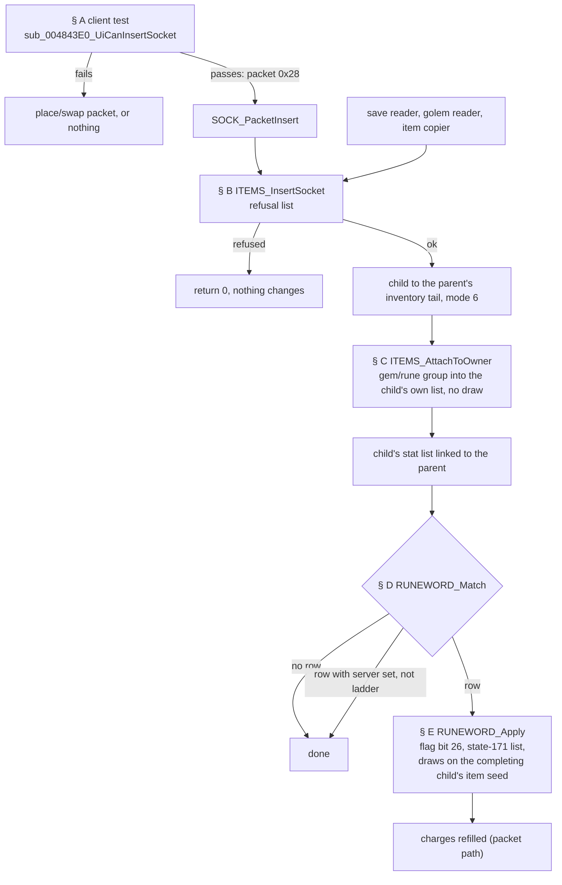
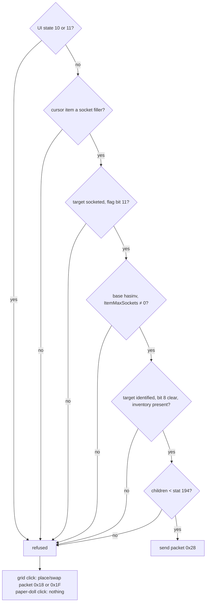
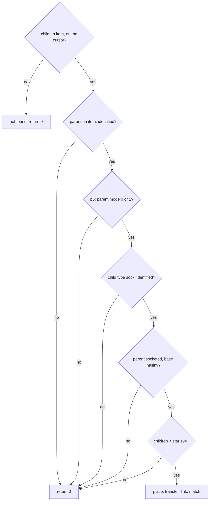
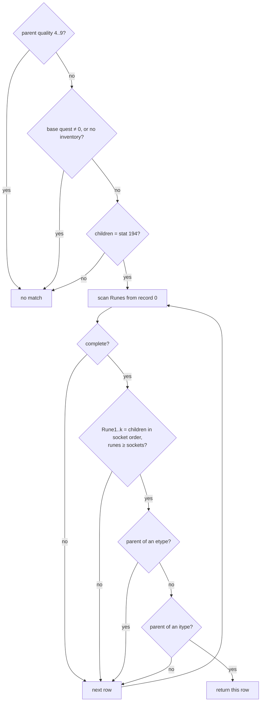
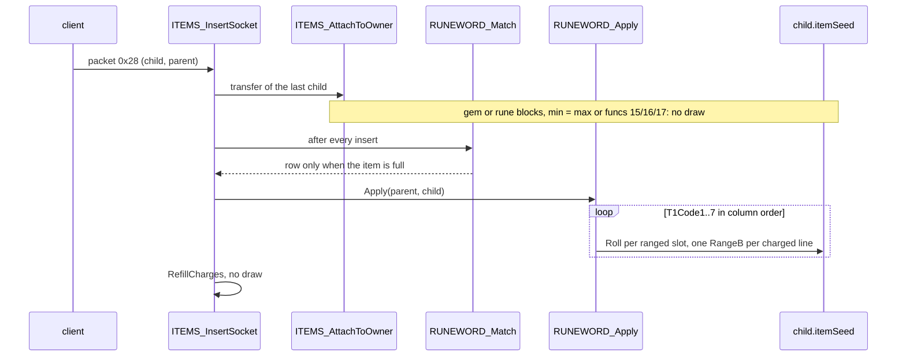

# Socket filling and runewords

## Purpose

A player puts a gem, rune or jewel (the **child**) into a socketed item (the **parent**). This spec says what the client
tests before it sends the request, what the server tests and in which order, what the child brings to the parent, when
the children make a runeword, and which draws on which seed roll the runeword's properties. It also gives the two
socket-count setters, the creation one with its quality clamps and the load one without them. The number of sockets a
drop gets is in [items/properties § F](properties.md#f-ethereal-and-sockets); the bits a socketed item and a runeword
leave in a save are in [save/d2s § I](../save/d2s.md#i-one-item).

Names of functions and fields are ours. "Item seed" is the seed at `ItemData+0x04` (`ITEMS_GetSeed`), not the unit
seed at `Unit+0x20` ([glossary](../../glossary.md)). Item flags are `ItemData+0x18`: bit 4 (`0x10`) identified, bit 11
(`0x800`) socketed, bit 26 (`0x4000000`) runeword. Item unit modes: 0 stored, 1 equipped, 4 on the cursor, 6 socketed.
Item types are `ItemTypes` row indices: 20 `gem`, 45 `weap`, 53 `sock`, 74 `rune`.



## Entry points

| When | Function | Tag |
|---|---|---|
| The player clicks a cursor item onto an item (client) | fn:sub_004843E0_UiCanInsertSocket@0x004843E0 | [C] |
| Client packet `0x28` (9 bytes) reaches the server | fn:SOCK_PacketInsert@0x0054B650 → fn:ITEMS_InsertSocket@0x00562660 with option flags 1, 1, 1, 1 | [C] |
| A socketed item is read from a save | fn:ITEMS_ReadInventoryList@0x005335E0 path (call 0x00531355) → fn:ITEMS_InsertSocket@0x00562660 with 0, 0, 0, 0, once per child | [C] |
| The golem reader and the item copier rebuild a socketed item | fn:D2S_ReadGolem@0x0056AE50, fn:sub_0055A2A0_ItemCopy@0x0055A2A0 → the insert with the flags clear | [I] |
| An item gets a socket count at creation (drop roll, creation record, cube, quest) | fn:ITEMS_SetSockets@0x0062BCB0 | [I] |
| A saved socket count is restored | fn:ITEMS_SetSocketsOnLoad@0x0062BE00 | [C] |

- [C] Every packet insert of the run arrived as client packet `0x28` and reached the insert with the option flags 1,
  1, 1, 1; the five children pre-filled in a loaded save reached it from the inventory reader's call (0x00531355) with
  0, 0, 0, 0. (fn:SOCK_PacketInsert@0x0054B650,
  run:2026-10-15-sockets, [items/0007 § 1](../../findings/items/0007-sockets-runewords.md#1-the-insert-items_insertsocket-0x00562660))
- [I] The readers and the copier set the rebuilt child to mode 4 before the call, so the cursor test passes for them
  too. (0x0056ADF5, fn:ITEMS_InsertSocket@0x00562660)

## Inputs

### Tables

| Anchor | Used for |
|---|---|
| tbl:Gems.txt:code | the gem's or rune's item; `GEMS_Load` writes the row index into that item's `gemoffset` |
| tbl:Weapons.txt:gemoffset | read from the **child's** base record (`+0x0F0`): its `gems` row |
| tbl:Gems.txt:weaponMod1Code, tbl:Gems.txt:helmMod1Code, tbl:Gems.txt:shieldMod1Code | the three 3-block groups at `+0x30`, `+0x60`, `+0x90` (16-byte `code`/`param`/`min`/`max`) |
| tbl:Gems.txt:nummods | **not read** by the socket path |
| tbl:Weapons.txt:gemapplytype, tbl:Armor.txt:gemapplytype | the parent base's group selector (`+0x13E`) |
| tbl:Misc.txt:quest | `+0x12A` of the parent base: a quest base never makes a runeword |
| `hasinv`, `invwidth`, `invheight` | base `+0x137`, `+0x10F`, `+0x110` ([Weapons](../../tables/Weapons.md)) |
| tbl:Runes.txt:complete | `+0x80`: the row can match |
| tbl:Runes.txt:server | `+0x81`: the row applies only in a ladder game |
| tbl:Runes.txt:Name | its string index is stored at `+0x82` (u16) by `RUNES_Load` (the saved runeword field); the two `Runeword95` rows share one index |
| tbl:Runes.txt:itype1, tbl:Runes.txt:etype1 | `itype1..6` (`+0x86` … `+0x90`, u16, 0 ends) include; `etype1..3` (`+0x92`, `+0x94`, `+0x96`) exclude |
| tbl:Runes.txt:Rune1 | `Rune1..6` (`+0x98`, s32 item index, < 1 ends): the runes in socket order |
| tbl:Runes.txt:T1Code1, tbl:Runes.txt:T1Param1, tbl:Runes.txt:T1Min1, tbl:Runes.txt:T1Max1 | lines 1..7 at `+0xB0` + 16·(k−1); `T1Param` compiled by `sub_006336A0_PropParamCell` (below) |
| tbl:Gems.txt:letter | `+0x020`, 8 bytes: **not read** by the socket path; the client's item description shows at most 5 UTF-16 units of it (below) |
| tbl:Properties.txt:func1 | the handler per property slot ([items/properties § E](properties.md#e-the-handlers-per-func)) |
| tbl:ItemTypes.txt:Equiv1 | type equivalence for `itype`/`etype` (`ITEMS_UnitIsType`) |

The record layouts are `struct:GemsRec+0x30` and `struct:RunesRec+0x80` in `re/types/sockets.h`; the `.bin` layouts
are in [Gems](../../tables/Gems.md) and [Runes](../../tables/Runes.md).

Load-time details of these columns, from [items/0007 § 9](../../findings/items/0007-sockets-runewords.md#9-table-fields-the-socket-path-does-not-use-backlog-2026-10-15-static):

- [I] **`itype`/`etype` slots.** `RUNEWORD_Match` reads six i16 from `+0x86` and three from `+0x92`, so `itype4..6`
  are `+0x8C`, `+0x8E`, `+0x90` and `etype1..3` are `+0x92`, `+0x94`, `+0x96`. (0x0062BFD0–0x0062C023,
  tbl:Runes.txt:itype1, tbl:Runes.txt:etype1)
- [I] **`T1Param` cells** go through the descriptor callback `sub_006336A0_PropParamCell` (type `0x19`, field
  `+0xB4 + 16·k`): a cell starting with `-` or a digit is `atol`; otherwise the name is looked up with `EXCEL_FindName`
  (lower-cased), first match wins, in the `skills` name link, then the `montype` link, then the `states` link; an
  empty cell or a name in none of them stores 0. So a skill name gives its `skills` row, case-insensitively, which is
  what the 109 stock cells hold. (fn:sub_006336A0_PropParamCell@0x006336A0, 0x006396E8–0x00639807,
  fn:EXCEL_FindName@0x006BD3C0, tbl:Runes.txt:T1Param1)
- [I] **`Name` → `+0x82`.** `RUNES_Load`'s only store into the record after the table load is the u16 `+0x82`
  (`STRTABLE_GetByKey(Name)`), one row at a time, so the two rows named `Runeword95` (*Passion*, *Patience*) get the
  same string index; `+0x084` is not written. (fn:RUNES_Load@0x006394A0 0x00639C63–0x00639C6E,
  fn:STRTABLE_GetByKey@0x00524D30, tbl:Runes.txt:Name)
- [I] **The save maps the shared index to no row.** `ITEMS_ReadFull` stores the 16 runeword bits of an item with flag
  bit 26 unmapped at `ItemData+0x38` and looks no row up; `ITEMS_WriteFull` does not save `+0x38` but calls
  `RUNEWORD_Match(item)` and writes that row's `+0x82`, or `0xFFFF` with no row. The row of a loaded runeword is always
  re-derived by `RUNEWORD_Match` from its socketed runes (§ D). `+0x38` is also a rare item's first prefix slot; a
  runeword's quality is never 4–9, so the two uses do not meet. (0x0062D1CB–0x0062D1EA, 0x0063087E–0x00630890,
  fn:ITEMS_ReadFull@0x0062CBE0, fn:ITEMS_WriteFull@0x0062FFF0, fn:RUNEWORD_Match@0x0062BED0,
  [items/0007 § Plan 0039 batch P1b](../../findings/items/0007-sockets-runewords.md#plan-0039-batch-p1b-2026-10-17))
- [C] **Patience never matches on stock data.** *Passion* has `complete` 1, *Patience* `complete` blank (0), and
  `RUNEWORD_Match` skips every row with `complete` 0, so the shared index 20600 only ever comes from *Passion*.
  (tbl:Runes.txt:complete, tbl:Runes.txt:Name, data check, [items/0007 § Plan 0039 batch P1b](../../findings/items/0007-sockets-runewords.md#b9-which-runeword95-row-a-save-maps-back-to))
- [I] **Gems `letter`** is read by the client's item-description builder `sub_00486670_ItemDescRuneLetters`: for an
  item whose socketed children include runes (`ITEMS_UnitIsType(child, 74)`), it writes string 0x501A once and then
  each rune's `letter` through `UNICODE_Utf8ToUtf16(dst, letter, 6)`, i.e. at most 5 UTF-16 units of the field.
  (fn:sub_00486670_ItemDescRuneLetters@0x00486670 0x004866C0–0x0048672A, fn:UNICODE_Utf8ToUtf16@0x00526320,
  fn:ITEMS_UnitIsType@0x00629BB0, tbl:Gems.txt:letter)

### Runtime state

| State | Type | Source |
|---|---|---|
| child, parent | item units | the packet's two unit ids, or the reader's rebuilt units |
| child mode, parent mode | unit `+0x10` | 4 on the cursor, 0 stored, 1 equipped, 6 socketed |
| item flags | u32, `ItemData+0x18` | bits 4, 11, 26 as above |
| quality | `ItemData+0x00` | 1 low … 8 crafted, 9 |
| stat 194 `item_numsockets` | base stat of the parent | the socket count |
| parent inventory | `Unit+0x60`, item list, count at `+0x28` | the children in socket order |
| child item seed | Seed (see [rng](../rng/README.md)) | `ItemData+0x04` of the child; `{startSeed, 666}` for a rune loaded from a save |
| ladder | `struct:Game+0x74` | gate for `server` rows |
| option flags `p4..p7` | four i32 | per caller (§ B) |

### Constants

| Name | Value | Anchor | Tag |
|---|---|---|---|
| runeword list state, flags | 171 (`0xAB`), `0x40` | fn:RUNEWORD_Apply@0x006600A0 | [C] |
| gems group offsets | `+0x30`, `+0x60`, `+0x90` for group 0, 1, 2; 3 blocks of 16 bytes each | fn:sub_0065C6D0_PropBlock3x3@0x0065C6D0 | [I] |
| insert packet | opcode `0x28`, 9 bytes: opcode, child unit id (u32), parent unit id (u32) | fn:SOCK_PacketInsert@0x0054B650, run:2026-10-15-sockets | [C] |
| `PACK_SHIFT`, `PACK_MASK` | 6, 63 (func 19's param) | [items/properties § Constants](properties.md#constants), run:2026-10-14-props-forced | [C] |

## Algorithm

### A. The client test



The client tests first and sends `0x28` only when every test passes. The server's list (§ B) is the authority: the
client test is a filter in front of it, and it hides most server refusals from clicks.

```
A1. UiCanInsertSocket(cursor, target) → bool:          ; order as the table below      [C] (fn:sub_004843E0_UiCanInsertSocket@0x004843E0, run:2026-10-15-sockets, all of A1–A2)
      for each test t in the table, in order:
        if t fails: return false
      return true                                       ; then send 0x28(child id, parent id)
A2. on false: a click on an item in a grid sends the ordinary place/swap packet
      (0x18 or 0x1F) and the two items change places; a click on a paper-doll item sends nothing
```

| # | The client refuses when | Tag (as a refusal) | Anchor |
|---:|---|---|---|
| 1 | the UI state word `0x007BCBF0` is 10 or 11 | [I] | fn:sub_004843E0_UiCanInsertSocket@0x004843E0 |
| 2 | the cursor item is not a socket filler (type 53 `sock`) | [C] | run:2026-10-15-sockets (4 cases) |
| 3 | the target lacks the socketed flag (bit 11) | [C] | run:2026-10-15-sockets (5 cases) |
| 4 | the target base has `hasinv` 0 | [I] | fn:sub_004843E0_UiCanInsertSocket@0x004843E0 |
| 5 | `ItemMaxSockets(target)` is 0 | [I] | fn:sub_0062BC20_ItemMaxSockets@0x0062BC20 |
| 6 | the target is not identified (bit 4) | [I] | fn:sub_004843E0_UiCanInsertSocket@0x004843E0 |
| 7 | the target has flag bit 8 (`0x100`) | [I] | fn:sub_004843E0_UiCanInsertSocket@0x004843E0 |
| 8 | the target has no inventory | [I] | fn:sub_004843E0_UiCanInsertSocket@0x004843E0 |
| 9 | the target's children already number its stat 194 (full) | [C] | run:2026-10-15-sockets (2 cases) |

Step notes:

- A1. The order is `[C]`: 357 client verdicts reproduced from the logged inputs (346 passed; 4 not a socket filler,
  5 not socketed, 2 full). The refusals the run produced are `[C]`; the UI-state, `hasinv`, `ItemMaxSockets`,
  identified, flag `0x100` and inventory tests were never seen failing and stay `[I]` as refusals.
  (fn:sub_004843E0_UiCanInsertSocket@0x004843E0, run:2026-10-15-sockets)
- A1. **The client does not test the child's identified flag**, so an unidentified jewel reaches the server, which
  refuses it (§ B). [C] (fn:sub_004843E0_UiCanInsertSocket@0x004843E0, run:2026-10-15-sockets)
- A1. **An unidentified socketed parent fails as "not socketed".** An unidentified magic cap with two sockets had
  the client flags `0x00804001`, without bit 11: the client unit lacks the socketed flag until the item is identified,
  so the client's identified test is not reached for a socketed item. One case. [I] (run:2026-10-15-sockets)
- A1. The client test has no level, item-class, quality or game-type test either: a rune onto a helm in a classic game
  was sent and accepted. [C] (fn:sub_004843E0_UiCanInsertSocket@0x004843E0, run:2026-10-15-sockets)

### B. The server insert: the refusal list



Tests short-circuit in this order; a refusal returns 0 and changes nothing. This list is the authority; the client
test of § A stands in front of it.

| # | The server refuses when | Tag (as a refusal) | Anchor |
|---:|---|---|---|
| 1 | the child unit is not found | [I] | fn:ITEMS_InsertSocket@0x00562660 (not found) |
| 2 | the child is not an item | [I] | fn:ITEMS_InsertSocket@0x00562660 |
| 3 | the child is not on the cursor (mode ≠ 4) | [I] | fn:ITEMS_InsertSocket@0x00562660 (not found) |
| 4 | the parent unit is not found | [I] | fn:ITEMS_InsertSocket@0x00562660 (not found) |
| 5 | the parent is not an item | [I] | fn:ITEMS_InsertSocket@0x00562660 |
| 6 | the parent is not identified (bit 4) | [I] | fn:ITEMS_InsertSocket@0x00562660 |
| 7 | `p6` ≠ 0 and the parent's mode is not 0 (stored) or 1 (equipped) | [I] | 0x00562715–0x00562725 |
| 8 | the child is not a socket filler (type 53 `sock`) | [I] | fn:ITEMS_IsSocketFiller@0x0062BEB0 |
| 9 | the child is not identified (bit 4) | [C] | run:2026-10-15-sockets (an unidentified magic jewel) |
| 10 | the parent lacks the socketed flag (bit 11) | [I] | fn:ITEMS_InsertSocket@0x00562660 |
| 11 | the parent base has `hasinv` 0 | [I] | fn:ITEMS_InsertSocket@0x00562660 |
| 12 | the parent has no inventory and none can be created | [I] | fn:ITEMS_InsertSocket@0x00562660 |
| 13 | the parent's inventory count ≥ `stat 194 & 0xFF` (full) | [I] | fn:ITEMS_InsertSocket@0x00562660 |

```
B1. InsertSocket(game, player, childId, parentId, p4, p5, p6, p7) → i32:            [C] order (fn:ITEMS_InsertSocket@0x00562660, run:2026-10-15-sockets)
      notFound ← 0
      for each test t in the refusal list above, in order:   ; C short-circuit
        if t fails:
          if t is 1, 3 or 4: notFound ← 1                 ; "not found"
          return 0                                        ; nothing changed
B2. place: remove the child from the cursor; append it at the TAIL of inv             [C] (fn:sub_0063B210_InvPlaceSocketed@0x0063B210, run:2026-10-15-sockets)
      child.x ← count(inv) before the append; child.y ← 0; count(inv) += 1           [I] (fn:sub_0063AF20_InvAppendItem@0x0063AF20, 0x005627FC)
      if p5 ≠ 0 and player: clear the player's cursor slot                            [I] (0x005627CB–0x005627DE)
B3. Transfer(game, child, parent)                       ; § C                         [C] (fn:ITEMS_AttachToOwner@0x0055C2C0, run:2026-10-15-sockets)
B4. child.mode ← 6 (socketed)                                                         [C] (run:2026-10-15-sockets)
B5. row ← Match(parent)                                 ; § D, after EVERY insert     [C] (fn:RUNEWORD_Match@0x0062BED0, run:2026-10-15-sockets)
    if row ≠ none and not (row.server ≠ 0 and game.ladder = 0):
      Apply(parent, child)                              ; § E                         [C] (fn:RUNEWORD_Apply@0x006600A0, run:2026-10-15-sockets)
      schedule the stat 252 and 253 replenish events                                  [I] (fn:sub_00558530_ItemReplenishDurTimer@0x00558530, fn:sub_00558580_ItemReplenishQtyTimer@0x00558580)
      if p7 ≠ 0: RefillCharges(parent)                  ; § E5                        [C] (fn:sub_0055FE80_ItemRefillCharges@0x0055FE80, run:2026-10-15-sockets)
    else if p4 = 0: return 1                            ; readers: no parent update   [I] (0x0056284F–0x0056289E)
B6. parent.flags |= 0x1; parent.flags &= ~0x4000; queue a client update when a player is given   [I] (0x0056284F–0x0056289E)
    return 1
```

Step notes:

- B6. **The flag bits the insert touches**, from a survey of every `ITEMS_CheckFlags`/`ITEMS_SetFlag` call site by
  mask ([items/0007 § Plan 0039 batch P1b](../../findings/items/0007-sockets-runewords.md#q18-b-item-flag-bits-0-2-8-and-14)):
  - [I] Bit 0 (`0x1`) is "changed, send an update": set by every server routine that moves an item or changes its state
    (26 move sites, `ITEMS_InsertSocket` among them, and the identify routine), never cleared through `ITEMS_SetFlag`,
    tested only by `ItemFlagUpdateSend`. (0x0056285D, 0x005762FE, fn:sub_005973F0_ItemFlagUpdateSend@0x005973F0)
  - [I] Bit 14 (`0x4000`) is "equipped, requirements not met": `EquipReqRefresh` sets it on an equipped item that fails
    `ItemUsableBy` (stats 0, 2, 12 against the requirements with stat 91, plus the quiver test) and clears it on one
    that passes; every move routine clears it with bit 0. (0x0055DC5D, 0x0055DCFA,
    fn:sub_0055DBC0_EquipReqRefresh@0x0055DBC0, fn:sub_0055DB00_ItemUsableBy@0x0055DB00,
    fn:sub_0062EAF0_ItemReqCheck@0x0062EAF0)
  - [I] Bit 8 (`0x100`), which the client test of § A refuses, is "broken": `ItemBreak` sets it and durability (stat 72)
    to 0, `ItemRepairBroken` clears it and sets bit 9, and `ItemCreate` copies it from the creation record.
    (0x0055F85A–0x0055F8B6, fn:sub_0055F850_ItemBreak@0x0055F850, fn:sub_0055F900_ItemRepairBroken@0x0055F900)
  - [I] Bit 2 (`0x4`) marks an item whose use is in progress (`ItemUse` sets it before the use function and
    `InvClearUseMark` clears it on failure); the insert does not read it: it tests only `0x10` and `0x800`.
    (0x005BF36B, 0x0056270C, 0x00562748, fn:sub_005BF240_ItemUse@0x005BF240, fn:sub_005BE1C0_InvClearUseMark@0x005BE1C0,
    fn:ITEMS_InsertSocket@0x00562660)

- B1. **Authority and tags.** The server list is what decides; the client test (§ A) stands in front of it and
  screens every server refusal but one from clicks. The run saw the whole chain pass in this order 350 times, and saw
  one refusal, an unidentified magic jewel stopped at the child's identified test, with return 0 and nothing changed.
  So the order and the "child unidentified" refusal are `[C]`; every other line is `[I]` **as a refusal** (read in
  the code, seen passing, never failing) until a forged `0x28` packet (ADR-0010) reaches it. [C] (fn:ITEMS_InsertSocket@0x00562660,
  0x005626B4–0x005627AD, run:2026-10-15-sockets)
- B1. **Not tested** by the insert: the parent's quality, its item class (`gemapplytype`), the game type. Inserts into
  low, magic, rare and crafted parents, into weapons, armour, helms and shields, and a rune in a classic game were all
  accepted. [C] (fn:ITEMS_InsertSocket@0x00562660, run:2026-10-15-sockets)
- B1. **No level-requirement test** for the child, and no ethereal or item-version test. Every rune of the run was
  below the character's level, so the run does not show the level case. [I] (0x00562660–0x005628B1)
- B1. The parent-mode test applies only with `p6` set, so the save reader's inserts pass it untested. [C]
  (0x00562715–0x00562725, run:2026-10-15-sockets)
- B1. **The packet handler's own checks**, before the call: the packet is exactly 9 bytes (else error return 3); the
  child id is the player's cursor item; a parent in mode 0 or 1 is in the player's own inventory; when the player's
  interaction target is a player (a trade), the insert is skipped silently. A "not found" from the insert becomes
  error return 3; the other refusals are ignored. [I] (fn:SOCK_PacketInsert@0x0054B650,
  fn:sub_005490E0_PktIsCursorItem@0x005490E0, fn:sub_005491B0_PktIsOwnStoredItem@0x005491B0, 0x0054B6DB–0x0054B6F4)
- B2. **Socket order is insertion order.** After each of 350 inserts the parent's child list was its list before plus
  the child at the tail, the count grew by one and the child's mode was 6. `INV_GetFirstItem` → `INV_GetNextItem`
  walks the children in that order, which is the order § D compares with `Rune1..6`. [C] (fn:sub_0063B210_InvPlaceSocketed@0x0063B210,
  fn:INV_GetFirstItem@0x0063B2C0, run:2026-10-15-sockets)
- B2. x and y were not logged, so x = 0, 1, 2, … and y = 0 stay inferred. [I] (fn:sub_0063AF20_InvAppendItem@0x0063AF20, 0x005627FC)
- B5. **A `server` row in a non-ladder game makes no runeword, and the insert still succeeds** (*Spirit* in the run).
  [C] (fn:ITEMS_InsertSocket@0x00562660, run:2026-10-15-sockets)
- B5. In a ladder game (`Game+0x74` ≠ 0) the row applies. No ladder game ran. [I] (struct:Game+0x74, fn:ITEMS_InsertSocket@0x00562660)

| caller | p4 | p5 | p6 | p7 | Tag |
|---|---|---|---|---|---|
| `SOCK_PacketInsert` (0x0054B6DB) | 1 | 1 | 1 | 1 | [C] |
| the inventory reader's call 0x00531355 | 0 | 0 | 0 | 0 | [C] |
| the other inventory readers (0x005311B5, 0x005313F0, 0x00531578), `sub_0055A2A0_ItemCopy` (0x0055A41C), the golem reader (0x0056AE18) | 0 | 1 | 0 | 0 | [I] |
| 0x00563441 (re-inserting copies of a parent's children) | caller's | 0 | 1 | 0 | [I] |

- B. The caller values are read from each site's pushes ([items/0007 § 1](../../findings/items/0007-sockets-runewords.md#1-the-insert-items_insertsocket-0x00562660));
  the 0x00531355 call was also logged in the run (5 of 5), the others did not run. [C] for 0x00531355
  (fn:ITEMS_InsertSocket@0x00562660, 0x00531343–0x00531349, run:2026-10-15-sockets); [I] for the other sites
  (0x005311A2–0x005311A8, 0x005313DD–0x005313E3, 0x00531567–0x0053156D, 0x0055A3F9–0x0055A3FF,
  0x0056AE00–0x0056AE06, 0x00563424–0x00563430)
- [I] `p4` = 1 makes the parent update of B6 happen without a runeword; `p5` clears the cursor; `p6` is the
  parent-mode test; `p7` the charge refill. (fn:ITEMS_InsertSocket@0x00562660, 0x0056283A–0x00562848)

### C. What a gem, rune or jewel brings

| Parent base `gemapplytype` | `gems` group (record offset) | Stock bases with sockets | Tag | Anchor |
|---|---|---|---|---|
| 0 | `weaponMod1..3` (`+0x30`) | every socketable weapon type | [C] | tbl:Gems.txt:weaponMod1Code, run:2026-10-15-sockets |
| 1 | `helmMod1..3` (`+0x60`) | `tors`, `helm`, `circ`, `pelt`, `phlm` (body armour takes the helm group) | [C] | tbl:Gems.txt:helmMod1Code, run:2026-10-15-sockets |
| 2 | `shieldMod1..3` (`+0x90`) | `shie`, `ashd`, `head` | [C] | tbl:Gems.txt:shieldMod1Code, run:2026-10-15-sockets |
| ≥ 3 | fatal | none on stock data | [I] | fn:sub_0065C6D0_PropBlock3x3@0x0065C6D0 |

- [C] The group is chosen by the **parent's** `gemapplytype`; the run applied each of the 35 gems into each of the
  three groups (105 of 105) and 159 runes across the three. (fn:ITEMS_GetGemApplyType@0x00629A40,
  fn:sub_0065C6D0_PropBlock3x3@0x0065C6D0, tbl:Weapons.txt:gemapplytype, tbl:Armor.txt:gemapplytype, run:2026-10-15-sockets)
- [I] The stock bases column is a data check over the 384 `hasinv` rows with `gemsockets` > 0; belts, boots and gloves
  have no sockets. A group ≥ 3, or a block index ≥ 3, is fatal. (fn:sub_0065C6D0_PropBlock3x3@0x0065C6D0,
  tbl:Armor.txt:gemapplytype)

```
C1. Transfer(game, child, owner):                                                   [C] (fn:ITEMS_AttachToOwner@0x0055C2C0, run:2026-10-15-sockets, all of C1–C3)
      if IsType(child, 20 gem) or IsType(child, 74 rune):
        if owner is not an item: return                 ; gems and runes act only inside an item
        g ← Gems[ItemRecord(child).gemoffset]           ; the CHILD's base +0x0F0; none → return
        mode ← 2 (gem) or 5 (rune)                       ; the two behave the same
        grp ← owner base gemapplytype                    ; 0, 1, 2
        for i in 0 ..< 3:
          b ← g + {0x30, 0x60, 0x90}[grp] + 16·i
          if b.code < 0: break                           ; the first blank block ends the group
          ApplyBlock(mode, item = child, target = child's main list (state 0, flags 0x40), b)
      else:                                             ; a jewel (quality 4 or 6)
        nothing applied                                  ; its own list was rolled at creation
C2. Link(owner, child): the child's stat list (Unit+0x5C) is attached to the owner
C3. the owner's own stat lists are not written
```

Step notes:

- C1. **No draw on stock data.** Every gem and rune block has `min = max` (the roll returns `min` without a step), or
  uses func 15/16 (no draw), or func 17 with `par` ≠ 0 (Thul 75, Tal 125; no draw). The only `min ≠ max` blocks, Ral
  `dmg-fire` 5–30, Ort `dmg-ltng` 1–50 and Thul `dmg-cold` 3–14 in `weaponMod1`, are funcs 15/16/17. So an insert
  that makes no runeword never moves any seed. [C] (fn:PROP_RollValue@0x0065E9E0, fn:PROP_Func15_Min@0x0065F960,
  fn:PROP_Func17_Par@0x0065FA40, tbl:Properties.txt:func1, run:2026-10-15-sockets)
- C1. The run reproduced 337 gem and rune transfers slot by slot with the child's seed unchanged; 13 jewels applied
  nothing. [C] (fn:ITEMS_AttachToOwner@0x0055C2C0, run:2026-10-15-sockets)
- C1. **The child is the handlers' item and target.** `ApplyBlock` gets 0 as its target unit, which `PROP_WriteStat`
  reads as "the item itself", so every handler that looks at the item sees the gem or rune: Pul's `ac%` (func 2)
  resets nothing; Ith's `dmg-max` and Sol's `dmg-min` (funcs 6, 5) take the non-weapon branch and write stats
  22/24/160 or 21/23/159, clamped against the rune's own base bytes, which are 0; Ohm's `dmg%` (func 7) writes 17 and
  18; Zod's `indestruct` (func 20) adds stat 152 to the rune's list. The parent sees these only through the link.
  [I] (fn:PROP_Func02_RollAcPercent@0x0065EBA0, fn:PROP_Func05_DmgMin@0x0065ECF0, fn:PROP_Func07_DmgPercent@0x0065F010,
  fn:PROP_Func20_Indestructible@0x0065FAE0, 0x00660051–0x0066006E)
- C1. `nummods` (`+0x2E`) is not read; the group's length is set by its first blank block. [I] (fn:sub_0065C6D0_PropBlock3x3@0x0065C6D0,
  tbl:Gems.txt:nummods)
- C1. **`gemoffset` is the child's.** `GEMS_Load` writes each `gems` row's index into `+0x0F0` of the item it names,
  and the transfer reads `+0x0F0` of the child's base; no parent offset is read. [I] (fn:ITEMS_AttachToOwner@0x0055C2C0,
  tbl:Weapons.txt:gemoffset)
- C2. **The link.** After each insert the parent's lists were its lists before plus the child's own stat list (seen
  from the parent as a state-0 list with flags `0x80000000`). When the list already belongs to the owner, only its
  enable bit `0x40000000` is toggled. The child's flag `0x100` would suppress the link when the call's own flag is 0,
  which it is on this path. [C] for the link (fn:sub_00627910_StatListLinkOwner@0x00627910, run:2026-10-15-sockets);
  the toggle and the `0x100` case are [I] (fn:ITEMS_AttachToOwner@0x0055C2C0)
- C1. **The client** runs the same transfer in its own copy, fatal instead of silent on a missing row; two further
  client functions apply a row in mode 5 or mode 2 to a scratch unit for an item description. [I]
  (fn:sub_004C0D20_ClientSocketAttach@0x004C0D20, fn:sub_004E6720_ClientGemDescMode5@0x004E6720,
  fn:sub_004E67D0_ClientGemDescMode2@0x004E67D0)

### D. The runeword match



```
D1. Match(parent) → Runes row or none:                                               [C] (fn:RUNEWORD_Match@0x0062BED0, run:2026-10-15-sockets, all of D1–D4)
      if parent.quality ∈ 4..9: return none              ; u32 (quality − 4) < 6: low, normal, superior pass
      if ItemRecord(parent).quest ≠ 0 or parent has no inventory: return none
      kids: i32[6];  n: i32 ← 0
      for c in parent.inventory in socket order: kids[n] ← c.classId;  n ← n + 1
      s: i32 ← (stat 194 of parent) & 0xFF
      if s ≠ n: return none                               ; only a full item can match
D2.   for r in 0 ..< RunesCount:                         ; record 0 included
        R ← Runes[r]
        if R.complete = 0: continue
        k: i32 ← 0
        while k < 6 and R.rune[k] ≥ 1:
          if n < k or kids[k] ≠ R.rune[k]: goto next     ; NOTE: k = n compares kids[n] (see D2 note)
          k ← k + 1
        if k < s: continue                                ; fewer runes than sockets
D3.     for e in 0 ..< 3 while R.etype[e] ≠ 0:
          if IsType(parent, R.etype[e]): goto next
D4.     for t in 0 ..< 6 while R.itype[t] ≠ 0:
          if IsType(parent, R.itype[t]): return R
      next:
      return none
```

Step notes:

- D1. **The match runs after every insert, but only a full item matches.** Before the last socket is filled, `s ≠ n`
  returns none. The run's model agreed with the logged row after all 350 inserts: 50 runewords from 29 rows, 60 full
  items with no runeword. [C] (fn:RUNEWORD_Match@0x0062BED0, run:2026-10-15-sockets)
- D1. **Quality.** Magic, set, rare, unique, crafted and quality 9 never match; a low-quality and a superior base
  matched in the run, and magic, rare and crafted bases did not. Ethereal is not tested; an ethereal normal base made
  *Steel* in a game-written save. [C] (0x0062BEE7–0x0062BEFD, run:2026-10-15-sockets, run:2026-10-11-d2s-samples)
- D1. **`quest`.** *Wirt's Leg* (base `leg`, `quest` 1) made no runeword. [C] (0x0062BF08, tbl:Misc.txt:quest,
  run:2026-10-15-sockets)
- D2. **Rune order** is the insertion order: the wrong order (*Lum Eth* in a shield) and the wrong type
  (*Splendor*'s runes in a helm) matched nothing. [C] (0x0062BFA3–0x0062BFCE, run:2026-10-15-sockets)
- D2. **One rune more than the sockets.** The bound test is `n < k`, not `n ≤ k`, so for a row with exactly one rune
  more than the sockets the loop reaches `k = n` and compares `kids[n]`, a stack slot this call never wrote; such a
  row matches only if that stale word equals the extra rune's item index. Two or more extra runes never match. The
  run's one case (a 3-socket armour with the first three runes of *Bramble*) matched nothing; the slot held 638, not
  614. [I] (0x0062BFA3–0x0062BFCE, run:2026-10-15-sockets) The slot lies in `RUNEWORD_Match`'s own frame, so its value is
  what the last code to use that stack address left, which depends on the call chain (the insert, the two readers,
  the cube's socket paths, the client's description code). A slot written by an earlier `RUNEWORD_Match` call on a
  fuller item at the same depth holds that item's `n`-th child class, so a stale match needs such an earlier call, not
  chance. [I] (0x0062BFA3–0x0062BFCE, [items/0007 § Plan 0039 batch P1b](../../findings/items/0007-sockets-runewords.md#q18-a-the-stale-kidsn-word))
- D2. **Scan order.** The first matching row from record 0 wins. On stock data no two `complete` rows share a rune
  sequence and none is a one-shorter prefix of another, so the order changes no stock result. [I] (0x0062BF6B–0x0062C03B,
  tbl:Runes.txt:Rune1)
- D3. `etype` excludes through `ITEMS_UnitIsType`; no stock `complete` row uses it, so the run does not test it. [I]
  (0x0062BFD0–0x0062C023, tbl:Runes.txt:etype1)
- D4. `itype` includes through `ITEMS_UnitIsType`, so equivalences count (`weap` covers every weapon; `hamm` and
  `mace` are both `blun`, neither the other). [C] (fn:ITEMS_UnitIsType@0x00629BB0, tbl:ItemTypes.txt:Equiv1,
  run:2026-10-15-sockets)
- D1. The match itself tests neither `server` (the insert does, B5) nor the item version nor the game type. A
  classic game has no runeword because no stock row is classic-legal: every rune is a version-100 item. [I]
  (fn:RUNEWORD_Match@0x0062BED0, [Runes § Survey](../../tables/Runes.md#survey-of-the-stock-rows))

### E. The runeword: flag, list and rolls

```
E1. Apply(parent, child) → i32:                         ; child = the filler whose insert completed the word   [C] (fn:RUNEWORD_Apply@0x006600A0, run:2026-10-15-sockets)
      R ← Match(parent)                                  ; matched again
      if R = none or parent already holds a list (state 171, flags 0x40): return 0     [I] (0x006600BC–0x006600CB)
      parent.flags |= 0x4000000                          ; flag bit 26                [C] (run:2026-10-11-d2s-samples, run:2026-10-15-sockets)
E2.   for i in 0 ..< 7:                                  ; T1Code1..7 in column order  [C] (fn:PROP_ApplyBlock@0x0065FD70, run:2026-10-15-sockets)
        b ← R.t1[i]
        if b.code < 0: break                             ; the first blank ends the lines   [I] (0x006600DD–0x0066010C)
        ApplyBlock(mode 6, target = parent, item = child, b, state 171, flags 0x40)
      return 1
E3. inside ApplyBlock, per items/properties § C–E:                                       [C] (fn:PROP_RollValue@0x0065E9E0, fn:ITEMS_GetSeed@0x00627D90, run:2026-10-15-sockets)
      every Roll (min ≠ max) draws Range(child.itemSeed, |max − min| + 1)               ; draw
      a func 19 line draws RangeB(child.itemSeed, c − c ÷ 8)                            ; draw, always
      writes go to TargetList(parent, 171, 0x40), created and attached on first use
      item tests (weapon? armour? ethereal? durability?) look at the CHILD
E4. after Apply, in the insert: replenish events for stats 252, 253                     [I] (fn:sub_00558530_ItemReplenishDurTimer@0x00558530)
E5. RefillCharges(parent), packet path only (p7):                                        [C] (fn:sub_0055FE80_ItemRefillCharges@0x0055FE80, 0x00562848, run:2026-10-15-sockets)
      for each stat 204 entry of the parent: if (v & 0xFF) < (v >> 8): v ← (v >> 8) × 256 + (v >> 8)
```

Step notes:

- E1. **The seed is the completing child's item seed.** Every runeword draw steps `ITEMS_GetSeed(child)` of the
  socket filler whose insert completed the word; the parent's item and unit seeds and the game seed are untouched.
  The run reproduced 50 runewords line by line from that seed, 50 draws among them (ranged lines of *Splendor*,
  *Sanctuary*, *Gloom*, *Enigma*, *Stone*, *Bramble*'s aura, *Call to Arms*'s `oskill`, *Famine*, *Duress*, *Bone*,
  and every func 19 charge). [C] (fn:PROP_RollValue@0x0065E9E0, fn:PROP_Func19_Charged@0x0065F6A0,
  fn:ITEMS_GetSeed@0x00627D90, run:2026-10-15-sockets)
- E1. **That seed's state.** A rune loaded from a save has item seed `{startSeed, 666}` at its insert (49 of 49 such
  completing runes), the reader's seed init of [save/d2s I5](../save/d2s.md#i-one-item); gem and rune transfers make
  no draws (§ C), so nothing moves it before the rolls. A rune made in the session (the cube's Nef) carried an advanced
  seed, and *Black* completed by it reproduced from that seed. [C] (fn:sub_00552E90_ItemSeedInit@0x00552E90,
  run:2026-10-15-sockets)
- E1. **Already applied.** A parent that already holds a state-171 list gets nothing and no flag: the save reader
  rebuilds the parent with its saved lists before it re-inserts the children, so a loaded runeword is not rolled
  again. [I] (0x006600BC–0x006600CB, fn:ITEMS_ReadFull@0x0062CBE0)
- E2. The stock `runes` rows have no gap and no unknown code (data check over 169 rows), so "first blank ends" and
  "skip blanks" give the same result on stock data. Mode 6 is not 1, so no handler applies a mode-1 reset. [I]
  (0x006600DD–0x0066010C, tbl:Runes.txt:T1Code1)
- E3. **The handlers' item is the rune**, not the parent. Consequences, per func ([items/properties § E](properties.md#e-the-handlers-per-func)):

| func | code (examples) | draws on the child's seed | effect with a rune as the item | Tag | Anchor |
|---:|---|---|---|---|---|
| 1, 3, 8, 10, 21, 22 | `ac`, `res-all`, `oskill`, `aura` | `Roll` (one draw when `min ≠ max`); func 3 reuses the preceding slot's value with no draw | as items/properties | [C] | fn:PROP_Func01_Roll@0x0065EB30, fn:PROP_Func03_Reuse@0x0065EC10, fn:PROP_Func08_Reuse@0x0065F2B0, fn:PROP_Func10_SkillTab@0x0065F3F0, fn:PROP_Func21_ValParam@0x0065FB50, fn:PROP_Func22_SkillParam@0x0065FBF0, run:2026-10-15-sockets |
| 8 | — | `v ← prev` when `prev` ≠ 0 (the reuse branch) | not reachable on stock data: func 8 is the first slot of every `properties` row a stock runeword line uses, so `prev` is 0 | [I] | fn:PROP_Func08_Reuse@0x0065F2B0 |
| 15, 16, 17 | `dmg-fire`, `dmg-ltng`, `dmg-cold` pairs | none where `par` ≠ 0 or `min` = `max` | as items/properties | [C] | fn:PROP_Func15_Min@0x0065F960, fn:PROP_Func16_Max@0x0065F9D0, fn:PROP_Func17_Par@0x0065FA40, run:2026-10-15-sockets |
| 17 | — | `Roll` when `par` = 0 on a ranged line | as items/properties; four stock rows (*Harmony*, *Fortitude*, *Lawbringer*, *Winter*), none made in the run | [I] | fn:PROP_Func17_Par@0x0065FA40 |
| 24 | — | `v ← prev or Roll` | as items/properties; one stock row, none made in the run | [I] | fn:PROP_Func24_ParParam@0x0065F390 |
| 2 | `ac%` | `Roll` | the base reset tests the rune (not armour): the parent's defense is **not** set to `maxac + 1` | [C] | fn:sub_0065CCC0_PropBaseReset@0x0065CCC0, run:2026-10-15-sockets |
| 5, 6 | `dmg-min`, `dmg-max` | `v ← prev or Roll` | the base columns are the **parent's**, but the weapon tests see the rune: all three stats 21/23/159 or 22/24/160 are written, each clamped against the parent's column | [C] | fn:PROP_Func05_DmgMin@0x0065ECF0, run:2026-10-11-d2s-samples |
| 7 | `dmg%` | `v ← prev or Roll` | writes 18 then 17 directly; no base reset | [C] | fn:PROP_Func07_DmgPercent@0x0065F010, run:2026-10-11-d2s-samples |
| 7 | `dmg%` | — | no "+1 maximum damage" fallback (the weapon branch is never taken) | [I] | fn:PROP_Func07_DmgPercent@0x0065F010 |
| 11 | `hit-skill`, `gethit-skill` | none | level = `max` | [C] | fn:PROP_Func11_SkillOnEvent@0x0065F470, run:2026-10-15-sockets |
| 11 | — | none | the ilvl branch (the rune's ilvl): every stock runeword line has `max` > 0, so it is not reached | [I] | fn:PROP_Func11_SkillOnEvent@0x0065F470 |
| 19 | `charged` | one `RangeB(c − c ÷ 8)`, always | stored as `max × 256 + current`, then refilled by E5 on the packet path | [C] | fn:PROP_Func19_Charged@0x0065F6A0, run:2026-10-15-sockets |
| 20 | `indestruct` | none | adds stat 152 to the parent's 171 list; three stock rows, none made in the run | [I] | fn:PROP_Func20_Indestructible@0x0065FAE0 |
| 23 | `ethereal` (*Famine*) | none | tests the rune's ethereal flag and durability: never makes the parent ethereal | [C] | fn:PROP_Func23_Ethereal@0x0065FD20, run:2026-10-15-sockets |

- E3. Corroboration of the table: a game-written save of *Steel* on a one-handed, non-throwing long sword holds
  stats 21, 23, 159 and 22, 24, 160 (+3 each), which only the non-weapon branch writes, and `dmg%` 20 as stats 17/18;
  *Famine* and the five *Splendor* (`ac%` on shields) reproduced in the run with the rune as the item. [C]
  (fn:PROP_Func05_DmgMin@0x0065ECF0, fn:PROP_Func06_DmgMax@0x0065EE80, fn:PROP_Func23_Ethereal@0x0065FD20,
  fn:PROP_Func02_RollAcPercent@0x0065EBA0, fn:sub_0065CCC0_PropBaseReset@0x0065CCC0, run:2026-10-11-d2s-samples,
  run:2026-10-15-sockets)
- E3. **Per-func coverage.** The run's 50 runewords reached funcs 1, 2, 3, 5, 6, 7, 8, 10, 11, 15, 16, 17, 19, 21, 22
  and 23, counted from the logged `SLOT` lines between `RWA` and `RWX` (the per-func table of [items/0007 § 5](../../findings/items/0007-sockets-runewords.md#5-the-runeword-runeword_applyparent-child-0-0x006600a0); `tools/sockets.py
  check` prints it), and every slot reproduced draw for draw. Ranged lines drew for funcs 1 and 22; the 36 func 3
  slots drew nothing, 15 of them on ranged lines. Funcs 8, 10 and 21 met only fixed lines (`min` = `max`), so their
  one-draw case rests on the shared `PROP_RollValue`, which the ranged lines of funcs 1, 2 and 22 corroborate. [C]
  (fn:PROP_RollValue@0x0065E9E0, fn:RUNEWORD_Apply@0x006600A0, run:2026-10-15-sockets)
- E3. The `[I]` rows of the table (func 8's reuse branch, func 17's `par` 0 roll, func 11's ilvl branch, func 7's
  `+1` fallback, funcs 20 and 24) are read from the handlers, with the stock-row counts of [items/0007 § 5](../../findings/items/0007-sockets-runewords.md#5-the-runeword-runeword_applyparent-child-0-0x006600a0); the `+1` fallback could not
  fire on the *Steel* sword anyway (`⌊19 · 20 / 100⌋` = 3). [I] (fn:PROP_Func07_DmgPercent@0x0065F010,
  fn:PROP_Func11_SkillOnEvent@0x0065F470, fn:PROP_Func20_Indestructible@0x0065FAE0)
- E5. **Charges are refilled on the packet path.** The func 19 draw still happens, so it still steps the child's
  seed; the refill then raises the current charges to the maximum. The parent's lists after the refill reproduced
  for all 50 runewords, 14 with a charge raised. Readers (`p7` = 0) do not refill. [C] for the packet path
  (fn:sub_0055FE80_ItemRefillCharges@0x0055FE80, run:2026-10-15-sockets); [I] for the readers (0x0056283A–0x00562848)
- E1. **What the parent gets**: flag bit 26 and one stat list of state 171, flags `0x40`, beside its own lists and
  the children's linked lists. The base's own lists (a superior's bonuses, for instance) are not touched, and each
  rune's own bonuses stay linked. [C] (fn:RUNEWORD_Apply@0x006600A0, fn:sub_0065CBF0_PropTargetList@0x0065CBF0,
  run:2026-10-11-d2s-samples, run:2026-10-15-sockets)

### F. Socket counts: the two setters

```
F1. SetSockets(item, n):                       ; creation: drop roll, creation record, cube, quest   [I] (fn:ITEMS_SetSockets@0x0062BCB0, all of F1)
      p: i32 ← invwidth × invheight            ; u8 × u8
      if p = 0: return
      cap: i32 ← min(p, 6)
      switch item.quality:                     ; 2 when the item has no item data
        4 (magic):            cap ← min(cap, 4)
        5 (set), 7 (unique):  cur ← stat 194 of item
                              if cur ≥ 1: n ← cur          ; keep the current count
                              else if cap ≠ 0: cap ← 1
        6 (rare):             cap ← min(cap, 2)
        8 (crafted), 9:       cap ← min(cap, 3)
      cap ← min(cap, ItemMaxSockets(item) & 0xFF)
      r: i32 ← min(max(n, 1), cap)
      if r < 1: return                         ; nothing written, not even the flag
      item.flags |= 0x800;  base stat 194 ← r
F2. SetSocketsOnLoad(item, n):                 ; the save reader                   [C] (fn:ITEMS_SetSocketsOnLoad@0x0062BE00, run:2026-10-15-sockets)
      F1 without the quality switch; a cap of 0 still writes stat 194 = 0 and the flag   [I] (fn:ITEMS_SetSocketsOnLoad@0x0062BE00)
```

Step notes:

- F1. Low, normal and superior have no quality clamp, so the drop roll's socket count
  ([items/properties § F](properties.md#f-ethereal-and-sockets), F6) is clamped only by the inventory size, 6 and
  `ItemMaxSockets`. No insert runs `SetSockets`, so the run did not execute its clamps. [I] (fn:ITEMS_SetSockets@0x0062BCB0,
  fn:sub_0062BC20_ItemMaxSockets@0x0062BC20)
- F1. Callers: the drop socket roll (two calls), item creation with a creation record's forced count, the cube's
  recipe output, and one quest-reward site (not followed). [I] (fn:sub_00556B60_ItemRollSockets@0x00556B60,
  fn:sub_00565AB0_RecipeOutputCreate@0x00565AB0, 0x00558F60, 0x0057A3E2)
- F2. **A loaded item keeps a count above the creation clamps**, and the insert fills it: a magic crystal sword with 6
  sockets, a magic shield with 4, a rare crystal sword with 5 and a crafted long sword with 4 (built states,
  ADR-0010) loaded with those counts and took that many children. [C] (fn:ITEMS_SetSocketsOnLoad@0x0062BE00,
  run:2026-10-15-sockets)

### G. In the save

- [I] **The runeword field.** `RUNES_Load` sets `Runes` `+0x82` to the string index of the row's `Name` key. The save
  writer stores that u16 for an item with flag bit 26 (`0xFFFF` when no row matches), and the reader stores it at
  `ItemData+0x38`; nothing in the insert writes `+0x38`. A client receives the item through the same serialiser.
  The *Steel* save holds `0x509F` = 20639, the string index of `Runeword134` (expansionstring entry 639).
  (fn:RUNES_Load@0x006394A0, fn:ITEMS_WriteFull@0x0062FFF0, 0x00639C44–0x00639C7F, 0x00630887, 0x0062D1CB,
  [Runes § Row identity](../../tables/Runes.md#row-identity))
- [C] **The lists.** A saved runeword item holds flag bit 26 and its state-171 list after the main list; its main list
  stays empty on a normal base. (fn:ITEMS_WriteFull@0x0062FFF0, run:2026-10-11-d2s-samples,
  [save/d2s § J](../save/d2s.md#j-property-list-framing))
- [I] **`n_filled`** in the save is the length of the parent's child list, counted only when the base has `hasinv`;
  the children follow the parent in the item list and are re-inserted by § B with the option flags clear.
  (fn:ITEMS_CountFilledSockets@0x0062A900, fn:ITEMS_ReadInventoryList@0x005335E0)
- [I] **A loaded runeword that no longer matches is discarded.** The inventory and golem readers remove a loaded
  item that has flag bit 26 but no matching row. (fn:sub_00563470_ItemDiscardInvalid@0x00563470, 0x0053379A,
  0x0056AD78)

### H. RNG call sequence



- [C] An insert that makes no runeword makes **no draw** on any seed. An insert that completes a runeword draws only
  on the completing child's item seed, in line order then slot order, one draw per ranged `Roll` (none when `min =
  max`, none for a reuse slot whose slot-1 value is non-zero) and one per `charged` line. The game seed and the
  parent's seeds are unchanged at the end of the insert. (fn:ITEMS_InsertSocket@0x00562660, fn:RUNEWORD_Apply@0x006600A0,
  run:2026-10-15-sockets; [rng](../rng/README.md#algorithm) for `Range`)

## Outputs

- The insert returns 1 (placed) or 0 (refused); the packet handler maps "not found" to its error return 3. [I]
  (fn:SOCK_PacketInsert@0x0054B650, 0x0054B6DB–0x0054B6F4)
- On success: the child is the parent's last inventory item in mode 6; a gem or rune carries its group's stats in its
  own main list; the child's stat list is linked to the parent. With a runeword: parent flag bit 26, one state-171
  list on the parent, the completing child's item seed advanced by the runeword's draws, charges full on the packet
  path. [C] (fn:ITEMS_InsertSocket@0x00562660, run:2026-10-15-sockets)

## Worked example

### Example 1: *Sanctuary* in a large shield (stock, run:2026-10-15-sockets)

Session `rw1` (slot 2, game seed `-seed 2001`, expansion, Normal). The parent is a normal-quality large shield
(`lrg`, item index 330, `gemapplytype` 2, 3 sockets, ilvl 99), already holding Ko, Ko. The child is Mal (item index
632), loaded from the save, item seed `{low 0xD2E66F6E, high 0x0000029A}` = `{startSeed, 666}` with startSeed
3538317166. *Sanctuary* is `Runes` record 41 (`Runeword122`): `itype1` `shld`, runes Ko Ko Mal, seven lines.

1. The client test passes and the packet `0x28` arrives; the server tests pass in order (§ B).
2. Transfer: Mal's `gems` row (57), group 2 (`shieldMod1`): `red-mag` 7..7, func 1, `min = max`: no draw. Mal's own
   list gets stat 35 = 7.
3. Match: 3 children = stat 194 = 3, quality 2, rune sequence Ko Ko Mal, `lrg` is `shie` → `shld`: record 41.
4. Apply, lines in order, on Mal's item seed (`Range(s, n)`: step `s ← low × 0x6AC690C5 + high` as a u64, then
   `low mod n`, [rng § Algorithm](../rng/README.md#algorithm)):

| line | code (func) | block | draw | seed after (low, high) | value written |
|---|---|---|---|---|---|
| 1 | `block` (1) | 20..20 | none | `D2E66F6E`, `0000029A` | stat 20 = 20 |
| 2 | `block2` (8) | 20..20 | none | unchanged | stat 102 = 20 |
| 3 | `ac%` (2) | 130..160 | #1 `Range(s, 31)` | `A515A240`, `57F6FFA1` | `0xA515A240 mod 31` = 12 → stat 16 = 142 |
| 4 | `ac-miss` (1) | 250..250 | none | unchanged | stat 32 = 250 |
| 5 | `res-all` (1, then 3, 3, 3) | 50..70 | #2 `Range(s, 21)` | `8A60DAE1`, `44DB0145` | `mod 21` = 20 → stat 39 = 70; slots 2–4 reuse 70: stats 41, 43, 45 = 70 |
| 6 | `balance2` (8) | 20..20 | none | unchanged | stat 99 = 20 |
| 7 | `charged` (19), par 17 *Slow Missiles* | 60..12 | #3 `RangeB(s, 60 − 7)` | `B088006A`, `39B76FCB` | `mod 53` = 1; current `(1 + 1 + 7) & 0xFF` = 9, max 60: value 9 + 60 × 256 = 15369; param 17 × 64 + 12 = 1100 |

5. Refill (packet path): stat 204 param 1100 becomes 60 × 256 + 60 = 15420.
6. End of the insert: the game seed (`A16D6052`, `2909A3FE` as logged) and the shield's seeds are unchanged; Mal's
   item seed is `{0xB088006A, 0x39B76FCB}`. Parent's state-171 list: 16 = 142, 20 = 20, 32 = 250, 39/41/43/45 = 70,
   99 = 20, 102 = 20, 204 (1100) = 15420.

- [C] Every value above is the run's logged value and `tools/sockets.py check` reproduces it; the three draws are the
  three seed changes of the log, recomputed with the rng step. (fn:RUNEWORD_Apply@0x006600A0, fn:PROP_RollValue@0x0065E9E0,
  fn:PROP_Func19_Charged@0x0065F6A0, run:2026-10-15-sockets)

### Example 2: *Steel* in a game-written save (stock)

- [C] An ethereal normal long sword (`lsd`, 2 sockets) took Tir then El by hand in the game. The save holds flags
  `0x04C02810` (bits 4, 11, 22, 26), `n_filled` 2, quality 2, runeword field `0x509F`, an empty main list and a
  state-171 list 17/18 = 20, 21 = 3, 22 = 3, 23 = 3, 24 = 3, 93 = 25, 135 = 50, 159 = 3, 160 = 3. Every *Steel* line
  has `min = max`, so it makes no draw and the save does not show the seed. (run:2026-10-11-d2s-samples,
  [items/0007 § 6](../../findings/items/0007-sockets-runewords.md#6-corroboration-from-a-game-written-save))

## Reimplementation notes

- **The rune is "the item".** Do not pass the parent to the property handlers as the item: the seed, the weapon and
  armour tests and func 23 all look at the child. The parent is only the target list. Getting this wrong changes
  `dmg-min`/`dmg-max` (one stat instead of three), `ac%` (a base defense reset) and the seed. [C] (fn:RUNEWORD_Apply@0x006600A0,
  run:2026-10-11-d2s-samples, run:2026-10-15-sockets)
- **The completing child's seed, not the first rune's.** Only the child whose insert filled the last socket draws.
  For a loaded rune that seed is `{startSeed, 666}`, so the same save and the same insert order give the same rolls.
  [C] (fn:ITEMS_GetSeed@0x00627D90, run:2026-10-15-sockets)
- **Charges: draw, then refill.** A player-made runeword shows full charges, but the func 19 draw must still be
  consumed. [C] (fn:sub_0055FE80_ItemRefillCharges@0x0055FE80, run:2026-10-15-sockets)
- **Low quality qualifies**, and ethereal is not tested; quality 9 is excluded with crafted. [C] (0x0062BEE7–0x0062BEFD,
  run:2026-10-15-sockets)
- **The stale `kids[n]` slot.** A faithful reimplementation reads an unwritten slot for a row with one rune more than
  the sockets; on stock data no exact match competes with it, and a reimplementation that treats the slot as "no
  rune" differs only if the stale word happened to equal the extra rune. [I] (0x0062BFA3–0x0062BFCE)
- **`gemoffset` is the child's** in 1.14d. Do not port the later "starting index into `gems`" reading of the parent's
  column. [I] (fn:ITEMS_AttachToOwner@0x0055C2C0, tbl:Weapons.txt:gemoffset)
- **Classic games accept runes** in sockets; they apply their group like any rune, and no runeword can form. [C]
  (fn:ITEMS_InsertSocket@0x00562660, run:2026-10-15-sockets)
- **Two socket setters.** Clamp by quality only at creation (`SetSockets`); a loaded count is kept above those
  clamps (`SetSocketsOnLoad`). [C] (fn:ITEMS_SetSocketsOnLoad@0x0062BE00, run:2026-10-15-sockets)

## Evidence

- [items/0007](../../findings/items/0007-sockets-runewords.md): the insert, the client test, the transfer, the match,
  the runeword, the setters, the *Steel* save; *Leads used* (25 verdicts, Phase 1b); § Plan 0039 batch P1b (the
  `Runeword95` save path, the stale `kids[n]` slot, flag bits 0, 2, 8, 14).
- [run:2026-10-15-sockets](../../findings/items/experiments.md#run2026-10-15-sockets): 23 sessions, 351 inserts,
  50 runewords from 29 rows, 357 client verdicts, 0 mismatches (`tools/sockets.py check`).
- [run:2026-10-11-d2s-samples](../../formats/experiments.md#run2026-10-11-d2s-samples): the game-written *Steel* save.
- [items/properties](properties.md): the block walk, the roll, the handlers per func; [rng](../rng/README.md): `Range`.
- Tables: [Gems](../../tables/Gems.md), [Runes](../../tables/Runes.md), [Weapons](../../tables/Weapons.md),
  [Armor](../../tables/Armor.md), [Misc](../../tables/Misc.md), [ItemTypes](../../tables/ItemTypes.md),
  [Properties](../../tables/Properties.md).
- Plan: [0029](../../plans/done/0029-items-sockets-runewords.md), with the Phase 2 review rulings on the refusal tags.

## Open questions

- [L] **The server refusals behind the client test** (cursor, parent identified, parent mode, child type, socketed,
  `hasinv`, full) were never seen failing. A forged `0x28` packet run (ADR-0010) would raise them; the plan did not
  require it (architect ruling, plan 0029 Phase 2 review).
- [L] **A child above the player's level.** The code has no level test, and the run had no such rune.
- [L] **The ladder side of `server`.** No ladder game ran; whether such a row applies there is read only.
- [L] **What the stale `kids[n]` word holds** in general, so whether it can ever equal the extra rune. Not
  determinable statically (plan 0039 P1b): it is stack residue of whatever ran before at that depth (D2 note); only a
  run or an emulation with a declared stack image can say more. The one logged case did not match.
- [L] **`ITEMS_SetSockets`' quality clamps** were not executed by the run; the crafted cap (3 in the code, 1 in
  `src:arreat-summit-socketing`) is a case for the cube plan (0030 Phase 2) or a forced path (ADR-0010): Larzuk's
  reward asks for 1 socket on qualities 5–9, so it cannot reach the cap ([items/0010 § 6](../../findings/items/0010-quest-drops.md#6-npc-rewards)),
  and no stock cube row can make a crafted item reach it either ([items/cube](cube.md#f-after-the-item-exists-in-this-order) F5).
- [L] **`gemoffset` per D2R.** `src:d2dfg-blizzard` describes `gemoffset` as a starting index into `gems`; in 1.14d the
  child's own `+0x0F0` is read. Every stock cell is 0, so the two readings agree on stock data and no run can tell
  them apart (backlog 2026-10-15, triaged into this section).
- ~~**Flag bits 0, 2, 8 and 14** that the insert sets, clears or tests: meanings not followed.~~ Answered: § B, step
  note B6 (update pending, use in progress, broken, requirements not met).
- [L] **`etype`**, the golem reader, the item copier and `0x0065D220` (the other caller of `ITEMS_SetSocketsOnLoad`)
  were not exercised.
- ~~**Which `Runeword95` row a save maps back to.**~~ Answered (*Inputs*, after `Name` → `+0x82`): none; the writer
  re-runs `RUNEWORD_Match`, and *Patience* never matches on stock data.
