# Treasure class resolution: from a drop source to item-creation calls

## Purpose

When a monster dies (or a chest opens), the game picks a treasure class (TC), walks it with draws on
the **source unit's seed**, and calls item creation once per item it lands on, passing the base item,
a quality, a unique/set index and upgrade flags. This spec covers the TC choice for a monster, the
level upgrade, the pick loop (positive and negative `Picks`), `NoDrop` and its player-count scaling,
the recursion into sub-TCs with ratio inheritance, and the hand-off. The quality roll that runs inside
the walk is specified by `items/quality`; here it is a call with a known seed contract. Primitives
(`Step`, `Range`) are those of [rng](../rng/README.md); TC indices and the load of the TC array are
in [data/excel § G](../data/excel.md#g-treasure-classes).

## Entry points

| When | Function | Tag |
|---|---|---|
| A monster dies (death event → death drop, `noNoDrop = 0`) | fn:sub_005A6FF0_MonDeathEvent@0x005A6FF0 → fn:sub_005A6830_MonDeathDrop@0x005A6830 → fn:MONSTER_DropItems@0x005A6600 | [I] |
| A corpse skill re-drops a monster (`noNoDrop = 1`) | fn:sub_005D8780_CorpseFindItem@0x005D8780 → fn:sub_005A8000_MonDropNoNoDrop@0x005A8000 → fn:MONSTER_DropItems@0x005A6600 | [I] |
| Monster TC → level upgrade → resolver | fn:TC_DropByIndex@0x0055AFA0 → fn:TC_ResolveDrops@0x0055A6D0 | [I] |
| A chest or other object drops (named only; the callers belong to `objects`) | fn:sub_00585B90_ObjectChestDrop@0x00585B90 → fn:TC_ResolveDrops@0x0055A6D0 | [I] |

- [I] `TC_ResolveDrops` has exactly two callers, `TC_DropByIndex` (monsters) and the object chest drop;
  `TC_DropByIndex` has one, `MONSTER_DropItems`. Gambling and vendor stock do not reach the resolver
  through these functions. (fn:TC_ResolveDrops@0x0055A6D0, fn:TC_DropByIndex@0x0055AFA0,
  [items/0001 §2](../../findings/items/0001-tc-resolution.md#2-entry-points))

## Inputs

### Tables

| Anchor | Used for |
|---|---|
| tbl:TreasureClassEx.txt:Picks, `group`, `level`, `Magic`, `Rare`, `Set`, `Unique`, `NoDrop`, `Item1..10`, `Prob1..10` | the runtime TC array, read through its load-time copy (section A) ([TreasureClassEx](../../tables/TreasureClassEx.md)) |
| tbl:MonStats.txt:TreasureClass1 … `TreasureClass4(H)` (`+0x86 + 8·diff + 2·k`) | the monster's base TC per difficulty and kind (section B) ([MonStats](../../tables/MonStats.md)) |
| tbl:MonStats.txt:TCQuestId, tbl:MonStats.txt:TCQuestCP | the quest TC switch (section B) |
| tbl:MonStats.txt:noRatio (`+0x0C` bit 2), tbl:MonStats.txt:boss (`+0x0C` bit 6) | block the level upgrade (section C) |
| `superuniques` record `+0x2C + 2·diff` (u16 TC index; no table doc yet, see *Open questions*) | a superunique's TC (section B) |
| tbl:ItemTypes.txt:TreasureClass, tbl:ItemTypes.txt:Rarity | auto item-type TCs and their entry weights (section I) ([ItemTypes](../../tables/ItemTypes.md)) |
| tbl:ItemTypes.txt:Throwable | the classic-game re-pick (section H) |
| tbl:Weapons.txt:version, `level`, `quest`, `spawnable`, `type`, `type2` (same offsets in [Armor](../../tables/Armor.md) and [Misc](../../tables/Misc.md)) | expansion-only flag, auto-TC filter, classic rejection ([Weapons](../../tables/Weapons.md)) |
| tbl:ItemRatio.txt:Version | only inside the quality roll (`items/quality`) ([ItemRatio](../../tables/ItemRatio.md)) |

### Runtime state

Offsets are byte offsets into the owner; struct names are ours ([`re/types/game.h`](../../../re/types/game.h),
[`re/types/tc.h`](../../../re/types/tc.h)).

| State | Type | Source |
|---|---|---|
| `game.difficulty` | u8, 0 Normal, 1 Nightmare, 2 Hell | struct:Game+0x6D |
| `game.expansion` | u32, non-zero in an expansion game | struct:Game+0x70 |
| `game.type` | u8 (`3` in every single-player call logged, `2` in every TCP/IP host call logged: run:2026-10-11-tc-drops, run:2026-10-12-tc-party) | struct:Game+0x6A |
| `game.seed` | `Seed`, seeds every created item unit | struct:Game+0xD0 ([rng/seeds](../rng/seeds.md#algorithm) step 7a) |
| player lists, party list | the game's player units, parties | struct:Game+0x1120, struct:Game+0x1D2C |
| `g_PlayersOverride` | u32, set by the `/players N` command | data:g_PlayersOverride@0x00883D70 |
| `src` | the source unit: the dying monster, or the object | argument |
| `src.seed` | `Seed` at struct:Unit+0x20, **every TC draw steps it** | [rng/seeds](../rng/seeds.md#algorithm) step 7a |
| `src.type`, `src.classId` | u32 (`1` monster, `2` object, `0` player, `4` item), class at `unit+0x04` | |
| monster type flags | u16 at `monsterData+0x16` (`unit+0x14` → `+0x16`): `0x02` superunique, `0x04` champion, `0x08` unique, `0x10` minion | fn:sub_005A0180_MonTypeFlag@0x005A0180 |
| superunique id | `monsterData+0x26` | fn:sub_005A03A0_MonSuperUniqueId@0x005A03A0 |
| unit stats | stat 12 `level`, 14 `gold`, 79 `item_goldbonus`, 100 `monster_playercount` (itemstatcost ids) | |
| `killer` | the unit credited with the kill (player, or a monster that may have an owner) | argument |
| TC array | `g_pTreasureClasses`, `g_nTreasureClasses` entries of 0x2C bytes | data:g_pTreasureClasses@0x0096C5EC, data:g_nTreasureClasses@0x0096C5F0 |

### Constants

| Name | Value | Anchor | Tag |
|---|---|---|---|
| `MAX_FRAMES` | 64 (overflow is fatal error `0xFEA`) | 0x0055AB68 | [I] |
| `MAX_DROP` | 6 when the caller passes no output array and `max < 1` (every monster drop) | fn:TC_ResolveDrops@0x0055A6D0 | [I] |
| `MAX_PARTY` | 8 (`cmp edi, 8` / `mov edi, 8`) | 0x0055A8E4 | [I] |
| `UPGRADE_MASK` | `0x3FF` | 0x0055AC5F–0x0055AF59 | [I] |
| `THROW_RETRIES` | 10 per resolver call (classic only) | 0x0055AE6E | [I] |
| `LONG_SWORD` | item code `lsd` | 0x0055AE6E | [I] |
| `GOLD_TYPE` | itemtypes record 4 (`gold`) | 0x0055AEF2 | [I] |
| x87 control word at the NoDrop evaluation | `0x027F` (53-bit significand, round to nearest even) in every logged evaluation, single player and TCP/IP host | 0x0055A93B, run:2026-10-11-tc-drops, run:2026-10-12-tc-party | [C] |

## Algorithm

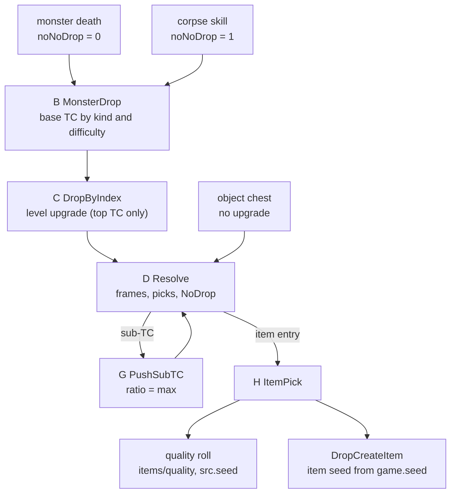

All draws in sections D–H are on `src.seed` unless a step says otherwise. Draw numbers restart for
each resolver call.

### A. The runtime TC (what the resolver reads)

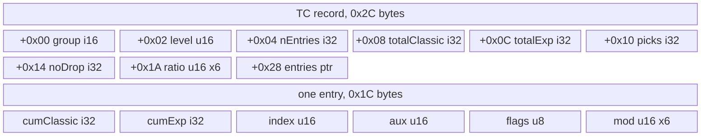

The resolver reads the TC array built at load ([data/excel § G](../data/excel.md#g-treasure-classes)),
not the `.bin` record. Layout of one TC (0x2C bytes): [C] (fn:TC_LoadTreasureClassEx@0x006547D0,
fn:TC_ParseItemCell@0x00654440, fn:TC_ResolveDrops@0x0055A6D0: writer and reader agree;
[items/0001 §1](../../findings/items/0001-tc-resolution.md#1-runtime-tc-layout-built-at-load-read-by-the-resolver))

| off | type | field | value |
|---|---|---|---|
| `+0x00` | i16 | `group` | `group + 5` (the number of auto item types) if `group ≠ 0`, else 0 |
| `+0x02` | u16 | `level` | `level` |
| `+0x04` | i32 | `nEntries` | |
| `+0x08` | i32 | `totalClassic` | sum of `Prob` over entries not flagged expansion-only |
| `+0x0C` | i32 | `totalExp` | sum of all `Prob` |
| `+0x10` | i32 | `picks` | `Picks` |
| `+0x14` | i32 | `noDrop` | `NoDrop` |
| `+0x1A` | u16[6] | `ratio` | `Magic`, `Rare`, `Set`, `Unique`, then the two words of `.bin` `+0x30`/`+0x32` (0 in every stock record) |
| `+0x28` | ptr | `entries` | 0x1C bytes each |

Entry (0x1C bytes): `cumClassic` i32 and `cumExp` i32 (the running sums **before** this entry was
added), `index` u16 (item index, or TC index), `aux` u16 (unique/set record index, or the `mul=` value),
`flags` u8 (`0x01` unique, `0x02` set, `0x04` sub-TC, `0x10` expansion-only), `mod` u16[6] from `cm=`,
`cr=`, `cs=`, `cu=`, `ce=`, `cg=`. [I] (fn:TC_AddEntry@0x00654080, fn:TC_ParseItemCell@0x00654440,
[items/0001 §1](../../findings/items/0001-tc-resolution.md#1-runtime-tc-layout-built-at-load-read-by-the-resolver))

```
A1. picks: i32 ← Picks;  if picks = 0: picks ← 1                      [I] (fn:TC_LoadTreasureClassEx@0x006547D0)
A2. an entry is expansion-only (flag 0x10) when it is an item whose      [I] (fn:TC_ParseItemCell@0x00654440, fn:TC_SetEntryProb@0x006540C0, tbl:Weapons.txt:version)
      version (+0xF6) ≥ 100, any unique or set reference, or a sub-TC
      whose own totalClassic is 0; its Prob is added to totalExp only
A3. cells with Prob < 1 are dropped at load, so every entry has Prob ≥ 1   [I] (fn:TC_LoadTreasureClassEx@0x006547D0)
```

Step notes:

- A. The only modifier in the shipped `treasureclassex` is `mul=` (81 cells, all `gld,mul=…`). No
  `cm=`…`cg=` and no non-zero `+0x30` word exist, so the ratio raises of H3 and the upgrade draws of H6
  never run with stock data. [I] ([items/0001 §1](../../findings/items/0001-tc-resolution.md#1-runtime-tc-layout-built-at-load-read-by-the-resolver), tbl:TreasureClassEx.txt:Item1)
- A. `ma=` and `mg=` write the same `aux` word as `mul=`; the resolver reads `aux` only for the gold
  multiply and the unique/set index, so on a non-gold item they do nothing here. [I]
  ([items/0001 § Dead ends](../../findings/items/0001-tc-resolution.md#dead-ends), fn:TC_ParseItemCell@0x00654440)

### B. Monster drop: which TC — `MONSTER_DropItems`

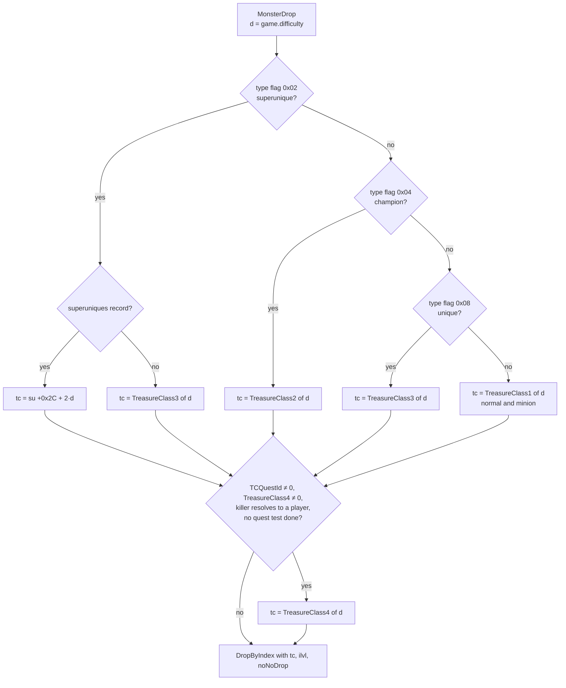

```
B1. MonsterDrop(game, mon: Unit, noNoDrop: bool, killer: Unit):
      d: u8 ← game.difficulty                                            [C] (fn:MONSTER_DropItems@0x005A6600, struct:Game+0x6D)
      row ← MonStats[mon.classId]                                        [I] (fn:MONSTATS_GetRecord@0x00451F80)
      ilvl: i32 ← max(1, mon.stat[12 level])                             [I] (fn:sub_00558200_UnitDropLevel@0x00558200)
B2.   if mon has type flag 0x02 (superunique):                           [C] (fn:MONSTER_DropItems@0x005A6600, run:2026-10-11-tc-drops)
        su ← superuniques[mon.superuniqueId]
        tc: u16 ← su ≠ none ? su[+0x2C + 2·d] : row.TreasureClass3[d]   ; missing record → unique column [I] (fn:sub_006556E0_SuperUniqueGet@0x006556E0)
B3.   else if mon has type flag 0x04 (champion): tc ← row.TreasureClass2[d]   [C] (fn:MONSTER_DropItems@0x005A6600 0x005A66C0–0x005A66D8, fn:sub_005A0180_MonTypeFlag@0x005A0180, run:2026-10-12-tc-champion)
B4.   else if mon has type flag 0x08 (unique):   tc ← row.TreasureClass3[d]   [C] (fn:MONSTER_DropItems@0x005A6600, run:2026-10-11-tc-drops)
B5.   else:                                      tc ← row.TreasureClass1[d]   [C] (fn:MONSTER_DropItems@0x005A6600, run:2026-10-11-tc-drops)
                                                 ; minions (flag 0x10 alone) land here
B6.   if row.TCQuestId ≠ 0 and row.TreasureClass4[d] ≠ 0 and killer resolves to a player p
         and none of the three quest tests on p is "done":                [I] (0x005A6705–0x005A67F1)
        tc ← row.TreasureClass4[d]                                       ; quest tests: items/quest-drops
B7.   DropByIndex(game, mon, killer, tc, forcedQ: 0, ilvl, noNoDrop, out: none, max: 0)   [I] (fn:MONSTER_DropItems@0x005A6600)
```

Step notes:

- B1. The death drop is skipped entirely when the monster unit has `+0xC4` bit 17 set, or when the
  collision test at its position (mask `0x801`) fails. Monster class 344 (`bonewall`) is a fatal error
  there. [I] (fn:sub_005A6830_MonDeathDrop@0x005A6830)
- B2–B5. The test order is superunique, champion, unique, else. Live monsters carry more than one
  flag (low byte of the flag word: `0x0b` on both superuniques killed, `0x09` on uniques, `0x0d` on
  champions), so the order matters. The column for the normal, minion, unique and superunique kinds is
  confirmed in Normal and Nightmare: `tools/tc.py replay` derives the base TC of every monster call from
  `monstats.bin` / `superuniques.txt` and matches all 317 monster calls (280 normal, 28 minion, 7 unique,
  2 superunique: Bishibosh → `Act 1 Super A` in Normal, Rakanishu → `Act 1 (N) Super B` in Nightmare). [C]
  (fn:MONSTER_DropItems@0x005A6600, tbl:MonStats.txt:TreasureClass1, tbl:MonStats.txt:TreasureClass3,
  run:2026-10-11-tc-drops)
- B3–B4. **Champion before unique.** When the monster is not a superunique, the code tests flag `0x04`
  first and takes `TreasureClass2`; only if that fails does it test `0x08` for `TreasureClass3`. The flag
  test is `(flags & mask) ≠ 0`, and live champions carry `0x0d` (`0x04` together with the unique flag
  `0x08`, and `0x01`), so a unique test placed first would give a champion the unique column. Both
  champion kills of the run (class 61 `fallenshaman4`, Nightmare, `mflags = 0d`) took `TreasureClass2(N)`
  (698 `Act 1 (N) Champ C`), not `TreasureClass3(N)` (783 `Act 1 (N) Unique C`), while a unique of the same
  class (`mflags = 09`) took 783; `tools/tc.py replay` asserts the base TC of all 121 monster calls of that
  run (98 normal, 17 minion, 2 champion, 4 unique). Scope: Nightmare, expansion, single player, class 61.
  [C] (fn:MONSTER_DropItems@0x005A6600 0x005A66C0–0x005A66D8, fn:sub_005A0180_MonTypeFlag@0x005A0180,
  tbl:MonStats.txt:TreasureClass2, run:2026-10-12-tc-champion,
  [items/0001 §3](../../findings/items/0001-tc-resolution.md#3-monster-tc-selection--monster_dropitems-0x005a6600))
- B2–B3. **Superunique first** is code-read only: no logged monster carries both `0x02` and `0x04` (every
  superunique logged `0x0b`). Champions in Normal and Hell, of other classes, and in a classic game were not
  logged either; they follow from the same code. [I] (fn:MONSTER_DropItems@0x005A6600, 0x005A66A0,
  fn:sub_005A03A0_MonSuperUniqueId@0x005A03A0)
- B3. The meaning of flag bit `0x01` (set on every logged unique, superunique and champion, not on
  Andariel, `0x08`) is not read; it does not take part in the column choice. [I]
  (fn:MONSTER_DropItems@0x005A6600, [items/0001 §3](../../findings/items/0001-tc-resolution.md#3-monster-tc-selection--monster_dropitems-0x005a6600))
- B2–B6. Hell (`d = 2`) uses the `(H)` columns by the same `8·d` stride; no Hell call was recorded. [I]
  (0x005A66AC–0x005A66FA, tbl:MonStats.txt:TreasureClass1(H))
- B6. The quest TC replaces **whichever** TC B2–B5 chose; it is not tied to the unique flag. A killer
  that is not a player is first resolved to its owning or summoning player; if none, no switch. [I]
  (0x005A6705–0x005A67F1, fn:sub_0058F0D0_MonsterOwner@0x0058F0D0)
- B6. One sighting, no promotion: in run:2026-10-12-tc-champion Andariel (class 156, Nightmare) logged
  base 834 `Andarielq (N)` = her `TreasureClass4(N)`, not `TreasureClass3(N)` (831). The killer's quest
  state was not logged, so the three quest tests stay code-read (*Open questions*). [I]
  (0x005A6705–0x005A67F1, tbl:MonStats.txt:TreasureClass4, run:2026-10-12-tc-champion)

### C. Level upgrade — `TC_DropByIndex` and `TC_GetByIndex`

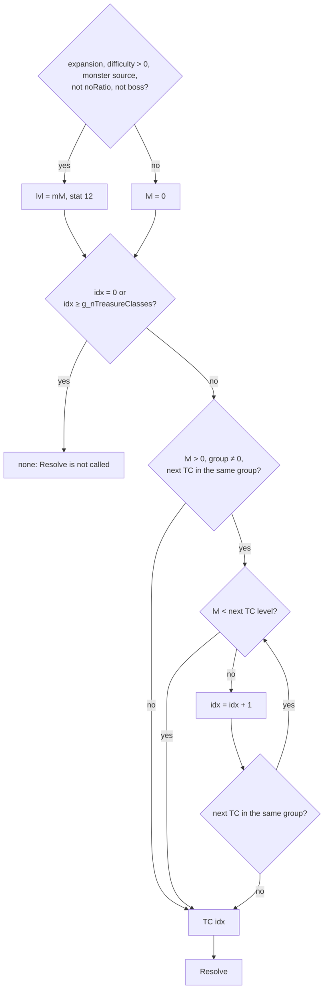

```
C1. DropByIndex(game, src, killer, tcIndex: u16, forcedQ, ilvl, noNoDrop, out, max):
      lvl: i32 ← 0
      if game.expansion ≠ 0 and game.difficulty > 0 and src.type = 1
         and not MonStats[src.classId].noRatio and not MonStats[src.classId].boss:   [I] (fn:TC_DropByIndex@0x0055AFA0, 0x0055AFAA–0x0055AFE8)
        lvl ← src.stat[12 level]                                         ; mlvl
      t ← GetByIndex(tcIndex, lvl)
      if t ≠ none: Resolve(game, src, killer, t, forcedQ, ilvl, noNoDrop, out, max)

C2. GetByIndex(idx: u16, lvl: i32) → TC or none:                         [I] (fn:TC_GetByIndex@0x00654E00)
      if idx = 0 or idx ≥ g_nTreasureClasses: return none
      t ← TC[idx]
      if lvl > 0 and t.group ≠ 0 and TC[idx+1].group = t.group:
        loop:
          if lvl < TC[idx+1].level: return TC[idx]                       ; next is too high: keep
          idx ← idx + 1
          if TC[idx+1].group ≠ TC[idx].group: return TC[idx]             ; end of the group run
      return t
```

Step notes:

- C1. The upgrade level is 0 for every Normal monster drop (53 calls) and the monster's level in
  Nightmare (167 calls; normal, minion, unique and superunique sources), and the forward walk reproduces
  in every call: 12 one-step upgrades at mlvl 40 (`Act 1 (N) Miss A` → `Miss B`, `H2H A` → `H2H B`,
  `Unique A` → `Unique B`), 9 calls held at `H2H B` because the next TC's level is 41. [C]
  (fn:TC_DropByIndex@0x0055AFA0, fn:TC_GetByIndex@0x00654E00, run:2026-10-11-tc-drops)
- C1–C2. **The champion group walks the same way.** 121 more Nightmare monster calls reproduce the upgrade
  level and the walk; both champions start at `Act 1 (N) Champ C` (698, group 18, level 41) and at mlvl 44
  walk two steps through `Act 2 (N) Champ A` (699, level 42) to `Act 2 (N) Champ B` (700, level 44),
  stopping before `Act 2 (N) Champ C` (701, level 45). One `boss` monster (Andariel, class 156) logged upgrade
  level 0 in Nightmare. `tools/tc.py replay` asserts the upgrade level of all 438 monster calls of the two
  runs. [C] (fn:TC_DropByIndex@0x0055AFA0, fn:TC_GetByIndex@0x00654E00, run:2026-10-12-tc-champion,
  [items/0001 §4](../../findings/items/0001-tc-resolution.md#4-level-upgrade--tc_dropbyindex-0x0055afa0-and-tc_getbyindex-0x00654e00))
- C2. **The base TC is always eligible, whatever its own `level`.** The walk only moves forward, so a
  base TC whose `level` is above mlvl is kept, never replaced by a lower TC of its group (146 Nightmare
  calls, Rakanishu's `Act 1 (N) Super B` at level 41 for mlvl 40 included). [C] (fn:TC_GetByIndex@0x00654E00,
  run:2026-10-11-tc-drops)
- C1. Only the top TC of a monster drop is upgraded; sub-TCs are fetched with `lvl = 0` (G1) and objects
  never upgrade. The classic gate and the `noRatio` gate were not exercised: every stock `noRatio`
  monster is a player summon with no TC, so that gate cannot be reached with stock tables. The `boss` gate
  agrees with its one logged call (Andariel, level 0, above) but rests on the code read.
  Superuniques upgrade unless their `monstats` row has `boss` or `noRatio`. [I] (0x0055AFAA–0x0055AFE8,
  tbl:MonStats.txt:noRatio, tbl:MonStats.txt:boss)
- C2. The walk reads `TC[idx+1]` without a bound check. With stock data every group run is followed by a
  loaded TC (the last, `Pandemonium Key C`, index 1012, has `group` 0). [I] (fn:TC_GetByIndex@0x00654E00)

### D. The resolver — `TC_ResolveDrops`

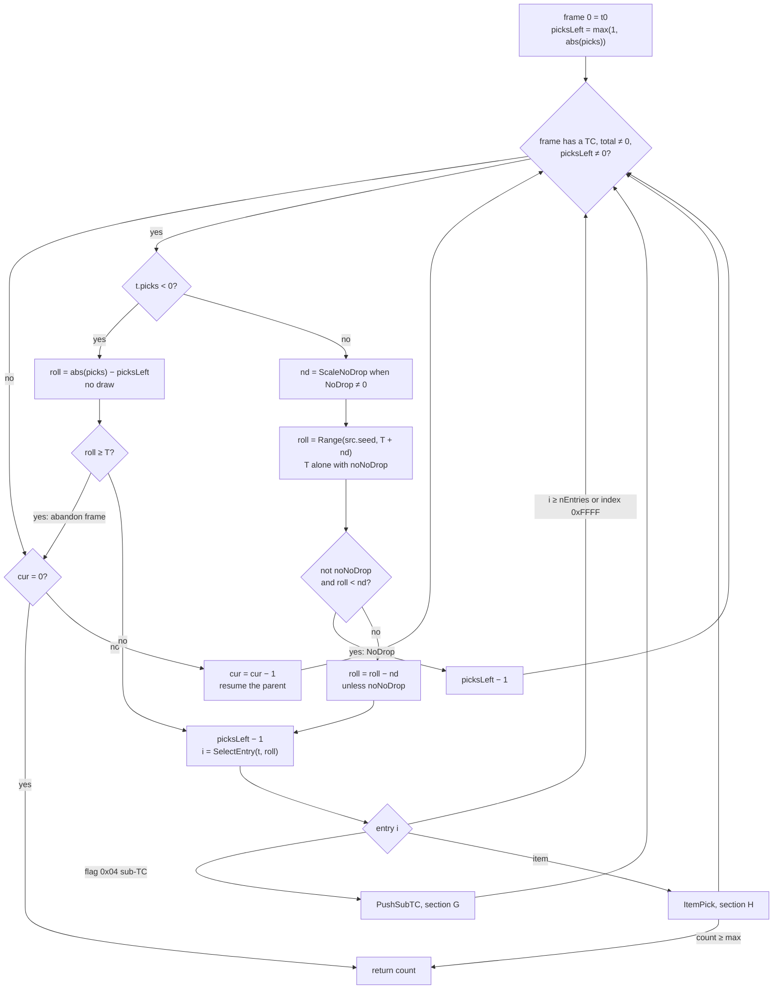

State: a stack of frames `{tc, picksLeft: i32, ratio: u16[6]}`, `cur: i32` the top frame,
`throwRetries: i32`, `count: i32` items created. `expansion ← game.expansion ≠ 0`, and
`total(t) = expansion ? t.totalExp : t.totalClassic`.

```
D1. Resolve(game, src, killer, t0, forcedQ, ilvl, noNoDrop, out, max):  [I] (fn:TC_ResolveDrops@0x0055A6D0, D1–D5 unless tagged)
      if out = none and max < 1: max ← 6                                ; out ≠ none with max = 0 is fatal
      count ← 0;  throwRetries ← 0;  cur ← 0
      frame[0] ← { t0, max(1, |t0.picks|), t0.ratio[0..5] }
D2.   loop:
        if frame[cur].tc ≠ none and total(frame[cur].tc) ≠ 0:
          while frame[cur].picksLeft ≠ 0:
            f ← frame[cur];  t ← f.tc                                     ; picks and noDrop re-read each pass
            T: i32 ← total(t);  if T = 0: break
D3.         if t.picks < 0:                                               [C] (fn:TC_ResolveDrops@0x0055A6D0, run:2026-10-11-tc-drops)
              roll: i32 ← |t.picks| − f.picksLeft                         ; 0, 1, 2, … — NO draw
              if roll ≥ T: break                                          [I] (fn:TC_ResolveDrops@0x0055A6D0)  ; abandons this frame
D4.         else:
              nd: i32 ← t.noDrop
              if nd ≠ 0: nd ← ScaleNoDrop(game, src, killer, nd, T)      ; section F, every pick
              range: i32 ← noNoDrop ? T : T + nd
              roll ← Range(src.seed, range)                               [C] draw#k, one per positive pick (0x0055AA03–0x0055AA3F, run:2026-10-11-tc-drops)
              if not noNoDrop:
                if roll < nd: f.picksLeft ← f.picksLeft − 1; continue     [C] (signed compare; run:2026-10-11-tc-drops)  ; NoDrop
                roll ← roll − nd
D5.         f.picksLeft ← f.picksLeft − 1                                 [I] (fn:TC_ResolveDrops@0x0055A6D0)
            i ← SelectEntry(t, roll)                                      ; section E
            if i ≥ t.nEntries: continue                                   ; pick consumed, nothing made
            e ← t.entries[i]
            if e.flags & 0x04: PushSubTC(e.index); continue               ; section G, changes cur
            if e.index = 0xFFFF: continue
            ItemPick(e)                                                   ; section H; may end the call
        if cur = 0: return count                                          [I] (fn:TC_ResolveDrops@0x0055A6D0)
        cur ← cur − 1                                                     ; resume the parent frame
```

Step notes:

- D3. **Negative `Picks`: no draw.** Pick *k* (0-based, `k < |Picks|`) takes the entry whose cumulative
  range contains *k*, so entry *i* fires `Prob_i` times in entry order. Reproduced for `Picks = −3`
  (`Act 1 Unique A/B`) and `Picks = −4` (`Act 1 Super A`, `Act 1 (N) Super B`). [C] (fn:TC_ResolveDrops@0x0055A6D0,
  tbl:TreasureClassEx.txt:Picks, run:2026-10-11-tc-drops)
- D3. The early stop when `k ≥ total` never fired in the run (every negative-`Picks` TC seen has
  `total = |Picks|`), and `Picks = 0` (stored as 1, A1) was not hit. Both are code-read only. [I]
  (fn:TC_ResolveDrops@0x0055A6D0, [items/0001 § Answer](../../findings/items/0001-tc-resolution.md#answer-summary))
- D4. The draw is an inlined copy of `Range`: `range < 1` returns 0 **without stepping**; otherwise one
  `Step` and `low mod range` (a mask for a power of two, same value). `range = 1` therefore still steps
  the seed and returns 0 (seen on every pick of `Act 1 Cpot A`, total 1, in the worked example). [C]
  (0x0055AA03–0x0055AA3F, fn:RNG_Range@0x0045C390, run:2026-10-11-tc-drops)
- D4. With `noNoDrop` (the corpse-skill path) `nd` is still computed but neither widens the range nor
  rejects a roll. [I] (fn:TC_ResolveDrops@0x0055A6D0, fn:sub_005A8000_MonDropNoNoDrop@0x005A8000)
- D5. A pick that ends on a sub-TC, on `index = 0xFFFF`, on a classic scan that runs off the end, or on
  an item rejected in H is consumed all the same (the throwable refund in H6 is the one exception). [I]
  (fn:TC_ResolveDrops@0x0055A6D0)
- D2. **In a classic game `total(t)` is `totalClassic`.** A classic Normal session reproduces with the draw range
  over `totalClassic` in all 485 resolver calls; with `totalExp` (and the `cumExp` search of E1) 41 calls break. [C]
  (0x0055AAED–0x0055AB33, run:2026-10-13-quality, [items/0001 §5.1](../../findings/items/0001-tc-resolution.md#51-entry-selection))
- D2. When a frame runs out of picks the loop pops to its parent, which continues with its own remaining
  picks. [I] (fn:TC_ResolveDrops@0x0055A6D0, [items/0001 §7](../../findings/items/0001-tc-resolution.md#7-recursion-into-a-sub-tc-0x0055ab680x0055ac2f))

### E. Entry selection

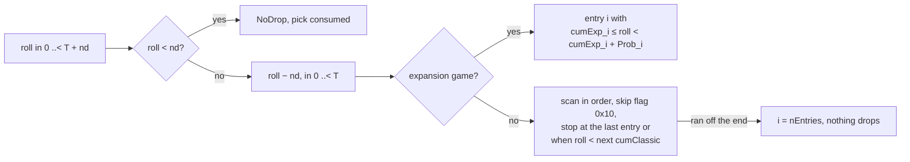

```
E1. SelectEntry(t, roll) — expansion game:
      the entry i whose half-open range [cumExp_i, cumExp_i + Prob_i)  [C] (0x0055AA93–0x0055AAEB, run:2026-10-11-tc-drops)
      contains roll
E2. SelectEntry(t, roll) — classic game:                                 [I] (0x0055AAED–0x0055AB33, E2 unless tagged)
      for i in 0 ..< t.nEntries:
        if entries[i].flags & 0x10: continue                             ; expansion-only entries skipped
        if i = t.nEntries − 1 or roll < entries[i+1].cumClassic: return i   [C] (run:2026-10-13-quality)
      return t.nEntries                                                  ; ran off the end: nothing drops
```

Step notes:

- E1. The game finds it by binary search over `cumExp`: the entry whose `cumExp = roll` if any, else
  `max(lo − 1, 0)` with `lo` the first entry whose `cumExp > roll`. Because every `Prob ≥ 1` (A3) this is
  the containment rule of E1. Every `SEL` index of the 328 replayed calls matches it. [C]
  (0x0055AA93–0x0055AAEB, run:2026-10-11-tc-drops)
- E2. **The classic scan, observed part:** the scan picks the entry whose classic range holds the roll, also
  when expansion-only entries follow it. `tools/tc.py replay` asserts the `SEL` index and every draw of all 485
  calls of a classic Normal session: 664 selections, 53 in TCs with expansion-only entries, 14 of them on the last
  classic entry just before such entries. [C] (0x0055AAED–0x0055AB33, run:2026-10-13-quality,
  [items/0001 §5.1](../../findings/items/0001-tc-resolution.md#51-entry-selection))
- E2. Not exercised: an expansion-only entry *before* the chosen one (the skip itself: a scan without it, or the
  `cumExp` search, gives the same result on that session), and a scan that runs off the end, which happens only
  when the last entries are all expansion-only. [I] (0x0055AAED–0x0055AB33)

### F. NoDrop scaling

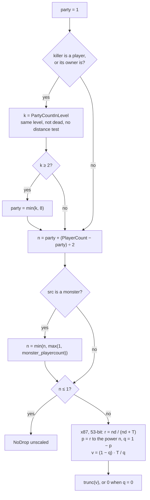

```
F1. ScaleNoDrop(game, src, killer, nd: i32, T: i32) → i32:              [I] (fn:TC_ResolveDrops@0x0055A6D0, 0x0055A8A1–0x0055A9D7, all of F1–F4)
      party: i32 ← 1
      if killer ≠ none:
        p ← killer.type = 0 ? killer : MonsterOwner(killer)              ; fn:sub_0058F0D0_MonsterOwner@0x0058F0D0
        if p ≠ none and p.type = 0:
          k: i32 ← PartyCountInLevel(game, p)                            ; F3
          if k ≥ 2: party ← min(k, 8)
F2.   n: i32 ← party + (PlayerCount(game) − party) ÷ 2                  ; C signed division, toward zero
      if src.type = 1:
        cap: i32 ← max(1, src.stat[100 monster_playercount])
        if n ≥ cap: n ← cap
      if n ≤ 1: return nd                                                ; unscaled
F4.   ; x87, every operation rounded to the precision control (53-bit significand, round to nearest even)
      r ← nd / (nd + T)                                                  ; nd + T is an i32 sum, converted exactly
      p ← r;  repeat n − 1 times: p ← p × r                              ; exactly n − 1 multiplications
      q ← 1 − p
      if q = 0: return 0
      v ← ((1 − q) × T) / q                                              ; (1 − q) is computed, p is not reused
      return trunc(v)                                                    ; toward zero (fn:CRT_ftol2@0x00682FD0)
```

Step notes:

- F2–F4. **Confirmed for a party of 1 and of 2:** with `party = 1` and 1 or 8 counted players
  (`/players 8`), `n` is 1 or 4; with `party = 2` and 2 players (two clients, TCP/IP), `n` is 2. `NoDrop'`
  equals the F4 evaluation at 53-bit precision in every logged evaluation, for `(NoDrop, T)` = (100, 60)
  → 10 and (125, 38) → 20 at `n = 4`, and (100, 60) and (100, 47) at `n = 2` (68 evaluations). The control
  word was `0x027F` in every evaluation, single player and TCP/IP host. [C] (0x0055A93B,
  fn:TC_ResolveDrops@0x0055A6D0, run:2026-10-11-tc-drops, run:2026-10-12-tc-party)
- F1. Still code-read: a dead party member, more than two players, the clamp at 8, and a monster killer
  resolved to its owning player. [I] (fn:sub_005408E0_PartyCountInLevel@0x005408E0, 0x0055A8E4,
  fn:sub_0058F0D0_MonsterOwner@0x0058F0D0,
  [items/0001 §6](../../findings/items/0001-tc-resolution.md#6-nodrop-scaling-0x0055a8a10x0055a9d7))
- F3. **Party count: same level, no distance test.** `PartyCountInLevel` counts the player and the members
  of its party (party list `game+0x1D2C`) whose room is in **the same level**: the level id of a room is
  read through room `+0x10` (the DRLG room) → `+0x58` (its level) → `+0x1D0` (the level id), and the ids
  must be equal. Community guides written for 1.10/1.11 say partied players count fully only "within two
  screens"; 1.14d counts them anywhere in the killer's level. In the two-client run a partied player in
  the killer's level gave `party = 2` in all 44 such calls at 26–375 subtiles (37 of them beyond two
  screens), an unpartied player in the same level (4 calls) and a partied player in another level (84
  calls) gave `party = 1`; `tools/tc.py replay` checks every logged party count against this rule.
  Scope: two players, both alive, player killer. [C] (fn:sub_005405A0_PartyForEachInLevel@0x005405A0,
  fn:sub_005408E0_PartyCountInLevel@0x005408E0, fn:sub_0061A1B0_RoomGetLevelId@0x0061A1B0,
  run:2026-10-12-tc-party, [items/0001 §6](../../findings/items/0001-tc-resolution.md#6-nodrop-scaling-0x0055a8a10x0055a9d7))
- F3. A member is counted only when not dead; a member without a room is skipped; a player with no
  room or no party counts itself only. [I] (fn:sub_005404F0_PartyCountAliveCb@0x005404F0,
  fn:sub_005405A0_PartyForEachInLevel@0x005405A0)
- F2. `PlayerCount` counts the units in the game's 128 player hash lists (`game+0x1120`, next pointer
  `unit+0xE4`) that are neither in state 7 (`playerbody`) nor dead (modes 0/17 for players, 0/12 for
  monsters, or `unit+0xC6` bit 0). If `game.type ∈ {1, 2, 3}` and `g_PlayersOverride` is larger, the
  override is used. `/players N` stores N only when `N ≤ 8` as an unsigned compare. `game.type` was 3
  in every single-player call and 2 in every TCP/IP host call logged, so by the code the override also
  applies in a TCP/IP game; no run typed `/players` there. [I]
  (fn:sub_00535790_PlayerCount@0x00535790, fn:sub_005541B0_UnitIsDead@0x005541B0,
  fn:sub_00535780_SetPlayersOverride@0x00535780, data:g_PlayersOverride@0x00883D70)
- F2. So the override is a **maximum**, not an addition: a lone player with `/players 8` gets
  `n = 1 + (8 − 1) ÷ 2 = 4`, the value logged in every `/players 8` call. [C] for the lone-player values
  (run:2026-10-11-tc-drops); the multi-player combination is [I] (fn:sub_00535790_PlayerCount@0x00535790).
- F2. The `monster_playercount` cap applies only to a monster source; an object source is not capped. [I]
  (0x0055A926)

### G. Recursion into a sub-TC

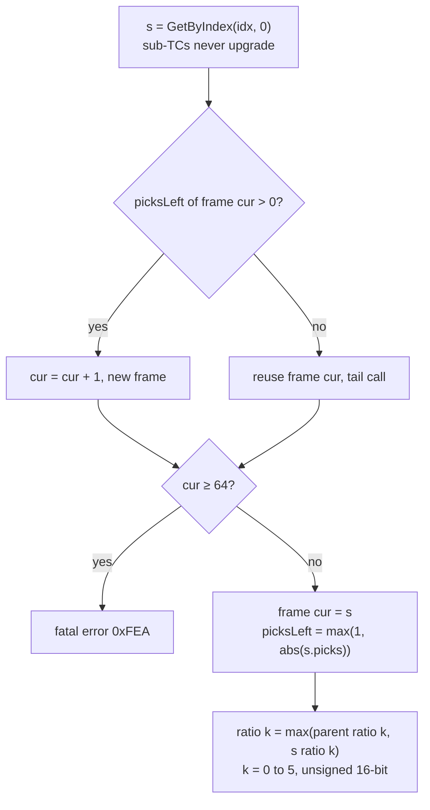

```
G1. PushSubTC(idx: u16):                                                 [I] (0x0055AB68–0x0055AC2F)
      s ← GetByIndex(idx, 0)                                             ; sub-TCs never upgrade
      parent ← cur
      if frame[cur].picksLeft > 0: cur ← cur + 1                         ; else reuse this frame (tail call)
      if cur ≥ 64: fatal error 0xFEA
      frame[cur].tc ← s;  frame[cur].picksLeft ← max(1, |s.picks|)
G2.   for k in 0 ..< 6:                                                  [C] (0x0055AB68–0x0055AC2F, run:2026-10-11-tc-drops)
        a: u16 ← frame[parent].ratio[k];  b: u16 ← s.ratio[k]
        frame[cur].ratio[k] ← (a = 0 or b > a) ? b : a                   ; = max(a, b), unsigned 16-bit
```

Step notes:

- G2. **Ratios combine by maximum, field by field.** `Act 1 Super A` (`1024,972,800,800`) over
  `Act 1 Uitem A` (`1024,800,800,800`) reaches the quality roll as `1024,972,800,800` in all 12 oracle
  entries under it, and a zero-ratio parent takes the child's values. [C] (0x0055AB68–0x0055AC2F,
  run:2026-10-11-tc-drops)
- G2. Each field is read before it is written, so the tail-call case (`parent = cur`) gives the same
  maximum. The child sees the parent's ratios as they are at the moment of the push, including any
  classic `cm=`…`cg=` raises (H3). [I] (0x0055AB68–0x0055AC2F)
- G1. The tail call does not change the order of draws; it only saves a frame. [I] (0x0055AB68)

### H. Item pick and hand-off

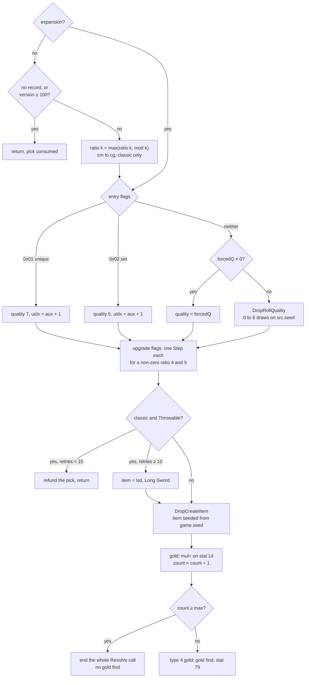

```
H1. ItemPick(e):                                                          [I] (0x0055AC5F–0x0055AF59, all of H1–H9 unless tagged)
      f ← frame[cur]
H2.   if not expansion:
        rec ← Items[e.index]
        if rec = none or rec.version ≥ 100: return                        ; pick consumed
H3.     for k in 0 ..< 6: f.ratio[k] ← max(f.ratio[k], e.mod[k])         ; cm/cr/cs/cu/ce/cg, classic only; persists in f
H4.   if e.flags & 0x01:      quality ← 7; uidx ← e.aux + 1              ; unique entry, no draw
      else if e.flags & 0x02: quality ← 5; uidx ← e.aux + 1              ; set entry, no draw
      else:
        uidx ← 0
        quality ← forcedQ ≠ 0 ? forcedQ
                  : DropRollQuality(game, src, killer, f.ratio, ilvl, e.index)   ; 0–6 draws on src.seed (items/quality)
H5.   up: u32 ← 0
      if f.ratio[4] ≠ 0:                                                 ; never with stock data
        Step(src.seed)                                                   ; draw#k (inlined, unguarded)
        if (src.seed.low & 0x3FF) < f.ratio[4]: up ← 0x04
      if f.ratio[5] ≠ 0:
        Step(src.seed)                                                   ; draw#k+1
        if (src.seed.low & 0x3FF) < f.ratio[5]: up ← up | 0x10
H6.   item ← e.index
      if not expansion and ItemTypes[Items[item].type].Throwable:
        if throwRetries < 10: throwRetries ← throwRetries + 1; f.picksLeft ← f.picksLeft + 1; return   ; refund
        throwRetries ← throwRetries + 1
        item ← ItemByCode("lsd")                                          ; Long Sword
H7.   unit ← DropCreateItem(game, item, src, quality, uidx, up)          ; does not touch src.seed
      if unit = none: return
H8.   if unit is of item type 4 (gold) and e.aux ≠ 0:
        unit.stat[14 gold] ← (i32)(unit.stat[14] × e.aux) >> 8           ; mul=; arithmetic shift
      if out ≠ none: out[count] ← unit
      count ← count + 1
      if count ≥ max: end the whole Resolve call                          ; no gold find for this item
H9.   if Items[unit].type = 4:
        unit.stat[14] ← unit.stat[14] × (100 + GF(killer) + GF(owner of killer)) ÷ 100   ; GF = stat 79
```

Step notes:

- H4. **The quality roll is a boundary for this spec.** It is called with the source unit, the
  killer, the frame's ratio words, the resolver's `ilvl` and the item index. In the replay its entry
  seed, item, `ilvl` and six ratio words were asserted on every call and its exit seed and return value
  taken from the log (ADR-0004 oracle). [C] for this entry contract (fn:ITEMS_DropRollQuality@0x00558640,
  run:2026-10-11-tc-drops)
- H4. It returns a quality code starting at 1. The run saw the codes 1, 2, 3, 4 and 6 (QOUT lines:
  1 ×8, 2 ×231, 3 ×4, 4 ×25, 6 ×4); worked example 1 shows code 1. [C] (fn:ITEMS_DropRollQuality@0x00558640,
  run:2026-10-11-tc-drops) The full range of codes and their meaning belong to `items/quality` (see *Open
  questions*).
- H4. It steps `src.seed` 0 to 6 times with `RNG_RangeB`; some results come without a draw (the
  potions of worked example 2 returned 2 with the seed unchanged). The rules are `items/quality`
  (plan 0010). [I] (fn:ITEMS_DropRollQuality@0x00558640, fn:RNG_RangeB@0x0045C3E0,
  [items/0002 §1](../../findings/items/0002-quality-roll.md#1-arguments-and-early-returns-0x005586400x005586ce)–[§2](../../findings/items/0002-quality-roll.md#2-row-selection--itemratio_select-0x00637910)
  for the offsets, [items/0002 § Answer](../../findings/items/0002-quality-roll.md#answer-summary) for the codes)
- H4. A unique entry (`flags & 0x01`) can only come from a cell that names a unique item (resolved at
  load by name, [data/excel G4](../data/excel.md#g-treasure-classes)), and a set entry likewise; both are
  expansion-only (A2). Neither was reached in the run. [I] (fn:TC_ParseItemCell@0x00654440, 0x0055AC5F)
- H5. The upgrade draws are unguarded inlined steps; the test uses the low word after the step. They run
  only when the frame's ratio words 4/5 are non-zero, which needs a `ce=`/`cg=` modifier (classic only,
  H3) or a non-zero `.bin` `+0x30` word: never with stock data. What creation does with bits
  `0x04`/`0x10` belongs to `items/quality`. [I] (0x0055AC5F–0x0055AF59, [items/0001 §8](../../findings/items/0001-tc-resolution.md#8-item-pick-and-hand-off-0x0055ac5f0x0055af59))
- H6. The throwable test uses the item's `type` only (`ItemTypes.Throwable`), and runs **after** the
  quality roll and the upgrade draws, so a refunded pick has already stepped `src.seed`. The first 10
  throwables in one resolver call refund their pick; later ones become a Long Sword. Classic only. [I]
  (0x0055AE6E–0x0055AEC2, tbl:ItemTypes.txt:Throwable)
- H6. **The throwable refund, observed part:** in a classic Normal session 16 picks of throwable types were
  refunded, at most 3 in one call: `tpot` potions (11), javelins, a throwing axe and a throwing knife. Each came
  after its quality roll, created no item, and the pick was taken again. Without the refund 13 of the 485 calls
  break. [C] (0x0055AE6E–0x0055AEC2, tbl:ItemTypes.txt:Throwable, run:2026-10-13-quality,
  [items/0001 §8](../../findings/items/0001-tc-resolution.md#8-item-pick-and-hand-off-0x0055ac5f0x0055af59))
- H6, H2. Not exercised: the Long Sword after the tenth throwable (`THROW_RETRIES`), and the `version ≥ 100`
  reject of H2 (the classic TCs of that session reached no such item record). [I] (0x0055AE6E–0x0055AEC2,
  [items/0001 §8](../../findings/items/0001-tc-resolution.md#8-item-pick-and-hand-off-0x0055ac5f0x0055af59))
- H7. **Item creation leaves the source seed alone:** `src.seed` is equal before and after every
  creation call of the 328 replayed calls. [C] (fn:sub_0055A550_DropCreateItem@0x0055A550, run:2026-10-11-tc-drops)
- H7. Creation builds a 0x84-byte record: source unit, game, the item's level (taken again from the
  source: monster or player `level` stat, else the area's `MonLvl[Ex][d]`, minimum 1), item index, drop
  position (a free spot near the source) and its room, quality, `uidx`, and the flags `up`, plus bit 0
  when the source is monster class 391 (`hellbovine`). The resolver's `ilvl` argument feeds only the
  quality roll. [I] (fn:sub_0055A550_DropCreateItem@0x0055A550, fn:sub_00558200_UnitDropLevel@0x00558200)
- H7. **The item's seed comes from the game seed**, not from `src.seed`: drops pass no seed in the
  record, so `sub_00558D90_ItemCreate` leaves the two game-seed draws of the unit constructor in place
  ([rng/seeds](../rng/seeds.md#algorithm) step 7a). In a classic game creation also refuses an item with
  `version ≥ 100`. [I] (fn:sub_00558D90_ItemCreate@0x00558D90, fn:sub_00555230_SUnitCreate@0x00555230)
- H8. `max` counts created items across the whole recursion. Reaching it ends the resolver at once, and
  the item that reaches it gets no gold find (H9 is skipped). [I] (0x0055AEF2–0x0055AF59)
- H8–H9. `mul=` applies to any item that is of type `gold` through the type-equivalence test; gold find
  applies only to items whose own `type` is exactly 4. Both products are signed 32-bit; `÷ 100` is an
  exact signed division. [I] (fn:sub_005589A0_DropGoldFind@0x005589A0, fn:ITEMS_UnitIsType@0x00629BB0)

### I. Auto item-type TCs (`weapN`, `armoN`, `bowN`, `meleN`, `abowN`)

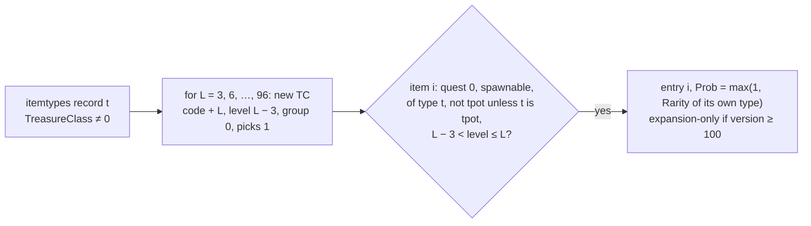

These are TC indices 1–160 ([data/excel G5](../data/excel.md#g-treasure-classes)); this section adds what
their contents are.

```
I1. for each itemtypes record t with TreasureClass ≠ 0, in record order:   [I] (fn:TC_BuildAutoTCs@0x006541C0, tbl:ItemTypes.txt:TreasureClass)
      for L in 3, 6, …, 96:
        name ← type code with padding spaces removed, then L in decimal   ; "bow " → "bow3"
        new TC: picks 1, group 0, level L − 3, noDrop 0, ratio all 0
        for each item i in item-index order (weapons, armor, misc):
          if Items[i].quest = 0 and Items[i].spawnable ≠ 0
             and i is of type t
             and (t = 38 or i is not of type 38)                          ; 38 = tpot
             and L − 3 < Items[i].level ≤ L:
            add entry i with Prob = max(1, ItemTypes[Items[i].type].Rarity)
            flag it expansion-only if Items[i].version ≥ 100
```

Step notes:

- I1. `group 0` means an auto TC never upgrades, and all-zero ratios mean it inherits its ratios from the
  TC that references it (G2). The weight is the `Rarity` of the item's **own** `type`, not of `t`.
  [I] (0x0065428B–0x00654361, tbl:ItemTypes.txt:Rarity, tbl:Weapons.txt:spawnable, tbl:Weapons.txt:level)
- I1. If the code rebuild fails for a type, no TC is allocated for that level and the numbering shifts;
  this does not happen with stock data (160 TCs). [I] (fn:TC_BuildAutoTCs@0x006541C0)

### J. Object drops (named only)

- [I] An object's TC is `Act N Chest A/B/C` for its difficulty: the object's level is the area level of
  its room's level, the act's level range is cut into thirds (tier A/B/C), and `TC_GetChestTC(diff, act,
  tier)` reads `g_ChestTCs`, filled at load with the names `"Act %d%s Chest %s"` (suffix `""`, `" (N)"`,
  `" (H)"`). The resolver gets the object as `src`, the operating player as `killer`, `max = 6`, an output
  array and no level upgrade. The callers and the forced quality they may pass belong to `objects`.
  (fn:sub_00585B90_ObjectChestDrop@0x00585B90, fn:TC_GetChestTC@0x00654E80, fn:TC_BuildChestTable@0x0065A2C0,
  data:g_ChestTCs@0x0096C5F4)
- [C] The 11 object calls in the run (`Act 1 Chest A`, `max = 6`, 8 of them with forced quality 4)
  reproduce with D–H unchanged. (fn:sub_00585B90_ObjectChestDrop@0x00585B90, run:2026-10-11-tc-drops)

## Draw order on `src.seed`

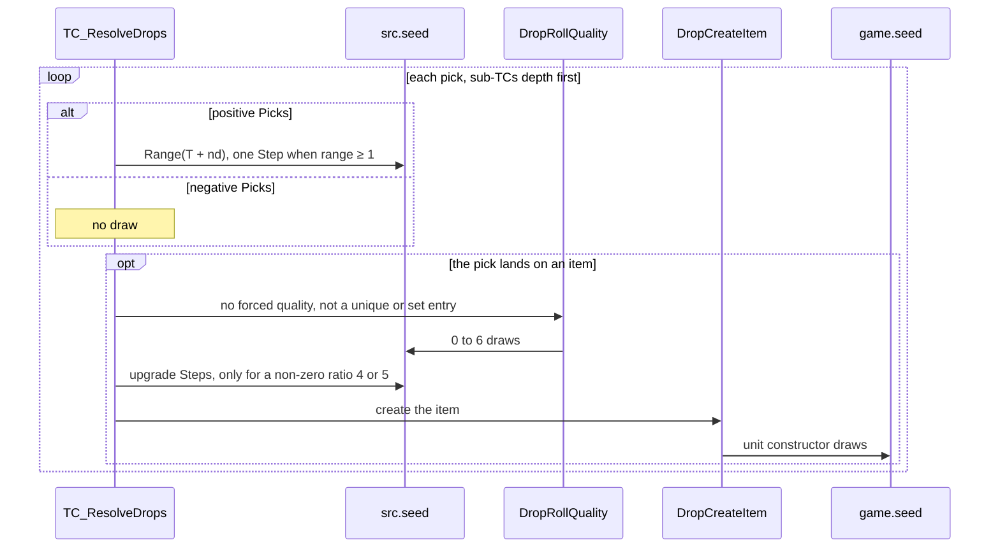

For one resolver call, in order. Items 1, 2 and 4 are [C] for every expansion-game call of the run,
with the quality roll as oracle (fn:TC_ResolveDrops@0x0055A6D0, run:2026-10-11-tc-drops: 328 calls,
every seed asserted).

1. Each positive pick with `range ≥ 1`: one draw (D4). Negative picks: none (D3).
2. Each item pick that is not a unique/set entry and has no forced quality: the quality roll's draws (H4).
3. Then the two upgrade draws, each only when its ratio word is non-zero (H5). Never ran: no stock data
   makes those words non-zero. [I] (0x0055AC5F–0x0055AF59)
4. Item creation: no draw on `src.seed` (H7); its unit-seed draws are on `game.seed`.

Sub-TCs interleave depth first: a sub-TC's picks (and the items under them) all happen before the
parent's next pick. [I] (fn:TC_ResolveDrops@0x0055A6D0)

## Outputs

- [I] `count`: the number of item units created (≤ `max`), and, when the caller passes `out`, the units
  in creation order. Monster drops pass no array; the units are placed in the world near the source.
  (fn:TC_ResolveDrops@0x0055A6D0, fn:sub_0055A550_DropCreateItem@0x0055A550)
- [C] `src.seed` advanced by exactly the draws of items 1, 2 and 4 above in every recorded call; the
  upgrade draws (item 3) are code-read only. (run:2026-10-11-tc-drops, 0x0055AC5F–0x0055AF59)
- [I] For each item: a creation call with `(item index, quality, uidx, up)`; `game.seed` stepped by the
  unit constructor. (fn:sub_00558D90_ItemCreate@0x00558D90)

## Worked example

Source: [run:2026-10-11-tc-drops](../../findings/items/experiments.md#run2026-10-11-tc-drops), replayed
by `python3 -I tools/tc.py replay`. Seeds are `low:high` in hex. Expansion game, Normal.

**1. Positive picks, NoDrop, two sub-TCs** (`tc-run2.log`, call #0). Monster class 5 (no type flags),
`ilvl` 1, killer a lone player with no `/players`, so `party = 1`, `PlayerCount = 1`, cap 1, `n = 1`
and NoDrop stays 100. `src.seed` on entry `a165c8f5:45c801b7`. [C] (run:2026-10-11-tc-drops)

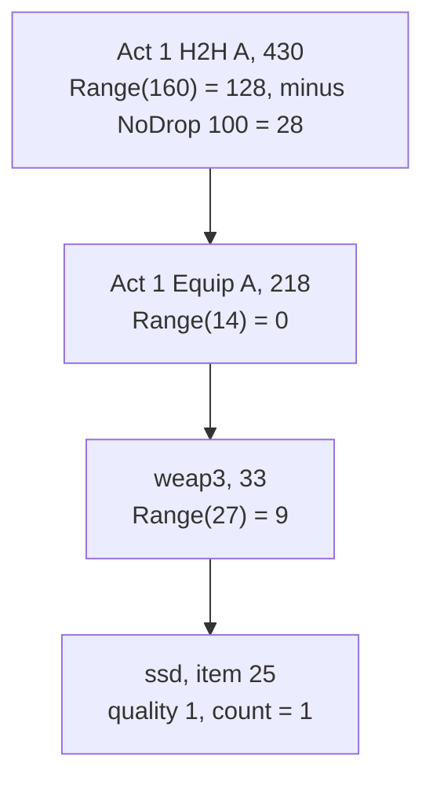

| # | TC (index) | Picks, NoDrop, total | Draw | `src.seed` after | roll | Result |
|---|---|---|---|---|---|---|
| 1 | `Act 1 H2H A` (430) | 1, 100, 60 | `Range(160)` | `99a37640:43515534` | 128 | 128 − 100 = 28 → entry 1 `Act 1 Equip A` (cum 21, prob 16) |
| 2 | `Act 1 Equip A` (218) | 1, 0, 14 | `Range(14)` | `661f5474:4014da46` | 0 | entry 0 `weap3` |
| 3 | `weap3` (33) | 1, 0, 27 | `Range(27)` | `cf6a178a:2a982ef3` | 9 | entry 4 `ssd`, item 25 (cum 8, prob 3) |
| — | quality oracle | ratios `0,0,0,0,0,0`, ilvl 1 | (oracle) | `a2ada0ba:6a57e192` | — | quality 1 |
| — | create item 25 | — | none | `a2ada0ba:6a57e192` | — | `count = 1` |

Each sub-TC push came after its parent's only pick was consumed, so each reused the frame (G1 tail
call), so all three TCs ran in frame 0. Frame 0 then has no picks left and the call ends
with `count = 1` and `src.seed = a2ada0ba:6a57e192`. The other three calls of that log (`Act 1 H2H A`,
fallen, class 19) drew once each, rolled below 100 and dropped nothing.

**2. Negative picks and ratio inheritance** (`tc-run5.log`, call #15). Unique monster, class 58,
`mflags = 09`, `ilvl` 5, `Act 1 Unique A` (767, `Picks = −3`, entries `Act 1 Uitem A` prob 1 and
`Act 1 Cpot A` prob 2). `src.seed` on entry `64be0388:64bef445`. [C] (run:2026-10-11-tc-drops)

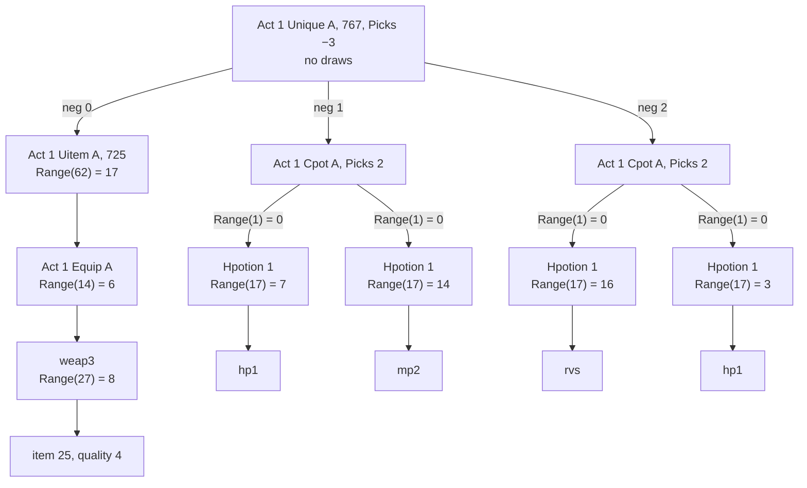

| Step | Frame | Draw | roll | Result |
|---|---|---|---|---|
| neg 0 | `Unique A` | none | 0 | `Act 1 Uitem A` (725, ratios `1024,800,800,800`) pushed |
| 1 | `Uitem A` (total 62) | `Range(62)` → `d8242bed:2a04d165` | 17 | `Act 1 Equip A` |
| 2 | `Equip A` (14) | `Range(14)` → `f1ddeec6:5a26a064` | 6 | `weap3` |
| 3 | `weap3` (27) | `Range(27)` → `f962bec2:64e17f4b` | 8 | item 25; quality oracle with ratios `1024,800,800,800,0,0` → 4, seed `604edad6:4a9978d0` |
| neg 1 | `Unique A` | none | 1 | `Act 1 Cpot A` (640, `Picks = 2`, one entry `Hpotion 1`, total 1) |
| 4 | `Cpot A` | `Range(1)` → `9fe43f7e:282b5a10` | 0 | `Hpotion 1` (174, total 17) |
| 5 | `Hpotion 1` | `Range(17)` → `ddfb1606:42b0873e` | 7 | `hp1` (587); oracle → 2, no draw |
| 6 | `Cpot A` | `Range(1)` → `d5efd9dc:5c9624d9` | 0 | `Hpotion 1` |
| 7 | `Hpotion 1` | `Range(17)` → `80dc8b25:593b40b3` | 14 | `mp2` (593); oracle → 2, no draw |
| neg 2 | `Unique A` | none | 2 | `Act 1 Cpot A` again |
| 8–11 | as 4–7 | four draws | 0, 16, 0, 3 | `rvs` (515), `hp1` (587) |

Five items, `count = 5`, final `src.seed = 43a0c080:5dec9d2e`. The ratio words reach the oracle from
`Uitem A` through two zero-ratio sub-TCs (G2), the `Range(1)` picks step the seed (D4), and the
potions' quality calls return without drawing (H4).

**3. NoDrop scaling** at `n = 4` (lone player, `/players 8`): `(NoDrop, T) = (100, 60)` gives
`r = 0.625`, `p = r⁴ = 0.152587890625`, `q = 0.847412109375`, `(1 − q) × 60 / q = 10.80…` → **10**;
`(125, 38)` gives **20**. Every pick then draws `Range(70)` or `Range(58)` instead of `Range(160)` or
`Range(163)`. [C] (0x0055A93B, run:2026-10-11-tc-drops; `python3 -I tools/tc.py nodrop 100 60 4`)

## Reimplementation notes

- **Two seeds.** TC picks and quality rolls step the source unit's seed (`unit+0x20`); the created
  items get their seeds from the game seed. Mixing them up shifts every later drop. [C]
  (run:2026-10-11-tc-drops, fn:sub_0055A550_DropCreateItem@0x0055A550)
- **The quality roll interleaves with the picks** on the same seed, so a TC walk cannot be reproduced
  without the quality model (`items/quality`). [C] (fn:ITEMS_DropRollQuality@0x00558640,
  run:2026-10-11-tc-drops)
- **NoDrop is recomputed for every pick**, from the unscaled `NoDrop` and the current TC's total, in
  floating point. A reimplementation in IEEE binary64 with round-to-nearest-even rounds each F4
  operation to the same 53-bit significand as the logged control word, for these operand ranges (no
  overflow or subnormals). Do not use the algebraically equal `p·T/(1 − p)`: the game computes `1 − q`.
  [I] (0x0055A8A1–0x0055A9D7, `tools/tc.py` `nodrop_scaled`)
- **The party rule is "same level", not "two screens".** 1.14d differs from the 1.10/1.11 community
  descriptions here; do not "correct" it. [C] (fn:sub_005405A0_PartyForEachInLevel@0x005405A0,
  run:2026-10-12-tc-party)
- **`/players` is a floor on the player count**, not an addition, and only in game types 1–3. [I]
  (fn:sub_00535790_PlayerCount@0x00535790)
- **The level walk is forward-only** and starts at the base TC, which is kept even when its own level
  is above mlvl. Do not search the whole group for the best level. [C] (fn:TC_GetByIndex@0x00654E00,
  run:2026-10-11-tc-drops)
- **`Range(1)` draws.** A sub-TC of total 1 with no NoDrop still steps the seed once per pick. [C]
  (0x0055AA03, run:2026-10-11-tc-drops)
- **`max` is global to the call** (6 for monster drops): the 6th created item ends the whole recursion,
  and that item skips gold find. [I] (0x0055AEF2–0x0055AF59)
- **Runtime `group` is offset by 5** for TCEx rows with a non-zero `group`; only equality between
  neighbours matters, so a reimplementation may keep the table value. [I] (fn:TC_LoadTreasureClassEx@0x006547D0)
- **Classic games differ** in the draw total (D2), entry selection (E2), item rejection (H2), the ratio raises
  (H3) and the throwable re-pick (H6). [I] (fn:TC_ResolveDrops@0x0055A6D0) A classic Normal session reproduces the
  classic total, the scan with no skipped entry and the throwable refund. [C] (run:2026-10-13-quality) The skip of
  an expansion-only entry, the scan off the end, the `version` reject, the raises and the Long Sword are code-read
  only. [I] (0x0055AAED–0x0055AB33, 0x0055AC5F–0x0055AF59)

## Evidence

- [findings/items/0001-tc-resolution.md](../../findings/items/0001-tc-resolution.md): the whole drop path
  (Phase 1 read, Phase 1b cross-check, Phase 2 promotions).
- [findings/items/experiments.md § run:2026-10-11-tc-drops](../../findings/items/experiments.md#run2026-10-11-tc-drops):
  328 resolver calls in eleven logs, reproduced by `tools/tc.py replay` (quality roll as boundary oracle),
  including the base-TC and upgrade-level check of all 317 monster calls.
- [findings/items/experiments.md § run:2026-10-12-tc-party](../../findings/items/experiments.md#run2026-10-12-tc-party):
  175 resolver calls of a two-client TCP/IP game (party count, `party = 2` NoDrop scaling).
- [findings/items/experiments.md § run:2026-10-13-quality](../../findings/items/experiments.md#run2026-10-13-quality):
  485 resolver calls of a classic Normal session, replayed with no oracle (the classic total, scan and throwable
  refund).
- [findings/items/experiments.md § run:2026-10-12-tc-champion](../../findings/items/experiments.md#run2026-10-12-tc-champion):
  124 resolver calls of a Nightmare single-player session, two champion kills (champion column, champion
  group walk).
- [specs/data/excel.md § G](../data/excel.md#g-treasure-classes): TC load, cell resolution, the TC index space.
- [specs/rng/README.md](../rng/README.md) and [specs/rng/seeds.md](../rng/seeds.md): `Range`, `Step`, unit seeds.
- Tables: [TreasureClassEx](../../tables/TreasureClassEx.md), [MonStats](../../tables/MonStats.md),
  [ItemTypes](../../tables/ItemTypes.md), [Weapons](../../tables/Weapons.md), [ItemRatio](../../tables/ItemRatio.md).
- `tools/tc.py`: the reference model (`replay`, `show`, `nodrop`).

## Open questions

- [L] **Parties beyond two players, and other champions.** Plan 0011 logged a party of two (alive,
  player killer) and two Nightmare champions of one class. Not logged: a dead member, three or more
  players, the clamp at 8, a monster killer's owner; champions in Normal or Hell, of other classes or in a
  classic game, and a monster carrying both `0x02` and `0x04` (the superunique-first order).
  ([items/0001 § Open questions](../../findings/items/0001-tc-resolution.md#open-questions))
- [L] **FPU precision in other configurations.** Every logged evaluation had control word `0x027F`;
  whether another game type or renderer sets 24- or 64-bit precision is not known.
- [L] **`game.type` values.** Single player logged 3 and a TCP/IP game 2 (on the host); value 1 is
  unobserved, and whether `/players` takes effect in a TCP/IP game was not tested. A run that typed
  `/players 1` still logged an override of 8; whether the command reached the game is unchecked.
- [L] **Hell, the untested classic cases (the skip of an expansion-only entry, the scan off the end, the `version`
  reject, the `cm=`…`cg=` raises, the Long Sword), the `boss` gate (one Nightmare call only), unique/set entries, `Picks = 0` and the negative-`Picks`
  early stop** are code-read only (inferred above). Hell needs its own run, and the classic cases need TCs that reach them; a
  unique entry needs a kill under a TC whose cell names a unique item, such as `ROP (N)`/`ROP (H)` →
  `Annihilus` (left unresolved by `tools/tc.py`).
- [L] **Quality codes.** The run saw codes 1, 2, 3, 4 and 6 from the quality roll; the full range and
  what each code means (and whether 5 and 7 from H4's set/unique entries use the same scale) belong to
  `items/quality` (plan 0010, backlog spec-writer → reverser).
- [L] **The quest TC tests** (B6) and the killer → player resolution belong to `items/quest-drops`. The
  one Andariel kill that took `TreasureClass4(N)` had no quest state logged.
- [L] **Game-seed draws inside item creation** beyond the unit constructor's two (rng/seeds 7a) are not
  covered here; the order of game-seed consumers is open in [rng/seeds](../rng/seeds.md#open-questions)
  and belongs to the item-creation specs.
- [L] **`superuniques` has no table doc**, so its TC column (`+0x2C + 2·d`) is cited by offset, not by
  `tbl:` anchor (backlog reverser → archivist on `superuniques`).
- [L] Meanings left to other subsystems: monster `+0xC4` bit 17 (skips the drop), `game+0x78` (copied
  into the creation record), the `hellbovine` flag bit, and the upgrade bits `0x04`/`0x10` (exceptional /
  elite upgrade?). ([items/0001 § Open questions](../../findings/items/0001-tc-resolution.md#open-questions))
