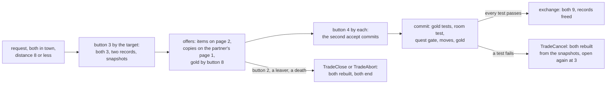
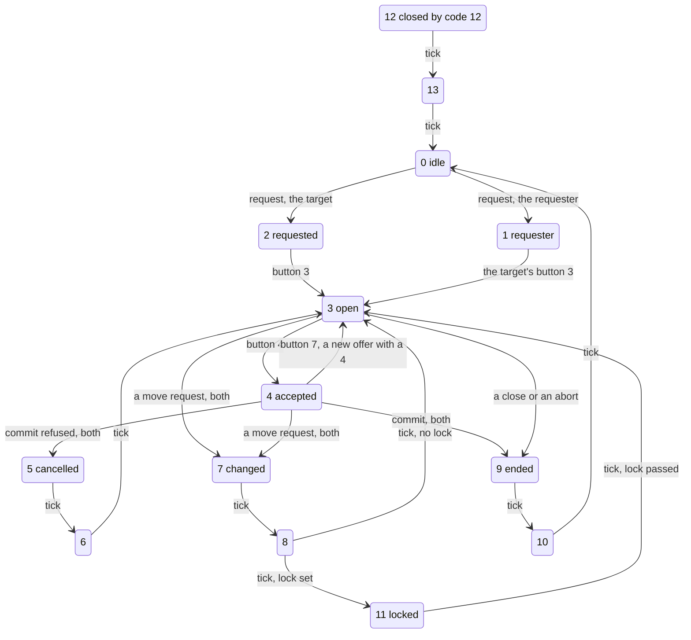
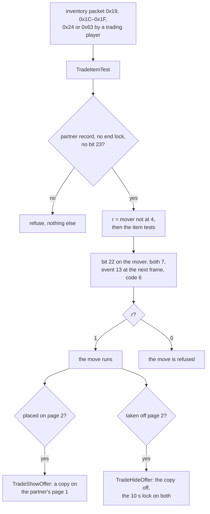
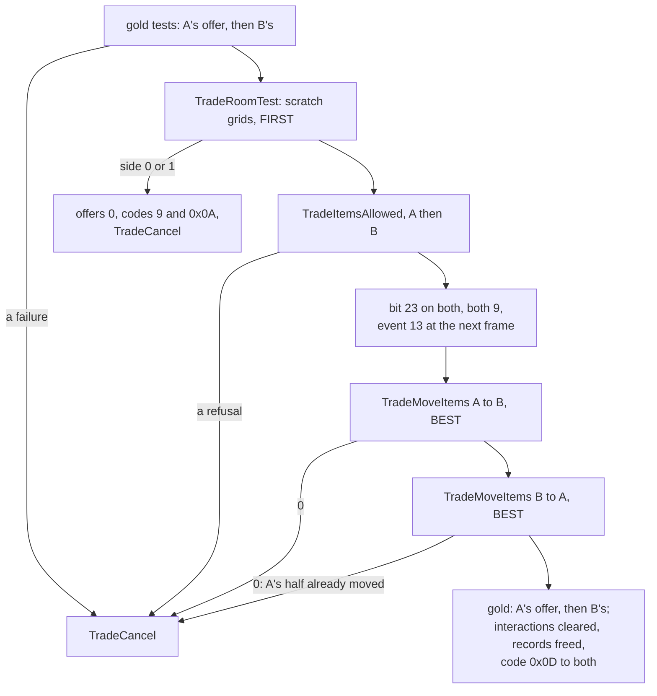

# Player trade: the request, the offer pages, the accepts, the commit and every way out

## Purpose

What the server does when two players trade, from the request to the exchange or the cancel. A request opens a
trade window between two players in town; each player puts items on its own offer page (page 2), and the server copies
each one to the partner's view page (page 1); either player can offer gold; both accept; the commit tests gold and room,
then copies each side's offer into the other's inventory and moves the gold. Every other way out (a close, a cancel at
the commit, a player leaving or dying) rebuilds both inventories from a snapshot taken when the window opened. Scope is
[ADR-0033](../../adrs/0033-scope-player-trade.md): the server's outcomes in game frames and in the server's own
`GetTickCount` windows; the client's trade window and its display are out (ADR-0014). Grids and placement are
[items/inventory](inventory.md), the gold cap is [items/economy § G](economy.md#g-gold-payment-caps-piles-and-the-death-loss),
and the event that steps the timed states is player event 13 of [sim/frame § F](../sim/frame.md#f-dispatch-the-event-tables-the-freeze-drop-kinds-6-and-11).



## Entry points

| When | Function | Tag |
|---|---|---|
| A player interacts with another player, within 8 | fn:sub_00548B00_UnitInteract@0x00548B00 → fn:sub_00566E60_TradeRequest@0x00566E60 (0x00548E6B) | [I] |
| A trade button (packet `0x4F`): 2 close, 3 accept the request, 4 accept the offer, 7 un-accept, 8 gold | fn:sub_00568060_PktInteractButton@0x00568060 (from 0x0054C7F0) | [I] |
| Seven inventory packets of a trading player (`0x19`, `0x1C`–`0x1F`, `0x24`, `0x63`) | fn:sub_00535610_InvMoveInteractTest@0x00535610 → fn:sub_00567620_TradeItemTest@0x00567620 | [I] |
| An item is placed on page 2 / taken off it | fn:sub_00568770_TradeShowOffer@0x00568770 (from `InvPlaceItem` 0x005603D9), fn:sub_00567400_TradeHideOffer@0x00567400 (from `InvItemToCursor` 0x0056063F) | [I] |
| Player event 13, the timed steps | fn:sub_005689D0_TradeStateTick@0x005689D0 (slot 0x006E1844) | [I] |
| A client leaves the game; a player dies | fn:sub_00539DA0_ClientRemove@0x00539DA0 (0x0053A091), fn:sub_005350F0_InteractEndOnDeath@0x005350F0 (0x00535169) → fn:sub_00568640_TradeAbort@0x00568640 | [I] |
| A player is saved | fn:PLRSAVE_Save@0x00532400 → fn:sub_00531BB0_SaveItemListOrSnapshot@0x00531BB0 | [I] |

Every one of these entries was reached in run:2026-11-10-trade except the death; for the save, `SaveItemListOrSnapshot` was
logged and the caller above it was not. The sections below say which branches the run covers. [C] (run:2026-11-10-trade, fn:sub_00568060_PktInteractButton@0x00568060)

## Inputs

### Tables

| Anchor | Used for |
|---|---|
| tbl:Misc.txt:quest | a base with `quest` (Items `+0x12A`) is tested against the partner's items by code, and a cube (`box `) with contents is refused (§ D) |
| tbl:Misc.txt:invwidth, tbl:Misc.txt:invheight | the offer's sizes in the room test and the moves ([items/inventory § B](inventory.md#b-the-placement-search)) |

The gold cap is `level × 10 000` (`PLAYER_GoldCap`, [items/economy § G](economy.md#g-gold-payment-caps-piles-and-the-death-loss)); carried gold is stat 14. [I] (fn:PLAYER_GoldCap@0x00622E70)

### Runtime state

| State | Type | Source |
|---|---|---|
| player data | `PlayerData` = `Unit+0x14`: `+0x4C` busy, `+0x50` the trade state (u32, 0–16), `+0x54` the request-message tick, `+0x58` the trade-end tick, `+0x5C` the trade record | fn:UNIT_GetPlayerData@0x006221A0, [multiplayer/0003 § Data touched](../../findings/multiplayer/0003-trade.md#data-touched) |
| the interaction | `Unit+0x64` the other unit's id, `+0x68` the kind (0 = a player, 1 = an NPC), `+0x6C` valid | [multiplayer/0003 § Data touched](../../findings/multiplayer/0003-trade.md#data-touched) |
| unit flags | struct:Unit+0xC8 bit 22 (a move is pending), bit 23 (a trade restore or exchange is pending) | fn:sub_00463720_UnitTestFlags@0x00463720 |
| trade record | `0x18` bytes: `+0x00` snapshot bytes written (i32), `+0x04` the snapshot buffer (`0x2000` bytes), `+0x08` the offer map (nodes original id, copy id, next), `+0x0C` the gold offer (u32), `+0x10` carried gold at opening, `+0x14` the lock time (`GetTickCount` value, 0 = none) | fn:sub_00566B30_TradeRecAlloc@0x00566B30 |
| tick | `t` = `GetTickCount()`, u32; every difference below is unsigned | fn:sub_00566E60_TradeRequest@0x00566E60 |

### Constants

| Name | Value | Anchor | Tag |
|---|---|---|---|
| request distance | `d ≤ 8` requests; `9 ≤ d ≤ 50` walks first; `d > 50` nothing | 0x00548DF9–0x00548E6B | [I] |
| message rate | 1 000 ms between two refusal events to one requester | 0x00566EA8–0x00566F4C | [I] |
| end window | 5 000 ms after a player's trade ended, no new request | 0x00566EDB, 0x00566F24 | [I] |
| removal lock | 10 000 ms on both records after an item leaves page 2 | fn:sub_00567400_TradeHideOffer@0x00567400 | [I] |
| snapshot buffer | `0x2000` bytes, read back as item version `0x60` | fn:sub_00566B30_TradeRecAlloc@0x00566B30, fn:sub_00566CC0_TradeRestoreSnapshot@0x00566CC0 | [I] |
| `0x77` codes | 0 / 1 request sent / received, 5 accepted, 6 a change or refusal, 9 no room (the receiver), `0x0A` no room (the giver), `0x0C` closed, `0x0D` exchanged, `0x0F` the lock passed | 0x005684E3–0x0056853B, 0x00567E05–0x00567E72, 0x00567268–0x00567294 | [I] |

## Algorithm

### How to read the tags

- **`[C]` live** is run:2026-11-10-trade: two stock clients on one machine, a TCP/IP game hosted by slot 1 under a
  read-only gdb logger, Normal, expansion, agent-driven; sessions a (T1, T2, T3 a and b, T5, T6), b (T7, T9–T12) and
  c (T4, T8, T13). `tools/trade_check.py` replays every logged request, button, item test, offer, removal, commit,
  cancel, close, abort, tick and save against this spec's rules: a 547 events / 318 checks, b 362 / 203, c 400 / 218,
  0 mismatches except T13's two tick-delay lines (§ A, Open questions). A `[C]` here names the case that reached the
  branch; the check covers the branch on the inputs the logs gave, and says nothing of inputs no case met.
  [C] (run:2026-11-10-trade, [multiplayer/0003 § 13](../../findings/multiplayer/0003-trade.md#13-phase-2-run-run2026-11-10-trade-lanen67h))
- **`[I]`** is the static reading of [multiplayer/0003](../../findings/multiplayer/0003-trade.md) §§ 2–10, with the
  addresses read. Branches no case reached stay `[I]`: T3 (c) (the town test), the second part of T5 (an overspend), T6
  with a button 8 alone (gold at a partner's 4), and the route of T8's save. [I] (fn:sub_00566E60_TradeRequest@0x00566E60, fn:PLRSAVE_Save@0x00532400)

### A. The states and the tick



The state is `PlayerData+0x50`; only the trade module writes it. [I] (0x005689D0–0x00568C90, [multiplayer/0003 § 2](../../findings/multiplayer/0003-trade.md#2-the-states-the-flags-and-the-tick))

| State | Set by | Left by |
|---|---|---|
| 0 | the tick from 10 or 13 | the request |
| 1 / 2 | `TradeRequest`: requester 1, target 2 | button 3 (open) or a close |
| 3 | `TradeOpen`; button 7 from 4; the tick from 6, from 8 with no lock, from 11 once the lock passed; `TradeShowOffer` or `TradeHideOffer` when either side is at 4 | button 4 (to 4); a move request (to 7); a close or abort (to 9) |
| 4 | button 4 at 3 | button 7, a move (7), `TradeShowOffer`/`TradeHideOffer` (3), the commit (9 or 5) |
| 5, 6 | `TradeCancel` (the commit's refusals) | the tick: 5 → 6 → 3 |
| 7, 8, 11 | `TradeItemTest`, both players | the tick: 7 → 8 → 3, or 8 → 11 → 3 when the record's lock is set |
| 9, 10 | `TradeClose` (the partner; the presser on code 9), `TradeAbort` (both), the exchange (both) | the tick: 9 → 10 → 0 |
| 12, 13 | `TradeClose` with code 12 (the presser) | the tick: 12 → 13 → 0 |
| 14, 15, 16 | button 3 while blocked, from 7 / 8 | the tick: 14 → 15 → 16, then a close with 12 or a wait |

```
A1. TradeStateTick(p), p's player event 13:                         [I] (fn:sub_005689D0_TradeStateTick@0x005689D0, 0x00568CE4) (all of A1)
      s: u32 ← pd(p).state
      if s ≤ 4: return                                     ; 0x005689E5, the tick never touches 0–4
      switch s:
        5:  state ← 6;  queue event 13 at frame + 1
        6:  state ← 3;  clear bits 22 and 23
        7:  state ← 8;  queue event 13 at frame + 1
        8:  clear bit 22
            if rec(p).lock ≠ 0: state ← 11;  queue event 13 at frame + 125
            else:               state ← 3
        11: if GetTickCount() > rec(p).lock (unsigned):
              state ← 3;  clear bits 22 and 23;  rec(p).lock ← 0;  0x77 code 0x0F to p
            else: queue event 13 at frame + 25
        9:  state ← 10;  queue event 13 at frame + 1
        10: state ← 0;   clear bits 22 and 23
        12: state ← 13;  queue event 13 at frame + 4
        13: state ← 0;   clear bits 22 and 23
        14: state ← 15;  queue event 13 at frame + 1
        15: state ← 16;  clear bit 22;  queue event 13 at frame + 5
        16: if both states ∈ {1, 2} or neither player is blocked: TradeClose(…, 12)
            else queue event 13 at frame + 5
A2. Blocked(p) = bit 22 or bit 23 of Unit+0xC8, or an item id on the       [I] (fn:sub_00597A20_TradeBlocked@0x00597A20, 0x0063CBB0, 0x0063CD20)
    inventory's update list that GameFindUnit still finds
```

- A1. [C] The tick's steps for states 5, 6, 7, 8 (with and without a lock), 9, 10 and 11, and its leaving 0–4 alone:
  every logged tick of sessions a, b and c (rule `R-tick`), the lock in T7, the cancels in T4 and T13. The bits each
  step clears read clear after it. (fn:sub_005689D0_TradeStateTick@0x005689D0, run:2026-11-10-trade)
- A1. [C] At 11, the state stays 11 while the lock time is ahead and goes to 3 once it has passed (T7: J's accepts at 7, 8
  and 11 refused, then accepted after the lock). (0x005689D0, run:2026-11-10-trade)
- A1. [I] The frame delays (+1, +4, +5, +25, +125) are read from the queue calls. The logs agree with them at every
  tick but two: in T13 the cancel's 5 → 6 → 3 ran inside one logged frame, where the rule and T4's cancel give one
  frame per step. The states and their order agree there too; the contradiction is named under Open questions.
  (fn:sub_005417D0_UnitQueueEvent@0x005417D0, run:2026-11-10-trade)
- A1. [I] States 12 to 16 were not reached (no button 3 inside an open trade, none while blocked). (0x005681FC–0x005683D7)

### B. The request

```
B1. UnitInteract, player target, d ← UnitInteractDistance(requester, target):   [I] (0x00548DF9–0x00548E6B, fn:sub_00641530_UnitInteractDistance@0x00641530) (all of B1)
      d > 50 (unsigned):  nothing
      9 ≤ d ≤ 50:         walk to the target first (InteractWalkTo)
      d ≤ 8:              if target mode = 0x11 and neither is in a live player interaction: corpse pickup
                          else TradeRequest(game, requester, target)
B2. TradeRequest(requester R, target T), t ← GetTickCount():
      1. R busy (an interaction, a cursor item, pd+0x4C) or the classic end lock: return          [I] (0x00566E6A–0x00566E82)
      2. T busy: if t − R.+0x54 > 1000: event 8 to R naming T;  R.+0x54 ← t;  return            [C] (0x00566EA8–0x00566ECF, run:2026-11-10-trade)
      3. t − T.+0x58 < 5000: if R.+0x54 + 1000 < t: event 9 to R naming T;  R.+0x54 ← t;  return [C] (0x00566EDB–0x00566F02, run:2026-11-10-trade)
      4. either state ≠ 0: return                                                                [I] (0x00566F10–0x00566F1E)
      5. t − R.+0x58 < 5000: if t > R.+0x54 + 1000: event 9 to R, no name;  R.+0x54 ← t;  return [I] (0x00566F24–0x00566F4C)
      6. both rooms' levels are towns:                                                           [C] (0x00566F58–0x0056700A, run:2026-11-10-trade)
           both interactions ← (kind 0, the other's id);  0x77 code 0 to R, 1 to T;  R state 1, T state 2
         else: both interactions cleared                                                         [I] (fn:sub_006426A0_LevelIsTown@0x006426A0)
```

- B2.2. [C] T3 (a): the target in Deckard Cain's menu; event 8 to the requester, no state moved. (run:2026-11-10-trade)
- B2.3. [C] T3 (b): a request 80 frames after T2's close; event 9 naming the target, `+0x54` = `t`, no state moved. (run:2026-11-10-trade)
- B2.6. [C] Every request that opened (T1 and the later ones) had both states 0, both outside their 5 000 ms windows,
  and left states 1 and 2 with each interaction naming the other. The out-of-town branch was not reached (T3 (c)). (fn:sub_00566E60_TradeRequest@0x00566E60, run:2026-11-10-trade)
- B. [I] There is no hostility, mode or level test of `TradeRequest`'s own; `PlayerHostileToggle` reaches the module only to
  send a message. (0x005A5F37, fn:sub_00566D90_TradeEventMsg@0x00566D90)

### C. The buttons

```
C0. PktInteractButton(presser P, button b, param):                   [I] (fn:sub_00568060_PktInteractButton@0x00568060, 0x00568620) (all of C0)
      the stash (0x12–0x14) and cube (0x17, 0x18) buttons are taken first
      P has no interaction: 0x77 code 0x0C;  another kind: code 0x0D;  return
      the partner Q is gone: a blocked P gets nothing, else code 0x0C;  return
      b ∈ {5, 6} or b > 8: nothing
C2. b = 2: if both states ∈ {1, 2} or neither is Blocked:                  [C] (0x00568175–0x005681F7, run:2026-11-10-trade)
             TradeClose(P, Q, 9);  P.+0x58 ← Q.+0x58 ← t
C3. b = 3: if P or Q is Blocked:                                           [I] (0x005681FC–0x005683D7)
             P at 7 → 14;  P at 8 → 15;  else TradeClose(P, Q, 12)
           else if the end lock: TradeClose(P, Q, 9)
           else if P state ≠ 2 or Q state ≠ 1: TradeClose(P, Q, 12)       ; 3 inside an open trade closes it
           else:                                                           [C] (0x005681FC–0x005683D7, run:2026-11-10-trade)
             TradeOpen: both states 3, 0x77 code 6 to both
             TradeRecAlloc(P), TradeRecAlloc(Q)    ; a second failure frees the first record
             0x78 to each: the partner's name and unit id
C4. b = 4: if P or Q Blocked, or P state ≠ 3, or an item on P's cursor:    [C] for P at 7, 8 or 11 (0x00568499–0x00568573, run:2026-11-10-trade)
             0x77 code 6 to P;  no state moves
           else if the end lock: TradeClose(P, Q, 9)                       [I] (0x00568499–0x00568573)
           else:                                                           [C] (0x00568499–0x00568573, run:2026-11-10-trade)
             0x77 code 5;  P state ← 4
             if Q state = 4: TradeCommit(A = P, B = Q);  P.+0x58 ← Q.+0x58 ← t     ; § F
C7. b = 7: each of P, Q at 4 goes to 3; codes to both                      [C] (0x0056857F–0x005685C2, run:2026-11-10-trade)
C8. b = 8: the gold offer, § E
```

- C2. [C] The close: both `+0x58` set to the same new tick and `TradeClose` code 9, from `Escape` and from the window's
  close control alike (dev session, T2). No close in the run sent button 3. (0x00568175, run:2026-11-10-trade)
- C3. [C] Opening: both 3, a record each with `+0x10` the carried gold, `+0x0C` and `+0x14` 0 and `+0x00` above 0
  (every opening of the run). The `0x78` sends are `[I]`. (fn:sub_00566B30_TradeRecAlloc@0x00566B30, fn:sub_0053CAD0_SendTrade78@0x0053CAD0, run:2026-11-10-trade)
- C4. [C] A refused accept: T7, where J pressed `ok` at 7, 8 and 11, got code 6 and kept its state. A refusal for a
  blocked presser at 3 or a cursor item alone was not logged. (run:2026-11-10-trade)
- C4. [C] The second accept commits with `A` the presser and `B` the partner (T1, T4, T5, T6, T13). (fn:sub_00567C70_TradeCommit@0x00567C70, run:2026-11-10-trade)
- C7. [C] A button 7 at 4 sets that player to 3 (a, f 4434: H 4 → 3). (0x0056857F, run:2026-11-10-trade)

### D. The offer pages and the change lock



```
D1. TradeItemTest(mover M, item), called before the packet moves anything:     [I] (fn:sub_00567620_TradeItemTest@0x00567620) (all of D1)
      no interaction: return M state ≤ 4;  kind ≠ 0: return 1;  partner gone: return M state ≤ 4
      partner has no record, or the end lock, or bit 23 on M or the partner: return 0     ; 0x0056767D–0x005676BA
      r: bool ← (M state ≠ 4)
      if item's base has quest:
        if the code is box and M has an item on page 3: r ← 0;  event 0x0A to M
        if PlayerFindItemByCode(partner, code) finds one: r ← 0
      else if item flag 0x1000 (monster equipment): r ← 0
      else: ITEMS_GetQuality(item)                                   ; called, result unused
      set bit 22 on M;  both states ← 7;  event 13 for both at frame + 1;  0x77 code 6 to both
      return r                                                       ; 0 makes the packet return without the move
D2. TradeShowOffer(placer P, item), after InvPlaceItem put item on page 2:    [I] (fn:sub_00568770_TradeShowOffer@0x00568770) (all of D2)
      no player interaction or the partner Q gone: 0x77 code 0x0C;  return
      copy ← ItemCopy(item);  copy mode 4, page 1
      if InvPlaceItem(game, Q, copy, item's cell, exact, 1, 0):
        copy socketed children;  add (item id, copy id) to P's record map
        if P or Q at 4: 0x79 four times;  TradeOpen (both 3)
      else: free the copy;  TradeClose(P, Q, 9)
D3. TradeHideOffer(placer P, item), after InvItemToCursor took item off page 2:   [I] (fn:sub_00567400_TradeHideOffer@0x00567400) (all of D3)
      no player interaction or the partner gone: a code;  return
      copy ← the map's copy id;  InvItemToCursor(Q, copy, …, 1, 1, 0, 1)     ; off page 1, Q's cursor word untouched
      the map entry stays
      P.rec.lock ← Q.rec.lock ← t + 10 000;  codes to both
      if P or Q at 4: 0x79 four times;  TradeOpen (both 3)
D4. TradeBeltLock, packets 0x1C and 0x1D on body slot 8, after D1:          [I] (fn:sub_00567840_TradeBeltLock@0x00567840, 0x0054AF07–0x0054AF17)
      in a player interaction with any item at location 2 (the belt): refuse
```

- D1. [C] Each of the 19 logged item tests (rule `R-itemtest`) set bit 22 on the mover and both states to 7, whatever it returned:
  the pick-ups of the offered items, the belt of T9, and the refused cube moves of T10 and T11. A refused move
  still un-accepts both. (fn:sub_00567620_TradeItemTest@0x00567620, 0x00567798–0x00567826, run:2026-11-10-trade)
- D1. [C] T10: J's cube holding an item, return 0 and event `0x0A`. T11: H's empty cube while J holds a cube, return 0
  and no event. T12: J's move while H was at 4 returned 1 and took H's 4 away. (0x005676E4–0x00567793, run:2026-11-10-trade)
- D1. [I] The early refusal (no partner record, end lock, bit 23), the mover at 4 and the monster-equipment flag were not
  logged; monster equipment cannot reach a stock player's inventory. (0x0056767D–0x005676BA, 0x00567793)
- D1. [I] A test runs on any of the seven packets, a pick-up from page 0 among them, not only on pages 1 and 2; `0x18`
  (cursor to page) does not call it, and needs `InteractIsPlayer` to place on page 2 ([items/inventory § E](inventory.md#e-pages-and-the-stash-0x18-0x19)). (fn:sub_0054ABB0_Pkt18CursorToPage@0x0054ABB0)
- D2. [C] Each logged offer put a copy with a new id on the partner's page 1 at the original's cell and added the pair to
  the placer's map; with neither player at 4 there was no `TradeOpen` (T12). (fn:sub_00568770_TradeShowOffer@0x00568770, run:2026-11-10-trade)
- D2. [I] The branch with a player at 4 is hard to reach: a placement follows a pick-up, whose test already set both to 7,
  and button 4 refuses a cursor item. The failed copy was not reached. (0x00568770–0x005689CD)
- D3. [C] T7: the copy left J's page 1, both records' lock times were set to the same new value, the map entry stayed,
  and the ticks went 7 → 8 → 11 → 3 once the lock passed. The value `t + 10 000` is `[I]`. (fn:sub_00567400_TradeHideOffer@0x00567400, run:2026-11-10-trade)
- D4. [C] T9: J clicked its belt (holding potions); the item test ran (both 7), the belt lock returned 0, and the belt
  stayed worn. (fn:sub_00567840_TradeBeltLock@0x00567840, run:2026-11-10-trade)
- D. [I] While trading, `InteractIsPlayer` refuses 14 other requests: the cursor drop, `0x18` to a page other than 2,
  item use from the inventory, on an item and from the belt, the gold drop, the mercenary's item packet, two quest
  party credits, identify, and `UnitInteract`. What each refusal returns is read for two only. (fn:sub_005678A0_InteractIsPlayer@0x005678A0, 0x0054C800–0x0054C86C)
- D. [I] `BeltOverflow`, `CubeDropEmptied` and `PageSwapCursor` also call `TradeShowOffer`; when they do was not read. (0x00560BF2, 0x00563B62, 0x00561E0D)

### E. The gold offer

```
E1. b = 8 (param: u32 the amount), presser P, partner Q:                    [I] (0x005683DC–0x00568497) (all of E1)
      if stat14(P) < param (unsigned) and neither is Blocked: TradeClose(P, Q, 9);  return
      if stat14(Q) + param > GoldCap(Q) (unsigned): param ← GoldCap(Q) − stat14(Q)
      if P has a record: P.rec.offer ← param;  0x79 to both
      no state is read or written
```

- E1. [C] The clip: T5, J's entry of 9 000, above H's room under its cap, was stored as that room, and H ended at
  exactly its cap of 800 000 with nothing dropped. Each of the 113 logged button 8s (all with a record) stored the clip
  model's value. (0x0056843C–0x00568448, fn:PLAYER_GoldCap@0x00622E70, run:2026-11-10-trade)
- E1. [C] The commit takes the offer as stored (T1, T5, T6). (fn:sub_00567C70_TradeCommit@0x00567C70, run:2026-11-10-trade)
- E1. [C] The 113 logged button 8s left both states as they were; each came with both players at 3, 6, 8 or 11.
  (0x005683DC, run:2026-11-10-trade)
- E1. [I] **A gold offer does not un-accept.** A partner at 4 stays at 4 through a button 8. No logged 8 reached a
  partner at 4: the stock client sends button 7 when the coin is clicked, and its entry box closes when the partner
  accepts (T6). (0x005683DC–0x00568497)
- E1. [C] The stock client's gold entry: one button 8 per entry (`param` the amount), always after a button 7 sent when
  the coin is clicked; and the client clamps the entry to its own gold before sending it (an entry of 150 000 sent as
  95 000). So the gold un-accepts the partner through the 7, and no overspend reached the server. (fn:sub_00568060_PktInteractButton@0x00568060, run:2026-11-10-trade)
- E1. [I] The overspend close (T5's second part) and a button 8 before the window opens (no record: nothing stored, the
  overspend still closes) were not reached. (0x005683E6)

### F. The commit



```
F1. TradeCommit(A, B), A the second to accept:                      [I] (fn:sub_00567C70_TradeCommit@0x00567C70) (all of F1)
      1. gold: if stat14(A) < A.offer (signed): TradeCancel                                ; 0x00567CA8
               if stat14(B) + A.offer > GoldCap(B) (unsigned): codes 0x0A, 9;  TradeCancel  ; 0x00567CE0
               then the same for B's offer into A                                          ; 0x00567D51, 0x00567D86
      2. side: i32 ← 0
         if not TradeRoomTest(A, B, &side):                                               ; F2
           A.offer ← B.offer ← 0
           0x77 to A then B: 0x0A, 9 when side = 0;  9, 0x0A when side = 1
           TradeCancel;  return
      3. if not TradeItemsAllowed(A) or not TradeItemsAllowed(B): TradeCancel;  return     ; ItemQuestGate per page-2 item
      4. bit 23 on A and B;  both states 9;  event 13 for both at frame + 1
      5. if not TradeMoveItems(A → B): TradeCancel;  return                                ; F3; 0x00567F32
      6. if not TradeMoveItems(B → A): TradeCancel;  return                                ; 0x00568050
      7. gold: A's offer moves to B, then B's to A
         both interactions cleared;  both records freed;  book skills recounted;  0x77 code 0x0D to both
F2. TradeRoomTest(A, B, &side):                                      [I] (fn:sub_0063E370_TradeRoomTest@0x0063E370, fn:sub_0063E100_InvScratchCopyGrid@0x0063E100, fn:sub_0063E2E0_InvScratchFitOffer@0x0063E2E0, fn:sub_0063E1C0_InvScratchPlace@0x0063E1C0) (all of F2)
      SA, SB ← two scratch inventories (0x40 bytes, magic 0x01020304, owner 0)
      copy A's page-0 cells into SA and B's into SB
      for each page-2 item of A, in A's item-list order:
        InvSpotFindBySize(SB, item, B's row, &x, &y, 0);  fail: side ← 0;  return 0
        mark the item's cells in SB
      for each page-2 item of B, in B's item-list order: the same into SA;  fail: side ← 1;  return 0
      return 1
F3. TradeMoveItems(X → Y):                                           [I] (fn:sub_005670E0_TradeMoveItems@0x005670E0) (all of F3)
      for each item of X on page 2, in list order:
        copy ← ItemCopy(item);  if copy = 0: skip the item
        TradeItemRename(copy);  mode 4;  page 0
        if not InvPlaceItem(game, Y, copy, 0, 0, anywhere, 1, 0): 0x77 0x0A to X, 9 to Y;  return 0
        copy socketed children;  fail: codes;  return 0
      for each item of X on page 1 or 2: remove it (a page-2 item loses its book skill first)
      return 1
```

- F2. [C] **The room test searches in the FIRST order, the moves in the BEST order.** A scratch's owner is 0, so
  `InvSpotFindBySize` takes the non-player orders of [items/inventory § B](inventory.md#b-the-placement-search) B1;
  `TradeMoveItems` places into the player's own inventory through `InvPlaceAnywhere`, which takes the player orders.
  Every logged commit (T1, T4, T5, T6, T13) had each scratch cell where the FIRST model puts it and each owner word
  0, and each real placement of the commits that moved items where the BEST model puts it. (0x0063E3B4, 0x0063E3F1, 0x0063E228,
  fn:sub_0063B850_InvSpotFindBySize@0x0063B850, fn:sub_0063B950_InvPlaceAnywhere@0x0063B950, run:2026-11-10-trade)
- F1.2. [C] T4: H's 2 × 4 offer into J's crowded page, J accepting last (A = J): `side` 1, `0x77` 9 to J then `0x0A`
  to H, both offers 0, `TradeCancel`, both restored, 5 → 6 → 3; nothing moved. Side 0 was not reached. (0x00567E0F, 0x00567E29, run:2026-11-10-trade)
- F1.6. [C] **The half commit.** T13: the room test passed, `TradeMoveItems(J → H)` returned 1, `(H → J)` returned 0
  at the fourth wand (`0x0A` to H, 9 to J), and `TradeCancel` at 0x00568050 rebuilt both inventories from their
  snapshots, which took J's moved item back from H. The gold had not moved. (fn:sub_005670E0_TradeMoveItems@0x005670E0, run:2026-11-10-trade)
- F1.7. [C] The exchange: both 9, records freed, interactions cleared, code `0x0D` to both, each received item a new
  unit on page 0, the giver's page 1 and 2 items gone, gold moved by the offers (T1, T5, T6). (0x00568012, 0x0056802C, run:2026-11-10-trade)
- F1. [I] Not reached: the four gold refusals (the offer is clipped at button 8, § E), the quest gate's refusal, the
  first move's failure (0x00567F32), a copy of 0, a socket failure, and the order of the gold moves.
  (0x00567C70–0x00567D8C, fn:sub_005672D0_TradeItemsAllowed@0x005672D0)
- F2. [I] FIRST and BEST disagree in both directions on the inventory model: a page where the room test passes and a
  move fails (T13), and pages where the room test refuses an offer the moves would place (a 2 × 1, 1 × 4 and two 1 × 3
  on the page, three 2 × 2 offered: FIRST fails the third, BEST places all three). The second direction was not run.
  (fn:sub_0063E370_TradeRoomTest@0x0063E370, [multiplayer/0003 § 12.3](../../findings/multiplayer/0003-trade.md#123-t13-first-and-best-disagree-in-both-directions))

### G. The record and the snapshot

```
G1. TradeRecAlloc(p):                                                 [I] (fn:sub_00566B30_TradeRecAlloc@0x00566B30) (all of G1)
      if pd(p).record ≠ 0: return 0
      rec ← 0x18 bytes;  rec.buffer ← 0x2000 bytes
      rec.bytes ← SaveItemListOrSnapshot(buffer, 0x2000, 0, 0, 0)    ; the live list in the save format
      if rec.bytes < 1: stop the game (error 0x809)
      rec.map ← rec.offer ← rec.lock ← 0;  rec.gold ← stat14(p)
G2. TradeReturnItems(p):                                              [I] (fn:sub_005678F0_TradeReturnItems@0x005678F0) (all of G2)
      if p has a record: packet 0x92 naming p to p and to each other player
      for each item of p's inventory, and the cursor item:
        mode 0: ItemBookSkillRemove;  InvQueueItemUpdate;  ItemData+0x14 bit 0
      InvDetachWorn(p)                         ; worn items and active charms, then every item unlinked, cursor 0
      TradeRestoreSnapshot(p)
G3. TradeRestoreSnapshot(p):                                          [I] (fn:sub_00566CC0_TradeRestoreSnapshot@0x00566CC0, fn:sub_005337F0_ItemListReadByVersion@0x005337F0) (all of G3)
      cancel p's event 9
      ItemListReadByVersion(rec.buffer, 0x60, 0x2000, 0, …)       ; every item read anew from the bytes
      if stat14(p) > 0 and p's mode ∉ {0, 17}: stat14(p) ← rec.gold   ; by two adds
```

- G2. [C] **A restore replaces the whole inventory.** After each logged restore (the close of T2, the cancels of T4 and
  T13, the partner in the two aborts) the player's item list had the opening layout, and no item id from before the restore
  survived. In T2 the offered item and the cube picked up in place of `Y` came back with the rest. (fn:sub_005678F0_TradeReturnItems@0x005678F0, fn:sub_00566CC0_TradeRestoreSnapshot@0x00566CC0, run:2026-11-10-trade)
- G3. [I] A player with 0 gold, or dead (mode 0 or 17), keeps the current gold. The trade moves no gold before the
  commit, so in the run the restored gold always equalled the opening gold. (0x00566CC0–0x00566D89)
- G. [I] Whether the units discarded by a restore, and the hidden copy of `TradeHideOffer`, are freed is not read. (0x0063CBB0, 0x0055DF10)

### H. The ways out

```
H1. TradeClose(presser P, partner Q, code):                          [I] (fn:sub_005679E0_TradeClose@0x005679E0) (all of H1)
      both marked changed;  bit 23 on both;  both interactions cleared
      TradeReturnItems(P);  TradeReturnItems(Q);  both records freed
      P state ← code (9 or 12);  Q state ← 9;  book skills recounted
      0x77 code 0x0C to both;  both event 13 cancelled and queued at frame + 1
H2. TradeCancel(A, B), the commit's refusals:                         [I] (fn:sub_00567B00_TradeCancel@0x00567B00) (all of H2)
      book skills recounted;  both marked changed;  bit 23 on both;  A.offer ← B.offer ← 0
      TradeReturnItems(A);  TradeReturnItems(B)
      0x79 four times;  0x77 code 6 to both;  both states 5;  event 13 at frame + 1
      the records and the interactions stay: after 5 → 6 → 3 the window is open, empty, with no offers
H3. TradeAbort(leaver L):                                             [I] (fn:sub_00568640_TradeAbort@0x00568640) (all of H3)
      if L's interaction is not kind 0 with a unit Q that exists: return
      if Q's interaction does not name L: clear L's interaction;  return     ; no state, no restore, records kept
      clear L's interaction;  L state 9, event 13
      TradeReturnItems(L);  TradeReturnItems(Q);  both records freed
      0x77 code 0x0C to Q;  clear Q's interaction;  Q state 9, event 13
```

| Way out | Path | Tag |
|---|---|---|
| Button 2 (`Escape` or the window's close control) | `TradeClose(…, 9)` (§ C2) | [C] (run:2026-11-10-trade) |
| Button 3 inside an open trade or while blocked; the tick at 16 | `TradeClose(…, 12)` | [I] (0x005681FC) |
| A gold overspend; a failed offer copy | `TradeClose(…, 9)` (§ E, § D2) | [I] (0x005683E6, 0x00568770) |
| A refusal at the commit | `TradeCancel`, open again at 3 (§ F) | [C] (run:2026-11-10-trade) |
| A client leaving the game | `ClientRemove`: the save first when its argument is 1, then `TradeAbort` | [C] for a dropped client (run:2026-11-10-trade) |
| A death | `PlayerDeath` → `InteractEndOnDeath` → `TradeAbort` | [I] (0x00581012, fn:sub_00580EC0_PlayerDeath@0x00580EC0) |
| The Act IV end move | `InteractEndForcedMove` presses button 6, which does nothing: the trade stays | [I] (0x00535244, 0x005B4A96) |
| Waypoint travel | no trade code: the traveller's interaction cleared, both states and records left | [I] (fn:sub_00584F60_WaypointTravel@0x00584F60, 0x0054C622) |

- H1. [C] Each logged close (T2 and the closes between cases) left the presser at the code and the partner at 9, both
  records freed, both interactions cleared, bit 23 on both, then 9 → 10 → 0. The `0x77` and event-13 lines are `[I]`. (fn:sub_005679E0_TradeClose@0x005679E0, run:2026-11-10-trade)
- H2. [C] Both cancels (T4, T13) left both players at 5 with their records, offers 0, bit 23, both inventories
  restored, then 6 and 3. (fn:sub_00567B00_TradeCancel@0x00567B00, run:2026-11-10-trade)
- H3. [C] Two aborts, both with the trade open: T8 and the end of session b, each by killing the joiner's client.
  `ClientRemove` (argument 1, `edx` 3, from 0x0052CB86) saved first, then `TradeAbort` with J the leaver found H's
  interaction naming J, set both to 9, freed both records and restored H. The leaver's own restore and the one-way branch are `[I]`. (fn:sub_00539DA0_ClientRemove@0x00539DA0, fn:sub_00568640_TradeAbort@0x00568640, run:2026-11-10-trade)
- H. [I] The *Save and Exit* route was not taken: with the trade open, `Escape` sends button 2 and closes the trade
  first. `ClientRemove`'s argument at its other callers is not read. (fn:sub_0052C900_SaveClients@0x0052C900, 0x00539E03)
- H. [I] After waypoint travel the partner's interaction still names the traveller, so the partner's later
  `TradeAbort` finds no back-pointer. A stock client may never send the waypoint packet while trading. (fn:sub_0054C5D0_Pkt49WaypointTravel@0x0054C5D0, 0x00584FCD)

### I. The save mid-trade

```
I1. PLRSAVE_Save(p):                                                  [I] (fn:PLRSAVE_Save@0x00532400, 0x00532447–0x00532464) (all of I1)
      flag ← 1 if p's interaction is set and of kind 0, else 0
      on the route for game byte +0x6A ∈ {1, 2}: D2S_WriteSave(…, flag) → D2S_WriteItemList(…, flag)
      the routes at 0x00531EB0 and 0x00532240 receive the flag; not followed to the writer
I2. SaveItemListOrSnapshot(buf, room, flag, …), unit u:              [I] (fn:sub_00531BB0_SaveItemListOrSnapshot@0x00531BB0, fn:sub_005675E0_TradeSnapshotCopy@0x005675E0) (all of I2)
      if flag ≠ 0 and u is a player and u has a record and rec.bytes ≤ room (signed):
        copy rec.bytes from rec.buffer;  return rec.bytes        ; the opening inventory
      else ITEMS_WriteInventoryList(u, …)                         ; the live list
```

- I2. [C] The saves logged mid-trade: at each of the two dropped clients (T8, the end of session b), `ClientRemove` saved
  both players before `TradeAbort`, each through two `SaveItemListOrSnapshot` calls with flag 1, and each of the 8
  `TradeSnapshotCopy` calls returned that player's record byte count with the record's sha256: the bytes written were
  the opening snapshot, for the leaver and for the host. (fn:sub_005675E0_TradeSnapshotCopy@0x005675E0, run:2026-11-10-trade)
- I. [I] So a player saved with an open record (from the target's accept to the end) is saved with the items as they
  were at opening and the carried gold as it is; in the request phase (no record) the live list is saved. Which
  `PLRSAVE_Save` route the saves at the drops took, and the file written, were not observed: J's save file on disk was
  not rewritten during session c. ([save/d2s § H](../save/d2s.md#h-item-lists), fn:D2S_WriteSave@0x00569AD0)

## Outputs

On an exchange: each player's offered items as new units on the partner's page 0, the givers' pages 1 and 2 empty,
carried gold moved by the two offers, both states 9 → 10 → 0, the records freed. On every other way out that reaches
`TradeReturnItems`: both inventories rebuilt from the opening snapshot as new units; after a cancel at the commit the
window is open again at 3, after a close or abort both states run 9 → 10 → 0. A save with a record open writes the
snapshot. [C] (run:2026-11-10-trade, fn:sub_00567C70_TradeCommit@0x00567C70)

## Worked example

T13 and T4, session c of run:2026-11-10-trade (characters `TrHostB` = H and `TrJoinB` = J, level 80, from
`tools/mp_saves.py`). Page 0 is 10 × 4. J's page 0: a 2 × 2 at (3, 1), a 2 × 4 at (7, 0), a 2 × 3 at (0, 1), a 2 × 3 at
(5, 0); J offers one 1 × 1 (`gcv`). H offers four 1 × 2 wands; H's page 0 then holds a 2 × 4 at (8, 0). J accepts last,
so A = J, B = H. [C] (fn:sub_0063E370_TradeRoomTest@0x0063E370, run:2026-11-10-trade)

| Step | Search | Cells | Result |
|---|---|---|---|
| room test, A's `gcv` into H's scratch | FIRST | (7, 0) | fits |
| room test, B's four wands into J's scratch | FIRST | (2, 0), (2, 2), (9, 0), (9, 2) | fits: the test passes |
| `TradeMoveItems(J → H)` | BEST | (7, 3) | 1 |
| `TradeMoveItems(H → J)` | BEST | (9, 0), (9, 2), (2, 1), then none | 0: (2, 0) and (2, 3) are left apart |
| `TradeCancel` at 0x00568050 | | both inventories from the snapshots | both 5 → 6 → 3, `gcv` back with J |

[C] Each scratch cell and each placement above is a logged value that the FIRST and BEST models of
[items/inventory § B](inventory.md#b-the-placement-search) predicted. (0x0063E228, fn:sub_005670E0_TradeMoveItems@0x005670E0, run:2026-11-10-trade)

T4, in the same window before T13: H offers its 2 × 4 axe instead. No two adjacent columns of J's page 0 are free, so
B's offer fails J's scratch: `side` 1, `0x77` 9 to J then `0x0A` to H, cancel, nothing moved. [C] (0x00567E0F, run:2026-11-10-trade)

## Reimplementation notes

- **The room test and the moves use different search orders**: the test fills scratch grids in the FIRST order, the
  moves place in the player's BEST order. A test that passes can be followed by a move that fails, which the snapshots
  then undo after one side has moved. [C] (fn:sub_0063E370_TradeRoomTest@0x0063E370, fn:sub_005670E0_TradeMoveItems@0x005670E0, run:2026-11-10-trade)
- **The room test can refuse an offer the moves would place.** Keep the FIRST test; do not replace it with a trial of
  the real placement. [I] (fn:sub_0063E370_TradeRoomTest@0x0063E370, 0x0063E3B4)
- **Any move request of a trading player un-accepts both, even one the server then refuses** (a cube with contents, a
  belt with potions, a quest code the partner holds). [C] (0x00567798, run:2026-11-10-trade)
- **A restore rebuilds the whole inventory from the opening snapshot**, not just the offered items: items moved on
  page 0 go back to their opening cells and every item comes back as a new unit with a new id. [C] (fn:sub_005678F0_TradeReturnItems@0x005678F0, run:2026-11-10-trade)
- **A refusal at the commit does not close the trade**: `TradeCancel` keeps the records and the interactions, empties
  both offers and the gold, and the window is open again at 3. [C] (fn:sub_00567B00_TradeCancel@0x00567B00, run:2026-11-10-trade)
- **The gold offer is clipped when it is made**, to the receiver's room under its cap, and the stored amount is what
  the commit moves. [C] (0x0056843C, run:2026-11-10-trade)
- **Button 8 writes no state**: a gold offer alone leaves a partner's accept standing (the stock client's button 7
  before it is § E). [I] (0x005683DC–0x00568497)
- **A save mid-trade writes the opening snapshot** of the item list, not the live list. [C] (fn:sub_005675E0_TradeSnapshotCopy@0x005675E0, run:2026-11-10-trade)
- **Real time, not frames**, for the 1 000 ms message rate, the 5 000 ms end window and the 10 000 ms removal lock: each
  compares `GetTickCount()` with a stamp, unsigned. The tick then re-tests the lock every 25 frames. [I] (0x00566EA8, 0x00566F24, fn:sub_00567400_TradeHideOffer@0x00567400)
- **Waypoint travel ends nothing**: the traveller's interaction is cleared, both trade states and records stay. [I] (fn:sub_00584F60_WaypointTravel@0x00584F60)

## Evidence

- [multiplayer/0003](../../findings/multiplayer/0003-trade.md): §§ 2–10 the reading, § 11 the cases, § 12 the
  logger, the checker and the T13 layout, § 13 the run's results.
- [multiplayer/0002](../../findings/multiplayer/0002-trade-and-party-gold.md) § 2: the first reading, corrected by 0003
  at its dated notes (the request distance, the gold offer, the `0x77` codes).
- [experiments § run:2026-11-10-trade](../../findings/multiplayer/experiments.md#run2026-11-10-trade).
- [items/inventory](inventory.md) (§ B the search orders, § E the pages), [items/economy § G](economy.md#g-gold-payment-caps-piles-and-the-death-loss),
  [sim/frame § F](../sim/frame.md#f-dispatch-the-event-tables-the-freeze-drop-kinds-6-and-11), [save/d2s § H](../save/d2s.md#h-item-lists).
- [ADR-0033](../../adrs/0033-scope-player-trade.md), [ADR-0008](../../adrs/0008-two-client-harness.md).

## Open questions

- [L] **T13's tick delays (a named contradiction).** In session c the cancel's ticks 5 → 6 → 3 ran in one logged frame
  (f 2371), where A1's queue calls and T4's cancel give one frame per step; the checker reports these two lines and
  nothing else. A lead: the frame word the logger reads (`Game+0xA8`) may be the outer loop's, with catch-up steps
  run inside one value after the five placements of that commit ([sim/frame § A](../sim/frame.md#a-the-host-loop-and-the-frame-clock)).
  A run that logs the frame at the event pass would settle it. ([multiplayer/0003 § 13](../../findings/multiplayer/0003-trade.md#13-phase-2-run-run2026-11-10-trade-lanen67h), run:2026-11-10-trade)
- [L] A button 8 with the partner at 4, and an overspend: the stock client sends neither (§ E). Only a written packet
  would reach them, an ADR-0013 question.
- [L] The town gate's failure (T3 (c)): the run's logger had no route out of town.
- [L] T8's save route and file: which of `PLRSAVE_Save`'s three routes a dropped client takes, the *Save and Exit*
  route, the routes at 0x00531EB0 and 0x00532240, and `ClientRemove`'s argument at its other callers.
- [L] Whether a trading player's client can send waypoint travel (`0x49`) or the 17-byte packet `0x0054C380`.
- [L] Whether the units a restore discards, and the hidden offer copy, are freed (the update list's consumer).
- [L] When `BeltOverflow`, `CubeDropEmptied` and `PageSwapCursor` reach `TradeShowOffer`.
- [L] Whether `ItemCopy` in `TradeShowOffer` and `TradeMoveItems` draws from any seed: the trade's draws are not read.
- [L] Unreached branches: states 12 to 16, the room test's side 0, the gold and quest refusals at the commit, the first
  move's failure, a failed offer copy, a death mid-trade.
