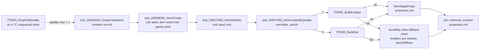
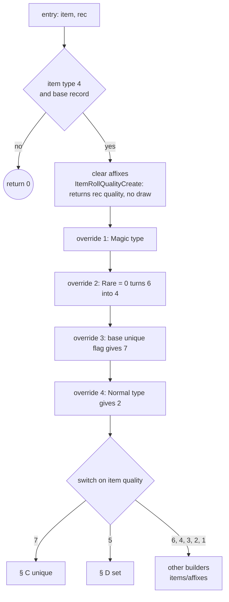
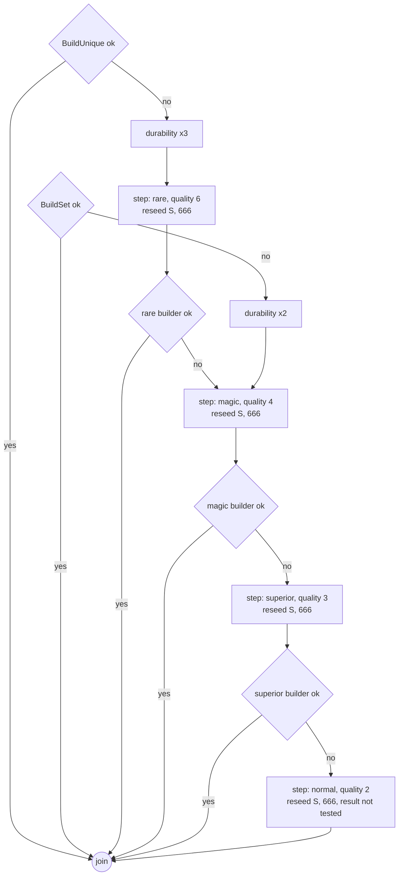
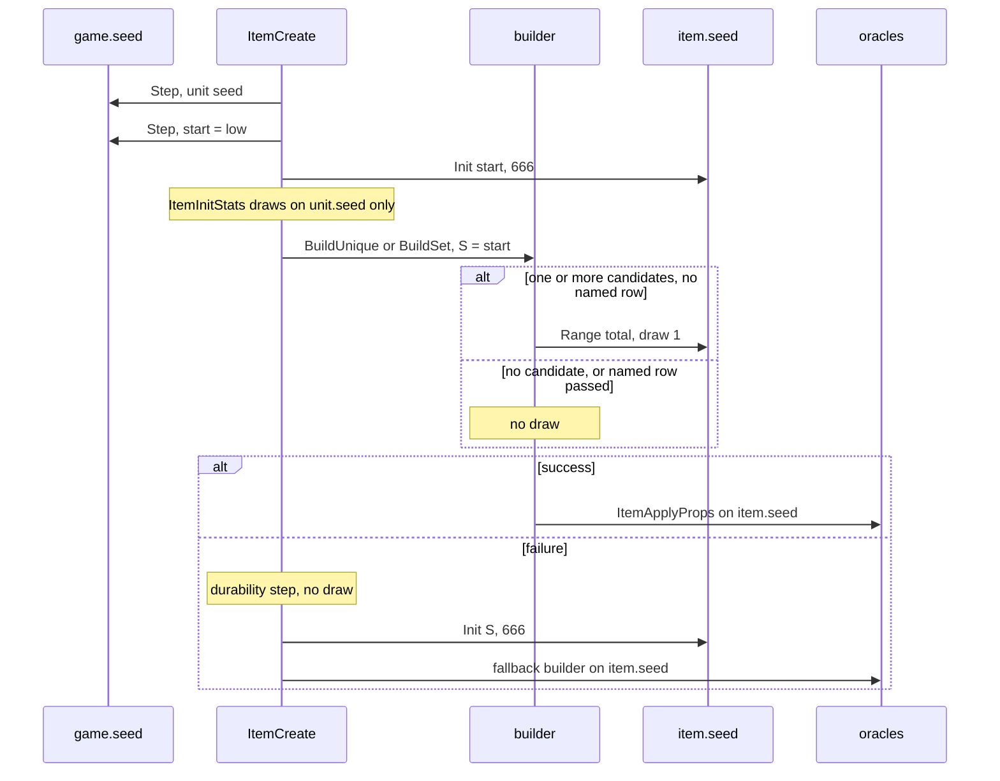

# Unique and set selection, and the creation fallbacks

## Purpose

Once a dropped item reaches item creation with quality 7 (unique) or 5 (set), this spec says which
`UniqueItems` or `SetItems` row it becomes, what that choice draws, and what the item turns into when no row
fits. The choice is made in `sub_00557450_ItemCreateByQuality`. It runs four pre-switch overrides, filters the
rows for the item's base, ilvl and version, and makes one weighted draw on the **item seed**. A unique row is also
tested against the game's made-uniques set. A failed build raises durability and falls back down the chain rare →
magic → superior → normal (unique) or magic → superior → normal (set), and each fallback step first restores the
item seed. The spec ends where the property code (`items/properties`) and the affix builders (`items/affixes`)
take over. It starts where [items/quality](quality.md) and [items/tc § H](tc.md#h-item-pick-and-hand-off) end.
Primitives are those of [rng](../rng/README.md).



## Entry points

| When | Function | Tag |
|---|---|---|
| A drop's item is created with quality 7 or 5 (from the quality roll or a TC unique/set entry) | fn:sub_0055A550_DropCreateItem@0x0055A550 → fn:sub_00558D90_ItemCreate@0x00558D90 → fn:sub_00557AB0_ItemInitStats@0x00557AB0 → fn:sub_00557450_ItemCreateByQuality@0x00557450 | [C] |
| The unique case of the switch | fn:ITEMS_BuildUnique@0x005566B0 | [C] |
| The set case of the switch (item version ≠ 0) | fn:ITEMS_BuildSet@0x005C2940 → fn:ITEMS_BuildSetPick@0x005C25C0 | [C] |

- [C] On every one of the 1 823 logged creations (304 stock, 1 519 forced), `ItemCreateByQuality` was entered
  once per item with the item seed at `{ItemData+0x10, 666}`, and the model of this spec reproduced the switch
  quality, the builder chain and the seed at the join. (fn:sub_00557450_ItemCreateByQuality@0x00557450,
  run:2026-10-14-uniques, run:2026-10-14-uniques-forced,
  [items/0004 § 10](../../findings/items/0004-uniques-sets.md#10-phase-2-reproduction-plan-0019))
- [I] Vendors, gambling, the cube and quest rewards call the same builders through other paths. This spec covers
  the builders as a drop reaches them; those callers belong to [items/vendors](vendors.md), `items/cube` and
  `items/quest-drops`. The version-0 builders and the restore path (`rec+0x2C` ≠ 0) are named in § B and § C only.
  (fn:ITEMS_BuildUnique@0x005566B0, fn:sub_005C2740_ItemBuildSetV0@0x005C2740,
  [items/0004 § 3.1](../../findings/items/0004-uniques-sets.md#31-entry))
- [I] The cube changes the made-uniques set through one path only: a `usetype` output with `reg` whose input 1 is a
  unique. `sub_00565AB0_RecipeOutputCreate` rebuilds that unique by row; when the row's made bit was clear before
  the rebuild, it clears the bit that the unique builder set, so the set is left as it was. A bit already set stays
  set (the made test of § C may then fail and fall back, § E). No stock `CubeMain` row has `reg`. (fn:sub_00565AB0_RecipeOutputCreate@0x00565AB0,
  0x00565F49–0x00565FA9, 0x005660DC–0x005660F2, struct:Game+0x1B24,
  [items/0008 § 3.3](../../findings/items/0008-cube.md#33-building-one-output); specified as step E7 of
  [items/cube § E](cube.md#e-building-one-output--sub_00565ab0_recipeoutputcreate))

## Inputs

### Tables

| Anchor | Used for |
|---|---|
| tbl:UniqueItems.txt:version (u16 `+0x24`) | version test: a row ≥ 100 is skipped when the item version is < 100 |
| tbl:UniqueItems.txt:enabled (`+0x2C` bit 0), tbl:UniqueItems.txt:ladder (bit 3), tbl:UniqueItems.txt:nolimit (bit 1) | candidate filter; `nolimit` only after the pick |
| tbl:UniqueItems.txt:code (`+0x28`) | must equal the base's `code` |
| tbl:UniqueItems.txt:lvl (`+0x34`, read as i16) | `lvl` ≤ ilvl |
| tbl:UniqueItems.txt:rarity (`+0x30`, i32) | weight, `max(1, rarity)` |
| tbl:SetItems.txt:item (`+0x28`), tbl:SetItems.txt:lvl (`+0x30`, i16), tbl:SetItems.txt:rarity (`+0x34`), tbl:SetItems.txt:set (`+0x2C`, u16) | set filter and weight |
| tbl:Sets.txt:version (`+0x04`), copied at load into each member's `setitems` `+0x22` | set version test |
| tbl:Weapons.txt:code (`+0x80`), tbl:Weapons.txt:unique (`+0x129`), tbl:Weapons.txt:quest (`+0x12A`), tbl:Weapons.txt:durability (`+0x112`), tbl:Weapons.txt:nodurability (`+0x113`) | the base (same offsets in [Armor](../../tables/Armor.md) and [Misc](../../tables/Misc.md)) |
| tbl:ItemTypes.txt:Magic (`+0x14`), tbl:ItemTypes.txt:Rare (`+0x15`), tbl:ItemTypes.txt:Normal (`+0x16`) | the pre-switch overrides |
| tbl:TreasureClassEx.txt:Item1 (a cell naming a unique or set row) | the TC-named preference (§ F) |

Not read: `carry1`, `lvl req` (either table), `Sets.level` (not compiled) and ItemRatio.

- [I] Nothing between the entry of `ItemCreateByQuality` and the return of its builder chain reads ItemRatio,
  oracles included. Only `ITEMRATIO_Select` reads the records, and its two callers are the drop roll and the
  drawing body of the creation-side roll, which a drop never enters. (fn:ITEMRATIO_Select@0x00637910,
  fn:ITEMS_DropRollQuality@0x00558640, data:g_pItemRatio@0x0096CC4C, tbl:ItemRatio.txt:Unique,
  [items/0004 § 9](../../findings/items/0004-uniques-sets.md#9-no-itemratio-read-on-the-builder-path-the-adr-0010-precondition))
- [I] The builder never reads `carry1` (`+0x2C` bit 2) or `lvl req`. (0x00556895–0x00556920,
  tbl:UniqueItems.txt:carry1, tbl:UniqueItems.txt:lvl req)
- [I] No set level exists at run time: `sets.bin` has no `level` field, and the only set level test reads
  `SetItems.lvl`. (0x00634DC0, 0x005C263E, tbl:SetItems.txt:lvl)
- [C] The rows are walked in table order (record index, separator rows already dropped by the compiler), the
  index into `g_pUniqueItems` (stride 0x14C) and `g_pSetItems` (stride 0x1B8). The logged candidate lists, in
  order, match a table-order walk of the stock records in every build. (data:g_pUniqueItems@0x0096C854,
  data:g_nUniqueItems@0x0096C858, data:g_pSetItems@0x0096C848, data:g_nSetItems@0x0096C84C,
  run:2026-10-14-uniques, run:2026-10-14-uniques-forced)

### Runtime state

| State | Type | Source |
|---|---|---|
| `item.seed` | `Seed` at struct:ItemData+0x04; on entry `{start, 666}` | set by fn:sub_00552E90_ItemSeedInit@0x00552E90 from one game-seed draw ([rng/seeds](../rng/seeds.md#algorithm)) |
| `item.start` | u32 at struct:ItemData+0x10 | the same draw's `low`; rewritten by every fallback step |
| `item.quality` | u32 at struct:ItemData+0x00 | written by the switch, the overrides and the fallbacks |
| `item.fileIndex` | i32 at struct:ItemData+0x28; −1 none | the chosen `UniqueItems` or `SetItems` row |
| `ilvl` | i32 at struct:ItemData+0x2C; `ITEMS_GetItemLevel` raises it to 1 and writes it back | the resolver's item level ([items/tc § H](tc.md#h-item-pick-and-hand-off)) |
| `itemVersion` | u16 at struct:ItemData+0x30, copied from `Game+0x78` | ≥ 100 in an expansion game, 1..99 in a classic game, never 0 on a drop |
| `rec` | the 0x84-byte creation record, `struct:ItemCreateRec` | `+0x2C` restore flag (0 on drops), `+0x30` quality, `+0x40` row + 1 (0 none), `+0x80` flags (bit 0: `hellbovine` source) |
| `game.gameType` | u8 at struct:Game+0x6A | 3 in single player, 2 in TCP/IP (logged, items/0001) |
| `game.ladder` | at struct:Game+0x74 | 0 in the runs |
| `game.uniqueMade` | 128 × u32 at struct:Game+0x1B24, bit `row` | cleared by fn:sub_00530BF0_GameCreate@0x00530BF0 |
| stats 72 (`durability`), 73 (`maxdurability`) | i32, the unit's stats as `ItemInitStats` set them (unit seed) | read and rewritten by the durability step |

### Constants

| Name | Value | Anchor | Tag |
|---|---|---|---|
| `INIT_HIGH` | 666 (`0x29A`), the `high` word of every item-seed reset | fn:RNG_SeedInit@0x00650E40 | [C] |
| `VERSION_EXP` | 100: a row or set with `version` ≥ 100 is expansion-only | 0x0055689A–0x005568A4, 0x005C2630 | [C] |
| `DUR_K_UNIQUE`, `DUR_K_SET` | 3, 2 | 0x005576F7–0x00557765, 0x0055789E–0x0055790A | [C] |
| `DUR_CAP` | 255 | 0x005576F7–0x00557765 | [C] |
| `MADE_BITS` | 4096 (128 dwords) | struct:Game+0x1B24, fn:sub_00530BF0_GameCreate@0x00530BF0 | [C] |
| `SET_COW` | set 29, members only from a `hellbovine` source (monster class 391) | 0x005C264E–0x005C265F | [I] |

- [C] Each constant above is what the model uses, and the model reproduces every logged build, failure and
  durability value with it (the set-29 rule is not exercised). (run:2026-10-14-uniques,
  run:2026-10-14-uniques-forced)

### Inputs and oracles

The Phase 2 model of plan 0019 (`tools/uniques.py check`) covers the path from the entry of `ItemCreateByQuality`
to the return of its builder chain with **no** oracle inside that span. It treats the callees below as ADR-0004
boundary oracles: it asserts the item seed on entry to each, then takes the logged exit seed and result. Every confirmed statement
of this spec holds under them. [C] (run:2026-10-14-uniques, run:2026-10-14-uniques-forced,
[items/0004 § Boundary](../../findings/items/0004-uniques-sets.md#boundary-for-phase-2-recommendation-the-architect-rules))

Plan 0024 replaced the property-roll oracle with the model of [items/properties](properties.md): both logs rerun with
0 mismatches, the item seed after 77 unique and 28 set rolls predicted from the tables alone. [C]
(fn:sub_0065FEC0_ItemApplyProps@0x0065FEC0, run:2026-10-14-props-forced,
[properties § H](properties.md#h-rng-call-sequence))

| Input | Kind | What this spec needs | Owner | Tag |
|---|---|---|---|---|
| `sub_0065FEC0_ItemApplyProps` mode 3 (unique) and mode 4 (set) | modelled (a seed oracle in plan 0019) | entry seed = the seed after the pick draw (or the builder entry seed for a TC-named row); it draws the row's properties on the item seed | [items/properties § B](properties.md#b-itemapplyprops-modes-and-blocks) | [C] (fn:sub_0065FEC0_ItemApplyProps@0x0065FEC0, run:2026-10-14-uniques, run:2026-10-14-uniques-forced) |
| the rare builder `ITEMS_BuildRare` | seed and result oracle | entry seed `{S, 666}`; returns success or failure | `items/affixes` | [C] (fn:ITEMS_BuildRare@0x005C21A0, run:2026-10-14-uniques-forced) |
| the magic builder `ITEMS_BuildMagic` | seed and result oracle | as above | `items/affixes` | [C] (fn:ITEMS_BuildMagic@0x005565E0, run:2026-10-14-uniques, run:2026-10-14-uniques-forced) |
| the superior builder `ITEMS_BuildSuperior`, the normal builder `ITEMS_BuildNormal` | seed and result oracle | as above; never reached from a failed unique or set in the runs | `items/affixes` | [I] (fn:ITEMS_BuildSuperior@0x005C2AD0, fn:ITEMS_BuildNormal@0x00556E80) |
| stats 72 and 73 before the durability step | value input | the values `sub_00557AB0_ItemInitStats` set on the unit seed | [items/properties § A](properties.md#a-base-stats-on-the-unit-seed) | [C] (fn:sub_00557AB0_ItemInitStats@0x00557AB0, run:2026-10-14-uniques, run:2026-10-14-uniques-forced) |
| `ItemData+0x10` (`start`) | value input | one game-seed draw in `sub_00552E90_ItemSeedInit` | [rng/seeds](../rng/seeds.md#algorithm) | [C] (fn:sub_00552E90_ItemSeedInit@0x00552E90, run:2026-10-14-uniques, run:2026-10-14-uniques-forced) |
| quality and `rec+0x40` | value input | the quality roll's code, or 7/5 and row + 1 from a TC entry | [items/quality](quality.md), [items/tc § H](tc.md#h-item-pick-and-hand-off) | [C] (fn:ITEMS_DropRollQuality@0x00558640, run:2026-10-14-uniques) |

## Algorithm

All arithmetic is signed 32-bit unless a step says otherwise. Section A fixes the item seed, B is the switch and
its overrides, C the unique builder, D the set builder, E the failure path, F the TC-named row.
[I] (fn:sub_00557450_ItemCreateByQuality@0x00557450, [items/0004 § 1](../../findings/items/0004-uniques-sets.md#1-itemcreatebyqualitygame-ecx-item-edx-rec-0x005574500x00557a27))

### A. The item seed at entry

```
A1. game draw: unit.seed ← Init(Step(game.seed).low)                    [C] (fn:sub_00555230_SUnitCreate@0x00555230, run:2026-10-14-uniques)
A2. game draw: Step(game.seed); item.start ← game.seed.low              [C] (fn:sub_00552E90_ItemSeedInit@0x00552E90, run:2026-10-14-uniques, run:2026-10-14-uniques-forced)
    Init(item.seed, item.start)                                         ; item.seed = {start, 666}
A3. ItemInitStats: quantity, durability, defense, picture (properties § A) [C] (fn:sub_00557AB0_ItemInitStats@0x00557AB0, run:2026-10-14-uniques, run:2026-10-14-uniques-forced)
    ; draws on unit.seed only; item.seed is untouched
A4. ItemCreateByQuality(game, item, rec)                                 ; § B
```

Step notes:

- A1–A2. These are the unit-constructor draws of [rng/seeds](../rng/seeds.md#algorithm) step 7a. Drops pass no
  seed in the record, so both come from the game seed. [I] (fn:sub_00558D90_ItemCreate@0x00558D90,
  fn:sub_00552E90_ItemSeedInit@0x00552E90)
- A3. The entry seed of `ItemCreateByQuality` was `{ItemData+0x10, 666}` in all 1 823 logged creations, so the
  unique or set pick is the **first draw on the item seed**. [C] (fn:sub_00557450_ItemCreateByQuality@0x00557450,
  run:2026-10-14-uniques, run:2026-10-14-uniques-forced)
- A3. Exception: an item of type 11 has a setup (`0x0065E8E0`, called from `ItemInitStats`) that draws on the item
  seed first. None was logged. [I] (0x0065E8E0, fn:sub_00557AB0_ItemInitStats@0x00557AB0)

### B. `ItemCreateByQuality`: the creation roll, the overrides and the switch



```
B1. if item.type ≠ 4 or base(item) = none: return 0                       [I] (0x00557450–0x00557482)
B2. ITEMS_SetAutoAffix(item, 0); clear prefix[0..2], suffix[0..2], rareName[0..1]   [I] (0x00557450–0x005574CC)
B3. q ← ItemRollQualityCreate(item, rec)                                   [C] (fn:sub_00556F60_ItemRollQualityCreate@0x00556F60, run:2026-10-14-uniques, run:2026-10-14-uniques-forced)
    ; on a drop: itemVersion ≠ 0 and rec.quality ≠ 0, so q = rec.quality, NO draw
    if rec.quality ≠ 0: q ← rec.quality
    item.quality ← q
B4. overrides, in this order, each writing item.quality only:            [I] (0x005574E3–0x00557567, all of B4a–B4d)
B4a.  if ItemTypes[item.type].Magic:
        if base.quest: item.quality ← 7
        else if item.quality ∉ 4..9: item.quality ← 4
B4b.  if not ItemTypes[item.type].Rare and item.quality = 6: item.quality ← 4
B4c.  if base.unique: item.quality ← 7
B4d.  if ItemTypes[item.type].Normal (or the type has no record): item.quality ← 2
B5. switch item.quality:                                                   [C] (0x0055757B, run:2026-10-14-uniques, run:2026-10-14-uniques-forced)
      7 → § C1;  5 → § D1;  6, 4, 3, 2, 1, 8, 9 → their builders (items/affixes);  else return 0
```

Step notes:

- B3. The creation-side roll's drawing body (item seed, `ITEMRATIO_Select`) runs only for an item of version 0 or
  a record of quality 0, which no drop produces. Every builder entry seed in the runs equals the seed the model
  carries with no draw here. [C] (fn:sub_00556F60_ItemRollQualityCreate@0x00556F60, 0x00556F7E,
  run:2026-10-14-uniques, run:2026-10-14-uniques-forced)
- B4. A later rule overwrites an earlier one: a base with `unique` whose type is `Normal` ends at 2. The rules do
  not write `rec.quality`. For a type with no `ItemTypes` record, `Magic` and `Rare` read as 0 and `Normal` as 1.
  [I] (fn:sub_0062E9E0_ItemTypeMagic@0x0062E9E0, fn:sub_00628CD0_ItemBaseIsQuest@0x00628CD0,
  fn:sub_0062A0F0_ItemQualityMagicPlus@0x0062A0F0, fn:sub_0062E990_ItemTypeRare@0x0062E990,
  fn:sub_00628C70_ItemBaseIsUnique@0x00628C70, fn:sub_0062EA30_ItemTypeNormal@0x0062EA30,
  tbl:ItemTypes.txt:Magic, tbl:ItemTypes.txt:Rare, tbl:ItemTypes.txt:Normal, tbl:Weapons.txt:unique,
  tbl:Weapons.txt:quest)
- B4. A model of the four rules predicted the switch quality of all 1 823 logged creations. Only B4d wrote (1 325
  times), and always over a quality already 2. [C] (0x005574E3–0x00557567, run:2026-10-14-uniques,
  run:2026-10-14-uniques-forced)
- B4. **On a drop through the quality roll, no override changes the quality**: the roll's early returns already
  give what the rules would write (a `Normal` type returns 2, a `unique` base or a `Magic` type with a quest base
  returns 7, a `Magic` type never gets below 4, a type with `Rare` = 0 skips the rare test). A TC entry that forces
  7 or 5 still passes through the rules: its quality becomes 2 when the base's type is `Normal`.
  [I] (0x005574E3–0x00557567, fn:ITEMS_DropRollQuality@0x00558640, [quality.md § A](quality.md#a-early-returns-no-draw-no-row))

### C. The unique builder

```
C1. item.fileIndex ← −1                                                    [C] (0x005576D3–0x005576E7, run:2026-10-14-uniques, run:2026-10-14-uniques-forced)
    S: u32 ← item.seed.low                                                  ; saved for the fallbacks (§ E)
    ok ← BuildUnique(game, item, rec)
    if not ok: go to E1 with k = 3, chain = [rare, magic, superior, normal]
    go to join

BuildUnique(game, item, rec) → bool:                                       (fn:ITEMS_BuildUnique@0x005566B0)
C2. if base(item) = none: return false                                      [I] (0x005566B0–0x005566DE)
    ; version 0 and the restore path (rec.restore ≠ 0) are not reached by a drop: see step notes
C3. n: i32 ← 0; total: i32 ← 0; named: i32 ← −1                           [C] (0x00556878–0x005569A7, run:2026-10-14-uniques, run:2026-10-14-uniques-forced, all of C3–C4)
    for row in 0 ..< nUniqueItems:
      u ← UniqueItems[row]
      if u.version ≥ 100 and itemVersion < 100: continue                    ; u16 compare
      if not u.enabled: continue
      if u.code ≠ base.code: continue
      if u.ladder and game.gameType = 0 and game.ladder = 0: continue
      if (i16) u.lvl > ITEMS_GetItemLevel(item): continue                   ; signed compare
      if rec.rowPlus1 ≠ 0 and rec.rowPlus1 − 1 = row: named ← row          ; § F
      cand[n] ← (row, cumBefore: total)
      n ← n + 1;  total ← total + max(1, u.rarity)                          ; rarity i32
C4. if n = 0:                                                               [C] (0x00556942–0x00556963, run:2026-10-14-uniques-forced)
      if base.unique: return true                                           ; [I] no row, no properties (0x00556942)
      item.fileIndex ← −1; return false
C5. if named < 0:                                                           [C] (0x00556970–0x005569A0, fn:RNG_RangeOffset@0x00472280, run:2026-10-14-uniques, run:2026-10-14-uniques-forced)
      r: u32 ← RNG.Range(seed: item.seed, n: total)                         ; draw#1, the only draw of the builder
      c ← 1
      while c < n and r ≥ cand[c].cumBefore: c ← c + 1
      row ← cand[c − 1].row
    else:
      row ← named                                                           ; [I] no draw (0x005568FC)
C6. if not base.quest and game ≠ none                                       [C] (0x005569AD–0x005569E4, fn:sub_005564D0_UniqueItemMadeTest@0x005564D0, run:2026-10-14-uniques-forced)
       and (row > 4096 or game.uniqueMade bit row is set):
      item.fileIndex ← −1; return false                                     ; no re-pick
C7. if row < 0 or row ≥ nUniqueItems or UniqueItems[row].code ≠ base.code:   [I] (0x005569E4–0x00556A00)
      return false
C8. item.fileIndex ← row                                                    [C] (fn:ITEMS_UniqueMarkMade@0x00556530, run:2026-10-14-uniques, run:2026-10-14-uniques-forced)
    if not UniqueMarkMade(game, item): item.fileIndex ← −1; return false
    ; UniqueMarkMade: unless UniqueItems[row].nolimit, set game.uniqueMade bit row
C9. item.flags.identified ← 0                                               [I] (0x00556A23–0x00556A38)
    ItemApplyProps(mode 3, item)                                            ; items/properties § B
    return true
```

Step notes:

- C2. For an item of version 0 (never a drop) the builder first multiplies stats 72/73 by 5 (cap 255) and takes the
  first matching row in table order with no `lvl` test and no draw. With `rec.restore` ≠ 0 (an existing item being
  restored) `rec+0x40` is the row itself, set with no filter and no draw. Drops reach neither. [I]
  (0x005566DE–0x0055674B, 0x0055674E–0x005567A9, 0x005567AC–0x00556849,
  fn:sub_005564A0_UniqueMadeTestV0@0x005564A0)
- C3. The five tests run in the order written and short-circuit. `ITEMS_GetItemLevel` is called only for a row that
  passed the first four, and it raises `ilvl` to 1 when below 1 and writes it back. [I] (0x00556895–0x005568E9,
  fn:ITEMS_GetItemLevel@0x006281E0)
- C3. **The ladder test.** A `ladder` row is excluded only when both `Game+0x6A` and `Game+0x74` are 0. Single
  player has `Game+0x6A` = 3, so `Djinnslayer` (290, `7sm`) and `Leviathan` (317, `uld`) were picked there. [C]
  (0x005568C3–0x005568D8, struct:Game+0x6A, struct:Game+0x74, run:2026-10-14-uniques-forced)
- C3. **Rows never reached**: label rows (blank `code`) never match a base code; the `nobase` and disabled rows,
  `Darkfear` (346, `enabled` blank) included, fail `enabled`. [I] (0x005568AA–0x005568C1,
  [UniqueItems § Row classes](../../tables/UniqueItems.md#row-classes))
- C3. **Weights apply in classic games too.** No version test touches the weight. A classic `rin` at ilvl 53 had
  candidates 120/121/122 at 15/15/1 (Worked example 1b). [C] (0x00556910–0x00556920,
  run:2026-10-14-uniques-forced)
- C3. The candidate list is the global `g_UniqueCandidates`, 8-byte pairs `(row, cumBefore)`. [I]
  (data:g_UniqueCandidates@0x008846F8)
- C5. `RNG_RangeOffset(seed, 0, total)` is `0 + Range(seed, total)`: one `Step`, then `low mod total`. Here
  `total ≥ n ≥ 1`, so the draw always happens. The walk returns the first candidate whose cumulative weight
  **including its own** exceeds `r`. The draw value, the seed after it and the row matched every logged pick. [C]
  (fn:RNG_RangeOffset@0x00472280, fn:ITEMS_GetSeed@0x00627D90, run:2026-10-14-uniques,
  run:2026-10-14-uniques-forced)
- C6. **The made test comes after the pick.** A marked row stays among the candidates and is drawn with its full
  weight; drawing it fails the whole build, and the item falls back to rare. The game's bit set, read at every
  unique builder entry, equalled the model's set of rows built in that game every time. A quest base skips the test
  ([I]: no quest base was built). [C] (fn:ITEMS_UniqueMarkMade@0x00556530, struct:Game+0x1B24,
  run:2026-10-14-uniques-forced)
- C6. The bound test admits row 4096, which would read the dword after the set, and fails rows above it. Stock
  data has 402 rows. [I] (0x005569AD–0x005569E4)
- C8. `nolimit` is blank in every stock row, so every unique a drop builds is marked. Nothing on the drop path
  clears a bit; the set is cleared only at game creation. [I] (fn:ITEMS_UniqueMarkMade@0x00556530,
  fn:sub_00530BF0_GameCreate@0x00530BF0, tbl:UniqueItems.txt:nolimit)
- C8. **Every path that builds a unique marks it.** `ITEMS_UniqueMarkMade` has one call in the image, from this
  builder (0x00556A1A), so any caller that reaches `ITEMS_BuildUnique` marks the row. A unique shown in a gamble
  window is marked when the window is built, bought or not ([items/vendors § G](vendors.md#g-gambling-gamble_buildinv)). [I]
  (0x00556A1A, fn:ITEMS_UniqueMarkMade@0x00556530, fn:ITEMS_BuildUnique@0x005566B0, fn:GAMBLE_BuildInv@0x00578790;
  [items/0004 § Plan 0039 batch P1b](../../findings/items/0004-uniques-sets.md#plan-0039-batch-p1b-2026-10-17))
- C4. With no candidate on a base whose `unique` flag is set, the build succeeds as a quality-7 item with file
  index −1 and no properties. Not reached in the runs. [I] (0x00556942–0x00556963,
  fn:sub_00628C70_ItemBaseIsUnique@0x00628C70)
- C9. The builder clears the identified flag (`0x10`) of every unique it builds. [I] (0x00556A23)
- C9. **A quest unique is identified afterwards.** `ItemInitStats` runs after `ItemCreateByQuality` returns
  (0x00557E41), and for a base with both `quest` and `questdiffcheck` set it writes stat 356 (the difficulty) and then
  sets flag `0x10`, undoing the builder's clear. [I] (0x00557E60–0x00557ECF, fn:sub_00557AB0_ItemInitStats@0x00557AB0,
  [items/0004 § Plan 0039 batch P1b](../../findings/items/0004-uniques-sets.md#plan-0039-batch-p1b-2026-10-17))
- C9. Every stock base with the `unique` flag and `quest` (17 bases) has `questdiffcheck` 1, so every stock quest
  unique is created identified; `std`, with the `unique` flag and no `quest`, is not identified by this rule. [C]
  (tbl:Misc.txt:questdiffcheck, tbl:Weapons.txt:questdiffcheck)
- C9. **`nolimit` plays no part in identification.** Its one reader is `ITEMS_UniqueMarkMade`, and none of the 22 sites
  that set or clear the identified flag tests the UniqueItems row: they decide on the base, the quality or their
  caller. [I] (fn:ITEMS_UniqueMarkMade@0x00556530, tbl:UniqueItems.txt:nolimit, [items/0004 § Plan 0039 batch P1b](../../findings/items/0004-uniques-sets.md#plan-0039-batch-p1b-2026-10-17))

### D. The set builder

```
D1. item.fileIndex ← −1                                                    [C] (0x0055787E–0x0055788E, run:2026-10-14-uniques, run:2026-10-14-uniques-forced)
    S: u32 ← item.seed.low
    ok ← BuildSet(item, rec)                                                ; version ≠ 0 → BuildSetPick
    if not ok: go to E1 with k = 2, chain = [magic, superior, normal]
    go to join

BuildSetPick(item, rec) → bool:                                            (fn:ITEMS_BuildSetPick@0x005C25C0)
D2. ilvl ← ITEMS_GetItemLevel(item)                                         [C] (0x005C2630–0x005C26A2, run:2026-10-14-uniques, run:2026-10-14-uniques-forced, all of D2–D3)
    n: i32 ← 0; total: i32 ← 0; named: i32 ← −1
    for row in 0 ..< nSetItems:
      s ← SetItems[row]
      if s.setVersion ≥ 100 and itemVersion < 100: continue                 ; Sets.version, copied at load
      if (i16) s.lvl > ilvl: continue
      if s.item ≠ base.code: continue
      if s.set = 29 and not (rec.flags & 1): continue                        ; [I] hellbovine source only (0x005C264E)
      if rec.rowPlus1 ≠ 0 and rec.rowPlus1 − 1 = row: named ← row          ; § F
      w: i32 ← s.rarity if s.rarity ≠ 0 else 1                              ; a negative value is kept
      cand[n] ← (row, w); total ← total + w; n ← n + 1
D3. if named < 0:                                                           [C] (0x005C26B6–0x005C2706, fn:RNG_RangeB@0x0045C3E0, run:2026-10-14-uniques, run:2026-10-14-uniques-forced)
      if total = 0: return false                                            ; no draw
      r: u32 ← RNG.Range(seed: item.seed, n: total)                         ; draw#1, the only draw of the builder
      c ← 0
      while c < n and r ≥ cand[c].w: r ← r − cand[c].w; c ← c + 1
      if c = n: return false
      row ← cand[c].row
    else:
      row ← named                                                           ; [I] no draw (0x005C2672)
D4. item.fileIndex ← row; item.flags.identified ← 0                         [I] (0x005C270D–0x005C2729)
    ItemApplyProps(mode 4, item)                                            ; items/properties § B
    return true
```

Step notes:

- D1. `ITEMS_BuildSet` sends an item of version 0 to `sub_005C2740_ItemBuildSetV0` instead (doubles 72/73 itself,
  one start draw, walks the classic sets' member lists, keeps the last match). No drop reaches it. [I]
  (fn:ITEMS_BuildSet@0x005C2940, fn:sub_005C2740_ItemBuildSetV0@0x005C2740)
- D2. Test order: version, `lvl`, code, set 29. `ilvl` is read once, before the loop. The candidate list is a
  256-pair stack array. [I] (0x005C2630–0x005C26A2)
- D2. **A set item has no version of its own.** The loader copies its set's `version` into the member row at
  `+0x22`, so a classic game (item version < 100) sees only the members of the 16 classic sets (`setitems` rows
  0..61). [I] (fn:sub_00634DC0_LoadSetTables@0x00634DC0, 0x005C2630, tbl:Sets.txt:version)
- D2. **No `enabled`, ladder or once-per-game test exists for sets**: a set item can drop any number of times in
  one game. [I] (0x005C2630–0x005C26A2)
- D2. Set 29 (`Cow King's Leathers` in stock data) is filtered by the record's flag bit 0, which
  `sub_0055A550_DropCreateItem` sets when the source is monster class 391 (`hellbovine`). Not reached in the runs.
  [I] (0x005C264E–0x005C265F, fn:sub_0055A550_DropCreateItem@0x0055A550, struct:ItemCreateRec+0x80)
- D3. The draw value, the seed after it and the row matched every logged set pick, among them `amu` with nine
  candidates (Worked example 2). With weights ≥ 1 the subtracting walk picks the same row as the unique walk; the
  `c = n` exit is unreachable then. [C] (0x005C26C1–0x005C2706, run:2026-10-14-uniques,
  run:2026-10-14-uniques-forced)
- D3. **No candidate, or `total` = 0**: return false with no draw. Every logged set failure was of this kind. [C]
  (0x005C26B6–0x005C26BB, run:2026-10-14-uniques, run:2026-10-14-uniques-forced)
- D4. The set builder does not consult `game.uniqueMade`. [I] (fn:ITEMS_BuildSetPick@0x005C25C0)

### E. Failure: durability and the fallback chain



```
E1. Durability(item, k):                                                    [C] (0x005576F7–0x00557765, 0x0055789E–0x0055790A, fn:sub_00629930_ItemHasDurability@0x00629930, run:2026-10-14-uniques, run:2026-10-14-uniques-forced)
      if ItemHasDurability(item) and itemVersion ≥ 1:
        v72: i32 ← k × GetUnitStat(item, 72);      if v72 ≥ 255: v72 ← 255
        v73: i32 ← k × GetUnitBaseStat(item, 73);  if v73 ≥ 255: v73 ← 255
        SetStat(item, 72, v72); SetStat(item, 73, v73)
E2. for q in chain:                                                         [C] (fn:sub_005573F0_ItemFallbackRare@0x005573F0, fn:sub_00557380_ItemFallbackMagic@0x00557380, run:2026-10-14-uniques, run:2026-10-14-uniques-forced)
      ClearAffixes(item)                                                    ; 3 prefixes, 3 suffixes, 2 rare names, fileIndex −1
      item.start ← S
      Init(item.seed, S)                                                    ; item.seed = {S, 666}, no draw
      ItemRollQualityCreate(item, rec)                                       ; returns at once on a drop, no draw
      item.quality ← q; rec.quality ← q                                     ; 6, 4, 3 or 2
      if q = normal: NormalBuilder(item); go to join                        ; result not tested
      S ← item.seed.low                                                     ; = S, nothing drew since the reseed
      if Builder_q(item, rec): go to join                                   ; ORACLE, items/affixes
```

Step notes:

- E1. `ItemHasDurability` holds when the base's `nodurability` is 0, its `durability` is non-zero, the unit has a
  stat list and stat 152 is below 1. The cap is a signed compare (`cmp 0xFF; jl`), so 255 and above become 255.
  Stat 72 is read with `GetUnitStat` and 73 with `GetUnitBaseStat`; both are the values `ItemInitStats` set. A
  base without durability skips the step with no write. [C] (fn:sub_00629930_ItemHasDurability@0x00629930,
  tbl:Weapons.txt:durability, tbl:Weapons.txt:nodurability, run:2026-10-14-uniques, run:2026-10-14-uniques-forced)
- E2. `S` is the low word saved in C1 or D1, before the failed builder. On a drop it equals `item.start`, so every
  fallback step starts from exactly the state the failed builder started from, and **the failed builder's draw is
  discarded** (Worked example 3b). [C] (fn:ITEMS_SetStartSeed@0x00627E20, fn:RNG_SeedInit@0x00650E40,
  0x005572B2–0x005572C3, run:2026-10-14-uniques, run:2026-10-14-uniques-forced)
- E2. Every logged failure went through one step only: 39 unique failures to rare (38 with no candidate, 1 with
  an already-made row) and 47 set failures to magic (3 of them stock). Each fallback builder's entry seed was
  `{S, 666}`, and each succeeded. [C] (run:2026-10-14-uniques, run:2026-10-14-uniques-forced)
- E2. The steps past the first (a failing fallback builder, then superior, then normal) follow the same helpers
  and were not reached. The rare builder fails at once when the type's `ItemTypes.Rare` is 0. [I]
  (fn:sub_00557320_ItemFallbackSuperior@0x00557320, fn:sub_005572A0_ItemFallbackNormal@0x005572A0,
  fn:ITEMS_BuildRare@0x005C21A0, 0x005572ED)
- E2. `ClearAffixes` resets the file index to −1, so a fallback item never keeps a unique or set row. The step
  writes the fallback quality into `rec.quality` too, which the post-switch steps read. [I]
  (fn:sub_00557250_ItemClearAffixes@0x00557250, struct:ItemCreateRec+0x30)

### F. A row named by the TC

```
F1. A TC cell naming a UniqueItems or SetItems row resolves to             [I] (fn:TC_ParseItemCell@0x00654440, fn:EXCEL_NameTreeInsert@0x006BD490, 0x00654553)
      an entry (base = Items[code of the row], aux = row, flags 0x11 unique / 0x12 set);
    the resolver passes quality 7 or 5 and rec.rowPlus1 = aux + 1.
F2. In C3 or D3 the named row is taken with NO draw only if it passed every     [I] (0x005568EB–0x005568FC, 0x005C2661–0x005C2672)
    filter test for this item. Otherwise the ordinary weighted pick runs over the
    base's candidates.
```

Step notes:

- F1. **Duplicated names**: each loader inserts every row's `index` in row order into a name tree keyed by the
  lower-cased name cut to 32 bytes; an equal name is freed, not linked, so the **first** row of a name wins.
  `Rainbow Facet` resolves to record 392 and `Azurewrath` to record 29 (the disabled `crs` row). A hit of 0 is
  rejected, so row 0 (`The Gnasher`) cannot be named. A forced-path log with edited TC cells agrees (`Azurewrath`:
  record `+0x40` = 30, base `crs`); it stays inferred, because the edited cells are the claim's own input (ADR-0010). [I]
  (fn:EXCEL_NameTreeInsert@0x006BD490, fn:EXCEL_FindName@0x006BD3C0, 0x00634D30–0x00634D85,
  run:2026-10-15-uniques-tcnamed-forced)
- F2. A named row must pass `enabled` (unique) and `lvl` ≤ ilvl like any other: a named row whose `lvl` exceeds the
  drop's ilvl yields another unique of the same base, and with no other candidate the build fails. A named unique
  that is already made fails C6. The forced-path log agrees: `The Oculus` (284) was taken with no draw three times, its
  second named creation in a game found the row made, and `Azurewrath` (29, disabled) found no `crs` candidate and fell
  back to rare six times. Only edited data reaches a named row, so this stays inferred (ADR-0010). [I]
  (0x005568AD–0x005568FC, 0x005569AD, run:2026-10-15-uniques-tcnamed-forced)
- F2. In stock data the only cells naming a row are `Annihilus` in `ROP (N)` and `ROP (H)`. No run reached them:
  `rec+0x40` was 0 at every logged entry. [C] That absence is logged; the path itself stays inferred.
  (tbl:TreasureClassEx.txt:Item1, run:2026-10-14-uniques, run:2026-10-14-uniques-forced)

### Draw order on the item seed



- [C] Between the item-seed initialisation and the first oracle the item seed is stepped **at most once**: the
  pick draw, made only when there is at least one candidate (unique) or a positive total (set) and no named row
  passed the filter. The creation roll, the overrides, the filters, the made test and the durability step draw
  nothing. (fn:ITEMS_BuildUnique@0x005566B0, fn:ITEMS_BuildSetPick@0x005C25C0, run:2026-10-14-uniques,
  run:2026-10-14-uniques-forced)
- [C] A failure discards that draw: the fallback builder starts from `{S, 666}`, the same state the failed builder
  started from. (fn:RNG_SeedInit@0x00650E40, run:2026-10-14-uniques-forced)
- [I] The game seed and the unit seed are not stepped from the entry of `ItemCreateByQuality` to the return of the
  builder chain, oracles aside. (fn:sub_00557450_ItemCreateByQuality@0x00557450,
  [items/quality § F](quality.md#f-boundaries-named-only))

## Outputs

At the join (0x00557943), before the post-switch steps:

| Outcome | `item.quality` / `rec.quality` | `item.fileIndex` | Item seed | Extra | Tag |
|---|---|---|---|---|---|
| unique built | 7 / 7 | the row | ItemApplyProps's exit seed | row marked in `Game+0x1B24` (unless `nolimit`); unidentified, except a quest base, which `ItemInitStats` then identifies (C9 notes) | [C] (fn:ITEMS_BuildUnique@0x005566B0, run:2026-10-14-uniques, run:2026-10-14-uniques-forced) |
| unique, no candidate, base `unique` flag | 7 / 7 | −1 | the entry seed | no properties | [I] (0x00556942–0x00556963) |
| set built | 5 / 5 | the row | ItemApplyProps's exit seed | unidentified | [C] (fn:ITEMS_BuildSetPick@0x005C25C0, run:2026-10-14-uniques-forced) |
| failed unique | 6 / 6 (or lower down the chain) | −1 | the fallback builder's exit seed | stats 72/73 ×3, cap 255 | [C] (fn:sub_005573F0_ItemFallbackRare@0x005573F0, run:2026-10-14-uniques-forced) |
| failed set | 4 / 4 (or lower down the chain) | −1 | the fallback builder's exit seed | stats 72/73 ×2, cap 255 | [C] (fn:sub_00557380_ItemFallbackMagic@0x00557380, run:2026-10-14-uniques, run:2026-10-14-uniques-forced) |

- [C] Every logged creation's seed, quality, record quality and file index at the join matched the model.
  (0x00557943, run:2026-10-14-uniques, run:2026-10-14-uniques-forced)
- [I] After the join, still in `ItemCreateByQuality` and outside this spec: an expansion item may take one ethereal
  draw on the item seed. Quality 5 is excluded, so **a set item is never ethereal while a unique can be**, and a
  failed set (now 4) can be. Then qualities 1..3 get the socket roll, and every quality except 5 and 7 gets the
  base's automagic group in an expansion game; see [items/properties § F](properties.md#f-ethereal-and-sockets).
  (fn:sub_00556CA0_ItemRollEthereal@0x00556CA0,
  fn:sub_00556B60_ItemRollSockets@0x00556B60, 0x00557943–0x00557A0C)

## Worked example

Seeds are `low:high` in hex. Each example was checked by `python3 -I tools/uniques.py check -v <log>` (0
mismatches); the draws were recomputed with `Step` of [rng](../rng/README.md#algorithm). Log lines are JSON
records of `tools/gdb/uniques.py`; the logs are in `workspace/logs/` (not in git, sha256 in the run's manifest).

### Example 1: a unique pick (stock)

`uniques-1957-hell.log` lines 2229–2239, [run:2026-10-14-uniques](../../findings/items/experiments.md#run2026-10-14-uniques)
(stock tables). Expansion Hell, item 308 `hlm`, ilvl 84, item version 101, quality 7 from the drop roll (`CPRE
item=308 q=7`). [C] (run:2026-10-14-uniques)

| Step | Log line | Value |
|---|---|---|
| A, entry | `IC0 … "seed":"fc763d51:0000029a","start":4235607377 …` | item seed `{start, 666}`, start = `0xfc763d51` |
| B | `ICQ {"q":7,"iq":7,"rq":7}` | no override changes 7 |
| C3 | `UMADE {… "rows":[]}` | nothing made yet in this game |
| C3 | `UPK {"row":73,"n":1,"total":1, … "cand":[[73,0]] …}` | one candidate: row 73 `Coif of Glory` (`hlm`, version 0, `lvl` 19, `rarity` 1) |
| C5 draw#1 | `UR {"r":0,"seed":"c020c1ef:694cc79b"}` | `0xfc763d51 × 0x6AC690C5 + 0x29A = 0x694cc79b_c020c1ef`; `r = 0xc020c1ef mod 1 = 0` → row 73 |
| C6–C9 | `PROPS {"mode":3,"seed":"c020c1ef:694cc79b"}` | not made, marked, oracle entered with the post-draw seed |
| join | `ICJ {"seed":"c020c1ef:694cc79b","q":7,"rq":7,"fi":73}` | unique, file index 73 |

A single candidate still costs one draw. [C] (run:2026-10-14-uniques)

### Example 1b: a weighted unique pick in a classic game (forced path)

`uforcedu-3401-nightmare.log` lines 1403–1411,
[run:2026-10-14-uniques-forced](../../findings/items/experiments.md#run2026-10-14-uniques-forced) (ItemRatio
edited, every other table stock; quoted for the pick only). Classic Nightmare, item 522 `rin`, ilvl 53, item
version 2, entry seed `1a7316d0:0000029a`. [C] (run:2026-10-14-uniques-forced)

| Candidate | Row | `lvl` | `rarity` | `cumBefore` |
|---|---|---|---|---|
| 0 | 120 `Nagelring` | 10 | 15 | 0 |
| 1 | 121 `Manald Heal` | 20 | 15 | 15 |
| 2 | 122 `The Stone of Jordan` | 39 | 1 | 30 |

Total 31. Draw#1 steps the seed to `dc4590aa:0b082b6a` (`UR {"r":20, …}`), `r = 0xdc4590aa mod 31 = 20`. The walk
stops at candidate 2 because `20 < 30`, so the row is candidate 1, **121**
(`UPK {"row":121,"n":3,"total":31, … "cand":[[120,0],[121,15],[122,30]] …}`). `PROPS` is entered with
`dc4590aa:0b082b6a`. This is a classic game, so the weights apply there too. [C] (run:2026-10-14-uniques-forced)

### Example 2: a set pick (forced path)

No stock set build succeeded (the stock run's three set builds all failed), so this one is from the forced run,
quoted for the filter and the draw only. `uforced-3006-hell.log` lines 2018–2026,
[run:2026-10-14-uniques-forced](../../findings/items/experiments.md#run2026-10-14-uniques-forced). Expansion Hell,
item 520 `amu`, ilvl 84, item version 101, entry seed `22dab5d4:0000029a`. [C] (run:2026-10-14-uniques-forced)

`SPK {"n":9,"total":45, … "cand":[[1,7],[9,7],[20,7],[28,7],[33,7],[53,7],[58,1],[77,1],[95,1]] …}`: the nine
`amu` set rows, classic and expansion, all with `lvl` ≤ 84, in table order with their weights.

| Walk | Candidate row | Weight | `r` before | Outcome |
|---|---|---|---|---|
| 0 | 1 `Civerb's Icon` | 7 | 23 | 23 ≥ 7, r ← 16 |
| 1 | 9 `Iratha's Collar` | 7 | 16 | 16 ≥ 7, r ← 9 |
| 2 | 20 `Vidala's Snare` | 7 | 9 | 9 ≥ 7, r ← 2 |
| 3 | 28 `Cathan's Sigil` | 7 | 2 | 2 < 7 → **row 28** |

Draw#1: `0x22dab5d4 × 0x6AC690C5 + 0x29A = 0x0e899828_428d2ebe`, `r = 0x428d2ebe mod 45 = 23`
(`SR {"r":23,"seed":"428d2ebe:0e899828"}`, `SROW {"row":28, …}`). `PROPS {"mode":4, …}` is entered with that seed,
and the join has quality 5, file index 28. [C] (run:2026-10-14-uniques-forced)

### Example 3: a failed set (stock)

`uniques-1953-hell.log` lines 1940–1954, [run:2026-10-14-uniques](../../findings/items/experiments.md#run2026-10-14-uniques).
Expansion Hell, item 149 `9p9`, ilvl 84, quality 5 from the drop roll (`CPRE item=149 q=5`), entry seed
`b6157de2:0000029a`. [C] (run:2026-10-14-uniques)

| Step | Log line | Value |
|---|---|---|
| D2 | `SPK {"n":0,"total":0, … "cand":[] …}` | no `SetItems` row has `item` = `9p9` |
| D3 | `BRET {"k":"set","ret":0,"fi":-1,"seed":"b6157de2:0000029a"}` | failure, no draw |
| E1 | `DUR` lines: `has` 1, `ver` 101, `s72` 20, `s73` 25, `w72` 40, `w73` 50 | ×2: 20/25 → 40/50 |
| E2 | `FB {"k":"magic","S":3054861794,"seed":"b6157de2:0000029a"}` | S = `0xb6157de2` = the start |
| E2 | `BLD {"k":"magic","seed":"b6157de2:0000029a","q":4,"rq":4,"fi":-1, …}` | magic builder (oracle) entered at `{S, 666}` |
| join | `ICJ {"seed":"09d0db43:562ac9ae","q":4,"rq":4,"fi":-1}` | magic; seed = the oracle's exit |

### Example 3b: a unique already made in the game (forced path)

The one case where a failed builder had drawn. `uforcedu-3401-nightmare.log` lines 2881–2896,
[run:2026-10-14-uniques-forced](../../findings/items/experiments.md#run2026-10-14-uniques-forced), quoted for the
made test, the fallback and the seed only. Classic Nightmare, item 320 `brs`, ilvl 52, entry seed
`83255370:0000029a`; row 86 `Venomsward` was built earlier in the same game (line 1550). [C]
(run:2026-10-14-uniques-forced)

| Step | Log line | Value |
|---|---|---|
| C3 | `UMADE {… "rows":[6,7,33,84,86,100,121]}` | 86 is marked |
| C5 draw#1 | `UR {"r":0,"seed":"d34837ca:36b32d94"}` | one candidate (86), drawn anyway |
| C6 | `UPK {"row":86, … "made":1 …}`, `BRET {"k":"unique","ret":0,"fi":-1,"seed":"d34837ca:36b32d94"}` | made → failure, no re-pick |
| E1 | `DUR` lines: `s72` 34, `s73` 50, `w72` 102, `w73` 150 | ×3 |
| E2 | `FB {"k":"rare","S":2200261488,"seed":"d34837ca:36b32d94"}` | S = `0x83255370`, the seed still holds the failed pick's draw |
| E2 | `BLD {"k":"rare","seed":"83255370:0000029a","q":6,"rq":6, …}` | reseeded to `{S, 666}`: the draw is discarded |
| join | `ICJ {… "q":6,"rq":6,"fi":-1}` | rare |

## Reimplementation notes

- **One draw, on the item seed, not the source unit's seed.** The quality roll steps `src.seed`; the pick steps
  `item.seed`, which a game-seed draw created. Drawing the pick from `src.seed` shifts every later TC pick of the
  drop. [C] (fn:ITEMS_BuildUnique@0x005566B0, fn:ITEMS_GetSeed@0x00627D90, run:2026-10-14-uniques)
- **A single candidate still draws.** `Range(1)` returns 0 but steps the seed, and the properties then start from
  the stepped seed. [C] (fn:RNG_RangeOffset@0x00472280, run:2026-10-14-uniques)
- **The made test comes after the pick.** Do not drop made rows from the candidate list and re-pick; the game
  draws with them in and fails the build when one comes up. [C] (fn:ITEMS_UniqueMarkMade@0x00556530,
  run:2026-10-14-uniques-forced)
- **Restore the seed before each fallback.** Each step reinitialises the item seed to `{S, 666}` and rewrites
  `ItemData+0x10`; a failed builder's draws must not leak into the fallback. [C] (fn:RNG_SeedInit@0x00650E40,
  run:2026-10-14-uniques-forced)
- **Ladder uniques drop in single player and TCP/IP.** 1.14d has one `ladder` bit, ignored whenever
  `Game+0x6A` ≠ 0. The ladder-season columns of D2R's table do not exist in 1.14d; do not port them. [C]
  (0x005568C3–0x005568D8, run:2026-10-14-uniques-forced)
- **`rarity` weights in classic games.** A community note says it works only in expansion games; in 1.14d no
  version test touches the weight. Do not "correct" it. [C] (0x00556910–0x00556920, run:2026-10-14-uniques-forced)
- **A TC-named unique still needs `enabled` and `lvl` ≤ ilvl.** D2R's documentation says a disabled row can still
  drop from a TC; in 1.14d it falls to the ordinary weighted pick. [I] (0x005568AD–0x005568FC)
- **Set items take their version from their set,** and have no `enabled`, ladder or once-per-game test. [I]
  (0x005C2630–0x005C26A2, tbl:Sets.txt:version)
- **The `lvl` comparisons are signed 16-bit** (`movsx`) against an `ilvl` raised to at least 1. [I]
  (0x005568E3–0x005568E9, 0x005C263E)
- **Durability is ×3 or ×2 of the current values, each capped at 255, and only for a base with durability.** The
  step uses `GetUnitStat` for 72 and `GetUnitBaseStat` for 73. [C] (0x005576F7–0x00557765,
  run:2026-10-14-uniques-forced)
- **Set weight 0 counts as 1, a negative weight is kept.** With a non-positive total, `Range` returns 0 without a
  draw (rng § Algorithm, `n < 1`), and the walk can then fail; stock weights are 1, 3 and 7, so this only matters
  for modded data. [I] (0x005C26B6–0x005C2706, fn:RNG_RangeB@0x0045C3E0)
- **Item version 0 builds by other rules** (first match, no draw, ×5 durability for uniques; set membership walk
  for sets). A reimplementation that creates only drops never reaches them. [I] (0x005566DE–0x00556849,
  fn:sub_005C2740_ItemBuildSetV0@0x005C2740)

## Evidence

- [findings/items/0004-uniques-sets.md](../../findings/items/0004-uniques-sets.md): the builders, the overrides and
  the fallbacks read from the code (Phase 1), the community cross-check (Phase 1b, *Leads used*), the ItemRatio
  precondition (§ 9) and the reproduction (§ 10).
- [findings/items/experiments.md § run:2026-10-14-uniques](../../findings/items/experiments.md#run2026-10-14-uniques):
  30 stock sessions, 304 creations, 1 unique and 3 set builds.
- [findings/items/experiments.md § run:2026-10-14-uniques-forced](../../findings/items/experiments.md#run2026-10-14-uniques-forced):
  54 sessions with only `itemratio.bin` edited (ADR-0010), 1 519 creations, 115 unique and 72 set builds. It is
  cited for the builders' filters, draws, seed use, fallbacks and outputs only, never for how often a quality comes
  up ([ADR-0010](../../adrs/0010-forced-path-runs.md)).
- [findings/items/experiments.md § run:2026-10-15-uniques-tcnamed-forced](../../findings/items/experiments.md#run2026-10-15-uniques-tcnamed-forced):
  TreasureClassEx cells edited (ADR-0010) to name `The Oculus` and `Azurewrath`; `tools/uniques.py` 108 creations,
  0 failed. Cited as agreeing evidence only: the edited cells are the input of the § F claims, which stay inferred.
- [findings/items/0001-tc-resolution.md](../../findings/items/0001-tc-resolution.md): the creation record, the
  TC unique/set entry and the `hellbovine` flag.
- Tables: [UniqueItems](../../tables/UniqueItems.md), [SetItems](../../tables/SetItems.md),
  [Sets](../../tables/Sets.md), [ItemRatio](../../tables/ItemRatio.md) (not read on this path),
  [ItemTypes](../../tables/ItemTypes.md), [Weapons](../../tables/Weapons.md), [Armor](../../tables/Armor.md),
  [Misc](../../tables/Misc.md), [TreasureClassEx](../../tables/TreasureClassEx.md).
- Specs: [rng](../rng/README.md) (`Step`, `Range`, `Init`), [rng/seeds](../rng/seeds.md) (step 7a),
  [items/tc](tc.md) (hand-off), [items/quality](quality.md) (the code and § F). Downstream:
  [stats/aggregate § J](../stats/aggregate.md#j-set-bonuses) (a set item's bonuses once worn).
- `tools/uniques.py` (`check`, `survey`), the reference model; `tools/unique_survey.py`, the candidates per base.

## Open questions

- [L] **The chain past the first fallback step.** No logged rare (after a unique) or magic (after a set) builder
  failed, so the superior and normal steps are code-read only. Needs `items/affixes` findings or a base whose type
  cannot be rare reaching a unique failure.
- [L] **Not reached in the runs:** a `unique`-flag base with no candidate (C4), a quest base skipping the made
  test (C6), a set-29 row from a `hellbovine` (D2), a TC-named row on stock data (§ F, only `Annihilus` in
  `ROP (N)`/`ROP (H)`), a type-11 item drawing on the item seed before the pick (A3 note). Each stays inferred. The
  TC-named row was logged on a forced path (run:2026-10-15-uniques-tcnamed-forced, 108 creations reproduced), which
  agrees with § F but cannot promote it: the edited TC cells are the claims' input (ADR-0010, architect review
  2026-10-15).
- [L] **A TC cell naming a disabled row** (`Azurewrath` → 29) cannot occur in stock data; the architect ruled it out
  of plan 0019 Phase 2. It is logged and reproduced on a forced path (run:2026-10-15-uniques-tcnamed-forced) and
  agrees, but § F2 stays inferred for the reason above.
- [L] **`Game+0x6A` = 0.** Which game type, if any, has it with no ladder flag (the only case that excludes `ladder`
  rows)? Single player and TCP/IP do not. The Open Battle.net value was not logged.
- ~~**`nolimit` and automatic identification.**~~ Answered in the C9 notes: a quest unique is identified by
  `ItemInitStats`, and `nolimit` takes no part ([items/0004 § Plan 0039 batch P1b](../../findings/items/0004-uniques-sets.md#plan-0039-batch-p1b-2026-10-17)).
- ~~**Other callers** and the made-uniques set.~~ Answered in the C8 notes: the mark has one call, in the builder, so every
  path that builds a unique marks it; the gamble window's case is [items/vendors § G](vendors.md#g-gambling-gamble_buildinv).
