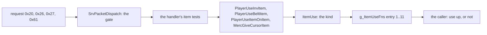
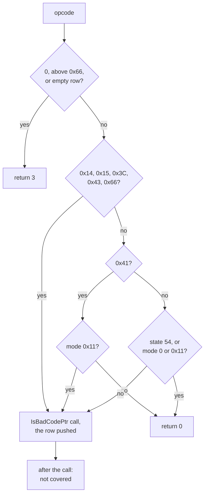
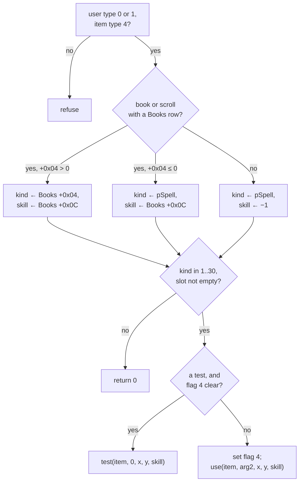
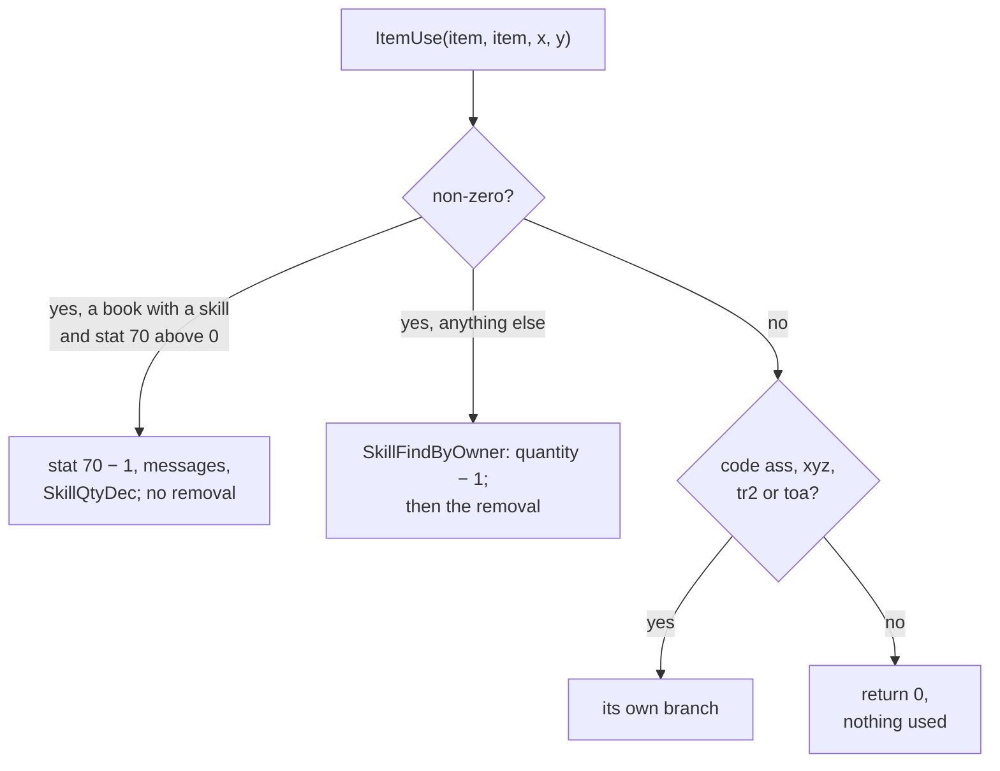
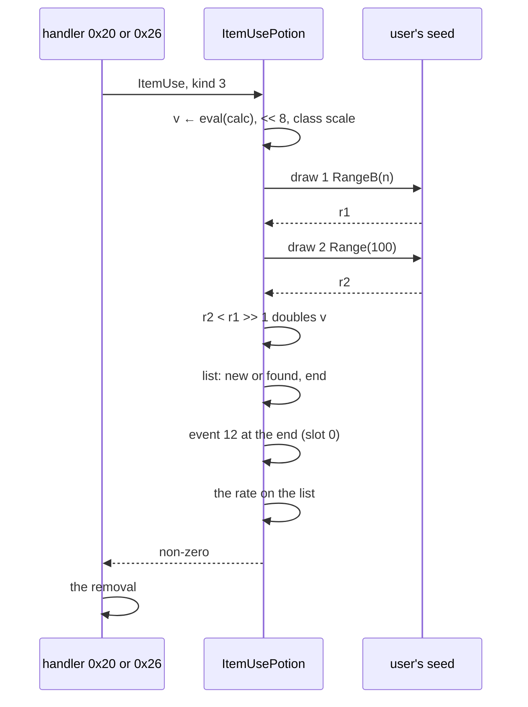

# Item use: the requests, the dispatch by use kind, potions and their draws

## Purpose

What the server does when a player uses an item. A client request (packet `0x20`, `0x26`, `0x27` or `0x61`) reaches the
item's use entry, chosen by a `Books` row or `Misc.pSpell`; the entry changes stats or lists, opens a menu or ends in an
identification; the request's handler then uses the item up or does not. This page also holds the gate every client
request passes and the order of requests in one drain. Scope is [ADR-0025](../../adrs/0025-scope-item-use-inventory.md):
the server's outcomes, in game frames. Slots, moves, pickup, drops and a ground item's life are
[items/inventory](inventory.md); the town portal's own body is [quests/travel § G](../quests/travel.md#g-town-portals).



## Entry points

| When | Function | Tag |
|---|---|---|
| Client packet `0x20`, use an inventory item (13 bytes: guid, x, y) | fn:sub_0054B1E0_Pkt20UseInvItem@0x0054B1E0 → fn:sub_0055E170_PlayerUseInvItem@0x0055E170 | [I] |
| Client packet `0x26`, use a belt item (13 bytes: guid, the mercenary flag) | fn:sub_0054B560_Pkt26UseBeltItem@0x0054B560 → fn:sub_00562390_PlayerUseBeltItem@0x00562390 | [I] |
| Client packet `0x27`, an item on an item (9 bytes: target guid, used guid) | fn:sub_0054B280_Pkt27ItemOnItem@0x0054B280 → fn:sub_00561ED0_PlayerUseItemOnItem@0x00561ED0 | [I] |
| Client packet `0x61`, the mercenary button (3 bytes) | fn:sub_0054D430_Pkt61MercItem@0x0054D430 → fn:sub_0054D230_MercGiveCursorItem@0x0054D230 | [I] |
| Skill do 113 reaches the first two as well ([skills/catalogue N3](../skills/catalogue.md)) | fn:sub_005BF3D0_SkillDo113UseBookScroll@0x005BF3D0 | [I] |

## Inputs

### Tables

| Anchor | Used for |
|---|---|
| tbl:Misc.txt:pSpell | the use kind when no `Books` row gives one |
| tbl:Misc.txt:useable | required by packets `0x20` and `0x26` (§ I) |
| tbl:Misc.txt:len, tbl:Misc.txt:state, tbl:Misc.txt:stat1, tbl:Misc.txt:calc1 | the amount rules (§ F, § G) |
| tbl:Misc.txt:cstate1, tbl:Misc.txt:cstate2 | kind 6 |
| tbl:Misc.txt:spellicon, tbl:Books.txt:SpellIcon | the identify prompt's icon |
| tbl:Books.txt:pSpell, tbl:Books.txt:BookSkill, tbl:Books.txt:ScrollSkill | the kind and the skill argument of a tome or scroll |
| tbl:ItemStatCost.txt:ValShift, tbl:ItemStatCost.txt:maxstat | the amount's shift, the instant cap |

The rows per kind are [Misc § Item-use columns](../../tables/Misc.md#item-use-columns-plan-0060-phase-0). The `calc`
columns are bytecode ([data/calc](../data/calc.md)); `eval` below is `ITEMS_EvalCalc`, and a blank offset evaluates to 0.

### Runtime state

| State | Type | Source |
|---|---|---|
| user's seed | `unit+0x20`, Seed64 ([rng](../rng/README.md)) | the unit that uses the item; the mercenary when `0x26`'s flag or `0x61` makes it the user |
| game frame | i32, `Game+0xA8` | the current frame |
| item flag 4 | bit of the item's flags | "use mark": set by `ItemUse`, cleared by `InvClearUseMarks` |
| user's list of a state | the stat list `UNIT_FindStatListByState` returns | the running potion of that state |

### Constants

| Name | Value | Anchor | Tag |
|---|---|---|---|
| `g_ItemUseFns` | 31 `{test, use}` pairs; `use` in entries 1..11 only, `test` in entry 1 only | data:g_ItemUseFns@0x00741790, [Misc](../../tables/Misc.md#the-use-dispatch-pspell-selects-a-g_itemusefns-entry) | [C] |
| exempt opcodes | `0x14`, `0x15`, `0x3C`, `0x43`, `0x66` | fn:sub_0054D750_SrvPacketDispatch@0x0054D750, run:2026-11-04-ground-emu | [C] |
| exempt state, modes | state 54; modes 0 and `0x11` | fn:sub_0054D750_SrvPacketDispatch@0x0054D750, run:2026-11-04-ground-emu | [C] |
| request position reach | 50 per axis, as `u16` | fn:sub_00548EF0_PktPosFar@0x00548EF0, 0x0054B222 | [I] |

## Algorithm

### How to read the tags

The evidence for one statement can be of four kinds, and each is named at the statement.

- **`[C]` (ADR-0021)**, run:2026-11-03-use-emu (7 320 cases, 11 families, 0 mismatches, 0 stops): the code's map from declared
  scratch bytes up to a named callee's entry. **The callee and everything after it are not covered**, "after, `[I]`". Not a
  run of the game, and not what the game stores at those offsets or when the code runs. A family's cases end at the
  entry's first callee, so 0 mismatches holds that far. [C] (fn:sub_005BF240_ItemUse@0x005BF240, run:2026-11-03-use-emu)
- **`[C]` (ADR-0021, ADR-0029 (c))**, run:2026-11-04-lock-scan: the gate's passes stop at the call instruction of an import,
  and nothing after that call is covered. [C] (0x0054D7DC, run:2026-11-04-lock-scan)
- **`[C]` live**, run:2026-11-04-inventory-2: 17 stock potion uses by one Sorceress in one process, one seed chain, no forced
  state. It rests on two different grounds, per the `lane/p60b` check ([items/0016 § Mismatches](../../findings/items/0016-harness-inventory-run2.md#mismatches-and-what-failed-at-the-first-check)): the **stored rate** of the 16 fresh-list uses
  on the **a-priori table** committed before the kept sessions; the **two draws, their seeds and the doubled amount** on the
  model evaluated **per case on the log's inputs**, so that check is of the code against its reading on inputs the log
  gives, not blind to them, and it says nothing of which inputs occur. [C] (run:2026-11-04-inventory-2, 0x005BE525, 0x005BE6CF)
- **`[I]`**: a code reading no case reaches, with the addresses read.

### A. The drain and the gate



```
A1. Drain (queue 1, FIFO, all clients and games):                    [I] (fn:sub_006BEAD0_NetQueuePop@0x006BEAD0, fn:sub_0053F3D0_SrvProcessClientMessage@0x0053F3D0, 0x0053F459, 0x0053F45E)
      while a packet pops:
        lock the client's game
        r: i32 ← SrvPacketDispatch(packet)
        ; r is discarded: the next instructions are mov ecx, esi; call 0x0052DA90, with no test of eax

A2. SrvPacketDispatch(op: u8, …) → i32:
      if op = 0 or op > 0x66 or row(op) is empty: return 3           [C] (ADR-0015) (family dispatch, fn:sub_0054D750_SrvPacketDispatch@0x0054D750, run:2026-11-04-ground-emu)
      if op ∈ {0x14, 0x15, 0x3C, 0x43, 0x66}: pass                   [C] (ADR-0021, ADR-0029 (c)) (0x0054D7DC, run:2026-11-04-lock-scan)
      else if op = 0x41: pass if mode = 0x11, else return 0          [C] (ADR-0015) for the return; the pass as the line above, one case, state 0 (0x0054D7DC, run:2026-11-04-ground-emu)
      else if the player has state 54 or mode ∈ {0, 0x11}: return 0  [C] (ADR-0015) (fn:sub_0057EEC0_PlayerModeAllowed@0x0057EEC0, run:2026-11-04-ground-emu)
      else: pass                                                     [C] (ADR-0021, ADR-0029 (c)) (0x0054D7DC, run:2026-11-04-lock-scan)
      pass: call IsBadCodePtr(row(op).fn)                            ; the emulated pass stops at this call
      if it returned non-zero: fatal                                 [I] (0x0054D7E6)
      return row(op).fn(…)                                           [I] (0x0054D818)
```

- A1. [I] **Two item requests in one drain run in arrival order, to completion, and see each other's results**: `0x17` then
  `0x16` on the same item finds it on the ground already; a second `0x19` finds a full cursor. Across clients it is arrival
  too. No item request is reordered, batched or rate-limited. Scope: `SrvProcessClientMessage`, `SrvPacketDispatch` and
  `PlayerModeAllowed`'s bodies, not each handler's whole closure. (fn:sub_0054D750_SrvPacketDispatch@0x0054D750,
  fn:sub_0053F3D0_SrvProcessClientMessage@0x0053F3D0, [items/0014 § 4](../../findings/items/0014-ground-items.md#4-one-drain))
- A1. [I] **A "refusal" return (2, 3) has no effect beyond the handler's own.** So in this spec a handler "returns 3" with
  nothing further, and whatever the handler already did stands. (0x0053F459, 0x0053F45E)
- A1. [I] **What leaves the drain** is a pickup out of reach: it starts a walk, and the pickup runs in a later frame's mode
  pass ([items/inventory § I](inventory.md#i-pickup)). The other item handlers of §§ B and [items/inventory § D](inventory.md#d-the-requests),
  as read, do their moves in the handler; their callees' queued events and marks reach clients later and were not
  followed. (fn:sub_00548A50_InteractWalkTo@0x00548A50, 0x00580E73, 0x00553380)
- A2. [C] (ADR-0015) The refusals, 428 cases over each opcode 0..`0x68`, `0x80`, `0xFF` × mode 1, 0, `0x11` and state 54 at mode 6: control
  `nogate` fails 258, `noexempt` 15. (fn:sub_0054D750_SrvPacketDispatch@0x0054D750, run:2026-11-04-ground-emu)
- A2. [C] (ADR-0021, ADR-0029 (c)) **The passes reach the `IsBadCodePtr` call with the opcode's table row pushed**, 106 of 106; the next
  row's word matches 0, and the 106 hold 91 distinct words. `0x41` in mode `0x11` is one case, at state 0. **After that call, all
  `[I]`: the import's result, the fatal branch, the handler's call.** The import (slot `0x006CC34C`, `KERNEL32!IsBadCodePtr`) is a
  stop at its call instruction: no value is given and nothing after it runs. What it does is not evidenced.
  (0x0054D7DC, run:2026-11-04-lock-scan, run:2026-11-04-ground-emu, data:g_SrvPacketTable@0x006E0D18)
- A2. [I] Not reached: `Game+0x1DC4` above 1, where the gate first overwrites that word with `0x00410A80`'s return.
  (0x0054D7C0, 0x0054D7CE)
- A2. [I] The gate draws nothing on this path: `PlayerModeAllowed(1, 0, 0)` returns before its RNG line because its second
  argument is 0. (0x0057EEFB, 0x0057EF75)

### B. The use requests

Each handler's tests, in order, before its caller function. All "returns" are discarded at the drain (A1).

| Packet | Tests | Tag and anchor |
|---|---|---|
| `0x20` | Length 13, else 3. `PktInvItemBad` (the item exists, mode 0, and `0x0063AD50` finds it with the player), then `PktPosFar` (each axis of the player's position within 50 of the packet's x and y, as `u16`); either's non-zero is returned. A refusal flagged by the use function returns 3 | [I] (fn:sub_00549150_PktInvItemBad@0x00549150, fn:sub_00548EF0_PktPosFar@0x00548EF0, 0x0054B222) |
| `0x26` | Length 13. Fields: guid (`+1`), flag (`+5`). The position tested and passed is the player's own, so the distance test holds with any input. `PktBeltItemBad` wants mode 2 | [I] (fn:sub_005492F0_PktBeltItemBad@0x005492F0, 0x0054B560) |
| `0x27` | Length 9. `+1` is the target, `+5` the used item; both must pass `PktOwnedItemBad` | [I] (fn:sub_00549220_PktOwnedItemBad@0x00549220, 0x0054B280) |
| `0x61` | Length 3; expansion games only (`game+0x70`), else 3. With a cursor item that is not a quest item the mercenary path runs; the player must have no used skill and be alive, and the pet of type 7 alive | [I] (0x0054D430) |

### C. The dispatch: `ItemUse`



```
C1. ItemUse(user, item, arg2, x: i32, y: i32) → i32:                 [C] (ADR-0021) (all of C1a–C1e; fn:sub_005BF240_ItemUse@0x005BF240, 0x005BF27C–0x005BF2D1, run:2026-11-03-use-emu)
 C1a. if user.type ∉ {0, 1} or item.type ≠ 4: refuse
 C1b. skill: i32 ← −1;  kind: i32 ← none
      if ITEMS_UnitIsType(item, 18) or ITEMS_UnitIsType(item, 22):
        row ← Books[item suffix word +0x3E]
        if row exists:
          skill ← row[+0x0C]
          if row[+0x04] > 0: kind ← row[+0x04]                       ; a Books row wins over pSpell
 C1c. if kind = none: kind ← Misc[item].pSpell                       ; skill keeps +0x0C or −1
 C1d. if kind < 1 or kind ≥ 31 or the slot is empty: return 0
 C1e. if the slot has a test and item flag 4 is clear:
        ends at test(item, 0, x, y, skill)
      else:
        item flag 4 ← 1
        ends at use(item, arg2, x, y, skill)
C2. After either boundary:                                           [I] (0x005BF320–0x005BF34C, 0x005BF38C–0x005BF3B6)
      a test returning 0, or a use returning 0: InvClearUseMark, message 0x7C
      a test's non-zero leaves the marks
      after any test ItemUse returns 0;  otherwise the use's own return
```

- C1. [C] (ADR-0021) Family `dispatch`, 600 cases: 44 at the `test`, 226 at the `use` of 10 kinds, 330 refusals or empty slots. Only kind 1 has
  a test, and it returns 1 (§ H1). Kinds 4 and 12..30 hold no stock row; kind 4's `use` is an address in the table and the
  empty ones return 0. Kinds 2, 6, 9, 10 and 11 are reached only at their entry, through this family.
  (fn:sub_005BF240_ItemUse@0x005BF240, data:g_ItemUseFns@0x00741790, run:2026-11-03-use-emu)

### D. Consumption, in the callers

A use entry does not remove the item. The caller does, by `ItemUse`'s return. All of this section is a code reading:
no emulated family enters these functions, and the runs logged the outcomes only for the cases named in § F.



```
D1. PlayerUseInvItem (packet 0x20), in order:                        [I] (all of D1; fn:sub_0055E170_PlayerUseInvItem@0x0055E170, 0x0055E170–0x0055E25D, 0x0055E263–0x0055E2F0)
      InvClearUseMarks(player)
      find the item;  a cursor item refuses
      mode 0 and useable, else the refuse flag
      a book with stat 70 below 1: return 0
      InteractIsPlayer non-zero: return 0
      r ← ItemUse(item, item, x, y)
      if r ≠ 0:
        if a book with a skill and stat 70 above 0:
          stat 70 ← stat 70 − 1; its messages; SkillQtyDec              ; no removal
        else:                                                           ; a scroll, a potion
          s ← SkillFindByOwner
          if s: quantity − 1; at 0 or below, cleared from the right hand when it is there
          InvItemConsume(item)
      if r = 0: the quest codes (D2);  any other code returns 0 with nothing used

D2. Quest codes, with r = 0 (not through pSpell):                    [I] (0x0055E263, 0x20737361, 0x207A7978, 0x20327274, 0x20616F74)
      ass  state 9/5:                 +1 stat 5
      xyz  state 20/5:                +0x1400 stat 7
      tr2  state 37/8 and not 37/7:   the resistance bonus
      toa  the stat reset
      each removes the item when it applies

D3. PlayerUseBeltItem (packet 0x26), in order:                       [I] (all of D3; fn:sub_00562390_PlayerUseBeltItem@0x00562390, 0x0056245B–0x0056249D, fn:sub_0055EDC0_BeltColumnShift@0x0055EDC0)
      clear marks;  find;  a cursor item refuses
      mode 2 and useable, else the flag
      InteractIsPlayer non-zero: return 0
      if the packet's flag, a player user and an expansion game:
        the item must be of type 76, 81 or 80, else 0
        the pet of type 7, when there is one, becomes the user
      r ← ItemUse
      if r ≠ 0: the skill's quantity as in D1;  BeltItemConsume;  BeltColumnShift(x & 3)
      ; the shift moves each remaining item of that column down; the column's items stay at rows in their order

D4. PlayerUseItemOnItem (packet 0x27):                               [I] (all of D4; fn:sub_00561ED0_PlayerUseItemOnItem@0x00561ED0, 0x00561F60–0x005621F4)
      the marks are not cleared before ItemUse                       ; flag 4 from the first request stands
      a used item in the belt must be of type 22, else the flag
      if the target's mode is neither 0 nor 1:                       ; does not reach ItemUse
        a used item in the belt is removed anyway
        a book in the inventory loses a charge, floored at 0
        nothing is identified
      a book of 0 charges refuses
      r ← ItemUse(used, target, 0, 0)
      if r ≠ 0: use one up:
        a belt item: SkillQtyDec, BeltItemConsume                    ; the column is NOT shifted here
        a book: stat 70 − 1
        an inventory scroll: the removal
      the marks are cleared after the consumption and on the refusals

D5. MercGiveCursorItem (packet 0x61):                                [I] (fn:sub_0054D230_MercGiveCursorItem@0x0054D230, 0x0054D3FD–0x0054D406, fn:sub_0055EEA0_CursorItemConsume@0x0055EEA0)
      with a cursor item identified, without flag 0x100, of type 76, 81 or 80:
        ItemUse(item, item, 0, 0) with the mercenary as the user     ; EDX from the function's ECX
        CursorItemConsume(item)                                      ; whatever ItemUse returned
```

### E. The kinds

| Kind | Stock rows | Effect | Draws before the first callee | Tag |
|---|---|---|---|---|
| 1 | `isc`, `ibk` | Identify, two requests (§ H1) | 0 | [C] (ADR-0021) to the first callee (fn:sub_005BE130_ItemUseIdentifyTest@0x005BE130, fn:sub_005BE230_ItemUseIdentify@0x005BE230, run:2026-11-03-use-emu) |
| 2 | `tsc`, `tbk` | Town portal, player only; refused in town and on level 136 ([quests/travel G1](../quests/travel.md#g-town-portals)) | 0 in the entry's own body, direct calls; the opened portal's three draws are [quests/travel G2](../quests/travel.md#g-town-portals) | [I] (fn:ITEMUSE_TownPortal@0x005BE290) |
| 3 | `hp1`..`hp5`, `mp1`..`mp5` | A total spread over `len`, with a chance of double (§ F) | 2 per amount slot when vitality or energy is above 0 | [C] (ADR-0021) to the first callee, and live in the scope of § F (fn:sub_005BE3F0_ItemUsePotion@0x005BE3F0, run:2026-11-03-use-emu, run:2026-11-04-inventory-2) |
| 4 | none | The kind-3 loop without the class scale and the draws (§ F) | 0 | [C] (ADR-0021) to the first callee (fn:sub_005BE7B0_ItemUseStatPlain@0x005BE7B0, run:2026-11-03-use-emu) |
| 5 | `rvs`, `rvl` | A percent of the maximum, at once (§ G) | 0 | [C] (ADR-0021) to the first callee (fn:sub_005BEAC0_ItemUseRejuv@0x005BEAC0, run:2026-11-03-use-emu) |
| 6 | `yps`, `wms` | Clear `cstate1`, `cstate2`, then as kind 9 (§ H3) | 0 in the entry's own body, direct calls | [I] (fn:sub_005BEF90_ItemUseCure@0x005BEF90) |
| 7 | `box` | Opens the cube; never used up (§ H2) | 0 | [C] (ADR-0021) to the first callee (fn:sub_005BF0C0_ItemUseCube@0x005BF0C0, run:2026-11-03-use-emu) |
| 8 | `elx` | Adds the item's stat 71 (§ H4) | 0 | [C] (ADR-0021) to the first callee (fn:sub_005BF060_ItemUseElixir@0x005BF060, run:2026-11-03-use-emu) |
| 9 | `vps`, `hrb` | A timed state, with the group clear (§ H3) | 0 in the entry's own body, direct calls | [I] (fn:sub_005BEDA0_ItemUseTimedState@0x005BEDA0) |
| 10, 11 | none | Cast skill 47 at level 1 | not read | [I] (0x005BF170, 0x005BF1F0) |

### F. Kinds 3 and 4: the amount and the two draws



```
F1. ItemUsePotion(item, arg2, x, y, skill), kind 3:                  [C] (ADR-0021) to the first of the boundaries in F's first note (all of F1a–F1f; fn:sub_005BE3F0_ItemUsePotion@0x005BE3F0, run:2026-11-03-use-emu)
 F1a. len: i32 ← eval(rec.len);  state: i32 ← rec.state;  rem: i32 ← 0;  L ← none
      if len > 0:
        if state < 1 or state ≥ nStates: return 0
        L ← UNIT_FindStatListByState(user, state)
        if L: rem ← L.end − frame                                    ; can be negative
 F1b. for k in 0 ..< 3:
        s: i32 ← rec.stat[k]
        if s < 0 or s ≥ nISC: break                                  ; kind 5 continues instead
        v: i32 ← eval(rec.calc[k])
        if s ∈ {26, 74}: v ← v << 8
        if s ∈ {8, 26}:  v ← PotionManaMul(user, v);  n: i32 ← stat(user, 1)   ; energy
        if s ∈ {6, 74}:  v ← PotionLifeMul(user, v);  n ← stat(user, 3)        ; vitality
 F1c.   if s ∈ {6, 8, 26, 74} and n > 0:                             ; draws even when v is 0
          r1: u32 ← RNG.RangeB(seed: user.seed, n: n)                ; draw#1
          r2: u32 ← RNG.Range(seed: user.seed, n: 100)               ; draw#2
          if (i32) r2 < (i32) (r1 >> 1): v ← v × 2                   ; r1 >> 1 logical
 F1d.   v ← v << isc[s].ValShift
        if v ≤ 0: continue
        if s ∈ {6, 74} and user is a player: v ← GolemHealShare(user, v)     ; § H5
 F1e.   if len < 1:                                                  ; instant: no stock row of kind 3
          if isc[s].maxstat < nISC and stat(s) + v > stat(maxstat): v ← stat(maxstat) − stat(s)
          UnitAddStat(user, s, v, 0)                                 ; boundary
 F1f.   else:
          end: i32 ← frame + rem + len
          if no L: L ← the new list (F2)                             ; STATLIST_Alloc is a boundary
          SetEnd(L, end)                                             ; bit 2 when end > 0
          old: i32 ← L.base(s)
          if k = 0: UnitQueueEvent(user, 12, end, 0, 0)              ; boundary
          if len + rem > 0: STATLIST_SetStat(L, s, (old × rem + v) ÷ (len + rem), 0)   ; boundary; truncating
F1g. After the loop, when stat 6 got an amount, on a player:         [I] (0x005BE6F0–0x005BE738)
      when |stat 352 − pct| > 4:  MsgLifePct;  stat 352 ← UnitLifePct    ; life × 128 ÷ max, 128 at full
      ; no stock potion of kind 3 names stat 6; both rejuvenations do

F2. A fresh list:                                                    [I] (0x005BE5E8–0x005BE673)
      STATLIST_Alloc(game+0x1C, 2, end, user type, user id);  its state;  STATE_Set(user, state, 1)
      a non-player user: UNIT_CancelEvents(3, 0), event 3 at frame + 1
      the remove callback 0x0056E900;  STATLIST_LinkToUnit(user, list, 1)
      ; the loop goes on with rem = 0, so the rate is v ÷ len

F3. PotionLifeMul(user, v: i32) → i32:                               [C] (family classmul, to the return, fn:sub_0062A5D0_PotionLifeMul@0x0062A5D0, run:2026-11-03-use-emu)
      Amazon, Paladin, Assassin:                 v + (v >> 1)        ; arithmetic shift
      Barbarian, every non-player, a null unit:  2 × v
      others (Sorceress, Necromancer, Druid):    v
F4. PotionManaMul(user, v: i32) → i32:                               [C] (family classmul, to the return, fn:sub_0062A620_PotionManaMul@0x0062A620, run:2026-11-03-use-emu)
      Amazon, Paladin, Assassin:                 v + (v >> 1)        ; arithmetic shift
      Sorceress, Necromancer, Druid:             2 × v
      others (Barbarian), a non-player, a null unit:  v
```

Step notes:

- F1. [C] (ADR-0021) The map up to the first of `UnitAddStat` (`0x005BE5C7`), `STATLIST_Alloc` (`0x005BE607`), `UnitQueueEvent` (`0x005BE6B3`), `STATLIST_SetStat`
  (`0x005BE6D4`), the golem's heal, or the return (families `stat3`, `stat4`, `stat5`; kind 4 at its own sites). What each case saw: the
  arguments, the list's end and bit 2, the seed. **Controls:** `draw1` (one draw) and `nodraw` fail 905 cases each; `half` (`r2 < r1`) 51;
  `floordiv` 120 (negative rates, from declared base rates); `sar` 20 in `classmul` (negative odd amounts, no stock input). (fn:sub_005BE3F0_ItemUsePotion@0x005BE3F0, run:2026-11-03-use-emu)
- F1. [I] What the boundaries' callees do: every effect of `STATLIST_Alloc`, `UnitQueueEvent`, `STATLIST_SetStat`, `UnitAddStat`.
  (fn:sub_005BE3F0_ItemUsePotion@0x005BE3F0, 0x005BE607)
- F1c. [C] **Live: the two draws and the doubling, 17 of 17 stock uses of kind 3**: 12 `hp1` and 5 `mp1`, a Sorceress at vitality 165 and energy 150. Each
  use made exactly two draws on the user's seed, `RangeB(n)` then `Range(100)`, `n` the vitality for `hp1` and the energy for `mp1`. The seed before, `n`,
  `r1`, `r2`, the seed after draw 2 and at the return all equal the replay, and the amount after the test is the scaled total, doubled when
  `r2 < r1 >> 1`. The user's seed chains from each use's return to the next use's entry, so no other draw on it lies between the 17. Control `onedraw` fails the
  check. Ground: per-case replay on the log's inputs (see *How to read the tags*). Uses at frames 111 to 5 034, no golem. (run:2026-11-04-inventory-2, fn:sub_005BE3F0_ItemUsePotion@0x005BE3F0, 0x005BE525, 0x005BE53B, 0x005BE544)
- F1c. [C] **Doubling by rows, as run:** `hp1` shows both outcomes, 6 doubled and 6 not, and the replay's test agrees with the logged amount in all 12. `mp1` shows
  the not-doubled outcome only, 5 of 5, all predicted not doubled by the same replay. (run:2026-11-04-inventory-2, 0x005BE544)
- F1c. [I] **The `mp1` doubled branch is not observed in a game.** It is the code's map, `[C]` (ADR-0021) in F1, not a run. The draw's chance at `n` = 150 is about 37 %, and 0 in 5 has a chance of about 10 %, so this batch does not say the
  mana potion never doubles. (fn:sub_005BE3F0_ItemUsePotion@0x005BE3F0, 0x005BE544)
- F1c. [I] **The chance** for `n`: `Σ min(100, r >> 1) ÷ (100 n)` over `r < n`: 2.0 % at 10, 5.76 % at 25, 12.0 % at 50, 24.5 % at 100, 37.0 % at 150, 40.75 % at 165, 49.5 % at 200, 79.8 % at 500.
  On a non-player user the stats read are whatever its list holds, usually none, so no draw. (tools/item_inventory.py `double_chance`, 0x005BE514–0x005BE53B)
- F1f. [C] **Live: slot 0's stored rate, 16 fresh-list uses of 16**: `rate = total ÷ len`, truncated, with `total` 7 680 (`hp1`, not doubled) or 15 360 (doubled) and `len` 192: 40 or 80; `mp1`
  10 240 ÷ 128 = 80. The rate at the `SetStat` call was in the a-priori pair in all 16. The list's end was `frame + len`, and event 12 was queued with it. Scope: `hp1` and `mp1` of a Sorceress. (run:2026-11-04-inventory-2, 0x005BE6CF, 0x005BE602, 0x005BE6AE)
- F1f. [C] (ADR-0021) The division's truncation (`floordiv`) and `(old × rem + v) ÷ (len + rem)` are the map on a slot after the first, reached by a slot 0 whose amount is 0; the stock path's slot 0 reaches the same instructions past the queue call. (0x005BE6D4, run:2026-11-03-use-emu)
- F1f. [I] **A second potion within the first's duration:** the reading is that it uses the same list, end `now + rem + len`, rate `(old × rem + v) ÷ (len + rem)`, so the undelivered part of the first is carried and spread over the longer window. In the game **the second use found the first list in 1 of 4 pairs**
  (42, 43, 42 and 33 frames apart: `hp1` at 111/153 and 1272/1315, `mp1` at 2434/2476, `hp1` at 5001/5034). Only 111/153 reached `STATLIST_SetStat` on the same list, with event end 495 = 153 + 150 + 192, so `rem` = 150; the other three allocated a new list. What decides it is not known. **The blend's arithmetic is not separated:** the one blended use has `old` = `total ÷ len` of the same potion, so the blend and `v ÷ len` both give 40. (0x005BE678–0x005BE6CF, 0x005BE602, run:2026-11-04-inventory-2)
- F1. [C] **Live: a potion is used at full life**: the list is allocated and the rate set, return 1; the amount is not refused. Scope: `hp1`, 1 case, stat 6 equal to stat 7 at the call. (run:2026-11-04-inventory-2, 0x005BE602)
- F1. [C] **Live: seeds across the request.** The 12 requests `0x20` and 5 of the 6 `0x26` that used a potion moved the player's seed; the game seed did not move across any request. The sixth `0x26` is the `rvs` of § G. Scope: the player's and the game's seeds around the handler, not other units' seeds. (run:2026-11-04-inventory-2, 0x0054B560)
- F3, F4. [C] 800 cases: all 7 classes, other classes and types, odd and negative amounts, a null unit. In a game only the Sorceress's factors ran (`v` life, `2v` mana). (fn:sub_0062A5D0_PotionLifeMul@0x0062A5D0, fn:sub_0062A620_PotionManaMul@0x0062A620, run:2026-11-03-use-emu)
- F. [I] **Stock totals**, in stored units (`calc1 << 8`, the class factor): `hp1` 30 gives 7 680 for a Sorceress, 11 520 for an Amazon, 15 360 for a Barbarian, i.e. 30, 45 or 60 life. The stored rate truncates: `hp3` (100, `len` 171) gives 25 600 ÷ 171 = 149 per frame, 25 479 over the 171 frames, 99 life and a remainder. Stock `ValShift` of stats 26 and 74 is blank, so 0. (tools/item_inventory.py, fn:sub_005BE3F0_ItemUsePotion@0x005BE3F0)
- F. [C] (ADR-0021) **Kind 4** (`ItemUseStatPlain`) is this loop without the class scale and the draws: 800 cases with the seed compared, no stock row. The controls that separate the draws are `stat3`'s, and `stat4` holds no golem case. (fn:sub_005BE7B0_ItemUseStatPlain@0x005BE7B0, run:2026-11-03-use-emu)
- F. [I] **Healing and mana potions do not run the group clear**: kind 3 has no call of `STATE_GroupClear` ([stats/states B3](../stats/states.md)). How the stored rate reaches life is [stats/states E2](../stats/states.md). (0x005BE3F0, 0x005BEE15)

### G. Kind 5: rejuvenation

```
G1. ItemUseRejuv(item, arg2, x, y, skill):                           [C] (ADR-0021) to the first callee (all of G1; fn:sub_005BEAC0_ItemUseRejuv@0x005BEAC0, 0x005BEBC1–0x005BEC3E, run:2026-11-03-use-emu)
      for k in 0 ..< 3:
        s: i32 ← rec.stat[k];  calc: i32 ← eval(rec.calc[k])
        skip the slot (continue) for a bad stat, a stat with no maxstat, or calc ≤ 0
        max: i32 ← STATS_GetUnitStat(user, maxstat, 0)               ; raw, not UnitGetMaxHp
        v: i32 ← max if calc = 100 else MulDiv(max, calc, 100)
        if current + v > max: v ← max − current
        UnitAddStat(user, s, v, 0)                                   ; boundary; no shift: stored stats and max are both << 8
G2. After the loop, when stat 6 got an amount, on a player, always:  [I] (0x005BED55)
      MsgLifePct;  stat 352 ← UnitLifePct
```

- G1. [C] (ADR-0021) Stock `rvs` 35 and `rvl` 100 percent of life and of mana. Controls: `pctflat` fails 252, `nocap` 207, `no100` 28. No draw before the boundary. (fn:sub_005BEAC0_ItemUseRejuv@0x005BEAC0, run:2026-11-03-use-emu)
- G1. [I] `MulDiv` is `sub_00483360_MulDiv`, of three branches, so above `0x100000` it may be `(max ÷ 100) × calc`. A timed path exists with the same list code; no stock row has `len` here. (fn:sub_00483360_MulDiv@0x00483360, 0x005BEBC1)
- G1. [I] **A kind-5 use from the belt (`rvs`, `0x26`) did not move the player's seed**, 1 case; the entry hook is the kind-3 function, so no entry line exists for it. (run:2026-11-04-inventory-2, 0x0054B560, fn:sub_005BEAC0_ItemUseRejuv@0x005BEAC0)

### H. The other kinds

```
H1. Identify (kind 1) is two requests.
    Test (first request: ItemUse sees flag 4 clear):                 [C] (ADR-0021) (family idtest, 120; fn:sub_005BE130_ItemUseIdentifyTest@0x005BE130, 0x005BE165, run:2026-11-03-use-emu)
      set item flag 4 on the scroll or tome
      a book or scroll with no Books row: return 1, no message
      ends at the client lookup 0x005531C0
    After that boundary:                                             [I] (0x005BE165, 0x0053D220)
      message 0x3F, the row's spell icon, the skill                  ; 0x53D220(icon, 0, 1, skill)
      returns 1                                                      ; so ItemUse returns 0 (C2): nothing is used up
    Use (second request, packet 0x27, flag 4 set):                   [C] (ADR-0021) (family idfn, 300; fn:sub_005BE230_ItemUseIdentify@0x005BE230, run:2026-11-03-use-emu)
      refuse while InteractIsPlayer: user +0x6C set, +0x68 type 0, and the unit found
      refuse an identified target
      refuse a target not in the user's inventory                    ; InvHoldsItem
      ends at ItemIdentify(target)
    ItemIdentify:                                                    [I] (fn:sub_00562590_ItemIdentify@0x00562590)
      fatal on flag 0x100000
      flag 0x10 through ItemIdentifyAttach;  flag 1 set;  flag 0x4000 cleared
      refresh;  close the event

H2. The cube (kind 7):                                               [C] (ADR-0021) (family cube, 300; fn:sub_005BF0C0_ItemUseCube@0x005BF0C0, run:2026-11-03-use-emu)
      busy: an interaction, a cursor item, or player data +0x4C
      not busy: ends at PlayerSetInteract(user, 4, cube guid)
      busy and the interaction is object class 0x10B: ends at PlayerClearInteract
      otherwise: return 0
    After:                                                           [I] (0x0055FA40)
      messages 0x11, 0x15;  0x0055FA40, read as far as its walk of page-0 items
      returns 0, so PlayerUseInvItem falls to D2's codes and returns 0: the cube stays

H3. Kinds 6 and 9:                                                   [I] (fn:sub_005BEF90_ItemUseCure@0x005BEF90, fn:sub_005BEDA0_ItemUseTimedState@0x005BEDA0, 0x005BEE15)
    Kind 6, ItemUseCure:
      for each of cstate1, cstate2 (+0x9A) that is a valid state:
        the unit's list of that state is unlinked and freed;  the state cleared when set
      then ItemUseTimedState
      returns 1 when any named state was processed or the state applied
    Kind 9, ItemUseTimedState ([data/calc](../data/calc.md)):
      STATE_GroupClear runs here and only for kinds 6 and 9
      calc goes to the list as is: the value held for len frames

H4. The elixir (kind 8):                                             [C] (ADR-0021) (family elix, 200; fn:sub_005BF060_ItemUseElixir@0x005BF060, run:2026-11-03-use-emu)
      adds the ITEM's stat 71 to the stat numbered by the item's file index (ItemData +0x28)
        when that is a valid stat and the value is not 0
      reads neither stat1 nor calc1                                  ; elx's `experience`, 5 is not read

H5. Blood Golem share, from F1d:                                     [C] (ADR-0021) (family golem, 300, and 27 + 11 cases of stat3, stat5; fn:sub_005BE3F0_ItemUsePotion@0x005BE3F0, fn:sub_005C6870_GolemHealShare@0x005C6870, run:2026-11-03-use-emu)
      for a positive life amount on a player:
        no pet of type 3 and class 0x122: return v
        p: i32 ← Skills[MonStats[pet.class][+0x170]][+0x15C]         ; a percent
        share: i32 ← v × p ÷ 100                                     ; truncating
        GolemHeal(share)                                             ; boundary; up to the golem's maximum
      the player keeps v − returned                                  [I] (fn:sub_005C5F10_GolemHeal@0x005C5F10)

H6. Keys have no use entry: KeyConsume(player):                      [C] (ADR-0021) (family key, 300; fn:sub_0055F140_KeyConsume@0x0055F140, run:2026-11-03-use-emu)
      the first item of type 41 on page 0 in the inventory;  none: return 0
      quantity − 1 above 0: ends at UnitAddStat(key, 70, −1, 0)
      else: ends at the removal InvItemConsume
      ; two callers: the chest (skipped for class 6) and a case of the object mode switch
```

- H1. [I] A first identify through D1 has `r` = 0, so it falls to D2's codes and returns 0 with nothing used. The second request is `0x27`, which does not clear the marks, so flag 4 from the first request stands. (0x0055E263, 0x00561F60, fn:sub_00561ED0_PlayerUseItemOnItem@0x00561ED0)
- H5. [I] `v = 0` sets the golem to full; no use entry sends it. (fn:sub_005C5F10_GolemHeal@0x005C5F10)
- H6. [I] `key` has `useable` 0 and no `pSpell`. Its callers: `OBJOP_Chest` and the case at `0x00581DC1`. (fn:OBJOP_Chest@0x00585F60, 0x00581DC1, 0x00585FB1)

### I. What the columns gate

- [I] **`useable` (`+0x11D`) is a required test of both use requests, `0x20` and `0x26`**, and it does not select a kind. Its absence sets the refuse flag, so the handler returns 3. A `useable` row with no `pSpell` (`hpo`, `rps`, …) passes the test and does nothing: `ItemUse` returns 0, and D1 returns 0 with nothing used unless the code is one of D2's four. (fn:sub_00628C20_ItemIsUseable@0x00628C20, 0x0055E212, 0x00562433)
- [C] (data) The counts behind it: the getter has 5 calls, 2 of them those requests', and `useable` has 10 `u8` matches. The gate itself stays the `[I]` above: no family of run:2026-11-03-use-emu enters either handler. (`static.txt` of run:2026-11-03-use-emu, 0x0055E212, 0x00562433, [the a69 route](../../backlog/2026-11-04-architect-reverser-a69-review-finding-notes.md))
- [I] **`belt` (`+0x130`), `durwarning` and `qntwarning` gate no use** among direct calls; indirect callers and table pointers are unfollowed. `autobelt` gates only placement ([items/inventory § F](inventory.md#f-belts)). (fn:sub_00621ED0_ItemBeltByte@0x00621ED0, fn:sub_006297A0_ItemDurWarning@0x006297A0, fn:sub_00629800_ItemQntWarning@0x00629800, [items/0012 § 7](../../findings/items/0012-use-inventory.md#7-what-the-columns-gate))
- [I] `sub_0063C830_BeltBoxQuery` tests `useable` and `belt` both 1 with size 1 × 1, called only from `0x004979AD`, so a client rule on this reading: out of scope. (fn:sub_0063C830_BeltBoxQuery@0x0063C830)

### J. Draws per seed

| Use | Draws | Seed | Tag |
|---|---|---|---|
| Kind 3 `hp1..5`, `mp1..5` | 2 per stat with an amount slot when vitality or energy > 0, else 0: one slot on all ten | the user's (`unit+0x20`) | [C] (ADR-0021) before the boundary; live for 17 uses of `hp1`, `mp1` (fn:sub_005BE3F0_ItemUsePotion@0x005BE3F0, run:2026-11-03-use-emu, run:2026-11-04-inventory-2) |
| Kinds 4, 5, 8, 1 (test and use), 7, a key | 0 | | [C] (ADR-0021) before the boundary, kind 4 no stock row (fn:sub_005BE7B0_ItemUseStatPlain@0x005BE7B0, fn:sub_005BEAC0_ItemUseRejuv@0x005BEAC0, fn:sub_005BF060_ItemUseElixir@0x005BF060, fn:sub_005BE130_ItemUseIdentifyTest@0x005BE130, fn:sub_005BF0C0_ItemUseCube@0x005BF0C0, fn:sub_0055F140_KeyConsume@0x0055F140, run:2026-11-03-use-emu) |
| Kinds 2, 6, 9 | 0 in the entry's own body | | [I] direct calls (fn:sub_005BEDA0_ItemUseTimedState@0x005BEDA0, `rcg-summary.txt`) |
| The gate | 0 on this path | | [I] (0x0057EEFB, 0x0057EF75) |

- [I] **No bound past the boundaries.** The counts hold only up to each entry's first callee, except the 17 live uses of § F, whose seed chain shows no other draw on the user's seed. Under `0x0055E000`, `0x0055E0D0`, `0x0055F140`, `0x00561E70`, `0x00562590` and the entries 1, 2, 5, 6, 7, 9 lie 2 097..2 115 functions with 118 holding a seed step (119 under entry 3: its own), indirect calls unfollowed, the steps at depth 5 or more, among them the room population and level creation, which no reading here connects to a use. The narrow closures: test `0x005BE130` 559 functions and 0 with a step, entry 8 `0x005BF060` 574 and 0, `0x0055EDC0` 636 and 0. (`rcg-summary.txt` of run:2026-11-03-use-emu, fn:sub_005BF240_ItemUse@0x005BF240)

## Outputs

The user's stats or a stat list of a state with its end and event 12; the user's seed stepped 2 per amount slot of kind 3; the item used up or kept (§ D); client messages named above. A request's return value goes nowhere (A1).

## Worked example

Two stock `hp1` uses of a Sorceress at vitality 165, frames 111 and 909 of run:2026-11-04-inventory-2 (session `pot`; committed in `docs/findings/items/0016-predictions-main2-r2.pred`, first and fourth rows, and reproduced with `tools/item_inventory.py`'s `Unit.range`). [C] (run:2026-11-04-inventory-2, fn:sub_005BE3F0_ItemUsePotion@0x005BE3F0)

| | frame 111 | frame 909 |
|---|---|---|
| User's seed before (`low:high`) | `f5e5440f:0000029a` | `155642d6:207a7ff9` |
| `v` after `calc1 << 8` and the class factor | 30 << 8 = 7 680 | 7 680 |
| `RangeB(165)` → `r1`, seed after | 125, `094fd225:668fa88f` | 122, `5ef84ea7:08e64475` |
| `Range(100)` → `r2`, seed after | 88, `51cf2f08:03e24604` | 44, `c562baf8:279c7a52` |
| `r2 < r1 >> 1` | 88 < 62: no | 44 < 61: yes |
| `v` | 7 680 | 15 360 |
| Fresh list: end, rate | 111 + 192 = 303, 7 680 ÷ 192 = 40 | 909 + 192 = 1 101, 15 360 ÷ 192 = 80 |

## Reimplementation notes

- **`calc1` of a healing or mana potion is a total**, not a per-frame amount. It is scaled, maybe doubled and divided by `len`; the division truncates, so a potion can deliver less than its total. [C] (ADR-0021) (0x005BE6D4, run:2026-11-03-use-emu)
- **The draws come before the amount test and run for a zero amount too**, and they depend on the user's vitality or energy being above 0. Keep them. [C] (ADR-0021) (0x005BE514, run:2026-11-03-use-emu)
- **`elx` does not read its row's `stat1`, `calc1`.** [C] (ADR-0021) (fn:sub_005BF060_ItemUseElixir@0x005BF060, run:2026-11-03-use-emu)
- **A first identify request consumes nothing**; the second one, on an unidentified item in the user's inventory, does. `0x27` does not clear the marks first. [I] (0x00561F60, fn:sub_005BE130_ItemUseIdentifyTest@0x005BE130)
- **A belt scroll used on an item does not shift its column; every other belt use does**, and a used belt scroll on a target not in a grid is removed unused. [I] (0x00561F60–0x005621F4)
- **`0x61` consumes the cursor item whatever `ItemUse` returned.** [I] (0x0054D3FD–0x0054D406)
- **Don't refuse on a handler's "3" at the drain**: the return is discarded. [I] (0x0053F459)

## Evidence

- [items/0012](../../findings/items/0012-use-inventory.md): requests, dispatch, kinds, columns, draws.
- [items/0014](../../findings/items/0014-ground-items.md) §§ Answer, 4: the gate and the drain; head: the imports of ADR-0029.
- [items/0016](../../findings/items/0016-harness-inventory-run2.md): the live potion uses, and the ground of each live claim.
- [Misc § Item-use columns](../../tables/Misc.md#item-use-columns-plan-0060-phase-0), [Books](../../tables/Books.md).
- [ADR-0025](../../adrs/0025-scope-item-use-inventory.md), [ADR-0021](../../adrs/0021-observed-boundaries-in-emulation.md), [ADR-0029](../../adrs/0029-import-slots-and-import-boundaries-in-emulation.md).
- run:2026-11-03-use-emu, run:2026-11-04-ground-emu, run:2026-11-04-lock-scan, run:2026-11-04-inventory-2.
- `tools/item_inventory.py`: the model the runs compare with.

## Open questions

- [L] **The blend** (F1f): why a second use within the first's duration allocated a new list in 3 of 4 pairs, and the formula for different amounts: log what `STATLIST_Find` returns and the user's lists at the second use, with a second potion of another tier. ([items/0016 § Open questions](../../findings/items/0016-harness-inventory-run2.md#open-questions))
- [L] **Unrun potion cases** (items/0012 § 10 cases 2, 3, 5, 7): an Amazon's and a Barbarian's factors in a game, mana for a Barbarian, `mp1`'s doubled branch, `hp5`, `rvl` on a maximum above 4 096 (`MulDiv`'s large branch).
- [L] **Unrun use cases** (items/0012 § 10 cases 8 to 20): the group clear on `yps`, `wms`, `vps`, `hrb`; the Blood Golem split; `isc` and `ibk` through both requests; a belt `isc` and `tsc`'s column shift; `box`; a `useable` row with no kind; a key on a chest and a door, an Assassin with none; a potion to the mercenary by `0x26`'s flag and by `0x61`; a use while trading; `elx`; the four quest codes.
- [L] **A whole use's draws past the boundaries** (§ J), other than the 17 uses' seed chain: a seed comparison over each kind.
- [L] The case of the object mode switch at `0x00581DBC`: what it is for and whether a class test precedes it. The Assassin's skip is read at `0x00585FB1` for the chest only.
- [L] How `elx` reaches a player; its file index and stat 71 have no writer named.
- [L] `useable`'s remaining `u8` readers in `0x4xxxxx` stay unclassified: client code, out of scope (ADR-0025).
