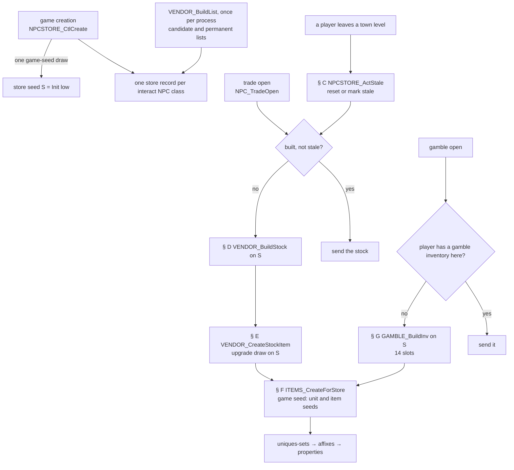
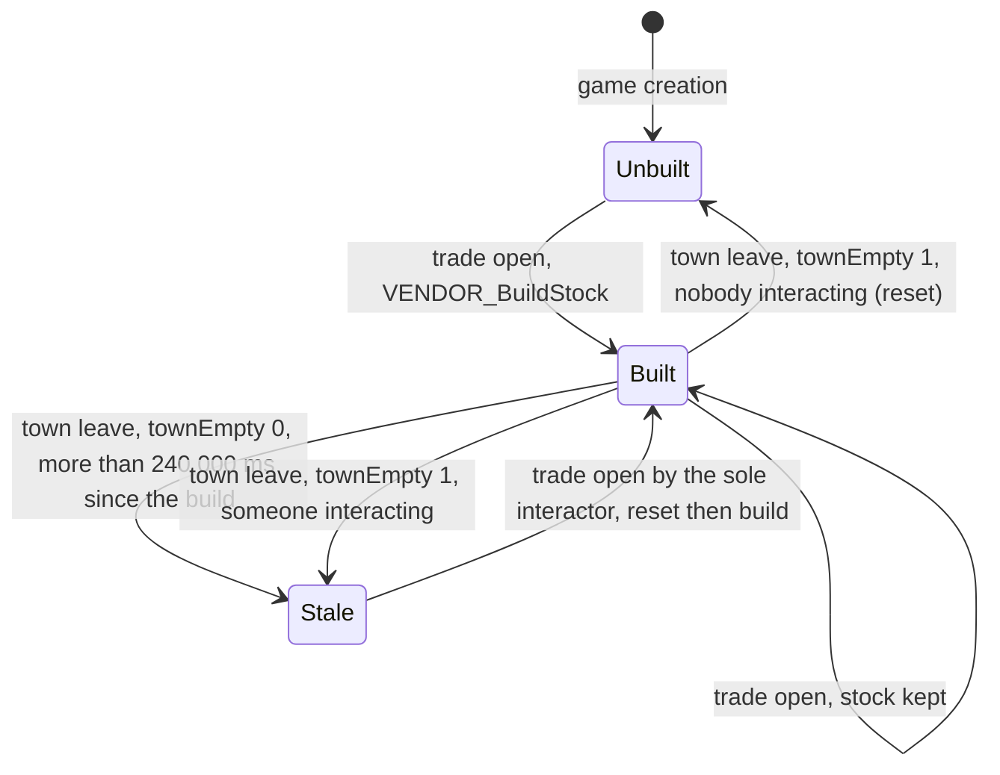
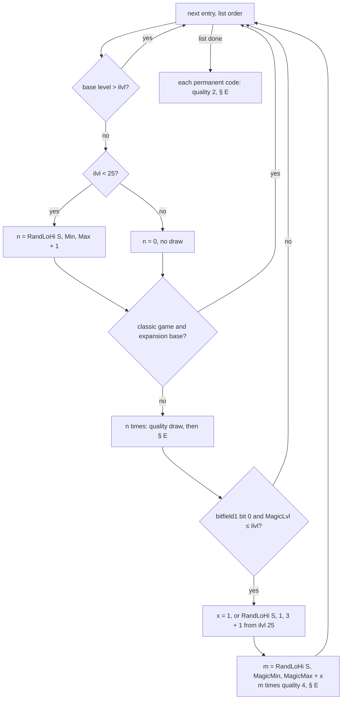
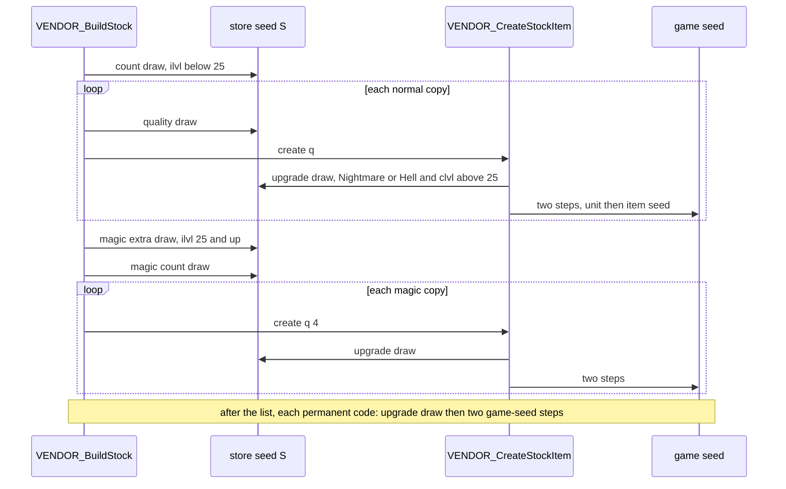
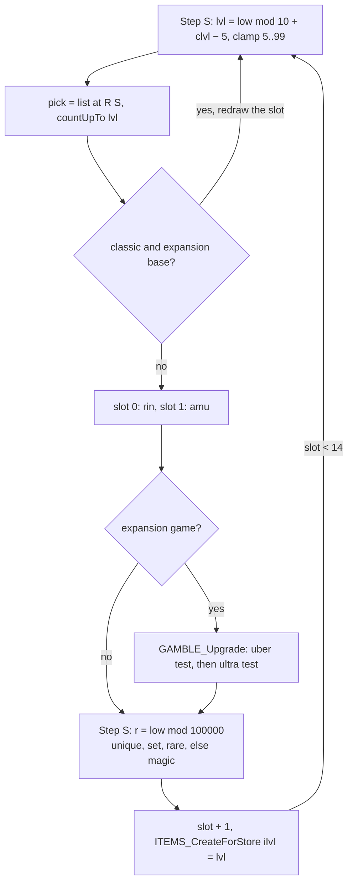

# Vendor stock and gambling

## Purpose

When a player opens a vendor's trade window, the server builds that vendor's stock if it has none: a list of normal,
superior and magic items, plus the vendor's permanent items, at a **stock level** derived from the opener's character
level, the difficulty and the act. When a player opens a gamble window, the server builds a 14-item gamble window for
that player at that NPC. Both draw every choice (counts, normal quality, the upgrade to an exceptional or elite base,
the gamble level, the gamble base and the gamble quality) from one **store seed** per game. Each item is then created
through the ordinary item creation of [uniques-sets](uniques-sets.md), [affixes](affixes.md) and
[properties](properties.md), seeded from the game seed exactly as a drop is. This spec gives when stock is built and
rebuilt, the stock build and the gamble build as pseudocode with their draw order, and the hand-off to item creation.
Prices, the buy/sell multipliers and repair costs are specified in [items/economy](economy.md) (§ I).

Vendor stock and gambling never reach the treasure-class resolver ([items/README](README.md#entry-points)). Names of
functions, structs and fields are ours ([items/0009](../../findings/items/0009-vendors.md), `re/types/vendors.h`).

Notation. `S` is the store seed, `NpcStoreCtl+0x08` (`Game+0x1D24` → `+0x08`). "Game seed" is `Game+0xD0`, "item
seed" the item data's seed ([glossary](../../glossary.md)). `Step`, `Range` are the primitives of
[rng](../rng/README.md#algorithm): `R(s, n)` is `Range(s, n)`, 0 with **no draw** when `n < 1` (signed), else one draw
and `low mod n` (unsigned). `RandLoHi(s, lo, hi)` is `lo + R(s, hi − lo)` when `hi > lo` (signed), else `lo` with no
draw. `clvl` is the opener's character level (stat 12). The vendor index `v` is the column group of the item tables:
0 Akara, 1 Gheed, 2 Charsi, 3 Fara, 4 Lysander, 5 Drognan, 6 Hratli (`Hralti` in the table headers), 7 Alkor,
8 Ormus, 9 Elzix, 10 Asheara, 11 Cain, 12 Halbu, 13 Jamella, 14 Malah, 15 Larzuk, 16 Drehya (Anya)
([Weapons § Vendor columns](../../tables/Weapons.md#vendor-columns-plan-0031-phase-0)).



## Entry points

| When | Function | Tag |
|---|---|---|
| Game creation: the store records and the store seed | fn:sub_00530BF0_GameCreate@0x00530BF0 → fn:NPCSTORE_CtlCreate@0x00536070, run:2026-10-15-vendors | [C] |
| Item tables loaded: the 17 candidate lists, once per process | fn:VENDOR_BuildAllLists@0x00536F80 → fn:VENDOR_BuildList@0x00536D50, run:2026-10-15-vendors | [C] |
| NPC menu packet: action 1 trade, 2 gamble, 3 hire | fn:NPC_MenuAction@0x00579D60 → fn:NPC_TradeOpen@0x00579430 → fn:NPC_OpenStore@0x00578B30, run:2026-10-15-vendors | [C] |
| A player leaves a town level (level or act change) | fn:sub_00537340_TownLevelLeave@0x00537340 → fn:NPCSTORE_ActStale@0x00537230, run:2026-10-15-vendors | [C] |
| A player leaves the game from a town of Acts I–IV | fn:sub_00537580_TownPlayerRemove@0x00537580 → fn:NPCSTORE_ActStale@0x00537230, run:2026-10-20-two-clients | [C] |
| The gamble window closes (cancel packet) | fn:sub_00572F20_NpcInteractRemove@0x00572F20 → fn:sub_00537190_GambleInvFree@0x00537190, run:2026-10-15-vendors | [C] |
| A player unit is freed while its NPC interaction is open | fn:sub_00555600_UnitFree@0x00555600 → fn:sub_00555500_PlayerInteractEnd@0x00555500 → fn:sub_00536B50_NpcStorePlayerLeave@0x00536B50, run:2026-10-20-two-clients, run:2026-10-27-sweep-vendors, [items/0009 § Plan 0038 batch H6c](../../findings/items/0009-vendors.md#plan-0038-batch-h6c-run2026-10-27-sweep-vendors) vend 2 | [C] |

- [C] `NPC_MenuAction(action, npcId, arg)` handles a 13-byte client packet. Action 1 (trade) is accepted for exactly
  the NPC classes 147, 148, 154, 177, 178, 199, 202, 252–255, 257, 405 and 511–513, and action 2 (gamble) for exactly
  147, 199, 254, 405, 512 and 514: both class tests were run for every class 0..799. The trade list is the slot
  table's store-flag set without 514, the gamble list the set `NPCSTORE_CtlCreate` marks as gamblers, and all 419
  logged trade opens carried that gambler flag. Classes are MonStats rows. (fn:NPC_MenuAction@0x00579D60,
  0x00579E23–0x00579ED5, fn:NPCSTORE_CtlCreate@0x00536070, data:g_NpcStoreTable@0x00731184, run:2026-10-15-vendors,
  [items/0009 § Plan 0038 batch S2c](../../findings/items/0009-vendors.md#plan-0038-batch-s2c-2026-10-16) vend 3)
- [I] Action 3 opens the hire list; the other actions are quest services (imbue, socketing, personalisation,
  travel), outside this spec. (fn:NPC_MenuAction@0x00579D60,
  [items/0009 § 3](../../findings/items/0009-vendors.md#3-open-and-rebuild-npc_menuaction--npc_tradeopen--npc_openstore))
- [C] The only call sites of `VENDOR_BuildStock` are 0x00578BCB, 0x005794C2 and 0x00579116, and those of
  `NPCSTORE_Reset` are 0x005372D8 and 0x005794B3 (Ghidra and a raw scan agree). The direct-call walk from the 265
  callbacks that the 37 quest init functions store never reaches `VENDOR_BuildStock`. It reaches `NPCSTORE_Reset` by
  one chain only: Baal's death → `0x0052E2A0` (a save of every client, in game types 1 and 2 only) → `0x0052E110` →
  `0x0052CAF0` (a client dropped after three failed sends) → `0x00539DA0` → `sub_00537580_TownPlayerRemove` →
  `NPCSTORE_ActStale`. So quest code resets a store only through that client drop, never in single player.
  (fn:VENDOR_BuildStock@0x00576980, fn:NPCSTORE_Reset@0x00536D10, fn:sub_0058DF20_A5Q6_BaalDeath@0x0058DF20,
  [items/0009 § Plan 0038 batch S2c](../../findings/items/0009-vendors.md#plan-0038-batch-s2c-2026-10-16) vend 4)
- [I] The walk follows direct calls only: the 825 indirect call sites under those callbacks are not followed.
  (fn:VENDOR_BuildStock@0x00576980, [items/0009 § Plan 0038 batch S2c](../../findings/items/0009-vendors.md#plan-0038-batch-s2c-2026-10-16) vend 4)
- [C] **Which free reaches `NpcStorePlayerLeave`.** `PlayerInteractEnd` has one call site, 0x005555C6 in
  `sub_00555600_UnitFree`; all 8 logged entries return to 0x005555CB. It calls `NpcStorePlayerLeave` (0x0055555D)
  when the player is still interacting with an NPC: in run:2026-10-20-two-clients's kept logs, 2 of the 7 host-side
  entries, the joiner's leaves while it was talking to Kashya (class 150) and to Akara, are followed by that call. In
  run:2026-10-27-sweep-vendors's single-player *Save and Exit*, the trade window's cancel had already cleared the
  interaction (`sub_00572F20_NpcInteractRemove`, then `sub_00554190_PlayerClearInteract`, and no new interaction
  after), and no `NpcStorePlayerLeave` call followed. With one player, every window close and menu Escape of the run
  sent the cancel first. (fn:sub_00555500_PlayerInteractEnd@0x00555500, fn:sub_00555600_UnitFree@0x00555600,
  fn:sub_00536B50_NpcStorePlayerLeave@0x00536B50, run:2026-10-20-two-clients, run:2026-10-27-sweep-vendors,
  [items/0009 § Plan 0038 batch H6c](../../findings/items/0009-vendors.md#plan-0038-batch-h6c-run2026-10-27-sweep-vendors) vend 2)
- [I] The call site is `UnitFree`'s case for unit type 0 (the jump table at 0x005555EC), and the test between the two
  outcomes is the player's interaction flag `+0x6C` with interaction type 1 (0x00555500–0x00555544): the two logged
  outcomes fit it. So the path is reached only when a client leaves with an interaction open.
  `sub_00554120_PlayerSetInteract` (called by `sub_00572C10_NpcInteractStart` at 0x00572D0B with type 1 and the
  NPC's id) writes the interaction only while `+0x6C` is 0 (0x00554133); `sub_00554190_PlayerClearInteract` clears it.
  (fn:sub_00555600_UnitFree@0x00555600, fn:sub_00554120_PlayerSetInteract@0x00554120,
  fn:sub_00554190_PlayerClearInteract@0x00554190,
  [items/0009 § Plan 0038 batch H6c](../../findings/items/0009-vendors.md#plan-0038-batch-h6c-run2026-10-27-sweep-vendors) vend 2)

## Inputs

### Tables

| Anchor | Used for |
|---|---|
| tbl:Weapons.txt:CharsiMin, `<V>Max`, `<V>MagicMin`, `<V>MagicMax`, `<V>MagicLvl` (`+0x146 + v`, `+0x157 + v`, `+0x168 + v`, `+0x179 + v`, `+0x18A + v`, u8) | the candidate entry of base and vendor `v` (§ B); the same columns in tbl:Armor.txt:CharsiMin and tbl:Misc.txt:AkaraMin ([Weapons § Vendor columns](../../tables/Weapons.md#vendor-columns-plan-0031-phase-0), [Armor](../../tables/Armor.md#vendor-columns-plan-0031-phase-0), [Misc](../../tables/Misc.md#vendor-columns-plan-0031-phase-0)) |
| tbl:Weapons.txt:PermStoreItem (`+0x1A4`), tbl:Misc.txt:PermStoreItem | the permanent list (§ B) |
| tbl:Weapons.txt:spawnable (`+0x133`) | listing filter (§ B) |
| tbl:Weapons.txt:level (`+0xFD`), tbl:Weapons.txt:version (`+0xF6`), tbl:Weapons.txt:code (`+0x80`) | the base level gate, the classic skip, the code (§ D, § G) |
| tbl:Weapons.txt:bitfield1 bit 0 (`+0xDC`) | the base may have magic stock (§ D) |
| tbl:Weapons.txt:ubercode (`+0x88`), tbl:Weapons.txt:ultracode (`+0x8C`) | the exceptional and elite bases of the stock upgrade (§ E) and the gamble upgrade (§ G) |
| tbl:Weapons.txt:NightmareUpgrade (`+0x19C`), tbl:Weapons.txt:HellUpgrade (`+0x1A0`) | the stock replacement base in Nightmare and Hell, `xxx` = none (§ E) |
| tbl:ItemTypes.txt:StorePage (`+0x22`), a row index of tbl:StorePage.txt:Code | the stock tab (§ E) ([StorePage](../../tables/StorePage.md)) |
| tbl:Gamble.txt:code | the gamble base list (§ G) ([Gamble](../../tables/Gamble.md)) |
| tbl:DifficultyLevels.txt:GambleRare, `GambleSet`, `GambleUnique`, `GambleUber`, `GambleUltra` (`+0x44`..`+0x54`) | the gamble quality and upgrade (§ G) ([DifficultyLevels § Gamble columns](../../tables/DifficultyLevels.md#gamble-columns-plan-0031)) |
| tbl:MonStats.txt:interact (`+0x0D` bit 1) | which NPC classes get a store record (§ A) |
| tbl:Npc.txt:npc and the multiplier columns | prices only; not read on the creation path (§ I) ([Npc](../../tables/Npc.md)) |

### Runtime state

| State | Type | Source |
|---|---|---|
| store seed `S` | Seed (see [rng](../rng/README.md#algorithm)) | `NpcStoreCtl+0x08`, seeded once at game creation (§ A); struct:NpcStoreCtl+0x08 |
| game seed | Seed | `Game+0xD0`; every created item's unit and item seeds (§ F) |
| `clvl` | i32 | the opener's stat 12, read at each stock build and each gamble build |
| `difficulty` | u8 | `Game+0x6D`: 0 Normal, 1 Nightmare, 2 Hell |
| `expansion` | bool | the game's expansion flag (`Game+0x70`) |
| `itemVersion` | u16 | `Game+0x78`: < 100 in a classic game |
| store record | `NpcStoreRec`, 0x44 bytes | per NPC class: `act`, `hasStore`, `isGambler`, `opened`, `built`, `stale` (`+0x27`), `buildTick`, the entries and permanent codes, the per-player gamble inventories; struct:NpcStoreRec+0x27 |
| `now` | u32 | `GetTickCount()` milliseconds, unsigned |

- [C] The stock and gamble builds read `clvl`, `difficulty`, the act and the expansion flag as inputs. The runs'
  characters were tool-built saves loaded on stock data (run:2026-10-15-vendors: expansion clvl 30 and 75, classic
  clvl 30; run:2026-10-27-sweep-vendors: expansion clvl 1 and 30 in Normal, 19 in Nightmare, 99 in Hell). Under
  ADR-0013 they are neutral inputs: they back the code that reads these values, nothing about how a character reaches
  that state. The clvl-30 save of the later run, one experience point under clvl 32's threshold, is not a state a
  character reaches by play (§ C). (fn:VENDOR_BuildStock@0x00576980, fn:GAMBLE_BuildInv@0x00578790,
  run:2026-10-15-vendors, run:2026-10-27-sweep-vendors)

### Constants

| Name | Value | Anchor | Tag |
|---|---|---|---|
| `STORE_INIT_HIGH` | 666 (the `Init` high word) | fn:NPCSTORE_CtlCreate@0x00536070, run:2026-10-15-vendors | [C] |
| `NORMAL_CAP[act]` | 12, 20, 28, 36, 45 for Acts I–V | fn:VENDOR_StockLevel@0x00576890, run:2026-10-15-vendors | [C] |
| `NO_NORMAL_FROM` | 25: no normal copies, magic extra 1 or 2, from this stock level | 0x005769F3–0x00576B4F, run:2026-10-15-vendors | [C] |
| `UPGRADE_MIN_CLVL` | 26: the stock upgrade draw needs `clvl > 25` | 0x00576389, run:2026-10-15-vendors | [C] |
| `STALE_MS` | 240 000 (`0x3A980`) | fn:NPCSTORE_ActStale@0x00537230, run:2026-10-15-vendors | [C] |
| `MAX_FAILS` | 32: a test that finds more than 32 failed creations (after a normal copy or a permanent item) ends the whole build at once; never reached (§ D) | fn:VENDOR_BuildStock@0x00576980, 0x00576AA3, 0x00576BE5, 0x00576B74 | [I] |
| `GAMBLE_SLOTS` | 14 | fn:GAMBLE_BuildInv@0x00578790, run:2026-10-15-vendors | [C] |
| `CRACKED_TRIES` | 5 | fn:VENDOR_CreateStockItem@0x00576330 | [I] |
| store record count | 64 records of 0x44 bytes: `NPCSTORE_FindRec` walks `i` = 0..0x3F at `recs + 0x44·i`, `NPCSTORE_CtlCreate` allocates 0x1100 bytes | fn:NPCSTORE_FindRec@0x00535EA0, fn:NPCSTORE_CtlCreate@0x00536070, [items/0009 § Plan 0038 batch S2c](../../findings/items/0009-vendors.md#plan-0038-batch-s2c-2026-10-16) vend 7 | [C] |
| NPC slot table | 43 entries of 8 bytes (acts 0–4: 8, 14, 8, 6, 7 entries; 17 with the store flag): class `+0x0`, store flag `+0x4`, act `+0x5`, flag `+0x6`, the only stride-8 reads being `NPCSTORE_CtlCreate`'s | data:g_NpcStoreTable@0x00731184, 0x005361FA–0x0053623A, [items/0009 § Plan 0038 batch S2c](../../findings/items/0009-vendors.md#plan-0038-batch-s2c-2026-10-16) vend 8 | [C] |

## Algorithm

### A. Store records and the store seed (game creation)

```
A1. Step(game.seed)                                                   [C] draw (game seed) (fn:NPCSTORE_CtlCreate@0x00536070, run:2026-10-15-vendors)
    S ← Init(game.seed.low)                                           ; S = {low, 666}
A2. for cls in 0 ..< nMonStats:                                       [C] (fn:NPCSTORE_CtlCreate@0x00536070, tbl:MonStats.txt:interact, run:2026-10-15-vendors)
      if MonStats[cls].interact = 0: continue
      rec ← next of the 64 records; rec.classId ← cls; rec.inventory ← new
      slot ← g_NpcStoreTable entry with class cls; if none: continue   [I] no-slot case (fn:NPCSTORE_CtlCreate@0x00536070)
      rec.act ← slot.act; rec.hasStore ← slot.hasStore
      if rec.hasStore ≠ 1: no lists; continue
      rec.entries, rec.permCodes ← copy of VendorList[VENDOR_INDEX[cls]]
      rec.isGambler ← cls ∈ {147, 199, 254, 405, 512, 514}
```

Step notes:

- A1. [C] `NPCSTORE_CtlCreate` runs once per game from `sub_00530BF0_GameCreate`, after the monster-region and
  object-region builds that draw on the game seed too. Every logged store seed of the 7 games is `{low, 666}` after
  one game-seed step, and the store seed at the entry of each of the 435 logged builds (stock, gamble, hireling) is
  the model's: nothing outside the builds of this spec and the hireling oracle draws on `S`.
  (fn:sub_00530BF0_GameCreate@0x00530BF0, fn:NPCSTORE_GetSeed@0x00536B40, run:2026-10-15-vendors,
  [rng/seeds](../rng/seeds.md#algorithm))
- A1. [C] **The store seed is game-seed draw 3** from `Init(N)` (N the game's seed, `{N, 666}` at
  `GAME_InitSeeds`): after the monster-region build (draw 1) and the object-region build (draw 2), each one step
  ([rng/seeds step note 7a](../rng/seeds.md#algorithm)). The code steps the game seed once and seeds `S` from the new
  low word (0x005360D2–0x005360FB); in each of the 7 games (seeds 3201–3207) the logged game seed at that step's entry
  (`VSC0`) is two steps past the one logged at `GAME_InitSeeds`, and `S` (`VSC1`) is `Init` of the third step's low
  word. (fn:NPCSTORE_CtlCreate@0x00536070, fn:GAME_InitSeeds@0x0052C280, run:2026-10-15-vendors)
- A2. [C] The records follow MonStats row order of the `interact` rows, and each record's act and store flag are its
  class's slot-table entry: all 419 logged trade opens show the record's act and store flag equal to the slot
  table's, and the 32 logged `NPCSTORE_ActStale` record lists are in ascending class order. `NPCSTORE_FindRec` finds
  a record by class over all 64 slots (Constants). (fn:NPCSTORE_CtlCreate@0x00536070, fn:NPCSTORE_FindRec@0x00535EA0,
  tbl:MonStats.txt:interact, run:2026-10-15-vendors,
  [items/0009 § Plan 0038 batch S2c](../../findings/items/0009-vendors.md#plan-0038-batch-s2c-2026-10-16) vend 7, 9)
- A2. [I] **One stock per NPC class per game, shared by every player**; gambling keeps one inventory per player and
  NPC (§ H). (fn:NPCSTORE_FindRec@0x00535EA0, data:g_NpcStoreTable@0x00731184,
  [items/0009 § 1](../../findings/items/0009-vendors.md#1-store-records-and-the-store-seed-game-creation))
- A2. [C] **The stock is shared with a second player**: in plan 0044's two-client run each store the host built was the
  one the joiner's open of the same NPC found, with no second build (12 opens, C1). Scope: two players, the trade
  stock; per-player gambling was not run with two players. (fn:NPCSTORE_FindRec@0x00535EA0, run:2026-10-20-two-clients)

**`VENDOR_INDEX`** (NPC class → vendor index):

| Class | NPC | v | Class | NPC | v |
|---:|---|---:|---:|---|---:|
| 148 | Akara | 0 | 255 | Ormus | 8 |
| 147 | Gheed | 1 | 199 | Elzix | 9 |
| 154 | Charsi | 2 | 252 | Asheara | 10 |
| 178 | Fara | 3 | 257 | Halbu | 12 |
| 202 | Lysander | 4 | 405 | Jamella | 13 |
| 177 | Drognan | 5 | 513 | Malah | 14 |
| 253 | Hratli | 6 | 511 | Larzuk | 15 |
| 254 | Alkor | 7 | 512 | Drehya (Anya) | 16 |

- [C] The record filler's switch and the list builder's switch agree on these 16 classes (a second code path), and
  the model's lists built from this map equal, byte for byte, the record each of the 94 logged builds read.
  (0x00536271–0x005363EE, 0x00536FC0–0x00537046, fn:VENDOR_BuildAllLists@0x00536F80, run:2026-10-15-vendors)
- [C] Class 514 (Nihlathak) gets list 15 (Larzuk's) and the gambler mark in his record, while the list builder maps
  him to 16; the two switches, run through the objdump instructions, agree on the 16 trade classes, and neither gives any class
  index 11 (Cain). He is not in the trade menu's class list (action 1, above), so his record's list is never built
  into stock; he only gambles. (0x00536252–0x005363F8, fn:VENDOR_BuildAllLists@0x00536F80,
  fn:NPC_MenuAction@0x00579D60,
  [items/0009 § Plan 0038 batch S2c](../../findings/items/0009-vendors.md#plan-0038-batch-s2c-2026-10-16) vend 11)
- [I] The Npc table's `npc` column is not read for this map. (tbl:Npc.txt:npc)

### B. The candidate lists (`VENDOR_BuildList`)

```
B1. for v in 0 ..< 17, once per process:                              [C] (fn:VENDOR_BuildList@0x00536D50, run:2026-10-15-vendors)
      entries[v] ← []; perm[v] ← []
      for i in 0 ..< nItems:                                          ; weapons, then armor, then misc, record index order
        b ← items[i]
        if b.spawnable = 0: continue
        if b.Max[v] = 0 and b.MagicMax[v] = 0: continue
        if b.PermStoreItem ≠ 0: append b.code to perm[v]
        else: append {Min: u8, Max: u8, MagicMin: u8, MagicMax: u8, code, MagicLvl: u8} to entries[v]
```

- B1. [C] `Min` plays no part in the listing: a base whose `Max` and `MagicMax` are both 0 is never stocked by that
  vendor. A permanent base is made once per build whatever its counts. A per-index byte at `g_VendorListBuilt` makes
  each list build once; the lists live at `g_VendorLists`. The logged record of all 16 used lists equals the model's.
  (data:g_VendorLists@0x00883D78, data:g_VendorListBuilt@0x00883E88, tbl:Weapons.txt:spawnable,
  tbl:Weapons.txt:CharsiMax, tbl:Weapons.txt:CharsiMagicMax, run:2026-10-15-vendors)
- [C] `tools/vendor_survey.py bases <vendor> <difficulty>` prints each group's listed bases from the tables
  ([Weapons § Vendor columns](../../tables/Weapons.md#vendor-columns-plan-0031-phase-0)); `tools/vendors.py lists`
  prints the 17 lists in build order. (tbl:Weapons.txt:PermStoreItem, run:2026-10-15-vendors)

### C. When stock is built, reset and marked stale



```
C0. on the first interaction start of a player with a hireling seller   [C] (fn:sub_00572C10_NpcInteractStart@0x00572C10, 0x00572CFF, fn:HIRE_SendList@0x00576770, run:2026-10-16-hirelings, run:2026-10-27-sweep-vendors)
    (150, 198, 252, 515; hirelings spec), before any menu action:
      HIRE_SendList(npc): if rec.hirelingsBuilt = 0: HIRE_BuildStock(rec); rec.hirelingsBuilt ← 1   ; draws on S: hirelings spec
C1. on trade open (action 1) of NPC npc by player p:                  [C] (fn:NPC_TradeOpen@0x00579430, fn:NPC_OpenStore@0x00578B30, run:2026-10-15-vendors)
      rec ← NPCSTORE_FindRec(npc.class); rec.opened ← 1
      if rec.hasStore:
        if rec.built = 0: VENDOR_BuildStock(npc, p)   (§ D); rec.built ← 1
        if rec.hirelingsBuilt = 0:                                     [I] never true with the stock client: C0 ran first (0x00578BFF)
          if npc.class ∈ {150, 515, 198, 252}: HIRE_BuildStock(rec)   ; 0x00578BFF
          rec.hirelingsBuilt ← 1
      if npc.class ∈ {150, 515, 198}: return                          ; hire-only NPCs
      if sole and rec.stale:                                          ; sole: the NPC's interaction list has exactly one live entry
        rec.stale ← 0; NPCSTORE_Reset(rec, npc)                        ; stock destroyed, built ← 0
        VENDOR_BuildStock(npc, p); rec.built ← 1
      send the stock
C2. on any level change of a player whose old level is a town          [C] (fn:sub_00537340_TownLevelLeave@0x00537340, run:2026-10-15-vendors)
      (levels 1, 40, 75, 103, 109 → act 0..4):
      count ← players still in that level
      NPCSTORE_ActStale(act, townEmpty: count = 0)
C3. NPCSTORE_ActStale(act, townEmpty):                                 [C] (fn:NPCSTORE_ActStale@0x00537230, run:2026-10-15-vendors)
      for rec with rec.act = act, hasStore = 1, opened = 1, built = 1:
        if not townEmpty:
          if now > rec.buildTick + 240000:                             ; u32, unsigned compare
            rec.stale ← 1; rec.buildTick ← now
        else:
          u ← the unit rec.npcUnitId
          if u is gone or u.class ≠ rec.classId:
            clear rec: built ← 0, buildTick ← 0, new inventory         ; no NPCSTORE_Reset call
          else if NpcInteractCount(u) = 0: NPCSTORE_Reset(rec, u)      ; built ← 0, stock destroyed
          else: rec.stale ← 1
```

Step notes:

- C1. [C] Every one of the 94 logged trade opens built: 81 first opens (`built` = 0), 6 opens after a reset and 7
  opens of a stale store by the sole interactor (`NPCSTORE_Reset`, then the build), each predicted from the record's
  state at the open. (run:2026-10-15-vendors, fn:NPCSTORE_Reset@0x00536D10)
- C1. [C] **An open of a built, non-stale store keeps the stock.** In plan 0044's two-client run each store the host
  built at its first open was kept, with no build, at the joiner's open of the same NPC (12 opens). Scope: the second
  open by another player. (fn:NPCSTORE_FindRec@0x00535EA0, fn:NPC_TradeOpen@0x00579430, run:2026-10-20-two-clients,
  [multiplayer/0001 § 6](../../findings/multiplayer/0001-cases.md#6-phase-2-results-run2026-10-20-two-clients))
- C1. [C] **The same player opening the window again rebuilds nothing either.** In run:2026-10-27-sweep-vendors, 7
  trade opens found the store built and not stale (Charsi 1, Drognan 3, Larzuk 3): no build before the next open, and
  the stock's item ids at each open were those left by the build, less the items bought since (one, Charsi's `lax`).
  (fn:NPC_TradeOpen@0x00579430, fn:NPC_OpenStore@0x00578B30, run:2026-10-27-sweep-vendors,
  [items/0009 § Plan 0038 batch H6c](../../findings/items/0009-vendors.md#plan-0038-batch-h6c-run2026-10-27-sweep-vendors) vend 12)
- C1. [I] `sole` is computed by `NPC_MenuAction` before the call (0x00579E08) from the NPC's interaction list
  (`MonsterData+0x30`). (fn:sub_00572DA0_NpcInteractCount@0x00572DA0)
- C1. [C] **With two players interacting, a stale store is not rebuilt and keeps its stock.** In the two-client run,
  Akara's store, marked stale 266.5 s after its build by the joiner's town leave, was opened by the host while the
  joiner was talking to her: `sole` 0, no reset and no build. Once the joiner's talk ended, the host's next open had
  `sole` 1, a reset, then a build. (0x00579E08, fn:sub_00572DA0_NpcInteractCount@0x00572DA0, run:2026-10-20-two-clients)
- C0–C1. [C] **Asheara's hirelings come before her stock, whatever the menu choice.** Her hire table (252, a store
  and hirelings) is built once, by `HIRE_SendList` called from `sub_00572C10_NpcInteractStart`, at the first click on
  her and before her first menu action. In run:2026-10-27-sweep-vendors four hire-list actions and then the trade open
  followed it, with `hirelingsBuilt` 1 and `built` 0 at the open, and the stock build that followed called no
  `HIRE_BuildStock`; in run:2026-10-15-vendors's 5 games with Asheara her first trade open likewise found
  `hirelingsBuilt` at 1, the hireling build logged before her first menu action (6 of 6 with the later run's). So
  `NPC_OpenStore`'s call 0x00578BFF was never taken in the runs. `HIRE_BuildStock` was a boundary oracle of the first
  run (ADR-0004); its draws on `S` are specified in [hirelings](../hirelings/README.md#entry-points) (plan 0033), which
  a reimplementation runs in its place. (fn:HIRE_SendList@0x00576770, fn:HIRE_BuildStock@0x00576070,
  fn:sub_00572C10_NpcInteractStart@0x00572C10, fn:NPC_OpenStore@0x00578B30, run:2026-10-15-vendors,
  run:2026-10-27-sweep-vendors,
  [items/0009 § Plan 0038 batch H6c](../../findings/items/0009-vendors.md#plan-0038-batch-h6c-run2026-10-27-sweep-vendors) vend 14)
- C1. [I] **The trade-first order is never taken by the stock client**, beyond the runs: `+0x21` (`hirelingsBuilt`)
  is cleared only at 0x005770C5, and `HIRE_BuildStock` follows at once (0x005770C9); `NPCSTORE_Reset` writes `+0x20`
  (`built`) alone (0x00536D24), so a store reset, including the two-player stale branch, leaves the hire table built.
  (fn:NPCSTORE_Reset@0x00536D10, 0x005770C5,
  [items/0009 § Plan 0038 batch H6c](../../findings/items/0009-vendors.md#plan-0038-batch-h6c-run2026-10-27-sweep-vendors) vend 14)
- C1. [C] In the run the oracle was entered 16 times, each with the `S` the model predicted, and its exit `S` was
  taken from the log. (fn:HIRE_BuildStock@0x00576070, run:2026-10-15-vendors)
- C2. [C] In single player, a waypoint to **another act** reaches `NPCSTORE_ActStale` with `townEmpty` 0 (the leaving
  player still counted in the town; 26 of 26 calls), so the old act's stores are only marked stale, and only those
  built more than 240 000 ms before. A waypoint to a level of the **same act** gives `townEmpty` 1 (6 of 6 calls), so
  every built store of the act is destroyed at once (by `NPCSTORE_Reset`, or by the clear path when the NPC unit is
  gone) and rebuilt at the next trade open from the opener's current level. (0x00537402, run:2026-10-15-vendors)
- C2. [C] **Walking out of a town takes the same `TownLevelLeave` call as a waypoint within the act.** In
  run:2026-10-27-sweep-vendors the walk from the Rogue Encampment into the Blood Moor (levels 1 → 2) called it from the
  per-frame room check (the call 0x00538191 in `0x005380D0`, return 0x00538196), and `NPCSTORE_ActStale` got
  `townEmpty` 1 and reset Akara's and Charsi's stores at once. The waypoints within an act took the same call site
  with `townEmpty` 1 (Harrogath → the Frigid Highlands once, Lut Gholein → the Sewers Level 2 six times: Larzuk's and
  Fara's stores reset), and every act change came from `sub_0053AEC0_PlayerChangeLevel` (the call 0x0053AF40, return
  0x0053AF45; the 14 from a town all with `townEmpty` 0). (fn:sub_00537340_TownLevelLeave@0x00537340, 0x00538191,
  0x0053AF40, fn:NPCSTORE_ActStale@0x00537230, run:2026-10-27-sweep-vendors,
  [items/0009 § Plan 0038 batch H6c](../../findings/items/0009-vendors.md#plan-0038-batch-h6c-run2026-10-27-sweep-vendors) vend 15)
- C2. [I] **Why an act change counts the leaving player.** `TownLevelLeave` counts the players whose current room's
  level is the old level. For a target in another act, `PlayerChangeLevel` calls it (0x0053AF40) before
  `PlayerChangeAct` (0x0053AF4F), while the player's unit is still in its town room, so the count includes it and
  `townEmpty` is 0. A change within the act goes through the per-frame room check, which calls it (0x00538191) only
  after it has found the player's room in a new level, so the player is no longer counted. A walk out of town takes the
  per-frame path. This matches the run's counts (0 on the 6 in-act changes, 1 on the 26 act changes).
  (0x00536820–0x0053683F, 0x00538163–0x00538179, fn:sub_00537340_TownLevelLeave@0x00537340,
  fn:sub_00536820_CountPlayersInLevelCb@0x00536820, fn:sub_0053AEC0_PlayerChangeLevel@0x0053AEC0,
  fn:sub_0053ACC0_PlayerChangeAct@0x0053ACC0, [items/0009 § Plan 0039 batch P1b](../../findings/items/0009-vendors.md#plan-0039-batch-p1b-2026-10-17))
- C2. [I] `sub_00537580_TownPlayerRemove` (a player leaving the game) does the same with `count − 1 = 0`, for the
  towns of Acts I–IV only: Harrogath (109) is missing from its switch. (fn:sub_00537580_TownPlayerRemove@0x00537580,
  0x00537580–0x005375FB)
- C2. [C] **A player leaving the game, with two players.** In the two-client run the joiner left from the Rogue
  Encampment (a) with the host in town: `townEmpty` 0, and only Gheed's store (built 351.6 s earlier) was marked stale,
  Akara's and Charsi's kept; (b) with the host in the Blood Moor: `townEmpty` 1, and the three built stores were reset.
  A leave from Harrogath, in two sessions, logged no `NPCSTORE_ActStale` call from `TownPlayerRemove` (no stale line
  with the return 0x005375FC). Scope: the leaves of (a) and (b) were
  connection drops (the joiner's process stopped) and Harrogath's were *Save and Exit*; whether both paths take the same
  removal call is not logged. (fn:sub_00537580_TownPlayerRemove@0x00537580, fn:NPCSTORE_ActStale@0x00537230,
  0x005375FC, run:2026-10-20-two-clients, [multiplayer/0001 § 6](../../findings/multiplayer/0001-cases.md#6-phase-2-results-run2026-10-20-two-clients))
- C3. [C] The 240 000 ms test: the code compares `now` with `buildTick + 0x3A980` unsigned; in the run 7 stores were
  marked, at 252.5–375.7 s after their build, and none sooner. `buildTick` is written at the start of each build and
  by the stale mark. (0x0053730A, fn:NPCSTORE_ActStale@0x00537230, run:2026-10-15-vendors)
- C3. [C] The multiplayer case with a player left in town (stale only after 240 s, rebuilt at the next trade open by a
  sole interactor) is C2's (a) and C1's two-player open. (fn:NPCSTORE_ActStale@0x00537230, run:2026-10-20-two-clients)
- C3. [I] The stale branch with `townEmpty` 1 and someone still interacting: the run's one such leave (the joiner alone
  in town with Akara's trade open, its connection dropped) logged the stale call before the interaction ended and no
  reset, the branch with an interactor, but the logged record list was empty there, so the stale byte itself was not
  seen. (fn:NPCSTORE_ActStale@0x00537230, run:2026-10-20-two-clients)
- [C] **What rebuilds nothing: a town entry, a reopen and a level-up.** In run:2026-10-27-sweep-vendors Drognan's
  store, built at clvl 30 in Lut Gholein, was opened again; the player took the waypoint to the Frigid Highlands (an
  act change, `townEmpty` 0, the store kept), levelled up there, came back by waypoint (a town entry: no
  `NPCSTORE_ActStale` call) and opened the store twice more. None of the three later opens built, each showed the
  same 57 item ids, and the model predicted the record's state (built, not stale) each time. The level-up was one
  event of two levels (30 → 32): the tool-built save held clvl 30 one experience point under clvl 32's threshold,
  a state not reached by play, and `sub_00536850_NpcStoreLevelUpNote` was entered once from the level-up's call
  (0x005709E0). (fn:sub_00536850_NpcStoreLevelUpNote@0x00536850, fn:NPC_TradeOpen@0x00579430,
  run:2026-10-27-sweep-vendors,
  [items/0009 § Plan 0038 batch H6c](../../findings/items/0009-vendors.md#plan-0038-batch-h6c-run2026-10-27-sweep-vendors) vend 18)
- [I] A quest event rebuilds nothing either (none in the runs). Why a level-up changes nothing: the level-up
  (`0x00570880`) calls `NpcStoreLevelUpNote`, which queues a note on each built store without reading the level
  gained (0x00536850–0x005368DF); the queue's consumer `sub_005368F0_NpcStorePendingDead` has no caller, nor does
  `sub_00579090_StockRebuildDead`. So the stock keeps the level of the build until a reset or stale rebuild.
  (fn:sub_00536850_NpcStoreLevelUpNote@0x00536850, fn:sub_005368F0_NpcStorePendingDead@0x005368F0,
  fn:sub_00579090_StockRebuildDead@0x00579090)

### D. The stock build (`VENDOR_BuildStock`)



```
D1. rec.buildTick ← now                                                [C] (fn:VENDOR_BuildStock@0x00576980, run:2026-10-15-vendors)
D2. clvl: i32 ← stat 12 of the opener                                   [C] (fn:VENDOR_BuildStock@0x00576980, run:2026-10-15-vendors)
    ilvl: i32 ← VENDOR_StockLevel(clvl + 5)
      VENDOR_StockLevel(x): if difficulty = 0 and act < 5: return min(x, NORMAL_CAP[act])
                            else return x                              ; no clamp to 99
D3. fails: i32 ← 0                                                     [C] (fn:VENDOR_BuildStock@0x00576980, run:2026-10-15-vendors)
    for e in rec.entries, in order:
      b ← base of e.code
      if b.level > ilvl: continue                                      ; no draw
      if ilvl < 25: n: i32 ← RandLoHi(S, e.Min, e.Max + 1)             ; draw (none when Max + 1 ≤ Min)
      else: n ← 0
      if b.version ≥ 100 and itemVersion < 100: continue               ; classic: after the count draw
      repeat n times:
        q: i32 ← VENDOR_PickNormalQuality(S, ilvl)                     ; draw
        if not VENDOR_CreateStockItem(e.code, q, ilvl, clvl): fails ← fails + 1     (§ E)
        if fails > 32: return                                          [I] never reached; 0x00576AA3
      if b.bitfield1 & 1 and e.MagicLvl ≤ ilvl:                        ; MagicLvl read as u8
        if ilvl ≥ 25: x: i32 ← RandLoHi(S, 1, 3) + 1                   ; draw: 2 or 3
        else: x ← 1
        m: i32 ← RandLoHi(S, e.MagicMin, e.MagicMax + x)               ; draw (none when MagicMax + x ≤ MagicMin)
        repeat m times:
          if not VENDOR_CreateStockItem(e.code, 4, ilvl, clvl): fails ← fails + 1   (§ E); no limit test here
D4. for c in rec.permCodes, in order:                                   [C] (fn:VENDOR_BuildStock@0x00576980, run:2026-10-15-vendors)
      it ← VENDOR_CreateStockItem(c, 2, ilvl, clvl)                    (§ E)
      if it = none: fails ← fails + 1
      else if c ∈ {aqv, cqv}: it.quantity (stat 70) ← its maximum stack
      if fails > 32: return                                            [I] never reached; 0x00576BE5
D5. VENDOR_PickNormalQuality(S, ilvl) → i32:                            [C] (fn:VENDOR_PickNormalQuality@0x00576900, run:2026-10-15-vendors)
      Step(S); r: u32 ← S.low mod 100                                  ; draw, always
      if ilvl < 5:  return 1 if r > 90 else 2
      if ilvl < 10: return 3 if r > 85 else 2
      return 3 if r ≥ 75 else 2
```

Step notes:

- D2. [C] The Normal caps bind for every act (Acts I–V at clvl 30 and 75); Nightmare and Hell take `clvl + 5` with no
  cap, up to 104. `ITEMS_CreateForStore` only raises an `ilvl` below 1 to 1. (fn:VENDOR_StockLevel@0x00576890,
  0x00576890–0x005768EF, run:2026-10-15-vendors)
- D3. [C] Counts: normal stock is `Min..Max` inclusive while `ilvl < 25` and none from 25 on; magic stock is
  `MagicMin..MagicMax` below 25, and `MagicMin..MagicMax + 1` or `MagicMin..MagicMax + 2` from 25 on, after a draw that
  picks which. An entry with `Max` = 0 and `Min` = 0 still makes its count draw (`RandLoHi(S, 0, 1)` = `R(S, 1)`, one
  draw, result 0). (0x005769F3–0x00576B4F, fn:RNG_RandLoHi@0x004BC500, run:2026-10-15-vendors)
- D3. [C] **`MagicLvl` is a minimum stock level**, not an affix level. The byte is compared with `ilvl` (`movzx`,
  `jg skip`), so 0 is no gate and 255 means the vendor never stocks a magic copy of that base. The affix level of a
  magic stock item comes from the ordinary alvl rule with the item's `ilvl` ([affixes](affixes.md)). In the run Charsi
  at Normal Act I (`ilvl` 12) made no magic `hla` (`MagicLvl` 15), `stu` (20) or `rng` (255), no 255 base ever got a
  magic copy, and 4097 of 4375 affix picks on magic stock items have an `alvl` above their entry's `MagicLvl`.
  (0x00576AE3–0x00576AEA, tbl:Weapons.txt:CharsiMagicLvl, run:2026-10-15-vendors)
- D3. [C] Hratli's `MagicLvl` is 0 on every weapon and armor base (the table header `HratliMagicLvl` is not the
  compiler's column name, so the absent-column default 0 is stored), so his magic stock has no level gate.
  (tbl:Weapons.txt:HratliMagicLvl, [Weapons § Vendor columns](../../tables/Weapons.md#vendor-columns-plan-0031-phase-0),
  run:2026-10-15-vendors)
- D3. [C] **Classic.** An expansion base (`version` ≥ 100) is skipped after its count draw and before any quality
  draw, so a classic game consumes the count draw of each expansion entry while `ilvl < 25` (32 such skips in the
  run). (0x00576A47–0x00576A5C, tbl:Weapons.txt:version, run:2026-10-15-vendors)
- D1. [C] The `buildTick` each of the 83 logged builds left (read at the next trade open or stale test) is ordered as
  the builds are in the log and lies between the `GetTickCount` values of the stale marks before and after it (7
  marks, 0 out of order); the 240 000 ms test of those marks counts from it. (fn:VENDOR_BuildStock@0x00576980,
  run:2026-10-15-vendors, [items/0009 § Plan 0038 batch S2c](../../findings/items/0009-vendors.md#plan-0038-batch-s2c-2026-10-16) vend 19)
- D3–D4. [C] The 32-failure limit was never reached: no build of run:2026-10-15-vendors passed 20 failures (94
  builds; 348 stock items found no room on their tab, § E), and none of run:2026-10-27-sweep-vendors's 17 passed 27
  (Larzuk in Hell at `ilvl` 104, five builds in three games: 26, 12, 13, 27 and 17; Fara in Nightmare at `ilvl` 24, the most
  normal copies, 9 to 20; Asheara at 104, 8; Anya and Malah at 104, none). `tools/vendors.py check` reproduces every
  build with the limit modelled. (fn:VENDOR_BuildStock@0x00576980, run:2026-10-15-vendors,
  run:2026-10-27-sweep-vendors,
  [items/0009 § Plan 0038 batch H6c](../../findings/items/0009-vendors.md#plan-0038-batch-h6c-run2026-10-27-sweep-vendors) vend 5)
- D3–D4. [I] **Where the limit is tested.** The count is tested after each normal copy (`cmp [ebp-4], 0x20; jg`,
  0x00576AA3) and after each permanent item (0x00576BE5), never in the magic loop (0x00576B3C–0x00576B4D). Both `jg`
  go to the function's epilogue (0x00576B74, `ret 8` at 0x00576B7A), so the first test that finds a 33rd failure ends
  the whole build at once: no further entry, copy or permanent item is made. From stock level 25 (no normal copies)
  the limit can end a build only in the permanent loop, after its first item. (fn:VENDOR_BuildStock@0x00576980,
  [items/0009 § Plan 0038 batch H6c](../../findings/items/0009-vendors.md#plan-0038-batch-h6c-run2026-10-27-sweep-vendors) vend 5)
- D5. [C] **Stock is normal, superior or magic**, never low, rare, set or unique: the 4 656 logged stock items of
  run:2026-10-15-vendors are quality 2 ×848, 3 ×131 and 4 ×3 677. Since `clvl ≥ 1` gives `ilvl ≥ 6` (D2), the
  low-quality branch (`ilvl < 5`) is unreachable. A normal entry is superior with 14 chances in 100 below `ilvl` 10
  and 25 in 100 from 10 on (the code's bounds; not a frequency claim). (0x00576900, fn:VENDOR_BuildStock@0x00576980,
  run:2026-10-15-vendors, [items/0009 § Plan 0038 batch S2c](../../findings/items/0009-vendors.md#plan-0038-batch-s2c-2026-10-16) vend 20)

**Draw order on `S` per entry** [C] (0x00576A3C–0x00576B99, 7513 stock-build draws reproduced, run:2026-10-15-vendors):



### E. One stock item (`VENDOR_CreateStockItem`)

```
E1. b ← base of code; want ← code                                      [C] (fn:VENDOR_CreateStockItem@0x00576330, run:2026-10-15-vendors)
    if difficulty > 0 and clvl > 25:
      u: u32 ← Range(S, 100000)                                        ; draw (RNG_RangeB)
      if difficulty = 1:                                               ; Nightmare; no expansion test
        if u < ilvl·64 + 4000 and valid(b.ubercode): want ← b.ubercode
        else if b.NightmareUpgrade ≠ "xxx": want ← b.NightmareUpgrade
      else:                                                            ; Hell
        if expansion and u < ilvl·16 + 1000 and valid(b.ultracode): want ← b.ultracode
        else if u < ilvl·128 + 5000 and valid(b.ubercode): want ← b.ubercode
        if b.HellUpgrade ≠ "xxx": want ← b.HellUpgrade                 ; overrides either result
E2. for pass in 0 ..< 2:                                               [C] (fn:VENDOR_CreateStockItem@0x00576330, run:2026-10-15-vendors)
      for t in 1 ... 5:
        it ← ITEMS_CreateForStore(npc, index of want, kind 4, q, ilvl)   (§ F)
        if it is low quality named "Cracked": destroy it; it ← none; continue   [I] never reached; 0x00576505
        break
      if it = none: return none                                        [I] after 5 Cracked tries (0x00576505)
      if code(it) = want: break
      destroy it; q ← 2                                                [I] made again once with quality 2; 0x00576536
E3. page ← the StorePage of it's item type                               [C] (fn:sub_0062E880_ItemStorePage@0x0062E880, 0x00576555–0x0057657A, run:2026-10-27-sweep-vendors)
    if page = −1: destroy it; return none                              [I] no case (0x00576555–0x0057657A)
    place it on tab page; if that fails and page = 1: try tab 2        ; 0x005765C8, 0x0057660B; the cell search [I]
    if that fails: park the item; return none                          ; counts as a failure in § D
    return it
```

Step notes:

- E1. [C] `valid(c)` is `c ≠ 0` and `c` not four spaces; the upgrade columns use `xxx` for none. Both thresholds use
  the stock `ilvl`; the gate uses `clvl`. The Nightmare `NightmareUpgrade` applies only after a failed uber test; the
  Hell `HellUpgrade` replaces whatever the tests gave. In the run every branch was taken (Nightmare: `ubercode` 78,
  `NightmareUpgrade` 851, none 603; Hell, expansion: `ultracode` 25, `ubercode` 128, `HellUpgrade` alone 452, none
  584; 2721 upgrade draws). (0x00576389–0x005764A5, tbl:Weapons.txt:ubercode, tbl:Weapons.txt:ultracode,
  tbl:Weapons.txt:NightmareUpgrade, tbl:Weapons.txt:HellUpgrade, run:2026-10-15-vendors)
- E1. [C] Every `NightmareUpgrade` and `HellUpgrade` target is a normal-tier base (a step up the same type, `wnd` →
  `ywn` → `bwn`), not the exceptional or elite code; the exceptional and elite bases come only from the
  `ubercode`/`ultracode` tests. (tbl:Weapons.txt:NightmareUpgrade,
  [Weapons § Vendor columns](../../tables/Weapons.md#vendor-columns-plan-0031-phase-0))
- E1. [C] A classic Nightmare or Hell store never creates an expansion base: every `ubercode`, `NightmareUpgrade` and
  `HellUpgrade` of every base a classic game can stock names a classic (`version` 0) base (972 cells), and 28 classic
  Nightmare stock items took their `ubercode` and reproduced. With modified data such an upgrade would reach a fatal
  assert (creation returns no item in a classic game, and `ITEMS_GetCode(NULL)` asserts). (0x0057652B,
  fn:sub_00558D90_ItemCreate@0x00558D90, run:2026-10-15-vendors)
- E2. [I] Neither retry was reached in the run: stock is never low quality, and no created code differed from the
  chosen one. (0x00576505, 0x00576536)
- E3. [C] The tab is the item type's `StorePage` byte, byte `+0x22` of the `itemtypes.bin` record, compiled to the
  StorePage row index of its code (0 `armo`, 1 `weap`, 2 `mag`, 3 `misc`; 0xFF for the 28 blank cells), as
  `sub_0062E880_ItemStorePage` reads it. No item type names `mag` (blank 28, `armo` 12, `misc` 45, `weap` 18), so tab 2
  holds only the overflow of tab 1. (fn:sub_0062E880_ItemStorePage@0x0062E880, tbl:ItemTypes.txt:StorePage,
  tbl:StorePage.txt:Code, [items/0009 § Plan 0038 batch S2c](../../findings/items/0009-vendors.md#plan-0038-batch-s2c-2026-10-16) vend 22, 24)
- E3. [C] **The tab and the placement.** For all 1 086 stock items of run:2026-10-27-sweep-vendors,
  `ItemStorePage` returned the StorePage byte of the item's type (the type at items `+0x11E`). Placed: tab 0 277,
  tab 1 314, tab 2 171, tab 3 139; parked 185. Each placed item lies on the tab it was placed on, inside the 10 × 10
  grid, overlapping no other (901 cells). Tab 2 received only items whose tab-1 try had failed (171), and a tab-1 item
  that also failed on tab 2, or an item of another tab that failed once, was parked: these are the builds' failures.
  (fn:sub_0062E880_ItemStorePage@0x0062E880, fn:sub_00560200_InvPlaceItem@0x00560200, 0x005765C8, 0x0057660B,
  run:2026-10-27-sweep-vendors, [items/0009 § The S2c pieces](../../findings/items/0009-vendors.md#the-s2c-pieces) vend 22)
- E3. [I] **The cell search is not modelled.** A first fit in column-major order (x outer, y inner) over the tab, in
  creation order, gives 841 of the 901 logged cells, and row-major order 384: the search is close to column-major but
  is not that alone. (fn:sub_00560200_InvPlaceItem@0x00560200, [items/0009 § The S2c pieces](../../findings/items/0009-vendors.md#the-s2c-pieces) vend 22)
- E3. [I] `0xFF` or an out-of-range type gives −1 (no stock case). Nothing reads `storepage.bin` at run time.
  (fn:sub_0062E880_ItemStorePage@0x0062E880, tbl:StorePage.txt:Code, [items/0009 § Plan 0038 batch S2c](../../findings/items/0009-vendors.md#plan-0038-batch-s2c-2026-10-16) vend 24)
- E3. [C] A stock item that finds no room is still created (its seeds and draws are consumed) and then counted as a
  failure: 348 such items in the run, each reproduced. (fn:VENDOR_CreateStockItem@0x00576330, run:2026-10-15-vendors)
- [I] Before placement `0x005761C0` fills durability, throwable stacks and charges to their maximum. (0x005761C0)
- [C] **That fill makes no draw.** The objdump walk under `sub_005761C0_ItemRepairAll` (487 functions), with its
  broken-item branch `sub_0055F900_ItemRepairBroken` left out (a new stock item is never broken), reaches no LCG site
  and no RNG call; and the store seed and the game seed continue unchanged across every stock item of the 94 builds of
  run:2026-10-15-vendors. (fn:sub_005761C0_ItemRepairAll@0x005761C0, run:2026-10-15-vendors, [items/0009 § Plan 0038 batch S2c](../../findings/items/0009-vendors.md#plan-0038-batch-s2c-2026-10-16) vend 25)

### F. The creation record (`ITEMS_CreateForStore`) and the item seeds

```
F1. rec: ItemCreateRec ← zeroed 0x84 bytes                              [C] (fn:ITEMS_CreateForStore@0x00559CE0, struct:ItemCreateRec+0x80, run:2026-10-15-vendors, run:2026-10-27-sweep-vendors)
    rec.source ← npc; rec.ilvl ← max(1, ilvl); rec.itemIndex ← index; rec+0x18 ← 4   ; kind (drops use 3)
    rec+0x28 ← 1; rec+0x2A ← itemVersion; rec.quality ← q; rec+0x80 ← 0x02   ; no seed fields set
F2. item ← sub_00558D90_ItemCreate(rec)                                 [C] (fn:sub_00558D90_ItemCreate@0x00558D90, run:2026-10-15-vendors)
      Step(game.seed)                                                  ; the unit seed (SUnitCreate)
      Step(game.seed); start: u32 ← game.seed.low                      ; ItemSeedInit
      item seed ← Init(start)                                          ; {start, 666}
      then sub_00557450_ItemCreateByQuality as for a drop
F3. mark the item identified (flag 0x10)                                [C] (fn:ITEMS_CreateForStore@0x00559CE0, run:2026-10-15-vendors)
```

- F1. [C] At `ItemCreate` (the record logged after each store creation), all 9 206 stock and gamble records of
  run:2026-10-15-vendors have `+0x80` = 2, row 0, no restore, the quality and `max(1, ilvl)` passed, and the game's
  item version; all 1 646 of run:2026-10-27-sweep-vendors (from the calls 0x005764DB and 0x005789FE) have `+0x18` = 4,
  `+0x28` = 1 and `+0x80` = 2 at `ItemCreateByQuality`'s entry. (fn:ITEMS_CreateForStore@0x00559CE0,
  struct:ItemCreateRec+0x80, run:2026-10-15-vendors, run:2026-10-27-sweep-vendors, [items/0009 § Plan 0038 batch S2c](../../findings/items/0009-vendors.md#plan-0038-batch-s2c-2026-10-16) vend 26, [items/0009 § The S2c pieces](../../findings/items/0009-vendors.md#the-s2c-pieces) vend 26)
- F1. [C] **Not every `ITEMS_CreateForStore` call is a store item.** `sub_0055A090_DropGoldAmount` calls it too
  (return 0x0055A18D) for a gold pile (class 523), outside any build: 4 such calls in run:2026-10-27-sweep-vendors,
  none in run:2026-10-15-vendors. Why those piles dropped is not part of this spec. (fn:sub_0055A090_DropGoldAmount@0x0055A090,
  run:2026-10-27-sweep-vendors, [items/0009 § Plan 0038 batch H6c](../../findings/items/0009-vendors.md#plan-0038-batch-h6c-run2026-10-27-sweep-vendors))
- F3. [C] All 4 656 stock and 4 550 gamble items have the identified flag `0x10` when `ITEMS_CreateForStore` returns.
  (fn:ITEMS_CreateForStore@0x00559CE0, run:2026-10-15-vendors, [items/0009 § Plan 0038 batch S2c](../../findings/items/0009-vendors.md#plan-0038-batch-s2c-2026-10-16) vend 27)
- F2. [C] Two game-seed steps per creation, the item's start seed the second step's low word: 9206 creations, each
  predicted from the game seed at `ITEMS_CreateForStore`. Other units draw on the game seed between builds, so a
  reimplementation of a live game must keep every game-seed consumer in call order ([rng/seeds](../rng/seeds.md)).
  (fn:sub_00555230_SUnitCreate@0x00555230, fn:sub_00552E90_ItemSeedInit@0x00552E90, run:2026-10-15-vendors)
- F2. [C] The creation-side quality roll (`ItemRollQualityCreate`) returns the record's quality with no draw (quality
  and item version are non-zero), so the stock or gamble quality enters the builders of
  [uniques-sets](uniques-sets.md) and [affixes](affixes.md) unchanged, with their usual fallbacks (7 → 6 → 4,
  5 → 4). 8787 creations reproduced through the item chain (uniques → affixes → properties) and 419 through the
  property chain. (fn:sub_00556F60_ItemRollQualityCreate@0x00556F60, fn:sub_00557450_ItemCreateByQuality@0x00557450,
  run:2026-10-15-vendors)
- F1. [C] Bit `0x02` of `rec+0x80` skips the ethereal roll's draw: **vendor and gamble items are never ethereal**.
  Normal and superior items still go through the socket roll on the item seed ([properties](properties.md)).
  (fn:sub_00556CA0_ItemRollEthereal@0x00556CA0, fn:sub_00556B60_ItemRollSockets@0x00556B60, run:2026-10-15-vendors)

### G. Gambling (`GAMBLE_BuildInv`)

**The gamble list** (`GAMBLE_LoadTable`, once at load):

- [C] The list is the 125 rows' item indices sorted by base level, and `countUpTo[n]` for `n` = 1..99 is the index
  of the first entry with `level > n`, or the row count: the dumped list (the same in all 7 games of
  run:2026-10-15-vendors) is that order, `countUpTo[1..99]` equals the count of rows with level ≤ `n`, and the 325
  gamble windows reproduce from it. (fn:GAMBLE_LoadTable@0x00638AE0, data:g_GambleList@0x0096CAB0,
  tbl:Gamble.txt:code, run:2026-10-15-vendors, [items/0009 § Plan 0038 batch S2c](../../findings/items/0009-vendors.md#plan-0038-batch-s2c-2026-10-16) vend 28)
- [I] How it is built: each `gamble` record gets the base `level` (u32 at `+0x04`) and the item index of `code`
  (`+0x08`) in place; an unknown code is fatal. The array is sorted in place by `level` with the CRT `qsort`
  (unsigned level; equal levels compare equal), and a separate index array copies each sorted record's item index.
  (fn:GAMBLE_LoadTable@0x00638AE0, data:g_GambleList@0x0096CAB0, tbl:Gamble.txt:code)
- [C] **The order of equal-level rows is the order `qsort` leaves, not Gamble.txt's.** A reimplementation takes it as
  data: the table below, dumped in all 7 games of the run (one order), with `countUpTo[1..99]` equal to the count of
  rows with base level ≤ n computed from the tables. (fn:GAMBLE_GetList@0x00638CC0, data:g_GambleList@0x0096CAB0,
  run:2026-10-15-vendors)

**Gamble list order (stock data).** `first` is the list index of the first row of that level, so a pick index `k`
names the `k − first`-th code of its row (0-based). `countUpTo[n]` = the `first` of the next listed level (125 after
level 52). [C] (data:g_GambleList@0x0096CAB0, run:2026-10-15-vendors)

| level | first | codes in list order |
|---:|---:|---|
| 1 | 0 | amu rin ssd ktr jav sbw cap qui clb buc |
| 2 | 10 | tkf |
| 3 | 11 | lgl hax lbl lea lbt dgr |
| 4 | 17 | spc |
| 5 | 18 | hbw hla scm bar spr sml skp |
| 6 | 25 | lxb lax |
| 7 | 27 | tax vbl vbt vgl axe |
| 8 | 32 | mac stu sbr lbw |
| 9 | 36 | tri dir wrb |
| 10 | 39 | pil 2hs |
| 11 | 41 | spk crs vou rng hlm lrg flc |
| 12 | 48 | mbt mbl bax axf cbw mgl |
| 13 | 54 | bkf mst 2ax scl |
| 15 | 58 | mxb ces scy chn kit ssp fhl bsd |
| 16 | 66 | brn bal |
| 17 | 68 | clm btx kri |
| 18 | 71 | clw sbb brs |
| 19 | 74 | msk bsh mpi fla |
| 20 | 78 | spt spl tgl lsd tbl tbt |
| 21 | 84 | mau btl gis pax |
| 22 | 88 | tow bhm |
| 23 | 90 | lbb ghm bld glv gax |
| 24 | 95 | hxb pik skr ci0 plt bsw |
| 25 | 101 | whm wax |
| 27 | 103 | wsd hbt swb hgl flb gix hbl |
| 28 | 110 | fld |
| 29 | 111 | crn tsp hal |
| 30 | 114 | gts |
| 31 | 115 | lwb |
| 32 | 116 | gma gth |
| 33 | 118 | gsd rxb |
| 34 | 120 | wsc |
| 35 | 121 | ltp |
| 37 | 122 | ful |
| 40 | 123 | aar |
| 52 | 124 | ci1 |

**The window**:



```
G1. D ← DifficultyLevels[difficulty]                                    [C] (fn:GAMBLE_BuildInv@0x00578790, run:2026-10-15-vendors)
    total: i32 ← D.GambleRare + D.GambleSet + D.GambleUnique
    inv ← new gamble inventory for player p at this NPC
    clvl: i32 ← stat 12 of p
    slot: i32 ← 0
G2. while slot < 14:                                                    [C] (0x00578877–0x005789F9, run:2026-10-15-vendors)
      Step(S); lvl: i32 ← (i32)(S.low mod 10) + clvl − 5               ; draw; unsigned mod
      lvl ← 5 if lvl ≤ 5, 99 if lvl ≥ 99, else lvl
      item ← list[R(S, countUpTo[lvl])]                                ; draw (none when countUpTo[lvl] < 1)
      if not expansion:
        if item has no record: return                                  [I] ends the build; no stock case (fn:GAMBLE_BuildInv@0x00578790)
        if item.version ≥ 100: continue                                ; redraw this slot
      if slot = 0: item ← rin
      else if slot = 1: item ← amu                                      ; after their two draws
      if expansion: item ← GAMBLE_Upgrade(lvl, item, D.GambleUber, D.GambleUltra)      (G3)
      q: i32 ← 4
      if total > 0:
        Step(S); r: u32 ← S.low mod 100000                             ; draw
        if r < total:
          if r < D.GambleUnique: q ← 7
          else if r ≥ D.GambleSet + D.GambleUnique: q ← 6
          else: q ← 5
      slot ← slot + 1
      it ← ITEMS_CreateForStore(npc, item, kind 4, q, ilvl: lvl)        (§ F)
      if it = none: continue                                           [I] the slot stays empty; no stock case (fn:GAMBLE_BuildInv@0x00578790)
      place it in inv (page 0); if that fails: destroy it; return      ; the failure branch [I], no stock case (fn:GAMBLE_BuildInv@0x00578790)
G3. GAMBLE_Upgrade(lvl, item, uber, ultra) → item:                       [C] (fn:GAMBLE_Upgrade@0x005786A0, run:2026-10-15-vendors)
      B ← base record of item
      if B.ubercode is blank, 0 or unknown: return item                ; no draw
      c: i32 ← (lvl − level(B.ubercode))·uber + 1
      if c ≤ 0: return item                                            ; no draw, no ultra test
      if R(S, 10000) < c: return base of B.ubercode                    ; draw; signed compare
      if B.ultracode is blank, 0 or unknown: return item
      c2: i32 ← (lvl − level(B.ultracode))·ultra + 1
      if c2 ≤ 0: return item                                           ; no draw
      if R(S, 10000) < c2: return base of B.ultracode                  ; draw
      return item
```

Step notes:

- G1. [C] Every gamble open of the runs built a window: the 325 of run:2026-10-15-vendors and the 40 of
  run:2026-10-27-sweep-vendors, each after the previous window's close had freed the inventory (§ H).
  (fn:sub_00578AE0_GambleEnsure@0x00578AE0, run:2026-10-15-vendors, run:2026-10-27-sweep-vendors,
  [items/0009 § Plan 0038 batch H6c](../../findings/items/0009-vendors.md#plan-0038-batch-h6c-run2026-10-27-sweep-vendors) vend 29)
- G1. [I] A gamble open builds only for an NPC whose record has `isGambler` (the six classes of § A), and only when
  the player has no gamble inventory at that NPC: `sub_00578AE0_GambleEnsure` skips the build when its id scan
  finds the player's id (0x00578AFC–0x00578B18). The inventory is keyed by the player's unit id, so each player in a
  game has their own window. **The no-build branch needs a second interactor on the NPC**, and has no single-player
  case: `sub_00572F20_NpcInteractRemove` frees the inventory only when its removal empties the NPC's interaction list
  (`cmp [edx], 0; jne` at 0x00572FAF skips `sub_00537190_GambleInvFree`); with one player every close and menu Escape
  sends the cancel, and the client sends the gamble action only from the NPC menu. A second player talking to the NPC
  keeps the list non-empty. (fn:sub_00578AE0_GambleEnsure@0x00578AE0, fn:NPC_OpenStore@0x00578B30, 0x00572FAF,
  [items/0009 § Plan 0038 batch H6c](../../findings/items/0009-vendors.md#plan-0038-batch-h6c-run2026-10-27-sweep-vendors) vend 29)
- G2. [C] **The gamble level `lvl`** lies in `clvl − 5 .. clvl + 4`; it filters the base (uniform among the list rows
  with base `level ≤ lvl`), is the item's creation `ilvl`, and is the upgrade level. At clvl 30 and 75 every value of
  that range occurred, and every affix pick of the 4550 gambled items reproduced from that `ilvl` by the general alvl
  rule: there is no separate affix window around the character's level. (0x00578877–0x00578916,
  tbl:Gamble.txt:code, run:2026-10-15-vendors)
- G2. [C] **The clamp to 5..99.** In run:2026-10-27-sweep-vendors, of 560 `lvl` draws, 26 at clvl 1 fell below 5
  (−4 to 4) and were taken as 5, and 232 at clvl 99 rose above 99 (100 to 103) and were taken as 99; every window
  reproduces from the clamped value (the pick's bound `countUpTo[lvl]`, the upgrade level and the creation `ilvl`).
  (0x005788A3–0x005788D6, fn:GAMBLE_BuildInv@0x00578790, run:2026-10-27-sweep-vendors, [items/0009 § Plan 0038 batch H6c](../../findings/items/0009-vendors.md#plan-0038-batch-h6c-run2026-10-27-sweep-vendors) vend 30)
- G2. [C] **Rings and amulets.** Slot 0 is always a ring and slot 1 always an amulet; their `lvl` and pick draws are
  made and discarded, but `lvl` is still their `ilvl`. `rin` and `amu` can also come up in slots 2–13 as list rows.
  (0x0057893E–0x00578950, run:2026-10-15-vendors)
- G2. [C] **Classic redraw.** In a classic game an expansion base repeats the slot's `lvl` and pick draws without
  advancing the slot (94 redraws in the run). The upgrade is skipped in a classic game with no draw.
  (fn:GAMBLE_BuildInv@0x00578790, fn:GAMBLE_Upgrade@0x005786A0, run:2026-10-15-vendors)
- G2. [C] **The quality.** One draw per slot (when `total > 0`), tested cumulatively in the order unique, set, rare out
  of 100 000. With stock DifficultyLevels (`GambleUnique` 50, `GambleSet` 100, `GambleRare` 10 000 in all three
  difficulties) the code's shares are 50 unique, 100 set, 10 000 rare and 89 850 magic in 100 000. The code reads the
  columns, so other data changes them. A unique or set that item creation cannot build falls back as for any item.
  4550 quality draws reproduced. (0x00578976–0x005789DD, tbl:DifficultyLevels.txt:GambleUnique,
  tbl:DifficultyLevels.txt:GambleSet, tbl:DifficultyLevels.txt:GambleRare, run:2026-10-15-vendors)
- G2. [I] A creation that returns no item leaves its slot empty (the slot counter already advanced); a placement
  failure ends the build. Neither happened in the run. (fn:GAMBLE_BuildInv@0x00578790)
- G3. [C] The uber test `R(S, 10000) < (lvl − qlvl)·GambleUber + 1` gives `(lvl − qlvl)·0.9 % + 0.01 %` with the stock
  `GambleUber` 90: the constant is 1 in 10 000, and at `lvl = qlvl` the bound is 1. The ultra test (stock
  `GambleUltra` 33) is made only after a failed uber draw and uses the elite base's own level. A base with no
  `ubercode`, or whose bound is ≤ 0, keeps its code with no draw. 2292 tests (1669 uber, 623 ultra) and 1966 no-draw
  bounds reproduced. (0x0057870B–0x0057877D, tbl:DifficultyLevels.txt:GambleUber,
  tbl:DifficultyLevels.txt:GambleUltra, tbl:Weapons.txt:ubercode, run:2026-10-15-vendors)
- [C] **The gambled item is decided at the build.** The server creates the window's items with their upgraded base
  and quality already set; what a purchase does with them is § H. (fn:GAMBLE_BuildInv@0x00578790,
  run:2026-10-15-vendors)
- [I] **A gambled unique enters the made-uniques set at the build.** Quality 7 reaches the same `ITEMS_BuildUnique`
  as a drop, whose one `ITEMS_UniqueMarkMade` call marks the row, so a unique shown in the window marks its row made
  whether or not it is bought, and a later pick of that row fails and falls back
  ([uniques-sets](uniques-sets.md)). (fn:GAMBLE_BuildInv@0x00578790, fn:ITEMS_BuildUnique@0x005566B0,
  [items/0004 § Plan 0039 batch P1b](../../findings/items/0004-uniques-sets.md#plan-0039-batch-p1b-2026-10-17))

**Draw order on `S` per slot** [C] (0x00578877–0x005789F9, 16 130 gamble-build draws reproduced, run:2026-10-15-vendors):
`lvl` (1), the pick (1, or 0 when `countUpTo[lvl] < 1`), in an expansion game the uber test (0–1) and the ultra test
(0–1, only after a failed uber draw), the quality (1); then the item's creation on the game seed and its item seed.

### H. Gamble refresh and purchases

- [C] Closing the gamble window sends the cancel packet: `sub_00572F20_NpcInteractRemove` removes the player from the
  NPC's interaction list, and when the list empties the player's gamble inventory there is freed; the next *Gamble*
  builds a new window. Each of the 325 windows of the run was built this way. (fn:sub_00572F20_NpcInteractRemove@0x00572F20,
  fn:sub_00537190_GambleInvFree@0x00537190, run:2026-10-15-vendors)
- [C] In run:2026-10-27-sweep-vendors all 77 logged `GambleInvFree` calls came from `NpcInteractRemove` (return
  0x00572FBF: the cancel). The interaction end that frees through `NpcStorePlayerLeave` (§ Entry points) was met only
  at the joiner's leaves at Kashya and Akara in run:2026-10-20-two-clients, neither a gambler.
  (fn:sub_00537190_GambleInvFree@0x00537190, fn:sub_00572F20_NpcInteractRemove@0x00572F20,
  run:2026-10-20-two-clients, run:2026-10-27-sweep-vendors, [items/0009 § Plan 0038 batch H6c](../../findings/items/0009-vendors.md#plan-0038-batch-h6c-run2026-10-27-sweep-vendors) vend 32)
- [I] The inventory is also freed when a player unit is freed with its interaction open
  (`sub_00555500_PlayerInteractEnd` → `sub_00536B50_NpcStorePlayerLeave`) and by `NPCSTORE_ClearRec` on a full reset
  of the NPC's record. Opening the gamble window twice within one interaction shows the same items. **Both need a
  second interactor on the NPC** and have no single-player case: the free by `NpcStorePlayerLeave` needs a client
  leaving with a gamble window open, and a second open within one interaction is G1's no-build branch, which needs
  the NPC's interaction list non-empty at a close (0x00572FAF). (fn:sub_00555500_PlayerInteractEnd@0x00555500,
  fn:sub_00536B50_NpcStorePlayerLeave@0x00536B50, fn:NPCSTORE_ClearRec@0x00536580, 0x00572FAF, [items/0009 § Plan 0038 batch H6c](../../findings/items/0009-vendors.md#plan-0038-batch-h6c-run2026-10-27-sweep-vendors) vend 32)
- [C] **A purchase copies the shown item and creates no replacement.** In run:2026-10-27-sweep-vendors two gamble
  purchases (Gheed's `sml` at clvl 1, Anya's `cap` at clvl 99) went `NPC_BuyItem` → `sub_0055A2A0_ItemCopy` of the
  shown item (a new unit with the same class, quality and file index), then `sub_00576F50_StoreItemSold`'s gamble
  branch (0x00576FFF → 0x00576650), with no `ITEMS_CreateForStore`, `GAMBLE_BuildInv` or `VENDOR_BuildStock` call
  inside the purchase; the player's gamble inventory afterwards was the one before less the bought item.
  (fn:NPC_BuyItem@0x00577830, fn:sub_0055A2A0_ItemCopy@0x0055A2A0, fn:sub_00576F50_StoreItemSold@0x00576F50,
  run:2026-10-27-sweep-vendors, [items/0009 § Plan 0038 batch H6c](../../findings/items/0009-vendors.md#plan-0038-batch-h6c-run2026-10-27-sweep-vendors) vend 33)
- [C] **A bought stock item is removed from the store unless `VENDOR_IsPermanent` holds; a sold item is copied in
  unless refused.** Purchases in run:2026-10-27-sweep-vendors: Akara's `tsc` (permanent: no removal call, the stock
  unchanged), Akara's `wnd`, Charsi's `lax` and Malah's `bwn` (not permanent: the removal call 0x005766D0, the stock
  less the item). Sales (`NPC_SellItem`'s decision): a `hp5` to Akara in Normal and a `cap` to Malah in Hell copied
  and placed; a `tsc` to Akara refused by the permanent test (her permanent list); a `hp5` to Malah in Hell refused
  by the permanent test, where `hp5` is in no vendor's permanent list, so the clause outside Normal refused it,
  against the Normal `hp5` copied; a `cap` sold in Gheed's gamble window refused by the gamble view (0x00579714), with
  no copy. With run:2026-10-19-economy2's refusals by the flags `0x400000` (ethereal) and `0x100` and by `carry1`
  (`0x00575FA0`) ([items/economy § F](economy.md#f-callers-buy-sell-repair)). (fn:VENDOR_IsPermanent@0x00576ED0,
  0x00576EF0–0x00576F10, fn:sub_00576F50_StoreItemSold@0x00576F50, fn:NPC_SellItem@0x00579510,
  run:2026-10-19-economy2, run:2026-10-27-sweep-vendors, [items/0009 § Plan 0038 batch H6c](../../findings/items/0009-vendors.md#plan-0038-batch-h6c-run2026-10-27-sweep-vendors) vend 34)
- [I] The rest of the two tests, not reached: `VENDOR_IsPermanent`'s clause outside Normal for `hp4`, `mp4` and
  `mp5` (0x00576EF6–0x00576F10), and the sale refusals of a `Cracked` low-quality item, base type 7, item flag
  `0x1000000` and `0x0055F590` (0x00579653, 0x00579681, 0x005796A1, 0x005796DD). (fn:VENDOR_IsPermanent@0x00576ED0,
  fn:NPC_SellItem@0x00579510, [items/0009 § Plan 0038 batch H6c](../../findings/items/0009-vendors.md#plan-0038-batch-h6c-run2026-10-27-sweep-vendors) vend 34)

### I. Prices and repair

- [C] Buy, sell and gamble prices go through `sub_0062FDC0_ItemTradePrice(player, item, difficulty, questRecord,
  npcClass, mode)`, with the NPC's Npc.txt row found by `sub_00656900_NpcGetByClass`; repair goes through
  `sub_00578050_NpcRepair` and `sub_0062FE60_RepairCost`. They are specified in [items/economy](economy.md): the price
  core in § B–§ D, the gamble price in § E, buy, sell and repair in § F. (fn:sub_0062FDC0_ItemTradePrice@0x0062FDC0,
  fn:sub_00656900_NpcGetByClass@0x00656900, fn:sub_00578050_NpcRepair@0x00578050, run:2026-10-17-economy)

## Outputs

- A stock build leaves the NPC's store inventory holding, in creation order, the normal and superior copies (below
  stock level 25), the magic copies and one normal copy of each permanent code, each placed on its tab; and `S` and the
  game seed advanced by every draw above. [C] (fn:VENDOR_BuildStock@0x00576980, run:2026-10-15-vendors)
- A gamble build leaves the player's gamble inventory at that NPC holding up to 14 items: slot 0 a ring, slot 1 an
  amulet, each with `ilvl` = its slot's `lvl`, quality 4–7 (after item creation's fallbacks), never ethereal.
  [C] (fn:GAMBLE_BuildInv@0x00578790, run:2026-10-15-vendors)
- Each item is a finished item unit from [uniques-sets](uniques-sets.md) → [affixes](affixes.md) →
  [properties](properties.md), identified. [C] (fn:ITEMS_CreateForStore@0x00559CE0, run:2026-10-15-vendors)

## Worked example

Both examples are recomputed from the run's logs with `python3 -I tools/vendors.py check` (read-only), which
reproduces them with 0 mismatches. Seeds are `low:high` in hex.

### Stock: Akara, expansion Normal, Act I, clvl 30 (run:2026-10-15-vendors, game 3201)

Inputs: `S` = `3145eef6:54d70515` at the build, game seed `218ddad6:1552df2f`, `clvl` 30, so
`ilvl` = `min(35, 12)` = 12 (Normal, Act I). Akara's list: 5 entries and 10 permanent codes. All five entries are
level ≤ 12; `MagicLvl` is 1 on each.

| Entry | Min..Max | MagicMin..MagicMax |
|---|---|---|
| `wnd` | 4..6 | 7..9 |
| `ywn` | 1..2 | 1..1 |
| `scp` | 2..4 | 2..4 |
| `sst` | 5..9 | 5..9 |
| `lst` | 2..3 | 1..2 |

The first eleven draws on `S` (`low` after the step, then the value):

| # | Draw | `low` | Result |
|---:|---|---|---|
| 1 | `wnd` count `RandLoHi(4, 7)` | `44564863` | 4 + 1 = **5** normal copies |
| 2–6 | quality, `low mod 100` | `2e3c9115` … `08107a2d` | 37, 95, 75, 80, 81 → 2, 3, 3, 3, 3 |
| 7 | `wnd` magic `RandLoHi(7, 10)` | `e16fda46` | 7 + 0 = **7** magic copies (no draw per copy in Normal) |
| 8 | `ywn` count `RandLoHi(1, 3)` | `375b6bc2` | 1 |
| 9 | quality | `100a38aa` | 22 → 2 |
| 10 | `ywn` magic `RandLoHi(1, 2)` = `1 + R(S, 1)` | `66500574` | 1 (a draw, though the range has one value) |
| 11 | `scp` count `RandLoHi(2, 5)` | `050e1eb4` | 3 |

The build continues the same way (`scp` 3 + 4, `sst` 6 + 6, `lst` 2 + 1) for **27 draws** in all, ending at
`S` = `a59b06dc:57c891ff`, then makes the 10 permanent items (`vps yps wms tbk ibk tsc isc key hp1 mp1`, quality 2)
with no draw on `S`: **46 items**. The first item (`wnd`, quality 2) steps the game seed twice: unit seed
`9018a5dd:…`, then `9930b65e:…`, so its item seed is `9930b65e:0000029a` (`{start, 666}`).

### Gamble: Jamella, expansion Hell, clvl 75 (run:2026-10-15-vendors, game 3203)

Inputs: `S` = `fa9e0110:4ba2ec0d`, `clvl` 75, DifficultyLevels Hell `GambleRare` 10 000, `GambleSet` 100,
`GambleUnique` 50, `GambleUber` 90, `GambleUltra` 33; `countUpTo[lvl]` = 125 for every `lvl` ≥ 52.

| Slot | `lvl` | pick (of 125) | uber test r / bound | ultra test r / bound | base | quality r → q |
|---:|---:|---|---|---|---|---|
| 0 | 79 | 45 `hlm` | — | — | `rin` (slot 0) | 85041 → 4 |
| 1 | 77 | 40 `2hs` | — | — | `amu` (slot 1) | 99141 → 4 |
| 2 | 72 | 38 `wrb` | 6916 / 3601 | 9157 / 331 | `wrb` | 30736 → 4 |
| 3 | 76 | 30 `vgl` | 3235 / 3331 | — | `xvg` | 92408 → 4 |
| 4 | 78 | 58 `mxb` | 2591 / 3421 | — | `8mx` | 17273 → 4 |
| 5 | 76 | 41 `spk` | 1288 / 3061 | — | `xpk` | 33537 → 4 |
| 6 | 72 | 106 `hgl` | 899 / 1621 | — | `xhg` | 17665 → 4 |
| 7 | 76 | 103 `wsd` | 894 / 2431 | — | `9wd` | 1219 → 6 |
| 8 | 72 | 124 `ci1` | 409 / 181 | bound ≤ 0, no draw | `ci1` | 7812 → 6 |
| 9 | 77 | 78 `spt` | 9491 / 2971 | bound ≤ 0, no draw | `spt` | 4142 → 6 |
| 10 | 78 | 71 `clw` | 5556 / 2971 | 2218 / 1 | `clw` | 32551 → 4 |
| 11 | 77 | 62 `kit` | 8503 / 2881 | 7312 / 166 | `kit` | 67585 → 4 |
| 12 | 79 | 56 `2ax` | 9392 / 3601 | 3271 / 298 | `2ax` | 6087 → 6 |
| 13 | 71 | 78 `spt` | 1483 / 2431 | — | `9st` | 63915 → 4 |

Slot 0 in detail: `Step(S)` → `low` `7a32bd5d`, `mod 10` = 9, `lvl` = 9 + 75 − 5 = 79; `Step(S)` → `f405d8f0`,
`mod 125` = 45, list index 45 = `hlm` (level 11 starts at 41: `spk crs vou rng hlm`), discarded for `rin`, which has no
`ubercode` (no upgrade draw); `Step(S)` → `6f1ebb71`, `mod 100000` = 85041 ≥ 10 150, so magic. Slot 6: `hgl`'s
exceptional `xhg` has level 54, bound `(72 − 54)·90 + 1` = 1621, and 899 < 1621 gives `xhg`. Slot 10: `clw`'s elite
base has level 78 = `lvl`, so its bound is 1 and only `r` = 0 would pass. Slots 8 and 9 fail their uber test and
make no ultra draw, because the elite bases (`ci3` level 85, `7st` level 83) are above `lvl`. The window takes 3 draws
on each of slots 0 and 1, 4 on each of the eight slots with one upgrade draw, and 5 on each of the four with two:
**58 draws**, ending at `S` = `d06de8ab:51260e38`; the 14 creations step the game seed twice each.
[C] (fn:GAMBLE_BuildInv@0x00578790, fn:GAMBLE_Upgrade@0x005786A0, run:2026-10-15-vendors)

## Reimplementation notes

- **A one-value range still draws.** `RandLoHi(S, 1, 2)` is `1 + R(S, 1)`, and `R(S, 1)` steps `S` (only `n < 1`
  skips the step). Akara's `ywn` magic count above consumes a draw for a fixed result; so does a `Min` = `Max` = 0
  count. Only `hi ≤ lo` skips the draw. [C] (fn:RNG_RandLoHi@0x004BC500, run:2026-10-15-vendors)
- **The classic count draw.** An expansion entry in a classic game still makes its count draw (below stock level 25)
  before it is skipped. [C] (0x00576A47–0x00576A5C, run:2026-10-15-vendors)
- **Ring and amulet slots discard two draws.** Slots 0 and 1 draw `lvl` and a pick, then replace the pick; their `lvl`
  is kept. [C] (0x0057893E–0x00578950, run:2026-10-15-vendors)
- **Equal-level gamble order is data.** Do not sort Gamble.txt with a stable sort; use the table in § G. [C]
  (data:g_GambleList@0x0096CAB0, run:2026-10-15-vendors)
- **Two seeds interleave.** Every choice of § D, § E and § G is on `S`; every item's unit and item seed comes from the
  game seed, which other units also step between builds. `HIRE_BuildStock` shares `S` and must run in its place: at
  a seller's first interaction start, before any menu action, so Asheara's hirelings come before her first stock
  build (C0). [C] (fn:HIRE_BuildStock@0x00576070, fn:sub_00572C10_NpcInteractStart@0x00572C10, run:2026-10-15-vendors,
  run:2026-10-27-sweep-vendors, [items/0009 § Plan 0038 batch H6c](../../findings/items/0009-vendors.md#plan-0038-batch-h6c-run2026-10-27-sweep-vendors) vend 14)
- **The upgrade draw comes before the creation** of each stock item, after its quality draw (normal copies) or after
  the magic count (magic copies); permanent items make it too in Nightmare and Hell. [C] (fn:VENDOR_CreateStockItem@0x00576330,
  run:2026-10-15-vendors)
- **Stock level is not clamped to 99** in Nightmare and Hell (`clvl` 99 gives 104), while the gamble `lvl` is clamped
  to 5..99: 8 Hell builds at clvl 99 (Larzuk 5, Anya, Malah, Asheara) took `ilvl` 104 and reproduce from it (the
  level gate, the upgrade bounds `104·16 + 1000` and `104·128 + 5000`, the creations' `ilvl`), while the same games'
  gamble `lvl` was clamped to 99. [C] (fn:VENDOR_StockLevel@0x00576890, fn:GAMBLE_BuildInv@0x00578790,
  run:2026-10-27-sweep-vendors, [items/0009 § Plan 0038 batch H6c](../../findings/items/0009-vendors.md#plan-0038-batch-h6c-run2026-10-27-sweep-vendors) vend 36)
- **A 33rd failure ends the whole build**, permanent items included, at the next limit test (after a normal copy or
  a permanent item; none in the magic loop). No stock build reaches it. [I] (0x00576AA3, 0x00576BE5, 0x00576B74,
  [items/0009 § Plan 0038 batch H6c](../../findings/items/0009-vendors.md#plan-0038-batch-h6c-run2026-10-27-sweep-vendors) vend 5)
- **`MagicLvl` is a gate, not a cap**: do not clamp the affix level to it. [C] (0x00576AEA, run:2026-10-15-vendors)
- **An act change by waypoint does not reset the old act's stores** in single player; it only marks those older than
  240 s stale. A waypoint within the act resets them at once. [C] (fn:NPCSTORE_ActStale@0x00537230,
  run:2026-10-15-vendors)

## Evidence

- Finding: [items/0009](../../findings/items/0009-vendors.md) (§ 1–8, § Phase 2, the gamble list order table, and
  plan 0038's batches [S2c](../../findings/items/0009-vendors.md#plan-0038-batch-s2c-2026-10-16) and
  [H6c](../../findings/items/0009-vendors.md#plan-0038-batch-h6c-run2026-10-27-sweep-vendors), cited by row as
  "vend N").
- Run: [run:2026-10-15-vendors](../../findings/items/experiments.md#run2026-10-15-vendors): 7 games, 94 stock builds,
  4656 stock items, 325 gamble windows (4550 items), 23 643 store-seed draws, 9206 creations, 0 mismatches;
  `tools/vendors.py check` on `workspace/logs/vendors-run.lst`.
- Run: [run:2026-10-27-sweep-vendors](../../findings/items/experiments.md#run2026-10-27-sweep-vendors): 6 kept
  sessions on tool-built saves (ADR-0013 neutral inputs), 17 stock builds, 40 gamble windows, 1 646 creations through
  the item chain, 0 mismatches (`tools/vendors.py check`); 9 616 counted checks, 0 bad (`tools/sweep_h6c.py logs`); its
  rescan of run:2026-10-20-two-clients's kept logs (vend 2).
- Tables: [Weapons § Vendor columns](../../tables/Weapons.md#vendor-columns-plan-0031-phase-0),
  [Armor § Vendor columns](../../tables/Armor.md#vendor-columns-plan-0031-phase-0),
  [Misc § Vendor columns](../../tables/Misc.md#vendor-columns-plan-0031-phase-0), [Gamble](../../tables/Gamble.md),
  [StorePage](../../tables/StorePage.md), [Npc](../../tables/Npc.md),
  [DifficultyLevels § Gamble columns](../../tables/DifficultyLevels.md#gamble-columns-plan-0031).
- Upstream specs: [rng](../rng/README.md), [rng/seeds](../rng/seeds.md), [quality](quality.md#f-boundaries-named-only),
  [uniques-sets](uniques-sets.md), [affixes](affixes.md), [properties](properties.md).
- Plan: [0031](../../plans/done/0031-items-vendors.md).

## Open questions

- ~~**Why an act change still counts the leaving player in the town** at `sub_00537340_TownLevelLeave`.~~ Answered:
  the call comes before the player leaves its town room (§ C, C2 notes;
  [items/0009 § Plan 0039 batch P1b](../../findings/items/0009-vendors.md#plan-0039-batch-p1b-2026-10-17)).
- [L] **Multiplayer**: the shared stock, the sole-interactor test and the stale mark with a player left in town are
  § C's (run:2026-10-20-two-clients). Still open: the stale byte of the leave with a trade window open (C3), whether a
  dropped connection and *Save and Exit* take the same removal call (C2), the gamble window kept while a second
  player talks to the same NPC and its free when a client leaves with it open (G1, § H; both need a second
  interactor), and more than two players.
- ~~**The made-uniques set**: whether a gambled unique enters it as a dropped unique does.~~ Answered: yes, at the
  window's build (§ G).
- [L] `NpcStoreRec` bytes `+0x24`..`+0x26`: the writers are read in [items/0009 § Plan 0039 batch P1b](../../findings/items/0009-vendors.md#plan-0039-batch-p1b-2026-10-17);
  plan 0043's read watchpoint, rerun with a control live to each session's end, found only `NPC_TradeOpen`'s read of
  `+0x27` (the stale byte of § C) and no read of `+0x24..+0x26` in the windows played
  ([items/economy § F](economy.md#f-callers-buy-sell-repair)); a reader in other NPC actions or game states stays open.
  The `HIRE_BuildStock` draw count is not followed (plan 0033 owns the hireling generator).
