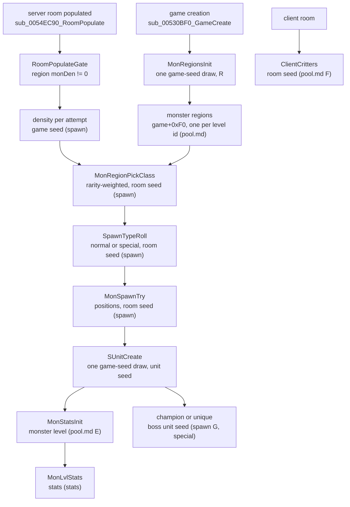

# Monsters: from a level's pool to a finished monster

## Purpose

This subsystem specifies how the game decides which monsters exist: which classes each level can host,
where and how many are placed, which become champions, uniques or superuniques, and what level and stats
they get. Four stages are written so far: the level pools with the monster level, the random population of
a room, the special monsters (mods, minions, superuniques, names), and the stats each monster is created with. This page is the
map: the order of the stages, which seed each one steps, and what each passes on. Primitives are those of
[rng](../rng/README.md); seed owners are in [rng/seeds](../rng/seeds.md).

## Files

| File | Covers | Status |
|---|---|---|
| [pool.md](pool.md) | the monster regions built at game creation (pool pick, appearance sets, copied Levels fields), the monster level rule, client critters | reviewed |
| [spawn.md](spawn.md) | random population of a room: gate, density, class pick, normal or special, groups, champion packs, unique and MonStats minions, placement | reviewed |
| [special.md](special.md) | champion or unique mods, mod handlers, unique minions and `xfer`, pack members, superuniques, MonPlace 2 and 3, the client name roll | reviewed |
| [stats.md](stats.md) | hit points, defence, experience, resistances and block from `MonStats` × `MonLvl` per difficulty, the player count (at creation only), the classic nightmare/hell factors, the stat callback, MonProp, the mod handlers' stat effects | reviewed (plan 0025, 2026-10-15) |

## Data flow

- [C] **The pools come first and from the game seed.** All monster regions are built once at game creation,
  from a region seed `R` seeded by the game seed's first draw after `GAME_InitSeeds`; they depend on the game
  seed and the difficulty only. The nightmare and hell side holds for games whose difficulty byte was forced
  before the build (an ADR-0003 intervention, [pool.md § C](pool.md#c-the-pool-pick-sub_005475e0_monregionpool) step
  note C1) and for natural nightmare and hell games, seed 1, expansion and classic, which build the same regions.
  (fn:sub_00547D20_MonRegionsInit@0x00547D20, fn:sub_005479C0_MonRegionsBuild@0x005479C0,
  run:2026-10-12-mon-pool, run:2026-10-12-mon-pool-p2; [pool.md § A](pool.md#a-the-region-seed-sub_00547d20_monregionsinit))
- [C] **Population draws from three seeds.** The server pass that runs on a room's first activation draws its
  class picks, type roll and positions from the active room's seed (`+0x6C`), its density rolls and one step per
  creation from the game seed, and group sizes, minion counts and the champion roll from the leader's or boss's
  unit seed. The type roll only decides normal or special; champion or unique comes later, from the boss's seed.
  (fn:sub_0054EC90_RoomPopulate@0x0054EC90, fn:sub_005BDE80_MonRegionPickClass@0x005BDE80,
  fn:sub_005BE020_SpawnTypeRoll@0x005BE020, run:2026-10-13-mon-spawn; [spawn.md](spawn.md))
- [I] **Each monster unit is seeded from the game seed.** Server monsters are created by the server unit
  constructor, one game-seed draw each. (fn:sub_00555230_SUnitCreate@0x00555230, [rng/seeds](../rng/seeds.md) step 7a)
- [C] **The monster level is set at unit creation**, from the class and the level the monster is created in,
  before the stats are read from `MonLvl.txt`: MonStats `Level*`, or the area's `MonLvlEx` in expansion nightmare
  and hell. The logged cases are listed in pool.md § E; `boss` and a few hireling and classic-normal paths stay inferred
  there. (fn:sub_00573CB0_MonStatsInit@0x00573CB0, fn:sub_006538A0_MonLvlStats@0x006538A0, run:2026-10-12-mon-pool-p2;
  [pool.md § E](pool.md#e-the-monster-level-sub_00573cb0_monstatsinit))
- [C] **Stats are set once, at creation.** `MonStatsInit` draws the hit points on the unit seed, scales them, defence
  and experience by the `MonLvl` row of the level and the player count of that moment, and the special-mod handlers then
  add their bonuses. A later `/players` change does not rescale a live monster. (fn:sub_00573CB0_MonStatsInit@0x00573CB0,
  fn:sub_00573930_MonPlayerBonus@0x00573930, run:2026-10-15-mon-stats; [stats.md](stats.md))
- [C] **Critters are not population.** They are a client-side draw per client room from the room seed, and
  they never read the pool. (fn:sub_0046C460_ClientCritters@0x0046C460, run:2026-10-12-mon-pool;
  [pool.md § F](pool.md#f-critters-sub_0046c460_clientcritters-not-from-the-pool))

## Entry points

| When | Function | Tag |
|---|---|---|
| Game created: all monster regions built | fn:sub_00547D20_MonRegionsInit@0x00547D20 ([pool.md](pool.md)) | [C] |
| Server room populated | fn:sub_0054EC90_RoomPopulate@0x0054EC90 → fn:sub_0054EBC0_RoomPopulateGate@0x0054EBC0 ([spawn.md](spawn.md), run:2026-10-13-mon-spawn) | [C] |
| Spawn class picked | fn:sub_005BDE80_MonRegionPickClass@0x005BDE80 ([spawn.md § D](spawn.md#d-the-class-pick), run:2026-10-13-mon-spawn) | [C] |
| Normal or special decided (1 folded into 2) | fn:sub_005BE020_SpawnTypeRoll@0x005BE020 ([spawn.md § E](spawn.md#e-the-type-roll-and-the-1--2-fold), run:2026-10-13-mon-spawn) | [C] |
| Champion or unique decided, on the boss's unit seed | fn:sub_005A0760_SpecialModsRoll@0x005A0760 ([spawn.md § G](spawn.md#g-the-special-group-boss-champion-or-unique), [special.md § A](special.md#a-champion-or-unique), run:2026-10-13-mon-spawn, run:2026-10-14-mon-special) | [C] |
| Superunique placed from a preset | fn:sub_005A49B0_SuperUniqueSpawn@0x005A49B0 ([special.md § G](special.md#g-superuniques), run:2026-10-14-mon-special) | [C] |
| Server monster initialised: region entry, level, stats | fn:sub_00574250_MonsterInit@0x00574250 → fn:sub_00573CB0_MonStatsInit@0x00573CB0 ([pool.md § E](pool.md#e-the-monster-level-sub_00573cb0_monstatsinit), run:2026-10-12-mon-pool-p2) | [C] |
| Client room's critters | fn:sub_0046C460_ClientCritters@0x0046C460 ([pool.md § F](pool.md#f-critters-sub_0046c460_clientcritters-not-from-the-pool)) | [C] |

## Downstream

- `items/tc` reads a monster's class and level stat when it drops ([items/tc](../items/tc.md)).
- [spawn.md](spawn.md) starts from the regions of [pool.md](pool.md#outputs). [special.md](special.md) starts from the
  specials it creates ([spawn.md § G](spawn.md#g-the-special-group-boss-champion-or-unique)), and [stats.md](stats.md)
  from the unit seed after `SUnitCreate` ([spawn.md § J](spawn.md#j-creation-and-the-unit-seed)).
- [stats.md](stats.md) starts from the level set in [pool.md § E](pool.md#e-the-monster-level-sub_00573cb0_monstatsinit).

## Open questions

- ~~Monster stats and the effects of the special mods~~ specified in [stats.md](stats.md) from
  [monsters/0004](../../findings/monsters/0004-stats.md) (plan 0025).
