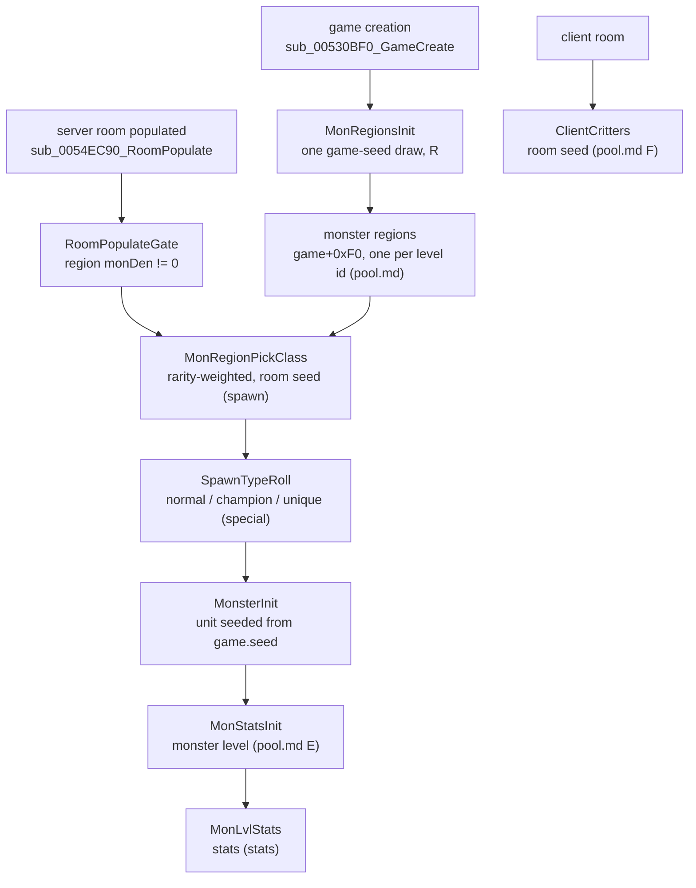

# Monsters: from a level's pool to a finished monster

## Purpose

This subsystem specifies how the game decides which monsters exist: which classes each level can host,
where and how many are placed, which become champions, uniques or superuniques, and what level and stats
they get. Only the first stage, the level pools and the monster level, is written so far. This page is the
map: the order of the stages, which seed each one steps, and what each passes on. Primitives are those of
[rng](../rng/README.md); seed owners are in [rng/seeds](../rng/seeds.md).

## Files

| File | Covers | Status |
|---|---|---|
| [pool.md](pool.md) | the monster regions built at game creation (pool pick, appearance sets, copied Levels fields), the monster level rule, client critters | draft |
| `spawn.md` | random population: density, the weighted class pick, packs and minions, placement | not started |
| `special.md` | champion/unique roll, `umon`, superuniques, mod rolls, name rolls | not started |
| `stats.md` | `monsters/stats`: hit points, damage, defence, experience from `MonLvl.txt` per difficulty and player count | not started |

## Data flow

- [C] **The pools come first and from the game seed.** All monster regions are built once at game creation,
  from a region seed `R` seeded by the game seed's first draw after `GAME_InitSeeds`; they depend on the game
  seed and the difficulty only. (fn:sub_00547D20_MonRegionsInit@0x00547D20, fn:sub_005479C0_MonRegionsBuild@0x005479C0,
  run:2026-10-12-mon-pool; [pool.md § A](pool.md#a-the-region-seed-sub_00547d20_monregionsinit))
- [I] **Population draws from the room.** The per-room population pass steps the active room's seed
  (`+0x6C`): the weighted class pick is `RangeB(roomSeed, raritySum) + 1` over the region's entries.
  (fn:sub_0054EC90_RoomPopulate@0x0054EC90, fn:sub_005BDE80_MonRegionPickClass@0x005BDE80,
  [monsters/0001 §6](../../findings/monsters/0001-level-pool.md#6-who-reads-the-pool-named-for-monstersspawn))
- [I] **Each monster unit is seeded from the game seed.** Server monsters are created by the server unit
  constructor, one game-seed draw each. (fn:sub_00555230_SUnitCreate@0x00555230, [rng/seeds](../rng/seeds.md) step 7a)
- [I] **The monster level is set at unit creation**, from the class and the level the monster is created in,
  before the stats are read from `MonLvl.txt`. (fn:sub_00573CB0_MonStatsInit@0x00573CB0, fn:sub_006538A0_MonLvlStats@0x006538A0;
  [pool.md § E](pool.md#e-the-monster-level-sub_00573cb0_monstatsinit))
- [C] **Critters are not population.** They are a client-side draw per client room from the room seed, and
  they never read the pool. (fn:sub_0046C460_ClientCritters@0x0046C460, run:2026-10-12-mon-pool;
  [pool.md § F](pool.md#f-critters-sub_0046c460_clientcritters-not-from-the-pool))

## Entry points

| When | Function | Tag |
|---|---|---|
| Game created: all monster regions built | fn:sub_00547D20_MonRegionsInit@0x00547D20 ([pool.md](pool.md)) | [C] |
| Server room populated | fn:sub_0054EC90_RoomPopulate@0x0054EC90 → fn:sub_0054EBC0_RoomPopulateGate@0x0054EBC0 (`monsters/spawn`) | [I] |
| Spawn class picked | fn:sub_005BDE80_MonRegionPickClass@0x005BDE80 (`monsters/spawn`, `monsters/special`) | [I] |
| Normal / champion / unique decided | fn:sub_005BE020_SpawnTypeRoll@0x005BE020 (`monsters/special`) | [I] |
| Server monster initialised: region entry, level, stats | fn:sub_00574250_MonsterInit@0x00574250 → fn:sub_00573CB0_MonStatsInit@0x00573CB0 ([pool.md § E](pool.md#e-the-monster-level-sub_00573cb0_monstatsinit)) | [I] |
| Client room's critters | fn:sub_0046C460_ClientCritters@0x0046C460 ([pool.md § F](pool.md#f-critters-sub_0046c460_clientcritters-not-from-the-pool)) | [C] |

## Downstream

- `items/tc` reads a monster's class and level stat when it drops ([items/tc](../items/tc.md)).
- `monsters/spawn` and `monsters/special` start from the regions of [pool.md](pool.md#outputs) and the
  consumers named there.
- `monsters/stats` starts from the level set in [pool.md § E](pool.md#e-the-monster-level-sub_00573cb0_monstatsinit).

## Open questions

- [L] Spawn, special monsters and stats have no finding yet beyond the readers named in
  [monsters/0001 §6](../../findings/monsters/0001-level-pool.md#6-who-reads-the-pool-named-for-monstersspawn); each
  needs its own plan.
