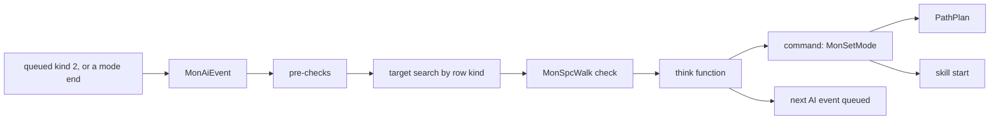
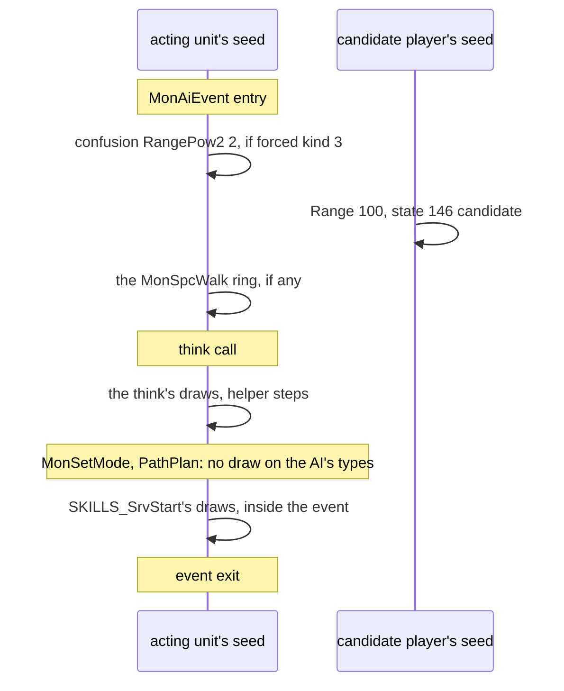
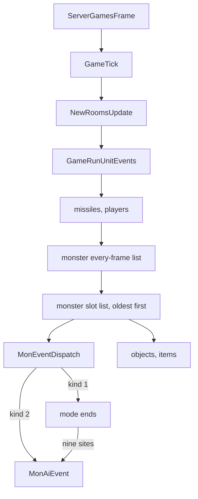
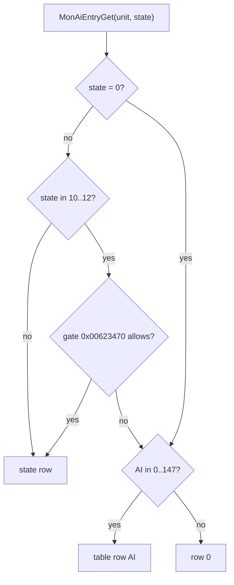
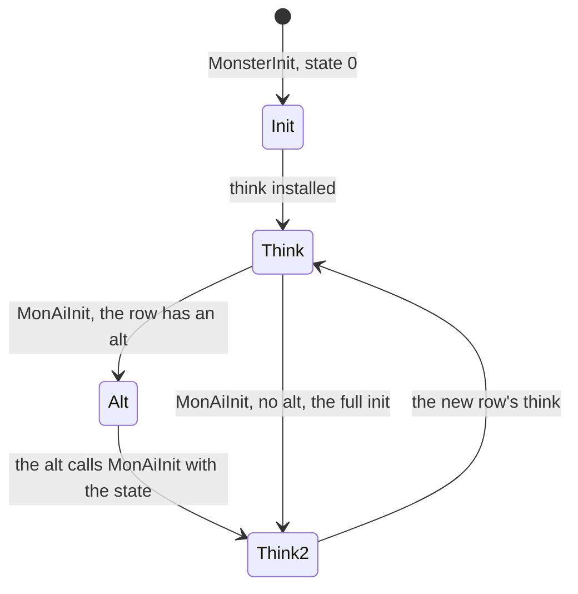

# Monster AI: the tick, the AI state, the event kinds and their seeds

## Purpose

A monster, a summon or a hireling does not think on every frame. It has an **AI event**, monster event kind 2, which
comes due on a frame or is called at a mode's end. One event runs the pre-checks, the target search, a walk check and
then the unit's **think function**, chosen from the AI table by MonStats `AI` and the unit's AI state. The think draws on
the acting unit's seed and gives one command: a mode, a skill, a path request, or a wait until the next event.

This page is the tick, the AI's clock, the table and its dispatch, the state a unit carries, the event kinds with their
seeds and how far each is evidenced. [machinery](machinery.md) is the target search, the command, the path request, the
following, and the think function of each of the 18 tier AIs. The other rows of the table and the 18 state rows are
[the catalogue](catalogue.md), one entry each.

Boundaries of this spec: the mode's frames are [anim/timing](../../anim/timing.md)'s; the skill behind a command is
[skills/dispatch](../../skills/dispatch.md)'s; the planners behind a path request are
[path/search](../../path/search.md)'s, reading the live grid; the composed frame is [sim/frame](../../sim/frame.md)'s.



## Entry points

| When | Function | Tag |
|---|---|---|
| A kind-2 event comes due in the monster slot pass | fn:sub_005B1740_MonAiEvent@0x005B1740, from `g_MonEventFuncs[2]` (data:g_MonEventFuncs@0x006E2490) | [I] |
| A mode ends, nine direct calls of the same slot | fn:sub_005A8030_MonModeEndGeneric@0x005A8030 (seven), fn:sub_005A8330_MonModeEndToS1@0x005A8330, fn:sub_005A83E0_MonModeEndToS1b@0x005A83E0 | [I] |
| A monster is created, or its AI state changes | fn:sub_005B0E00_MonAiInit@0x005B0E00, first from fn:sub_00574250_MonsterInit@0x00574250 | [I] |

## Inputs

### Tables

| Anchor | Used for |
|---|---|
| tbl:MonStats.txt:AI | the row of the AI table, s16 at `+0x1E` |
| tbl:MonStats.txt:aidel | the delay after a neutral start, u8 at `+0x4F` plus difficulty under one condition (C1) |
| tbl:MonStats.txt:aidist | the search range, u8 at `+0x52` plus difficulty |
| tbl:MonStats.txt:aip1 | `aip1..8`, the think function's parameters, s16 at `+0x56 + 6(K−1) + 2·difficulty` |
| tbl:MonStats.txt:opendoors | whether a unit opens doors (F2) |
| tbl:MonStats.txt:isMelee | the `MonSpcWalk` check (F4) |
| tbl:Levels.txt:MonSpcWalk | the same check |
| tbl:Skills.txt:auratargetstate | which curse sets which AI state (E5) |
| [MonAI](../../../tables/MonAI.md) | the index of the 148 rows and which MonStats records name them |

### Runtime state

| State | Type | Source |
|---|---|---|
| the frame `T` | i32, `Game+0xA8` | `GameTick` |
| difficulty `d` | u8, `Game+0x6D` | the game |
| the unit's seed | the two words `Unit+0x20/+0x24` ([rng](../../rng/README.md)) | [rng/seeds](../../rng/seeds.md) |
| `AiCtl` | 0x40 bytes at `MonsterData+0x28` | § E |
| `MonPathCtl` | 0x24 bytes at `MonsterData+0x2C` | [machinery § D](machinery.md#d-the-path-request) |
| `AiCtx` | 9 dwords on `MonAiEvent`'s stack | § B |

### Constants

| Name | Value | Anchor | Tag |
|---|---|---|---|
| table rows | 148 of 16 bytes, as bytes ([MonAI](../../../tables/MonAI.md#the-ai-table-in-the-image)) | data:g_MonAiTable@0x0073CA18 | [C] |
| state rows | 18 of 16 bytes | data:g_MonAiStateRows@0x0073D358 | [I] |
| default `aidel` | 15 when the cell is 0 | fn:sub_005A73E0_MonModeStartNeutral@0x005A73E0 | [I] |
| stunned delay | 45 under state 21 | 0x005A7419 | [I] |

## Algorithm

### A. The event kinds and their seeds



| Event | Entry | Draws | Seed | Tag |
|---|---|---|---|---|
| events that end before the think | `MonAiEvent`: pre-check, search, `MonSpcWalk` | § F, [machinery § A](machinery.md#a-target-search) | acting unit; a candidate player for state 146 | [C] 14 645 of 32 324 logged events reach the think call and 17 679 end before it, with `AiCtl.state` 0 at all of them (run:2026-11-03-ai, 0x005B186F, 0x005B1876) |
| a decision | the think call at `0x005B186F` | the entry's own, in [machinery § T](machinery.md#t-the-tier-ais) | acting unit | [C] every logged point (entry, think call, boundaries, `MonSetMode`, `PathPlan`, skill start, exit) follows the previous one by whole steps of the acting unit's own seed, 0 to 7 steps, 0 violations in 14 645 decisions; the search's state-146 candidate draw is on another seed and is not logged (run:2026-11-03-ai) |
| the path plan | `PathPlan` under `MonSetMode` | none on the AI's types | — | [C] the unit seed is unchanged on all 9 618 plan calls with an exit line inside decisions ([machinery D6](machinery.md#d-the-path-request)), path types 2, 5, 6, 7, 13, 15; type 1 was not requested in the run (run:2026-11-03-ai, fn:sub_00649970_PathPlan@0x00649970) |
| a skill start | `SKILLS_SrvStart` inside the decision | [skills/dispatch § P](../../skills/dispatch.md#p-draws-and-seeds-per-event-kind) | acting unit | [C] 899 skill starts of the decision's unit between the think call and the exit, each entered at the decision's last logged seed advanced 0 to 12 steps (0 steps 791 times) and each exiting with the event's exit seed (run:2026-11-03-ai, fn:SKILLS_SrvStart@0x0056F640) |
| a mode's frames | [anim/timing § N](../../anim/timing.md#n-draws-and-seeds-per-event-kind) | none of the animation's but an object's start | — | [I] (fn:sub_005A7C20_MonSetMode@0x005A7C20) |

- A1. [C] **The commands logged at the AI's sites of `MonSetMode`** are led by modes 2 (WL) 6 133, 15 (RN) 1 533, 4 (A1) 712,
  5 (A2) 425, 14 (SQ) 289, 8 (S1) 375, with path type byte 101 for every-frame modes and 100 otherwise; modes 9 (S2) 58, 11 (S4) 53,
  7 32, 10 (S3) 18 and 1 (NU) 4 also occur.
  (run:2026-11-03-ai, fn:sub_005A7C20_MonSetMode@0x005A7C20)
- A2. [C] **Decision pairs on one seed.** A decision's exit seed equals the same unit's next decision's entry seed in
  12 368 pairs of the first run, 9 687 of them with draws. Over the three kept batches every tier AI but two has at
  least 20 drawing pairs: Fetish has 22, and the other 15 have 58 or more. (run:2026-11-03-ai, run:2026-11-04-ai-r5)
- A3. [I] **Chaining short by name:** Andariel has 8 drawing pairs of the 20 asked and BatDemon 1 of 300 pairs, so the
  chaining of those two kinds stays a reading. (run:2026-11-04-ai-r5)
- A4. [C] **The H1 gaps, new ones.** With the AI logger beside the skills logger, 41 of the 49 monster gaps of six
  replayed sessions close: every entry seed on the way agrees with the walking seed, and the next skill event starts
  inside the unit's own decision, at 0 steps from that decision's last boundary line. All 41 are AI row 13, and the
  resumed model reproduces every decision between the two events (91). Logged paths only: the seed movement is the
  decision's, and the callee that starts the skill is a boundary. (run:2026-11-04-h1, fn:sub_005F1440_AiFallenShaman@0x005F1440)
- A5. [I] **The rest of H1.** The other 8 stop at an `AD0` with the monster as attacker, its seed 1 to 4 steps past the
  walking seed, and which draws those are is not examined. The 331 gaps of plan 0045 cannot be re-walked, as their logs
  hold no AI line and a replay does not reproduce them; they have the same shape, which is all their logs can say: 330
  are of classes 58 and 59, and the first disagreement is `MAS0` in 257 and `AD0` in 70. The frame model's walk re-chains none of
  the 331 ([frame/0004 § 6](../../../findings/frame/0004-order-on-kept-logs.md#6-the-resynchronised-entries), run:2026-11-03-frame-order).
  (run:2026-11-04-h1, [ai/0018 § 6](../../../findings/ai/0018-phase2-third-run.md#6-h1-the-331-gaps-both-loggers))
- A6. [C] **A summon's owner skill damage,** for class 419 and skill 221 at level 20 in sessions with one player, is
  [skills/dispatch § M](../../skills/dispatch.md#m-monster-skill-use) (M2), not restated here. (run:2026-11-04-ai-resume, fn:sub_0056E050_MonOwnerSkillDamage@0x0056E050)

### B. The tick



```
B1. the frame:                                                    [I] (fn:sub_0052D870_GameTick@0x0052D870, 0x0052D8F2)
      GameTick increments Game+0xA8, runs its act passes and NewRoomsUpdate,
      then GameRunUnitEvents, the client room sync and the timers.
B2. the pass:                                                     [I] (fn:sub_005414D0_GameRunUnitEvents@0x005414D0, 0x005414EE, 0x00541589)
      write frame & 63 into the event control
      for each type in missiles, players, monsters, objects, items:
        run its every-frame list, with no frame test
        run its slot list: records whose frame = Game+0xA8, oldest first, each freed after its run
B3. MonEventDispatch(kind, a, b):                                 [I] (fn:sub_005A7F80_MonEventDispatch@0x005A7F80)
      if the unit has state 1 (freeze) and is alive and kind not in {3, 4, 5, 8, 12}: drop the event
      call g_MonEventFuncs[kind]
B4. MonAiEvent(game, unit):                                       [I] (fn:sub_005B1740_MonAiEvent@0x005B1740, 0x005B1746, 0x005B186F)
      ctx.ctl ← MonsterData+0x28;  ctx+0x04..+0x18 ← 0
      ctx+0x1C ← the MonStats record of Unit+0x04
      ctx+0x20 ← the MonStats2 record of MonStats +0x18
      if either record is missing: return
      if MonAiPreChecks(...) ≠ 0: return                          ; § F
      if MonAiTargetByKind(...) ≠ 0: return                       ; § D
      if MonSpcWalkCheck(...) ≠ 0: return                         ; § F
      AiCtl.think(game, unit, &ctx)                               ; IsBadCodePtr test first, fatal
```

- B1a. [I] Every frame is run by `ServerGamesFrame` over its 1 024 game slots; `GameTick`'s other caller is unreached.
  The AI event is always queued at a frame (`T + n`, n ≥ 1), so it runs in the monster slot pass, after every monster's
  every-frame event of that frame, in the order the events were queued. (fn:sub_0052FC20_ServerGamesFrame@0x0052FC20,
  0x0052FD19, fn:sub_005645E0_GameTickAlt@0x005645E0, fn:sub_00541060_MonEventsRun@0x00541060, fn:sub_005416B0_EventQueueAt@0x005416B0)
- B3a. [I] **A frozen monster loses a due AI event**, and `COMBAT_ApplyFreeze` queues a new one at `T + length + 1`.
  (fn:COMBAT_ApplyFreeze@0x0057B230, 0x0057B3DC)
- B5. [I] **The nine direct calls** are all mode ends: seven in `MonModeEndGeneric` (0x005A80F5, 0x005A813F, 0x005A818E,
  0x005A81ED, 0x005A822E, 0x005A8267, 0x005A82AD) and one each in `MonModeEndToS1` (0x005A83D1) and `MonModeEndToS1b`
  (0x005A8481), each skipped while frozen and alive. There the AI runs inside the mode-end event of that frame, not from
  the queue. The event's two arguments are not read. (fn:sub_005A8030_MonModeEndGeneric@0x005A8030)
- B6. [C] `AiCtx`'s fields as the first-boundary comparison reads them: the think call at 0x005B186F is where a decision
  begins, and its `ctx` words, the control words and the block a pointer argument addresses are compared with the model.
  (run:2026-11-03-ai, 0x005B186F, struct:AiCtx+0x14, struct:AiCtl+0x14)

### C. When the next AI event comes

```
C1. MonModeStartNeutral (mode NU, and MonSetMode's refusal fallback):      [I] (fn:sub_005A73E0_MonModeStartNeutral@0x005A73E0, 0x005A7419, 0x005A747D)
      if UnitEventFirstFrame(2) ≤ T:                     ; no AI event pending later than now
        if state 21 (stunned): n ← 45
        else:
          a: u8 ← MonStats+0x4F
          if Game+0x6A ≠ 0 or Game+0x74 ≠ 0: a ← the byte at MonStats+0x4F + difficulty
          n ← a, or 15 when a = 0
        queue kind 2 at T + n
C2. MonAiIdle(n):                                                          [I] (fn:sub_005DE080_MonAiIdle@0x005DE080)
      mode NU unless already NU;  cancel kind 2;  queue kind 2 at T + max(n, 1)
C3. MonAiDelay(n):                                                         [I] (fn:sub_005DE0F0_MonAiDelay@0x005DE0F0)
      cancel kind 2;  queue kind 2 at T + max(n, 1);  the mode is unchanged
C4. MonAiDelayEarlier(n):                                                  [I] (fn:sub_005DE130_MonAiDelayEarlier@0x005DE130)
      only when nothing is pending, or the pending one is due now, or it is
      due at or after T + n:  cancel kind 2;  queue kind 2 at T + max(n, 1)
```

- C5. [I] **The other queueing sites**, of 30 in all: `MonAiTargetOrWait` (`T + 20`); `MonKnockbackEnd` (`T + 1`,
  `T + 15`), 0x005A74E0 (`T + 15`), freeze (`T + length + 1`), 0x0057B170 (`T + ebx`), 0x0058594B (`T + eax + 1`),
  0x005A3A6C (`T + 51`); `SpawnOwnedMonster` (`T + 25`), `RoomInactiveUnitsRestore` (a saved delay), 0x00573780 (`T + 2`,
  twice), `UnitInteract` and 0x0054CA10 (`T + 1`); `SkillReviveDo` (`T + 25`), `SummonFinish` (`T + 15`), 0x005D1320 and
  `SkillDo126ImpInferno` (`T + 13`), `SkillDo44BladeSentinel`, `SkillDo71Taunt`, `MonFleeFrom` (`T + 1`), `SkillDo49Shadow`
  and `SkillDo16Valkyrie` (`T + 20`), and two AI helpers 0x005E8140, 0x005E8340 (`T + 1`). 66 sites cancel kind 2.
  (fn:sub_005A8520_MonKnockbackEnd@0x005A8520, fn:sub_0056D940_SpawnOwnedMonster@0x0056D940, 0x005417D0)
- C6. [I] **What this means.** A monster that commands a mode usually gets its next AI event from that mode's end
  (`MonModeStartNeutral` at `T + aidel`, or a direct call at one of the nine mode ends); an idle monster with no target
  gets it from the idle delay of its row kind (D3); an AI function may also queue it while a mode runs (`MonAiDelay`),
  and then the AI's next command replaces that mode. (fn:sub_005DE890_MonAiTargetOrIdle@0x005DE890, fn:sub_005A7C20_MonSetMode@0x005A7C20)
- C7. [I] **What ends a mode, from the AI's side.** The AI commands only from its event, and every command goes through
  `MonSetMode`, which replaces the current mode. A mode ends, from this side, (a) when the AI event fires during it, an
  event queued by `MonAiDelay`, `MonAiDelayEarlier`, `MonAiTargetOrWait`, a skill or a restore while the mode runs, and
  the think commands, or (b) at its own end, whose neutral start queues the next AI event. (fn:sub_005DE0F0_MonAiDelay@0x005DE0F0,
  fn:sub_005A73E0_MonModeStartNeutral@0x005A73E0, [anim/timing](../../anim/timing.md))

### D. The AI table and its dispatch



```
D1. MonAiEntryGet(unit, state: u32) → row:                                 [I] (fn:sub_005B15D0_MonAiEntryGet@0x005B15D0, 0x005B15E5, 0x005B1645, 0x00623470)
      if state ≠ 0 and (state not in 10..12 or the gate allows):
        return g_MonAiStateRows + 16·state                ; no bound on state here
      ai: i16 ← MonStats[class].AI
      return g_MonAiTable + 16·ai   when 0 ≤ ai < 148,  else g_MonAiTable
```

- D1a. [C] This row-address map, for states 0–9 and 13–17 and `AI` over the s16 range, matches the emulation in all 554
  cases; the control without the upper bound fails all 143 cases that separate it. (run:2026-10-27-ai-emu, `entry`)
- D1b. [I] **The gate for states 10–12** (`0x00623470`) is true for a class allowed by `MonModeAllowed` with MonStats
  `+0x0C` bit 6 (`boss`) clear and `+0x0E` bit 0 set; when false, the lookup falls through to the class's row.
  (0x00623470, tbl:MonStats.txt:boss)
- D2. [I] **A row** is `{+0 searchKind, +4 init, +8 think, +C alt}`. It is dispatched in two steps: `MonAiInit` copies
  `think` (or `alt`) into `AiCtl.think`; on each AI event the `searchKind` of the row for the stored state runs the
  target search, then `AiCtl.think(game, unit, &ctx)` runs. 147 distinct think functions over 148 rows: rows 106 and
  143 share theirs. 146 rows are named by a MonStats row; `None` and `ShadowMasterNoInit` are not. Rows 0 (`ret 4`) and 1
  (`Idle`: with a room, `MonAiIdle(200)`) are bare. (data:g_MonAiTable@0x0073CA18, fn:sub_005B0CC0_AiNone@0x005B0CC0,
  fn:sub_005B0CD0_AiIdle@0x005B0CD0, tbl:MonStats.txt:AI)
- D3. [I] **The row kind** (`MonAiTargetByKind`, a switch on `+0` of `MonAiEntryGet(unit, AiCtl.state)`; fn:sub_005B1650_MonAiTargetByKind@0x005B1650):

  | Kind | Search | The think runs | No target |
  |---|---|---|---|
  | 0 | none | always | — |
  | 1 | `MonAiTargetOrIdle` | only with a target | the ring walk or the idle below, event ends |
  | 2 | `MonAiFindTarget` | either way | — |
  | 4 | `MonAiTargetOrWait` | only with a target | the ring walk or `T + 20`, event ends |
  | 5 | the same search | either way | — |
  | 3, above 5 | | stops the event (no stock row) | |

  The target goes to `ctx+0x08`, the distance to `ctx+0x14`, the melee test to `ctx+0x18`. Stock: kinds 0 (26 rows), 1
  (104), 2 (16), 4 (1), 5 (1). (fn:sub_005B1650_MonAiTargetByKind@0x005B1650, struct:AiCtx+0x08, fn:sub_005DD7F0_MonAiFindTarget@0x005DD7F0)
- D4. [I] **No target, kind 1** (`MonAiTargetOrIdle`), each ring walk only if `MonModeAllowed` (fn:sub_005DE890_MonAiTargetOrIdle@0x005DE890):

  ```
  if MonsterData+0x54 ∈ {3, 19}, or the unit's cell fails the collision pattern test (mask 0x40):
    MonAiWanderRing(5)
  else: d ← the nearest checked player head's distance
    MonAiIdle(10)      when d < 25
    MonAiIdle(d − 10)  when 25 ≤ d < 35
    MonAiIdle(25)      when d ≥ 35
  ```

  Kinds 4 and 5 (`MonAiTargetOrWait`): the same collision ring walk, else the AI event at `T + 20` with the mode
  unchanged. (fn:sub_005DE890_MonAiTargetOrIdle@0x005DE890, fn:sub_005DE9D0_MonAiTargetOrWait@0x005DE9D0,
  fn:sub_005DD2B0_AiMonState3or19@0x005DD2B0, 0x005DE9C8)

### E. The AI state on the unit



```
E1. MonAiInit(game, unit, ctl, state: i32):                                [I] (fn:sub_005B0E00_MonAiInit@0x005B0E00, 0x005B0E4D, 0x005B0E77, 0x005B0E99, 0x005B0EA5, 0x005B0F2D)
      if game, unit or ctl is null, or state ≥ 18 (signed), or unit is no monster: return
      if the class is at or past the MonStats count: state ← 1
      if AiCtl.think ≠ 0
         and AiCtl.think = think of MonAiEntryGet(unit, AiCtl.state)
         and that row has an alt:
        AiCtl.state ← state;  AiCtl.think ← alt;  return
      clear AiCtl+0x14, +0x18, +0x1C;  free the parameter records
      r ← MonAiEntryGet(unit, state)
      r.init(game, unit, &blk)     ; blk laid out as an AiCtx: ctl, six zeros, MonStats, MonStats2;
                                   ; returns without setting anything when a record is missing
      AiCtl.state ← state
      AiCtl.think ← r.think, or 0x005B0CD0 when 0
```

- E1a. [I] A unit with state 54 takes a fatal path at `0x005B0E14`. The `< 18` test is signed, so a negative argument
  passes it and would index below the second table; no stock caller found passes one. Writes to `AiCtl+0x00` other than
  `MonAiInit`'s two stores are not scanned. (0x005B0E14, 0x005B0E94, 0x005B0F2B, struct:AiCtl+0x00)
- E2. [I] **The alt as a one-event bridge.** A `MonAiInit` call while `AiCtl.think` is the current row's think and that
  row has an `alt` sets the new state and installs the `alt`; the `alt` then calls `MonAiInit` with that state while
  `AiCtl.think` is the `alt`, so the full init runs and installs the state's think. (fn:sub_005E5280_AiHireableAlt@0x005E5280,
  0x005E52AB, [ai/0007 § 2.5](../../../findings/ai/0007-hirelings.md#25-the-alt-and-states-5-and-6))
- E3. [I] **The blocks.** `MonsterInit` allocates into `MonsterData+0x28/+0x2C/+0x30` the `AiCtl` (0x40 bytes, zeroed,
  `+0x0C = −1`, `+0x10 = 1`, `+0x2C = −1`, `+0x30 = 1`), the `MonPathCtl` (0x24 bytes, zeroed) and a third (0x00572BA0),
  then calls `MonAiInit(ctl, 0)`. (fn:sub_00574250_MonsterInit@0x00574250, 0x00574307, fn:sub_0058EBC0_AiCtlAlloc@0x0058EBC0,
  fn:sub_005A6490_MonPathCtlAlloc@0x005A6490)
- E4. [I] **`AiCtl`'s fields** (struct:AiCtl+0x08).

  | Offset | Width | Meaning |
  |---|---|---|
  | `+0x00` | i32 | the state |
  | `+0x04` | u32 | the think |
  | `+0x08` | u16 | flags: `0x08` set by the search when it finds a target and the searcher is not alignment 2; `0x40` set by `MonAiMove`'s flag 1 on a refused move, a one-shot that forces the search's line test on, cleared by the search ([machinery A2](machinery.md#a-target-search)); `0x10` `MonAiBossSightPause`'s once only; `0x20` the unique-mod teleport flag; `0x01`, `0x02` set by the owner functions (0x0058F05F, 0x0058F073, 0x0058F59E, 0x0058F5AC), not followed here |
  | `+0x0C`, `+0x10` | i32 | a unit to keep near and its type ([machinery § E](machinery.md#e-following)) |
  | `+0x14`, `+0x18`, `+0x1C` | i32 | AI variables, `v14`, `v18`, `v1C` in [machinery § T](machinery.md#t-the-tier-ais) |
  | `+0x20`, `+0x24` | ptr | the parameter records |
  | `+0x28`..`+0x34` | | the owner and the minion list |

  (struct:AiCtl+0x08, struct:AiCtl+0x2C, fn:sub_0058F030_MonSetOwner@0x0058F030, fn:sub_0058F380_MonGroupForEach@0x0058F380)
- E5. [I] **The state rows and who sets them.** `MonAiInit` has 33 direct calls: 21 push an immediate, 12 a register (fn:sub_005B0E00_MonAiInit@0x005B0E00).

  | State | Think | Kind | Setter read |
  |---|---|---|---|
  | 0 | the class's row | the class's | `MonsterInit` and the sites sending a unit back |
  | 1 | fn:sub_005B0CD0_AiIdle@0x005B0CD0 | 0 | `MonAiInit`'s class bound |
  | 2 | 0x005B14E0 | 1 | none (see E7) |
  | 3 | 0x005E5870, init 0x005E5730 | 1 | none (see E7) |
  | 4 | 0x005E52D0, alt 0x005E5280 | 0 | none by an immediate; the table's `Hireable` pair |
  | 5 | 0x005E7AC0 | 0 | `Hireable`, class 271 |
  | 6 | 0x005E7C10 | 0 | `Hireable`, other classes |
  | 7 | 0x005E4CF0 | 0 | none by an immediate; the `NecroPet` think |
  | 8 | 0x005E7DC0 | 1 | none (see E7) |
  | 9 | 0x005E7F80 | 1 | none (see E7) |
  | 10 | 0x005E8020 | 1 | `CloakAreaCb`; a curse with `auratargetstate` 23 |
  | 11 | 0x005E8140, init 0x005E80E0 | 1 | `MonFleeFrom`; a curse with `auratargetstate` 56 |
  | 12 | 0x005E8340 | 0 | a curse with `auratargetstate` 27 |
  | 13 | 0x005E5C50 | 1 | one `SuperUniqueSpawn` case (0x005A4C1A) |
  | 14 | 0x005E2610 | 1 | none (see E7) |
  | 15 | 0x005E1D30 | 1 | `WhipChangeClass` |
  | 16 | 0x005E2D80, init 0x005E2CD0 | 1 | `ImpAttach`, two sites |
  | 17 | 0x005E8020 | 2 | none (see E7) |

  The words of the table are bytes of the image ([MonAI § The second table](../../../tables/MonAI.md#the-second-table-at-0x0073d358-found-at-the-lanea52-review)); what they do is the reading above.
  (data:g_MonAiStateRows@0x0073D358, fn:sub_005C34B0_CurseSetAiState@0x005C34B0, fn:sub_005DDD00_MonFleeFrom@0x005DDD00,
  fn:sub_005D18E0_ImpAttach@0x005D18E0, fn:sub_005C35C0_CurseApplyCb@0x005C35C0, 0x005D6612, 0x005D1EC0)
- E6. [C] **States seen live.** In the logged lines of the 21 sessions of run:2026-11-03-ai-3 (Normal, 34 980 frames, 27
  caps; 7 539 decisions, 10 721 events) the state is 0 everywhere except two sessions: `s-necro-curse` has 10 in 38
  decisions and 11 in 78, and `s-barb-howl` 11 in 20 decisions and 41 events and 12 in 56 decisions. States 1 to 9 and
  13 to 17 occur in 0 of those lines. Over the 17 logs of run:2026-11-04-ai-r5 the states are 0 in 5 894 decisions, 10 in
  594 and 11 in 36, with 12 absent. This is a statement about those logged lines: the word is read only at a decision or
  an event, and the curses not cast, Nightmare and Hell are outside it. (run:2026-11-03-ai-3, run:2026-11-04-ai-r5, 0x005B186F)
- E7. [I] **"No setter" stays a reading.** No immediate call passes 2, 3, 8, 9, 14 or 17, the register sites give no new
  value, and `SpawnOwnedMonster`'s block `+0x0C` is 0 at all 15 callers; states 4 and 7 meet the same scan. No spec calls
  those rows dead on that.
  (fn:sub_0056D940_SpawnOwnedMonster@0x0056D940, [ai/0013 § 3](../../../findings/ai/0013-batch12.md))
- E8. [I] **Which curse sets which state.** `CurseSetAiState`, `CurseApplyCb`'s one callee, passes 10, 12 or 11 for a
  skill whose `auratargetstate` (Skills `+0x82`) is 23, 27 or 56, else 0. The states' think functions are the catalogue's.
  (fn:sub_005C34B0_CurseSetAiState@0x005C34B0, 0x005C34D8, 0x005C3503, tbl:Skills.txt:auratargetstate)
- E9. [I] **The inactive save and restore** keep, of all this, only the saved point of parameter record 10 for
  `isSpawn`/`isMelee`/`interact`-class rows and three named classes, the owner link of classes 68 and 543, and a
  `MonsterData+0x0E` byte for classes 311 and 312; the state word and think function are rebuilt by `MonAiInit` on
  restore (0x0054286B). See [drlg/lifecycle](../../drlg/lifecycle.md). (fn:sub_00541FE0_InactiveMonAiSave@0x00541FE0,
  fn:sub_00541E20_InactiveMonAiRestore@0x00541E20, fn:sub_005424F0_InactiveMonstersRestore@0x005424F0)
- E10. [I] **Who has which row.** A monster's row is its record's. Every Hireling row's class uses row 61 `Hireable`.
  Summons enter like any monster, by `SpawnOwnedMonster` → `MonAiInit`, and the target lists by `TargetListAttach`: Raise
  Skeleton, Skeletal Mage, the three golems and Valkyrie row 67; Dopplezon and Bone Prison row 1; Bone Wall 84; Hydra 86;
  the druid rows 107 to 112; the assassin rows 101, 102, 104, 105 and 106; Overseer's whip 117; Impregnate 69.
  (fn:sub_0056D940_SpawnOwnedMonster@0x0056D940, 0x0056DA6A, tbl:Skills.txt:summon, tbl:PetType.txt:mclass1, tbl:Hireling.txt:Class)

### F. The pre-checks and the walk check

```
F1. MonAiPreChecks:                                                        [I] (fn:sub_005B10E0_MonAiPreChecks@0x005B10E0)
      if state 21: MonAiIdle(3); stop the event
      if MonAiOpenDoor stops: stop the event
      if MonAiKeepNear stops: stop the event                      ; machinery § E
F2. MonAiOpenDoor:                                                         [I] (fn:sub_005B0F50_MonAiOpenDoor@0x005B0F50, 0x00621A70, 0x00584540)
      for a MonStats opendoors row (+0x0C bit 3) whose cell has collision bit 0x800:
        o ← search kind 8                      ; the nearest object with 0x00621A70 set in mode 0
        if o's Objects record +0x16D ≠ 0: operate it (0x00584540(2, guid)); MonAiIdle(5); stop
F3. MonAiBossSightPause:                                                   [I] (fn:sub_005B1140_MonAiBossSightPause@0x005B1140, 0x005B11B8, 0x005B11CB, fn:sub_00553380_UnitSetEvent@0x00553380)
      for class 250, a champion or unique, or a boss,
      at distance below 20 (unsigned) from a player target, with AiCtl flag 0x10 clear:
        UnitSetEvent(U, 16, 0);  set flag 0x10;  MonAiIdle(20);  stop
F4. MonSpcWalkCheck, only with a target:                                   [I] (fn:sub_005B13E0_MonSpcWalkCheck@0x005B13E0, fn:sub_005DC640_AiApproachPointTest@0x005DC640, tbl:Levels.txt:MonSpcWalk, tbl:MonStats.txt:isMelee)
      MonAiBossSightPause
      UModTeleportTry                                             ; drlg/lifecycle
      for an isMelee class allowed its mode, in a level with MonSpcWalk ≠ 0, the distance above it (unsigned):
        if AiApproachPointTest(unit, target) passes: go on, target unchanged
        else search kind 11:
          a found unit replaces the target and the distance in ctx
          none: MonAiWanderRing(4) and stop
```

## Outputs

One event gives at most one command ([machinery § B](machinery.md#b-the-command)), the unit-seed steps of the entry
([machinery § T](machinery.md#t-the-tier-ais)), changes to `AiCtl` and the next kind-2 record. The entries' pseudocode says
which helper returns and which falls through.

## How far this is evidenced

### G. The first boundary

A **decision** is the call of the think function at `0x005B186F`. Its **first boundary** is the first call, from the think
code, of a function the emulation of that think treats as a boundary (ADR-0021). The comparison is of the first callee,
its call site (the return address), registers, stack words, the seed, the control words and the block a pointer
argument addresses. It stops there: what the callee returns and everything after it is the next section's.

- G1. [C] **Floor, first run.** Over every row logged, 14 645 decisions, 12 614 compared, **0 mismatches** at each
  decision's first boundary; 10 374 are compared with an emulated map and 2 240 with a map read by hand. The 18 tier AIs
  hold 9 823 of the 14 645, per the table below, each at 50 or more. Outside the 0: 2 016 decisions in rows with no model,
  15 Scarab decisions the rev 2 window could not compare and the 17 679 events that end before the think call. (run:2026-11-03-ai, fn:sub_005B1740_MonAiEvent@0x005B1740)
- G2. [C] **Later batches, every row logged.** 7 539 decisions, 6 272 compared, 0 mismatches (run:2026-11-03-ai-3); 6 524 decisions, 4 476
  compared (3 538 modelled, 938 by hand maps), 2 048 in rows with no model, 0 mismatches (run:2026-11-04-ai-r5). Controls
  fail as required in both. (0x005B186F)
- G3. [C] **What the 0 tests.** 3 313 of the 4 476 compared decisions of the rev 6 batch sit in the 16 thinks with one
  first call: they confirm that call and its words, no branch choice. The site control fails every decision by
  construction, and the melee control fails 767 of 4 476 and separates nothing in 16 rows. 1 163 decisions have a choice
  of first call. By row, 9 tier AIs have one outcome there (rows 6, 13, 28, 29, 30, 35, 37, 61, 64) and 7 more than one.
  (run:2026-11-04-ai-r5, 0x005B186F)
- G4. [C] **The logger's own fault, found and bounded.** The first rev 5 logs of the Far Oasis had 36 first-boundary
  mismatches, all Scarab, all the call of `GameFindUnit` at 0x0058F0FF inside a pending `MonsterOwner`, which rev 5's
  pending rule hid. They are exactly the rev 5 decisions with `MonsterOwner` at 0x005F258A; rev 6 logs that one line again,
  and no model changed. On the logs written after the fix the model's words at that call held in all 43 decisions that
  reach it, 24 from a seed that did not exist at the fix. (run:2026-11-04-ai-r5, fn:sub_0058F0D0_MonsterOwner@0x0058F0D0,
  fn:sub_00552F60_GameFindUnit@0x00552F60)
- G5. [I] **A hand map stays a reading.** For rows 6, 13, 28, 29's think and 35, G1's map is the first-callee map read from the
  finding and objdump, not emulated. The logged first call equals it, and that equality is what G1 confirms; the map
  as a rule of the code is not raised. (run:2026-11-04-ai-r5, [ai/0015 § 1](../../../findings/ai/0015-phase2-first-run.md#1-what-is-logged-and-compared))

The per-AI table, decisions and distinct predicted first boundaries of the first run (the logs of `AI_CAP_ROW` 200 per
game; the mercenary dominates because it thinks every few frames):

| Row | Tier AI | Decisions | First boundaries | Map | Tag |
|---:|---|---:|---|---|---|
| 2 | Skeleton | 357 | 4 | emulated | [C] (run:2026-11-03-ai) |
| 6 | Fallen | 1 393 | 1 | by hand | [C] (run:2026-11-03-ai) |
| 9 | Wraith | 70 | 3 | emulated | [C] (run:2026-11-03-ai) |
| 13 | FallenShaman | 363 | 2 (358 and 5) | by hand | [C] (run:2026-11-03-ai) |
| 20 | Scarab | 180 (15 not comparable) | 5 | emulated | [C] (run:2026-11-03-ai) |
| 21 | Mummy | 168 | 5 | emulated | [C] (run:2026-11-03-ai) |
| 22 | GreaterMummy | 71 | 3 | emulated | [C] (run:2026-11-03-ai) |
| 28 | Vampire | 279 | 1 | by hand | [C] (run:2026-11-03-ai) |
| 29 | BatDemon | 115 (110 think, 5 alt) | 1 | think by hand, alt emulated | [C] (run:2026-11-03-ai) |
| 30 | Fetish | 130 | 1 | emulated | [C] (run:2026-11-03-ai) |
| 34 | Andariel | 64 | 5 | emulated | [C] (run:2026-11-03-ai) |
| 35 | CorruptArcher | 95 | 1 | by hand | [C] (run:2026-11-03-ai) |
| 37 | SkeletonBow | 278 | 1 | emulated | [C] (run:2026-11-03-ai) |
| 61 | Hireable | 5 697 | 1 | emulated | [C] (run:2026-11-03-ai) |
| 64 | SkeletonMage | 226 | 1 | emulated | [C] (run:2026-11-03-ai) |
| 67 | NecroPet | 184 | 1 | emulated | [C] (run:2026-11-03-ai) |
| 89 | Megademon | 98 | 1 | emulated | [C] (run:2026-11-03-ai) |
| 125 | BloodLord | 55 | 5 | emulated | [C] (run:2026-11-03-ai) |

A row with one first boundary shows that callee, its registers, stack words and seed, not a branch choice. No think past
that first call, nor any branch a callee's result decides, is claimed by this table. The Fallen map's mode 0 and 12 return
branch was never taken.

### H. Past the first boundary

A resumable model (`tools/ai_resume.py`) walks the code from the think call, taking each boundary call's seed asserted on
entry where known and its logged exit seed and `EAX`. Where a branch reads a value the log does not hold, the model
forks. A model that forks on unknowns cannot fail there, so the number of calls matched is not the evidence.

- H1. [C] **The rule's sentence.** For the decisions of the table below, and those only, on the logged paths only: *in
  each of these decisions no branch the model ran depended on an unknown value; with the logged inputs and the logged
  results of the boundary calls as oracles, the game's code gives exactly one sequence of boundary calls, it equals the
  logged one in callee, call site and every word the model knows, and the code then returns with no further call.* This
  raises no role, no symbol and no reading of a catalogue finding, and the other side of a one-way branch is not
  compared. It assumes that an opaque callee changes no known memory but `Unit+0xC4` and its pointer arguments, and known
  words exclude synthetic stack and path pointers. (run:2026-11-04-ai-resume, run:2026-11-04-ai-resume-flip,
  run:2026-11-04-ai-r5, run:2026-11-04-r72, 0x005B186F)

  | Row | Think | Decisions under the sentence | Calls past the first | Two-way sites failing alone | Logs | Narrowness |
  |---:|---|---:|---:|---|---|---|
  | 13 | FallenShaman | 103 | 361 | 10 of 10 | rev 4 | |
  | 21 | Mummy | 205 | 205 | 4 of 4 | rev 4 | one call past the first in every decision |
  | 30 | Fetish | 316 | 877 | 7 of 7 | rev 4 | 243 of 316 on one path |
  | 89 | Megademon | 77 | 232 | 7 of 7 | rev 4 | |
  | 37 | SkeletonBow | 81 of 86 | | 6 of 6 in the 81 | rev 4 | the 81 only |
  | 64 | SkeletonMage | 79 of 91 | | 12 of 12 in the 79 | rev 4 | the 79 only |
  | 28 | Vampire | 56 | 168 | 15 of 15 | rev 6 | |
  | 29 | BatDemon | 215 | 526 | 8 of 8 | rev 6 | |
  | 35 | CorruptArcher | 111 | 226 | 10 of 10 | rev 6 | |
  | 22 | GreaterMummy | 62 (27 and 35) | 98 | 9 of 9 | rev 4 and rev 6 | |
  | 34 | Andariel | 51 (9 and 42) | 2 | 5 of 5 | rev 4 and rev 6 | two calls past the first in all |
  | 44 | Duriel | 309 | 310 | 3 of 3 | rev 6, owner-played | Normal, record 211; 1 decision not melee, the one case on that side of 0x005F6814 |
  | 10, state 13 | `AiSt13` | 160 | 988 | 7 of 7 | rev 6, owner-played | H1b's three given words; Normal, the player as target, one preset file |

- H1b. [C] **State 13's row, three given words.** For that row alone the "logged inputs" include three words the stock model does not load: the list's count at `AiCtl+0x38`, 4, the points of LvlPrest `Def` 159's `File1` path; DataTables `+0xA78`, the logged `ms` minus class × 0x1A8, which is the logger's own read of that word; DataTables `+0xBA0`, 357, the records of skills.bin. They are not unknown: the model does not fork on them, and wrong ones fail, a count of 3 in 6 decisions, a count of 5 in 138, a Skills count of 321 or below in 21. A Skills count above 321 cannot fail, so only that bound is tested. The list's points stay unknown in this census; [S13e](catalogue.md#s13-state-row-13-fnsub_005e5c50_aist130x005e5c50) compares them with the file. Without the words the census has 1 of 160 with no fork. (run:2026-11-04-r72, 0x005E5B93, 0x005E5BC8, 0x005E5BE0)
- H2. [C] **What the resumed 0 tests.** On the rev 6 batch 6 438 decisions are resumed with 0 mismatches and 86 stopped
  (row 32's `call esi` 80, a return site not armed 5, a log's end 1), 46 832 boundary calls matched past the first. Of the
  resumed, 3 055 have no branch on an unknown value; the other 3 383 hold 42 304 of the 46 564 calls past the first of
  completed decisions, where a model that forks cannot fail at the fork, and rows 6 and 61 alone hold 39 340 of them. So
  the large number is a consistency check, and the sentence applies only to the table's fork-free decisions. Controls:
  reversed branches fail 6 174 of 6 524, a seed one step off 6 521 of 6 524. (run:2026-11-04-ai-r5, 0x005B186F)
- H3. [I] **Past the first boundary, a consistency check only:** rows 6 Fallen, 61 Hireable and 67 NecroPet, which have a
  branch on an unknown value in every resumed decision, and the other 5 of row 37 and 12 of row 64. Which call the code
  takes where an unknown decides is not compared: Fallen 8 661 of 24 738 later steps, Hireable 2 095 of 31 037, NecroPet
  21 of 449, SkeletonMage 12 of 148, SkeletonBow 5 of 284. Fallen's later calls are not breadth: 21 620 of its 24 738 are
  one call site, `GameFindUnit` at 0x005F035F in its loop. The unknowns: Fallen's `GameFindUnit` loop reads the found
  unit's mode and position (0x005F0367, 0x005F037A), Hireable a word through `EDI` that picks its first arm in every decision
  (0x005E5353), NecroPet the words `+0x32`/`+0x34` through `[ebp-0x8]` and a found unit's `+0xC4` (0x005E48DE, 0x005E48F3).
  (run:2026-11-04-ai-resume, run:2026-11-04-ai-resume-flip)
- H4. [I] **Not under the sentence for other reasons.** Row 20 Scarab: 205 decisions fork-free, but one two-way site,
  0x005F283F, fails none alone: it clears `AiCtl+0x14` and returns with no call after it, so no comparison of calls can see
  it. Rows 2 Skeleton and 9 Wraith and 125 BloodLord have no call past the first (BloodLord 38 decisions, under the floor of
  50 too), so there is nothing to claim. (run:2026-11-04-ai-r5, 0x005F283F, 0x005B186F)
- H5. [I] Everything an entry of [machinery § T](machinery.md#t-the-tier-ais) states past its first boundary outside those
  logged paths stays the code reading of its catalogue finding. (run:2026-11-04-ai-r5)

## Worked example

The AI distance and one think, for test vectors. These follow from the rules above with no recorded seed; the kept logs'
tests are the checkers `tools/ai.py check` and `tools/ai_resume.py` over the logs named in `run:2026-11-04-ai-r5`.

- [C] `AiDistToPoint` with `dx = 10`, `dy = 3` gives `(2·10 + 3) / 2 = 11` in the floor the emulation confirms
  (run:2026-10-27-ai-emu, fn:sub_005DC530_AiDistToPoint@0x005DC530).
- [I] `MonAiIdle(5)` at frame 1 000 cancels any kind-2 record of the unit and queues one for frame 1 005; `MonAiIdle(0)`
  queues one for frame 1 001. (fn:sub_005DE080_MonAiIdle@0x005DE080)

## Reimplementation notes

- [I] **The AI has two entries, the queue and a mode end.** At a mode end it runs inside that mode-end event, so its draws
  come at that event's place in the frame, not at the kind-2 record's. The per-unit order on a shared seed is [sim/frame § D and § E](../../sim/frame.md#d-the-unit-events-the-control-the-pass-the-runners)'s.
  (fn:sub_005B1740_MonAiEvent@0x005B1740, fn:sub_005A8030_MonModeEndGeneric@0x005A8030)
- [I] **`Idle` queues; a think that queues nothing leaves no kind-2 record**, so such a unit next thinks at a mode's end.
  Row 6 cancels its pending event on every decision (T6). (fn:UNIT_CancelEvents@0x00540E60, fn:sub_005F02C0_AiFallen@0x005F02C0)
- [I] **`MonAiEntryGet` is not bounded on the state branch.** The bound is `MonAiInit`'s, and it is signed.
  (fn:sub_005B15D0_MonAiEntryGet@0x005B15D0, 0x005B0E4D)
- [I] **The row kind follows the stored state**, not the class: a unit in state 12 (kind 0), when the gate of D1b allows it,
  skips the search even when its class's row has kind 1. (fn:sub_005B1650_MonAiTargetByKind@0x005B1650, 0x005B1663)

## Evidence

- [ai/0001](../../../findings/ai/0001-machinery.md): the tick, the table, the state, the search, the command, the request.
- [ai/0015](../../../findings/ai/0015-phase2-first-run.md), [ai/0017](../../../findings/ai/0017-phase2-second-run.md),
  [ai/0018](../../../findings/ai/0018-phase2-third-run.md): the three runs; [experiments](../../../findings/ai/experiments.md).
- [ai/0013 § 3](../../../findings/ai/0013-batch12.md): the state setters.
- [ai/0014](../../../findings/ai/0014-community-cross-check.md): the community cross-check, for *Open questions*.
- [ai/0020](../../../findings/ai/0020-owner-played-duriel-countess.md): the owner-played Duriel and The Countess, row 44's and state 13's lines in § H, for *Open questions*.
- [MonAI](../../../tables/MonAI.md), [MonStats](../../../tables/MonStats.md).
- `AiCtl` and its neighbours are in [re/types/ai.h](../../../../re/types/ai.h).

## Open questions

- [I] **States 2, 3, 8, 9, 14 and 17.** They stay E7's reading and are not called dead. The owner-played window holds states 0 and 13 only (626 AID and 769 AIN lines, Normal), and states 10, 11, 12 and 13 have not been live in one window. (run:2026-11-04-r72, [ai/0020](../../../findings/ai/0020-owner-played-duriel-countess.md))
- [L] **State 13's setter, observed.** 0x005A4C1A at spawn is a reading: every owner log attached after she was created. A read-only break at 0x005B0E00, attached before her level is entered, would give it. (fn:sub_005B0E00_MonAiInit@0x005B0E00)
- [L] **State 13 on her preset's `File2`:** what picks the file, and her fires under it, are not logged. (0x005E5C02, tbl:LvlPrest.txt:File2)
- [L] **Chaining short:** Andariel 8 of 20, BatDemon 1 of 300 (A3). (run:2026-11-04-ai-r5)
- [L] **BloodLord:** 38 decisions past the first, none with a call there (H4). (run:2026-11-04-ai-r5)
- [L] **The catalogue sample** is short for batches 5, 10, 11: the logs hold no non-tier row of 5 and 11, and of batch 10 only row 130, with no map at its
  first boundary and no call past the first. Row 44 is batch 7's and state 13 batch 12's (§ H1), where rows 54, 99, 32, 100 do not count. The rest of the table stays at its batch's
  emulated `[C]` or `[I]`. (run:2026-11-04-ai-resume, run:2026-11-04-ai-r5, run:2026-11-04-r72)
- [I] **Row 23's mismatches.** The 8 of the rev 4 logs have the logger's 600-call limit as their cause read; rev 6 has
  row 23 at 256 decisions with 0 mismatches and 0 `AIL` lines with `pend` 0, but only 2 of those lines are row 23's, so
  the reading is untested; row 23 is the catalogue's. (run:2026-11-04-ai-resume, run:2026-11-04-ai-r5, 0x005F33EC)
- [L] **The H1 remainder:** the 8 `AD0` stops, unexamined (A5), and the 330 of 331 same shape, an inference (A5).
- [C] **C10, settled for record 211, Normal.** Of 308 logged melee decisions, Smite 102, Jab 116, A1 90; exact 95 % intervals 27.9–38.7, 32.2–43.3, 24.2–34.6 %, excluding src:arreat-summit-boss-pages's 50 and 17. The 9 with the mercenary as target are counted, as the think only pushes its target; the player alone gives 99, 111, 89 of 299 and excludes them too. Each decision's arm and number of steps follow from its logged seed by the three draws, 308 of 308; six other readings fail 90 to 234. (run:2026-11-04-r72, fn:sub_005F67B0_AiDuriel@0x005F67B0, [ai/0020](../../../findings/ai/0020-owner-played-duriel-countess.md))
- [C] **The code's side, emulated:** `draw < aip2` Skill3, then a fresh `draw < aip3` Skill2, then a fresh `draw < aip4` A2, else A1, to the first callee. (run:2026-10-30-ai-cat-emu-6, fn:sub_005F67B0_AiDuriel@0x005F67B0)
- [I] **Its frequencies** are arithmetic on that map with `aip2..4` 33, 50, 0: Smite 33 %, Jab 33.5 %, A1 33.5 %; the counts agree and do not prove them. (fn:sub_005F67B0_AiDuriel@0x005F67B0)
- [L] **C11, Über Duriel:** the page's same 17/33/50. Same think and `aip` values as data, no decision of record 708 logged; open with the Uber cases. (fn:sub_005F67B0_AiDuriel@0x005F67B0, [ai/0014](../../../findings/ai/0014-community-cross-check.md))
- [L] **P1b-2, C40.** Whether a natural champion corpse reaches the Greater Mummy's skill test: no natural champion was logged, and the built-state run cannot count, since a logger
  never writes game memory (ADR-0003). It needs a `-forced` mode that writes nothing. (fn:sub_005F2A00_AiGreaterMummyCb@0x005F2A00)
- [I] **The code's side of C40:** the callback tests the unique flag only, so a champion corpse in range becomes `corpse` ([machinery T22a](machinery.md#t22-row-22-greatermummy-fnsub_005f2b10_aigreatermummy0x005f2b10)); the skill's own target test is not read for champions. (fn:sub_005F2A00_AiGreaterMummyCb@0x005F2A00, fn:sub_005FD470_MonSkillTargetOk@0x005FD470)
- [L] **The Uber forced cases** G1, G2, G3 and G5 of [ai/0016](../../../findings/ai/0016-uber-event.md) are named
  shortfalls, for owner play.
- [L] **`0x00623470`'s** column at MonStats `+0x0E` bit 0, `MonsterData+0x54`'s writer, the third `MonsterInit` block and
  `Game+0x6A`'s meaning in the `aidel` choice are unnamed here. (0x00623470, fn:sub_00574250_MonsterInit@0x00574250)
