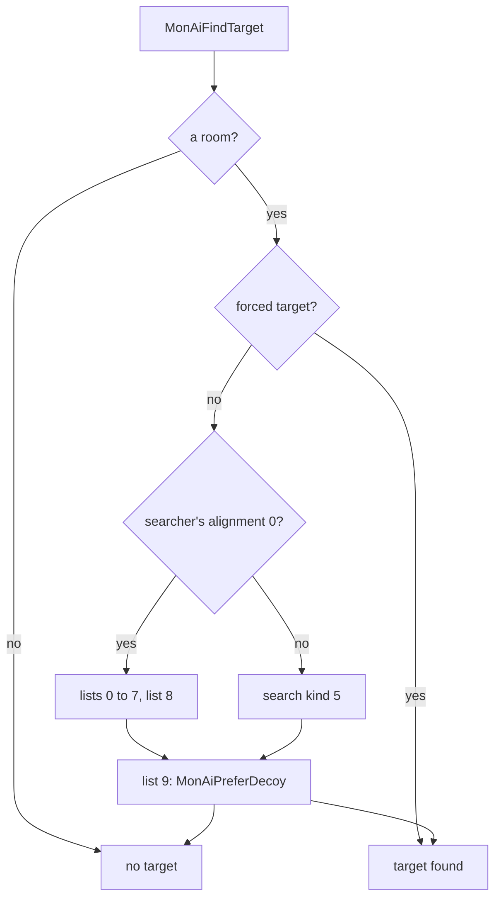
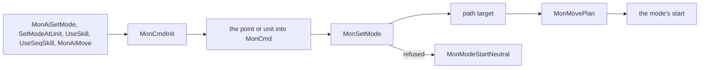
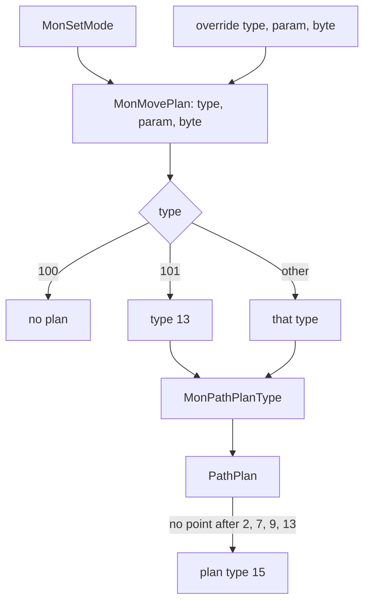
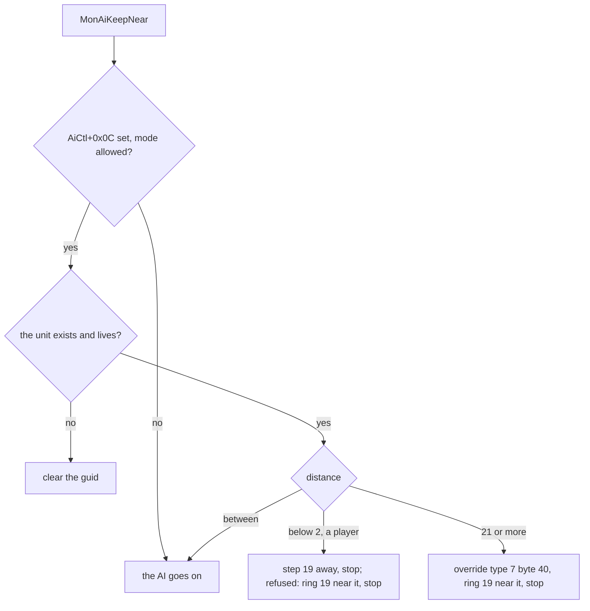
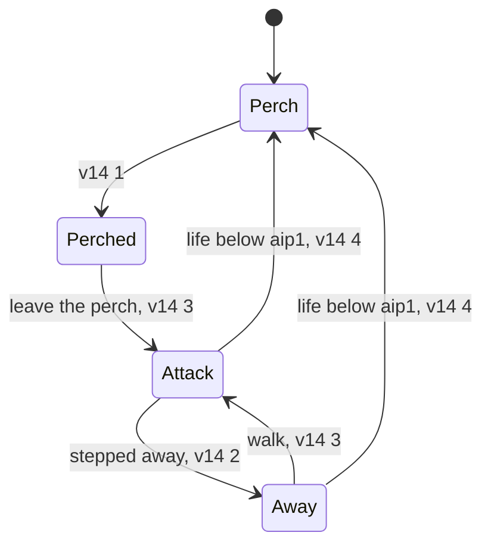

# Monster AI: target search, the command, the path request, following, the tier AIs

## Purpose

What an AI event does once [the tick](README.md#b-the-tick) reaches it: how the target is found, how a command becomes a
mode, a skill and a path request, how a minion keeps to its leader, and what each of the 18 tier AIs decides, with its
draws in order. How far each statement is evidenced is [README § G and § H](README.md#how-far-this-is-evidenced); the
sentence past the first boundary is **H1** there, quoted once and referred to below.

## Entry points

| When | Function | Tag |
|---|---|---|
| Row kinds 1, 2, 4, 5 of an event | fn:sub_005DD7F0_MonAiFindTarget@0x005DD7F0 | [I] |
| A think asks for its own hostile | fn:sub_005DDC30_MonAiFindHostile@0x005DDC30 | [I] |
| A think commands | fn:sub_005DDF90_MonAiSetModeAtUnit@0x005DDF90, fn:sub_005DDFC0_MonAiSetMode@0x005DDFC0, fn:sub_005DEAD0_MonAiUseSkill@0x005DEAD0, fn:sub_005DE000_MonAiUseSeqSkill@0x005DE000, fn:sub_005DEB60_MonAiMove@0x005DEB60 | [I] |
| A think overrides the next plan | fn:sub_005DE190_MonAiPathOverride@0x005DE190, fn:sub_005A6260_AiPathOverrideSet@0x005A6260 | [I] |

## Inputs

### Tables

| Anchor | Used for |
|---|---|
| tbl:MonStats.txt:aidist | the search range |
| tbl:MonStats.txt:aip1 | `aip1..8`, per difficulty |
| tbl:MonStats.txt:Skill1, tbl:MonStats.txt:Sk1mode | the skills and modes the thinks use |
| tbl:MonStats.txt:Velocity, tbl:MonStats.txt:Run | row 28's and row 67's speed terms |
| tbl:MonStats2.txt:MeleeRng | the hireling's melee approach |
| tbl:Hireling.txt:Skill1, tbl:Hireling.txt:Mode1, tbl:Hireling.txt:Chance1, tbl:Hireling.txt:ChancePerLvl1, tbl:Hireling.txt:DefaultChance | `MERCAI_PickSkill` |
| tbl:Skills.txt:aitype, tbl:Skills.txt:aurastate, tbl:Skills.txt:aura | `MERCAI_PickSkill`'s skips |

### Runtime state

| State | Type | Source |
|---|---|---|
| the target lists | ten heads at `Game+0x10F8`, 16-byte nodes `{unit, flags, next, prev}` | § A |
| the unit's list | `Unit+0xD0`, 11 none | § A |
| the parameter list | `AiCtl+0x20/+0x24` | § E |
| the command | `MonCmd`, 0x20 bytes | § B |
| the one-shot override | `MonPathCtl+0x18/+0x1C/+0x20` | § D |

### Constants

| Name | Value | Anchor | Tag |
|---|---|---|---|
| default range | 35 when `aidist` is 0 | fn:sub_005DD7F0_MonAiFindTarget@0x005DD7F0 | [I] |
| player list skip | 55 or more | fn:sub_005DD7F0_MonAiFindTarget@0x005DD7F0 | [I] |
| no-plan path byte | 100; 101 → type 13 | struct:MonCmd+0x15 | [I] |
| override parameter range | −126..126, fatal outside; the byte capped at 77 | fn:sub_005DE190_MonAiPathOverride@0x005DE190, fn:sub_005A6260_AiPathOverrideSet@0x005A6260 | [I] |

### Notation

Every entry below uses these. [I] (fn:RNG_Step@0x0045C370, fn:RNG_Range@0x0045C390, fn:RNG_RangeB@0x0045C3E0, [ai/0002 § Notation](../../../findings/ai/0002-pool-a.md))

| Write | Means |
|---|---|
| `U`, `G`, `T`, `d` | the unit, the game, `G+0xA8`, `G+0x6D` |
| `t`, `dist`, `melee` | `ctx+0x08`, `ctx+0x14`, `ctx+0x18`: the event's target, distance and melee test |
| `v14`, `v18`, `v1C` | `AiCtl+0x14`, `+0x18`, `+0x1C` (i32) |
| `aip(K)` | the i16 at `MonStats + 0x56 + 6(K−1) + 2d` |
| `D100()` | one step of `U`'s seed ([rng](../../rng/README.md)), giving the new low word mod 100, unsigned |
| `chance(K)` | `D100() < aip(K)`, a signed compare (`jge` past the taken branch) |
| `Range(n)` | `RNG_Range` or `RNG_RangeB` on `U`'s seed: `low mod n`, and 0 with no step for `n < 1` |
| `Pow2(n)` | `RNG_RangePow2` on `U`'s seed |
| `draw#k` | the k-th step of `U`'s seed in this decision, on the path shown; a helper's own steps are in § F |
| `Dist(a, b)`, `InTown(u)`, `Region(u)` | `AiDistUnits`; `RoomIsTown(UnitGetRoom(u))`; `LogicRegionIdAt` of the unit |
| `FindTarget`, `FindHostile`, `Ovr(type, param, byte)` | `MonAiFindTarget`, `MonAiFindHostile`, `MonAiPathOverride(U, type, param, byte)` |
| `SetModeAtUnit`, `UseSkill`, `Idle`, `Delay`, `Walk`, `Walk13`, `WalkZ`, `WalkStop`, `RunStop`, `WalkToPoint`, `Ring`, `T56`, `Toward`, `StepAway`, `StepAwayXY`, `WanderNear`, `WanderRingDirect` | § B and § C |
| `PetMove`, `Follow`, `HireFight` | `AiPetMove` (T67b), `AiHireFollow` (T61a), `AiHireFight` (T61) |

Modes are MonMode rows: 0 DT, 1 NU, 2 WL, 4 A1, 5 A2, 8 S1, 9 S2, 10 S3, 11 S4, 12 DD, 14 SQ, 15 RN.

## Algorithm

### A. Target search



- A1. [I] **The lists.** Lists 0–7 are one per player slot: `TargetListAddPlayer`, from `SUnitCreate` for a player when
  fewer than 9 clients, takes the first free slot, and `TargetListAttach(unit, i)` links a unit after player `i`'s node
  (`MERC_Init`, `MercRevive`, `SkillReviveDo`, the summon do functions; 15 calls). So the player comes first, then its
  hirelings and summons. Lists 8 and 9: `TargetListAdd(unit, 8 or 9)` pushes at the head: 8 from `WandererSpawn` and two AI
  functions, 9 (decoys) from the inactive restore, `MissileSpawnOwnedMonster`, Attract, the confuse callback, Bone Wall and
  Bone Prison. (fn:sub_005B1880_TargetListAddPlayer@0x005B1880, fn:sub_005B1900_TargetListAttach@0x005B1900,
  fn:sub_005B1990_TargetListAdd@0x005B1990, struct:Game+0x10F8)

```
A2. MonAiFindTarget(game, unit, ctl, out dist, out melee):                 [I] (all of a–f) (fn:sub_005DD7F0_MonAiFindTarget@0x005DD7F0, 0x005DD829, 0x005DD9B6, 0x005DD963, 0x005DDBF4, 0x005DDC08)
 a. if the unit has no room: return none
    rec ← none;  read ← 0
    if AiCtl flag 0x40 is set: clear it;  lineTest ← true       ; one shot: it forces the test on
    else if the room is outdoors (0x0061AA40): lineTest ← false
    else:
      lineTest ← AiCtl flag 0x08 is clear
      a monster: rec ← its MonsterData+0x50 record
      if lineTest and rec: read ← rec+0x24;  lineTest ← read = 0
 b. r ← MonAiForcedTarget;  if r: go to f
 c. if UnitAlignGet(unit) = 0:
      best ← MonStats+0x52 + d, u8;  35 when 0                  ; the range is the start of best
      nearestSeen ← 0x7FFFFFFF
      for each list 0..7:
        head counts only when in the searcher's act (Unit+0x18 byte), in a room, and that room not a town
        a counted head's AI distance updates nearestSeen
        if that distance ≥ 55: skip the whole list
        a dead head's distance reads as 0x7FFFFFFF
        the head and the list's later nodes (no act, town or death test on these) are taken
          when distance < best (unsigned) and (not lineTest or UnitLineBlocked(unit, cand, 4) = 0): best ← distance
      list 8: act test, then the same rule against the same best
 d. else: search kind 5 from the unit's logic region (LogicRegionIdAt), with best from 35
 e. the decoys of list 9 (act test, the line test, their own best from 0x7FFFFFFF, no range; in d, the search's own).
    MonAiPreferDecoy chooses the nearest over the found target
      when there is none, or
      when the decoy is nearer than 6 and a type-2 test plan to the found target has no point
      (and search kind 7 finds nothing within 19)
 f. with a target:
      unless alignment 2: set flag 0x08;  if rec: rec+0x24 ← (read = 0 ? 1 : 0)
      melee ← InMeleeRange(unit, target, 0);  dist ← its distance
    without: melee ← 0;  dist ← nearestSeen
```

- A2a. [I] Distances here are `AiDistToPoint` from the unit's own point (A7). So, forced targets aside, a target is never taken at or beyond `aidist` (35 when the cell is 0), a decoy has no such bound, and once a monster has had a target flag `0x08` turns the line test off until something clears it. `MonAiMove`'s flag 1, on a refused move, sets `0x40` (B6), so the next search tests the line again. (fn:sub_00622AA0_UnitLineBlocked@0x00622AA0, fn:sub_00622C40_InMeleeRange@0x00622C40, fn:sub_0061AB00_RoomIsTown@0x0061AB00,
  fn:sub_006259B0_UnitAlignGet@0x006259B0, tbl:MonStats.txt:aidist, 0x005DEC0A)
- A3. [I] **The forced target** (`MonsterData+0x38` kind, `+0x34` guid; taunt, attract, confuse): kinds 1, 2 and 4 look up the
  guid as a player, a monster or a type-3 unit. Called from `MonAiFindHostile`, such a unit must also pass `UnitLineBlocked(found, unit, 4) = 0`, or the
  kind and guid are cleared. Kind 3 (confusion) draws `RNG_RangePow2(unit seed, 2)` and flips the alignment for the search: alignment 1 becomes 0 on a draw of 0 and 2 otherwise;
  on a non-zero draw alignment 0 becomes 2 and 2 becomes 0. It then searches kind 5 from `MonAiFindTarget` (the caller's line test, from 35) or kind 6 from `MonAiFindHostile`, and
  restores the first alignment. The unit taken must be a living player or monster, or of type 3. Otherwise the kind and guid are cleared. (fn:sub_005DD610_MonAiForcedTarget@0x005DD610, 0x005DD668, 0x005DD6CA, 0x005DD76F,
  fn:sub_00573120_MonForcedTargetClear@0x00573120, fn:RNG_RangePow2@0x00472210, fn:sub_005543B0_MonAlignSet@0x005543B0)
- A4. [I] **`MonAiFindHostile`** is the forced target, else search kind 6 and `MonAiPreferDecoy` between its nearest and the search's decoy (the same rule as A2 e). After it, a think's distance tests read
  what the entry says: some read `ctx`'s, some the hostile's (`0x7FFFFFFF` without one). (fn:sub_005DDC30_MonAiFindHostile@0x005DDC30, 0x005DDC88)
- A5. [I] **The unit search.** `AiUnitSearch(game, unit, out, param, kind)` takes `g_AiSearchKinds[kind] = {walker, callback}`
  (the callback from `param` when the table's is 0). Walkers: 0 the near rooms' unit lists (`Room+0x74`, next `Unit+0xE8`);
  1 the near rooms' client players (`Room+0x48`, count `+0x78`); 2 the near rooms that are not towns and hold a client; 3 the
  owner's minion group. Kinds passed: 1 (19 calls, own callbacks), 2, 3, 5, 6 (2), 7, 8, 9, 11, 12. Kind roles, read from
  their callbacks: 3 nearest living non-hostile monster, 4 a monster in mode 0 near, 5 the alignment-2 search, 6 and 7 the
  nearest hostile within 49 with a line test, 8 a closed door, 9 the dead minions of the owner, 11 a hostile with a teleport
  point, 12 a count of living monsters of one class. (fn:sub_005DD0B0_AiUnitSearch@0x005DD0B0, data:g_AiSearchKinds@0x006E3300,
  fn:sub_005DCE60_AiSearchNearRooms@0x005DCE60, fn:sub_005DCEE0_AiSearchNearClients@0x005DCEE0,
  fn:sub_005DCF70_AiSearchNearRoomsNoTown@0x005DCF70, fn:sub_005DD050_AiSearchOwnerGroup@0x005DD050)
- A6. [I] **The hostility test with a draw.** `AiHostileCandidate` (kinds 6, 7, 11) takes a living player or monster out of
  town with `Unit+0xC4` bit `0x04` set, for a living searcher of type 0 or 1. When the candidate has state 146 and is a **player**, it draws `RNG_Range(candidate seed, 100)` and refuses a
  candidate outside melee range on a draw below 80. A **monster** with state 146 is refused inside melee range. Then
  `UnitsHostile`. (fn:sub_005DC970_AiHostileCandidate@0x005DC970, 0x005DC9BC, fn:sub_00554200_UnitsHostile@0x00554200, fn:RNG_Range@0x0045C390)
- A7. [I] **The AI distance.** `AiDistToPoint(unit, x, y)`: `dx ← |ux − x|`, `dy ← |uy − y|`, the result
  `(2·max(dx, dy) + min(dx, dy)) / 2`, a signed division (`lea; cdq; sub; sar 1`, 0x005DC5A4–0x005DC5AB) on non-negative
  values, so a floor; the position from path `+0x02/+0x06` (u16) for unit types 0, 1, 3 and from path `+0x0C/+0x10` for
  2, 4, 5, and 0 without a path. `AiDistUnits(a, b)` first subtracts `UNIT_GetSizeX(a)` from both components, floor 0;
  `AiDistToPointSized` subtracts `size / 2 + 1`. (fn:sub_005DC530_AiDistToPoint@0x005DC530, fn:sub_005DC380_AiDistUnits@0x005DC380,
  fn:sub_005DC480_AiDistToPointSized@0x005DC480)
- A7a. [C] `AiDistToPoint`'s map matches the emulation in 240 cases over the six unit types; the control `(dx + dy) / 2`
  fails all 240. (run:2026-10-27-ai-emu, `dist`)
- A8. [I] **`UnitDistSq(a, b)`** is `dx² + dy²` in 32-bit signed `imul` and `add`, compared signed by its callers. One square
  fits for `|dx| ≤ 46 340`; no stock path reaches a wrap. (fn:sub_005B0BD0_UnitDistSq@0x005B0BD0)
- A9. [I] **No light radius term.** The search's functions call no stat getter, and no code in the image reads stat 89 by an
  immediate id. Scope: the five search functions' direct callees and stat ids that are immediates; the 215 getter calls with
  a register id are unresolved, so the walkers' and callbacks' code is not placed in or out. The server's one
  visibility term found is state 146 in A6. (fn:sub_005DD7F0_MonAiFindTarget@0x005DD7F0, fn:sub_0063EBD0_MonComponentLightRadius@0x0063EBD0,
  [ai/0001 § 6](../../../findings/ai/0001-machinery.md#6-target-search))
- A10. [I] **`MonSkillTargetOk`**, which 13 calls in 10 AI functions use, reads `TgtPlaceCheck`; see row 13 and row 22 below
  for the tier's. (fn:sub_005FD470_MonSkillTargetOk@0x005FD470)

### B. The command



```
B1. MonCmdInit(unit, mode, cmd):                                           [I] (fn:sub_005A7E60_MonCmdInit@0x005A7E60, struct:MonCmd+0x15)
      clear the used skill and the command;  set mode and unit
      cmd+0x15 ← 101 when the mode is every-frame (MonModeEveryFrame), else 100
B2. MonSetMode(game, cmd, flag):                                           [I] (fn:sub_005A7C20_MonSetMode@0x005A7C20)
      set the path target: a unit at cmd+0x08, else the point cmd+0x0C/+0x10
      path+0x94 ← 20
      MonMovePlan(cmd+0x15, cmd+0x18, AL = cmd+0x1C)                       ; § D
      start the mode
      on refusal: MonModeStartNeutral
B3. MonAiUseSkill(game, unit, mode, skill, target, x, y):                  [I] (fn:sub_005DEAD0_MonAiUseSkill@0x005DEAD0, 0x005DEB5B, fn:sub_006439B0_SkillFindByOwner@0x006439B0)
      if mode ≥ 16: stop here
      MonCmdInit(mode)
      UNIT_SetUsedSkill(SkillFindByOwner(unit, skill, −1))
      Unit+0xC4 |= 0x40
      PathSetStopDist(path, 1)                 ; path+0x93 ← 0
      target, x, y into the command
      if MonSetMode(game, cmd, 0) starts: return 1
      MonAiIdle(10);  return 0
B4. MonAiUseSeqSkill(skill, target, x, y):                                 [I] (fn:sub_005DE000_MonAiUseSeqSkill@0x005DE000)
      the same in mode 14, without the 0x40 bit, for a skill row below the Skills count
B5. MonAiSetMode(mode, x, y), MonAiSetModeAtUnit(mode, target):            [I] (fn:sub_005DDFC0_MonAiSetMode@0x005DDFC0, fn:sub_005DDF90_MonAiSetModeAtUnit@0x005DDF90)
      build a command at a point or a unit;  MonSetMode(…, 1)
      MonAiSetMode(0, 0, 0) is the AI's self-removal
B6. MonAiMove(game, unit, target, mode, x, y, stop, flags) → 0 or 1:      [I] (fn:sub_005DEB60_MonAiMove@0x005DEB60, fn:sub_00649070_PathSetStopDist@0x00649070, 0x005DEB86, 0x005DEC0A, 0x005DEC13, 0x005DEC4C, 0x005DEC62)
      if mode = 15 and state 60: clear the one-shot override (0x005A61F0);  mode ← 2
      path+0x93 ← stop − 1                     ; 0 outside 1..19
      the command at the unit or point;  r ← MonSetMode(…, 1)
      if r ≠ 0: return 1
      flags & 4: cancel the AI event
      flags & 1: set AiCtl flag 0x40           ; for a monster with a control block
      if flags & 2 is clear: return 0          ; no idle, no draw: nothing is queued here
      one step of U's seed                     ; 1 step
      if low mod 100 < 70: MonAiWanderRing(4)  else MonAiIdle(10)
      return 1
```

- B7. [I] **The walkers around `MonAiMove`.** `MonAiWalkToUnit(t, flags)` (`Walk`), `MonAiWalkToUnitStop(t, n)` (`WalkStop`),
  `MonAiWalkToUnitType13` (`Walk13`: override type 13), `MonAiWalkToUnitOrZero` (`WalkZ`), `MonAiRunToUnit`,
  `MonAiRunToUnitFlags`, and the point forms `MonAiWalkToPoint`, `MonAiRunToPoint` (WL under state 60),
  `MonAiWalkToPointOrStop` (cancels the AI event on refusal). `MonAiRunToUnitStop(t, stop)` (`RunStop`) is
  `MonAiMove(t, 15, 0, 0, stop or 1, 0)`, the stop byte replaced by 1 when 0. So `Walk(t, 7)` on refusal cancels the AI event, sets
  flag `0x40` and takes B6's draw and fallback, and `Walk(t, 0)` on refusal returns 0 with nothing queued. (fn:sub_005DEC80_MonAiWalkToUnit@0x005DEC80, fn:sub_005DEF80_MonAiWalkToUnitStop@0x005DEF80,
  fn:sub_005DED40_MonAiWalkToUnitType13@0x005DED40, fn:sub_005DECA0_MonAiWalkToUnitOrZero@0x005DECA0, fn:sub_005DED20_MonAiRunToUnit@0x005DED20,
  fn:sub_005DED00_MonAiRunToUnitFlags@0x005DED00, fn:sub_005DED90_MonAiWalkToPoint@0x005DED90, fn:sub_005DEDE0_MonAiRunToPoint@0x005DEDE0,
  fn:sub_005DEE50_MonAiWalkToPointOrStop@0x005DEE50, fn:sub_005DEFB0_MonAiRunToUnitStop@0x005DEFB0)

```
B8. Ring(r) = MonAiWanderRing(r):                                          [I] (fn:sub_005DE200_MonAiWanderRing@0x005DE200, fn:RNG_RangeB@0x0045C3E0)
      step                                                       ; draw 1
      even low word: dy ← r & 0xFF;  dx ← RangeB(seed, r & 0xFF) ; draw 2, none when r = 0
      odd low word:  dx ← r;         dy ← RangeB(seed, r)        ; draw 2, none when r = 0
      step;  negate dx on an odd low                             ; next draw
      step;  negate dy on an odd low                             ; next draw
      MonAiMove(0, 2, x + dx, y + dy, 1, 0)
```

- B8a. [C] This map up to its call of `MonAiMove` (arguments and the unit seed at the boundary, site 0x005DE313) matches the
  emulation in 200 cases; the control with the parity reversed fails the 177 that separate it. `MonAiMove` and after are not
  covered. (run:2026-10-27-ai-emu, `ring`)
- B8b. [I] `MonAiWanderRingDirect`, `MonAiWanderNearUnit` and `MonAiRunNearUnit` do alike around another unit or with mode RN.
  (fn:sub_005DF400_MonAiWanderRingDirect@0x005DF400, fn:sub_005DF530_MonAiWanderNearUnit@0x005DF530, fn:sub_005DF680_MonAiRunNearUnit@0x005DF680)

```
B9. StepAway(other, d, flag) = MonAiStepAway:                              [I] (fn:sub_005DEFE0_MonAiStepAway@0x005DEFE0)
      the point d & 0xFF subtiles from the unit on each axis, away from other, 0 on an equal axis
      if d & 0xFF > 5: MonAiPathOverride(0, d)
      MonAiMove(0, 2, x', y', 1, flag ? 4 : 0)                   ; no draw
B10. StepAwayXY(o, n, f) = MonAiStepAwayXY:                                [I] (fn:sub_005DF140_MonAiStepAwayXY@0x005DF140, fn:sub_005A6260_AiPathOverrideSet@0x005A6260)
      sx, sy: sign of (ux − ox), (uy − oy), unsigned compares, 0 on an equal axis
      if (u8) n > 5: AiPathOverrideSet(0; 0, n)
      return MonAiMove(0, 15, ux + (u8) n · sx, uy + (u8) n · sy, 1, f ? 4 : 0)      ; no draw in its body
B11. T56(target, byte, flag) = MonAiWalkToUnitType56:                      [I] (fn:sub_005DF7D0_MonAiWalkToUnitType56@0x005DF7D0, 0x005DF7D8, 0x005DF834)
      one step of U's seed                                       ; 1 step
      MonAiPathOverride(type 5 when the new low byte < 0x80, else 6;  the byte)
      MonAiMove(target, 2, 0, 0, 1, flag ? 4 : 0)
B12. Toward(t, max, ring) = MonAiWalkTowardUnit → MonAiMoveToUnitDist(t, 2, max, ring):   [I] (fn:sub_005DE6D0_MonAiWalkTowardUnit@0x005DE6D0, fn:sub_005DE4E0_MonAiMoveToUnitDist@0x005DE4E0)
      D ← AiDistUnits(U, t);  dir ← −1 when D < ring, else +1
      n ← min(|D − ring|, max)
      dx ← |tx − ux|;  dy ← |ty − uy|;  s ← max(dx + dy, n)
      if s > 0:
        ix ← dx·n ÷ s;  iy ← dy·n ÷ s                ; signed division
        while ix + iy < n: ix ← ix + 1;  iy ← iy + 1
      point ← (ux + sgn(tx − ux)·ix·dir, uy + sgn(ty − uy)·iy·dir)
      MonCmdInit(U, mode);  PathSetStopDist(path, 1);  the point into the command;  MonSetMode(…, 1)      ; no draw
```

- B9a. [C] `StepAway`'s and `T56`'s maps up to their first boundary (`MonAiPathOverride` at sites 0x005DF105 and 0x005DF818, or
  `MonAiMove` at 0x005DF122) match the emulation: 200 `flee` cases (8 with a null other return 0, 100 reach the override, 92
  the move) and 120 `typedraw` cases; the controls fail all separating cases (69 and 120). (run:2026-10-27-ai-emu)

### C. Idle and delay

`Idle(n)`, `Delay(n)` are [README § C](README.md#c-when-the-next-ai-event-comes). [I] (fn:sub_005DE080_MonAiIdle@0x005DE080, fn:sub_005DE0F0_MonAiDelay@0x005DE0F0)

### D. The path request

The planners behind the request are [path/search](../../path/search.md)'s and read the live grid
([path/overview § F1](../../path/README.md#f1-the-planners-take-the-live-grid)). The type table, its flags and its draws are
[path/overview § D](../../path/README.md); this section is what the AI asks for.



- D1. [I] **Its parts.** The command's target unit or point; the path type `MonCmd+0x15`; the one-shot override in `MonPathCtl`
  (`+0x18` type, `+0x1C` step parameter, `+0x20` byte); path `+0x93` (stop distance) and `+0x94 = 20`.
  (fn:sub_005A63F0_MonMovePlan@0x005A63F0, struct:MonPathCtl+0x18, struct:MonCmd+0x15)

```
D2. MonAiPathOverride(unit, type, param, byte):                            [I] (fn:sub_005DE190_MonAiPathOverride@0x005DE190)
      param outside −126..126 is fatal
      if type = 1: type ← 7
      AiPathOverrideSet(type, param, byte)
    AiPathOverrideSet(type, param, byte):                                  [I] (fn:sub_005A6260_AiPathOverrideSet@0x005A6260, 0x005A6267, 0x005A6271, 0x005A627F)
      each word is stored only when non-zero, so a 0 keeps what an earlier call set this event
      byte: u8, capped at 77
D3. MonMovePlan(type, param, byte):                                        [I] (fn:sub_005A63F0_MonMovePlan@0x005A63F0, struct:MonPathCtl+0x10)
      take each non-zero override word;  clear all three
      if type = 100: no plan
      if type = 101: type ← 13
      byte defaults to 5
      MonPathPlanType(type)
      MonPathCtl+0x10 ← the step parameter
      MonPathCtl+0x14 ← 10 when the plan was not type 1 and the path has a target unit, else −1
D4. MonPathPlanType(type):                                                 [I] (fn:sub_005A6290_MonPathPlanType@0x005A6290, fn:sub_00649970_PathPlan@0x00649970)
      path+0x90 ← byte;  the type;  PathPlan(path, unit, 0)
      with no point after types 2, 7, 9 or 13: plan type 15
```

- D5. [I] **The types the AI passes** are 1, 2, 5, 6, 7, 13 and 15, plus the default 13. `MonAiPathOverride`'s 103 calls: type
  unchanged (0) 55, 7 12, 1 (→ 7) 6, 2 10, 13 7, 15 3, 5 1, and 9 from registers, all resolved: 13 four times, 2 twice, 0 once, and
  5 or 6 twice (drawn at 0x005DF813, B11; 0x005ECBD7's argument, 5 or 6 by `AiCtl+0x1C` at both callers, 0x005ECE63 and 0x005ECE89). `AiPathOverrideSet`'s 9 calls: the two inside `MonAiPathOverride`, 13, 0 and **1** five
  times (0x005E3BCC, 0x005E4300 and three in state row 13's 0x005E5C50). The mode machine also sets 0 after a get-hit start and 8
  for knockback (0x005A7821). None passes 4, 10 or 14. (fn:sub_005DE190_MonAiPathOverride@0x005DE190, fn:sub_005A6260_AiPathOverrideSet@0x005A6260,
  [ai/0001 § 8](../../../findings/ai/0001-machinery.md#8-the-path-request))
- D6. [C] Inside decisions the logged plans are types 2 (148), 5 (217), 6 (203), 7 (1 961), 13 (5 825) and 15 (1 580), 9 618 in
  all, none stepping the unit seed; type 1 was not requested in that run. (run:2026-11-03-ai, fn:sub_00649970_PathPlan@0x00649970)
- D7. [I] **The planner call sites from AI code.** `MonPathPlanType` (0x005A62EF, 0x005A634E, through `MonSetMode` → `MonMovePlan`);
  `MonModeStartSkill` (0x005A760D, 0x005A7638, base class 110 with the current type); 0x005A77C0 (type 8, 0x005A7854); and three
  type-2 test plans that restore the path: `MonAiPreferDecoy` (0x005DD580), 0x005E8F20 (0x005E912D) and 0x005FBDD0 (0x005FBFB7).
  (fn:sub_005A75C0_MonModeStartSkill@0x005A75C0, fn:sub_005DD510_MonAiPreferDecoy@0x005DD510)
- D8. [I] **The town.** For a hostile searcher a player head in a town room is never a target and its list's pets are skipped
  with it (0x005DD915–0x005DD923), and every AI path type ends in a planner that `PathPlan` runs only after `PathTargetNotTown`.
  (fn:sub_006483A0_PathTargetNotTown@0x006483A0, [drlg/lifecycle](../../drlg/lifecycle.md#open-questions))

### E. Following



- E1. [I] **`MonAiKeepNear`.** When `AiCtl+0x0C ≠ −1` and `MonModeAllowed`, the unit `(AiCtl+0x10, AiCtl+0x0C)` is looked up, and
  gone or dead clears the guid. At AI distance below 2 with `AiCtl+0x10 = 0` (a player) it steps 19 subtiles away
  (`MonAiStepAway(unit, 19, 1)`, then stop), and on a refused step goes straight to `MonAiWanderNearUnit(unit, 19)` and stops. At 21 or more it sets `MonAiPathOverride(U, 7, 0, 40)` and wanders to a ring point of radius 19
  around that unit (`MonAiWanderNearUnit(unit, 19)`, 4 unit-seed steps), and stops. Between, the AI goes on. (fn:sub_005B0FF0_MonAiKeepNear@0x005B0FF0, 0x005B109E, 0x005B10C0, 0x005B10CC)
- E2. [I] **Who sets the pair.** `AiCtlFollowSet` writes it from `UniqueMinions` (minion → its boss), `SkillReviveDo`,
  `SummonFinish` and `SkillDo71Taunt`. (fn:sub_005DD330_AiCtlFollowSet@0x005DD330, fn:sub_005A0C00_UniqueMinions@0x005A0C00,
  fn:sub_005D8570_SkillDo71Taunt@0x005D8570)
- E3. [I] **The owner and the group.** `MonsterOwner(U)` reads the owner link; a leader is a unit whose owner is itself, and the
  minion groups are `AiCtl+0x28..+0x34`. (fn:sub_0058F0D0_MonsterOwner@0x0058F0D0, fn:sub_0058F030_MonSetOwner@0x0058F030,
  fn:sub_0058F380_MonGroupForEach@0x0058F380)
- E4. [I] **The parameter list** at `AiCtl+0x20/+0x24`: records of 0x1C bytes `{next, prev, kind, +0x0C, +0x10, +0x14, +0x18}` in a
  circular list, `+0x20` the head. `AiParamsAlloc` links a zeroed record before the head (the first record becomes the head);
  `AiParamsPush(unit, blk)` copies `blk+0x08..+0x18` into a new record and makes it the head; `AiParamsHead` returns the head;
  `AiParamsPop` unlinks and frees it; `AiParamsFind(unit, kind, makeHead)` returns the first record of that kind from the head and
  with `makeHead` makes it the head. (fn:sub_0058EC90_AiParamsAlloc@0x0058EC90, fn:sub_0058EF40_AiParamsPush@0x0058EF40,
  fn:sub_0058EE80_AiParamsHead@0x0058EE80, fn:sub_0058ED10_AiParamsPop@0x0058ED10, fn:sub_0058EEF0_AiParamsFind@0x0058EEF0)
- E5. [I] **A leader's call.** `MonHelpBlock(unit, blk)` pushes a copy of `blk` to each minion of the unit's owner, the `AiCtl+0x34`
  list. Rows 6, 13 and 20 use it with a stack block whose kind word (`+0x08`) is the only word written; the other four words
  the copies take (`+0x0C..+0x18`) are whatever the stack held (0x005F04AA–0x005F04D5). (fn:sub_0058F730_MonHelpBlock@0x0058F730)

### F. Draws and seeds of the helpers

| Function | Seed | Draws | Tag |
|---|---|---|---|
| `Ring`, `WanderRingDirect`, `WanderNearUnit`, `RunNearUnit` | acting unit | 4 steps, 3 when `r = 0` | [I] (fn:sub_005DE200_MonAiWanderRing@0x005DE200); map `[C]` for `Ring` (B8a) |
| `MonAiMove`, refusal with flag 2 | acting unit | 1 step, then 4 more on `low mod 100 < 70` | [I] (fn:sub_005DEB60_MonAiMove@0x005DEB60) |
| `T56` | acting unit | 1 step | [I] (fn:sub_005DF7D0_MonAiWalkToUnitType56@0x005DF7D0); map `[C]` (B9a) |
| `MonAiForcedTarget`, confusion | acting unit | 1 (`RangePow2`) | [I] (fn:sub_005DD610_MonAiForcedTarget@0x005DD610) |
| `AiHostileCandidate`, a player with state 146 | **the candidate player** | 1 (`Range 100`) | [I] (fn:sub_005DC970_AiHostileCandidate@0x005DC970) |
| state row 2's 0x005B14E0 | acting unit | 1 or 2 steps, then maybe a ring walk | [I] (0x005B14E0) |
| `UModTeleportTry` | as [drlg/lifecycle](../../drlg/lifecycle.md) (`SpawnPosPick`) | | [I] (fn:sub_005B11F0_UModTeleportTry@0x005B11F0) |
| `MonSetMode` | an object's `Sync` start, the skill start functions | [anim/timing § N](../../anim/timing.md#n-draws-and-seeds-per-event-kind), [skills/dispatch § P](../../skills/dispatch.md#p-draws-and-seeds-per-event-kind) | [I] (fn:sub_005A7C20_MonSetMode@0x005A7C20) |
| `PathPlan`, the AI's types | | none | [C] (run:2026-11-03-ai; D6) |

### T. The tier AIs

Each entry is the think function as pseudocode, with its draw order and its evidence. Every entry's block is the code reading of its
catalogue finding, `[I]`, and its first boundary is `[C]` per [README § G](README.md#g-the-first-boundary). "The map" in a `[C]` line below is the map from the think's inputs to its first callee or return, each emulated case's boundary (ADR-0021), and nothing after it. Where a row is under
sentence H1, "H1 holds" means [the sentence](README.md#h-past-the-first-boundary) for the decisions and logs in that table, and no more.
All 18 rows have no `init`; all have row kind 1 except 61 and 67 (kind 0), so the think runs only with a target but for those two.
Only rows 29 and 61 have an `alt`. [I] (data:g_MonAiTable@0x0073CA18, [MonAI](../../../tables/MonAI.md))

#### T2. Row 2 `Skeleton` (fn:sub_005EFCF0_AiSkeleton@0x005EFCF0)

```
if not melee:                                     [I] (0x005EFCF0, 0x005EFE11)
  if chance(1):                 ; draw#1
    Walk(t, 7); return
else if chance(3):              ; draw#1
  SetModeAtUnit(chance(4) ? 4 : 5, t); return     ; draw#2: A1 or A2
Idle(aip(2))
```

- T2a. [I] One draw out of melee range, one or two in it. (fn:sub_005EFCF0_AiSkeleton@0x005EFCF0, tbl:MonStats.txt:aip1)
- T2b. [C] The map to its first callee, four outcomes in the first run; no call past the first in any decision resumed.
  (run:2026-10-30-ai-cat-emu-1, run:2026-11-03-ai, 0x005B186F)

#### T6. Row 6 `Fallen` (fn:sub_005F02C0_AiFallen@0x005F02C0)

```
1. if U is null, or U.mode ∈ {0, 12}: return                                  [I] (all of 1–5) (0x005F02C0, 0x005F0476)
2. UNIT_CancelEvents(G, U, 2, 0)             ; drop the pending AI event
   room ← UnitGetRoom(U);  if none: return
3. the flight scan:
   for each room r of DUNGEON_GetNearRooms(room):
     for i in 0 ..< 4:                       ; r+0x38, the ring of the last four dead monsters
       m ← GameFindUnit(G, 1, r.deadGuid[i])
       if m and m.mode = 0 and AiDistToPoint(m, U.x, U.y) < 15:
         v14 ← 1;  AiParamsPop(U);  Ovr(0, 50, 0)
         if StepAway(t, 12, 1):
           if low(step) mod 20 < 1: UnitSetEvent(U, 17, 0)     ; draw#1, only after a successful step
           return
         leave the scan                      ; the step was refused
4. if the mode read at step 1 ≠ 1: Idle(10); return                          ; only from NU
5. rec ← AiParamsHead(U)
   if no rec:
     if not melee and AiMonState3or19(U): Walk(t, 0); return
     if dist < 15 and MonsterOwner(U) = U and Range(100) < aip(1):            ; draw#1: a leader
       blk.kind ← 1;  MonHelpBlock(U, &blk);  AiParamsPush(U, &blk)
       SetModeAtUnit(9, t); return                                            ; S2
     if not melee:
       if dist ≤ aip(2): Walk(t, 7); return
       if Range(100) < 30: Ring(3); return    ; next draw
       Idle(10); return
     if v14 ≠ 0 or Range(100) < aip(3):       ; drawn only when v14 = 0
       v14 ← 0
       SetModeAtUnit(Range(100) < aip(4) ? 4 : 5, t); return
     if Range(100) < 30: SetModeAtUnit(9, t); return
     Idle(10); return
   if rec.kind = 1:
     if not melee:
       if not Walk(t, 0): AiParamsPop(U)
       return
     if Range(100) ≥ aip(3): Idle(5); return
     SetModeAtUnit(Range(100) < aip(4) ? 4 : 5, t); return
   AiParamsPop(U);  Idle(10)
```

- T6a. [I] **Draws.** The scan's mod-20 draw only after a successful step; then at most three `Range(100)` (`aip1` or 30, `aip3`, `aip4`).
  `UNIT_CancelEvents` runs on every event before the scan, so a path that only returns queues nothing itself, and the next AI event
  comes from the mode's end. (fn:UNIT_CancelEvents@0x00540E60, fn:sub_0061AFA0_RoomRecordDeath@0x0061AFA0, fn:sub_00553380_UnitSetEvent@0x00553380)
- T6b. [C] The logged first call in every compared decision of the first run (1 393) is `UNIT_CancelEvents` at site 0x005F02FD with
  arguments 2 and 0. One outcome: the map's mode 0 and 12 return was never taken. (run:2026-11-03-ai, 0x005F02FD)
- T6c. [I] Past the first boundary this row is a consistency check only ([README H3](README.md#h-past-the-first-boundary)). (run:2026-11-04-ai-resume-flip, 0x005F0367)

#### T9. Row 9 `Wraith` (fn:sub_005F0A20_AiWraith@0x005F0A20)

```
if not melee:                                     [I] (0x005F0A20, 0x005F0AEA)
  if chance(1): Toward(t, 12, 0); return          ; draw#1
else if chance(3): SetModeAtUnit(4, t); return    ; draw#1
Idle(aip(2))
```

- T9a. [C] The map; three outcomes in the first run; no call past the first in any decision resumed. (run:2026-10-30-ai-cat-emu-1, run:2026-11-03-ai, 0x005B186F)

#### T13. Row 13 `FallenShaman` (fn:sub_005F1440_AiFallenShaman@0x005F1440)

```
1. if melee and chance(3): SetModeAtUnit(4, t); return                ; draw#1     [I] (all of 1–7) (0x005F1440, 0x005F14BC, 0x005F150E)
2. srch ← {unit 0, count 0, dist 0, bound aip(4)·aip(4)}
3. if not MonTypeFlag(U, 8) or MonTypeFlag(U, 4):                     ; not a unique, or a champion
     AiUnitSearch(G, U, &srch, 0, 9)                                  ; own group's dead, AiDeadMinionCb
   else:
     AiUnitSearch(G, U, &srch, AiFallenCorpseCb, 1)                   ; a unique: near rooms
4. if chance(1): blk.kind ← 1;  MonHelpBlock(U, &blk)                 ; post to the group, whether or not a corpse was found
5. if srch.unit and srch.count and chance(1) and MonSkillTargetOk(Skill1, srch.unit, 0, 0):
     MonAiUseSeqSkill(Skill1, srch.unit, 0, 0); return                ; Resurrect, mode 14
6. if t and dist < aip(5) and chance(2): UseSkill(Sk2mode, Skill2, t, 0, 0); return
   h ← FindHostile(&dist, 0)
   if h and dist < aip(5) and chance(2): UseSkill(Sk2mode, Skill2, h, 0, 0); return
7. if chance(3): T56(t, 3, 0) else Idle(10)
```

- T13a. [I] **Which dead.** `AiDeadMinionCb` takes a monster in mode 12 with `Unit+0xC4` bit `0x02`, no state of the DataTables
  `+0x150` set, owned by the searcher, at AI distance (`AiDistUnits`) ≤ `aip4²`: an AI distance compared with a square.
  `AiFallenCorpseCb` takes a monster whose `MonBaseId` is 19 or 58, alignment 0, `Unit+0xC4` bit `0x02`, no state of `+0x150`, in mode 12,
  no state of `+0xD4`, `UnitDistSq` ≤ `aip4²`, and neither champion nor unique (`MonTypeFlag` `0x0C` clear). Both count the candidates and
  keep the last one taken. (fn:sub_005DCDA0_AiDeadMinionCb@0x005DCDA0, fn:sub_005F1380_AiFallenCorpseCb@0x005F1380, fn:sub_005A0180_MonTypeFlag@0x005A0180)
- T13b. [I] **Draw order:** melee `aip3`; the `aip1` call to the group; the `aip1` resurrect draw (only with a corpse); up to two `aip2`
  draws for the missile; one `aip3` for the approach. `FindHostile` adds its callees'. (fn:sub_005DE000_MonAiUseSeqSkill@0x005DE000, tbl:MonStats.txt:Skill2)
- T13c. [C] The logged first call in all 363 compared decisions of the first run is the hand map's: two outcomes (358 and 5): the attack when in melee
  and the draw passes, else `MonTypeFlag(U, 8)` at site 0x005F14E1. H1 holds for 103 decisions.
  (run:2026-11-03-ai, run:2026-11-04-ai-resume-flip, 0x005F14E1)

#### T20. Row 20 `Scarab` (fn:sub_005F2540_AiScarab@0x005F2540)

```
1. rec ← AiParamsHead(U)                                              [I] (all of 1–5) (0x005F2540, 0x005F2816)
2. if no rec and dist < 20 and MonsterOwner(U) = U and chance(5):     ; draw#1: a leader
     blk.kind ← 1;  MonHelpBlock(U, &blk);  AiParamsPush(U, &blk);  rec ← &blk
3. if rec and rec.kind = 1:
     if melee and Skill1 ≥ 0: AiParamsPop(U);  UseSkill(Sk1mode, Skill1, t, 0, 0); return      ; Jab
     Ovr(2, 100, 0)
     if not Walk(t, 0): AiParamsPop(U)
     return
4. if not melee:
     if v14 ≠ 0:
       Ovr(2, 0, 4);  Walk(t, 7)
       if D100() > 10: v14 ← 0                                        ; a draw after the walk
       return
     T56(t, 0, 0);  v14 ← 1;  return
5. if not chance(1): Idle(aip(3)); return                             ; draw#1
   if Skill1 ≥ 0 and chance(4): UseSkill(Sk1mode, Skill1, t, 0, 0); return                      ; draw#2
   SetModeAtUnit(chance(2) ? 4 : 5, t)                                ; draw#2 or #3
```

- T20a. [I] A head record of another kind is left in place and the plain decision runs. (fn:sub_0058F0D0_MonsterOwner@0x0058F0D0, struct:AiCtl+0x14)
- T20b. [C] The map, `MonsterOwner`'s own `GameFindUnit` call included as a boundary; five outcomes in the first run.
  (run:2026-10-30-ai-cat-emu-2, run:2026-11-03-ai, 0x0058F0FF)
- T20c. [I] Past the first boundary it stays a reading ([README H4](README.md#h-past-the-first-boundary)). (0x005F283F)

#### T21. Row 21 `Mummy` (fn:sub_005F2850_AiMummy@0x005F2850)

```
1. if AiMonState3or19(U) and not melee: Walk(t, 7); return            [I] (all of 1–3) (0x005F2850, 0x005F290D, 0x005F29D7, 0x005F29E6)
2. if dist ≤ aip(1):
     if melee:
       if chance(3): SetModeAtUnit(chance(4) ? 4 : 5, t); return      ; draw#1, #2
       Idle(aip(5))                                                   ; no return: the walk follows in the same event
     Walk(t, 7); return
3. if chance(2): Ring(3); return
   Idle(aip(5))
```

- T21a. [I] `aip1` is a range, not a chance. A failed `aip3` draw (100 in every stock record) runs `Idle(aip5)` and then `Walk(t, 7)` in the same
  event. (tbl:MonStats.txt:aip1)
- T21b. [C] The map up to the first callee (the `Idle`; the walk after it is a reading); five outcomes in the first run. H1 holds for 205 decisions, one
  call past the first in each. (run:2026-10-30-ai-cat-emu-2, run:2026-11-03-ai, run:2026-11-04-ai-resume-flip)

#### T22. Row 22 `GreaterMummy` (fn:sub_005F2B10_AiGreaterMummy@0x005F2B10)

```
1. if melee and chance(1): SetModeAtUnit(4, t); return                ; draw#1     [I] (all of 1–8) (0x005F2B10, 0x005F2C15, 0x005F2C6E, 0x005F2C85, 0x005F2E9F)
2. if dist < 5 and chance(1): SetModeAtUnit(5, t); return             ; draw#1 or #2
3. s ← {corpse 0, wounded 0, taken 0, inRange 0, bound aip(5)², undead 0, uniquesToo 0}
4. if U.class = (MonStatsCount > 229 ? 229 : −1):                     ; Radament
     A2Q1_BossSeen(G, U);  s.bound ← (aip(5) + 10)²;  s.undead ← 1
     if d = 0: s.uniquesToo ← 1
5. AiUnitSearch(G, U, &s, AiGreaterMummyCb, 1)
6. if Skill2 ≥ 0 and s.wounded and chance(3):
     UnitSetPathTargetUnit(U, s.wounded);  UseSkill(Sk2mode, Skill2, s.wounded, 0, 0); return   ; Bestow
   if s.corpse and chance(2) and MonSkillTargetOk(Skill1, s.corpse, 0, 0):
     UnitSetPathTargetUnit(U, s.corpse);  MonAiUseSeqSkill(Skill1, s.corpse, 0, 0); return      ; Resurrect2, mode 14
7. if Skill3 ≥ 0 and chance(4) and (h ← FindHostile(&dist, 0)):
     UseSkill(Sk3mode, Skill3, h, 0, 0); return                       ; UnHolyBolt
8. if s.inRange < 1: Ovr(0, 50, 0);  WalkStop(t, 3); return
   if D100() > 49: Idle(6) else T56(t, 3, 0)
```

- T22a. [I] **`AiGreaterMummyCb`.** A monster other than the searcher, on the same side (`AlignSame02`), alignment not 2, `Unit+0xC4` bit `0x02`, not in
  state set 33; then with `undead` 0 its MonStats `lUndead` (`+0x0D` bit 3), with `undead` 1 `MONSTATS_IsUndead`; then unless `uniquesToo`, not a unique
  (`MonTypeFlag(unit, 8)`); then `UnitDistSq` ≤ `bound`. Each such unit counts in `inRange`; one in mode 12 with no state of the `+0xD4` mask becomes `corpse`,
  one in another mode than 0 whose stat 6 differs from `UnitGetMaxHp` becomes `wounded`; each taken one counts in `taken`. The last one met of each kind is kept.
  (fn:sub_005F2A00_AiGreaterMummyCb@0x005F2A00, 0x005F2B03, fn:sub_00650D70_AlignSame02@0x00650D70, fn:MONSTATS_IsUndead@0x0063E990, tbl:MonStats.txt:lUndead)
- T22b. [I] **Draw order:** the two melee/near draws on `aip1`; then `aip3` only with `Skill2 ≥ 0` and a wounded unit, `aip2` only with a corpse, `aip4` only with
  `Skill3 ≥ 0`, and the 50/50 only with a unit in range. (tbl:MonStats.txt:Skill2, tbl:MonStats.txt:Skill3)
- T22c. [C] The map up to `A2Q1_BossSeen` or the search, the block's seven words included in the non-Radament case; three outcomes in the first run. H1 holds for
  62 decisions. (run:2026-10-30-ai-cat-emu-2, run:2026-11-03-ai, run:2026-11-04-ai-r5)
- T22d. [I] Whether a champion corpse passes the skill's own test is unlogged: see *Open questions*. (fn:sub_005FD470_MonSkillTargetOk@0x005FD470)

#### T28. Row 28 `Vampire` (fn:sub_005F4A70_AiVampire@0x005F4A70)

```
bits ← aip(5);  b0, b1, b2 ← its bits 0, 1, 2     ; Pair, Skill2 (Firewall), Skill3 (Meteor)     [I] (all of this block) (0x005F4A70, 0x005F4ABE, 0x005F4ADA, 0x005F4B3D, 0x005F4C24, 0x005F4DFC, 0x005F4E22, 0x005F4E3F, 0x005F4F2C, 0x005F4F52, 0x005F4F72, 0x005F4FBB)
v14: 1 engaged, 2 fleeing;  v18: the largest distance below 30 seen under s;  v1C: the skill cooldown

Pair(x):    if Range(100) < 50: UseSkill(Sk1mode, Skill1, x, 0, 0)  else UseSkill(Sk4mode, Skill4, x, 0, 0)
Skills(x):  if b1 and v1C ≤ 0 and Range(100) < aip(4): UseSkill(Sk2mode, Skill2, x, 0, 0);  v1C ← 11;  true
            if b2 and v1C ≤ 0 and Range(100) < aip(4): UseSkill(Sk3mode, Skill3, x, 0, 0);  v1C ← 11;  true
            false

1. if v1C > 0: v1C ← v1C − 1
   h ← FindHostile(&hd, 0)
   s ← AiMonState3or19(U)
2. if s:
     if v14 = 0: v14 ← 1
     if dist < 30 and dist > v18: v18 ← dist
     if melee:
       x ← D100()                                 ; always drawn, before the bit test
       if x ≤ 30 and b0: Pair(t)  else SetModeAtUnit(4, t)
       return
3. life ← UnitLifePct(U)
4. if v14 = 2:                                    ; fleeing
     if life ≥ 75: v14 ← 1;  Walk(t, 7);  return
     if dist < 14 or dist ≤ v18:
       Ovr(0, p, 0)                               ; T28a
       if StepAway(t, 8, 1): return
     if dist ≥ aip(3) or Range(100) ≥ aip(2): Idle(15);  return
     if Skills(t): return
     if b0 and h and hd ≤ 20: Pair(h);  return
     T56(t, 4, 0);  return
5. if life < 33:
     v14 ← 2
     if StepAway(t, 8, 0): return                 ; refused: on to step 6 or 7
6. if melee:
     v14 ← 1
     if D100() < aip(1):
       if not (b0 and h): SetModeAtUnit(4, t);  return
       if Range(100) > 30: SetModeAtUnit(4, t);  return
       if hd ≤ 20: Pair(h);  return
     if Range(100) < 33: T56(t, 4, 0)  else Idle(10)
     return
7. if dist ≥ aip(3):
     if v14 = 1: Walk(t, 7)  else Idle(15)
     return
   v14 ← 1
   if Range(100) ≥ aip(2):                        ; keep a distance
     if dist > 20: Walk(t, 7);  return
     if dist < 9 and Range(100) < 50: StepAway(t, 8, 0);  return
     if Range(100) < 50: T56(t, 4, 0)  else Idle(10)       ; inside 9 this is the second 50
     return
   if Skills(t): return
   if not (b0 and h and hd ≤ 20): Walk(t, 7);  return
   if Range(100) < 75: Pair(h)  else T56(t, 4, 0)
```

- T28a. [I] **The flee step's override.** `p` is computed only when `Velocity > 0`, a signed 16-bit test, and is 0 otherwise. With the guard met:
  `q: i32 ← (i16 Run · 100) ÷ (i16 Velocity)`, truncating, then `q − 100`, a result ≤ 0 becoming 0 and one ≥ 120 becoming 120, passed to
  `MonAiPathOverride(unit, 0, p, 0)`. This is the one such computation in the think; the engaged flee's step takes no override, and `Run · 100` cannot wrap.
  (0x005F4BC0, 0x005F4BEC, 0x005F4BF8, 0x005F4C09, tbl:MonStats.txt:Velocity, tbl:MonStats.txt:Run)
- T28b. [C] The logged first call in all 279 compared decisions of the first run is the hand map's: `MonAiFindHostile` at site 0x005F4AD5, one outcome. H1 holds for 56
  decisions, 168 calls past the first. (run:2026-11-03-ai, run:2026-11-04-ai-r5, 0x005F4AD5)
- T28c. [C] **The block run as written** against every row 28 decision of the rev 4 and rev 6 logs: 100 decisions, 99 compared, 0 mismatches, 1 stopped at a return site not armed. Each boundary call's function and return address, the unit seed at it, `v14`, `v18`, `v1C`, `T56`'s three arguments and the exit seed agree, with the logged inputs and results as oracles. Logged paths only: steps 1, 3, 5 with its step accepted, 6 and 7, `Pair` both ways, and `T56` at two of its three sites. **Reached by no log, so `[I]` only:** step 2's melee arm, all of step 4, `Skills`' two uses. Controls: `T56`'s byte as 3 fails 23, the draw of step 6's `Range(100) > 30` made before its two tests fails 1, the second 50 inside 9 dropped fails 2; step 2's draw made only with `b0` fails none, as that arm is not reached. (run:2026-11-04-ai-t28, fn:sub_005F4A70_AiVampire@0x005F4A70)

#### T29. Row 29 `BatDemon` (fn:sub_005F5040_AiBatDemon@0x005F5040, alt fn:sub_005F4FD0_AiBatDemonAlt@0x005F4FD0)



```
life ← UnitLifePct(U)                                     [I] (all of this block) (0x005F5040, 0x005F53D3)
switch v14:
 0, 4:   SetModeAtUnit(10, 0);  Delay(8);  v14 ← 1;  v18 ← 0
         r ← stat 74 of U
         if r ≠ 0: v1C ← aip(5)·r ÷ 8;  UnitSetStat(U, 74, r + v1C, 0)   else v1C ← 0
         return
 1:      if v18 > 1 and not (not melee and dist > 6 and not AiMonState3or19(U) and (dist > 13 or life < 51)):
           if v1C ≠ 0: UnitSetStat(U, 74, stat 74 of U − v1C, 0)
           SetModeAtUnit(9, 0);  Delay(6);  v14 ← 3;  return             ; leave the perch
         SetModeAtUnit(11, 0);  Delay(v18 = 0 ? 10 : 15);  v18 ← v18 + 1;  return
 2:      if life < aip(1) and StepAway(t, 15, 0): v14 ← 4; return
         if Range(100) < 33: Walk(t, 0);  v14 ← 3; return
         if Range(100) < 15: Ring(6); return
         Idle(10); return
 3:      if life < aip(1) and StepAway(t, 15, 0): v14 ← 4; return
         if not melee: Walk(t, 0); return
         if v18 > 0: SetModeAtUnit(5, t);  v18 ← 0; return
         if AiMonState3or19(U) and Range(100) < aip(2) and StepAway(t, 12, 0): v14 ← 2; return
         if Range(100) < aip(3): SetModeAtUnit(Range(100) < aip(4) ? 5 : 4, t); return
         Idle(10); return
 other:  if dist < 15: Walk(t, 0);  v14 ← 3; return
         v14 ← 4;  Idle(15)
alt:
  a unit in mode 11:  v14 ← 1;  Delay(1)
  else v14 = 4:       v14 ← 1;  SetModeAtUnit(10, 0)
  else:               MonAiInit(ctl, ctl.state);  Idle(1)
```

- T29a. [I] The `aip5 · r ÷ 8` is signed and truncating, `(x + (x >> 31 & 7)) >> 3`. The first attack after a perch is A2 (`v18 > 0`). The alt's second arm tests and writes `v14` (`AiCtl+0x14`, 0x005F4FFC, 0x005F5006). (fn:STATS_GetUnitStat@0x00625480, fn:sub_00627260_UnitSetStat@0x00627260, tbl:ItemStatCost.txt:hpregen, 0x005F4FD0, 0x005F5031)
- T29b. [C] The alt's map (no draw) by emulation; the think's logged first call, `UnitLifePct` at site 0x005F5070, in all 110 compared think decisions of the first run, by hand map,
  one outcome. H1 holds for 215 decisions, 526 calls past the first. (run:2026-10-30-ai-cat-emu-2, run:2026-11-03-ai, run:2026-11-04-ai-r5, 0x005F5070)

#### T30. Row 30 `Fetish` (fn:sub_005F53E0_AiFetish@0x005F53E0)

```
1. rec ← AiParamsHead(U)                                              [I] (all of 1–4) (0x005F53E0, 0x005F56BD)
   if rec:
     if rec.kind ∈ {1, 14} and (u ← GameFindUnit(G, rec+0x10, rec+0x0C)):
       v14 ← 0;  v18 ← 0;  Ovr(13, 50, 0);  Walk(u, 0);  AiParamsPop(U); return
     AiParamsPop(U)
2. tl ← UnitLifePct(t)                                                ; the target's life
3. switch v14:
    0: if melee:
         v18 ← 0;  v14 ← 1
         if chance(1): SetModeAtUnit(4, t); return                    ; draw#1
         Idle(aip(2)); return
    1: v18 ← v18 + 1
       if v18 > aip(3) and tl > aip(4):                               ; hit and run
         v14 ← 2;  v18 ← 0;  Ovr(2, 50, 0);  StepAway(t, 14, 1); return
       if melee:
         if Range(100) < aip(1): SetModeAtUnit(4, t); return          ; draw#1
         Idle(aip(2)); return
    2: if dist > 12:
         v18 ← v18 + 1
         if v18 > 1: v14 ← 0;  v18 ← 0
         if D100() < 20: T56(t, 4, 0); return                         ; draw#1
         Idle(10); return
       Ovr(2, 50, 0)
       if StepAway(t, 14, 1): return
       v14 ← 0;  v18 ← 0;  Idle(10); return
    other: Idle(10); return
4. Ovr(13, 50, 0);  Walk(t, 7)
```

- T30a. [I] No writer of a kind-14 record with a unit was found in the batch. (fn:sub_00621F20_UnitLifePct@0x00621F20)
- T30b. [C] The record map up to `GameFindUnit`, `AiParamsPop` or `UnitLifePct`, with no draw before them; one outcome in the first run. H1 holds for 316 decisions, 243 on one path.
  (run:2026-10-30-ai-cat-emu-2, run:2026-11-03-ai, run:2026-11-04-ai-resume-flip)

#### T34. Row 34 `Andariel` (fn:sub_005F5830_AiAndariel@0x005F5830)

```
if melee:                                                  [I] (all of this block) (0x005F5830, 0x005F584E, 0x005F5A0F)
  if Skill1 ≥ 0 and D100() < aip(1):                       ; draw#1
    UseSkill(Sk1mode, Skill1, t, 0, 0); return
  SetModeAtUnit(4, t); return
if D100() < aip(2): Idle(5); return                        ; draw#1
if D100() < aip(3):                                        ; draw#2
  if Skill1 ≥ 0 and Range(100) < aip(4):                   ; draw#3
    UseSkill(Sk1mode, Skill1, t, 0, 0); return
  if Skill2 ≥ 0: UseSkill(Sk2mode, Skill2, t, 0, 0); return
Ovr(1, 0, 0)
Walk(t, 7)
```

- T34a. [I] The draws compare signed (`jge`); the skill tests are sign tests of the i16. `Ovr(1, …)` plans type 7 (D2). Its `RNG_Range` takes the seed `U + 0x20` set at entry. (fn:sub_005DE190_MonAiPathOverride@0x005DE190,
  fn:sub_005DEC80_MonAiWalkToUnit@0x005DEC80, tbl:MonStats.txt:aip4)
- T34b. [C] The map by emulation; five outcomes in the first run. H1 holds for 51 decisions, two calls past the first in all. (run:2026-10-30-ai-cat-emu-6, run:2026-11-03-ai, run:2026-11-04-ai-r5)

#### T35. Row 35 `CorruptArcher` (fn:sub_005F5A20_AiCorruptArcher@0x005F5A20)

```
1. r ← dist;  h ← FindHostile(&r, 0)                                  [I] (all of 1–7) (0x005F5A20, 0x005F5D3E)
2. if no h:
     if D100() > 49: Idle(aip(3)); return                             ; draw#1, unsigned
     T56(t, 3, 0); return
3. if not melee and AiMonState3or19(U): SetModeAtUnit(4, h); return
4. if r < 6 and chance(4):                                            ; draw#1
     Ovr(0, 100, 0)
     if StepAwayXY(h, 12, 1): return
5. if 0 < aip(8) and aip(8) < r and Range(100) < aip(1):
     Ovr(0, 10, 0);  WalkStop(h, (u8) aip(8)); return
   if aip(5) < r:
     Ovr(0, 100, 0);  RunStop(h, (u8) aip(5)); return
6. if not chance(2): Idle(aip(3)); return
7. if Skill2 ≥ 0 and Range(100) < aip(6): UseSkill(Sk2mode, Skill2, h, 0, 0); return
   if Skill3 ≥ 0 and Range(100) < aip(7): UseSkill(Sk3mode, Skill3, h, 0, 0); return
   if Skill1 < 0: SetModeAtUnit(4, h); return
   UseSkill(Sk1mode, Skill1, h, 0, 0)
```

- T35a. [I] After `FindHostile` every distance test reads `r`, the hostile's distance (`0x7FFFFFFF` without one), not the event's, and every command after it is aimed at `h`; the no-hostile wander is at `t`. Up to five draws.
  (fn:sub_005DDC30_MonAiFindHostile@0x005DDC30, fn:sub_005DF140_MonAiStepAwayXY@0x005DF140, tbl:MonStats.txt:aip8)
- T35b. [C] The logged first call in all 95 compared decisions of the first run is the hand map's: `MonAiFindHostile` at site 0x005F5A56, one outcome. H1 holds for 111 decisions, 226 calls past the first.
  (run:2026-11-03-ai, run:2026-11-04-ai-r5, 0x005F5A56)

#### T37. Row 37 `SkeletonBow` (fn:sub_005F6070_AiSkeletonBow@0x005F6070)

```
r ← dist                                                  [I] (all of this block) (0x005F6070, 0x005F620C)
if AiMonState3or19(U) and (h ← FindHostile(&r, 0)): SetModeAtUnit(4, h); return
h ← FindHostile(&r, 0)
if no h or r > 19:
  if chance(3): Toward(t, aip(4), aip(5)); return         ; draw#1
  Idle(20); return
if chance(1): SetModeAtUnit(4, h); return                 ; draw#1
if D100() < 20: T56(t, 3, 0); return                      ; draw#2
Idle(aip(2))
```

- T37a. [I] No skill column is read. (fn:sub_005DE6D0_MonAiWalkTowardUnit@0x005DE6D0)
- T37b. [C] The state test up to the first or second `FindHostile`, the pointer argument included, no draw before it; one outcome in the first run. H1 holds for 81 of the 86 resumed decisions; the other 5 stay a consistency check.
  (run:2026-10-30-ai-cat-emu-3, run:2026-11-03-ai, run:2026-11-04-ai-resume-flip)

#### T61. Row 61 `Hireable` and state 4 (fn:sub_005E52D0_AiHireable@0x005E52D0)

```
1. cls ← U ? U.class : −1;  O ← MonsterOwner(U)                       [I] (all of 1–8) (0x005E52D0, 0x005E5350, 0x005E53F4, 0x005E53FC, 0x005E5437, 0x005E5477, 0x005E54EC, 0x005E5568, 0x005E559A, 0x005E55A7)
2. if no O or O.type ≠ 0:                                             ; only a player owner keeps row 61
     MonAiInit(ctl, cls = 271 ? 5 : 6);  Idle(10); return
3. if UNIT_HasState(U, 12): STATE_Set(U, 12, 0)                       ; inferno
   if U.mode ∈ {2, 15}: return                                        ; no command
   AiParamsHead(U)                                                    ; result not read
4. v ← v14
   if 16 < v < 20 (signed): far ← 2v;  near ← v;  n ← v >> 1
   else:                    far ← 24;  near ← 16;  n ← 5
   e: u32 ← AiDistUnits(U, O)
5. if e > 100:  Follow(O, U, 3, 0, 0, 0); return                      ; unsigned compares
   if e > far:  Follow(O, U, 1, 1, 60, 0); return
   if e > near:
     if O.mode ∈ {2, 6}: Follow(O, U, 0, 0, 0, 0); return
     if O.mode = 3:      Follow(O, U, 0, 1, 60, 0); return
6. if U.mode ≠ 1: UNIT_CancelEvents(G, U, 2, 0);  Idle(5); return
7. ranged ← not (cls = 338 or 559 < cls ≤ 561)
   blocked ← COLL_PatternTestBool(room, subX, subY, UnitPathGet48(U), 0x40)
   if blocked and Pow2(128) < (ranged ? 12 : 6): Ring(5); return      ; draw#1, signed
   if not InTown(U) and (h ← FindHostile(&e2, &m)) and e2 < 25:       ; unsigned
     HireFight(cls, O, h, &U.seed, ctx); return
   if blocked: Ring(5); return
8. if Region(O) ≠ Region(U): Follow(O, U, 0, 1, 60, 0); return
   if AiDistUnits(U, O) ≤ 1:
     n ← n − 1                                                        ; byte
     x, y ← the owner's path point
     Ovr(7, 0, 0);  if WanderNear(O, n): return
     UNIT_CancelEvents(G, U, 2, 0);  if StepAway(O, n, 1): return
     Ovr(0, 0, 40);  WalkToPoint(x, y); return
   if Range(100) < 5: WanderNear(O, near); return                     ; draw#2
   Idle(5)
```

```
HireFight(cls, O, t, seed, ctx):                                      [I] (all of this block) (fn:sub_005E5050_AiHireFight@0x005E5050, 0x005E509C, 0x005E50AD, 0x005E510D, 0x005E511C, 0x005E514A, 0x005E51CD, 0x005E523A)
  c ← 98 for cls 338, 560, 561 (the stat is not read)
      else min(95, v14 + 40 + 2·stat 12 of U)
  e ← AiDistUnits(U, t)
  info ← PETS_GetInfo(O, U ? U.guid : −1);  if no info: Idle(10); return
  hit ← (low(step(seed)) mod 100) < c                                 ; draw#1, signed
  v14 ← hit ? 0 : v14 + 10
  if aip(1) = 0:                                                      ; ranged
    if e < 4 and (low(step(seed)) mod 100) < 50:                      ; draw#2
      if WanderNear(O, 4): return
      UNIT_CancelEvents(G, U, 2, 0);  if StepAway(t, 4, 1): return
      MERCAI_PickSkill(cls, info.w08, t, seed); return                ; even after a miss
    if hit: MERCAI_PickSkill(cls, info.w08, t, seed) else Idle(10)
    return
  if e < 3 and InMeleeRange(U, t, 0):
    if hit: MERCAI_PickSkill(cls, info.w08, t, seed) else Idle(10)
    return
  PathSetStopDist(path, MonStats2.MeleeRng);  MonAiRunToUnitFlags(t, 1)
```

```
MERCAI_PickSkill(cls, id, t, seed):                                   [I] (all of this block) (fn:MERCAI_PickSkill@0x005E4D30, 0x005E4D7F, 0x005E4E8A, 0x005E4E93, 0x005E4ED1, 0x005E4EEC, 0x005E4F14, 0x005E4F55, 0x005E4FBF, 0x005E5014)
  if cls < 0 or cls ≥ MonStats count, or no record: return
  L ← stat 12 of U
  h ← HIRELING_GetRecord(G+0x70, id, L);  if no h: return
  dl ← max(0, L − h.Level);  total ← h.DefaultChance
  for k in 0 ..< 6:
    s ← h.Skill[k];  if s < 1 or s ≥ Skills count: leave the loop
    cum[k] ← 0
    e ← SkillFindByOwner(U, s, −1)
    if no e, or SKILLS_GetSkillLevel(U, e, 1) ≤ 0: continue
    if Skills[s].aitype = 1 and aurastate in [0, States count) and UNIT_HasState(U, aurastate): continue
    if s = 41 and t and UnitEdgeDistance(U, t) > SKILLS_GetSkillLevel(U, e, 1) ÷ 2 + 4: continue
    total ← total + h.Chance[k] + (h.ChancePerLvl[k]·dl) ÷ 4          ; signed
    cum[k] ← total
  r ← 0 when total + 1 < 1
      else step(seed) & total when (total + 1) & total = 0
      else step(seed) mod (total + 1)                                 ; draw#1, unsigned div
  if r ≥ h.DefaultChance:
    k ← the first in 0 ..< 6 with cum[k] ≥ r                          ; signed
    if k < 6 and (s ← h.Skill[k]) > 0:
      if Skills[s] has aura bit: PlayerSetSkill(U, 0, s, −1);  Idle(10); return
      UseSkill(h.Mode[k], s, t, 0, 0); return
  if cls = 271: UseSkill(Sk1mode, Skill1, t, 0, 0); return
  if cls ∈ {338, 359, 560, 561} and InMeleeRange(U, t, 0): SetModeAtUnit(4, t); return
  Idle(10)
```

- T61a. [I] **`Follow(O, U, kind, run, speed, n)` = `AiHireFollow`.** Kind 0: from a start direction (`UnitDirToPoint` on the owner, reduced by `Dir64To8`) it tries up to eight directions in turn, each a
  point 8 subtiles from the owner's point in the owner's logic region, with `Ovr(0, speed, 40)` and `MonAiWalkToPointOrStop`; none works: `UNIT_CancelEvents(2, 0)` and `MonAiWanderRingDirect(owner, 4)`.
  Kind 1 with the owner in mode 2: `Ovr(0, 0, 100)` and a walk to the owner's point; in any other mode it walks back along the owner's 20-entry trail (player data `+0xA0` the index, `+0xA8 + 8k` the points,
  newest first), skipping points within 5, with `Ovr(0, speed, 100)` and a walk, then `Ovr(15, speed, 100)` and a walk (a run with the run flag), then once per call `AiPathOverrideSet(speed, 100)` and the same
  move, and after 20 entries `MonAiWanderRingDirect(owner, max(4, Dist/4))`; a speed of 0 is replaced by `50 + Range(15)` (0x005E3ABC). Kind 3: a spawn position near the owner (`SpawnPosPick` with class 363 when
  the MonStats count exceeds 363, else −1), `UnitTeleport` there, `Unit+0xC8 |= 0x10000`, `Idle(5)`; it returns 0 on a failed pick, room or teleport. Row 61 reaches only kinds 3, 1, 0, 0, 0.
  (fn:sub_005E3930_AiHireFollow@0x005E3930, 0x005E3E9F, fn:sub_0054DC40_SpawnPosPick@0x0054DC40, fn:sub_00554EA0_UnitTeleport@0x00554EA0)
- T61b. [I] **The alt and states 5, 6.** `alt`: `if UNIT_HasState(U, 12): STATE_Set(U, 12, 0)`, then `MonAiInit(ctl, ctl.state)`, `Idle(1)`. State 5, also row 60's think: not in mode 1 `Idle(5)`; out of town with a hostile
  within 20 (signed): on `Range(100) < 30` `UseSkill(Sk1mode, Skill1, h, 0, 0)` for class 271, else `SetModeAtUnit(4, h)`; then on a second `Range(100) < 30` `T56(h, 4, 0)`; else `Idle(10)`. Otherwise `D100() < 20` `Ring(5)`, else `Idle(10)`. State 6:
  the same guard; out of town with `FindTarget`'s `h`, one `r ← Range(100)`: out of melee `r < 30` `Walk(h, 7)` else `Idle(10)`, in melee `r < 80` `SetModeAtUnit(4, h)` else `Idle(10)`. Otherwise as state 5.
  (fn:sub_005E5280_AiHireableAlt@0x005E5280, fn:sub_005E7AC0_AiGoodNpcRanged@0x005E7AC0, 0x005E7C10, 0x005E52AB)
- T61c. [I] **From the code's own writes `v14` is a multiple of 10**, so step 4's 17–19 arm needs another writer. The record is looked up with `G+0x70` and `id` the pet entry's `+8`. When no weight was added and `r = DefaultChance`, the search reads
  stack slots past the break, which hold earlier contents, or reaches slot 6 and falls back; which skill a stale slot selects is not read. (fn:MERCAI_PickSkill@0x005E4D30, 0x005E4F0F, 0x005E4F2B, fn:PETS_GetInfo@0x00574BD0)
- T61d. [C] The first call `MonsterOwner` at site 0x005E52F7, in 240 emulated cases and in all 5 697 decisions of the first run, one outcome; the seven emulated families of the row (`hire`, `hirealt`, `st5`, `st6`, `pick`, `fight`, `follow`) each to their first callee or return. Everything past it is T61e. (run:2026-10-30-ai-cat-emu-6, run:2026-11-03-ai, 0x005E52F7)
- T61e. [I] Past the first boundary a consistency check ([README H3](README.md#h-past-the-first-boundary)). (run:2026-11-04-ai-resume-flip, 0x005E5353)

#### T64. Row 64 `SkeletonMage` (fn:sub_005F96C0_AiSkeletonMage@0x005F96C0)

```
e ← dist;  h ← FindHostile(&e, 0)                 ; e is the frame word it may rewrite      [I] (all of this block) (0x005F96C0, 0x005F9755, 0x005F98BD, 0x005F9948)
if h:
  if e > aip(2) and chance(3):                    ; draw#1
    Ovr(0, 10, 0);  WalkStop(h, (u8) aip(2)); return
  if e ≤ aip(4) and chance(5):                    ; draw#1 or #2
    Ovr(0, 25, 0)
    if StepAway(h, 5, 1): return
    SetModeAtUnit(4, t); return                   ; at t, not h
  if e < aip(6) and chance(1): SetModeAtUnit(4, h); return                ; up to #3
if e > aip(2) and chance(3):
  Ovr(0, 10, 0);  WalkStop(t, (u8) aip(2)); return
if chance(7): T56(t, 4, 0); return
Idle(aip(8))
```

- T64a. [I] The walk-stop distance is the low byte of `aip2`; the compares use the full i16. At most five draws: three on the hostile branch, two after it. (fn:sub_005DEF80_MonAiWalkToUnitStop@0x005DEF80, fn:sub_005DEFE0_MonAiStepAway@0x005DEFE0)
- T64b. [C] The entry call `FindHostile(G, U; EBP+8, 0)` from 0x005F96E9 with `dist` in the frame word it addresses, before any test; one outcome in the first run. H1 holds for 79 of the 91 resumed decisions; the other 12 stay a consistency check.
  (run:2026-10-30-ai-cat-emu-4, run:2026-11-03-ai, run:2026-11-04-ai-resume-flip)

#### T67. Row 67 `NecroPet` and state 7 (fn:sub_005E4CF0_AiNecroPet@0x005E4CF0)

```
UNIT_CancelEvents(G, U, 2, 0)                     [I] (fn:sub_005E4CF0_AiNecroPet@0x005E4CF0)
if v14 ≠ 0: Ranged(ctx)  else Melee(ctx)
```

```
OwnerBlock:                                       [I] (all of this block) (fn:sub_005E4830_AiNecroPetMelee@0x005E4830, fn:sub_005E4AC0_AiNecroPetRanged@0x005E4AC0, 0x005E4926, 0x005E4B4A, 0x005E4ABC, 0x005E4CE8)
  with no owner: PetMove(GameFindUnit(v1C), U, 3, 0, 0, 0) when the remembered guid v1C still finds a unit, else Idle(10)
  v1C ← O+0x0C                                    ; the owner's guid
  r ← Dist(U, O)
  if r > 50: PetMove(O, U, 3, …)                  ; kind 3, the teleport
  s ← Run·100 ÷ Velocity − 100;  100 when Velocity < 1 or s > 99
  if r ≥ 29: PetMove(O, U, 0, 0, s, 0)
  the rest of each branch runs inside 29
Melee:
  OwnerBlock
  t ← FindTarget(ctl) searched as the owner (unit = O, this pet's ctl), dropped if its +0xC4 bit 30 is set,
      or the owner-near hostile of 0x005DDE50 (radius 24) when the distance it returns is at most 6,
      else the found target when within 36
  drop t when AiApproachPointTest fails
  if D100() ≥ 15: g ← AiPetGuard(t, O, melee, ctx, 0, 7)     ; draw#1
  else:           g ← AiPetGuard(t, O, melee, ctx, 1, 8)
  when g commands nothing and t is set outside town:
    in melee: Range(100) ≥ 80: Idle(10);  else SetModeAtUnit(4, t)
    out of melee: Ovr(0, 0, 12);  Walk13(t, 7)
  no t, or in town: WanderRingDirect(O, 4), or Idle(20) when only the unit is in town
Ranged:
  OwnerBlock
  t ← the hostile of FindHostile within 15,
      else the FindTarget one, searched as the owner, when UnitLineBlocked(U, t, 4) = 0 and within 20
  draw#1 as Melee's, for AiPetGuard
  outside town:
    if Range(100) < 80: UseSkill(Sk1mode, Skill1, t, 0, 0)
    else if Range(100) ≥ 75: T56(t, 3, 0)
    else Idle(10)
```

- T67a. [I] **`AiPetGuard(t, O, melee, ctx, flag, dist)`.** `dist ← dist + (0x00574F40(O) >> 1)`, capped at 36; `r ← Dist(pet, O)`. With `r < 2`, the owner in mode 1 and no `melee`: `PetMove(kind 5)`. With `t` and the pet outside town: 0 (the caller acts) while `r ≤ 80`, else kind 3. Otherwise the kind is 2 (stand), set to 0
  when the owner walks or runs (modes 2, 3, 6) or its path has a target point off both axes, 1 when the two are in different logic regions or `r > dist`, 3 when `r > 50`; when the owner's path is within 28 of its player-data point (`+0x14C`) kind 1 with `r ≤ 29`, or kind 2, become 4; with `flag` and kind 2 the guard returns 0; else
  `PetMove(kind, 0, 0, dist)`. No draw in the guard itself. (fn:sub_005E45D0_AiPetGuard@0x005E45D0, 0x005E482A, fn:sub_0061B130_LogicRegionIdAt@0x0061B130)
- T67b. [I] **`AiPetMove`**, returning 1 when it commanded: kind 0 walks to a point eight subtiles out in the owner's direction class (an eight-direction search of free points in the owner's region); kind 1 runs toward the owner's path target with `speed`, or `40 + Range(40)` when `speed` is 0; kind 2 wanders: `Range(100) < 10` gives
  `WanderRingDirect(ref, 3 + Range(3))`; kind 3 teleports the pet next to the owner (`SpawnPosPick` for class 363 or 0, `UnitTeleport`, `+0xC8 |= 0x10000`, `Idle(5)`); kind 4 steps away when another pet of the owner stands within 2 (`AiPetCrowdCb` over the owner's pet list); kind 5 `Ovr(7, 0, 0)` and `WanderNearUnit(ref, dist)`. Its three `Range` calls are on the pet's seed.
  (fn:sub_005E3EA0_AiPetMove@0x005E3EA0, 0x005E41E8, 0x005E438E, 0x005E43A0, 0x005E45C8)
- T67c. [I] Which code sets `v14` for a necromancer's pet is not read. (fn:sub_005E4CF0_AiNecroPet@0x005E4CF0)
- T67d. [C] The entry call `UNIT_CancelEvents(2, 0)` from 0x005E4CFD before any test, emulated and in all 184 compared decisions of the first run, one outcome. (run:2026-10-30-ai-cat-emu-5, run:2026-11-03-ai, 0x005E4CFD)
- T67e. [I] Past the first boundary a consistency check ([README H3](README.md#h-past-the-first-boundary)). (run:2026-11-04-ai-resume-flip, 0x005E48DE)

#### T89. Row 89 `Megademon` (fn:sub_005E0C80_AiMegademon@0x005E0C80)

```
n ← 1                                             [I] (all of this block) (0x005E0C80, 0x005E0F4F)
if Skill1 ≥ 0 and (s ← SkillFindByOwner(U, Skill1, −1)) and (lv ← SKILLS_GetSkillLevel(U, s, 1)) > 0: n ← lv
h ← UNIT_HasState(U, 12)                          ; inferno
if Skill1 ≥ 0 and not melee and dist < n and not h:
  if T > v14 and Range(100) < aip(1):             ; draw#1
    v14 ← T + aip(6);  UseSkill(Sk1mode, Skill1, t, 0, 0); return
  go to far
if h: STATE_Set(U, 12, 0)
if melee:
  if Skill1 ≥ 0 and T > v14 and chance(2):
    v14 ← T + aip(6);  UseSkill(Sk1mode, Skill1, t, 0, 0); return
  if chance(3): SetModeAtUnit(4, t); return
  if chance(5): T56(t, 3, 0) else Idle(5)
  return
far:
if chance(4): Walk(t, 7) else Idle(10)
```

- T89a. [I] The skill's level is used as a distance, and `aip6` is a cooldown in frames. State 12 is cleared whenever the breath is not chosen at range. At most three draws. (fn:sub_006439B0_SkillFindByOwner@0x006439B0, fn:SKILLS_GetSkillLevel@0x006442A0, fn:UNIT_HasState@0x00639DF0, fn:STATE_Set@0x00639DB0)
- T89b. [C] The skill-sign test up to `SkillFindByOwner` (0x005E0CC3) or, for `Skill1 < 0`, `UNIT_HasState(U, 12)` (0x005E0CF1), nothing after it; one outcome in the first run. H1 holds for 77 decisions. (run:2026-11-03-ai-cat-emu-8, run:2026-11-03-ai, run:2026-11-04-ai-resume-flip)

#### T125. Row 125 `BloodLord` (fn:sub_005E36F0_AiBloodLord@0x005E36F0)

```
if melee:                                         [I] (0x005E36F0, 0x005E3799, 0x005E3834)
  if chance(1):                                   ; draw#1
    if chance(3): UseSkill(5, Skill1, t, 0, 0)    ; draw#2: the constant mode 5, no sign test on Skill1
    else SetModeAtUnit(4, t)
    return
  Idle(aip(4)); return
if chance(2): WalkZ(t) else Idle(aip(4))          ; draw#1
```

- T125a. [C] The full map by emulation: `UseSkill(5, Skill1, t, 0, 0)` (0x005E379D), `SetModeAtUnit(4, t)` (0x005E37B0), `Idle(aip4)` (0x005E37CA, 0x005E3829) or `WalkZ(t)` (0x005E3813). Live: five outcomes in the first run. (run:2026-11-03-ai-cat-emu-9, run:2026-11-03-ai)

## Outputs

An entry ends in one of § B's commands, a helper of § C, or a return with nothing queued, as its block shows. [I] (fn:sub_005A7C20_MonSetMode@0x005A7C20)

## Worked example

`chance(1)` with `aip1` = 50 on a step whose new low word is 1 234 567: `1 234 567 mod 100 = 67`, and `67 < 50` is false, so the branch is not taken and the seed has stepped once. [I] (fn:RNG_Step@0x0045C370, [ai/0002 § Notation](../../../findings/ai/0002-pool-a.md))

## Reimplementation notes

- [I] **A draw in a failed `and`.** `chance(K)` short-circuits as written: row 13's second `chance(1)` is drawn only with a corpse, row 22's `aip3` only with `Skill2 ≥ 0` and a wounded unit. Keep the order of the tests. (fn:sub_005F1440_AiFallenShaman@0x005F1440, fn:sub_005F2B10_AiGreaterMummy@0x005F2B10)
- [I] **Row 21's `Idle` does not return:** the walk runs in the same event. (0x005F29D7, 0x005F29E6)
- [I] **Row 13's kind-9 bound compares an AI distance with a square.** Row 22's bounds are 32-bit signed `imul` squares of an i16. (fn:sub_005DCDA0_AiDeadMinionCb@0x005DCDA0, 0x005F2C85)
- [I] **Row 125 uses the constant mode 5** and no sign test on `Skill1`. (0x005E3799)
- [I] **A leader's stack block** carries four words the code does not write (E5), and row 30 reads `+0x0C/+0x10` of a kind-1 head record for its `GameFindUnit`; these inputs do not give those words. (0x005F04AA, 0x005F04D5, 0x005F53E0)
- [I] **Row 34's override type 1 plans type 7** (D2), so `Ovr(1, …)` is no type-1 request. (fn:sub_005DE190_MonAiPathOverride@0x005DE190)

## Evidence

- [ai/0001](../../../findings/ai/0001-machinery.md): §§ 5 to 9.
- The tier's entries: [ai/0002](../../../findings/ai/0002-pool-a.md) §§ 2.1, 2.5, 2.8, 2.11, 4; [ai/0003](../../../findings/ai/0003-pool-b.md) §§ 2.4–2.6, 2.12–2.14; [ai/0004](../../../findings/ai/0004-pool-c.md) §§ 2.0, 2.2, 2.4; [ai/0005](../../../findings/ai/0005-pool-d.md) § 2.1; [ai/0006](../../../findings/ai/0006-summons.md) §§ 2.2, 2.3; [ai/0007](../../../findings/ai/0007-hirelings.md) § 2; [ai/0008](../../../findings/ai/0008-bosses-a.md) § 2.1; [ai/0009](../../../findings/ai/0009-batch8.md) § 2.5; [ai/0010](../../../findings/ai/0010-batch9.md) § 2.13.
- Row 28's block, § A2, B6 and D2: the instructions, written into [ai/0003 § 2.12](../../../findings/ai/0003-pool-b.md#212-row-28-vampire-0x005f4a70) and [ai/0001](../../../findings/ai/0001-machinery.md) at this spec's review.
- [ai/0015](../../../findings/ai/0015-phase2-first-run.md), [ai/0017](../../../findings/ai/0017-phase2-second-run.md) § 13, [ai/0018](../../../findings/ai/0018-phase2-third-run.md) § 4.
- [MonStats](../../../tables/MonStats.md), [Hireling](../../../tables/Hireling.md), [MonAI](../../../tables/MonAI.md).
- [path/overview](../../path/README.md), [path/search](../../path/search.md), [skills/dispatch § M](../../skills/dispatch.md#m-monster-skill-use).

## Open questions

- [L] **The register stat getters** of A9, unresolved, would need a resolver before a spec could say the walkers and callbacks read no light radius. (fn:sub_0063EBD0_MonComponentLightRadius@0x0063EBD0)
- [L] **The type-16 setters** (0x00663E00, 0x00663ED0) have no reference in the image; a wine run that breaks on them would settle whether anything reaches them. See [path/overview](../../path/README.md). (0x00663E00)
- [L] **Town-follow.** Whether a stock town's geometry admits such a route stays [path/overview](../../path/README.md)'s and [drlg/lifecycle](../../drlg/lifecycle.md#open-questions)'s named shortfall. (fn:sub_006483A0_PathTargetNotTown@0x006483A0)
- [L] **C40.** See [the overview's list](README.md#open-questions). (fn:sub_005F2A00_AiGreaterMummyCb@0x005F2A00)
